# Game and stats data dictionary: core tables

Status: **proposal** (prompt 003, workflow W2 items 1, 2 and 4; written 2026-10-18 by the W2 core-tables agent). The requirements session approves or changes it. Machine-readable twins: `schema/tables/<table>.yaml` (one file per table, `status: proposed`).

Scope: every table the project produces or ingests about a game, except the state-record tables of W2 item 5 (`free_throws`, `timeouts`, `reviews`, `restarts`, `foul_state`, `score_events`, `state_frame`, `state_second`, `scoreboard_ocr`, `scoreboard_flags`, `made_basket_events`, `cv_events_unmatched`), which another agent defines and which this file references by name only, and the player-attribute card (`player_cards`, W1, `docs/data/dictionary_players.md`). The source-by-source field map is `docs/data/source_field_map.md` (another agent).

Nothing here contains data. Sources were read from documentation and file headers only (CBBD OpenAPI v1.30.1, hoopR reference pages, local Kaggle and EvanMiya CSV header rows, key names of the ESPN files already pulled); no API call to CBBD, ESPN or KenPom was made for this file.

## 1. Overview

91 tables in 12 groups. The ER diagram shows the main joins; every table also joins to `games` through `game_id`.

```mermaid
erDiagram
    games ||--o{ team_game_context : "2 per game"
    games }o--|| venues : "played at"
    games }o--o{ teams : "home and away"
    games ||--o{ game_officials : crew
    game_officials }o--|| officials : is
    games ||--o{ availability : "per player"
    games ||--o{ team_box : box
    games ||--o{ player_box : box
    games ||--o{ pregame_cards : "frozen at t-24h and t-1h"
    games ||--o{ market_snapshots : "lines and prices"
    teams ||--o{ rosters : "per season"
    players ||--o{ rosters : "per season"
    players ||--o{ jersey_history : numbers
    teams ||--o{ coaches : staff
    teams ||--o{ ratings_snapshots : "as of date"
    games ||--o{ video_files : footage
    video_files ||--o{ frames : decoded
    frames ||--o{ detections : boxes
    detections }o--o| tracks : "belongs to"
    tracks }o--o| players : identity
    frames ||--o{ player_positions : "10 per frame"
    frames ||--o{ official_positions : "3 per frame"
    frames ||--|| ball_states : ball
    frames ||--o| frame_geometry : geometry
    games ||--o{ ball_control_state : segments
    games ||--o{ possessions : has
    possessions ||--|{ chances : contains
    chances ||--o{ events : "event chain"
    events ||--o| shots : detail
    events ||--o| fouls : detail
    events ||--o| turnovers : detail
    events ||--o| rebounds : detail
    events ||--o| substitutions : detail
    events ||--o| jump_balls : detail
    events ||--o| coaches_challenges : detail
    rebounds ||--o{ box_outs : "box-outs"
    chances ||--o{ passes : passes
    chances ||--o{ touches : touches
    touches ||--o{ dribbles : dribbles
    touches ||--o| drives : drive
    chances ||--o{ screens : screens
    chances ||--o| set_instances : set
    set_instances ||--o{ set_instance_phases : phases
    games ||--o{ scheme_states : "per second"
    games ||--o{ defensive_matchups : "per second"
    possessions ||--o{ transition_phases : transition
    possessions ||--o{ transition_roles : roles
    games ||--o{ possession_value : "10 Hz"
    games ||--o{ lineup_stints : stints
    games ||--o{ shot_clock_resets : resets
    games ||--o{ whistles : audio
    games ||--o{ simulation_runs : simulated
    simulation_runs ||--o{ predictions : produces
    run_records ||--o{ run_requirement_results : results
    run_records ||--o{ error_catalogue : failures
    review_queue ||--o{ review_labels : labels
```

| Group | Tables |
|---|---|
| Registry and reference | `games`, `pregame_cards`, `teams`, `id_crosswalk`, `venues`, `players`, `rosters`, `jersey_history`, `availability`, `coaches`, `officials`, `game_officials`, `team_game_context`, `team_box`, `player_box`, `ratings_snapshots`, `market_snapshots`, `lines_odds_snapshots`, `prediction_market_prices`, `registry_change_log` |
| Play-by-play, possessions and official events | `events`, `substitutions`, `lineup_stints`, `possessions`, `chances`, `shots`, `fouls`, `whistles`, `coaches_challenges`, `shot_clock_resets`, `jump_balls`, `turnovers`, `rebounds`, `box_outs` |
| Video and computer vision | `video_files`, `frames`, `detections`, `tracks`, `track_exits`, `player_positions`, `official_positions`, `ball_states`, `ball_control_state` |
| Ball actions and player events | `passes`, `touches`, `dribbles`, `drives`, `defensive_events` |
| Actions, sets and defensive structure | `movement_primitives`, `screens`, `actions`, `post_touches`, `play_calls`, `set_instances`, `set_instance_phases`, `configuration_snapshots`, `scheme_states`, `scheme_changes`, `defensive_matchups`, `frame_geometry` |
| Transition | `transition_phases`, `transition_numbers`, `transition_roles` |
| Value, load and understanding | `possession_value`, `value_credits`, `load_stint_bins`, `accel_efforts`, `belief_states` |
| Bench, audio and appearance | `bench_events`, `audio_seconds`, `commentary_segments`, `appearance_cards` |
| Simulation and prediction | `simulation_runs`, `predictions` |
| Runs, errors and review | `run_records`, `run_requirement_results`, `error_catalogue`, `review_queue`, `review_labels`, `quarantine_rows`, `raw_pulls` |
| Profiles, quality and research | `profile_snapshots`, `position_forecasts`, `reaction_events`, `identity_confusions`, `dq_reports`, `coach_quiz`, `hypothesis_results`, `source_register` |
| Player-game links (requested by W1) | `player_game_context`, `player_shooting_sector_ring` |

State-record tables (defined elsewhere, referenced here): `free_throws`, `timeouts`, `reviews`, `restarts`, `foul_state`, `score_events`, `state_frame`, `state_second`, `scoreboard_ocr`, `scoreboard_flags`, `made_basket_events`, `cv_events_unmatched`.

## 2. Key conventions

### 2.1 IDs

- `game_id`: the ESPN event ID as a string (e.g. `401856571`). It is the one join key across video, play-by-play, markets and context (R-FD-02). Other sources map to it through `id_crosswalk`: CBBD `games.sourceId` (ESPN event ID per docs/markets/collector_design.md 1.1, to verify on the first keyed call), hoopR NCAA `espn_game_id`, hoopR `mbb_schedule_crosswalk` (`bart_muid`, `kp_game_id`), markets `SnapshotRow.game_id`.
- `team_id`: ESPN team ID string (MSU = `127`). Torvik and KenPom names (e.g. Torvik `Michigan St.`), CBBD integer IDs, Kaggle `TEAM NO`/`TEAM ID` and EvanMiya team strings map through `id_crosswalk` (R-DS-05, R-MK-18).
- `player_id`: ESPN athlete ID string; players without one get a local ID `x-<team_id>-<season>-<n>`. CBBD athlete IDs, NCAA engine IDs and name strings map through `id_crosswalk` (proposed new-DS-1).
- `venue_id`, `official_id`, `coach_id`: ESPN IDs where ESPN has them, else local `v-`, `o-`, `c-` slugs.
- Event-level keys are strings scoped by game: `<game_id>:<source or kind>:<n>` (e.g. `event_id`, `shot_id`, `foul_id`). `possession_id` and `chance_id` are integers counted within a game; the global key is (`game_id`, id).
- Video: a file is identified by `video_id` = SHA-256 of the original file (R-FD-09; the state-record tables use the same `video_id`); a frame by (`video_id`, `frame_index`); a track by (`run_id`, `video_id`, `track_id`).
- `run_id`: `<UTC yyyymmddThhmmssZ>-<task_id>`; every model output links to its run (R-RR-01, R-EN-04).

### 2.2 Time bases

| Name | Unit | Definition |
|---|---|---|
| `video_ts_ms` | ms (int64) | Time from the first frame's presentation timestamp of the ORIGINAL file; for variable-frame-rate files the original PTS is kept in `frames.pts_raw` (R-VI-12). |
| `frame_index` | int | 0-based decoded frame index of the original file. |
| `ts_ds` | 0.1 s (int64) | `video_ts_ms // 100`, used by 10 Hz tables (`possession_value`, `transition_numbers`). |
| `second_index` | s (int) | `video_ts_ms // 1000`, used by 1 Hz tables (`scheme_states`, `defensive_matchups`, `belief_states`, `audio_seconds`). |
| `period` | int | 1 = first half, 2 = second half, 3+ = overtime 1, 2, ... (halves start at 20:00, overtimes at 5:00, R-IV-16). |
| `game_clock_s` | s, 0.1 resolution | Seconds REMAINING in the period: [0, 1200] in halves, [0, 300] in overtime (R-DQ-02). Source strings `mm:ss` are converted. |
| `shot_clock_s` | s, 0.1 resolution | Seconds remaining on the shot clock, [0, 30]; null only when the shot clock is off, and the state then says `off` explicitly (R-MD-01). |
| `*_utc` | timestamp[us, UTC] | All wall-clock times in UTC with microsecond precision; US-Eastern only for date matching through zoneinfo `America/New_York` (R-MK-25). Local tip time is derived from the venue time zone. |
| `as_of_date` | date | Date a rating or card describes (point-in-time; R-DS-04). |

The video-to-clock map (R-MD-08) lives in the state-record tables (`state_frame`, `state_second`); every table here that carries both video time and game clock takes the clock from that map.

### 2.3 Court frame and positions

- Attacked-rim frame (R-CG-02, `src/msu_alpha/geometry.py`): origin on the floor under the centre of the rim being attacked; x along the baseline, positive to the attacker's right; y from the baseline toward half-court (baseline at y = -1.60 m, half-court at y = 12.73 m). r = sqrt(x^2 + y^2) in metres; theta = atan2(y, x) in degrees, 0 = right baseline, 90 = top of the key, 180 = left baseline. The other half is mirrored. Positions are stored to 1 cm (R-CG-08).
- Derived labels recompute from x, y with `geometry.describe()`: `spot` (restricted_area, paint, mid_range_*, corner_three_*, wing_three_*, slot_three_*, top_three), `post_zone` (low_post, high_post, none), `landmark` (elbow, nail, block within 0.9 m), `sector_15deg` (0-11), `ring_0p5m`. Court constants: `config/court_ncaa_men.yaml`; term meanings: `config/vocabulary_map.yaml`.
- `player_positions` also keeps an unmirrored full-court frame (`x_fc_m`, `y_fc_m`, origin at centre court) so no information is lost by mirroring.

### 2.4 Controlled vocabularies (taxonomy-valued columns hold codes, not free text)

| Prefix | Source file | Meaning |
|---|---|---|
| `OFF.F<n>[.]` | `docs/taxonomy/offense_full.md` | Offense families F1-F18 and their numbered sub-sections (e.g. `OFF.F5.4` screener post-action, `OFF.F13.2` BLOB, `OFF.F17` Synergy play types). |
| `MS.<id>` | `docs/taxonomy/motion_starts.md` | Named motion starts and entries (e.g. `MS.H01` Elbow Punch Stagger / 'Spartan'). |
| `DEF.F<n>[.]` | `docs/taxonomy/defense_full.md` | Defense families F1-F18 (e.g. `DEF.F3.1` containment ball-screen coverages, `DEF.F8.1` 2-3 zone, `DEF.F18.1` per-second label hierarchy). |
| `TR.PH.*`, `TR.RO.*`, `TR.ST.*` | `docs/research/transition_full.md` | Transition phases (3.1 offensive, 3.3 defensive), roles (4), start types (6.1); definition fields as in 5.4. |
| namespaces `MSU.`, `zone.`, `blob.`, `press.`, `def.` | R-ST-22 | Prefix for colliding names (e.g. 'Chicago' the action vs the zone set). |
| geometry labels | `src/msu_alpha/geometry.py` | Shot zones and spots (`spot`), post zones, landmarks, sectors, rings. |
| enums of `schema/global_metadata.yaml` | that file | `game_type`, `ball_control_state` (6), `camera_shot_type` (9), `bonus_state`, `inbound_side`. |

### 2.5 Licence classes and source codes

| Code | Source | Licence class (data_sources_catalog.md, R-DS-02, R-DS-10, R-DS-14, R-RG-11) |
|---|---|---|
| C | CBBD | MI: model input allowed |
| E | ESPN files already pulled | RO: reference only (ESPN direct; R-DS-02) |
| HE | hoopR ESPN releases | MI: model input allowed (hoopR release; R-DS-02 allowed channel) |
| HN | hoopR NCAA engine | MI: model input allowed (hoopR release) |
| T | Torvik | MI*: model input allowed, provisional (no Torvik terms page found; Aldemir to confirm) |
| K | KenPom | BL: blocked until the KenPom API is bought (R-DS-14); then model input allowed |
| KG | Kaggle archive | RO*: reference only until the archive licence is checked (contains KenPom/Torvik-derived columns) |
| EM | EvanMiya exports | RO: reference only (EvanMiya terms: no redistribution; R-DS-10) |
| MK | markets collector | MK: per source, docs/markets/collector_design.md section 6 |
| O | computed by us | OWN: own (model input allowed; inherits the strictest class of its inputs) |
| M | manual (Aldemir) | PRIV: private (Aldemir's input; R-RG-06) |
| R | rulebook / config | OWN: own (public rule text) |

Short classes in the column tables: MI = model input allowed; MI* = model input, provisional (Torvik: no terms page found); RO = reference only; RO* = reference only until the licence is checked (Kaggle archive); BL = blocked until permission or purchase (KenPom until the official API); OWN = computed by us (inherits the strictest class of its inputs); PRIV = Aldemir's private input; MK = per market source (collector_design.md section 6). A row's own `licence_class` column carries the class of the source that filled it, so mixed-source columns are filtered row by row; reference-only and blocked rows never reach a model.

In the Sources column, only sources that have the field are listed; every other source has none. The YAML files list all seven external sources explicitly (`none` where absent).

### 2.6 As-of rules

| Code | Rule |
|---|---|
| `STATIC` | Entity attribute versioned by valid_from/valid_to; a model for a game at tip T uses the version with valid_from <= T. |
| `PRE_TIP` | Known before tip (schedule, venue, assignment); usable pre-game once its known_at_utc is before the cutoff (R-CX-09). |
| `SNAPSHOT` | Carries its own as-of time; usable only when that time is before the cutoff (tip minus horizon; R-CX-09, R-MK-07, R-PC-14). |
| `DAY_BEFORE` | Value as of the US-Eastern day before tip (R-FD-06, R-DS-04); missing -> nearest earlier snapshot, flagged with its date. |
| `IN_GAME` | Known at in-game instant t (video_ts_ms / game clock); live models may use it from t on; pre-game models only as aggregates of earlier games. |
| `POST_GAME` | Known only after the final horn; a feature only for games that tip after this game ended (R-FD-07). |
| `RUN` | Run or audit metadata; never a model feature. |
| `LABEL` | Human label; gold or training target, never an inference-time input (R-HR-07). |

Cutoff for a pre-game feature = tip minus the horizon of the pre-game card (24 h or 1 h, R-CX-18). A table's default rule applies to every column unless the column names its own.

### 2.7 Naming rules

- snake_case; table names plural nouns; one row per grain stated at the top of each table.
- Units in column names (R-EN-01): `_m`, `_cm`, `_kg`, `_s`, `_ms`, `_deg`, `_mps`, `_mps2`, `_km`, `_px`, `_hz`, `_db`; probabilities `_prob` in [0, 1]; shares `_frac` in [0, 1]; expected points `_xpts`. No feet or inches in stored values; the original string goes in a `*_source` or `*_raw` column (e.g. `listed_height_source`, `dist_ncaa_source`).
- Every key ends in `_id` (the same names the state-record tables use: `events.event_id`, `shots.shot_id`, `frames.(video_id, frame_index)`); booleans read as statements (`is_`, `has_`, or a past participle such as `made`, `blocked`); enums are lower snake values; taxonomy codes end in `_code` or `_codes`.
- Every non-view table ends with the provenance block: `source`, `source_ref`, `pulled_at_utc`, `transform_version`, `model_version`, `confidence`, `dq_flag` (observed, inferred, carried, imputed, quarantined), `pass` (blind, anchored, none), `licence_class`, `schema_version` (R-MD-09, R-MD-19, R-SR-13, R-DQ-04, R-EN-01).
- Rows from different sources for the same thing are separate rows tagged by `source` (any source can be swapped later); fused values carry `source = pbp_fused` or `cv` with lineage in `source_ref`.
- Storage: processed tables as Parquet under `MyDrive/MSU-Alpha-3/processed/<game_id>/<version>/` (R-EN-07); nothing with rows goes into the public repo (R-RG-11). The repo holds only these specs and `schema/tables/*.yaml`.

### 2.8 Possession and chance definitions

Ours (R-MD-04): a possession ends only when the other team gains control; an offensive rebound, or a shot-clock reset inside the possession, starts a new chance in the same possession. Each source's own definition is stored next to ours, never merged; see the notes of `possessions`.

### 2.9 Provenance block (last columns of every non-view table)

| Column | Type | Range | Null | Definition | Req |
|---|---|---|---|---|---|
| `source` | enum[cbbd, espn, hoopr_espn, hoopr_ncaa, torvik, kenpom, kaggle, evanmiya, markets, cv, ocr, audio, pbp_fused, manual, rules, computed] | enum | no | Source that produced this row (every value carries its source, R-MD-09; any source can be swapped later). | R-MD-09, R-SR-15, R-DS-10 |
| `source_ref` | string | '<raw sha256>#<json pointer or row number>' | yes | Pointer to the raw pull or upstream rows this row came from (lineage). | R-DQ-04, R-DQ-05 |
| `pulled_at_utc` | timestamp[us, UTC] | 2000-01-01 .. 2040-01-01 | no | UTC time the raw source was pulled, or the time the row was computed. | R-DQ-05, R-MK-25 |
| `transform_version` | string | git commit (7-40 hex) + transform name | no | Code version that produced the row. | R-DQ-04, R-EN-04, R-RR-01 |
| `model_version` | string | free text, e.g. 'det-yolo11x@a1b2c3' | yes | Model version for model outputs; null for loaded official data. | R-MD-09, R-EN-04 |
| `confidence` | float32 | [0, 1] | no | Confidence of the row's main value; official data carries 1.0. | R-MD-09 |
| `dq_flag` | enum[observed, inferred, carried, imputed, quarantined] | enum | no | Data-quality flag of the row's main value. | R-MD-19, R-DQ-03 |
| `pass` | enum[blind, anchored, none] | enum | no | Blind = produced without play-by-play; anchored = play-by-play used; none = not a vision output. | R-SR-13, R-SR-15 |
| `licence_class` | enum[model_input_allowed, reference_only, blocked, own, private] | enum | no | Licence class of this row, from its source (data_sources_catalog.md); reference_only and blocked rows never reach a model. | R-DS-10, R-RG-04, R-RG-11 |
| `schema_version` | int16 | [1, 999] | no | Version of this table's schema at write time. | R-EN-01, R-MK-31 |

## 3. Tables

## Registry and reference

### `games`

- **Grain:** one row per game (any D-I game in scope; MSU games first)
- **Primary key:** `game_id`
- **Foreign keys:** `venue_id` -> `venues.venue_id`; `home_team_id` -> `teams.team_id`; `away_team_id` -> `teams.team_id`; `home_head_coach_id` -> `coaches.coach_id`; `away_head_coach_id` -> `coaches.coach_id`; `primary_video_id` -> `video_files.video_id`
- **As-of (default):** `PRE_TIP`. Known before tip (schedule, venue, assignment); usable pre-game once its known_at_utc is before the cutoff (R-CX-09).
- **Storage:** private: MyDrive/MSU-Alpha-3/processed/<game_id>/<version>/<table>.parquet (R-EN-07)
- **Requirements:** R-FD-01, R-FD-02, R-MD-14, R-MD-18, R-MD-20, R-CX-04, R-CX-07, R-CX-15
- Scores, attendance and colours are POST_GAME or IN_GAME and are never pre-game features; scheduled facts are PRE_TIP.
- registry/games.csv (MSU-centric: opponent, msu_score) is the current partial instance; this table is home/away-neutral so it also holds every D-I game for R-SY-06.
- Closing lines are not stored here; read them from market_snapshots (snapshot_label = close) to keep one source of truth.
- **Plus** the provenance block of section 2.7 (`source`, `source_ref`, `pulled_at_utc`, `transform_version`, `model_version`, `confidence`, `dq_flag`, `pass`, `licence_class`, `schema_version`); it is listed in full in the YAML file.
- **Schema file:** `schema/tables/games.yaml`

| Column | Type | Unit | Range | Null | Definition | Sources | Licence | As-of | Req |
|---|---|---|---|---|---|---|---|---|---|
| `game_id` | string | - | ESPN event ID (digits) | no | ESPN game (event) ID, the one join key across video, play-by-play, markets and context. | join key, see 2.1 | RO (E); MI (HE,HN,C); MI* (T); BL (K); MK (MK); OWN (O) | PRE_TIP | R-FD-01, R-FD-02 |
| `season` | int16 | year | [2003, 2035] | no | Season named by its ending year (2026 = 2025-26), as ESPN and CBBD do. | E/HE/HN/C season; T file year; K Season; KG YEAR | RO (E); MI (HE,HN,C); MI* (T); BL (K); RO* (KG) | PRE_TIP | R-FD-01 |
| `season_type` | enum[preseason, regular, postseason] | - | enum | no | Season type as the source labels it (Big Ten tournament is 'regular' in ESPN; game_type fixes that). | E: season.type (2 regular, 3 postseason); HE: season_type; C: seasonType | RO (E); MI (HE,C) | PRE_TIP | R-FD-01 |
| `game_type` | enum[exhibition, non_conference, big_ten, big_ten_tournament, ncaa_tournament, conference, conference_tournament, nit, other_postseason] | - | enum | no | Game type. The first five values are the global_metadata.yaml enum; the last four are proposed for non-MSU D-I games (open question). | E: notes[].headline + conferenceCompetition; HE: conference_competition, notes_headline; C: gameType, conferenceGame, tournament; O: rule on notes text | RO (E); MI (HE,C); OWN (O) | PRE_TIP | R-FD-01, R-MD-14, R-CX-15 |
| `tournament_name` | string | - | free text | yes | Tournament or event name (e.g. 'NCAA Men's Basketball Championship', 'Big Ten Tournament'). | E: notes[].headline; HE: notes_headline; C: tournament | RO (E); MI (HE,C) | PRE_TIP | R-CX-15, R-MD-14 |
| `tournament_round` | enum[none, first_four, r64, r32, s16, e8, f4, final, conf_r1, conf_r2, conf_qf, conf_sf, conf_final, mte_r1, mte_r2, mte_final, other] | - | enum | no | Round within the tournament ('none' outside tournaments). | E: notes[].headline; C: gameNotes; O: parsed | RO (E); MI (C); OWN (O) | PRE_TIP | R-FD-01, R-CX-15 |
| `home_seed` | int8 | - | [1, 16] | yes | Seed of the home-listed team in a seeded tournament. | C: homeSeed; E: competitors[].curatedRank? (unverified); KG: SEED | MI (C); RO (E); RO* (KG) | PRE_TIP | R-MD-14, R-CX-15 |
| `away_seed` | int8 | - | [1, 16] | yes | Seed of the away-listed team. | C: awaySeed; KG: SEED | MI (C); RO* (KG) | PRE_TIP | R-MD-14, R-CX-15 |
| `tip_scheduled_utc` | timestamp[us, UTC] | UTC | 2000-01-01 .. 2040-01-01 | no | Scheduled tip time. | E: event.date; HE: start_date; C: startDate; O: registry date_utc | RO (E); MI (HE,C); OWN (O) | PRE_TIP | R-MD-18, R-MK-25 |
| `tip_actual_utc` | timestamp[us, UTC] | UTC | 2000-01-01 .. 2040-01-01 | yes | Actual tip time (first live ball), from the PBP wallclock of the opening jump or from video. | E: plays[0].wallclock; C: plays.wallclock; O: video sync | RO (E); MI (C); OWN (O) | POST_GAME | R-MD-18 |
| `start_time_tbd` | bool | - | true/false | no | Tip time not yet announced. | C: startTimeTbd; HE: time_valid (inverse) | MI (C,HE) | PRE_TIP | R-FD-01 |
| `tip_local` | string | - | ISO local time with offset | no | Local tip time at the venue (computed from UTC and venue tz). | O: zoneinfo(venue.tz) | OWN (O) | PRE_TIP | R-MD-18 |
| `home_team_id` | string | - | ESPN team ID | no | Home-listed team (also on neutral sites, as ESPN lists it). | E: competitors[homeAway=home].id; HE: home_id / home_team_id; C: homeTeamId; HN: home_espn_team_id | RO (E); MI (HE,C,HN) | PRE_TIP | R-FD-01, R-MK-14 |
| `away_team_id` | string | - | ESPN team ID | no | Away-listed team. | E: competitors[homeAway=away].id; HE: away_id / away_team_id; C: awayTeamId; HN: away_espn_team_id | RO (E); MI (HE,C,HN) | PRE_TIP | R-FD-01 |
| `neutral_site` | bool | - | true/false | no | Played at a neutral site. | E: neutralSite; HE: neutral_site; C: neutralSite | RO (E); MI (HE,C) | PRE_TIP | R-FD-01, R-MD-14, R-CX-04 |
| `conference_game` | bool | - | true/false | no | Conference game (counts in conference standings). | E: conferenceCompetition; HE: conference_competition; C: conferenceGame | RO (E); MI (HE,C) | PRE_TIP | R-MD-14, R-CX-15 |
| `venue_id` | string | - | ESPN venue ID or local v- ID | no | Venue (FK venues). | E: venue.id; HE: venue_id; C: venueId (CBBD id; map via venues.cbbd_venue_id) | RO (E); MI (HE,C) | PRE_TIP | R-FD-01, R-FD-11 |
| `attendance` | int32 | people | [0, 80000] | yes | Announced attendance. | E: attendance; HE: attendance; C: attendance | RO (E); MI (HE,C) | POST_GAME | R-FD-01, R-CX-04 |
| `status` | enum[scheduled, in_progress, final, postponed, canceled] | - | enum | no | Game status. | E: status.type.name; HE: status_type_name; C: status | RO (E); MI (HE,C) | PRE_TIP | R-FD-01 |
| `home_score` | int16 | points | [0, 200] | yes | Final home points (including overtime). | E: competitors[].score; HE: home_score; C: homePoints | RO (E); MI (HE,C) | POST_GAME | R-FD-01, R-IV-04 |
| `away_score` | int16 | points | [0, 200] | yes | Final away points. | E: competitors[].score; HE: away_score; C: awayPoints | RO (E); MI (HE,C) | POST_GAME | R-FD-01, R-IV-04 |
| `home_period_points` | list<int16> | points | each [0, 120] | yes | Home points per period (half 1, half 2, OT1, ...). | C: homePeriodPoints; E: competitors[].linescores[].value; KG: HalfScoring.H1_PF/H2_PF (team level) | MI (C); RO (E); RO* (KG) | POST_GAME | R-FD-01 |
| `away_period_points` | list<int16> | points | each [0, 120] | yes | Away points per period. | C: awayPeriodPoints; E: competitors[].linescores[].value | MI (C); RO (E) | POST_GAME | R-FD-01 |
| `overtime_periods` | int8 | - | [0, 7] | yes | Number of overtime periods played. | O: len(period_points) - 2 | OWN (O) | POST_GAME | R-FD-01, R-DQ-06 |
| `home_head_coach_id` | string | - | coach_id | yes | Home head coach (FK coaches). | E: summary header coaches (unverified); KG: REF _ Current NCAAM Coaches (current only); M: school site | RO (E); RO* (KG); PRIV (M) | PRE_TIP | R-FD-01, R-CC-01 |
| `away_head_coach_id` | string | - | coach_id | yes | Away head coach (FK coaches). | E: summary header coaches (unverified); M: school site | RO (E); PRIV (M) | PRE_TIP | R-FD-01, R-CC-01 |
| `broadcast_network` | string | - | e.g. CBS, TNT, BTN, FOX, FS1, ESPN, ESPN2, Peacock, B1G+ | yes | Primary TV network. | E: broadcasts[].media.shortName; C: games/media broadcasts[].broadcastName; O: registry broadcast | RO (E); MI (C); OWN (O) | PRE_TIP | R-FD-01, R-MD-20 |
| `graphics_package_id` | string | - | scorebug template ID | yes | Broadcast graphics package (scorebug template) used for OCR. | O: assigned at intake; M: confirmed by Aldemir | OWN (O); PRIV (M) | PRE_TIP | R-MD-20, R-VI-11 |
| `broadcast_crew` | list<string> | - | names | yes | Play-by-play and analyst names (public broadcast credits). | M: broadcast; E: broadcasts (names not always present) | PRIV (M); RO (E) | PRE_TIP | R-FD-01 |
| `home_jersey_colour` | string | - | hex #RRGGBB + name | yes | Jersey colour worn by the home team in this game (from video). | O: video colour clustering; M: confirmed | OWN (O); PRIV (M) | IN_GAME | R-FD-01, R-CX-07, R-DT-03 |
| `away_jersey_colour` | string | - | hex #RRGGBB + name | yes | Jersey colour worn by the away team. | O: video colour clustering; M: confirmed | OWN (O); PRIV (M) | IN_GAME | R-FD-01, R-CX-07 |
| `jersey_contrast_de` | float32 | CIEDE2000 | [0, 100] | yes | Colour contrast between the two jerseys (CIEDE2000 distance). | O: computed | OWN (O) | PRE_TIP | R-CX-07 |
| `pbp_available` | enum[none, espn, cbbd, ncaa, multiple] | - | enum | no | Which play-by-play feeds exist for the game. | O: loader check | OWN (O) | PRE_TIP | R-FD-01, R-SY-06 |
| `shot_coords_available` | bool | - | true/false | no | Shot coordinates exist in at least one source. | O: loader check (ESPN coordinate x/y, CBBD shotInfo.location, NCAA shot_x/shot_y) | OWN (O) | PRE_TIP | R-FD-01, R-SY-07 |
| `primary_video_id` | string | - | 64 hex | yes | Best footage file for this game (FK video_files). | O: video_files | OWN (O) | PRE_TIP | R-FD-01, R-FD-09 |
| `footage_quality_score` | float32 | - | [0, 1] | yes | Share of usable possessions in the primary footage (R-VI-06). | O: video intake | OWN (O) | PRE_TIP | R-FD-01, R-VI-06 |
| `opening_arrow_team_id` | string | - | ESPN team ID | yes | Team the possession arrow first points to (team that did not gain control of the opening tip). | O: jump_balls | OWN (O) | IN_GAME | R-EV-14, R-MD-12 |
| `excitement_cbbd` | float32 | - | [0, 10] (unverified scale) | yes | CBBD game excitement index (post-game). | C: excitement | MI (C) | POST_GAME | new-FD-1 |
| `notes` | string | - | free text | yes | Source notes (e.g. tournament headline). | E: notes[].headline; C: gameNotes; O: registry notes | RO (E); MI (C); OWN (O) | PRE_TIP | R-FD-01 |
| `registry_written_utc` | timestamp[us, UTC] | UTC | 2000-01-01 .. 2040-01-01 | no | When this registry row was first written (must precede any video processing, R-FD-01). | O: computed | OWN (O) | RUN | R-FD-01, R-FD-10 |

### `pregame_cards`

- **Grain:** one row per game x team x horizon (24 h and 1 h before tip)
- **Primary key:** `game_id`, `team_id`, `horizon`
- **Foreign keys:** `game_id` -> `games.game_id`; `team_id` -> `teams.team_id`
- **As-of (default):** `SNAPSHOT`. Carries its own as-of time; usable only when that time is before the cutoff (tip minus horizon; R-CX-09, R-MK-07, R-PC-14).
- **Storage:** private: MyDrive/MSU-Alpha-3/processed/<game_id>/<version>/<table>.parquet (R-EN-07)
- **Requirements:** R-CX-18, R-CX-09, R-MK-07, R-PC-14
- A pre-game model reads only this card for its game; anything not on the card did not exist at freeze time.
- **Plus** the provenance block of section 2.7 (`source`, `source_ref`, `pulled_at_utc`, `transform_version`, `model_version`, `confidence`, `dq_flag`, `pass`, `licence_class`, `schema_version`); it is listed in full in the YAML file.
- **Schema file:** `schema/tables/pregame_cards.yaml`

| Column | Type | Unit | Range | Null | Definition | Sources | Licence | As-of | Req |
|---|---|---|---|---|---|---|---|---|---|
| `game_id` | string | - | ESPN event ID (digits) | no | ESPN game (event) ID, the one join key across video, play-by-play, markets and context. | join key, see 2.1 | RO (E); MI (HE,HN,C); MI* (T); BL (K); MK (MK); OWN (O) | SNAPSHOT | R-FD-02 |
| `team_id` | string | - | ESPN team ID (digits); MSU = 127 | no | ESPN team ID of the team this row belongs to. | ESPN team ID; other sources via id_crosswalk (2.1) | RO (E,EM); MI (HE,HN,C); MI* (T); BL (K); RO* (KG); OWN (O) | SNAPSHOT | R-FD-02, R-DS-05 |
| `horizon` | enum[t-24h, t-1h] | - | enum | no | Freeze horizon before tip. | O: scheduler | OWN (O) | SNAPSHOT | R-CX-18 |
| `frozen_at_utc` | timestamp[us, UTC] | UTC | 2000-01-01 .. 2040-01-01 | no | When the card was frozen; every field inside has an as-of time before this. | O: computed | OWN (O) | SNAPSHOT | R-CX-18, R-CX-09 |
| `rating_snapshot_ids` | list<string> | - | ratings_snapshots keys | no | Ratings rows used (both teams, every system). | O: ratings_snapshots | OWN (O) | SNAPSHOT | R-CX-18, R-FD-06 |
| `market_snapshot_refs` | list<string> | - | market_snapshots dedup keys | yes | Market rows known at freeze time. | MK: SnapshotRow.dedup_key() | MK (MK) | SNAPSHOT | R-CX-18, R-MK-07 |
| `availability_refs` | list<string> | - | availability keys | yes | Availability rows known at freeze time. | O: availability | OWN (O) | SNAPSHOT | R-CX-18, R-CX-08 |
| `officials_announced` | list<string> | - | official_id | yes | Officials announced by freeze time (often none at 24 h). | O: game_officials where known_at_utc < frozen_at_utc | OWN (O) | SNAPSHOT | R-CX-18, R-CX-06 |
| `player_card_snapshot_ids` | list<string> | - | player_cards keys (W1) | yes | Player card snapshots for the team's roster. | O: player_cards (W1 table) | OWN (O) | SNAPSHOT | R-CX-18, R-PC-14 |
| `context_feature_values` | map<string,float64> | per feature | per feature registry | yes | Context features (rest, travel, proximity, stakes) with their as-of times in context_feature_asof. | O: team_game_context | OWN (O) | SNAPSHOT | R-CX-18, R-CX-01 |
| `context_feature_asof` | map<string,timestamp[us, UTC]> | UTC | each < frozen_at_utc | yes | As-of time of each context feature. | O: feature registry | OWN (O) | SNAPSHOT | R-CX-09 |
| `prediction_ids` | list<string> | - | predictions keys | yes | Our predictions frozen with the card (R-MK-07). | O: predictions | OWN (O) | SNAPSHOT | R-CX-18, R-MK-07 |
| `card_sha256` | string | - | 64 hex | no | Hash of the serialised card, so later edits are detectable. | O: hash | OWN (O) | SNAPSHOT | R-CX-18, R-FD-10 |

### `teams`

- **Grain:** one row per team x valid period (versioned when name, conference or venue changes)
- **Primary key:** `team_id`, `valid_from`
- **Foreign keys:** `home_venue_id` -> `venues.venue_id`
- **As-of (default):** `STATIC`. Entity attribute versioned by valid_from/valid_to; a model for a game at tip T uses the version with valid_from <= T.
- **Storage:** private: MyDrive/MSU-Alpha-3/processed/<game_id>/<version>/<table>.parquet (R-EN-07)
- **Requirements:** R-DS-05, R-FD-11, R-CX-05, R-CX-14
- **Plus** the provenance block of section 2.7 (`source`, `source_ref`, `pulled_at_utc`, `transform_version`, `model_version`, `confidence`, `dq_flag`, `pass`, `licence_class`, `schema_version`); it is listed in full in the YAML file.
- **Schema file:** `schema/tables/teams.yaml`

| Column | Type | Unit | Range | Null | Definition | Sources | Licence | As-of | Req |
|---|---|---|---|---|---|---|---|---|---|
| `team_id` | string | - | ESPN team ID (digits); MSU = 127 | no | ESPN team ID. | ESPN team ID; other sources via id_crosswalk (2.1) | RO (E,EM); MI (HE,HN,C); MI* (T); BL (K); RO* (KG); OWN (O) | STATIC | R-FD-02, R-DS-05 |
| `valid_from` | date | - | >= 2002-07-01 | no | First date this version applies. | O: versioning | OWN (O) | STATIC | R-FD-10 |
| `valid_to` | date | - | > valid_from | yes | Last date (null = current). | O: versioning | OWN (O) | STATIC | R-FD-10 |
| `school` | string | - | free text | no | School name. | E: team.location; HE: team_location; C: teams.school; T: team (e.g. 'Michigan St.'); K: TeamName; KG: TEAM / TeamName; EM: team | RO (E,EM); MI (HE,C); MI* (T); BL (K); RO* (KG) | STATIC | R-DS-05 |
| `display_name` | string | - | free text | no | Display name with mascot. | E: team.displayName; HE: team_display_name; C: displayName | RO (E); MI (HE,C) | STATIC | R-DS-05 |
| `abbreviation` | string | - | 2-6 chars | yes | Short code. | E: abbreviation; HE: team_abbreviation; C: abbreviation | RO (E); MI (HE,C) | STATIC | R-DS-05 |
| `mascot` | string | - | free text | yes | Mascot. | C: mascot; HE: team_name | MI (C,HE) | STATIC | R-DS-05 |
| `conference_id` | string | - | ESPN group ID | yes | Conference in this period. | E: groups.id; HE: groups_id / home_conference_id; C: conferenceId; T: conf; KG: CONF / CONF ID | RO (E); MI (HE,C); MI* (T); RO* (KG) | STATIC | R-MD-14, R-PC-09 |
| `conference_name` | string | - | free text | yes | Conference name. | C: conference; HE: groups_name; T: conf; K: conf | MI (C,HE); MI* (T); BL (K) | STATIC | R-MD-14 |
| `division` | enum[d1, d2, d3, naia, other] | - | enum | no | Division (non-D-I opponents exist in exhibitions). | E: groups; O: rule | RO (E); OWN (O) | STATIC | R-FD-01 |
| `home_venue_id` | string | - | venue_id | yes | Home arena (FK venues). | C: currentVenueId; HE: home_venue_id | MI (C,HE) | STATIC | R-FD-11, R-CX-14 |
| `campus_lat_deg` | float64 | degrees | [-90, 90] | yes | Campus latitude (WGS84) for travel and proximity. | KG: Tournament Locations.COLLEGE LATITUDE; M: geocoded campus; O: geocoder | RO* (KG); PRIV (M); OWN (O) | STATIC | R-CX-05, R-CX-14 |
| `campus_lon_deg` | float64 | degrees | [-180, 180] | yes | Campus longitude. | KG: Tournament Locations.COLLEGE LONGITUDE; O: geocoder | RO* (KG); OWN (O) | STATIC | R-CX-05, R-CX-14 |
| `campus_elevation_m` | float32 | m | [-100, 3500] | yes | Campus elevation above sea level. | O: elevation service / USGS | OWN (O) | STATIC | R-CX-16 |
| `campus_tz` | string | - | IANA tz, e.g. America/Detroit | yes | Campus time zone. | KG: COLLEGE TIME ZONE; O: tz lookup | RO* (KG); OWN (O) | STATIC | R-CX-05 |
| `primary_colour` | string | - | hex #RRGGBB | yes | Brand primary colour (jerseys in a game go to games). | E: color; HE: team_color; C: primaryColor | RO (E); MI (HE,C) | STATIC | R-CX-07, R-DT-03 |
| `secondary_colour` | string | - | hex #RRGGBB | yes | Brand secondary colour. | E: alternateColor; HE: team_alternate_color; C: secondaryColor | RO (E); MI (HE,C) | STATIC | R-CX-07 |
| `enrollment` | int32 | students | [0, 100000] | yes | Enrollment, for neutral-site crowd proxies. | M: public IPEDS/college data | PRIV (M) | STATIC | R-CX-17 |

### `id_crosswalk`

- **Grain:** one row per entity x source x valid period
- **Primary key:** `entity_type`, `source`, `source_key`, `valid_from`
- **As-of (default):** `STATIC`. Entity attribute versioned by valid_from/valid_to; a model for a game at tip T uses the version with valid_from <= T.
- **Storage:** private: MyDrive/MSU-Alpha-3/processed/<game_id>/<version>/<table>.parquet (R-EN-07)
- **Requirements:** R-DS-05, R-MK-18, new-DS-1
- Same structure as markets TeamXwalkEntry and SourceEventMapEntry (src/msu_alpha/markets/models.py), generalised to players, venues, officials and coaches.
- new-DS-1 (proposed): player-level crosswalk ESPN <-> CBBD <-> NCAA <-> Torvik/KenPom names; R-DS-05 names only game and team IDs.
- **Plus** the provenance block of section 2.7 (`source`, `source_ref`, `pulled_at_utc`, `transform_version`, `model_version`, `confidence`, `dq_flag`, `pass`, `licence_class`, `schema_version`); it is listed in full in the YAML file.
- **Schema file:** `schema/tables/id_crosswalk.yaml`

| Column | Type | Unit | Range | Null | Definition | Sources | Licence | As-of | Req |
|---|---|---|---|---|---|---|---|---|---|
| `entity_type` | enum[game, team, player, venue, official, coach] | - | enum | no | Kind of entity mapped. | O: crosswalk | OWN (O) | STATIC | R-DS-05, new-DS-1 |
| `espn_id` | string | - | ESPN ID or local x-/v-/o-/c- ID | no | Our ID (ESPN where it exists). | HE: mbb_team_crosswalk.espn_team_id / mbb_player_crosswalk.espn_athlete_id / mbb_schedule_crosswalk.espn_game_id | MI (HE) | STATIC | R-DS-05, R-FD-02 |
| `source_key` | string | - | source's ID or exact name string | no | The source's ID or name exactly as received (e.g. Torvik 'Michigan St.'). | HE: bart_team / kp_team / fox_team_id / yahoo_team_id / bart_muid / kp_game_id; C: id; HN: ncaa_team_id / contest_id / player_id; KG: TEAM NO / TEAM ID / TeamName; EM: team / name / p_id_string_* | MI (HE,C,HN); RO* (KG); RO (EM) | STATIC | R-DS-05 |
| `source_name` | string | - | free text | yes | Display name in the source. | HE: espn_display_name / bart_team / kp_team | MI (HE) | STATIC | R-DS-05 |
| `valid_from` | date | - | date | no | First date valid. | O: versioning | OWN (O) | STATIC | R-MK-18, R-FD-10 |
| `valid_to` | date | - | date | yes | Last date valid. | O: versioning | OWN (O) | STATIC | R-MK-18 |
| `method` | enum[exact_id, exact_name, manual, fuzzy_reviewed, hoopr_crosswalk] | - | enum | no | How the mapping was made; fuzzy matches never auto-accept State vs non-State or ambiguous St. names. | HE: match_method; O: matcher | MI (HE); OWN (O) | STATIC | R-MK-18 |
| `match_confidence` | float32 | - | [0, 1] | no | Match confidence. | HE: match_confidence / bart_match_confidence / kp_match_confidence | MI (HE) | STATIC | R-MK-18 |
| `reviewed_by` | string | - | name | yes | Who reviewed a non-exact match. | M: Aldemir | PRIV (M) | STATIC | R-MK-18 |

### `venues`

- **Grain:** one row per venue x valid period
- **Primary key:** `venue_id`, `valid_from`
- **As-of (default):** `STATIC`. Entity attribute versioned by valid_from/valid_to; a model for a game at tip T uses the version with valid_from <= T.
- **Storage:** private: MyDrive/MSU-Alpha-3/processed/<game_id>/<version>/<table>.parquet (R-EN-07)
- **Requirements:** R-FD-11, R-VI-13, R-CG-10, R-CX-04, R-CX-12, R-CX-16
- **Plus** the provenance block of section 2.7 (`source`, `source_ref`, `pulled_at_utc`, `transform_version`, `model_version`, `confidence`, `dq_flag`, `pass`, `licence_class`, `schema_version`); it is listed in full in the YAML file.
- **Schema file:** `schema/tables/venues.yaml`

| Column | Type | Unit | Range | Null | Definition | Sources | Licence | As-of | Req |
|---|---|---|---|---|---|---|---|---|---|
| `venue_id` | string | - | ESPN venue ID or local 'v-<slug>' | no | Venue ID. | E: venue.id; HE: venue_id; C: venues.id (map) | RO (E); MI (HE,C) | STATIC | R-FD-11 |
| `valid_from` | date | - | date | no | First date this version applies (renovations, renames). | O: versioning | OWN (O) | STATIC | R-FD-10 |
| `valid_to` | date | - | date | yes | Last date. | O: versioning | OWN (O) | STATIC | R-FD-10 |
| `name` | string | - | free text | no | Venue name at the time. | E: venue.fullName; HE: venue_full_name; C: name; O: registry venue | RO (E); MI (HE,C); OWN (O) | STATIC | R-FD-11 |
| `cbbd_venue_id` | int32 | - | CBBD id | yes | CBBD venue ID. | C: id | MI (C) | STATIC | R-DS-05 |
| `city` | string | - | free text | yes | City. | E: venue.address.city; HE: venue_address_city; C: city; KG: GAME CITY | RO (E); MI (HE,C); RO* (KG) | STATIC | R-FD-11 |
| `state` | string | - | 2-letter or region | yes | State or region. | E: venue.address.state; HE: venue_address_state; C: state; KG: GAME STATE | RO (E); MI (HE,C); RO* (KG) | STATIC | R-FD-11 |
| `country` | string | - | ISO 3166 alpha-2 | yes | Country. | C: country | MI (C) | STATIC | R-FD-11 |
| `lat_deg` | float64 | degrees | [-90, 90] | yes | Latitude (WGS84) of the arena. | KG: GAME LATITUDE (tournament sites only); O: geocoded address | RO* (KG); OWN (O) | STATIC | R-FD-11, R-CX-05, R-CX-14, R-PC-03 |
| `lon_deg` | float64 | degrees | [-180, 180] | yes | Longitude. | KG: GAME LONGITUDE; O: geocoded address | RO* (KG); OWN (O) | STATIC | R-FD-11, R-CX-05, R-CX-14 |
| `elevation_m` | float32 | m | [-100, 3500] | yes | Floor elevation above sea level. | O: elevation service at lat/lon | OWN (O) | STATIC | R-FD-11, R-CX-04, R-CX-16 |
| `tz` | string | - | IANA tz | yes | Venue time zone. | KG: GAME TIME ZONE; O: tz lookup | RO* (KG); OWN (O) | STATIC | R-CX-05, R-MD-18 |
| `capacity` | int32 | seats | [500, 80000] | yes | Basketball capacity. | HE: venue_capacity; K: Arena Capacity page (docs only); M: school site | MI (HE); BL (K); PRIV (M) | STATIC | R-FD-11, R-CX-04 |
| `indoor` | bool | - | true/false | yes | Indoor venue. | HE: venue_indoor | MI (HE) | STATIC | R-FD-11 |
| `is_neutral_usual` | bool | - | true/false | yes | Venue usually hosts neutral-site games (NBA arenas, event sites). | O: derived from games | OWN (O) | STATIC | R-CX-04, R-CX-14 |
| `main_camera_side` | enum[scorer_table_side, opposite_side, unknown] | - | enum | yes | Side of the court the main broadcast camera sits on. | O: first video; M: confirmed | OWN (O); PRIV (M) | STATIC | R-FD-11, R-VI-13 |
| `main_camera_height_m` | float32 | m | [2, 40] | yes | Approximate main-camera height above the floor (from calibration). | O: camera calibration | OWN (O) | STATIC | R-VI-13 |
| `zoom_range_seen` | list<float32> | focal length px | [min, max] | yes | Range of focal lengths seen from the main camera. | O: camera calibration | OWN (O) | STATIC | R-VI-13 |
| `floor_template_id` | string | - | template ID | yes | Floor template (logos, paint, glare zones) for court mapping. | O: built on first visit | OWN (O) | STATIC | R-FD-11, R-CG-10 |
| `floor_colour` | string | - | hex + name | yes | Dominant floor colour. | O: video | OWN (O) | STATIC | R-CX-12 |
| `backdrop_behind_baskets` | string | - | free text | yes | What is behind each basket (seats, curtain, students). | O: video; M: notes | OWN (O); PRIV (M) | STATIC | R-CX-12 |
| `lighting_level` | float32 | relative luma | [0, 1] | yes | Median luma of the floor in main-camera frames. | O: video | OWN (O) | STATIC | R-CX-12 |

### `players`

- **Grain:** one row per player (person)
- **Primary key:** `player_id`
- **As-of (default):** `STATIC`. Entity attribute versioned by valid_from/valid_to; a model for a game at tip T uses the version with valid_from <= T.
- **Storage:** private: MyDrive/MSU-Alpha-3/processed/<game_id>/<version>/<table>.parquet (R-EN-07)
- **Requirements:** R-PC-01, R-FD-03, R-FD-04, new-DS-1
- Body, origin, recruiting, laterality detail and every card field are defined by W1 in docs/data/dictionary_players.md (player_cards); this table holds identity only.
- Excluded by design (R-PC-15): race, ethnicity or proxies, face data, private health, private social media.
- **Plus** the provenance block of section 2.7 (`source`, `source_ref`, `pulled_at_utc`, `transform_version`, `model_version`, `confidence`, `dq_flag`, `pass`, `licence_class`, `schema_version`); it is listed in full in the YAML file.
- **Schema file:** `schema/tables/players.yaml`

| Column | Type | Unit | Range | Null | Definition | Sources | Licence | As-of | Req |
|---|---|---|---|---|---|---|---|---|---|
| `player_id` | string | - | ESPN athlete ID or local x- ID | no | ESPN athlete ID; local ID 'x-<team_id>-<season>-<n>' when ESPN has none. | ESPN athlete ID; others via id_crosswalk (2.1) | RO (E); MI (HE,HN,C); OWN (O) | STATIC | R-FD-03, R-PC-01, new-DS-1 |
| `full_name` | string | - | free text | no | Full name. | E: athlete.displayName; HE: athlete_display_name / full_name; C: name; HN: player_*_clean_name; T: player name; EM: name | RO (E,EM); MI (HE,C,HN); MI* (T) | STATIC | R-PC-01 |
| `broadcast_name` | string | - | free text | yes | Name as the broadcast says it (pronunciation-friendly), for commentary alignment. | M: broadcast; O: commentary ASR | PRIV (M); OWN (O) | STATIC | R-PC-01, R-AU-01 |
| `first_name` | string | - | free text | yes | First name. | HE: first_name; C: firstName | MI (HE,C) | STATIC | R-PC-01 |
| `last_name` | string | - | free text | yes | Last name. | HE: last_name; C: lastName | MI (HE,C) | STATIC | R-PC-01 |
| `cbbd_player_id` | int32 | - | CBBD id | yes | CBBD athlete ID. | C: id / athleteId | MI (C) | STATIC | new-DS-1 |
| `ncaa_player_id` | string | - | stats.ncaa.org id | yes | NCAA engine player ID (season-specific in the source; crosswalk keeps all). | HN: player_1_id / home_1_player_id | MI (HN) | STATIC | new-DS-1 |
| `birth_date` | date | - | 1990-01-01 .. 2012-12-31 | yes | Birth date when public; else null and age_flag set. | HE: date_of_birth; C: teams/roster dateOfBirth | MI (HE,C) | STATIC | R-PC-01 |
| `birth_date_flag` | enum[public, from_class, unknown] | - | enum | no | How birth date / age is known (R-PC-01 exception). | O: rule | OWN (O) | STATIC | R-PC-01 |
| `shooting_hand` | enum[right, left, unknown] | - | enum | yes | Shooting hand (public listing or video). | HE: hand_abbreviation (unverified for college); O: video | MI (HE); OWN (O) | STATIC | R-FD-03 |
| `player_card_ref` | string | - | player_cards key (W1) | yes | Pointer to the W1 player-attribute card (body, origin, recruiting live there). | O: W1 dictionary_players.md | OWN (O) | STATIC | R-FD-04, R-PC-14 |

### `rosters`

- **Grain:** one row per player x team x season
- **Primary key:** `player_id`, `team_id`, `season`
- **Foreign keys:** `player_id` -> `players.player_id`; `team_id` -> `teams.team_id`
- **As-of (default):** `STATIC`. Entity attribute versioned by valid_from/valid_to; a model for a game at tip T uses the version with valid_from <= T.
- **Storage:** private: MyDrive/MSU-Alpha-3/processed/<game_id>/<version>/<table>.parquet (R-EN-07)
- **Requirements:** R-FD-03, R-PC-01, R-PC-04
- Rosters are rebuilt from per-game box scores because ESPN's roster endpoint is incomplete (registry/README.md); every player in a game's PBP must map to a row (R-FD-03 test).
- **Plus** the provenance block of section 2.7 (`source`, `source_ref`, `pulled_at_utc`, `transform_version`, `model_version`, `confidence`, `dq_flag`, `pass`, `licence_class`, `schema_version`); it is listed in full in the YAML file.
- **Schema file:** `schema/tables/rosters.yaml`

| Column | Type | Unit | Range | Null | Definition | Sources | Licence | As-of | Req |
|---|---|---|---|---|---|---|---|---|---|
| `player_id` | string | - | ESPN athlete ID or local x- ID | no | ESPN athlete ID; local ID 'x-<team_id>-<season>-<n>' when ESPN has none. | ESPN athlete ID; others via id_crosswalk (2.1) | RO (E); MI (HE,HN,C); OWN (O) | STATIC | R-FD-03, R-PC-01, new-DS-1 |
| `team_id` | string | - | ESPN team ID (digits); MSU = 127 | no | ESPN team ID of the team this row belongs to. | ESPN team ID; other sources via id_crosswalk (2.1) | RO (E,EM); MI (HE,HN,C); MI* (T); BL (K); RO* (KG); OWN (O) | STATIC | R-FD-02, R-DS-05 |
| `season` | int16 | year | [2003, 2035] | no | Season named by its ending year (2026 = 2025-26), as ESPN and CBBD do. | E/HE/HN/C season; T file year; K Season; KG YEAR | RO (E); MI (HE,HN,C); MI* (T); BL (K); RO* (KG) | STATIC | R-FD-01 |
| `listed_position` | enum[G, F, C, PG, SG, SF, PF, G-F, F-C, unknown] | - | enum | yes | Listed position. | E: position.abbreviation; HE: position_abbreviation; C: position; O: registry/rosters.csv position | RO (E); MI (HE,C); OWN (O) | STATIC | R-PC-01, R-FD-03 |
| `class_year` | enum[fr, so, jr, sr, gr, rs_fr, rs_so, rs_jr, rs_sr, unknown] | - | enum | yes | Class as listed. | E: experience.displayValue; HE: experience_display_value; O: registry/rosters.csv class | RO (E); MI (HE); OWN (O) | STATIC | R-PC-01 |
| `eligibility_year` | int8 | year of eligibility | [1, 6] | yes | Eligibility year (1 = first year of eligibility). | C: recruiting/portal eligibility; M: school site | MI (C); PRIV (M) | STATIC | R-PC-01 |
| `listed_height_cm` | float32 | cm | [160, 235] | yes | Listed height (runs high, R-DQ-09); converted from inches. | E: athlete.height (in); HE: height (in); C: height (in); T: Height (ft-in string); O: registry/rosters.csv height_cm | RO (E); MI (HE,C); MI* (T); OWN (O) | STATIC | R-FD-03, R-PC-04, R-DQ-09 |
| `listed_height_source` | string | - | original string, e.g. 6-10 | yes | Original height string as published. | E: displayHeight; HE: display_height | RO (E); MI (HE) | STATIC | R-PC-04 |
| `listed_weight_kg` | float32 | kg | [60, 160] | yes | Listed weight, converted from pounds. | E: athlete.weight (lb); HE: weight (lb); C: weight (lb) | RO (E); MI (HE,C) | STATIC | R-FD-03, R-PC-04 |
| `transfer_origin_team_id` | string | - | ESPN team ID | yes | Previous college for transfers. | C: recruiting/portal origin | MI (C) | STATIC | R-FD-03, R-FD-12 |
| `is_walk_on` | bool | - | true/false | yes | Walk-on added by hand (missing from ESPN). | M: school site | PRIV (M) | STATIC | R-FD-03 |
| `headshot_url` | string | - | URL | yes | Headshot link (reference only; never used for face models, R-ID-10). | E: headshot.href; HE: headshot_href | RO (E); MI (HE) | STATIC | R-FD-03, R-ID-10 |
| `first_seen_utc` | timestamp[us, UTC] | UTC | 2000-01-01 .. 2040-01-01 | no | First pull that listed the player on this roster. | O: computed | OWN (O) | RUN | R-FD-10 |

### `jersey_history`

- **Grain:** one row per player x team x jersey number x date interval
- **Primary key:** `player_id`, `team_id`, `jersey_number`, `valid_from`
- **Foreign keys:** `player_id` -> `players.player_id`; `team_id` -> `teams.team_id`
- **As-of (default):** `STATIC`. Entity attribute versioned by valid_from/valid_to; a model for a game at tip T uses the version with valid_from <= T.
- **Storage:** private: MyDrive/MSU-Alpha-3/processed/<game_id>/<version>/<table>.parquet (R-EN-07)
- **Requirements:** R-FD-03, R-ID-04, R-ID-08
- **Plus** the provenance block of section 2.7 (`source`, `source_ref`, `pulled_at_utc`, `transform_version`, `model_version`, `confidence`, `dq_flag`, `pass`, `licence_class`, `schema_version`); it is listed in full in the YAML file.
- **Schema file:** `schema/tables/jersey_history.yaml`

| Column | Type | Unit | Range | Null | Definition | Sources | Licence | As-of | Req |
|---|---|---|---|---|---|---|---|---|---|
| `player_id` | string | - | ESPN athlete ID or local x- ID | no | ESPN athlete ID; local ID 'x-<team_id>-<season>-<n>' when ESPN has none. | ESPN athlete ID; others via id_crosswalk (2.1) | RO (E); MI (HE,HN,C); OWN (O) | STATIC | R-FD-03, R-PC-01, new-DS-1 |
| `team_id` | string | - | ESPN team ID (digits); MSU = 127 | no | ESPN team ID of the team this row belongs to. | ESPN team ID; other sources via id_crosswalk (2.1) | RO (E,EM); MI (HE,HN,C); MI* (T); BL (K); RO* (KG); OWN (O) | STATIC | R-FD-02, R-DS-05 |
| `jersey_number` | string | - | '0', '00', '1'..'99' | no | Jersey number as a string ('0' and '00' differ). | E: athlete.jersey; HE: jersey; C: jersey; O: video number reads (R-ID-04) | RO (E); MI (HE,C); OWN (O) | STATIC | R-FD-03, R-ID-04, R-ID-08 |
| `valid_from` | date | - | date | no | First game date the number applied. | O: first box/video sighting | OWN (O) | STATIC | R-FD-03 |
| `valid_to` | date | - | date | yes | Last date (null = still worn). | O: versioning | OWN (O) | STATIC | R-FD-03 |
| `evidence` | enum[espn_roster, school_site, box_score, video, manual] | - | enum | no | Evidence for the interval. | O: loader | OWN (O) | STATIC | R-FD-03, R-DQ-01 |

### `availability`

- **Grain:** one row per player x game
- **Primary key:** `player_id`, `game_id`
- **Foreign keys:** `player_id` -> `players.player_id`; `game_id` -> `games.game_id`
- **As-of (default):** `SNAPSHOT`. Carries its own as-of time; usable only when that time is before the cutoff (tip minus horizon; R-CX-09, R-MK-07, R-PC-14).
- **Storage:** private: MyDrive/MSU-Alpha-3/processed/<game_id>/<version>/<table>.parquet (R-EN-07)
- **Requirements:** R-FD-05, R-CX-08, R-RG-06
- **Plus** the provenance block of section 2.7 (`source`, `source_ref`, `pulled_at_utc`, `transform_version`, `model_version`, `confidence`, `dq_flag`, `pass`, `licence_class`, `schema_version`); it is listed in full in the YAML file.
- **Schema file:** `schema/tables/availability.yaml`

| Column | Type | Unit | Range | Null | Definition | Sources | Licence | As-of | Req |
|---|---|---|---|---|---|---|---|---|---|
| `player_id` | string | - | ESPN athlete ID or local x- ID | no | ESPN athlete ID; local ID 'x-<team_id>-<season>-<n>' when ESPN has none. | ESPN athlete ID; others via id_crosswalk (2.1) | RO (E); MI (HE,HN,C); OWN (O) | SNAPSHOT | R-FD-03, R-PC-01, new-DS-1 |
| `game_id` | string | - | ESPN event ID (digits) | no | ESPN game (event) ID, the one join key across video, play-by-play, markets and context. | join key, see 2.1 | RO (E); MI (HE,HN,C); MI* (T); BL (K); MK (MK); OWN (O) | SNAPSHOT | R-FD-02 |
| `team_id` | string | - | ESPN team ID (digits); MSU = 127 | no | ESPN team ID of the team this row belongs to. | ESPN team ID; other sources via id_crosswalk (2.1) | RO (E,EM); MI (HE,HN,C); MI* (T); BL (K); RO* (KG); OWN (O) | SNAPSHOT | R-FD-02, R-DS-05 |
| `status` | enum[played, out, limited, returned, dnp_coach, unconfirmed] | - | enum | no | Availability status. | C: games/players minutes > 0 -> played; HE: did_not_play; EM: injuries.csv status (tournament only); M: Aldemir confirms | MI (C,HE); RO (EM); PRIV (M) | SNAPSHOT | R-FD-05, R-CX-08 |
| `minutes` | float32 | min | [0, 65] | yes | Minutes played (box score). | C: games/players minutes; HE: player_box minutes; E: boxscore players minutes | MI (C,HE); RO (E) | POST_GAME | R-FD-05, R-PE-06 |
| `minutes_limit_note` | string | - | free text | yes | Public minutes restriction. | M: news | PRIV (M) | SNAPSHOT | R-CX-08 |
| `reason_public` | enum[injury_public, illness_public, suspension, personal, eligibility, coach_decision, unknown] | - | enum | yes | Public reason category only; no private health (R-RG-06). | EM: injury_type (tournament file); M: public report | RO (EM); PRIV (M) | SNAPSHOT | R-FD-05, R-RG-06 |
| `source_link` | string | - | URL | yes | Public source link. | M: news URL | PRIV (M) | SNAPSHOT | R-FD-05 |
| `known_at_utc` | timestamp[us, UTC] | UTC | 2000-01-01 .. 2040-01-01 | no | When this status became public (pre-game use only if before cutoff). | O: computed | OWN (O) | SNAPSHOT | R-CX-09, R-FD-05 |
| `is_private_note` | bool | - | true/false | no | True for Aldemir's private notes (never shared; R-RG-06). | M: Aldemir | PRIV (M) | SNAPSHOT | R-RG-06 |
| `note` | string | - | free text | yes | Note. | M: Aldemir | PRIV (M) | SNAPSHOT | R-FD-05 |

### `coaches`

- **Grain:** one row per coach x team x season (head and assistants)
- **Primary key:** `coach_id`, `team_id`, `season`
- **As-of (default):** `STATIC`. Entity attribute versioned by valid_from/valid_to; a model for a game at tip T uses the version with valid_from <= T.
- **Storage:** private: MyDrive/MSU-Alpha-3/processed/<game_id>/<version>/<table>.parquet (R-EN-07)
- **Requirements:** R-CC-01, R-CH-06, R-CH-07
- **Plus** the provenance block of section 2.7 (`source`, `source_ref`, `pulled_at_utc`, `transform_version`, `model_version`, `confidence`, `dq_flag`, `pass`, `licence_class`, `schema_version`); it is listed in full in the YAML file.
- **Schema file:** `schema/tables/coaches.yaml`

| Column | Type | Unit | Range | Null | Definition | Sources | Licence | As-of | Req |
|---|---|---|---|---|---|---|---|---|---|
| `coach_id` | string | - | ESPN coach ID or local 'c-<slug>' | no | Coach ID. | E: coaches[].id (unverified); HE: espn_mbb_coach (live; not used); KG: Current Coach (name only) | RO (E); MI (HE); RO* (KG) | STATIC | R-CC-01 |
| `team_id` | string | - | ESPN team ID (digits); MSU = 127 | no | ESPN team ID of the team this row belongs to. | ESPN team ID; other sources via id_crosswalk (2.1) | RO (E,EM); MI (HE,HN,C); MI* (T); BL (K); RO* (KG); OWN (O) | STATIC | R-FD-02, R-DS-05 |
| `season` | int16 | year | [2003, 2035] | no | Season named by its ending year (2026 = 2025-26), as ESPN and CBBD do. | E/HE/HN/C season; T file year; K Season; KG YEAR | RO (E); MI (HE,HN,C); MI* (T); BL (K); RO* (KG) | STATIC | R-FD-01 |
| `name` | string | - | free text | no | Coach name. | KG: REF _ Current NCAAM Coaches.Current Coach / Coach Results.COACH; M: school site | RO* (KG); PRIV (M) | STATIC | R-CC-01 |
| `role` | enum[head, associate_head, assistant, director_ops, other] | - | enum | no | Role on staff. | M: school site | PRIV (M) | STATIC | R-CC-01 |
| `tenure_start_season` | int16 | year | [1950, 2035] | yes | First season at this school. | KG: Since / Join Team | RO* (KG) | STATIC | R-CC-01 |
| `career_wins_asof` | int16 | games | [0, 1500] | yes | Career wins before this season. | KG: Coach Results.W (tournament only); M: public | RO* (KG); PRIV (M) | STATIC | R-CC-01 |
| `career_losses_asof` | int16 | games | [0, 1500] | yes | Career losses before this season. | M: public | PRIV (M) | STATIC | R-CC-01 |
| `system_offense_codes` | list<string> | - | OFF.F* codes | yes | Offense families most used (from our set_instances, as of season start). Vocabulary: docs/taxonomy/offense_full.md F1-F18. | O: set_instances | OWN (O) | STATIC | R-CC-01 |
| `system_defense_codes` | list<string> | - | DEF.F* codes | yes | Defense families most used. Vocabulary: docs/taxonomy/defense_full.md F1-F18. | O: scheme_states | OWN (O) | STATIC | R-CC-01 |

### `officials`

- **Grain:** one row per official (person)
- **Primary key:** `official_id`
- **As-of (default):** `STATIC`. Entity attribute versioned by valid_from/valid_to; a model for a game at tip T uses the version with valid_from <= T.
- **Storage:** private: MyDrive/MSU-Alpha-3/processed/<game_id>/<version>/<table>.parquet (R-EN-07)
- **Requirements:** R-FD-08, R-RF-06
- **Plus** the provenance block of section 2.7 (`source`, `source_ref`, `pulled_at_utc`, `transform_version`, `model_version`, `confidence`, `dq_flag`, `pass`, `licence_class`, `schema_version`); it is listed in full in the YAML file.
- **Schema file:** `schema/tables/officials.yaml`

| Column | Type | Unit | Range | Null | Definition | Sources | Licence | As-of | Req |
|---|---|---|---|---|---|---|---|---|---|
| `official_id` | string | - | ESPN official ID or local 'o-<slug>' | no | Official ID. | E: gameInfo.officials[] / core officials id; HE: espn officials (load_mbb_officials, per catalog) | RO (E); MI (HE) | STATIC | R-FD-08 |
| `name` | string | - | free text | no | Official's name as published. | E: officials[].displayName (unverified key); K: officials.php names (docs only) | RO (E); BL (K) | STATIC | R-FD-08 |
| `first_season_seen` | int16 | year | [2003, 2035] | yes | First season in our data. | O: game_officials | OWN (O) | STATIC | R-RF-06 |

### `game_officials`

- **Grain:** one row per official x game
- **Primary key:** `game_id`, `official_id`
- **Foreign keys:** `game_id` -> `games.game_id`; `official_id` -> `officials.official_id`
- **As-of (default):** `SNAPSHOT`. Carries its own as-of time; usable only when that time is before the cutoff (tip minus horizon; R-CX-09, R-MK-07, R-PC-14).
- **Storage:** private: MyDrive/MSU-Alpha-3/processed/<game_id>/<version>/<table>.parquet (R-EN-07)
- **Requirements:** R-FD-08, R-DQ-01, R-CX-06, R-RF-06
- Crew tendency features (R-RF-06) are computed from fouls across all D-I games each official worked, only from games before the target date.
- **Plus** the provenance block of section 2.7 (`source`, `source_ref`, `pulled_at_utc`, `transform_version`, `model_version`, `confidence`, `dq_flag`, `pass`, `licence_class`, `schema_version`); it is listed in full in the YAML file.
- **Schema file:** `schema/tables/game_officials.yaml`

| Column | Type | Unit | Range | Null | Definition | Sources | Licence | As-of | Req |
|---|---|---|---|---|---|---|---|---|---|
| `game_id` | string | - | ESPN event ID (digits) | no | ESPN game (event) ID, the one join key across video, play-by-play, markets and context. | join key, see 2.1 | RO (E); MI (HE,HN,C); MI* (T); BL (K); MK (MK); OWN (O) | SNAPSHOT | R-FD-02 |
| `official_id` | string | - | official_id | no | Official (FK officials). | E: officials[].id; HE: officials | RO (E); MI (HE) | SNAPSHOT | R-FD-08 |
| `listed_order` | int8 | - | [1, 4] | yes | Order in the source list (1 = referee/crew chief in most feeds, unverified). | E: officials[].order | RO (E) | SNAPSHOT | R-FD-08 |
| `listed_position` | string | - | source text | yes | Position text as the source gives it. | E: officials[].position.name (unverified) | RO (E) | SNAPSHOT | R-FD-08 |
| `is_crew_chief` | bool | - | true/false | yes | Crew chief (referee, rule 2-1) when known. | E: order = 1 (unverified); M: conference release | RO (E); PRIV (M) | SNAPSHOT | R-FD-08 |
| `known_at_utc` | timestamp[us, UTC] | UTC | 2000-01-01 .. 2040-01-01 | no | When the assignment became public (usually game day or post-game). | O: computed | OWN (O) | SNAPSHOT | R-CX-09, R-CX-06 |
| `evidence` | enum[espn, conference_release, broadcast, video, unknown] | - | enum | no | Evidence; ESPN missing a name -> 'unknown', never guessed (R-FD-08). | O: loader | OWN (O) | SNAPSHOT | R-FD-08, R-DQ-01 |

### `team_game_context`

- **Grain:** one row per team x game
- **Primary key:** `game_id`, `team_id`
- **Foreign keys:** `game_id` -> `games.game_id`; `team_id` -> `teams.team_id`; `opponent_team_id` -> `teams.team_id`
- **As-of (default):** `PRE_TIP`. Known before tip (schedule, venue, assignment); usable pre-game once its known_at_utc is before the cutoff (R-CX-09).
- **Storage:** private: MyDrive/MSU-Alpha-3/processed/<game_id>/<version>/<table>.parquet (R-EN-07)
- **Requirements:** R-CX-04, R-CX-05, R-CX-08, R-CX-11, R-CX-13, R-CX-14, R-CX-15, R-CX-16, R-MD-14, R-MD-18
- **Plus** the provenance block of section 2.7 (`source`, `source_ref`, `pulled_at_utc`, `transform_version`, `model_version`, `confidence`, `dq_flag`, `pass`, `licence_class`, `schema_version`); it is listed in full in the YAML file.
- **Schema file:** `schema/tables/team_game_context.yaml`

| Column | Type | Unit | Range | Null | Definition | Sources | Licence | As-of | Req |
|---|---|---|---|---|---|---|---|---|---|
| `game_id` | string | - | ESPN event ID (digits) | no | ESPN game (event) ID, the one join key across video, play-by-play, markets and context. | join key, see 2.1 | RO (E); MI (HE,HN,C); MI* (T); BL (K); MK (MK); OWN (O) | PRE_TIP | R-FD-02 |
| `team_id` | string | - | ESPN team ID (digits); MSU = 127 | no | ESPN team ID of the team this row belongs to. | ESPN team ID; other sources via id_crosswalk (2.1) | RO (E,EM); MI (HE,HN,C); MI* (T); BL (K); RO* (KG); OWN (O) | PRE_TIP | R-FD-02, R-DS-05 |
| `side` | enum[home, away, neutral_home_listed, neutral_away_listed] | - | enum | no | Home, away, or neutral with the source's listing. | E: homeAway + neutralSite; C: isHome + neutralSite | RO (E); MI (C) | PRE_TIP | R-MD-14, R-CX-04 |
| `is_msu` | bool | - | true/false | no | Row is Michigan State. | O: team_id = 127 | OWN (O) | PRE_TIP | R-MD-14 |
| `opponent_team_id` | string | - | ESPN team ID | no | Opponent. | E: competitors; C: opponentId | RO (E); MI (C) | PRE_TIP | R-FD-01 |
| `campus_to_venue_km` | float32 | km | [0, 12000] | yes | Great-circle distance campus to venue. | KG: Tournament Locations.DISTANCE (KM) (tournament only); O: haversine(teams, venues) | RO* (KG); OWN (O) | PRE_TIP | R-MD-14, R-CX-05, R-CX-14 |
| `proximity_home_flag` | bool | - | true/false | yes | Neutral site: this team is closer by more than 300 km (proposal). | O: computed | OWN (O) | PRE_TIP | R-CX-14 |
| `travel_from_prev_km` | float32 | km | [0, 12000] | yes | Distance from the previous game's venue (or campus) to this venue. | O: computed | OWN (O) | PRE_TIP | R-CX-05 |
| `time_zones_crossed` | int8 | zones | [-6, 6] | yes | Signed time zones crossed from previous location (east positive). | KG: TIME ZONES CROSSED VALUE (tournament only); O: tz offsets | RO* (KG); OWN (O) | PRE_TIP | R-CX-05 |
| `days_rest` | int16 | days | [0, 200] | yes | Days since this team's previous game (season opener: since previous season's last game, flagged). | O: schedule | OWN (O) | PRE_TIP | R-CX-05, R-MD-18 |
| `games_last_7d` | int8 | games | [0, 7] | yes | Games played in the previous 7 days. | O: schedule | OWN (O) | PRE_TIP | R-CX-05 |
| `games_last_14d` | int8 | games | [0, 14] | yes | Games in the previous 14 days. | O: schedule | OWN (O) | PRE_TIP | R-CX-05 |
| `altitude_diff_m` | float32 | m | [-3500, 3500] | yes | Venue elevation minus campus elevation. | O: venues, teams | OWN (O) | PRE_TIP | R-CX-16 |
| `travel_mode` | enum[bus, charter_flight, unknown] | - | enum | yes | Travel mode if public. | M: public reports | PRIV (M) | PRE_TIP | R-CX-05 |
| `stakes_codes` | list<string> | - | rivalry, ranked_opponent, senior_night, national_tv, seeding_at_stake, early_season_event | yes | Stakes tags. | O: rules; M: confirmed | OWN (O); PRIV (M) | PRE_TIP | R-CX-11, R-CX-15 |
| `is_rivalry` | bool | - | true/false | yes | Rivalry game (list kept in config). | M: config list | PRIV (M) | PRE_TIP | R-CX-15 |
| `academic_flags` | list<string> | - | exam_week, break, none | yes | Academic calendar flags. | M: school calendar | PRIV (M) | PRE_TIP | R-CX-13 |
| `returning_minutes_frac` | float32 | - | [0, 1] | yes | Share of last season's minutes returning (continuity). | K: Continuity (docs); O: player_box | BL (K); OWN (O) | PRE_TIP | R-CX-08 |
| `weather_summary` | string | - | free text | yes | Weather at both cities on game and travel days. | O: weather archive | OWN (O) | PRE_TIP | R-CX-10 |

### `team_box`

- **Grain:** one row per team x game (official box score)
- **Primary key:** `game_id`, `team_id`
- **Foreign keys:** `game_id` -> `games.game_id`; `team_id` -> `teams.team_id`
- **As-of (default):** `POST_GAME`. Known only after the final horn; a feature only for games that tip after this game ended (R-FD-07).
- **Storage:** private: MyDrive/MSU-Alpha-3/processed/<game_id>/<version>/<table>.parquet (R-EN-07)
- **Requirements:** R-DQ-06, R-IV-04, R-IV-15, R-FD-05
- Cross-source check (R-DQ-01): CBBD vs hoopR-ESPN vs NCAA engine; disagreements flagged per field.
- **Plus** the provenance block of section 2.7 (`source`, `source_ref`, `pulled_at_utc`, `transform_version`, `model_version`, `confidence`, `dq_flag`, `pass`, `licence_class`, `schema_version`); it is listed in full in the YAML file.
- **Schema file:** `schema/tables/team_box.yaml`

| Column | Type | Unit | Range | Null | Definition | Sources | Licence | As-of | Req |
|---|---|---|---|---|---|---|---|---|---|
| `game_id` | string | - | ESPN event ID (digits) | no | ESPN game (event) ID, the one join key across video, play-by-play, markets and context. | join key, see 2.1 | RO (E); MI (HE,HN,C); MI* (T); BL (K); MK (MK); OWN (O) | POST_GAME | R-FD-02 |
| `team_id` | string | - | ESPN team ID (digits); MSU = 127 | no | ESPN team ID of the team this row belongs to. | ESPN team ID; other sources via id_crosswalk (2.1) | RO (E,EM); MI (HE,HN,C); MI* (T); BL (K); RO* (KG); OWN (O) | POST_GAME | R-FD-02, R-DS-05 |
| `points` | int16 | points | [0, 200] | no | Points. | C: teamStats.points.total; E: competitors[].score; HE: team_score | MI (C,HE); RO (E) | POST_GAME | R-IV-04, R-DQ-06 |
| `fgm` | int16 | count | [0, 80] | no | Field goals made. | C: fieldGoals.made; E: fieldGoalsMade-fieldGoalsAttempted; HE: field_goals_made | MI (C,HE); RO (E) | POST_GAME | R-DQ-06, R-IV-15 |
| `fga` | int16 | count | [0, 120] | no | Field goals attempted. | C: fieldGoals.attempted; E: fieldGoalsMade-fieldGoalsAttempted; HE: field_goals_attempted | MI (C,HE); RO (E) | POST_GAME | R-DQ-06 |
| `fg3m` | int16 | count | [0, 40] | no | Three-point makes. | C: threePointFieldGoals.made; E: threePointFieldGoalsMade-...; HE: three_point_field_goals_made | MI (C,HE); RO (E) | POST_GAME | R-DQ-06 |
| `fg3a` | int16 | count | [0, 70] | no | Three-point attempts. | C: threePointFieldGoals.attempted; E: threePointFieldGoalsMade-...; HE: three_point_field_goals_attempted | MI (C,HE); RO (E) | POST_GAME | R-DQ-06 |
| `ftm` | int16 | count | [0, 60] | no | Free throws made. | C: freeThrows.made; E: freeThrowsMade-freeThrowsAttempted; HE: free_throws_made | MI (C,HE); RO (E) | POST_GAME | R-DQ-06 |
| `fta` | int16 | count | [0, 80] | no | Free throws attempted. | C: freeThrows.attempted; E: freeThrowsMade-freeThrowsAttempted; HE: free_throws_attempted | MI (C,HE); RO (E) | POST_GAME | R-DQ-06 |
| `oreb` | int16 | count | [0, 40] | no | Offensive rebounds (players + team). | C: rebounds.offensive; E: offensiveRebounds; HE: offensive_rebounds | MI (C,HE); RO (E) | POST_GAME | R-DQ-06, R-SY-05 |
| `dreb` | int16 | count | [0, 60] | no | Defensive rebounds. | C: rebounds.defensive; E: defensiveRebounds; HE: defensive_rebounds | MI (C,HE); RO (E) | POST_GAME | R-DQ-06 |
| `ast` | int16 | count | [0, 45] | no | Assists (home scorekeepers credit more, R-DQ-09). | C: assists; E: assists; HE: assists | MI (C,HE); RO (E) | POST_GAME | R-DQ-09, R-EV-03 |
| `stl` | int16 | count | [0, 30] | no | Steals. | C: steals; E: steals; HE: steals | MI (C,HE); RO (E) | POST_GAME | R-DQ-09 |
| `blk` | int16 | count | [0, 25] | no | Blocks. | C: blocks; E: blocks; HE: blocks | MI (C,HE); RO (E) | POST_GAME | R-DQ-09 |
| `tov` | int16 | count | [0, 40] | no | Turnovers including team turnovers. | C: turnovers.total; E: totalTurnovers; HE: total_turnovers | MI (C,HE); RO (E) | POST_GAME | R-DQ-06 |
| `team_tov` | int16 | count | [0, 10] | yes | Team turnovers. | C: turnovers.teamTotal; E: teamTurnovers; HE: team_turnovers | MI (C,HE); RO (E) | POST_GAME | R-DQ-06 |
| `pf` | int16 | count | [0, 45] | no | Personal fouls. | C: fouls.total; E: fouls; HE: fouls | MI (C,HE); RO (E) | POST_GAME | R-SR-03, R-IV-09 |
| `tech_fouls` | int8 | count | [0, 10] | yes | Technical fouls. | C: fouls.technical; E: technicalFouls; HE: technical_fouls | MI (C,HE); RO (E) | POST_GAME | R-SR-03 |
| `flagrant_fouls` | int8 | count | [0, 5] | yes | Flagrant fouls. | C: fouls.flagrant; E: flagrantFouls; HE: flagrant_fouls | MI (C,HE); RO (E) | POST_GAME | R-SR-03 |
| `fast_break_points` | int16 | points | [0, 60] | yes | Official fast-break points (NCAA stats-manual definition). | C: points.fastBreak; E: fastBreakPoints | MI (C); RO (E) | POST_GAME | R-TR-18, R-TR-27 |
| `points_in_paint` | int16 | points | [0, 100] | yes | Points in the paint. | C: points.inPaint; E: pointsInPaint | MI (C); RO (E) | POST_GAME | R-SY-07 |
| `points_off_turnovers` | int16 | points | [0, 60] | yes | Points off turnovers. | C: points.offTurnovers; E: turnoverPoints | MI (C); RO (E) | POST_GAME | R-VL-11 |
| `largest_lead` | int16 | points | [0, 80] | yes | Largest lead. | C: points.largestLead; E: largestLead; HE: largest_lead | MI (C,HE); RO (E) | POST_GAME | R-MD-17 |
| `possessions_source` | float32 | possessions | [40, 110] | yes | Possessions as the source estimates them (CBBD formula, unverified; not our count). | C: teamStats.possessions; T: box.php game possessions | MI (C); MI* (T) | POST_GAME | R-IV-15, R-SY-06 |
| `game_minutes` | float32 | min | [40, 75] | yes | Game length in minutes (40 + 5 per OT). | C: gameMinutes | MI (C) | POST_GAME | R-DQ-06 |

### `player_box`

- **Grain:** one row per player x game (official box score)
- **Primary key:** `game_id`, `player_id`
- **Foreign keys:** `game_id` -> `games.game_id`; `player_id` -> `players.player_id`; `team_id` -> `teams.team_id`
- **As-of (default):** `POST_GAME`. Known only after the final horn; a feature only for games that tip after this game ended (R-FD-07).
- **Storage:** private: MyDrive/MSU-Alpha-3/processed/<game_id>/<version>/<table>.parquet (R-EN-07)
- **Requirements:** R-FD-05, R-IV-15, R-PC-06, R-PC-07, R-PC-08
- **Plus** the provenance block of section 2.7 (`source`, `source_ref`, `pulled_at_utc`, `transform_version`, `model_version`, `confidence`, `dq_flag`, `pass`, `licence_class`, `schema_version`); it is listed in full in the YAML file.
- **Schema file:** `schema/tables/player_box.yaml`

| Column | Type | Unit | Range | Null | Definition | Sources | Licence | As-of | Req |
|---|---|---|---|---|---|---|---|---|---|
| `game_id` | string | - | ESPN event ID (digits) | no | ESPN game (event) ID, the one join key across video, play-by-play, markets and context. | join key, see 2.1 | RO (E); MI (HE,HN,C); MI* (T); BL (K); MK (MK); OWN (O) | POST_GAME | R-FD-02 |
| `player_id` | string | - | ESPN athlete ID or local x- ID | no | ESPN athlete ID; local ID 'x-<team_id>-<season>-<n>' when ESPN has none. | ESPN athlete ID; others via id_crosswalk (2.1) | RO (E); MI (HE,HN,C); OWN (O) | POST_GAME | R-FD-03, R-PC-01, new-DS-1 |
| `team_id` | string | - | ESPN team ID (digits); MSU = 127 | no | ESPN team ID of the team this row belongs to. | ESPN team ID; other sources via id_crosswalk (2.1) | RO (E,EM); MI (HE,HN,C); MI* (T); BL (K); RO* (KG); OWN (O) | POST_GAME | R-FD-02, R-DS-05 |
| `starter` | bool | - | true/false | yes | Started the game. | C: players[].starter; HE: starter | MI (C,HE) | POST_GAME | R-SY-03 |
| `minutes` | float32 | min | [0, 65] | yes | Minutes. | C: players[].minutes; HE: minutes; HN: mins | MI (C,HE,HN) | POST_GAME | R-FD-05, R-DQ-06 |
| `points` | int16 | points | [0, 70] | yes | Points. | C: points; HE: points; HN: pts | MI (C,HE,HN) | POST_GAME | R-IV-15 |
| `fgm` | int16 | count | [0, 30] | yes | FG made. | C: fieldGoals.made; HE: field_goals_made; HN: fgm | MI (C,HE,HN) | POST_GAME | R-IV-15 |
| `fga` | int16 | count | [0, 50] | yes | FG attempted. | C: fieldGoals.attempted; HE: field_goals_attempted; HN: fga | MI (C,HE,HN) | POST_GAME | R-IV-15 |
| `fg3m` | int16 | count | [0, 15] | yes | 3P made. | C: threePointFieldGoals.made; HE: three_point_field_goals_made; HN: tpm | MI (C,HE,HN) | POST_GAME | R-IV-15 |
| `fg3a` | int16 | count | [0, 30] | yes | 3P attempted. | C: threePointFieldGoals.attempted; HE: three_point_field_goals_attempted; HN: tpa | MI (C,HE,HN) | POST_GAME | R-IV-15 |
| `ftm` | int16 | count | [0, 30] | yes | FT made. | C: freeThrows.made; HE: free_throws_made; HN: ftm | MI (C,HE,HN) | POST_GAME | R-IV-15 |
| `fta` | int16 | count | [0, 40] | yes | FT attempted. | C: freeThrows.attempted; HE: free_throws_attempted; HN: fta | MI (C,HE,HN) | POST_GAME | R-IV-15 |
| `rim_fgm` | int16 | count | [0, 25] | yes | Makes at the rim (NCAA engine zone). | HN: rimm; T: Rim makes (player-game box.php) | MI (HN); MI* (T) | POST_GAME | R-PC-06 |
| `rim_fga` | int16 | count | [0, 35] | yes | Attempts at the rim. | HN: rima; T: Rim attempts | MI (HN); MI* (T) | POST_GAME | R-PC-06 |
| `mid_fgm` | int16 | count | [0, 20] | yes | Mid-range makes. | HN: midm; T: Mid | MI (HN); MI* (T) | POST_GAME | R-PC-06 |
| `mid_fga` | int16 | count | [0, 30] | yes | Mid-range attempts. | HN: mida; T: Mid | MI (HN); MI* (T) | POST_GAME | R-PC-06 |
| `oreb` | int16 | count | [0, 20] | yes | Offensive rebounds. | C: rebounds.offensive; HE: offensive_rebounds; HN: orb | MI (C,HE,HN) | POST_GAME | R-PC-08 |
| `dreb` | int16 | count | [0, 25] | yes | Defensive rebounds. | C: rebounds.defensive; HE: defensive_rebounds; HN: drb | MI (C,HE,HN) | POST_GAME | R-PC-08 |
| `ast` | int16 | count | [0, 20] | yes | Assists. | C: assists; HE: assists; HN: ast | MI (C,HE,HN) | POST_GAME | R-PC-07 |
| `stl` | int16 | count | [0, 12] | yes | Steals. | C: steals; HE: steals; HN: stl | MI (C,HE,HN) | POST_GAME | R-PC-08 |
| `blk` | int16 | count | [0, 15] | yes | Blocks. | C: blocks; HE: blocks; HN: blk | MI (C,HE,HN) | POST_GAME | R-PC-08 |
| `tov` | int16 | count | [0, 15] | yes | Turnovers. | C: turnovers; HE: turnovers; HN: tov | MI (C,HE,HN) | POST_GAME | R-PC-07 |
| `pf` | int8 | count | [0, 5] | yes | Personal fouls (5 = disqualified, R-IV-03). | C: fouls; HE: fouls; HN: pf | MI (C,HE,HN) | POST_GAME | R-MD-16, R-IV-03 |
| `ejected` | bool | - | true/false | yes | Ejected. | C: ejected; HE: ejected | MI (C,HE) | POST_GAME | R-IV-03 |
| `usage_source` | float32 | % | [0, 60] | yes | Usage rate as CBBD computes it (source definition). | C: usage; T: Usg (box.php) | MI (C); MI* (T) | POST_GAME | R-PC-10 |
| `ortg_source` | float32 | points/100 poss | [0, 300] | yes | Offensive rating (source). | C: offensiveRating; T: ORtg | MI (C); MI* (T) | POST_GAME | R-PC-10 |
| `game_score_source` | float32 | - | [-20, 60] | yes | Game score (source). | C: gameScore | MI (C) | POST_GAME | R-PC-12 |

### `ratings_snapshots`

- **Grain:** one row per entity x rating system x metric x as-of date (long format)
- **Primary key:** `entity_type`, `entity_id`, `system`, `metric_code`, `as_of_date`
- **As-of (default):** `DAY_BEFORE`. Value as of the US-Eastern day before tip (R-FD-06, R-DS-04); missing -> nearest earlier snapshot, flagged with its date.
- **Storage:** private: MyDrive/MSU-Alpha-3/processed/<game_id>/<version>/<table>.parquet (R-EN-07)
- **Requirements:** R-FD-06, R-DS-04, R-OS-01, R-PR-03, R-PC-13
- Long format so any system or metric can be added without a schema change.
- Kaggle archive and EvanMiya export rows are reference only; KenPom rows wait for the API (R-DS-14).
- **Plus** the provenance block of section 2.7 (`source`, `source_ref`, `pulled_at_utc`, `transform_version`, `model_version`, `confidence`, `dq_flag`, `pass`, `licence_class`, `schema_version`); it is listed in full in the YAML file.
- **Schema file:** `schema/tables/ratings_snapshots.yaml`

| Column | Type | Unit | Range | Null | Definition | Sources | Licence | As-of | Req |
|---|---|---|---|---|---|---|---|---|---|
| `entity_type` | enum[team, player, lineup, conference] | - | enum | no | What is rated. | O: loader | OWN (O) | DAY_BEFORE | R-FD-06, R-DS-04 |
| `entity_id` | string | - | ESPN team/player ID, lineup_key, or conference ID | no | Rated entity in our IDs (via id_crosswalk). | O: id_crosswalk | OWN (O) | DAY_BEFORE | R-DS-05 |
| `season` | int16 | year | [2003, 2035] | no | Season named by its ending year (2026 = 2025-26), as ESPN and CBBD do. | E/HE/HN/C season; T file year; K Season; KG YEAR | RO (E); MI (HE,HN,C); MI* (T); BL (K); RO* (KG) | DAY_BEFORE | R-FD-01 |
| `system` | enum[kenpom, torvik, cbbd_adjusted, cbbd_srs, cbbd_elo, evanmiya, espn_bpi, net, ap_poll, kaggle_538, kaggle_rppf, kaggle_teamrankings, haslametrics] | - | enum | no | Rating system. | O: loader | OWN (O) | DAY_BEFORE | R-FD-06, R-DS-09 |
| `metric_code` | enum[adj_o, adj_d, adj_em, adj_t, raw_o, raw_d, raw_t, barthag, sos, ncsos, wab, luck, elo, srs, net_rating, bpr, obpr, dbpr, bpi, bpi_o, bpi_d, net_rank, ap_rank, ap_points, tempo, poss_length_off_s, poss_length_def_s, continuity, effective_height_cm, experience_years, talent, porpag, dporpag, preseason_adj_em] | - | enum | no | Metric. Source columns: KenPom AdjOE/AdjDE/AdjEM/AdjTempo (KG 'INT _ KenPom _ Summary': AdjOE, AdjDE, AdjEM, AdjTempo; 'KenPom Barttorvik': KADJ O, KADJ D, KADJ EM, KADJ T); Torvik adjoe/adjde/barthag/adjt/WAB (2026_team_results.csv; KG BADJ O/BADJ D/BADJ EM/BARTHAG/BADJ T/WAB/TALENT/EXP/EFF HGT); CBBD ratings/adjusted offensiveRating/defensiveRating/netRating, ratings/srs rating, ratings/elo elo, games homeTeamEloStart; EvanMiya obpr/dbpr/bpr (EvanMiya_Teams/Players), O RATE/D RATE (KG EvanMiya.csv); KenPom 'Avg Possession Length (Offense)' (KG INT _ KenPom _ Efficiency); poll ranks from CBBD rankings. | K: ratings, archive endpoints (docs); T: {YEAR}_team_results.csv, Time Machine; C: /ratings/adjusted, /ratings/srs, /ratings/elo, /rankings; EM: EvanMiya_Teams.csv, EvanMiya_Players.csv, EvanMiya_Lineups.csv; KG: archive-3 and archive files (see definition); E: powerindex bpi (pulled? no; reference) | BL (K); MI* (T); MI (C); RO (EM,E); RO* (KG) | DAY_BEFORE | R-FD-06, R-DS-04, R-OS-01 |
| `value` | float64 | per metric (points/100 poss, poss/40 min, probability, rank, s, cm, years) | per metric | no | Metric value; unit given by metric_code (e.g. adj_o points per 100 possessions; adj_t possessions per 40 min; barthag probability 0-1; poss_length_off_s seconds). | K; T; C; EM; KG | BL (K); MI* (T); MI (C); RO (EM); RO* (KG) | DAY_BEFORE | R-FD-06 |
| `rank` | int16 | rank | [1, 400] | yes | Rank in the system, when given. | K: Rank*; T: * Rank; C: rankings.*; KG: * RANK | BL (K); MI* (T); MI (C); RO* (KG) | DAY_BEFORE | R-FD-06 |
| `as_of_date` | date | - | date | no | Date the rating describes (point-in-time; end-of-season ratings never used in backtests). | T: Time Machine date; K: archive date; C: season-level only (no date: as_of = pull date, flagged); KG: season-level, end-of-season or pre-tournament (flagged leaky) | MI* (T); BL (K); MI (C); RO* (KG) | DAY_BEFORE | R-DS-04, R-FD-06 |
| `is_point_in_time` | bool | - | true/false | no | True only if the value was published on as_of_date (archive/time machine or our own daily pull); end-of-season files are false and barred from backtests. | O: loader rule | OWN (O) | DAY_BEFORE | R-DS-04, R-CX-09 |
| `snapshot_kind` | enum[daily_archive, own_daily_pull, preseason, pre_tournament, end_of_season, unknown] | - | enum | no | Kind of snapshot. | O: loader | OWN (O) | DAY_BEFORE | R-DS-04 |

### `market_snapshots`

- **Grain:** one row per priced outcome x market x book or exchange x snapshot (SnapshotRow)
- **Primary key:** `game_id`, `source`, `book`, `market`, `market_phase`, `snapshot_label`, `side`, `team_or_player_id`, `line`, `snapshot_time_utc`
- **Foreign keys:** `game_id` -> `games.game_id`; `team_id` -> `teams.team_id`; `player_id` -> `players.player_id`
- **As-of (default):** `SNAPSHOT`. Carries its own as-of time; usable only when that time is before the cutoff (tip minus horizon; R-CX-09, R-MK-07, R-PC-14).
- **Storage:** private: MyDrive/MSU-Alpha-3/markets/snapshots/ (hive partitions source/season/month)
- **Requirements:** R-MK-01, R-MK-02, R-MK-03, R-MK-14, R-MK-15, R-MK-16, R-MK-25, R-MK-26, R-MK-27
- Columns are exactly SnapshotRow in src/msu_alpha/markets/models.py (schema_version from msu_alpha.markets.SCHEMA_VERSION); do not redefine.
- team_or_player_id in the key = coalesce(team_id, player_id), as SnapshotRow.dedup_key() (C-14).
- Storage: MyDrive/MSU-Alpha-3/markets/snapshots/ (collector_design.md 3.2); never git (R-MK-24).
- **Schema file:** `schema/tables/market_snapshots.yaml`

| Column | Type | Unit | Range | Null | Definition | Sources | Licence | As-of | Req |
|---|---|---|---|---|---|---|---|---|---|
| `source` | enum[cbbd, espn, sbro, oddsapi, kalshi, polymarket, polymarket_us] | - | Source enum | no | Market source (models.Source). | MK: SnapshotRow.source | MK (MK) | SNAPSHOT | R-MK-14 |
| `book` | string | - | book key | no | Sportsbook key, ESPN provider id+name, or kalshi/polymarket. | MK: SnapshotRow.book; C: lines[].provider; E: odds provider | MK (MK); MI (C); RO (E) | SNAPSHOT | R-MK-02, R-MK-14 |
| `market` | enum[moneyline, spread, total, moneyline_1h, spread_1h, total_1h, team_total, prop_points, prop_rebounds, prop_assists, prop_threes, prop_pra] | - | Market enum | no | Market (models.Market). | MK: SnapshotRow.market | MK (MK) | SNAPSHOT | R-MK-02 |
| `side` | enum[team, over, under, yes, no] | - | Side enum | no | Outcome side (models.Side). | MK: SnapshotRow.side | MK (MK) | SNAPSHOT | R-MK-14 |
| `snapshot_time_utc` | timestamp[us, UTC] | UTC | 2000-01-01 .. 2040-01-01 | no | Our fetch time, or the source's snapshot time for historical pulls. | MK: SnapshotRow.snapshot_time_utc | MK (MK) | SNAPSHOT | R-MK-16, R-MK-25 |
| `fetched_at_utc` | timestamp[us, UTC] | UTC | 2000-01-01 .. 2040-01-01 | no | Fetch time from the manifest. | MK: SnapshotRow.fetched_at_utc | MK (MK) | RUN | R-MK-13 |
| `season` | int16 | year | [2008, 2035] | no | Ending year. | MK: SnapshotRow.season | MK (MK) | SNAPSHOT | R-MK-14 |
| `source_event_id` | string | - | source id | no | Source's event ID. | MK: SnapshotRow.source_event_id; C: gameId | MK (MK); MI (C) | SNAPSHOT | R-MK-17 |
| `raw_ref` | string | - | sha256 | no | sha256 of the raw body. | MK: SnapshotRow.raw_ref | MK (MK) | SNAPSHOT | R-MK-13, R-DQ-05 |
| `game_id` | string | - | ESPN event ID | yes | ESPN event ID; null until matched (R-MK-17). | MK: SnapshotRow.game_id | MK (MK) | SNAPSHOT | R-FD-02, R-MK-14, R-MK-17 |
| `market_phase` | enum[pregame, live] | - | Phase enum | no | Pre-game or live. | MK: SnapshotRow.market_phase | MK (MK) | SNAPSHOT | R-MK-16 |
| `team_id` | string | - | ESPN team ID | yes | Team for spreads, moneylines, team totals; never home/away. | MK: SnapshotRow.team_id | MK (MK) | SNAPSHOT | R-MK-14, R-MK-18 |
| `player_id` | string | - | ESPN athlete ID | yes | Player for props. | MK: SnapshotRow.player_id | MK (MK) | SNAPSHOT | R-MK-14 |
| `line` | float32 | points | [-60, 260] | yes | Line, signed from this team's point of view. | MK: SnapshotRow.line; C: spread/overUnder/spreadOpen/overUnderOpen | MK (MK); MI (C) | SNAPSHOT | R-MK-01, R-MK-28 |
| `line_is_integer` | bool | - | true/false | no | Whole-number line (push possible). | MK: SnapshotRow.line_is_integer | MK (MK) | SNAPSHOT | R-MK-29 |
| `price_american` | int32 | American odds | [-100000, 100000], not in (-100, 100) | yes | American price as received. | MK: SnapshotRow.price_american; C: homeMoneyline/awayMoneyline | MK (MK); MI (C) | SNAPSHOT | R-MK-26 |
| `price_decimal` | float64 | decimal odds | > 1 | yes | Decimal price derived from American. | MK: SnapshotRow.price_decimal | MK (MK) | SNAPSHOT | R-MK-26 |
| `price_decimal_source` | float64 | decimal odds | > 1 | yes | Source's own decimal when sent. | MK: SnapshotRow.price_decimal_source | MK (MK) | SNAPSHOT | R-MK-26 |
| `implied_prob` | float64 | probability | (0, 1) | yes | Implied probability (exchanges: mid). | MK: SnapshotRow.implied_prob | MK (MK) | SNAPSHOT | R-MK-04 |
| `booksum` | float64 | - | > 0 | yes | Sum of implied probabilities of the complementary set. | MK: SnapshotRow.booksum | MK (MK) | SNAPSHOT | R-MK-30 |
| `fair_prob_power` | float64 | probability | (0, 1) | yes | Fair probability, power method. | MK: SnapshotRow.fair_prob_power | MK (MK) | SNAPSHOT | R-MK-04, R-MK-15 |
| `fair_prob_shin` | float64 | probability | (0, 1) | yes | Fair probability, Shin method. | MK: SnapshotRow.fair_prob_shin | MK (MK) | SNAPSHOT | R-MK-04, R-MK-15 |
| `fair_prob_mult` | float64 | probability | (0, 1) | yes | Fair probability, multiplicative baseline. | MK: SnapshotRow.fair_prob_mult | MK (MK) | SNAPSHOT | R-MK-15 |
| `power_k` | float64 | - | > 0 | yes | Power-method parameter. | MK: SnapshotRow.power_k | MK (MK) | SNAPSHOT | R-MK-15 |
| `shin_z` | float64 | - | [0, 1) | yes | Shin z. | MK: SnapshotRow.shin_z | MK (MK) | SNAPSHOT | R-MK-15 |
| `bid` | float64 | probability | [0, 1] | yes | Exchange best bid. | MK: SnapshotRow.bid | MK (MK) | SNAPSHOT | R-MK-03 |
| `ask` | float64 | probability | [0, 1] | yes | Exchange best ask. | MK: SnapshotRow.ask | MK (MK) | SNAPSHOT | R-MK-03 |
| `last` | float64 | probability | [0, 1] | yes | Exchange last trade. | MK: SnapshotRow.last | MK (MK) | SNAPSHOT | R-MK-03 |
| `bid_size` | float64 | contracts | >= 0 | yes | Bid size. | MK: SnapshotRow.bid_size | MK (MK) | SNAPSHOT | R-MK-03 |
| `ask_size` | float64 | contracts | >= 0 | yes | Ask size. | MK: SnapshotRow.ask_size | MK (MK) | SNAPSHOT | R-MK-03 |
| `volume` | float64 | contracts or USD (per source) | >= 0 | yes | Volume. | MK: SnapshotRow.volume | MK (MK) | SNAPSHOT | R-MK-03 |
| `open_interest` | float64 | contracts | >= 0 | yes | Open interest. | MK: SnapshotRow.open_interest | MK (MK) | SNAPSHOT | R-MK-03 |
| `source_time_utc` | timestamp[us, UTC] | UTC | 2000-01-01 .. 2040-01-01 | yes | Source's own last-change time. | MK: SnapshotRow.source_time_utc | MK (MK) | SNAPSHOT | R-MK-25 |
| `snapshot_label` | enum[open, open_first_seen, open_reported, t-24h, t-1h, close, close_reported, gameday, sweep, inplay_1m, movement] | - | SnapshotLabel enum | no | Snapshot label. | MK: SnapshotRow.snapshot_label | MK (MK) | SNAPSHOT | R-MK-16 |
| `observed_post_event` | bool | - | true/false | no | Pre-game value fetched after the game (never a pre-game feature). | MK: SnapshotRow.observed_post_event | MK (MK) | SNAPSHOT | R-MK-07, R-CX-09 |
| `dq_flags` | list<string> | - | rule IDs C-01..C-16, XS-* | no | Contract and cross-source flags. | MK: SnapshotRow.dq_flags | MK (MK) | SNAPSHOT | R-MK-21, R-MK-22 |
| `schema_version` | int16 | - | >= 1 | no | Schema version. | MK: SnapshotRow.schema_version | MK (MK) | SNAPSHOT | R-MK-31 |

### `lines_odds_snapshots`

- **Grain:** view: one row per sportsbook or consensus priced outcome x snapshot
- **Primary key:** `(as market_snapshots)`
- **As-of (default):** `SNAPSHOT`. Carries its own as-of time; usable only when that time is before the cutoff (tip minus horizon; R-CX-09, R-MK-07, R-PC-14).
- **Storage:** view over market_snapshots
- **Requirements:** R-MK-01, R-MK-02, R-MK-06, R-PR-03
- **View of:** `market_snapshots` where source in (cbbd, espn, sbro, oddsapi) and provider_type in (book, consensus). Columns: identical to `market_snapshots`.
- Columns are exactly SnapshotRow in src/msu_alpha/markets/models.py (schema_version from msu_alpha.markets.SCHEMA_VERSION); do not redefine.
- Closing line for a game = rows with snapshot_label in (close, close_reported); a CBBD null spread with a total present is flagged possible_pickem (R-MK-28).
- **Schema file:** `schema/tables/lines_odds_snapshots.yaml`

### `prediction_market_prices`

- **Grain:** view: one row per exchange outcome price x snapshot (pre-game and 1-minute in-game)
- **Primary key:** `(as market_snapshots)`
- **As-of (default):** `SNAPSHOT`. Carries its own as-of time; usable only when that time is before the cutoff (tip minus horizon; R-CX-09, R-MK-07, R-PC-14).
- **Storage:** view over market_snapshots
- **Requirements:** R-MK-03, R-MK-16, R-MK-12
- **View of:** `market_snapshots` where source in (kalshi, polymarket, polymarket_us); provider_type = exchange. Columns: identical to `market_snapshots`.
- Columns are exactly SnapshotRow in src/msu_alpha/markets/models.py (schema_version from msu_alpha.markets.SCHEMA_VERSION); do not redefine.
- In-game rows (market_phase = live, snapshot_label = inplay_1m) are IN_GAME values; pre-game models use only rows with snapshot_time_utc before the cutoff.
- Kalshi and Polymarket are disabled until Aldemir records the terms decisions (config/markets.yaml).
- **Schema file:** `schema/tables/prediction_market_prices.yaml`

### `registry_change_log`

- **Grain:** one row per changed cell in any registry table
- **Primary key:** `table_name`, `row_key`, `column_name`, `changed_at_utc`
- **As-of (default):** `RUN`. Run or audit metadata; never a model feature.
- **Storage:** private: MyDrive/MSU-Alpha-3/processed/<game_id>/<version>/<table>.parquet (R-EN-07)
- **Requirements:** R-FD-10, R-DQ-04
- **Schema file:** `schema/tables/registry_change_log.yaml`

| Column | Type | Unit | Range | Null | Definition | Sources | Licence | As-of | Req |
|---|---|---|---|---|---|---|---|---|---|
| `table_name` | string | - | registry table name | no | Table changed. | O: registry writer | OWN (O) | RUN | R-FD-10 |
| `row_key` | string | - | serialised PK | no | Primary key of the changed row. | O: registry writer | OWN (O) | RUN | R-FD-10 |
| `column_name` | string | - | column | no | Column changed. | O: registry writer | OWN (O) | RUN | R-FD-10 |
| `old_value` | string | - | serialised | yes | Old value. | O: registry writer | OWN (O) | RUN | R-FD-10 |
| `new_value` | string | - | serialised | yes | New value. | O: registry writer | OWN (O) | RUN | R-FD-10 |
| `changed_at_utc` | timestamp[us, UTC] | UTC | 2000-01-01 .. 2040-01-01 | no | When. | O: computed | OWN (O) | RUN | R-FD-10 |
| `changed_by` | string | - | session or person | no | Who. | O: writer; M: Aldemir | OWN (O); PRIV (M) | RUN | R-FD-10 |
| `reason` | string | - | free text | no | Why. | O: writer | OWN (O) | RUN | R-FD-10 |

## Play-by-play, possessions and official events

### `events`

- **Grain:** one row per event from any source (official play-by-play, CV, OCR, audio, manual); one event never hides inside another
- **Primary key:** `game_id`, `event_id`
- **Foreign keys:** `game_id` -> `games.game_id`; `team_id` -> `teams.team_id`; `player_id_1` -> `players.player_id`; `player_id_2` -> `players.player_id`; `possession_id` -> `possessions.possession_id`; `chance_id` -> `chances.chance_id`; `matched_event_id` -> `events.event_id`
- **As-of (default):** `IN_GAME`. Known at in-game instant t (video_ts_ms / game clock); live models may use it from t on; pre-game models only as aggregates of earlier games.
- **Storage:** private: MyDrive/MSU-Alpha-3/processed/<game_id>/<version>/<table>.parquet (R-EN-07)
- **Requirements:** R-EV-01, R-EV-12, R-SY-02, R-SY-10, R-SR-14, R-MD-01
- **Stamps:** every row also carries all fields of `schema/global_metadata.yaml` (R-MD-01).
- PBP rows and CV rows of the same real event are separate rows linked by matched_event_id, so blind and anchored passes stay comparable (R-SR-13).
- cv_events_unmatched (state-record table) holds the confidence stream of CV events without a PBP match; events.match_status = cv_only points at it.
- ESPN files already pulled are reference only; model inputs come from hoopR releases and CBBD (R-DS-02, R-DS-06).
- **Plus** the provenance block of section 2.7 (`source`, `source_ref`, `pulled_at_utc`, `transform_version`, `model_version`, `confidence`, `dq_flag`, `pass`, `licence_class`, `schema_version`); it is listed in full in the YAML file.
- **Schema file:** `schema/tables/events.yaml`

| Column | Type | Unit | Range | Null | Definition | Sources | Licence | As-of | Req |
|---|---|---|---|---|---|---|---|---|---|
| `game_id` | string | - | ESPN event ID (digits) | no | ESPN game (event) ID, the one join key across video, play-by-play, markets and context. | join key, see 2.1 | RO (E); MI (HE,HN,C); MI* (T); BL (K); MK (MK); OWN (O) | IN_GAME | R-FD-02 |
| `event_id` | string | - | '<game_id>:<source>:<int>' | no | Event key '<game_id>:<source>:<seq>'; seq = source sequence (PBP) or our counter (CV). | O: events | OWN (O) | IN_GAME | R-EV-01, R-EV-12 |
| `source_seq` | int64 | - | >= 0 | no | Order within the source feed. | E: sequenceNumber / id; HE: sequence_number / game_play_number; C: id; HN: row order; O: counter | RO (E); MI (HE,C,HN); OWN (O) | IN_GAME | R-EV-12 |
| `event_family` | enum[period_start, period_end, game_end, jump_ball, held_ball, shot, free_throw, rebound, turnover, steal, block, foul, violation, timeout, media_timeout, substitution, coach_challenge, review, ejection, injury_stoppage, out_of_bounds, pass, touch, dribble, drive, screen, handoff, deflection, loose_ball, contest, post_touch, shot_clock_reset, whistle, bench_event, other] | - | enum | no | Controlled event family; detail columns live in the family table named in detail_table. | O: mapping from source type | OWN (O) | IN_GAME | R-EV-01, R-SY-10 |
| `event_type_code` | string | - | controlled code, e.g. shot.layup, foul.shooting, turnover.bad_pass | no | Controlled event type within the family (codes listed in each detail table). | O: mapping | OWN (O) | IN_GAME | R-EV-01, R-EV-10, R-RF-03 |
| `event_type_source` | string | - | source text | yes | Event type exactly as the source names it. | E: type.text (e.g. 'Defensive Rebound', 'Lost Ball Turnover', 'Jumpball', 'OfficialTVTimeOut'); HE: type_text / type_id; C: playType (/plays/types); HN: event_type (e.g. 'made Layup', 'won Jumpball') | RO (E); MI (HE,C,HN) | IN_GAME | R-SY-02 |
| `detail_table` | enum[shots, free_throws, rebounds, turnovers, fouls, substitutions, timeouts, reviews, coaches_challenges, jump_balls, passes, touches, dribbles, drives, screens, defensive_events, post_touches, shot_clock_resets, whistles, bench_events, restarts, none] | - | enum | no | Family table holding the detail row (free_throws, timeouts, reviews, restarts are state-record tables). | O: pipeline | OWN (O) | IN_GAME | R-EV-01 |
| `detail_key` | string | - | PK of the detail row | yes | Key of the detail row. | O: pipeline | OWN (O) | IN_GAME | R-EV-01 |
| `video_ts_ms` | int64 | ms | [0, 3.6e7] | yes | Milliseconds from the first frame's presentation time in the original file (original PTS kept for VFR, R-VI-12). | O: decoder PTS | OWN (O) | IN_GAME | R-EV-01, R-SY-02, R-MD-01 |
| `frame_index` | int32 | - | [0, 2.2e6] | yes | 0-based index of the decoded frame in the original file. | O: decoder | OWN (O) | IN_GAME | R-EV-01, R-SY-02, R-MD-01 |
| `period` | int8 | - | [1, 9] | yes | Period (1, 2 halves; 3+ overtime). | E: period.number; HE: period_number; HN: period; C: period; O: state_frame | RO (E); MI (HE,HN,C); OWN (O) | IN_GAME | R-EV-01, R-SY-02, R-MD-01 |
| `game_clock_s` | float32 | s | [0, 1200] halves; [0, 300] overtime | yes | Game clock: seconds remaining in the period. | E: clock.displayValue (mm:ss -> s); HE: start_quarter_seconds_remaining / clock_display_value; HN: clock (mm:ss) / sec_left; C: secondsRemaining (integer s) / clock; O: scoreboard OCR, R-MD-08 map | RO (E); MI (HE,HN,C); OWN (O) | IN_GAME | R-EV-01, R-SY-02, R-MD-01 |
| `shot_clock_s` | float32 | s | [0, 30] | yes | Shot clock reading in seconds; null only when shot_clock_state = off (R-MD-01 explicit off). | O: scoreboard OCR (state_frame) or reconstructed per R-MD-06 | OWN (O) | IN_GAME | R-EV-01, R-SY-02, R-MD-01 |
| `wallclock_utc` | timestamp[us, UTC] | UTC | 2000-01-01 .. 2040-01-01 | yes | Wall-clock time of the event as the feed logs it. | E: wallclock; HE: wallclock; C: wallclock | RO (E); MI (HE,C) | IN_GAME | R-SY-02 |
| `team_id` | string | - | ESPN team ID (digits); MSU = 127 | yes | Team credited with the event (ESPN team ID); null for neutral events. | ESPN team ID; other sources via id_crosswalk (2.1) | RO (E,EM); MI (HE,HN,C); MI* (T); BL (K); RO* (KG); OWN (O) | IN_GAME | R-EV-01 |
| `player_id_1` | string | - | ESPN athlete ID or local x- ID | yes | Primary actor (shooter, rebounder, fouler, turnover committer, passer, player entering). | E: athlete.id / participants[].athlete.id; HE: athlete_id_1 / participants_0_athlete_id; HN: player_*_id via mbb_player_crosswalk; C: athleteId -> players.sourceId (assumed ESPN, verify); O: identity pipeline (track -> player) | RO (E); MI (HE,HN,C); OWN (O) | IN_GAME | R-EV-01 |
| `player_id_2` | string | - | ESPN athlete ID or local x- ID | yes | Secondary actor (assister, fouled player, blocker, stealer, receiver, player leaving). | E: athlete.id / participants[].athlete.id; HE: athlete_id_1 / participants_0_athlete_id; HN: player_*_id via mbb_player_crosswalk; C: athleteId -> players.sourceId (assumed ESPN, verify); O: identity pipeline (track -> player) | RO (E); MI (HE,HN,C); OWN (O) | IN_GAME | R-EV-01 |
| `player_id_3` | string | - | ESPN athlete ID or local x- ID | yes | Third actor when present (e.g. blocker on a shot that was also fouled). | E: athlete.id / participants[].athlete.id; HE: athlete_id_1 / participants_0_athlete_id; HN: player_*_id via mbb_player_crosswalk; C: athleteId -> players.sourceId (assumed ESPN, verify); O: identity pipeline (track -> player) | RO (E); MI (HE,HN,C); OWN (O) | IN_GAME | R-EV-01 |
| `actor_x_m` | float32 | m | [-8.62, 8.62] (court half-width 7.62 m +- 1 m, R-DQ-02) | yes | x of the primary actor at the event time in the attacked-rim frame (origin under the attacked rim centre, x along the baseline, + to the attacker's right), stored to 1 cm. | O: court mapping (geometry.describe) | OWN (O) | IN_GAME | R-EV-01, R-CG-05 |
| `actor_y_m` | float32 | m | [-2.60, 28.05] | yes | y of the primary actor at the event time (from the baseline toward half-court; rim centre at y = 0, baseline at y = -1.60). | O: court mapping (geometry.describe) | OWN (O) | IN_GAME | R-EV-01, R-CG-05 |
| `actor_r_m` | float32 | m | [0, 30] | yes | Distance of the primary actor at the event time from the attacked rim centre, sqrt(x^2 + y^2). | O: court mapping (geometry.describe) | OWN (O) | IN_GAME | R-EV-01, R-CG-05 |
| `actor_theta_deg` | float32 | degrees | [-180, 180]; on court in front of the rim [0, 180] | yes | Angle of the primary actor at the event time from the right baseline at the rim centre, atan2(y, x). | O: court mapping (geometry.describe) | OWN (O) | IN_GAME | R-EV-01, R-CG-05, R-CG-02 |
| `actor_spot` | string | - | geometry.spot() label | yes | Named spot of the primary actor at the event time. Vocabulary: geometry.spot() labels (src/msu_alpha/geometry.py): restricted_area, paint, mid_range_{left,right}, corner_three_{left,right}, wing_three_{left,right}, slot_three_{left,right}, top_three. | O: court mapping (geometry.describe) | OWN (O) | IN_GAME | R-EV-01, R-CG-05 |
| `actor_sector_15deg` | int8 | - | [0, 11] | yes | 15-degree angle sector index of the primary actor at the event time (geometry.sector). | O: court mapping (geometry.describe) | OWN (O) | IN_GAME | R-EV-01, R-CG-05 |
| `actor_ring_0p5m` | int8 | - | [0, 60] | yes | 0.5 m distance-ring index of the primary actor at the event time (geometry.ring). | O: court mapping (geometry.describe) | OWN (O) | IN_GAME | R-EV-01, R-CG-05 |
| `home_score_after` | int16 | points | [0, 200] | yes | Home score after the event. | E: homeScore; HE: home_score; C: homeScore; HN: home_score | RO (E); MI (HE,C,HN) | IN_GAME | R-SR-02, R-IV-04 |
| `away_score_after` | int16 | points | [0, 200] | yes | Away score after the event. | E: awayScore; HE: away_score; C: awayScore; HN: away_score | RO (E); MI (HE,C,HN) | IN_GAME | R-SR-02, R-IV-04 |
| `score_value` | int8 | points | [0, 3] | yes | Points scored on the event. | E: scoreValue; HE: score_value; C: scoreValue; HN: shot_value | RO (E); MI (HE,C,HN) | IN_GAME | R-IV-04 |
| `scoring_play` | bool | - | true/false | yes | Event scored points. | E: scoringPlay; HE: scoring_play; C: scoringPlay | RO (E); MI (HE,C) | IN_GAME | R-SR-02 |
| `shooting_play` | bool | - | true/false | yes | Event is a shot or free throw. | E: shootingPlay; HE: shooting_play; C: shootingPlay | RO (E); MI (HE,C) | IN_GAME | R-EV-07 |
| `text` | string | - | free text | yes | Source play text (private store only). | E: text; HE: text; C: playText; HN: event_description | RO (E); MI (HE,C,HN) | IN_GAME | R-SY-02 |
| `on_floor_home` | list<string> | - | 5 player_id | yes | Home players on the floor at the event (source or our lineup reconstruction). | C: onFloor[] (2023-24+); HN: home_1..home_5 (+ _player_id); O: lineup_stints | MI (C,HN); OWN (O) | IN_GAME | R-SY-03, R-ID-03 |
| `on_floor_away` | list<string> | - | 5 player_id | yes | Away players on the floor. | C: onFloor[]; HN: away_1..away_5; O: lineup_stints | MI (C,HN); OWN (O) | IN_GAME | R-SY-03 |
| `home_win_prob_source` | float32 | probability | [0, 1] | yes | Source in-game home win probability after the event (reference; not our model). | C: homeWinProbability; E: winprobability[playId].homeWinPercentage | MI (C); RO (E) | IN_GAME | R-MD-17 |
| `possession_id` | int32 | - | [1, 200] per game | yes | Possession number within the game under OUR rule: a possession ends only when the other team gains control. | O: possessions table; HN: poss_num (source definition, kept in possessions.poss_num_ncaa) | OWN (O); MI (HN) | IN_GAME | R-MD-04, R-SY-04 |
| `chance_id` | int32 | - | [1, 300] per game | yes | Chance number within the game; a new chance starts at each offensive rebound or shot-clock reset inside a possession. | O: chances table | OWN (O) | IN_GAME | R-MD-04, R-SY-05 |
| `chain_index` | int16 | - | [0, 200] | yes | Order of the event inside its chance (event chain); null for dead-ball stretch events. | O: pipeline | OWN (O) | IN_GAME | R-EV-12 |
| `dead_ball_stretch_id` | int32 | - | >= 1 | yes | Dead-ball stretch the event belongs to when not inside a chance. | O: pipeline | OWN (O) | IN_GAME | R-EV-12 |
| `value_before` | float32 | expected points | [0, 4] | yes | Possession value just before the event (possession_value). | O: possession_value | OWN (O) | IN_GAME | R-EV-01, R-VL-02 |
| `value_after` | float32 | expected points | [0, 4] | yes | Possession value just after the event. | O: possession_value | OWN (O) | IN_GAME | R-EV-01, R-VL-02 |
| `surprise_nats` | float32 | nats | [0, 20] | yes | Negative log probability the belief state gave this event. | O: belief_states | OWN (O) | IN_GAME | R-GU-02 |
| `matched_event_id` | string | - | '<game_id>:<source>:<int>' | yes | For CV events: the matched PBP event; for PBP events: the matched CV event. | O: events | OWN (O) | IN_GAME | R-EV-01, R-EV-12 |
| `match_status` | enum[matched, pbp_only, cv_only, video_gap, not_checked] | - | enum | no | Two-way PBP-video match status. | O: sync | OWN (O) | IN_GAME | R-SY-10, R-SR-14 |
| `sync_residual_s` | float32 | s | [-30, 30] | yes | Video time minus PBP-mapped time for matched events. | O: sync | OWN (O) | IN_GAME | R-SY-02 |
| `from_replay_frame` | bool | - | false only (contract) | no | Must be false: no event is created from replay frames (R-VI-04). | O: pipeline | OWN (O) | IN_GAME | R-VI-04 |

### `substitutions`

- **Grain:** one row per player entering or leaving the floor (paired in/out when the source pairs them)
- **Primary key:** `game_id`, `sub_id`
- **Foreign keys:** `game_id` -> `games.game_id`; `player_in_id` -> `players.player_id`; `player_out_id` -> `players.player_id`
- **As-of (default):** `IN_GAME`. Known at in-game instant t (video_ts_ms / game clock); live models may use it from t on; pre-game models only as aggregates of earlier games.
- **Storage:** private: MyDrive/MSU-Alpha-3/processed/<game_id>/<version>/<table>.parquet (R-EN-07)
- **Requirements:** R-SY-03, R-EV-11, R-IV-03, R-DQ-09
- **Plus** the provenance block of section 2.7 (`source`, `source_ref`, `pulled_at_utc`, `transform_version`, `model_version`, `confidence`, `dq_flag`, `pass`, `licence_class`, `schema_version`); it is listed in full in the YAML file.
- **Schema file:** `schema/tables/substitutions.yaml`

| Column | Type | Unit | Range | Null | Definition | Sources | Licence | As-of | Req |
|---|---|---|---|---|---|---|---|---|---|
| `game_id` | string | - | ESPN event ID (digits) | no | ESPN game (event) ID, the one join key across video, play-by-play, markets and context. | join key, see 2.1 | RO (E); MI (HE,HN,C); MI* (T); BL (K); MK (MK); OWN (O) | IN_GAME | R-FD-02 |
| `sub_id` | string | - | '<game_id>:sub:<n>' | no | Substitution key. | O: pipeline | OWN (O) | IN_GAME | R-SY-03 |
| `event_id` | string | - | '<game_id>:<source>:<int>' | yes | Event key '<game_id>:<source>:<seq>' (FK events). | O: events | OWN (O) | IN_GAME | R-EV-01, R-EV-12 |
| `team_id` | string | - | ESPN team ID (digits); MSU = 127 | no | ESPN team ID of the team this row belongs to. | ESPN team ID; other sources via id_crosswalk (2.1) | RO (E,EM); MI (HE,HN,C); MI* (T); BL (K); RO* (KG); OWN (O) | IN_GAME | R-FD-02, R-DS-05 |
| `player_in_id` | string | - | ESPN athlete ID or local x- ID | yes | Player entering. | E: athlete.id / participants[].athlete.id; HE: athlete_id_1 / participants_0_athlete_id; HN: player_*_id via mbb_player_crosswalk; C: athleteId -> players.sourceId (assumed ESPN, verify); O: identity pipeline (track -> player) | RO (E); MI (HE,HN,C); OWN (O) | IN_GAME | R-SY-03 |
| `player_out_id` | string | - | ESPN athlete ID or local x- ID | yes | Player leaving. | E: athlete.id / participants[].athlete.id; HE: athlete_id_1 / participants_0_athlete_id; HN: player_*_id via mbb_player_crosswalk; C: athleteId -> players.sourceId (assumed ESPN, verify); O: identity pipeline (track -> player) | RO (E); MI (HE,HN,C); OWN (O) | IN_GAME | R-SY-03 |
| `video_ts_ms` | int64 | ms | [0, 3.6e7] | yes | Milliseconds from the first frame's presentation time in the original file (original PTS kept for VFR, R-VI-12). | O: decoder PTS | OWN (O) | IN_GAME | R-SY-03, R-EV-11 |
| `frame_index` | int32 | - | [0, 2.2e6] | yes | 0-based index of the decoded frame in the original file. | O: decoder | OWN (O) | IN_GAME | R-SY-03, R-EV-11 |
| `period` | int8 | - | [1, 9] | yes | Period (1, 2 halves; 3+ overtime). | E: period.number; HE: period_number; HN: period; C: period; O: state_frame | RO (E); MI (HE,HN,C); OWN (O) | IN_GAME | R-SY-03, R-EV-11 |
| `game_clock_s` | float32 | s | [0, 1200] halves; [0, 300] overtime | yes | Game clock: seconds remaining in the period. | E: clock.displayValue (mm:ss -> s); HE: start_quarter_seconds_remaining / clock_display_value; HN: clock (mm:ss) / sec_left; C: secondsRemaining (integer s) / clock; O: scoreboard OCR, R-MD-08 map | RO (E); MI (HE,HN,C); OWN (O) | IN_GAME | R-SY-03, R-EV-11 |
| `shot_clock_s` | float32 | s | [0, 30] | yes | Shot clock reading in seconds; null only when shot_clock_state = off (R-MD-01 explicit off). | O: scoreboard OCR (state_frame) or reconstructed per R-MD-06 | OWN (O) | IN_GAME | R-SY-03, R-EV-11 |
| `team_points_at` | int16 | points | [0, 200] | yes | Team points at the substitution (CBBD subIn/subOut.teamPoints). | C: subIn.teamPoints / subOut.teamPoints | MI (C) | IN_GAME | R-SY-03 |
| `opp_points_at` | int16 | points | [0, 200] | yes | Opponent points at the substitution. | C: subIn.opponentPoints / subOut.opponentPoints | MI (C) | IN_GAME | R-SY-03 |
| `during_dead_ball` | bool | - | must be true (R-IV-03) | yes | Substitution happened during a dead ball (invariant; false = flag). | O: state_frame | OWN (O) | IN_GAME | R-IV-03 |
| `during_timeout` | bool | - | true/false | yes | Made during a timeout (lineup change during timeout, R-EV-15). | O: timeouts (state-record) | OWN (O) | IN_GAME | R-EV-15 |
| `reason_inferred` | enum[rotation, foul_trouble, fouled_out, injury, after_error, blowout, end_game_specialist, unknown] | - | enum | yes | Inferred reason (coach record). | O: rule; M: label | OWN (O); PRIV (M) | IN_GAME | R-CC-03, R-PE-06 |
| `timing_error_flag` | bool | - | true/false | no | PBP substitution timing disagrees with video by > 1 s (R-DQ-09 bias). | O: sync | OWN (O) | IN_GAME | R-DQ-09 |
| `source_timing` | string | - | free text | yes | Raw timing as received. | C: subIn.secondsRemaining/period; E: Substitution play clock; HN: players_in / players_out (stint level) | MI (C,HN); RO (E) | IN_GAME | R-SY-03 |

### `lineup_stints`

- **Grain:** one row per team x stint (contiguous interval with the same five on the floor)
- **Primary key:** `game_id`, `team_id`, `stint_num`
- **Foreign keys:** `game_id` -> `games.game_id`; `team_id` -> `teams.team_id`
- **As-of (default):** `IN_GAME`. Known at in-game instant t (video_ts_ms / game clock); live models may use it from t on; pre-game models only as aggregates of earlier games.
- **Storage:** private: MyDrive/MSU-Alpha-3/processed/<game_id>/<version>/<table>.parquet (R-EN-07)
- **Requirements:** R-SY-03, R-MD-15, R-CH-01, R-IV-01
- Source definitions differ: hoopR NCAA engine stints are reconstructed from PBP (sub_deviate counts inferences); CBBD lineups exist from 2023-24 and give season aggregates per idHash.
- **Plus** the provenance block of section 2.7 (`source`, `source_ref`, `pulled_at_utc`, `transform_version`, `model_version`, `confidence`, `dq_flag`, `pass`, `licence_class`, `schema_version`); it is listed in full in the YAML file.
- **Schema file:** `schema/tables/lineup_stints.yaml`

| Column | Type | Unit | Range | Null | Definition | Sources | Licence | As-of | Req |
|---|---|---|---|---|---|---|---|---|---|
| `game_id` | string | - | ESPN event ID (digits) | no | ESPN game (event) ID, the one join key across video, play-by-play, markets and context. | join key, see 2.1 | RO (E); MI (HE,HN,C); MI* (T); BL (K); MK (MK); OWN (O) | IN_GAME | R-FD-02 |
| `team_id` | string | - | ESPN team ID (digits); MSU = 127 | no | ESPN team ID of the team this row belongs to. | ESPN team ID; other sources via id_crosswalk (2.1) | RO (E,EM); MI (HE,HN,C); MI* (T); BL (K); RO* (KG); OWN (O) | IN_GAME | R-FD-02, R-DS-05 |
| `stint_num` | int16 | - | >= 1 | no | Stint number for the team in the game. | HN: stint_num / game_stint_num; O: from substitutions | MI (HN); OWN (O) | IN_GAME | R-SY-03 |
| `lineup_key` | string | - | sorted 5 player_id joined by '-' | no | Lineup key (five players as one key). | HN: lineup_key; C: lineups idHash (different hash); O: computed | MI (HN,C); OWN (O) | IN_GAME | R-MD-15 |
| `player_ids` | list<string> | - | 5 player_id | no | The five players. | HN: player_1..player_5; C: athletes[].id; O: substitutions | MI (HN,C); OWN (O) | IN_GAME | R-SY-03, R-MD-15 |
| `opponent_lineup_key` | string | - | lineup key | yes | Opponent five during the stint (10-man matchup = join). | HN: matchup_stints.home_lineup_key/away_lineup_key | MI (HN) | IN_GAME | R-CH-01 |
| `start_video_ts_ms` | int64 | ms | [0, 3.6e7] | yes | Milliseconds from the first frame's presentation time in the original file (original PTS kept for VFR, R-VI-12). | O: decoder PTS | OWN (O) | IN_GAME | R-SY-03 |
| `start_frame_index` | int32 | - | [0, 2.2e6] | yes | 0-based index of the decoded frame in the original file. | O: decoder | OWN (O) | IN_GAME | R-SY-03 |
| `start_period` | int8 | - | [1, 9] | yes | Period (1, 2 halves; 3+ overtime). | E: period.number; HE: period_number; HN: period; C: period; O: state_frame | RO (E); MI (HE,HN,C); OWN (O) | IN_GAME | R-SY-03 |
| `start_game_clock_s` | float32 | s | [0, 1200] halves; [0, 300] overtime | yes | Game clock: seconds remaining in the period. | E: clock.displayValue (mm:ss -> s); HE: start_quarter_seconds_remaining / clock_display_value; HN: clock (mm:ss) / sec_left; C: secondsRemaining (integer s) / clock; O: scoreboard OCR, R-MD-08 map | RO (E); MI (HE,HN,C); OWN (O) | IN_GAME | R-SY-03 |
| `start_shot_clock_s` | float32 | s | [0, 30] | yes | Shot clock reading in seconds; null only when shot_clock_state = off (R-MD-01 explicit off). | O: scoreboard OCR (state_frame) or reconstructed per R-MD-06 | OWN (O) | IN_GAME | R-SY-03 |
| `end_video_ts_ms` | int64 | ms | [0, 3.6e7] | yes | Milliseconds from the first frame's presentation time in the original file (original PTS kept for VFR, R-VI-12). | O: decoder PTS | OWN (O) | IN_GAME | R-SY-03 |
| `end_frame_index` | int32 | - | [0, 2.2e6] | yes | 0-based index of the decoded frame in the original file. | O: decoder | OWN (O) | IN_GAME | R-SY-03 |
| `end_period` | int8 | - | [1, 9] | yes | Period (1, 2 halves; 3+ overtime). | E: period.number; HE: period_number; HN: period; C: period; O: state_frame | RO (E); MI (HE,HN,C); OWN (O) | IN_GAME | R-SY-03 |
| `end_game_clock_s` | float32 | s | [0, 1200] halves; [0, 300] overtime | yes | Game clock: seconds remaining in the period. | E: clock.displayValue (mm:ss -> s); HE: start_quarter_seconds_remaining / clock_display_value; HN: clock (mm:ss) / sec_left; C: secondsRemaining (integer s) / clock; O: scoreboard OCR, R-MD-08 map | RO (E); MI (HE,HN,C); OWN (O) | IN_GAME | R-SY-03 |
| `end_shot_clock_s` | float32 | s | [0, 30] | yes | Shot clock reading in seconds; null only when shot_clock_state = off (R-MD-01 explicit off). | O: scoreboard OCR (state_frame) or reconstructed per R-MD-06 | OWN (O) | IN_GAME | R-SY-03 |
| `duration_s` | float32 | s | [0, 2700] | no | Game-clock seconds of the stint. | HN: duration_seconds / duration_mins*60; C: totalSeconds (lineup season aggregate); O: computed | MI (HN,C); OWN (O) | IN_GAME | R-SY-03, R-DQ-06 |
| `off_possessions` | int16 | possessions | [0, 80] | yes | Possessions on offense (our definition). | O: possessions; HN: poss (source definition) | OWN (O); MI (HN) | IN_GAME | R-CH-01 |
| `def_possessions` | int16 | possessions | [0, 80] | yes | Possessions on defense. | O: possessions; HN: opp_poss | OWN (O); MI (HN) | IN_GAME | R-CH-01 |
| `points_for` | int16 | points | [0, 100] | yes | Points scored in the stint. | HN: pts; O: events | MI (HN); OWN (O) | IN_GAME | R-CH-01 |
| `points_against` | int16 | points | [0, 100] | yes | Points allowed. | HN: opp_pts; O: events | MI (HN); OWN (O) | IN_GAME | R-CH-01 |
| `season_seconds_together_before` | float32 | s | [0, 1.5e5] | yes | Seconds this five has played together earlier this season (before this game). | O: lineup_stints history | OWN (O) | IN_GAME | R-MD-15 |
| `player_count_error` | bool | - | true/false | no | Source lineup reconstruction had != 5 players (kept, flagged). | HN: player_count_error; O: check | MI (HN); OWN (O) | IN_GAME | R-IV-01 |

### `possessions`

- **Grain:** one row per possession under OUR rule (ends only when the other team gains control; offensive rebounds stay inside)
- **Primary key:** `game_id`, `possession_id`
- **Foreign keys:** `game_id` -> `games.game_id`; `team_id` -> `teams.team_id`; `defense_team_id` -> `teams.team_id`
- **As-of (default):** `IN_GAME`. Known at in-game instant t (video_ts_ms / game clock); live models may use it from t on; pre-game models only as aggregates of earlier games.
- **Storage:** private: MyDrive/MSU-Alpha-3/processed/<game_id>/<version>/<table>.parquet (R-EN-07)
- **Requirements:** R-MD-04, R-SY-04, R-SY-06, R-DQ-06, R-TR-19, R-PE-01
- **Stamps:** every row also carries all fields of `schema/global_metadata.yaml` (R-MD-01).
- Source possession definitions (record, never merge): OURS = ends only when the other team gains control (offensive rebound = new chance, same possession). KenPom = estimated count FGA - OR + TO + 0.475 x FTA (glossary). CBBD box 'possessions' = an estimate (formula unverified). hoopR NCAA engine poss_num = possession changes on change of poss_team (offensive rebounds stay inside; unverified, check on first files). Synergy = an offensive rebound starts a new possession. ESPN = no possession field.
- Test (R-SY-04, R-DQ-06): possession points sum to the final score; possessions of the two teams differ by <= 1 per half (R-IV-15).
- **Plus** the provenance block of section 2.7 (`source`, `source_ref`, `pulled_at_utc`, `transform_version`, `model_version`, `confidence`, `dq_flag`, `pass`, `licence_class`, `schema_version`); it is listed in full in the YAML file.
- **Schema file:** `schema/tables/possessions.yaml`

| Column | Type | Unit | Range | Null | Definition | Sources | Licence | As-of | Req |
|---|---|---|---|---|---|---|---|---|---|
| `game_id` | string | - | ESPN event ID (digits) | no | ESPN game (event) ID, the one join key across video, play-by-play, markets and context. | join key, see 2.1 | RO (E); MI (HE,HN,C); MI* (T); BL (K); MK (MK); OWN (O) | IN_GAME | R-FD-02 |
| `possession_id` | int32 | - | [1, 200] per game | no | Possession number within the game under OUR rule: a possession ends only when the other team gains control. | O: possessions table; HN: poss_num (source definition, kept in possessions.poss_num_ncaa) | OWN (O); MI (HN) | IN_GAME | R-MD-04, R-SY-04 |
| `team_id` | string | - | ESPN team ID (digits); MSU = 127 | no | Offensive team (ESPN team ID). | ESPN team ID; other sources via id_crosswalk (2.1) | RO (E,EM); MI (HE,HN,C); MI* (T); BL (K); RO* (KG); OWN (O) | IN_GAME | R-FD-02, R-DS-05 |
| `defense_team_id` | string | - | ESPN team ID (digits); MSU = 127 | no | Defensive team. | E: team.id; HE: team_id / home_team_id / away_team_id; HN: *_espn_team_id; C: teamId -> teams.sourceId (ESPN team ID); T: team name via hoopR mbb_team_crosswalk.bart_team; K: team name via mbb_team_crosswalk.kp_team; KG: TEAM / TeamName via crosswalk; EM: team via crosswalk; O: id_crosswalk | RO (E,EM); MI (HE,HN,C); MI* (T); BL (K); RO* (KG); OWN (O) | IN_GAME | R-FD-02, R-DS-05 |
| `start_video_ts_ms` | int64 | ms | [0, 3.6e7] | yes | Milliseconds from the first frame's presentation time in the original file (original PTS kept for VFR, R-VI-12). | O: decoder PTS | OWN (O) | IN_GAME | R-SY-04 |
| `start_frame_index` | int32 | - | [0, 2.2e6] | yes | 0-based index of the decoded frame in the original file. | O: decoder | OWN (O) | IN_GAME | R-SY-04 |
| `start_period` | int8 | - | [1, 9] | yes | Period (1, 2 halves; 3+ overtime). | E: period.number; HE: period_number; HN: period; C: period; O: state_frame | RO (E); MI (HE,HN,C); OWN (O) | IN_GAME | R-SY-04 |
| `start_game_clock_s` | float32 | s | [0, 1200] halves; [0, 300] overtime | yes | Game clock: seconds remaining in the period. | E: clock.displayValue (mm:ss -> s); HE: start_quarter_seconds_remaining / clock_display_value; HN: clock (mm:ss) / sec_left; C: secondsRemaining (integer s) / clock; O: scoreboard OCR, R-MD-08 map | RO (E); MI (HE,HN,C); OWN (O) | IN_GAME | R-SY-04 |
| `start_shot_clock_s` | float32 | s | [0, 30] | yes | Shot clock reading in seconds; null only when shot_clock_state = off (R-MD-01 explicit off). | O: scoreboard OCR (state_frame) or reconstructed per R-MD-06 | OWN (O) | IN_GAME | R-SY-04 |
| `end_video_ts_ms` | int64 | ms | [0, 3.6e7] | yes | Milliseconds from the first frame's presentation time in the original file (original PTS kept for VFR, R-VI-12). | O: decoder PTS | OWN (O) | IN_GAME | R-SY-04 |
| `end_frame_index` | int32 | - | [0, 2.2e6] | yes | 0-based index of the decoded frame in the original file. | O: decoder | OWN (O) | IN_GAME | R-SY-04 |
| `end_period` | int8 | - | [1, 9] | yes | Period (1, 2 halves; 3+ overtime). | E: period.number; HE: period_number; HN: period; C: period; O: state_frame | RO (E); MI (HE,HN,C); OWN (O) | IN_GAME | R-SY-04 |
| `end_game_clock_s` | float32 | s | [0, 1200] halves; [0, 300] overtime | yes | Game clock: seconds remaining in the period. | E: clock.displayValue (mm:ss -> s); HE: start_quarter_seconds_remaining / clock_display_value; HN: clock (mm:ss) / sec_left; C: secondsRemaining (integer s) / clock; O: scoreboard OCR, R-MD-08 map | RO (E); MI (HE,HN,C); OWN (O) | IN_GAME | R-SY-04 |
| `end_shot_clock_s` | float32 | s | [0, 30] | yes | Shot clock reading in seconds; null only when shot_clock_state = off (R-MD-01 explicit off). | O: scoreboard OCR (state_frame) or reconstructed per R-MD-06 | OWN (O) | IN_GAME | R-SY-04 |
| `start_event_id` | string | - | '<game_id>:<source>:<int>' | yes | Event that started the possession (control gained). | O: events | OWN (O) | IN_GAME | R-EV-01, R-EV-12 |
| `end_event_id` | string | - | '<game_id>:<source>:<int>' | yes | Event that ended it (other team gains control, or period end). | O: events | OWN (O) | IN_GAME | R-EV-01, R-EV-12 |
| `start_type_code` | enum[TR.ST.dreb_fg, TR.ST.dreb_ft, TR.ST.live_to, TR.ST.dead_to, TR.ST.made_fg, TR.ST.made_ft, TR.ST.jump_ball, TR.ST.period_start, TR.ST.held_ball_arrow, TR.ST.other] | - | enum | no | Start type (transition_full.md section 6.1 classes). Vocabulary: docs/research/transition_full.md 6.1. | O: rule on events; HN: start_event_type (source labels) | OWN (O); MI (HN) | IN_GAME | R-SY-04, R-TR-08, R-PE-01 |
| `inbound_type` | enum[none, slob, blob, backcourt, after_made_basket] | - | enum | no | Throw-in that started the possession, if any. | O: restarts (state-record) | OWN (O) | IN_GAME | R-SY-04, R-MD-03 |
| `after_timeout` | bool | - | true/false | no | Possession starts right after a timeout (ATO). | O: timeouts | OWN (O) | IN_GAME | R-SY-04, R-EV-15 |
| `end_type` | enum[made_fg, made_last_ft, dreb, turnover, period_end, held_ball_arrow_other, other] | - | enum | no | How the possession ended. | O: rule | OWN (O) | IN_GAME | R-SY-04 |
| `points` | int8 | points | [0, 12] | no | Points scored in the possession (all chances, including free throws). | O: events; HN: pts | OWN (O); MI (HN) | IN_GAME | R-SY-04, R-DQ-06 |
| `n_chances` | int8 | - | [1, 12] | no | Chances inside the possession. | O: chances | OWN (O) | IN_GAME | R-SY-05, R-MD-04 |
| `n_oreb` | int8 | - | [0, 10] | no | Offensive rebounds inside the possession. | O: rebounds | OWN (O) | IN_GAME | R-SY-05 |
| `duration_s` | float32 | s | [0, 600] | no | Game-clock length. | O: computed; HN: poss_length | OWN (O); MI (HN) | IN_GAME | R-SY-04, R-PE-04 |
| `transition_class` | enum[primary, early, half_court, not_applicable, uncertain] | - | enum | yes | Our state-based class (R-TR-09); every other definition lives in transition_phases. | O: transition_phases | OWN (O) | IN_GAME | R-TR-09, R-SY-04 |
| `is_transition_ncaa_engine` | bool | - | true/false | yes | Source flag (hoopR NCAA is_transition), kept side by side, never merged. | HN: is_transition | MI (HN) | IN_GAME | R-TR-18 |
| `is_garbage_time_source` | bool | - | true/false | yes | Source garbage-time flag (hoopR NCAA is_garbage_time); stored, never used to drop rows. | HN: is_garbage_time | MI (HN) | IN_GAME | new-SY-1 |
| `end_of_period_flag` | bool | - | true/false | no | Possession starts with <= 60 s left in the period. | O: clock | OWN (O) | IN_GAME | R-TR-23 |
| `margin_start` | int16 | points | [-80, 80] | no | Offense margin at start. | O: events | OWN (O) | IN_GAME | R-MD-17 |
| `off_lineup_key` | string | - | lineup key | yes | Offensive five. | O: lineup_stints | OWN (O) | IN_GAME | R-MD-15 |
| `def_lineup_key` | string | - | lineup key | yes | Defensive five. | O: lineup_stints | OWN (O) | IN_GAME | R-MD-15 |
| `pre_win_prob` | float32 | probability | [0, 1] | yes | Our pre-possession win probability (empty before P6). | O: predictions | OWN (O) | IN_GAME | R-MD-17 |
| `value_start` | float32 | expected points | [0, 4] | yes | Possession value at start. | O: possession_value | OWN (O) | IN_GAME | R-VL-01 |
| `coverage_mean` | float32 | - | [0, 1] | yes | Mean frame coverage score over the possession. | O: frames | OWN (O) | IN_GAME | R-VI-05 |
| `n_camera_cuts` | int16 | - | [0, 50] | yes | Camera cuts inside the possession. | O: frames | OWN (O) | IN_GAME | R-VI-05 |
| `usable_flag` | bool | - | true/false | yes | Usable for video analysis (coverage thresholds in config). | O: rule | OWN (O) | IN_GAME | R-VI-06 |
| `poss_num_ncaa` | int32 | - | >= 1 | yes | Possession number in the hoopR NCAA engine (its own definition). | HN: poss_num | MI (HN) | IN_GAME | R-SY-06 |
| `stoppage_events` | list<string> | - | event_id | yes | Stoppages inside the possession (substitution, foul, timeout, out of bounds, review, injury). | O: events | OWN (O) | IN_GAME | R-TR-19 |
| `previous_possession_result` | enum[score, foul_drawn, turnover, oreb_then_miss, miss, none] | - | enum | yes | Result of the previous possession (sequence feature). | O: possessions | OWN (O) | IN_GAME | R-EV-13 |

### `chances`

- **Grain:** one row per chance (a new chance starts at each offensive rebound or shot-clock reset inside a possession)
- **Primary key:** `game_id`, `chance_id`
- **Foreign keys:** `game_id` -> `games.game_id`; `possession_id` -> `possessions.possession_id`
- **As-of (default):** `IN_GAME`. Known at in-game instant t (video_ts_ms / game clock); live models may use it from t on; pre-game models only as aggregates of earlier games.
- **Storage:** private: MyDrive/MSU-Alpha-3/processed/<game_id>/<version>/<table>.parquet (R-EN-07)
- **Requirements:** R-MD-04, R-MD-06, R-SY-05, R-PE-02
- **Stamps:** every row also carries all fields of `schema/global_metadata.yaml` (R-MD-01).
- **Plus** the provenance block of section 2.7 (`source`, `source_ref`, `pulled_at_utc`, `transform_version`, `model_version`, `confidence`, `dq_flag`, `pass`, `licence_class`, `schema_version`); it is listed in full in the YAML file.
- **Schema file:** `schema/tables/chances.yaml`

| Column | Type | Unit | Range | Null | Definition | Sources | Licence | As-of | Req |
|---|---|---|---|---|---|---|---|---|---|
| `game_id` | string | - | ESPN event ID (digits) | no | ESPN game (event) ID, the one join key across video, play-by-play, markets and context. | join key, see 2.1 | RO (E); MI (HE,HN,C); MI* (T); BL (K); MK (MK); OWN (O) | IN_GAME | R-FD-02 |
| `chance_id` | int32 | - | [1, 300] per game | no | Chance number within the game; a new chance starts at each offensive rebound or shot-clock reset inside a possession. | O: chances table | OWN (O) | IN_GAME | R-MD-04, R-SY-05 |
| `possession_id` | int32 | - | [1, 200] per game | no | Possession number within the game under OUR rule: a possession ends only when the other team gains control. | O: possessions table; HN: poss_num (source definition, kept in possessions.poss_num_ncaa) | OWN (O); MI (HN) | IN_GAME | R-MD-04, R-SY-04 |
| `chance_number` | int8 | - | [1, 12] | no | Chance number within the possession (1 = first). | O: computed | OWN (O) | IN_GAME | R-MD-04, R-SY-05, R-PE-02 |
| `team_id` | string | - | ESPN team ID (digits); MSU = 127 | no | Offensive team. | ESPN team ID; other sources via id_crosswalk (2.1) | RO (E,EM); MI (HE,HN,C); MI* (T); BL (K); RO* (KG); OWN (O) | IN_GAME | R-FD-02, R-DS-05 |
| `start_cause` | enum[possession_start, oreb_fg, oreb_ft, reset_defensive_foul, reset_kicked_ball, reset_held_ball, reset_other] | - | enum | no | Why the chance started. | O: events, shot_clock_resets | OWN (O) | IN_GAME | R-SY-05, R-SY-08 |
| `shot_clock_start_s` | float32 | s | [0, 30] | yes | Shot clock at chance start (30, flat 20 after a ring-touching miss rebounded by the offence, max(20, left) after defensive foul or kicked ball; Rule 2-11.6). | O: scoreboard OCR; rule reconstruction for PBP-only games | OWN (O) | IN_GAME | R-MD-06, R-SY-05 |
| `shot_clock_start_rule` | string | - | rule citation, e.g. 2-11.6.d.1 | yes | Rule that sets the start value. | R: config/invariants.yaml (state-record proposal) | OWN (R) | IN_GAME | R-MD-06, R-SY-09 |
| `start_video_ts_ms` | int64 | ms | [0, 3.6e7] | yes | Milliseconds from the first frame's presentation time in the original file (original PTS kept for VFR, R-VI-12). | O: decoder PTS | OWN (O) | IN_GAME | R-SY-05 |
| `start_frame_index` | int32 | - | [0, 2.2e6] | yes | 0-based index of the decoded frame in the original file. | O: decoder | OWN (O) | IN_GAME | R-SY-05 |
| `start_period` | int8 | - | [1, 9] | yes | Period (1, 2 halves; 3+ overtime). | E: period.number; HE: period_number; HN: period; C: period; O: state_frame | RO (E); MI (HE,HN,C); OWN (O) | IN_GAME | R-SY-05 |
| `start_game_clock_s` | float32 | s | [0, 1200] halves; [0, 300] overtime | yes | Game clock: seconds remaining in the period. | E: clock.displayValue (mm:ss -> s); HE: start_quarter_seconds_remaining / clock_display_value; HN: clock (mm:ss) / sec_left; C: secondsRemaining (integer s) / clock; O: scoreboard OCR, R-MD-08 map | RO (E); MI (HE,HN,C); OWN (O) | IN_GAME | R-SY-05 |
| `start_shot_clock_s` | float32 | s | [0, 30] | yes | Shot clock reading in seconds; null only when shot_clock_state = off (R-MD-01 explicit off). | O: scoreboard OCR (state_frame) or reconstructed per R-MD-06 | OWN (O) | IN_GAME | R-SY-05 |
| `end_video_ts_ms` | int64 | ms | [0, 3.6e7] | yes | Milliseconds from the first frame's presentation time in the original file (original PTS kept for VFR, R-VI-12). | O: decoder PTS | OWN (O) | IN_GAME | R-SY-05 |
| `end_frame_index` | int32 | - | [0, 2.2e6] | yes | 0-based index of the decoded frame in the original file. | O: decoder | OWN (O) | IN_GAME | R-SY-05 |
| `end_period` | int8 | - | [1, 9] | yes | Period (1, 2 halves; 3+ overtime). | E: period.number; HE: period_number; HN: period; C: period; O: state_frame | RO (E); MI (HE,HN,C); OWN (O) | IN_GAME | R-SY-05 |
| `end_game_clock_s` | float32 | s | [0, 1200] halves; [0, 300] overtime | yes | Game clock: seconds remaining in the period. | E: clock.displayValue (mm:ss -> s); HE: start_quarter_seconds_remaining / clock_display_value; HN: clock (mm:ss) / sec_left; C: secondsRemaining (integer s) / clock; O: scoreboard OCR, R-MD-08 map | RO (E); MI (HE,HN,C); OWN (O) | IN_GAME | R-SY-05 |
| `end_shot_clock_s` | float32 | s | [0, 30] | yes | Shot clock reading in seconds; null only when shot_clock_state = off (R-MD-01 explicit off). | O: scoreboard OCR (state_frame) or reconstructed per R-MD-06 | OWN (O) | IN_GAME | R-SY-05 |
| `time_used_s` | float32 | s | [0, 60] | no | Game-clock seconds used in the chance. | O: computed | OWN (O) | IN_GAME | R-SY-05, R-PE-04 |
| `end_type` | enum[shot, foul_drawn, reset, turnover, period_end] | - | enum | no | How the chance ended. | O: rule | OWN (O) | IN_GAME | R-SY-05 |
| `outcome_code` | enum[fg2_make, fg2_miss, fg3_make, fg3_miss, shooting_foul, and_one, nonshooting_foul_bonus, nonshooting_foul_no_bonus, live_ball_turnover, dead_ball_turnover, end_of_period] | - | enum | no | Chance outcome on the engine's 11-outcome multinomial. | O: rule | OWN (O) | IN_GAME | R-PE-02, R-PE-01 |
| `points` | int8 | points | [0, 6] | no | Points scored in the chance. | O: events | OWN (O) | IN_GAME | R-SY-05 |
| `is_putback` | bool | - | true/false | no | Chance ends with a putback within 2 s of the offensive rebound (proposal). | O: rule; HN: pbackm/pbacka (player box) | OWN (O); MI (HN) | IN_GAME | R-SY-05 |
| `kick_out_after_oreb` | bool | - | true/false | no | First pass after the offensive rebound goes outside the arc. | O: passes | OWN (O) | IN_GAME | R-SY-05 |
| `second_chance_points` | int8 | points | [0, 6] | no | Points on chances with chance_number >= 2 (equals points when chance_number >= 2). | O: computed; HN: is_second_chance | OWN (O); MI (HN) | IN_GAME | R-SY-05, R-VL-11 |
| `set_id` | string | - | set_instances key | yes | Set instance matched in the chance. | O: set_instances | OWN (O) | IN_GAME | R-ST-05 |
| `value_start` | float32 | expected points | [0, 4] | yes | Possession value at chance start. | O: possession_value | OWN (O) | IN_GAME | R-VL-11 |

### `shots`

- **Grain:** one row per field-goal attempt (free throws are in free_throws, a state-record table)
- **Primary key:** `game_id`, `shot_id`
- **Foreign keys:** `game_id` -> `games.game_id`; `event_id` -> `events.event_id`; `shooter_id` -> `players.player_id`; `made_basket_event_id` -> `made_basket_events.make_id (state-record)`
- **As-of (default):** `IN_GAME`. Known at in-game instant t (video_ts_ms / game clock); live models may use it from t on; pre-game models only as aggregates of earlier games.
- **Storage:** private: MyDrive/MSU-Alpha-3/processed/<game_id>/<version>/<table>.parquet (R-EN-07)
- **Requirements:** R-EV-07, R-BL-05, R-BL-08, R-MB-07, R-SY-07, R-VL-04, R-PC-06
- **Stamps:** every row also carries all fields of `schema/global_metadata.yaml` (R-MD-01).
- **Plus** the provenance block of section 2.7 (`source`, `source_ref`, `pulled_at_utc`, `transform_version`, `model_version`, `confidence`, `dq_flag`, `pass`, `licence_class`, `schema_version`); it is listed in full in the YAML file.
- **Schema file:** `schema/tables/shots.yaml`

| Column | Type | Unit | Range | Null | Definition | Sources | Licence | As-of | Req |
|---|---|---|---|---|---|---|---|---|---|
| `game_id` | string | - | ESPN event ID (digits) | no | ESPN game (event) ID, the one join key across video, play-by-play, markets and context. | join key, see 2.1 | RO (E); MI (HE,HN,C); MI* (T); BL (K); MK (MK); OWN (O) | IN_GAME | R-FD-02 |
| `shot_id` | string | - | '<game_id>:shot:<n>' | no | Shot key. | O: pipeline | OWN (O) | IN_GAME | R-EV-07 |
| `event_id` | string | - | '<game_id>:<source>:<int>' | no | Event key '<game_id>:<source>:<seq>' (FK events). | O: events | OWN (O) | IN_GAME | R-EV-01, R-EV-12 |
| `possession_id` | int32 | - | [1, 200] per game | yes | Possession number within the game under OUR rule: a possession ends only when the other team gains control. | O: possessions table; HN: poss_num (source definition, kept in possessions.poss_num_ncaa) | OWN (O); MI (HN) | IN_GAME | R-MD-04, R-SY-04 |
| `chance_id` | int32 | - | [1, 300] per game | yes | Chance number within the game; a new chance starts at each offensive rebound or shot-clock reset inside a possession. | O: chances table | OWN (O) | IN_GAME | R-MD-04, R-SY-05 |
| `team_id` | string | - | ESPN team ID (digits); MSU = 127 | no | ESPN team ID of the team this row belongs to. | ESPN team ID; other sources via id_crosswalk (2.1) | RO (E,EM); MI (HE,HN,C); MI* (T); BL (K); RO* (KG); OWN (O) | IN_GAME | R-FD-02, R-DS-05 |
| `shooter_id` | string | - | ESPN athlete ID or local x- ID | no | Shooter. | E: athlete.id / participants[].athlete.id; HE: athlete_id_1 / participants_0_athlete_id; HN: player_*_id via mbb_player_crosswalk; C: athleteId -> players.sourceId (assumed ESPN, verify); O: identity pipeline (track -> player) | RO (E); MI (HE,HN,C); OWN (O) | IN_GAME | R-FD-03, R-PC-01, new-DS-1 |
| `video_ts_ms` | int64 | ms | [0, 3.6e7] | yes | Milliseconds from the first frame's presentation time in the original file (original PTS kept for VFR, R-VI-12). | O: decoder PTS | OWN (O) | IN_GAME | R-EV-07, R-BL-04 |
| `frame_index` | int32 | - | [0, 2.2e6] | yes | 0-based index of the decoded frame in the original file. | O: decoder | OWN (O) | IN_GAME | R-EV-07, R-BL-04 |
| `period` | int8 | - | [1, 9] | yes | Period (1, 2 halves; 3+ overtime). | E: period.number; HE: period_number; HN: period; C: period; O: state_frame | RO (E); MI (HE,HN,C); OWN (O) | IN_GAME | R-EV-07, R-BL-04 |
| `game_clock_s` | float32 | s | [0, 1200] halves; [0, 300] overtime | yes | Game clock: seconds remaining in the period. | E: clock.displayValue (mm:ss -> s); HE: start_quarter_seconds_remaining / clock_display_value; HN: clock (mm:ss) / sec_left; C: secondsRemaining (integer s) / clock; O: scoreboard OCR, R-MD-08 map | RO (E); MI (HE,HN,C); OWN (O) | IN_GAME | R-EV-07, R-BL-04 |
| `shot_clock_s` | float32 | s | [0, 30] | yes | Shot clock reading in seconds; null only when shot_clock_state = off (R-MD-01 explicit off). | O: scoreboard OCR (state_frame) or reconstructed per R-MD-06 | OWN (O) | IN_GAME | R-EV-07, R-BL-04 |
| `release_x_m` | float32 | m | [-8.62, 8.62] (court half-width 7.62 m +- 1 m, R-DQ-02) | yes | x of the shooter's last floor contact before release in the attacked-rim frame (origin under the attacked rim centre, x along the baseline, + to the attacker's right), stored to 1 cm. | O: court mapping (geometry.describe) | OWN (O) | IN_GAME | R-EV-07, R-CG-05 |
| `release_y_m` | float32 | m | [-2.60, 28.05] | yes | y of the shooter's last floor contact before release (from the baseline toward half-court; rim centre at y = 0, baseline at y = -1.60). | O: court mapping (geometry.describe) | OWN (O) | IN_GAME | R-EV-07, R-CG-05 |
| `release_r_m` | float32 | m | [0, 30] | yes | Distance of the shooter's last floor contact before release from the attacked rim centre, sqrt(x^2 + y^2). | O: court mapping (geometry.describe) | OWN (O) | IN_GAME | R-EV-07, R-CG-05 |
| `release_theta_deg` | float32 | degrees | [-180, 180]; on court in front of the rim [0, 180] | yes | Angle of the shooter's last floor contact before release from the right baseline at the rim centre, atan2(y, x). | O: court mapping (geometry.describe) | OWN (O) | IN_GAME | R-EV-07, R-CG-05, R-CG-02 |
| `release_spot` | string | - | geometry.spot() label | yes | Named spot of the shooter's last floor contact before release. Vocabulary: geometry.spot() labels (src/msu_alpha/geometry.py): restricted_area, paint, mid_range_{left,right}, corner_three_{left,right}, wing_three_{left,right}, slot_three_{left,right}, top_three. | O: court mapping (geometry.describe) | OWN (O) | IN_GAME | R-EV-07, R-CG-05 |
| `release_sector_15deg` | int8 | - | [0, 11] | yes | 15-degree angle sector index of the shooter's last floor contact before release (geometry.sector). | O: court mapping (geometry.describe) | OWN (O) | IN_GAME | R-EV-07, R-CG-05 |
| `release_ring_0p5m` | int8 | - | [0, 60] | yes | 0.5 m distance-ring index of the shooter's last floor contact before release (geometry.ring). | O: court mapping (geometry.describe) | OWN (O) | IN_GAME | R-EV-07, R-CG-05 |
| `value_attempted` | int8 | points | [2, 3] | no | 2 or 3 (official). | E: pointsAttempted; HE: score_value; C: shotInfo.range (three_pointer -> 3); HN: shot_value / point_value | RO (E); MI (HE,C,HN) | IN_GAME | R-EV-07, R-IV-12 |
| `is_three_by_geometry` | bool | - | true/false | yes | Our geometry says behind the arc (6.75 m; 6.60 m corners). | O: geometry.is_three | OWN (O) | IN_GAME | R-IV-12 |
| `made` | bool | - | true/false | no | Made. | E: scoringPlay; HE: scoring_play; C: shotInfo.made; HN: made / event_result | RO (E); MI (HE,C,HN) | IN_GAME | R-BL-05, R-EV-07 |
| `shot_type_code` | enum[catch_and_shoot, pull_up, step_back, floater, layup, dunk, alley_oop, hook, tip_in, putback, post_move, fadeaway, jumper_other, unknown] | - | enum | no | Our shot type. | O: video classifier; E: type.text (e.g. 'LayUpShot', 'DunkShot', 'JumpShot', 'TipShot'); HN: shot_type; C: playType | OWN (O); RO (E); MI (HN,C) | IN_GAME | R-EV-07 |
| `layup_hand` | enum[left, right, both, unknown, not_applicable] | - | enum | yes | Finishing hand for layups and finishes. | O: pose | OWN (O) | IN_GAME | R-EV-07, R-PC-11 |
| `cbbd_range` | enum[rim, jumper, three_pointer] | - | enum | yes | CBBD shot range bucket. | C: shotInfo.range | MI (C) | IN_GAME | R-PC-06 |
| `ncaa_shot_zone` | string | - | source label | yes | hoopR NCAA engine shot zone. | HN: shot_zone | MI (HN) | IN_GAME | R-PC-06 |
| `assisted_official` | bool | - | true/false | yes | Assisted per PBP (home scorekeeper bias, R-DQ-09). | C: shotInfo.assisted; HN: assist_player not null; E: participants[1] | MI (C,HN); RO (E) | IN_GAME | R-EV-03, R-DQ-09 |
| `assister_official_id` | string | - | ESPN athlete ID or local x- ID | yes | Assister per PBP. | E: athlete.id / participants[].athlete.id; HE: athlete_id_1 / participants_0_athlete_id; HN: player_*_id via mbb_player_crosswalk; C: athleteId -> players.sourceId (assumed ESPN, verify); O: identity pipeline (track -> player) | RO (E); MI (HE,HN,C); OWN (O) | IN_GAME | R-EV-03 |
| `assister_video_id` | string | - | ESPN athlete ID or local x- ID | yes | Assister by our video rule (separate field; disagreement reported). | E: athlete.id / participants[].athlete.id; HE: athlete_id_1 / participants_0_athlete_id; HN: player_*_id via mbb_player_crosswalk; C: athleteId -> players.sourceId (assumed ESPN, verify); O: identity pipeline (track -> player) | RO (E); MI (HE,HN,C); OWN (O) | IN_GAME | R-EV-03 |
| `blocked` | bool | - | true/false | yes | Blocked. | E: Block play linked; HN: event_type; O: video | RO (E); MI (HN); OWN (O) | IN_GAME | R-EV-07, R-EV-09 |
| `blocker_id` | string | - | ESPN athlete ID or local x- ID | yes | Blocker. | E: athlete.id / participants[].athlete.id; HE: athlete_id_1 / participants_0_athlete_id; HN: player_*_id via mbb_player_crosswalk; C: athleteId -> players.sourceId (assumed ESPN, verify); O: identity pipeline (track -> player) | RO (E); MI (HE,HN,C); OWN (O) | IN_GAME | R-EV-09 |
| `fouled` | bool | - | true/false | yes | Shooter fouled on the attempt. | O: fouls | OWN (O) | IN_GAME | R-EV-07, R-RF-03 |
| `and_one` | bool | - | true/false | yes | Made and fouled (free throw pending). | O: fouls + made | OWN (O) | IN_GAME | R-EV-07, R-MB-05 |
| `rim_outcome` | enum[clean, front_rim, back_rim, side_rim, in_and_out, backboard_then_rim, airball, blocked, unknown] | - | enum | yes | Rim outcome. | O: ball + rim model | OWN (O) | IN_GAME | R-BL-08, R-EV-07 |
| `ring_contact` | enum[yes, no, unknown] | - | enum | no | Did the try touch the ring (needed for the 20 s reset). | O: ball + rim model | OWN (O) | IN_GAME | R-MB-07, R-SR-06 |
| `bank` | enum[bank, direct, unknown] | - | enum | no | Bank shot vs direct. | O: ball model | OWN (O) | IN_GAME | R-EV-07 |
| `closest_defender_id` | string | - | ESPN athlete ID or local x- ID | yes | Nearest defender at release. | E: athlete.id / participants[].athlete.id; HE: athlete_id_1 / participants_0_athlete_id; HN: player_*_id via mbb_player_crosswalk; C: athleteId -> players.sourceId (assumed ESPN, verify); O: identity pipeline (track -> player) | RO (E); MI (HE,HN,C); OWN (O) | IN_GAME | R-EV-07 |
| `contest_distance_m` | float32 | m | [0, 15] | yes | Distance from shooter to nearest defender at release. | O: positions | OWN (O) | IN_GAME | R-EV-07, R-VL-04, R-CO-04 |
| `closing_speed_mps` | float32 | m/s | [0, 10] | yes | Nearest defender's speed toward the shooter over the last 0.5 s. | O: positions | OWN (O) | IN_GAME | R-EV-07 |
| `shooter_facing_deg` | float32 | degrees | [-180, 180] | yes | Shooter torso angle to the rim at release. | O: pose | OWN (O) | IN_GAME | R-CG-07 |
| `dribbles_before` | int8 | count | [0, 40] | yes | Dribbles in the shooter's touch before release. | O: touches | OWN (O) | IN_GAME | R-EV-07 |
| `touch_time_before_s` | float32 | s | [0, 30] | yes | Catch to release. | O: touches | OWN (O) | IN_GAME | R-EV-07, R-CO-01 |
| `release_height_m` | float32 | m | [1.5, 4.0] | yes | Ball release height (3D, after R-CG-11). | O: 3D ball | OWN (O) | IN_GAME | R-PL-07, R-CG-11 |
| `release_time_s` | float32 | s | [0, 3] | yes | Catch (or gather) to release time. | O: ball | OWN (O) | IN_GAME | R-PL-07 |
| `arc_deg` | float32 | degrees | [20, 70] | yes | Launch angle (3D). | O: 3D ball | OWN (O) | IN_GAME | R-PL-07 |
| `entry_angle_deg` | float32 | degrees | [20, 70] | yes | Entry angle at the rim (3D). | O: 3D ball | OWN (O) | IN_GAME | R-PL-07 |
| `shot_quality_xpts` | float32 | expected points | [0, 3] | yes | Shot quality: expected points from location, contest, type, shooter. | O: VL model | OWN (O) | IN_GAME | R-VL-04 |
| `release_before_horn` | enum[yes, no, not_applicable, unknown] | - | enum | no | End-of-period or shot-clock shots: release frame vs the clock. | O: frames + OCR | OWN (O) | IN_GAME | R-MB-06 |
| `made_basket_event_id` | string | - | made_basket_events key | yes | Fused make record (state-record table made_basket_events). | O: made_basket_events | OWN (O) | IN_GAME | R-MB-01 |
| `loc_espn_x_raw` | float32 | ESPN grid units | [0, 50] | yes | ESPN raw coordinate x (own grid; normalised to metres in release_x_m when used). | HE: coordinate_x_raw / coordinate_x; E: coordinate.x | MI (HE); RO (E) | IN_GAME | R-SY-07 |
| `loc_espn_y_raw` | float32 | ESPN grid units | [0, 94] | yes | ESPN raw coordinate y. | HE: coordinate_y_raw / coordinate_y; E: coordinate.y | MI (HE); RO (E) | IN_GAME | R-SY-07 |
| `loc_cbbd_x_raw` | float32 | CBBD units (unverified) | source range | yes | CBBD shotInfo.location.x as received. | C: shotInfo.location.x | MI (C) | IN_GAME | R-SY-07 |
| `loc_cbbd_y_raw` | float32 | CBBD units (unverified) | source range | yes | CBBD shotInfo.location.y. | C: shotInfo.location.y | MI (C) | IN_GAME | R-SY-07 |
| `loc_ncaa_x_raw` | float32 | NCAA units (unverified) | source range | yes | NCAA shot_x (2019+). | HN: shot_x | MI (HN) | IN_GAME | R-SY-07 |
| `loc_ncaa_y_raw` | float32 | NCAA units (unverified) | source range | yes | NCAA shot_y. | HN: shot_y | MI (HN) | IN_GAME | R-SY-07 |
| `dist_ncaa_source` | string | - | original string in feet | yes | NCAA engine distance as received (feet); converted value goes to source_dist_m. | HN: dist_ft | MI (HN) | IN_GAME | R-SY-07 |
| `source_dist_m` | float32 | m | [0, 28] | yes | Source shot distance converted to metres. | HN: dist_ft x 0.3048 | MI (HN) | IN_GAME | R-SY-07 |
| `location_source` | enum[video, espn, cbbd, ncaa, none] | - | enum | no | Which source filled release_x_m/y_m. | O: rule | OWN (O) | IN_GAME | R-SY-07, R-DQ-09 |
| `video_vs_espn_diff_m` | float32 | m | [0, 30] | yes | Distance between our location and ESPN's normalised location. | O: computed | OWN (O) | IN_GAME | R-SY-07 |
| `is_heave` | bool | - | true/false | no | End-of-period heave (r > 12 m and <= 3 s left, proposal). | O: rule | OWN (O) | IN_GAME | R-TR-23 |

### `fouls`

- **Grain:** one row per foul called (player, bench, coach or team)
- **Primary key:** `game_id`, `foul_id`
- **Foreign keys:** `game_id` -> `games.game_id`; `fouler_id` -> `players.player_id`; `fouled_id` -> `players.player_id`; `ft_sequence_id` -> `free_throws.ft_sequence_id (state-record)`; `whistle_id` -> `whistles.whistle_id`; `calling_official_id` -> `officials.official_id`
- **As-of (default):** `IN_GAME`. Known at in-game instant t (video_ts_ms / game clock); live models may use it from t on; pre-game models only as aggregates of earlier games.
- **Storage:** private: MyDrive/MSU-Alpha-3/processed/<game_id>/<version>/<table>.parquet (R-EN-07)
- **Requirements:** R-RF-03, R-SR-03, R-MD-07, R-MD-16, R-TR-25, R-VL-10
- **Stamps:** every row also carries all fields of `schema/global_metadata.yaml` (R-MD-01).
- foul_state (state-record) holds per-team-per-half counts, bonus and analysis buckets; this table holds the call itself.
- **Plus** the provenance block of section 2.7 (`source`, `source_ref`, `pulled_at_utc`, `transform_version`, `model_version`, `confidence`, `dq_flag`, `pass`, `licence_class`, `schema_version`); it is listed in full in the YAML file.
- **Schema file:** `schema/tables/fouls.yaml`

| Column | Type | Unit | Range | Null | Definition | Sources | Licence | As-of | Req |
|---|---|---|---|---|---|---|---|---|---|
| `game_id` | string | - | ESPN event ID (digits) | no | ESPN game (event) ID, the one join key across video, play-by-play, markets and context. | join key, see 2.1 | RO (E); MI (HE,HN,C); MI* (T); BL (K); MK (MK); OWN (O) | IN_GAME | R-FD-02 |
| `foul_id` | string | - | '<game_id>:foul:<n>' | no | Foul key. | O: pipeline | OWN (O) | IN_GAME | R-RF-03 |
| `event_id` | string | - | '<game_id>:<source>:<int>' | no | Event key '<game_id>:<source>:<seq>' (FK events). | O: events | OWN (O) | IN_GAME | R-EV-01, R-EV-12 |
| `possession_id` | int32 | - | [1, 200] per game | yes | Possession number within the game under OUR rule: a possession ends only when the other team gains control. | O: possessions table; HN: poss_num (source definition, kept in possessions.poss_num_ncaa) | OWN (O); MI (HN) | IN_GAME | R-MD-04, R-SY-04 |
| `chance_id` | int32 | - | [1, 300] per game | yes | Chance number within the game; a new chance starts at each offensive rebound or shot-clock reset inside a possession. | O: chances table | OWN (O) | IN_GAME | R-MD-04, R-SY-05 |
| `team_id` | string | - | ESPN team ID (digits); MSU = 127 | no | Fouling team. | ESPN team ID; other sources via id_crosswalk (2.1) | RO (E,EM); MI (HE,HN,C); MI* (T); BL (K); RO* (KG); OWN (O) | IN_GAME | R-FD-02, R-DS-05 |
| `offender_type` | enum[player, bench, head_coach, assistant_coach, team] | - | enum | no | Who was charged. | HN: foul_tech_class; E: type.text; O: mapping | MI (HN); RO (E); OWN (O) | IN_GAME | R-RF-03, R-SR-03 |
| `fouler_id` | string | - | ESPN athlete ID or local x- ID | yes | Player charged (null for bench, coach, team). | E: athlete.id / participants[].athlete.id; HE: athlete_id_1 / participants_0_athlete_id; HN: player_*_id via mbb_player_crosswalk; C: athleteId -> players.sourceId (assumed ESPN, verify); O: identity pipeline (track -> player) | RO (E); MI (HE,HN,C); OWN (O) | IN_GAME | R-RF-03 |
| `fouled_id` | string | - | ESPN athlete ID or local x- ID | yes | Player fouled. | E: athlete.id / participants[].athlete.id; HE: athlete_id_1 / participants_0_athlete_id; HN: player_*_id via mbb_player_crosswalk; C: athleteId -> players.sourceId (assumed ESPN, verify); O: identity pipeline (track -> player) | RO (E); MI (HE,HN,C); OWN (O) | IN_GAME | R-RF-03 |
| `foul_type` | enum[shooting, non_shooting, offensive, loose_ball, technical, flagrant_1, flagrant_2, intentional, bench] | - | enum (9 types, R-RF-03) | no | Foul type. | HN: foul_class, is_shooting_foul, is_looseball_foul, is_flagrant; E: type.text ('PersonalFoul', 'Shooting Foul'?, 'Technical Foul', 'Flagrant Foul'); C: playType | MI (HN,C); RO (E) | IN_GAME | R-RF-03, R-SR-03 |
| `foul_subtype` | enum[personal, player_control, team_control, away_from_ball, take_foul, intentional_end_game, double, class_a_technical, class_b_technical, contact_dead_ball_technical, other] | - | enum | yes | Sub-type (player control, class A/B technicals, etc.). | HN: foul_tech_class; O: rule | MI (HN); OWN (O) | IN_GAME | R-SR-03 |
| `shot_value_fouled` | int8 | points | [0, 3] | yes | Value of the try when fouled in the act of shooting (0 = not shooting). | O: shots | OWN (O) | IN_GAME | R-SR-09 |
| `video_ts_ms` | int64 | ms | [0, 3.6e7] | yes | Milliseconds from the first frame's presentation time in the original file (original PTS kept for VFR, R-VI-12). | O: decoder PTS | OWN (O) | IN_GAME | R-RF-03 |
| `frame_index` | int32 | - | [0, 2.2e6] | yes | 0-based index of the decoded frame in the original file. | O: decoder | OWN (O) | IN_GAME | R-RF-03 |
| `period` | int8 | - | [1, 9] | yes | Period (1, 2 halves; 3+ overtime). | E: period.number; HE: period_number; HN: period; C: period; O: state_frame | RO (E); MI (HE,HN,C); OWN (O) | IN_GAME | R-RF-03 |
| `game_clock_s` | float32 | s | [0, 1200] halves; [0, 300] overtime | yes | Game clock: seconds remaining in the period. | E: clock.displayValue (mm:ss -> s); HE: start_quarter_seconds_remaining / clock_display_value; HN: clock (mm:ss) / sec_left; C: secondsRemaining (integer s) / clock; O: scoreboard OCR, R-MD-08 map | RO (E); MI (HE,HN,C); OWN (O) | IN_GAME | R-RF-03 |
| `shot_clock_s` | float32 | s | [0, 30] | yes | Shot clock reading in seconds; null only when shot_clock_state = off (R-MD-01 explicit off). | O: scoreboard OCR (state_frame) or reconstructed per R-MD-06 | OWN (O) | IN_GAME | R-RF-03 |
| `loc_x_m` | float32 | m | [-8.62, 8.62] (court half-width 7.62 m +- 1 m, R-DQ-02) | yes | x of the foul contact in the attacked-rim frame (origin under the attacked rim centre, x along the baseline, + to the attacker's right), stored to 1 cm. | O: court mapping (geometry.describe) | OWN (O) | IN_GAME | R-RF-03 |
| `loc_y_m` | float32 | m | [-2.60, 28.05] | yes | y of the foul contact (from the baseline toward half-court; rim centre at y = 0, baseline at y = -1.60). | O: court mapping (geometry.describe) | OWN (O) | IN_GAME | R-RF-03 |
| `loc_r_m` | float32 | m | [0, 30] | yes | Distance of the foul contact from the attacked rim centre, sqrt(x^2 + y^2). | O: court mapping (geometry.describe) | OWN (O) | IN_GAME | R-RF-03 |
| `loc_theta_deg` | float32 | degrees | [-180, 180]; on court in front of the rim [0, 180] | yes | Angle of the foul contact from the right baseline at the rim centre, atan2(y, x). | O: court mapping (geometry.describe) | OWN (O) | IN_GAME | R-RF-03, R-CG-02 |
| `loc_spot` | string | - | geometry.spot() label | yes | Named spot of the foul contact. Vocabulary: geometry.spot() labels (src/msu_alpha/geometry.py): restricted_area, paint, mid_range_{left,right}, corner_three_{left,right}, wing_three_{left,right}, slot_three_{left,right}, top_three. | O: court mapping (geometry.describe) | OWN (O) | IN_GAME | R-RF-03 |
| `loc_sector_15deg` | int8 | - | [0, 11] | yes | 15-degree angle sector index of the foul contact (geometry.sector). | O: court mapping (geometry.describe) | OWN (O) | IN_GAME | R-RF-03 |
| `loc_ring_0p5m` | int8 | - | [0, 60] | yes | 0.5 m distance-ring index of the foul contact (geometry.ring). | O: court mapping (geometry.describe) | OWN (O) | IN_GAME | R-RF-03 |
| `team_fouls_half_after` | int8 | count | [0, 40] | yes | Team fouls this half after this foul (foul_state is the authoritative state-record table). | O: foul_state | OWN (O) | IN_GAME | R-RF-03, R-MD-07 |
| `bonus_state_after` | enum[none, bonus, double_bonus] | - | enum | yes | Bonus state after this foul. | O: foul_state | OWN (O) | IN_GAME | R-RF-03, R-MD-07 |
| `personal_fouls_after` | int8 | count | [0, 5] | yes | Fouler's personal fouls after this foul. | O: events | OWN (O) | IN_GAME | R-MD-16 |
| `fouled_out` | bool | - | true/false | no | Fouler reached 5 fouls (disqualified). | O: rule | OWN (O) | IN_GAME | R-IV-03 |
| `ft_awarded` | int8 | free throws | [0, 3] | yes | Free throws awarded. | HN: ft_awarded; O: rule | MI (HN); OWN (O) | IN_GAME | R-RF-03, R-SR-09 |
| `is_one_and_one` | bool | - | true/false | yes | One-and-one award. | HN: is_one_and_one | MI (HN) | IN_GAME | R-SR-09 |
| `ft_sequence_id` | string | - | free_throws sequence key | yes | Free-throw sequence (state-record table free_throws). | O: free_throws | OWN (O) | IN_GAME | R-SR-09 |
| `whistle_id` | string | - | whistles key | yes | Audio whistle linked to this foul. | O: whistles | OWN (O) | IN_GAME | R-RF-02 |
| `calling_official_id` | string | - | official_id | yes | Official who made the call, when visible. | O: video; M: label | OWN (O); PRIV (M) | IN_GAME | R-RF-05 |
| `calling_official_role` | enum[lead, trail, centre, unknown] | - | enum | yes | Role of the calling official. | O: official_positions | OWN (O) | IN_GAME | R-RF-05, R-DT-12 |
| `referee_signal` | enum[foul, block, charge, travel, three_point_attempt, timeout, jump_ball, technical, flagrant, unseen] | - | enum | yes | Signal read from the official's pose. | O: pose | OWN (O) | IN_GAME | R-RF-04 |
| `in_transition` | bool | - | true/false | yes | Foul stopped a break (R-TR-25). | O: transition_phases | OWN (O) | IN_GAME | R-TR-25 |
| `clear_path` | bool | - | true/false | yes | No defender between the ball and the rim at the foul. | O: positions | OWN (O) | IN_GAME | R-TR-25 |
| `fouler_dist_to_ball_m` | float32 | m | [0, 30] | yes | Fouler's distance to the ball at the foul. | O: positions | OWN (O) | IN_GAME | R-TR-25 |
| `is_take_foul_candidate` | bool | - | true/false | yes | Take-foul candidate (away from the ball, stops a break). | O: rule | OWN (O) | IN_GAME | R-TR-25 |
| `is_end_game_intentional` | bool | - | true/false | yes | Intentional foul by a trailing team late (policy fit). | O: rule | OWN (O) | IN_GAME | R-PE-07 |
| `value_of_foul_drawn` | float32 | expected points | [-2, 4] | yes | Free-throw points plus change in next-possession value (bonus, foul trouble). | O: VL | OWN (O) | IN_GAME | R-VL-10 |

### `whistles`

- **Grain:** one row per whistle detected in the audio
- **Primary key:** `game_id`, `whistle_id`
- **Foreign keys:** `game_id` -> `games.game_id`; `video_id` -> `video_files.video_id`; `linked_event_id` -> `events.event_id`
- **As-of (default):** `IN_GAME`. Known at in-game instant t (video_ts_ms / game clock); live models may use it from t on; pre-game models only as aggregates of earlier games.
- **Storage:** private: MyDrive/MSU-Alpha-3/processed/<game_id>/<version>/<table>.parquet (R-EN-07)
- **Requirements:** R-RF-01, R-RF-02, R-VI-08
- **Stamps:** every row also carries all fields of `schema/global_metadata.yaml` (R-MD-01).
- **Plus** the provenance block of section 2.7 (`source`, `source_ref`, `pulled_at_utc`, `transform_version`, `model_version`, `confidence`, `dq_flag`, `pass`, `licence_class`, `schema_version`); it is listed in full in the YAML file.
- **Schema file:** `schema/tables/whistles.yaml`

| Column | Type | Unit | Range | Null | Definition | Sources | Licence | As-of | Req |
|---|---|---|---|---|---|---|---|---|---|
| `game_id` | string | - | ESPN event ID (digits) | no | ESPN game (event) ID, the one join key across video, play-by-play, markets and context. | join key, see 2.1 | RO (E); MI (HE,HN,C); MI* (T); BL (K); MK (MK); OWN (O) | IN_GAME | R-FD-02 |
| `whistle_id` | string | - | '<game_id>:wh:<n>' | no | Whistle key. | O: audio detector | OWN (O) | IN_GAME | R-RF-01 |
| `video_id` | string | - | 64 hex chars | no | Video file ID = SHA-256 of the original file (one game can have several files; same key as video_id in the state-record tables) (R-FD-09). | O: hash of the Drive file | OWN (O) | IN_GAME | R-FD-09, R-VI-09 |
| `video_ts_ms` | int64 | ms | [0, 3.6e7] | no | Milliseconds from the first frame's presentation time in the original file (original PTS kept for VFR, R-VI-12). | O: decoder PTS | OWN (O) | IN_GAME | R-MD-01, R-VI-12 |
| `duration_ms` | int16 | ms | [20, 3000] | no | Whistle duration. | O: audio | OWN (O) | IN_GAME | R-RF-01 |
| `peak_freq_hz` | float32 | Hz | [1500, 5000] | yes | Peak frequency. | O: audio | OWN (O) | IN_GAME | R-RF-01 |
| `masked_by_crowd` | bool | - | true/false | no | Crowd noise masked the whistle; time taken from PBP sync and flagged. | O: audio | OWN (O) | IN_GAME | R-RF-01 |
| `linked_event_id` | string | - | '<game_id>:<source>:<int>' | yes | PBP event linked to the whistle. | O: events | OWN (O) | IN_GAME | R-EV-01, R-EV-12 |
| `link_type` | enum[foul, violation, timeout, out_of_bounds, held_ball, period_end, review, no_pbp_match] | - | enum | no | What the whistle stopped. | O: linker | OWN (O) | IN_GAME | R-RF-02 |
| `offset_to_event_s` | float32 | s | [-5, 5] | yes | Whistle time minus mapped PBP time. | O: linker | OWN (O) | IN_GAME | R-RF-01, R-RF-02 |

### `coaches_challenges`

- **Grain:** one row per coach's challenge (Rule 11-4)
- **Primary key:** `game_id`, `challenge_id`
- **Foreign keys:** `game_id` -> `games.game_id`; `challenged_event_id` -> `events.event_id`; `review_id` -> `reviews.review_id (state-record)`
- **As-of (default):** `IN_GAME`. Known at in-game instant t (video_ts_ms / game clock); live models may use it from t on; pre-game models only as aggregates of earlier games.
- **Storage:** private: MyDrive/MSU-Alpha-3/processed/<game_id>/<version>/<table>.parquet (R-EN-07)
- **Requirements:** R-EV-16, R-SR-04, R-RF-07
- **Stamps:** every row also carries all fields of `schema/global_metadata.yaml` (R-MD-01).
- Last 2 minutes and overtime: officials review without a challenge; those reviews live only in reviews (state-record).
- **Plus** the provenance block of section 2.7 (`source`, `source_ref`, `pulled_at_utc`, `transform_version`, `model_version`, `confidence`, `dq_flag`, `pass`, `licence_class`, `schema_version`); it is listed in full in the YAML file.
- **Schema file:** `schema/tables/coaches_challenges.yaml`

| Column | Type | Unit | Range | Null | Definition | Sources | Licence | As-of | Req |
|---|---|---|---|---|---|---|---|---|---|
| `game_id` | string | - | ESPN event ID (digits) | no | ESPN game (event) ID, the one join key across video, play-by-play, markets and context. | join key, see 2.1 | RO (E); MI (HE,HN,C); MI* (T); BL (K); MK (MK); OWN (O) | IN_GAME | R-FD-02 |
| `challenge_id` | string | - | '<game_id>:ch:<n>' | no | Challenge key. | O: pipeline | OWN (O) | IN_GAME | R-EV-16 |
| `challenged_event_id` | string | - | '<game_id>:<source>:<int>' | yes | Call that was challenged. | O: events | OWN (O) | IN_GAME | R-EV-01, R-EV-12 |
| `team_id` | string | - | ESPN team ID (digits); MSU = 127 | no | Challenging team. | ESPN team ID; other sources via id_crosswalk (2.1) | RO (E,EM); MI (HE,HN,C); MI* (T); BL (K); RO* (KG); OWN (O) | IN_GAME | R-FD-02, R-DS-05 |
| `coach_id` | string | - | coach_id | yes | Head coach who challenged. | O: games | OWN (O) | IN_GAME | R-EV-16 |
| `challenge_number` | int8 | - | [1, 2] | no | 1st or 2nd (a 2nd is earned only after an overturn, Rule 11-4.1.d). | O: count | OWN (O) | IN_GAME | R-EV-16 |
| `play_type` | enum[out_of_bounds, basket_interference_goaltending, restricted_area_secondary_defender] | - | enum (Rule 11-4.1.a-c) | no | Play type challenged. | HN: challenge_outcome (text, unverified); M: broadcast | MI (HN); PRIV (M) | IN_GAME | R-EV-16 |
| `video_ts_ms` | int64 | ms | [0, 3.6e7] | yes | Milliseconds from the first frame's presentation time in the original file (original PTS kept for VFR, R-VI-12). | O: decoder PTS | OWN (O) | IN_GAME | R-EV-16 |
| `frame_index` | int32 | - | [0, 2.2e6] | yes | 0-based index of the decoded frame in the original file. | O: decoder | OWN (O) | IN_GAME | R-EV-16 |
| `period` | int8 | - | [1, 9] | yes | Period (1, 2 halves; 3+ overtime). | E: period.number; HE: period_number; HN: period; C: period; O: state_frame | RO (E); MI (HE,HN,C); OWN (O) | IN_GAME | R-EV-16 |
| `game_clock_s` | float32 | s | [0, 1200] halves; [0, 300] overtime | yes | Game clock: seconds remaining in the period. | E: clock.displayValue (mm:ss -> s); HE: start_quarter_seconds_remaining / clock_display_value; HN: clock (mm:ss) / sec_left; C: secondsRemaining (integer s) / clock; O: scoreboard OCR, R-MD-08 map | RO (E); MI (HE,HN,C); OWN (O) | IN_GAME | R-EV-16 |
| `shot_clock_s` | float32 | s | [0, 30] | yes | Shot clock reading in seconds; null only when shot_clock_state = off (R-MD-01 explicit off). | O: scoreboard OCR (state_frame) or reconstructed per R-MD-06 | OWN (O) | IN_GAME | R-EV-16 |
| `timeout_type_used` | enum[thirty_second, full, media] | - | enum | yes | Timeout used to request it (Rule 11-4.1.e-f). | O: timeouts | OWN (O) | IN_GAME | R-EV-16 |
| `outcome` | enum[overturned, stands, equipment_failure] | - | enum | no | Result. | HN: challenge_outcome; M: broadcast | MI (HN); PRIV (M) | IN_GAME | R-EV-16 |
| `timeout_charged` | bool | - | true/false | no | Timeout charged (not charged when successful, Rule 5-14.1.e). | O: rule | OWN (O) | IN_GAME | R-EV-16, R-SR-04 |
| `second_challenge_earned` | bool | - | true/false | no | Overturn earned a second challenge. | O: rule | OWN (O) | IN_GAME | R-EV-16 |
| `review_id` | string | - | reviews key | yes | Monitor review record (state-record table reviews). | O: reviews | OWN (O) | IN_GAME | R-RF-07, R-SR-04 |
| `score_or_clock_changed` | bool | - | true/false | yes | Score, possession or clock changed after the review. | O: state_frame | OWN (O) | IN_GAME | R-MB-05 |

### `shot_clock_resets`

- **Grain:** one row per shot-clock reset seen on the scoreboard or implied by a rule
- **Primary key:** `game_id`, `reset_id`
- **Foreign keys:** `game_id` -> `games.game_id`; `cause_event_id` -> `events.event_id`; `ocr_ref` -> `scoreboard_ocr.reading_id (state-record)`
- **As-of (default):** `IN_GAME`. Known at in-game instant t (video_ts_ms / game clock); live models may use it from t on; pre-game models only as aggregates of earlier games.
- **Storage:** private: MyDrive/MSU-Alpha-3/processed/<game_id>/<version>/<table>.parquet (R-EN-07)
- **Requirements:** R-SY-08, R-SY-09, R-MD-06, R-IV-07
- **Stamps:** every row also carries all fields of `schema/global_metadata.yaml` (R-MD-01).
- **Plus** the provenance block of section 2.7 (`source`, `source_ref`, `pulled_at_utc`, `transform_version`, `model_version`, `confidence`, `dq_flag`, `pass`, `licence_class`, `schema_version`); it is listed in full in the YAML file.
- **Schema file:** `schema/tables/shot_clock_resets.yaml`

| Column | Type | Unit | Range | Null | Definition | Sources | Licence | As-of | Req |
|---|---|---|---|---|---|---|---|---|---|
| `game_id` | string | - | ESPN event ID (digits) | no | ESPN game (event) ID, the one join key across video, play-by-play, markets and context. | join key, see 2.1 | RO (E); MI (HE,HN,C); MI* (T); BL (K); MK (MK); OWN (O) | IN_GAME | R-FD-02 |
| `reset_id` | string | - | '<game_id>:scr:<n>' | no | Reset key. | O: OCR | OWN (O) | IN_GAME | R-SY-08 |
| `video_ts_ms` | int64 | ms | [0, 3.6e7] | yes | Milliseconds from the first frame's presentation time in the original file (original PTS kept for VFR, R-VI-12). | O: decoder PTS | OWN (O) | IN_GAME | R-SY-08 |
| `frame_index` | int32 | - | [0, 2.2e6] | yes | 0-based index of the decoded frame in the original file. | O: decoder | OWN (O) | IN_GAME | R-SY-08 |
| `period` | int8 | - | [1, 9] | yes | Period (1, 2 halves; 3+ overtime). | E: period.number; HE: period_number; HN: period; C: period; O: state_frame | RO (E); MI (HE,HN,C); OWN (O) | IN_GAME | R-SY-08 |
| `game_clock_s` | float32 | s | [0, 1200] halves; [0, 300] overtime | yes | Game clock: seconds remaining in the period. | E: clock.displayValue (mm:ss -> s); HE: start_quarter_seconds_remaining / clock_display_value; HN: clock (mm:ss) / sec_left; C: secondsRemaining (integer s) / clock; O: scoreboard OCR, R-MD-08 map | RO (E); MI (HE,HN,C); OWN (O) | IN_GAME | R-SY-08 |
| `shot_clock_s` | float32 | s | [0, 30] | yes | Shot clock reading in seconds; null only when shot_clock_state = off (R-MD-01 explicit off). | O: scoreboard OCR (state_frame) or reconstructed per R-MD-06 | OWN (O) | IN_GAME | R-SY-08 |
| `value_before_s` | float32 | s | [0, 30] | yes | Shot clock just before the reset. | O: scoreboard_ocr (state-record) | OWN (O) | IN_GAME | R-SY-08 |
| `value_after_s` | float32 | s | [0, 30] | yes | Shot clock just after. | O: scoreboard_ocr | OWN (O) | IN_GAME | R-SY-08 |
| `after_class` | enum[s30, s20, other, off] | - | enum | no | Class of the after value. | O: rule | OWN (O) | IN_GAME | R-SY-08 |
| `cause` | enum[change_of_possession, offensive_rebound_off_ring, defensive_foul, kicked_ball, held_ball, other] | - | enum | no | Cause. | O: linker on events | OWN (O) | IN_GAME | R-SY-08 |
| `cause_event_id` | string | - | '<game_id>:<source>:<int>' | yes | Event that caused the reset. | O: events | OWN (O) | IN_GAME | R-EV-01, R-EV-12 |
| `rule_expected_after_s` | float32 | s | [0, 30] | yes | Value the rule requires for this cause (30; flat 20; max(20, left)). | R: Rule 2-11.6 via config/invariants.yaml | OWN (R) | IN_GAME | R-SY-09, R-MD-06 |
| `rule_citation` | string | - | e.g. 2-11.6.d.1 | yes | Rule applied. | R: rules book 2026-27 | OWN (R) | IN_GAME | R-SY-09 |
| `rule_match` | bool | - | true/false | yes | After value equals the rule value (mismatch = flag, operator errors kept). | O: check | OWN (O) | IN_GAME | R-SY-09, R-IV-07 |
| `started_chance_id` | int32 | - | >= 1 | yes | Chance started by the reset. | O: chances | OWN (O) | IN_GAME | R-SY-05 |
| `ocr_ref` | string | - | scoreboard_ocr.reading_id | yes | OCR reading row (immutable raw). | O: scoreboard_ocr | OWN (O) | IN_GAME | R-SR-15 |

### `jump_balls`

- **Grain:** one row per jump ball (opening, overtime, re-jump) or held-ball arrow situation
- **Primary key:** `game_id`, `jump_id`
- **Foreign keys:** `game_id` -> `games.game_id`; `jumper_home_id` -> `players.player_id`; `jumper_away_id` -> `players.player_id`
- **As-of (default):** `IN_GAME`. Known at in-game instant t (video_ts_ms / game clock); live models may use it from t on; pre-game models only as aggregates of earlier games.
- **Storage:** private: MyDrive/MSU-Alpha-3/processed/<game_id>/<version>/<table>.parquet (R-EN-07)
- **Requirements:** R-EV-14, R-DT-15, R-MD-12, R-RF-07, R-IV-08
- **Stamps:** every row also carries all fields of `schema/global_metadata.yaml` (R-MD-01).
- **Plus** the provenance block of section 2.7 (`source`, `source_ref`, `pulled_at_utc`, `transform_version`, `model_version`, `confidence`, `dq_flag`, `pass`, `licence_class`, `schema_version`); it is listed in full in the YAML file.
- **Schema file:** `schema/tables/jump_balls.yaml`

| Column | Type | Unit | Range | Null | Definition | Sources | Licence | As-of | Req |
|---|---|---|---|---|---|---|---|---|---|
| `game_id` | string | - | ESPN event ID (digits) | no | ESPN game (event) ID, the one join key across video, play-by-play, markets and context. | join key, see 2.1 | RO (E); MI (HE,HN,C); MI* (T); BL (K); MK (MK); OWN (O) | IN_GAME | R-FD-02 |
| `jump_id` | string | - | '<game_id>:jb:<n>' | no | Key. | O: pipeline | OWN (O) | IN_GAME | R-EV-14 |
| `event_id` | string | - | '<game_id>:<source>:<int>' | yes | Event key '<game_id>:<source>:<seq>' (FK events). | O: events | OWN (O) | IN_GAME | R-EV-01, R-EV-12 |
| `kind` | enum[opening_tip, overtime_tip, rejump, held_ball_arrow] | - | enum | no | Kind (jump balls only start the game and extra periods; later held balls follow the arrow, Rules 6-2, 6-3). | E: type.text 'Jumpball'; HN: event_type 'won/lost Jumpball'; O: rule | RO (E); MI (HN); OWN (O) | IN_GAME | R-EV-14, R-IV-08, R-RF-07 |
| `video_ts_ms` | int64 | ms | [0, 3.6e7] | yes | Milliseconds from the first frame's presentation time in the original file (original PTS kept for VFR, R-VI-12). | O: decoder PTS | OWN (O) | IN_GAME | R-EV-14 |
| `frame_index` | int32 | - | [0, 2.2e6] | yes | 0-based index of the decoded frame in the original file. | O: decoder | OWN (O) | IN_GAME | R-EV-14 |
| `period` | int8 | - | [1, 9] | yes | Period (1, 2 halves; 3+ overtime). | E: period.number; HE: period_number; HN: period; C: period; O: state_frame | RO (E); MI (HE,HN,C); OWN (O) | IN_GAME | R-EV-14 |
| `game_clock_s` | float32 | s | [0, 1200] halves; [0, 300] overtime | yes | Game clock: seconds remaining in the period. | E: clock.displayValue (mm:ss -> s); HE: start_quarter_seconds_remaining / clock_display_value; HN: clock (mm:ss) / sec_left; C: secondsRemaining (integer s) / clock; O: scoreboard OCR, R-MD-08 map | RO (E); MI (HE,HN,C); OWN (O) | IN_GAME | R-EV-14 |
| `shot_clock_s` | float32 | s | [0, 30] | yes | Shot clock reading in seconds; null only when shot_clock_state = off (R-MD-01 explicit off). | O: scoreboard OCR (state_frame) or reconstructed per R-MD-06 | OWN (O) | IN_GAME | R-EV-14 |
| `jumper_home_id` | string | - | ESPN athlete ID or local x- ID | yes | Home jumper. | E: athlete.id / participants[].athlete.id; HE: athlete_id_1 / participants_0_athlete_id; HN: player_*_id via mbb_player_crosswalk; C: athleteId -> players.sourceId (assumed ESPN, verify); O: identity pipeline (track -> player) | RO (E); MI (HE,HN,C); OWN (O) | IN_GAME | R-EV-14 |
| `jumper_away_id` | string | - | ESPN athlete ID or local x- ID | yes | Away jumper. | E: athlete.id / participants[].athlete.id; HE: athlete_id_1 / participants_0_athlete_id; HN: player_*_id via mbb_player_crosswalk; C: athleteId -> players.sourceId (assumed ESPN, verify); O: identity pipeline (track -> player) | RO (E); MI (HE,HN,C); OWN (O) | IN_GAME | R-EV-14 |
| `jumper_home_height_cm` | float32 | cm | [170, 235] | yes | Home jumper height (roster, listed). | O: rosters | OWN (O) | IN_GAME | R-EV-14 |
| `jumper_away_height_cm` | float32 | cm | [170, 235] | yes | Away jumper height. | O: rosters | OWN (O) | IN_GAME | R-EV-14 |
| `tip_winner_team_id` | string | - | ESPN team ID | yes | Team whose jumper won the tip. | E: Jumpball team; HN: event_team | RO (E); MI (HN) | IN_GAME | R-EV-14 |
| `tip_direction_deg` | float32 | degrees | [-180, 180] | yes | Direction of the tap relative to the winner's attacked basket (0 = toward it). | O: ball track | OWN (O) | IN_GAME | R-EV-14 |
| `tip_receiver_id` | string | - | ESPN athlete ID or local x- ID | yes | First player to control the tap. | E: athlete.id / participants[].athlete.id; HE: athlete_id_1 / participants_0_athlete_id; HN: player_*_id via mbb_player_crosswalk; C: athleteId -> players.sourceId (assumed ESPN, verify); O: identity pipeline (track -> player) | RO (E); MI (HE,HN,C); OWN (O) | IN_GAME | R-EV-14 |
| `first_possession_team_id` | string | - | ESPN team ID | yes | Team that gained control. | O: possessions | OWN (O) | IN_GAME | R-EV-14 |
| `arrow_before_team_id` | string | - | ESPN team ID | yes | Arrow before (null at the opening tip). | O: state | OWN (O) | IN_GAME | R-MD-12, R-RF-07 |
| `arrow_after_team_id` | string | - | ESPN team ID | yes | Arrow after. | O: state | OWN (O) | IN_GAME | R-MD-12, R-EV-14 |
| `held_ball_player_ids` | list<string> | - | 2+ player_id | yes | Players tied up on a held ball. | O: video; E: participants | OWN (O); RO (E) | IN_GAME | R-RF-07, R-DT-15 |
| `circle_formation` | list<struct<player_id:string, x_m:float32, y_m:float32>> | m | players around the centre circle | yes | Positions around the circle at the toss (fixed formation). | O: positions | OWN (O) | IN_GAME | R-DT-15 |
| `tossing_official_id` | string | - | official_id | yes | Official who tossed. | O: video | OWN (O) | IN_GAME | R-DT-12 |

### `turnovers`

- **Grain:** one row per turnover
- **Primary key:** `game_id`, `turnover_id`
- **Foreign keys:** `game_id` -> `games.game_id`; `event_id` -> `events.event_id`; `player_id` -> `players.player_id`
- **As-of (default):** `IN_GAME`. Known at in-game instant t (video_ts_ms / game clock); live models may use it from t on; pre-game models only as aggregates of earlier games.
- **Storage:** private: MyDrive/MSU-Alpha-3/processed/<game_id>/<version>/<table>.parquet (R-EN-07)
- **Requirements:** R-EV-10, R-VL-11, R-PE-02
- **Stamps:** every row also carries all fields of `schema/global_metadata.yaml` (R-MD-01).
- **Plus** the provenance block of section 2.7 (`source`, `source_ref`, `pulled_at_utc`, `transform_version`, `model_version`, `confidence`, `dq_flag`, `pass`, `licence_class`, `schema_version`); it is listed in full in the YAML file.
- **Schema file:** `schema/tables/turnovers.yaml`

| Column | Type | Unit | Range | Null | Definition | Sources | Licence | As-of | Req |
|---|---|---|---|---|---|---|---|---|---|
| `game_id` | string | - | ESPN event ID (digits) | no | ESPN game (event) ID, the one join key across video, play-by-play, markets and context. | join key, see 2.1 | RO (E); MI (HE,HN,C); MI* (T); BL (K); MK (MK); OWN (O) | IN_GAME | R-FD-02 |
| `turnover_id` | string | - | '<game_id>:to:<n>' | no | Key. | O: pipeline | OWN (O) | IN_GAME | R-EV-10 |
| `event_id` | string | - | '<game_id>:<source>:<int>' | no | Event key '<game_id>:<source>:<seq>' (FK events). | O: events | OWN (O) | IN_GAME | R-EV-01, R-EV-12 |
| `possession_id` | int32 | - | [1, 200] per game | yes | Possession number within the game under OUR rule: a possession ends only when the other team gains control. | O: possessions table; HN: poss_num (source definition, kept in possessions.poss_num_ncaa) | OWN (O); MI (HN) | IN_GAME | R-MD-04, R-SY-04 |
| `chance_id` | int32 | - | [1, 300] per game | yes | Chance number within the game; a new chance starts at each offensive rebound or shot-clock reset inside a possession. | O: chances table | OWN (O) | IN_GAME | R-MD-04, R-SY-05 |
| `team_id` | string | - | ESPN team ID (digits); MSU = 127 | no | ESPN team ID of the team this row belongs to. | ESPN team ID; other sources via id_crosswalk (2.1) | RO (E,EM); MI (HE,HN,C); MI* (T); BL (K); RO* (KG); OWN (O) | IN_GAME | R-FD-02, R-DS-05 |
| `player_id` | string | - | ESPN athlete ID or local x- ID | yes | Player charged (null = team turnover). | ESPN athlete ID; others via id_crosswalk (2.1) | RO (E); MI (HE,HN,C); OWN (O) | IN_GAME | R-EV-10 |
| `is_team_turnover` | bool | - | true/false | no | Team turnover. | HN: is_team_turnover; E: teamTurnovers | MI (HN); RO (E) | IN_GAME | R-EV-10 |
| `turnover_type` | enum[bad_pass, lost_ball, travel, double_dribble, offensive_foul, shot_clock_violation, five_second_closely_guarded, ten_second_backcourt, three_second_lane, out_of_bounds, carry, other] | - | enum (11 types + other, R-EV-10) | no | Turnover type; PBP type wins when both exist. | HN: turnover_type; E: type.text ('Lost Ball Turnover', 'Bad Pass Turnover', 'Traveling', ...); C: playType; O: video | MI (HN,C); RO (E); OWN (O) | IN_GAME | R-EV-10 |
| `live_ball` | bool | - | true/false | no | Live-ball (steal) vs dead-ball turnover. | O: rule | OWN (O) | IN_GAME | R-PE-02, R-TR-08 |
| `stealer_id` | string | - | ESPN athlete ID or local x- ID | yes | Stealer for live-ball turnovers. | E: athlete.id / participants[].athlete.id; HE: athlete_id_1 / participants_0_athlete_id; HN: player_*_id via mbb_player_crosswalk; C: athleteId -> players.sourceId (assumed ESPN, verify); O: identity pipeline (track -> player) | RO (E); MI (HE,HN,C); OWN (O) | IN_GAME | R-EV-09 |
| `video_ts_ms` | int64 | ms | [0, 3.6e7] | yes | Milliseconds from the first frame's presentation time in the original file (original PTS kept for VFR, R-VI-12). | O: decoder PTS | OWN (O) | IN_GAME | R-EV-10 |
| `frame_index` | int32 | - | [0, 2.2e6] | yes | 0-based index of the decoded frame in the original file. | O: decoder | OWN (O) | IN_GAME | R-EV-10 |
| `period` | int8 | - | [1, 9] | yes | Period (1, 2 halves; 3+ overtime). | E: period.number; HE: period_number; HN: period; C: period; O: state_frame | RO (E); MI (HE,HN,C); OWN (O) | IN_GAME | R-EV-10 |
| `game_clock_s` | float32 | s | [0, 1200] halves; [0, 300] overtime | yes | Game clock: seconds remaining in the period. | E: clock.displayValue (mm:ss -> s); HE: start_quarter_seconds_remaining / clock_display_value; HN: clock (mm:ss) / sec_left; C: secondsRemaining (integer s) / clock; O: scoreboard OCR, R-MD-08 map | RO (E); MI (HE,HN,C); OWN (O) | IN_GAME | R-EV-10 |
| `shot_clock_s` | float32 | s | [0, 30] | yes | Shot clock reading in seconds; null only when shot_clock_state = off (R-MD-01 explicit off). | O: scoreboard OCR (state_frame) or reconstructed per R-MD-06 | OWN (O) | IN_GAME | R-EV-10 |
| `loc_x_m` | float32 | m | [-8.62, 8.62] (court half-width 7.62 m +- 1 m, R-DQ-02) | yes | x of the ball at the turnover in the attacked-rim frame (origin under the attacked rim centre, x along the baseline, + to the attacker's right), stored to 1 cm. | O: court mapping (geometry.describe) | OWN (O) | IN_GAME | R-VL-11 |
| `loc_y_m` | float32 | m | [-2.60, 28.05] | yes | y of the ball at the turnover (from the baseline toward half-court; rim centre at y = 0, baseline at y = -1.60). | O: court mapping (geometry.describe) | OWN (O) | IN_GAME | R-VL-11 |
| `loc_r_m` | float32 | m | [0, 30] | yes | Distance of the ball at the turnover from the attacked rim centre, sqrt(x^2 + y^2). | O: court mapping (geometry.describe) | OWN (O) | IN_GAME | R-VL-11 |
| `loc_theta_deg` | float32 | degrees | [-180, 180]; on court in front of the rim [0, 180] | yes | Angle of the ball at the turnover from the right baseline at the rim centre, atan2(y, x). | O: court mapping (geometry.describe) | OWN (O) | IN_GAME | R-VL-11, R-CG-02 |
| `loc_spot` | string | - | geometry.spot() label | yes | Named spot of the ball at the turnover. Vocabulary: geometry.spot() labels (src/msu_alpha/geometry.py): restricted_area, paint, mid_range_{left,right}, corner_three_{left,right}, wing_three_{left,right}, slot_three_{left,right}, top_three. | O: court mapping (geometry.describe) | OWN (O) | IN_GAME | R-VL-11 |
| `loc_sector_15deg` | int8 | - | [0, 11] | yes | 15-degree angle sector index of the ball at the turnover (geometry.sector). | O: court mapping (geometry.describe) | OWN (O) | IN_GAME | R-VL-11 |
| `loc_ring_0p5m` | int8 | - | [0, 60] | yes | 0.5 m distance-ring index of the ball at the turnover (geometry.ring). | O: court mapping (geometry.describe) | OWN (O) | IN_GAME | R-VL-11 |
| `cost_xpts` | float32 | expected points | [-4, 0] | yes | Turnover cost (value lost plus opponent's transition value), by type and location. | O: VL | OWN (O) | IN_GAME | R-VL-11 |

### `rebounds`

- **Grain:** one row per rebound (player or team) after a missed field goal or last free throw
- **Primary key:** `game_id`, `rebound_id`
- **Foreign keys:** `game_id` -> `games.game_id`; `event_id` -> `events.event_id`; `rebounder_id` -> `players.player_id`
- **As-of (default):** `IN_GAME`. Known at in-game instant t (video_ts_ms / game clock); live models may use it from t on; pre-game models only as aggregates of earlier games.
- **Storage:** private: MyDrive/MSU-Alpha-3/processed/<game_id>/<version>/<table>.parquet (R-EN-07)
- **Requirements:** R-EV-08, R-PE-03, R-VL-11, R-PC-08
- **Stamps:** every row also carries all fields of `schema/global_metadata.yaml` (R-MD-01).
- **Plus** the provenance block of section 2.7 (`source`, `source_ref`, `pulled_at_utc`, `transform_version`, `model_version`, `confidence`, `dq_flag`, `pass`, `licence_class`, `schema_version`); it is listed in full in the YAML file.
- **Schema file:** `schema/tables/rebounds.yaml`

| Column | Type | Unit | Range | Null | Definition | Sources | Licence | As-of | Req |
|---|---|---|---|---|---|---|---|---|---|
| `game_id` | string | - | ESPN event ID (digits) | no | ESPN game (event) ID, the one join key across video, play-by-play, markets and context. | join key, see 2.1 | RO (E); MI (HE,HN,C); MI* (T); BL (K); MK (MK); OWN (O) | IN_GAME | R-FD-02 |
| `rebound_id` | string | - | '<game_id>:reb:<n>' | no | Key. | O: pipeline | OWN (O) | IN_GAME | R-EV-08 |
| `event_id` | string | - | '<game_id>:<source>:<int>' | no | Event key '<game_id>:<source>:<seq>' (FK events). | O: events | OWN (O) | IN_GAME | R-EV-01, R-EV-12 |
| `possession_id` | int32 | - | [1, 200] per game | yes | Possession number within the game under OUR rule: a possession ends only when the other team gains control. | O: possessions table; HN: poss_num (source definition, kept in possessions.poss_num_ncaa) | OWN (O); MI (HN) | IN_GAME | R-MD-04, R-SY-04 |
| `chance_id` | int32 | - | [1, 300] per game | yes | Chance number within the game; a new chance starts at each offensive rebound or shot-clock reset inside a possession. | O: chances table | OWN (O) | IN_GAME | R-MD-04, R-SY-05 |
| `shot_id` | string | - | shots key or free_throws key | yes | Missed try that was rebounded. | O: linker | OWN (O) | IN_GAME | R-EV-08 |
| `team_id` | string | - | ESPN team ID (digits); MSU = 127 | no | ESPN team ID of the team this row belongs to. | ESPN team ID; other sources via id_crosswalk (2.1) | RO (E,EM); MI (HE,HN,C); MI* (T); BL (K); RO* (KG); OWN (O) | IN_GAME | R-FD-02, R-DS-05 |
| `rebounder_id` | string | - | ESPN athlete ID or local x- ID | yes | Rebounder (null = team rebound). | E: athlete.id / participants[].athlete.id; HE: athlete_id_1 / participants_0_athlete_id; HN: player_*_id via mbb_player_crosswalk; C: athleteId -> players.sourceId (assumed ESPN, verify); O: identity pipeline (track -> player) | RO (E); MI (HE,HN,C); OWN (O) | IN_GAME | R-EV-08 |
| `off_def` | enum[offensive, defensive] | - | enum | no | Offensive or defensive. | E: type.text; HE: type_text; HN: event_type; C: playType | RO (E); MI (HE,HN,C) | IN_GAME | R-EV-08 |
| `is_team_rebound` | bool | - | true/false | no | Team rebound (kept as PBP records it). | E: participants empty; O: rule | RO (E); OWN (O) | IN_GAME | R-EV-08 |
| `is_dead_ball_rebound` | bool | - | true/false | no | Dead-ball rebound (FT artefact, out of bounds). | E: type.text 'Dead Ball Rebound' | RO (E) | IN_GAME | R-EV-08 |
| `video_ts_ms` | int64 | ms | [0, 3.6e7] | yes | Milliseconds from the first frame's presentation time in the original file (original PTS kept for VFR, R-VI-12). | O: decoder PTS | OWN (O) | IN_GAME | R-EV-08 |
| `frame_index` | int32 | - | [0, 2.2e6] | yes | 0-based index of the decoded frame in the original file. | O: decoder | OWN (O) | IN_GAME | R-EV-08 |
| `period` | int8 | - | [1, 9] | yes | Period (1, 2 halves; 3+ overtime). | E: period.number; HE: period_number; HN: period; C: period; O: state_frame | RO (E); MI (HE,HN,C); OWN (O) | IN_GAME | R-EV-08 |
| `game_clock_s` | float32 | s | [0, 1200] halves; [0, 300] overtime | yes | Game clock: seconds remaining in the period. | E: clock.displayValue (mm:ss -> s); HE: start_quarter_seconds_remaining / clock_display_value; HN: clock (mm:ss) / sec_left; C: secondsRemaining (integer s) / clock; O: scoreboard OCR, R-MD-08 map | RO (E); MI (HE,HN,C); OWN (O) | IN_GAME | R-EV-08 |
| `shot_clock_s` | float32 | s | [0, 30] | yes | Shot clock reading in seconds; null only when shot_clock_state = off (R-MD-01 explicit off). | O: scoreboard OCR (state_frame) or reconstructed per R-MD-06 | OWN (O) | IN_GAME | R-EV-08 |
| `loc_x_m` | float32 | m | [-8.62, 8.62] (court half-width 7.62 m +- 1 m, R-DQ-02) | yes | x of the rebound (first control) in the attacked-rim frame (origin under the attacked rim centre, x along the baseline, + to the attacker's right), stored to 1 cm. | O: court mapping (geometry.describe) | OWN (O) | IN_GAME | R-EV-08 |
| `loc_y_m` | float32 | m | [-2.60, 28.05] | yes | y of the rebound (first control) (from the baseline toward half-court; rim centre at y = 0, baseline at y = -1.60). | O: court mapping (geometry.describe) | OWN (O) | IN_GAME | R-EV-08 |
| `loc_r_m` | float32 | m | [0, 30] | yes | Distance of the rebound (first control) from the attacked rim centre, sqrt(x^2 + y^2). | O: court mapping (geometry.describe) | OWN (O) | IN_GAME | R-EV-08 |
| `loc_theta_deg` | float32 | degrees | [-180, 180]; on court in front of the rim [0, 180] | yes | Angle of the rebound (first control) from the right baseline at the rim centre, atan2(y, x). | O: court mapping (geometry.describe) | OWN (O) | IN_GAME | R-EV-08, R-CG-02 |
| `loc_spot` | string | - | geometry.spot() label | yes | Named spot of the rebound (first control). Vocabulary: geometry.spot() labels (src/msu_alpha/geometry.py): restricted_area, paint, mid_range_{left,right}, corner_three_{left,right}, wing_three_{left,right}, slot_three_{left,right}, top_three. | O: court mapping (geometry.describe) | OWN (O) | IN_GAME | R-EV-08 |
| `loc_sector_15deg` | int8 | - | [0, 11] | yes | 15-degree angle sector index of the rebound (first control) (geometry.sector). | O: court mapping (geometry.describe) | OWN (O) | IN_GAME | R-EV-08 |
| `loc_ring_0p5m` | int8 | - | [0, 60] | yes | 0.5 m distance-ring index of the rebound (first control) (geometry.ring). | O: court mapping (geometry.describe) | OWN (O) | IN_GAME | R-EV-08 |
| `distance_from_rim_m` | float32 | m | [0, 28] | yes | Distance of first control from the rim. | O: positions | OWN (O) | IN_GAME | R-EV-08 |
| `long_short` | enum[short, long, unknown] | - | enum | yes | Long rebound r >= 6.0 m from the shooter's rim (heuristic). | O: rule | OWN (O) | IN_GAME | R-EV-08 |
| `contested` | bool | - | true/false | yes | Another player within 1.0 m at the catch (proposal). | O: positions | OWN (O) | IN_GAME | R-EV-08 |
| `tip_out` | bool | - | true/false | yes | Tipped out to a teammate. | O: ball | OWN (O) | IN_GAME | R-EV-08 |
| `crashers_off` | int8 | players | [0, 5] | yes | Offensive players crashing at the release (moving toward rim, r <= 4.5 m within 1 s; proposal). | O: positions | OWN (O) | IN_GAME | R-EV-08, R-TR-12 |
| `crashers_def` | int8 | players | [0, 5] | yes | Defensive players at r <= 4.5 m at the rebound. | O: positions | OWN (O) | IN_GAME | R-EV-08 |
| `leaker_ids` | list<string> | - | player_id | yes | Players who leaked out at the release. | O: transition_roles | OWN (O) | IN_GAME | R-EV-08, R-TR-15 |
| `value_xpts` | float32 | expected points | [-2, 2] | yes | Value of the rebound by chance number. | O: VL | OWN (O) | IN_GAME | R-VL-11 |

### `box_outs`

- **Grain:** one row per box-out pairing on a missed try
- **Primary key:** `game_id`, `box_out_id`
- **Foreign keys:** `game_id` -> `games.game_id`; `rebound_id` -> `rebounds.rebound_id`
- **As-of (default):** `IN_GAME`. Known at in-game instant t (video_ts_ms / game clock); live models may use it from t on; pre-game models only as aggregates of earlier games.
- **Storage:** private: MyDrive/MSU-Alpha-3/processed/<game_id>/<version>/<table>.parquet (R-EN-07)
- **Requirements:** R-EV-08, R-PC-08, R-DT-16
- **Stamps:** every row also carries all fields of `schema/global_metadata.yaml` (R-MD-01).
- **Plus** the provenance block of section 2.7 (`source`, `source_ref`, `pulled_at_utc`, `transform_version`, `model_version`, `confidence`, `dq_flag`, `pass`, `licence_class`, `schema_version`); it is listed in full in the YAML file.
- **Schema file:** `schema/tables/box_outs.yaml`

| Column | Type | Unit | Range | Null | Definition | Sources | Licence | As-of | Req |
|---|---|---|---|---|---|---|---|---|---|
| `game_id` | string | - | ESPN event ID (digits) | no | ESPN game (event) ID, the one join key across video, play-by-play, markets and context. | join key, see 2.1 | RO (E); MI (HE,HN,C); MI* (T); BL (K); MK (MK); OWN (O) | IN_GAME | R-FD-02 |
| `box_out_id` | string | - | '<game_id>:bo:<n>' | no | Key. | O: pipeline | OWN (O) | IN_GAME | R-EV-08 |
| `rebound_id` | string | - | rebounds key | no | Rebound situation. | O: rebounds | OWN (O) | IN_GAME | R-EV-08 |
| `boxer_id` | string | - | ESPN athlete ID or local x- ID | no | Player boxing out. | E: athlete.id / participants[].athlete.id; HE: athlete_id_1 / participants_0_athlete_id; HN: player_*_id via mbb_player_crosswalk; C: athleteId -> players.sourceId (assumed ESPN, verify); O: identity pipeline (track -> player) | RO (E); MI (HE,HN,C); OWN (O) | IN_GAME | R-EV-08 |
| `target_id` | string | - | ESPN athlete ID or local x- ID | no | Opponent being boxed. | E: athlete.id / participants[].athlete.id; HE: athlete_id_1 / participants_0_athlete_id; HN: player_*_id via mbb_player_crosswalk; C: athleteId -> players.sourceId (assumed ESPN, verify); O: identity pipeline (track -> player) | RO (E); MI (HE,HN,C); OWN (O) | IN_GAME | R-EV-08 |
| `contact_start_ts_ms` | int64 | ms | [0, 3.6e7] | yes | Milliseconds from the first frame's presentation time in the original file (original PTS kept for VFR, R-VI-12). | O: decoder PTS | OWN (O) | IN_GAME | R-MD-01, R-VI-12 |
| `contact_duration_s` | float32 | s | [0, 5] | yes | Contact duration. | O: pose + positions | OWN (O) | IN_GAME | R-EV-08, R-DT-16 |
| `result` | enum[made, lost, no_contact] | - | enum | no | Box-out made (target kept away from the ball) or lost. | O: rule | OWN (O) | IN_GAME | R-EV-08, R-PC-08 |
| `boxer_won_ball` | bool | - | true/false | yes | Boxer's team got the rebound. | O: rebounds | OWN (O) | IN_GAME | R-PC-08 |

## Video and computer vision

### `video_files`

- **Grain:** one row per original video file (never edited or overwritten)
- **Primary key:** `video_id`
- **Foreign keys:** `game_id` -> `games.game_id`
- **As-of (default):** `RUN`. Run or audit metadata; never a model feature.
- **Storage:** private: MyDrive/MSU-Alpha-3/raw_video/ (files) + registry table on Drive; repo keeps only footage_path text in registry/games.csv
- **Requirements:** R-FD-09, R-VI-01, R-VI-02, R-VI-09, R-VI-14, R-RG-01, R-RG-10
- **Plus** the provenance block of section 2.7 (`source`, `source_ref`, `pulled_at_utc`, `transform_version`, `model_version`, `confidence`, `dq_flag`, `pass`, `licence_class`, `schema_version`); it is listed in full in the YAML file.
- **Schema file:** `schema/tables/video_files.yaml`

| Column | Type | Unit | Range | Null | Definition | Sources | Licence | As-of | Req |
|---|---|---|---|---|---|---|---|---|---|
| `video_id` | string | - | 64 hex chars | no | Video file ID = SHA-256 of the original file (one game can have several files; same key as video_id in the state-record tables) (R-FD-09). | O: hash of the Drive file | OWN (O) | RUN | R-FD-09, R-VI-09 |
| `game_id` | string | - | ESPN event ID (digits) | no | ESPN game (event) ID, the one join key across video, play-by-play, markets and context. | join key, see 2.1 | RO (E); MI (HE,HN,C); MI* (T); BL (K); MK (MK); OWN (O) | RUN | R-FD-02, R-FD-09 |
| `drive_path` | string | - | MyDrive/MSU-Alpha-3/raw_video/<season>/<YYYY-MM-DD>_<opponent>_<source>.<ext> | no | Private Drive path (no public link, R-RG-01). | O: download log | OWN (O) | RUN | R-FD-09, R-RG-01 |
| `source_kind` | enum[youtube, b1g_plus_recording, msu_film, broadcast_recording, other] | - | enum | no | Where the file came from. | O: download log | OWN (O) | RUN | R-RG-10, R-GT-03 |
| `source_url` | string | - | URL | yes | Source page URL. | O: download log | OWN (O) | RUN | R-RG-10 |
| `channel` | string | - | free text | yes | Uploader channel. | O: yt-dlp metadata | OWN (O) | RUN | R-RG-10 |
| `upload_date` | date | - | date | yes | Platform upload date. | O: yt-dlp metadata | OWN (O) | RUN | R-RG-10 |
| `download_tool` | string | - | e.g. yt-dlp 2026.09.xx | yes | Tool and version. | O: download log | OWN (O) | RUN | R-RG-10 |
| `downloaded_at_utc` | timestamp[us, UTC] | UTC | 2000-01-01 .. 2040-01-01 | no | Download time. | O: computed | OWN (O) | RUN | R-RG-10 |
| `platform_terms_note` | string | - | free text | yes | Platform terms noted (YouTube restricts downloading) and Aldemir's private-research decision. | M: Aldemir | PRIV (M) | RUN | R-RG-10 |
| `container` | string | - | mp4, webm, mkv | no | Container. | O: ffprobe | OWN (O) | RUN | R-FD-09 |
| `video_codec` | string | - | h264, vp9, av1, hevc | no | Video codec (kept, no re-encode). | O: ffprobe | OWN (O) | RUN | R-FD-09, R-VI-16 |
| `width_px` | int16 | px | [320, 7680] | no | Width. | O: ffprobe | OWN (O) | RUN | R-FD-09, R-VI-01 |
| `height_px` | int16 | px | [240, 4320] | no | Height. | O: ffprobe | OWN (O) | RUN | R-FD-09, R-VI-01 |
| `fps_nominal` | float32 | frames/s | [23.976, 120] | no | Nominal frame rate. | O: ffprobe r_frame_rate | OWN (O) | RUN | R-FD-09, R-VI-01 |
| `fps_constant` | bool | - | true/false | no | Constant frame rate (frame-interval spread < 1 ms). | O: frame timestamps | OWN (O) | RUN | R-VI-01, R-VI-12 |
| `frame_interval_spread_ms` | float32 | ms | [0, 100] | no | Max minus min frame interval. | O: frame timestamps | OWN (O) | RUN | R-VI-01 |
| `interlaced` | bool | - | true/false | no | Interlacing detected. | O: ffprobe field_order / idet | OWN (O) | RUN | R-VI-12 |
| `duration_s` | float64 | s | [0, 36000] | no | Duration. | O: ffprobe | OWN (O) | RUN | R-FD-09, R-VI-02 |
| `n_frames` | int32 | frames | [0, 2.2e6] | no | Frame count. | O: decoder | OWN (O) | RUN | R-VI-02 |
| `size_bytes` | int64 | bytes | > 0 | no | File size. | O: filesystem | OWN (O) | RUN | R-CS-05, R-CS-09 |
| `bitrate_kbps` | float32 | kb/s | [100, 100000] | yes | Overall bitrate. | O: ffprobe | OWN (O) | RUN | R-VI-10, R-VI-14 |
| `audio_codec` | string | - | aac, opus, none | yes | Audio codec (original audio kept). | O: ffprobe | OWN (O) | RUN | R-VI-01, R-VI-08 |
| `audio_sample_rate_hz` | int32 | Hz | [8000, 96000] | yes | Audio sample rate. | O: ffprobe | OWN (O) | RUN | R-VI-08 |
| `audio_offset_ms` | int16 | ms | [-500, 500] | yes | Audio-video offset measured on a whistle. | O: whistle check | OWN (O) | RUN | R-VI-08 |
| `quality_tier` | enum[tier1_1080p_plus, tier2_below_1080p] | - | enum | no | Tier (YouTube below 1080p = tier 2). | O: rule | OWN (O) | RUN | R-VI-01, R-GT-03 |
| `intake_expected_s` | float64 | s | [3600, 14400] | yes | Expected full-game length used for the intake check. | O: rule | OWN (O) | RUN | R-VI-02 |
| `intake_dropped_frames` | int32 | frames | >= 0 | yes | Dropped frames found. | O: intake | OWN (O) | RUN | R-VI-02 |
| `intake_frozen_frames` | int32 | frames | >= 0 | yes | Frozen (duplicate) frames found. | O: intake | OWN (O) | RUN | R-VI-02 |
| `intake_letterbox_px` | int16 | px | >= 0 | yes | Letterbox bar height. | O: intake | OWN (O) | RUN | R-VI-02 |
| `intake_overlays` | list<string> | - | free text | yes | Overlays noted (channel watermark, picture-in-picture). | O: intake | OWN (O) | RUN | R-VI-02 |
| `intake_pass` | bool | - | true/false | yes | Dropped + frozen < 0.1% and length OK; failures go to Aldemir before processing. | O: intake; M: decision | OWN (O); PRIV (M) | RUN | R-VI-02 |
| `is_full_game` | bool | - | true/false | no | Full-game replay (highlights never count). | O: length + content check | OWN (O) | RUN | R-VI-14 |

### `frames`

- **Grain:** one row per decoded frame of a video file
- **Primary key:** `video_id`, `frame_index`
- **Foreign keys:** `video_id` -> `video_files.video_id`; `game_id` -> `games.game_id`
- **As-of (default):** `IN_GAME`. Known at in-game instant t (video_ts_ms / game clock); live models may use it from t on; pre-game models only as aggregates of earlier games.
- **Storage:** private: MyDrive/MSU-Alpha-3/processed/<game_id>/<version>/<table>.parquet (R-EN-07)
- **Requirements:** R-VI-03, R-VI-04, R-VI-05, R-VI-07, R-CG-03, R-DT-09, R-MD-01, R-MD-11
- **Stamps:** every row also carries all fields of `schema/global_metadata.yaml` (R-MD-01).
- state_frame (state-record) holds the game state per frame (clocks, score, control, broadcast state); frames holds what the camera shows and how it maps to the court.
- camera_shot_type uses the 9 global_metadata classes; R-SR-10 lists a different 7-class broadcast set (main wide, tight, reverse angle, replay, bench or crowd, graphic, ad break) - open question for Aldemir.
- **Plus** the provenance block of section 2.7 (`source`, `source_ref`, `pulled_at_utc`, `transform_version`, `model_version`, `confidence`, `dq_flag`, `pass`, `licence_class`, `schema_version`); it is listed in full in the YAML file.
- **Schema file:** `schema/tables/frames.yaml`

| Column | Type | Unit | Range | Null | Definition | Sources | Licence | As-of | Req |
|---|---|---|---|---|---|---|---|---|---|
| `video_id` | string | - | 64 hex chars | no | Video file ID = SHA-256 of the original file (one game can have several files; same key as video_id in the state-record tables) (R-FD-09). | O: hash of the Drive file | OWN (O) | IN_GAME | R-FD-09, R-VI-09 |
| `frame_index` | int32 | - | [0, 2.2e6] | no | 0-based index of the decoded frame in the original file. | O: decoder | OWN (O) | IN_GAME | R-MD-01 |
| `game_id` | string | - | ESPN event ID (digits) | no | ESPN game (event) ID, the one join key across video, play-by-play, markets and context. | join key, see 2.1 | RO (E); MI (HE,HN,C); MI* (T); BL (K); MK (MK); OWN (O) | IN_GAME | R-FD-02 |
| `video_ts_ms` | int64 | ms | [0, 3.6e7] | no | Milliseconds from the first frame's presentation time in the original file (original PTS kept for VFR, R-VI-12). | O: decoder PTS | OWN (O) | IN_GAME | R-MD-01, R-VI-12 |
| `pts_raw` | int64 | stream time-base units | >= 0 | no | Original presentation timestamp (kept for VFR). | O: decoder | OWN (O) | IN_GAME | R-VI-12 |
| `is_duplicate_of_prev` | bool | - | true/false | no | Frozen frame (identical to the previous). | O: intake | OWN (O) | IN_GAME | R-VI-02 |
| `camera_shot_type` | enum[main_wide, close_up, replay, slow_motion, crowd, bench, studio, commercial, graphic] | - | global_metadata enum (9 classes) | no | Camera shot type. Vocabulary: schema/global_metadata.yaml camera_shot_type. | O: computed by us (vision pipeline) | OWN (O) | IN_GAME | R-VI-03, R-MD-11 |
| `camera_shot_conf` | float32 | - | [0, 1] | no | Classifier confidence. | O: model output; official data = 1.0 | OWN (O) | IN_GAME | R-VI-03 |
| `is_replay` | bool | - | true/false | no | Inside a replay or slow-motion segment (kept out of live tracking). | O: computed by us (vision pipeline) | OWN (O) | IN_GAME | R-VI-04 |
| `replay_segment_id` | int32 | - | >= 1 | yes | Replay segment number. | O: computed by us (vision pipeline) | OWN (O) | IN_GAME | R-VI-04 |
| `players_visible` | int8 | players | [0, 10] | yes | On-court players visible. | O: computed by us (vision pipeline) | OWN (O) | IN_GAME | R-VI-05, R-DT-05 |
| `halfcourt_share_in_view` | float32 | - | [0, 1] | yes | Share of the active half-court in view. | O: computed by us (vision pipeline) | OWN (O) | IN_GAME | R-VI-05 |
| `zoom_factor` | float32 | - | [0.5, 20] | yes | Zoom relative to the arena's widest main shot. | O: computed by us (vision pipeline) | OWN (O) | IN_GAME | R-VI-05, R-DT-09 |
| `ball_visible` | bool | - | true/false | yes | Ball visible. | O: computed by us (vision pipeline) | OWN (O) | IN_GAME | R-VI-05, R-SR-06 |
| `coverage_score` | float32 | - | [0, 1] | yes | Coverage score from the four parts (formula in config). | O: computed by us (vision pipeline) | OWN (O) | IN_GAME | R-VI-05, R-MD-11 |
| `homography` | list<float64> | image px -> court m | 9 values, row-major 3x3 | yes | Image-to-court mapping (attacked-rim frame converted downstream). | O: computed by us (vision pipeline) | OWN (O) | IN_GAME | R-CG-03 |
| `distortion_k` | list<float32> | - | k1, k2 (and p1, p2) | yes | Lens distortion coefficients. | O: computed by us (vision pipeline) | OWN (O) | IN_GAME | R-CG-03 |
| `camera_pan_deg` | float32 | degrees | [-90, 90] | yes | Camera pan. | O: computed by us (vision pipeline) | OWN (O) | IN_GAME | R-DT-09 |
| `camera_tilt_deg` | float32 | degrees | [-45, 45] | yes | Camera tilt. | O: computed by us (vision pipeline) | OWN (O) | IN_GAME | R-DT-09 |
| `focal_px` | float32 | px | [300, 20000] | yes | Focal length (zoom). | O: computed by us (vision pipeline) | OWN (O) | IN_GAME | R-DT-09, R-VI-13 |
| `keypoints_visible` | int16 | count | [0, 40] | yes | Court keypoints visible. | O: computed by us (vision pipeline) | OWN (O) | IN_GAME | R-CG-03 |
| `mapping_interpolated` | bool | - | true/false | yes | Fewer than 4 keypoints; mapping interpolated and flagged. | O: computed by us (vision pipeline) | OWN (O) | IN_GAME | R-CG-03 |
| `mapping_conf` | float32 | - | [0, 1] | no | Court-mapping confidence. | O: model output; official data = 1.0 | OWN (O) | IN_GAME | R-CG-03, R-SR-10 |
| `graphics_mask_ref` | string | - | path#frame (RLE) | yes | Mask of broadcast graphics (scorebug, lower thirds, wipes). | O: computed by us (vision pipeline) | OWN (O) | IN_GAME | R-VI-07 |
| `scorebug_bbox_px` | list<int16> | px | x1, y1, x2, y2 | yes | Scorebug box (template per graphics package). | O: computed by us (vision pipeline) | OWN (O) | IN_GAME | R-VI-11, R-VI-07 |
| `audio_rms_db` | float32 | dBFS | [-90, 0] | yes | Audio level in this frame's window. | O: audio | OWN (O) | IN_GAME | R-AU-03 |

### `detections`

- **Grain:** one row per person or object box in a frame
- **Primary key:** `video_id`, `frame_index`, `det_id`
- **Foreign keys:** `video_id, frame_index` -> `frames.(video_id, frame_index)`; `track_id` -> `tracks.track_id`
- **As-of (default):** `IN_GAME`. Known at in-game instant t (video_ts_ms / game clock); live models may use it from t on; pre-game models only as aggregates of earlier games.
- **Storage:** private: MyDrive/MSU-Alpha-3/processed/<game_id>/<version>/<table>.parquet (R-EN-07)
- **Requirements:** R-DT-01, R-DT-02, R-DT-03, R-ID-02, R-ID-04, R-ID-10, R-VI-07
- **Stamps:** every row also carries all fields of `schema/global_metadata.yaml` (R-MD-01).
- **Plus** the provenance block of section 2.7 (`source`, `source_ref`, `pulled_at_utc`, `transform_version`, `model_version`, `confidence`, `dq_flag`, `pass`, `licence_class`, `schema_version`); it is listed in full in the YAML file.
- **Schema file:** `schema/tables/detections.yaml`

| Column | Type | Unit | Range | Null | Definition | Sources | Licence | As-of | Req |
|---|---|---|---|---|---|---|---|---|---|
| `video_id` | string | - | 64 hex chars | no | Video file ID = SHA-256 of the original file (one game can have several files; same key as video_id in the state-record tables) (R-FD-09). | O: hash of the Drive file | OWN (O) | IN_GAME | R-FD-09, R-VI-09 |
| `frame_index` | int32 | - | [0, 2.2e6] | no | 0-based index of the decoded frame in the original file. | O: decoder | OWN (O) | IN_GAME | R-MD-01 |
| `game_id` | string | - | ESPN event ID (digits) | no | ESPN game (event) ID, the one join key across video, play-by-play, markets and context. | join key, see 2.1 | RO (E); MI (HE,HN,C); MI* (T); BL (K); MK (MK); OWN (O) | IN_GAME | R-FD-02 |
| `det_id` | int16 | - | [0, 200] per frame | no | Detection number in the frame. | O: computed by us (vision pipeline) | OWN (O) | IN_GAME | R-DT-01 |
| `object_class` | enum[person, ball, rim, backboard, net, scoreboard] | - | enum | no | Object class. | O: computed by us (vision pipeline) | OWN (O) | IN_GAME | R-DT-01, R-BL-01 |
| `bbox_px` | list<float32> | px | x1, y1, x2, y2 inside the frame | no | Box. | O: computed by us (vision pipeline) | OWN (O) | IN_GAME | R-DT-01 |
| `det_conf` | float32 | - | [0, 1] | no | Detector confidence. | O: model output; official data = 1.0 | OWN (O) | IN_GAME | R-DT-01 |
| `person_class` | enum[on_court_player, referee, bench_player, coach, other] | - | enum | yes | Person filter class (other = fans, band, staff, mascots). | O: computed by us (vision pipeline) | OWN (O) | IN_GAME | R-DT-02, R-DT-17 |
| `person_class_conf` | float32 | - | [0, 1] | yes | Person-class confidence. | O: model output; official data = 1.0 | OWN (O) | IN_GAME | R-DT-02 |
| `team_label` | enum[msu, opponent, referee, other] | - | enum | yes | Team label. | O: computed by us (vision pipeline) | OWN (O) | IN_GAME | R-DT-03 |
| `team_label_conf` | float32 | - | [0, 1] | yes | Team-label confidence. | O: model output; official data = 1.0 | OWN (O) | IN_GAME | R-DT-03 |
| `jersey_read_front` | string | - | digits, '?' for unread digit | yes | Number read on the front (partial digits kept). | O: computed by us (vision pipeline) | OWN (O) | IN_GAME | R-ID-04 |
| `jersey_read_back` | string | - | digits, '?' allowed | yes | Number read on the back. | O: computed by us (vision pipeline) | OWN (O) | IN_GAME | R-ID-04 |
| `jersey_read_conf` | float32 | - | [0, 1] | yes | Number-read confidence. | O: model output; official data = 1.0 | OWN (O) | IN_GAME | R-ID-04 |
| `orientation_slice` | enum[facing_camera, back_turned, side_left, side_right, bent_over, airborne, on_floor] | - | enum | yes | Body orientation slice. | O: computed by us (vision pipeline) | OWN (O) | IN_GAME | R-ID-02 |
| `height_px` | float32 | px | [5, 2160] | yes | Person height in pixels. | O: computed by us (vision pipeline) | OWN (O) | IN_GAME | R-ID-05, R-RR-03 |
| `occlusion_level` | enum[none, partial, heavy] | - | enum | yes | Occlusion level. | O: computed by us (vision pipeline) | OWN (O) | IN_GAME | R-RR-03 |
| `inside_graphics_mask` | bool | - | true/false | no | Inside a graphics mask (dropped downstream). | O: computed by us (vision pipeline) | OWN (O) | IN_GAME | R-VI-07 |
| `foot_point_px` | list<float32> | px | x, y | yes | Ground point at the feet (not box centre). | O: computed by us (vision pipeline) | OWN (O) | IN_GAME | R-CG-04 |
| `track_id` | int32 | - | >= 0 | yes | Track (FK tracks). | O: computed by us (vision pipeline) | OWN (O) | IN_GAME | R-DT-04 |
| `body_keypoints_ref` | string | - | path#row | yes | Body pose keypoints (no face landmarks or face embeddings, R-ID-10). | O: computed by us (vision pipeline) | OWN (O) | IN_GAME | R-DT-10, R-ID-10 |
| `ball_size_check_pass` | bool | - | true/false | yes | Ball boxes: diameter consistent with 0.24 m at the mapped depth. | O: computed by us (vision pipeline) | OWN (O) | IN_GAME | R-BL-01 |
| `run_id` | string | - | '<UTC yyyymmddThhmmssZ>-<task_id>' | no | Pipeline run that produced the row (run_records). | O: runner | OWN (O) | IN_GAME | R-RR-01, R-EN-04 |

### `tracks`

- **Grain:** one row per track (persistent identity through a run)
- **Primary key:** `run_id`, `video_id`, `track_id`
- **Foreign keys:** `video_id` -> `video_files.video_id`; `player_id` -> `players.player_id`; `run_id` -> `run_records.run_id`
- **As-of (default):** `IN_GAME`. Known at in-game instant t (video_ts_ms / game clock); live models may use it from t on; pre-game models only as aggregates of earlier games.
- **Storage:** private: MyDrive/MSU-Alpha-3/processed/<game_id>/<version>/<table>.parquet (R-EN-07)
- **Requirements:** R-DT-04, R-DT-11, R-ID-01, R-ID-03, R-ID-04, R-ID-07, R-ID-09
- **Plus** the provenance block of section 2.7 (`source`, `source_ref`, `pulled_at_utc`, `transform_version`, `model_version`, `confidence`, `dq_flag`, `pass`, `licence_class`, `schema_version`); it is listed in full in the YAML file.
- **Schema file:** `schema/tables/tracks.yaml`

| Column | Type | Unit | Range | Null | Definition | Sources | Licence | As-of | Req |
|---|---|---|---|---|---|---|---|---|---|
| `run_id` | string | - | '<UTC yyyymmddThhmmssZ>-<task_id>' | no | Pipeline run that produced the row (run_records). | O: runner | OWN (O) | IN_GAME | R-RR-01, R-EN-04 |
| `video_id` | string | - | 64 hex chars | no | Video file ID = SHA-256 of the original file (one game can have several files; same key as video_id in the state-record tables) (R-FD-09). | O: hash of the Drive file | OWN (O) | IN_GAME | R-FD-09, R-VI-09 |
| `game_id` | string | - | ESPN event ID (digits) | no | ESPN game (event) ID, the one join key across video, play-by-play, markets and context. | join key, see 2.1 | RO (E); MI (HE,HN,C); MI* (T); BL (K); MK (MK); OWN (O) | IN_GAME | R-FD-02 |
| `track_id` | int32 | - | >= 0 | no | Track number in the run. | O: computed by us (vision pipeline) | OWN (O) | IN_GAME | R-DT-04 |
| `kind` | enum[player, referee, ball, other] | - | enum | no | What is tracked. | O: computed by us (vision pipeline) | OWN (O) | IN_GAME | R-DT-04, R-DT-12 |
| `start_frame` | int32 | - | [0, 2.2e6] | no | 0-based index of the decoded frame in the original file. | O: decoder | OWN (O) | IN_GAME | R-MD-01 |
| `end_frame` | int32 | - | [0, 2.2e6] | no | 0-based index of the decoded frame in the original file. | O: decoder | OWN (O) | IN_GAME | R-MD-01 |
| `n_frames` | int32 | frames | >= 1 | no | Frames in the track. | O: computed by us (vision pipeline) | OWN (O) | IN_GAME | R-DT-04 |
| `team_label` | enum[msu, opponent, referee, other] | - | enum | yes | Voted team label. | O: computed by us (vision pipeline) | OWN (O) | IN_GAME | R-DT-03 |
| `jersey_number_voted` | string | - | '0'..'99', '00' | yes | Voted number. | O: computed by us (vision pipeline) | OWN (O) | IN_GAME | R-ID-04 |
| `jersey_vote_conf` | float32 | - | [0, 1] | yes | Vote share of the winning number. | O: model output; official data = 1.0 | OWN (O) | IN_GAME | R-ID-04 |
| `player_id` | string | - | ESPN athlete ID or local x- ID | yes | Assigned identity (chosen among the 5 PBP puts on the floor, R-ID-03). | ESPN athlete ID; others via id_crosswalk (2.1) | RO (E); MI (HE,HN,C); OWN (O) | IN_GAME | R-ID-01, R-ID-03 |
| `identity_conf` | float32 | - | [0, 1] | yes | Identity confidence. | O: model output; official data = 1.0 | OWN (O) | IN_GAME | R-ID-01 |
| `id_switches_corrected` | int16 | count | >= 0 | yes | Identity switches corrected in this track. | O: computed by us (vision pipeline) | OWN (O) | IN_GAME | R-DT-04, R-ID-06 |
| `quality_mean` | float32 | - | [0, 1] | yes | Mean per-second track quality. | O: computed by us (vision pipeline) | OWN (O) | IN_GAME | R-DT-11 |
| `gaps_over_1s` | int16 | count | >= 0 | yes | Gaps > 1 s (each sent to imputation and HR). | O: computed by us (vision pipeline) | OWN (O) | IN_GAME | R-DT-11 |
| `restored_after` | enum[none, camera_cut, replay, timeout, substitution] | - | enum | yes | Identity restored after this interruption. | O: computed by us | OWN (O) | IN_GAME | R-ID-07 |
| `agrees_with_pbp_lineup` | bool | - | true/false | yes | Assigned identity is in the PBP lineup for the possession. | O: computed by us | OWN (O) | IN_GAME | R-ID-09, R-ID-03 |

### `track_exits`

- **Grain:** one row per frame exit of a player track (frame-exit memory)
- **Primary key:** `run_id`, `video_id`, `track_id`, `exit_frame`
- **Foreign keys:** `run_id, video_id, track_id` -> `tracks`
- **As-of (default):** `IN_GAME`. Known at in-game instant t (video_ts_ms / game clock); live models may use it from t on; pre-game models only as aggregates of earlier games.
- **Storage:** private: MyDrive/MSU-Alpha-3/processed/<game_id>/<version>/<table>.parquet (R-EN-07)
- **Requirements:** R-DT-06, R-DT-07
- **Stamps:** every row also carries all fields of `schema/global_metadata.yaml` (R-MD-01).
- **Plus** the provenance block of section 2.7 (`source`, `source_ref`, `pulled_at_utc`, `transform_version`, `model_version`, `confidence`, `dq_flag`, `pass`, `licence_class`, `schema_version`); it is listed in full in the YAML file.
- **Schema file:** `schema/tables/track_exits.yaml`

| Column | Type | Unit | Range | Null | Definition | Sources | Licence | As-of | Req |
|---|---|---|---|---|---|---|---|---|---|
| `run_id` | string | - | '<UTC yyyymmddThhmmssZ>-<task_id>' | no | Pipeline run that produced the row (run_records). | O: runner | OWN (O) | IN_GAME | R-RR-01, R-EN-04 |
| `video_id` | string | - | 64 hex chars | no | Video file ID = SHA-256 of the original file (one game can have several files; same key as video_id in the state-record tables) (R-FD-09). | O: hash of the Drive file | OWN (O) | IN_GAME | R-FD-09, R-VI-09 |
| `game_id` | string | - | ESPN event ID (digits) | no | ESPN game (event) ID, the one join key across video, play-by-play, markets and context. | join key, see 2.1 | RO (E); MI (HE,HN,C); MI* (T); BL (K); MK (MK); OWN (O) | IN_GAME | R-FD-02 |
| `track_id` | int32 | - | >= 0 | no | Track. | O: computed by us (vision pipeline) | OWN (O) | IN_GAME | R-DT-06 |
| `player_id` | string | - | ESPN athlete ID or local x- ID | yes | ESPN athlete ID; local ID 'x-<team_id>-<season>-<n>' when ESPN has none. | ESPN athlete ID; others via id_crosswalk (2.1) | RO (E); MI (HE,HN,C); OWN (O) | IN_GAME | R-DT-06 |
| `exit_frame` | int32 | - | [0, 2.2e6] | no | 0-based index of the decoded frame in the original file. | O: decoder | OWN (O) | IN_GAME | R-MD-01 |
| `exit_ts_ms` | int64 | ms | [0, 3.6e7] | no | Milliseconds from the first frame's presentation time in the original file (original PTS kept for VFR, R-VI-12). | O: decoder PTS | OWN (O) | IN_GAME | R-MD-01, R-VI-12 |
| `exit_side` | enum[left, right, top, bottom, camera_cut] | - | enum | no | Edge left (cut = last main frame used). | O: computed by us (vision pipeline) | OWN (O) | IN_GAME | R-DT-06 |
| `exit_x_m` | float32 | m | [-8.62, 8.62] (court half-width 7.62 m +- 1 m, R-DQ-02) | yes | x of the player at exit in the attacked-rim frame (origin under the attacked rim centre, x along the baseline, + to the attacker's right), stored to 1 cm. | O: court mapping (geometry.describe) | OWN (O) | IN_GAME | R-DT-06 |
| `exit_y_m` | float32 | m | [-2.60, 28.05] | yes | y of the player at exit (from the baseline toward half-court; rim centre at y = 0, baseline at y = -1.60). | O: court mapping (geometry.describe) | OWN (O) | IN_GAME | R-DT-06 |
| `exit_r_m` | float32 | m | [0, 30] | yes | Distance of the player at exit from the attacked rim centre, sqrt(x^2 + y^2). | O: court mapping (geometry.describe) | OWN (O) | IN_GAME | R-DT-06 |
| `exit_theta_deg` | float32 | degrees | [-180, 180]; on court in front of the rim [0, 180] | yes | Angle of the player at exit from the right baseline at the rim centre, atan2(y, x). | O: court mapping (geometry.describe) | OWN (O) | IN_GAME | R-DT-06, R-CG-02 |
| `exit_spot` | string | - | geometry.spot() label | yes | Named spot of the player at exit. Vocabulary: geometry.spot() labels (src/msu_alpha/geometry.py): restricted_area, paint, mid_range_{left,right}, corner_three_{left,right}, wing_three_{left,right}, slot_three_{left,right}, top_three. | O: court mapping (geometry.describe) | OWN (O) | IN_GAME | R-DT-06 |
| `exit_sector_15deg` | int8 | - | [0, 11] | yes | 15-degree angle sector index of the player at exit (geometry.sector). | O: court mapping (geometry.describe) | OWN (O) | IN_GAME | R-DT-06 |
| `exit_ring_0p5m` | int8 | - | [0, 60] | yes | 0.5 m distance-ring index of the player at exit (geometry.ring). | O: court mapping (geometry.describe) | OWN (O) | IN_GAME | R-DT-06 |
| `exit_speed_mps` | float32 | m/s | [0, 10] | yes | Speed at exit. | O: computed by us (vision pipeline) | OWN (O) | IN_GAME | R-DT-06 |
| `exit_heading_deg` | float32 | degrees | [-180, 180] | yes | Heading at exit (court frame). | O: computed by us (vision pipeline) | OWN (O) | IN_GAME | R-DT-06 |
| `reentry_frame` | int32 | - | [0, 2.2e6] | yes | 0-based index of the decoded frame in the original file. | O: decoder | OWN (O) | IN_GAME | R-MD-01 |
| `reentry_matched` | bool | - | true/false | yes | Re-entering player matched to the stored track. | O: computed by us (vision pipeline) | OWN (O) | IN_GAME | R-DT-06 |

### `player_positions`

- **Grain:** one row per on-court player per frame (observed on main-camera frames, or imputed off-screen)
- **Primary key:** `video_id`, `frame_index`, `player_id`
- **Foreign keys:** `video_id, frame_index` -> `frames`; `player_id` -> `players.player_id`; `team_id` -> `teams.team_id`
- **As-of (default):** `IN_GAME`. Known at in-game instant t (video_ts_ms / game clock); live models may use it from t on; pre-game models only as aggregates of earlier games.
- **Storage:** private: MyDrive/MSU-Alpha-3/processed/<game_id>/<version>/<table>.parquet (R-EN-07)
- **Requirements:** R-CG-05, R-CG-08, R-DT-07, R-DT-08, R-DT-10, R-ID-01, R-PL-10
- **Stamps:** every row also carries all fields of `schema/global_metadata.yaml` (R-MD-01).
- Attacked-rim frame: positions of all 10 players use the rim attacked by the team in possession (dead balls: the last team in possession); the other half is mirrored (R-CG-02). x_fc_m/y_fc_m keep an unmirrored full-court frame so no information is lost.
- Range contract (R-DQ-02): positions inside the court +- 1 m, speeds <= 10 m/s; failing rows go to quarantine_rows.
- **Plus** the provenance block of section 2.7 (`source`, `source_ref`, `pulled_at_utc`, `transform_version`, `model_version`, `confidence`, `dq_flag`, `pass`, `licence_class`, `schema_version`); it is listed in full in the YAML file.
- **Schema file:** `schema/tables/player_positions.yaml`

| Column | Type | Unit | Range | Null | Definition | Sources | Licence | As-of | Req |
|---|---|---|---|---|---|---|---|---|---|
| `video_id` | string | - | 64 hex chars | no | Video file ID = SHA-256 of the original file (one game can have several files; same key as video_id in the state-record tables) (R-FD-09). | O: hash of the Drive file | OWN (O) | IN_GAME | R-FD-09, R-VI-09 |
| `frame_index` | int32 | - | [0, 2.2e6] | no | 0-based index of the decoded frame in the original file. | O: decoder | OWN (O) | IN_GAME | R-MD-01 |
| `game_id` | string | - | ESPN event ID (digits) | no | ESPN game (event) ID, the one join key across video, play-by-play, markets and context. | join key, see 2.1 | RO (E); MI (HE,HN,C); MI* (T); BL (K); MK (MK); OWN (O) | IN_GAME | R-FD-02 |
| `video_ts_ms` | int64 | ms | [0, 3.6e7] | no | Milliseconds from the first frame's presentation time in the original file (original PTS kept for VFR, R-VI-12). | O: decoder PTS | OWN (O) | IN_GAME | R-MD-01, R-VI-12 |
| `player_id` | string | - | ESPN athlete ID or local x- ID | no | ESPN athlete ID; local ID 'x-<team_id>-<season>-<n>' when ESPN has none. | ESPN athlete ID; others via id_crosswalk (2.1) | RO (E); MI (HE,HN,C); OWN (O) | IN_GAME | R-CG-05, R-ID-01 |
| `team_id` | string | - | ESPN team ID (digits); MSU = 127 | no | ESPN team ID of the team this row belongs to. | ESPN team ID; other sources via id_crosswalk (2.1) | RO (E,EM); MI (HE,HN,C); MI* (T); BL (K); RO* (KG); OWN (O) | IN_GAME | R-FD-02, R-DS-05 |
| `track_id` | int32 | - | >= 0 | yes | Track (null when imputed). | O: computed by us (vision pipeline) | OWN (O) | IN_GAME | R-DT-04 |
| `observed` | enum[observed, imputed, carried] | - | enum | no | Observed in frame, imputed off-screen (DT-07), or carried. | O: computed by us (vision pipeline) | OWN (O) | IN_GAME | R-DT-07, R-MD-19 |
| `x_fc_m` | float32 | m | [-15.33, 15.33] | yes | Full-court x: origin at centre court, along the sidelines toward the north basket (fixed per arena). | O: computed by us (vision pipeline) | OWN (O) | IN_GAME | R-CG-05, R-CG-06 |
| `y_fc_m` | float32 | m | [-8.62, 8.62] | yes | Full-court y: across the court, + toward the scorer's table side. | O: computed by us (vision pipeline) | OWN (O) | IN_GAME | R-CG-05 |
| `x_m` | float32 | m | [-8.62, 8.62] (court half-width 7.62 m +- 1 m, R-DQ-02) | yes | x of the player (in the frame of the rim the team in possession attacks) in the attacked-rim frame (origin under the attacked rim centre, x along the baseline, + to the attacker's right), stored to 1 cm. | O: court mapping (geometry.describe) | OWN (O) | IN_GAME | R-CG-05, R-CG-08 |
| `y_m` | float32 | m | [-2.60, 28.05] | yes | y of the player (in the frame of the rim the team in possession attacks) (from the baseline toward half-court; rim centre at y = 0, baseline at y = -1.60). | O: court mapping (geometry.describe) | OWN (O) | IN_GAME | R-CG-05, R-CG-08 |
| `r_m` | float32 | m | [0, 30] | yes | Distance of the player (in the frame of the rim the team in possession attacks) from the attacked rim centre, sqrt(x^2 + y^2). | O: court mapping (geometry.describe) | OWN (O) | IN_GAME | R-CG-05, R-CG-08 |
| `theta_deg` | float32 | degrees | [-180, 180]; on court in front of the rim [0, 180] | yes | Angle of the player (in the frame of the rim the team in possession attacks) from the right baseline at the rim centre, atan2(y, x). | O: court mapping (geometry.describe) | OWN (O) | IN_GAME | R-CG-05, R-CG-08, R-CG-02 |
| `spot` | string | - | geometry.spot() label | yes | Named spot of the player (in the frame of the rim the team in possession attacks). Vocabulary: geometry.spot() labels (src/msu_alpha/geometry.py): restricted_area, paint, mid_range_{left,right}, corner_three_{left,right}, wing_three_{left,right}, slot_three_{left,right}, top_three. | O: court mapping (geometry.describe) | OWN (O) | IN_GAME | R-CG-05, R-CG-08 |
| `sector_15deg` | int8 | - | [0, 11] | yes | 15-degree angle sector index of the player (in the frame of the rim the team in possession attacks) (geometry.sector). | O: court mapping (geometry.describe) | OWN (O) | IN_GAME | R-CG-05, R-CG-08 |
| `ring_0p5m` | int8 | - | [0, 60] | yes | 0.5 m distance-ring index of the player (in the frame of the rim the team in possession attacks) (geometry.ring). | O: court mapping (geometry.describe) | OWN (O) | IN_GAME | R-CG-05, R-CG-08 |
| `side` | enum[left, right] | - | enum | yes | Sign of x. | O: computed by us (vision pipeline) | OWN (O) | IN_GAME | R-CG-05 |
| `post_zone` | enum[low_post, high_post, none] | - | enum | yes | Post zone (geometry.post_zone). Vocabulary: src/msu_alpha/geometry.py post_zone. | O: computed by us (vision pipeline) | OWN (O) | IN_GAME | R-CG-05 |
| `landmark` | enum[elbow_right, elbow_left, nail, block_right, block_left, none] | - | enum | yes | Nearest landmark within 0.9 m (geometry.landmark). Vocabulary: config/vocabulary_map.yaml terms. | O: computed by us (vision pipeline) | OWN (O) | IN_GAME | R-CG-05 |
| `court_half` | enum[frontcourt, backcourt] | - | enum | yes | Half relative to the team in possession. | O: computed by us (vision pipeline) | OWN (O) | IN_GAME | R-TR-03, R-IV-14 |
| `region95_semi_axes_m` | list<float32> | m | a, b >= 0 | yes | 95% ellipse semi-axes for imputed positions. | O: computed by us (vision pipeline) | OWN (O) | IN_GAME | R-DT-07 |
| `region95_angle_deg` | float32 | degrees | [0, 180) | yes | Ellipse orientation. | O: computed by us (vision pipeline) | OWN (O) | IN_GAME | R-DT-07 |
| `imputation_strength` | enum[strong, weak] | - | enum | yes | Weak after 10 s off-screen (region only). | O: computed by us (vision pipeline) | OWN (O) | IN_GAME | R-DT-07, R-TR-03 |
| `vx_mps` | float32 | m/s | [-10, 10] | yes | Velocity x (smoothed). | O: computed by us (vision pipeline) | OWN (O) | IN_GAME | R-DT-08 |
| `vy_mps` | float32 | m/s | [-10, 10] | yes | Velocity y. | O: computed by us (vision pipeline) | OWN (O) | IN_GAME | R-DT-08 |
| `speed_mps` | float32 | m/s | [0, 10] | yes | Speed (> 10 flagged as tracking error). | O: computed by us (vision pipeline) | OWN (O) | IN_GAME | R-DT-08, R-IV-13, R-DQ-02 |
| `accel_mps2` | float32 | m/s^2 | [-12, 12] | yes | Signed tangential acceleration. | O: computed by us (vision pipeline) | OWN (O) | IN_GAME | R-DT-08, R-IV-13, R-PL-12 |
| `heading_deg` | float32 | degrees | [-180, 180] | yes | Movement heading. | O: computed by us (vision pipeline) | OWN (O) | IN_GAME | R-DT-08 |
| `jerk_mps3` | float32 | m/s^3 | [-200, 200] | yes | Jerk (research only; not reported as load, R-PL-12). | O: computed by us (vision pipeline) | OWN (O) | IN_GAME | R-DT-08 |
| `torso_facing_deg` | float32 | degrees | [-180, 180] | yes | Torso facing relative to the attacked basket. | O: computed by us (vision pipeline) | OWN (O) | IN_GAME | R-DT-10, R-CG-07 |
| `stance` | enum[upright, defensive_stance, post_seal, box_out, diving, airborne, on_floor, unresolved] | - | enum | yes | Stance. | O: computed by us (vision pipeline) | OWN (O) | IN_GAME | R-DT-10, R-DT-01 |
| `hands_up` | bool | - | true/false | yes | Hands up (contest). | O: computed by us (vision pipeline) | OWN (O) | IN_GAME | R-DT-10 |
| `airborne` | bool | - | true/false | yes | Airborne (ground point = last floor contact). | O: computed by us (vision pipeline) | OWN (O) | IN_GAME | R-DT-10, R-CG-04 |
| `jump_height_m` | float32 | m | [0, 1.3] | yes | Jump height (3D; after R-CG-11). | O: computed by us (vision pipeline) | OWN (O) | IN_GAME | R-CG-11, R-PC-05 |
| `tracked_point` | enum[pelvis_floor, ankle_mid, box_bottom] | - | enum | no | Point tracked on this row. | O: computed by us (vision pipeline) | OWN (O) | IN_GAME | R-PL-10, R-CG-04 |
| `filter_name` | string | - | e.g. 'butterworth_2hz_o4' | no | Smoothing filter and window. | O: computed by us (vision pipeline) | OWN (O) | IN_GAME | R-PL-10, R-PL-13 |
| `identity_conf` | float32 | - | [0, 1] | no | Identity confidence of this row. | O: model output; official data = 1.0 | OWN (O) | IN_GAME | R-ID-01 |
| `on_main_camera` | bool | - | true/false | no | Frame is main wide camera. | O: computed by us (vision pipeline) | OWN (O) | IN_GAME | R-VI-03, R-PL-05 |

### `official_positions`

- **Grain:** one row per official per frame
- **Primary key:** `video_id`, `frame_index`, `official_id`
- **Foreign keys:** `video_id, frame_index` -> `frames`; `official_id` -> `officials.official_id`
- **As-of (default):** `IN_GAME`. Known at in-game instant t (video_ts_ms / game clock); live models may use it from t on; pre-game models only as aggregates of earlier games.
- **Storage:** private: MyDrive/MSU-Alpha-3/processed/<game_id>/<version>/<table>.parquet (R-EN-07)
- **Requirements:** R-DT-12, R-SR-07, R-RF-04, R-RF-05, R-IV-02
- **Stamps:** every row also carries all fields of `schema/global_metadata.yaml` (R-MD-01).
- **Plus** the provenance block of section 2.7 (`source`, `source_ref`, `pulled_at_utc`, `transform_version`, `model_version`, `confidence`, `dq_flag`, `pass`, `licence_class`, `schema_version`); it is listed in full in the YAML file.
- **Schema file:** `schema/tables/official_positions.yaml`

| Column | Type | Unit | Range | Null | Definition | Sources | Licence | As-of | Req |
|---|---|---|---|---|---|---|---|---|---|
| `video_id` | string | - | 64 hex chars | no | Video file ID = SHA-256 of the original file (one game can have several files; same key as video_id in the state-record tables) (R-FD-09). | O: hash of the Drive file | OWN (O) | IN_GAME | R-FD-09, R-VI-09 |
| `frame_index` | int32 | - | [0, 2.2e6] | no | 0-based index of the decoded frame in the original file. | O: decoder | OWN (O) | IN_GAME | R-MD-01 |
| `game_id` | string | - | ESPN event ID (digits) | no | ESPN game (event) ID, the one join key across video, play-by-play, markets and context. | join key, see 2.1 | RO (E); MI (HE,HN,C); MI* (T); BL (K); MK (MK); OWN (O) | IN_GAME | R-FD-02 |
| `video_ts_ms` | int64 | ms | [0, 3.6e7] | no | Milliseconds from the first frame's presentation time in the original file (original PTS kept for VFR, R-VI-12). | O: decoder PTS | OWN (O) | IN_GAME | R-MD-01, R-VI-12 |
| `official_id` | string | - | official_id or 'ref-<track>' | no | Official (identity from game_officials when resolvable). | O: computed by us (vision pipeline) | OWN (O) | IN_GAME | R-DT-12, R-SR-07 |
| `role` | enum[lead, trail, centre, unknown] | - | enum | no | Mechanics role at this moment. | O: computed by us (vision pipeline) | OWN (O) | IN_GAME | R-DT-12 |
| `observed` | enum[observed, imputed, carried] | - | enum | no | Observed or imputed. | O: computed by us (vision pipeline) | OWN (O) | IN_GAME | R-SR-07 |
| `x_fc_m` | float32 | m | [-16.33, 16.33] | yes | Full-court x (officials may stand off court). | O: computed by us (vision pipeline) | OWN (O) | IN_GAME | R-SR-07 |
| `y_fc_m` | float32 | m | [-9.62, 9.62] | yes | Full-court y. | O: computed by us (vision pipeline) | OWN (O) | IN_GAME | R-SR-07 |
| `signal_pose` | enum[none, foul, block, charge, travel, three_point_attempt, timeout, jump_ball, technical, unseen] | - | enum | yes | Signal shown at this frame. | O: computed by us (vision pipeline) | OWN (O) | IN_GAME | R-RF-04 |

### `ball_states`

- **Grain:** one row per frame (ball position and state)
- **Primary key:** `video_id`, `frame_index`
- **Foreign keys:** `video_id, frame_index` -> `frames`; `holder_id` -> `players.player_id`
- **As-of (default):** `IN_GAME`. Known at in-game instant t (video_ts_ms / game clock); live models may use it from t on; pre-game models only as aggregates of earlier games.
- **Storage:** private: MyDrive/MSU-Alpha-3/processed/<game_id>/<version>/<table>.parquet (R-EN-07)
- **Requirements:** R-BL-01, R-BL-02, R-BL-03, R-SR-06, R-IV-13, R-MB-07, R-BL-07
- **Stamps:** every row also carries all fields of `schema/global_metadata.yaml` (R-MD-01).
- **Plus** the provenance block of section 2.7 (`source`, `source_ref`, `pulled_at_utc`, `transform_version`, `model_version`, `confidence`, `dq_flag`, `pass`, `licence_class`, `schema_version`); it is listed in full in the YAML file.
- **Schema file:** `schema/tables/ball_states.yaml`

| Column | Type | Unit | Range | Null | Definition | Sources | Licence | As-of | Req |
|---|---|---|---|---|---|---|---|---|---|
| `video_id` | string | - | 64 hex chars | no | Video file ID = SHA-256 of the original file (one game can have several files; same key as video_id in the state-record tables) (R-FD-09). | O: hash of the Drive file | OWN (O) | IN_GAME | R-FD-09, R-VI-09 |
| `frame_index` | int32 | - | [0, 2.2e6] | no | 0-based index of the decoded frame in the original file. | O: decoder | OWN (O) | IN_GAME | R-MD-01 |
| `game_id` | string | - | ESPN event ID (digits) | no | ESPN game (event) ID, the one join key across video, play-by-play, markets and context. | join key, see 2.1 | RO (E); MI (HE,HN,C); MI* (T); BL (K); MK (MK); OWN (O) | IN_GAME | R-FD-02 |
| `video_ts_ms` | int64 | ms | [0, 3.6e7] | no | Milliseconds from the first frame's presentation time in the original file (original PTS kept for VFR, R-VI-12). | O: decoder PTS | OWN (O) | IN_GAME | R-MD-01, R-VI-12 |
| `ball_visible` | bool | - | true/false | no | Ball visible in the frame. | O: computed by us (vision pipeline) | OWN (O) | IN_GAME | R-BL-01, R-SR-06 |
| `image_xy_px` | list<float32> | px | x, y in frame | yes | Ball centre in the image. | O: computed by us (vision pipeline) | OWN (O) | IN_GAME | R-BL-01 |
| `diameter_px` | float32 | px | [2, 200] | yes | Ball diameter in pixels. | O: computed by us (vision pipeline) | OWN (O) | IN_GAME | R-BL-01 |
| `size_check_pass` | bool | - | true/false | yes | Consistent with 0.24 m. | O: computed by us (vision pipeline) | OWN (O) | IN_GAME | R-BL-01 |
| `ball_x_m` | float32 | m | [-8.62, 8.62] (court half-width 7.62 m +- 1 m, R-DQ-02) | yes | x of the ball's floor projection in the attacked-rim frame (origin under the attacked rim centre, x along the baseline, + to the attacker's right), stored to 1 cm. | O: court mapping (geometry.describe) | OWN (O) | IN_GAME | R-SR-06, R-BL-01 |
| `ball_y_m` | float32 | m | [-2.60, 28.05] | yes | y of the ball's floor projection (from the baseline toward half-court; rim centre at y = 0, baseline at y = -1.60). | O: court mapping (geometry.describe) | OWN (O) | IN_GAME | R-SR-06, R-BL-01 |
| `ball_r_m` | float32 | m | [0, 30] | yes | Distance of the ball's floor projection from the attacked rim centre, sqrt(x^2 + y^2). | O: court mapping (geometry.describe) | OWN (O) | IN_GAME | R-SR-06, R-BL-01 |
| `ball_theta_deg` | float32 | degrees | [-180, 180]; on court in front of the rim [0, 180] | yes | Angle of the ball's floor projection from the right baseline at the rim centre, atan2(y, x). | O: court mapping (geometry.describe) | OWN (O) | IN_GAME | R-SR-06, R-BL-01, R-CG-02 |
| `ball_spot` | string | - | geometry.spot() label | yes | Named spot of the ball's floor projection. Vocabulary: geometry.spot() labels (src/msu_alpha/geometry.py): restricted_area, paint, mid_range_{left,right}, corner_three_{left,right}, wing_three_{left,right}, slot_three_{left,right}, top_three. | O: court mapping (geometry.describe) | OWN (O) | IN_GAME | R-SR-06, R-BL-01 |
| `ball_sector_15deg` | int8 | - | [0, 11] | yes | 15-degree angle sector index of the ball's floor projection (geometry.sector). | O: court mapping (geometry.describe) | OWN (O) | IN_GAME | R-SR-06, R-BL-01 |
| `ball_ring_0p5m` | int8 | - | [0, 60] | yes | 0.5 m distance-ring index of the ball's floor projection (geometry.ring). | O: court mapping (geometry.describe) | OWN (O) | IN_GAME | R-SR-06, R-BL-01 |
| `ball_height_m` | float32 | m | [0, 12] | yes | Ball height above the floor (3D; after R-CG-11). | O: computed by us (vision pipeline) | OWN (O) | IN_GAME | R-CG-11, R-SR-06, R-ST-26 |
| `holder_id` | string | - | ESPN athlete ID or local x- ID | yes | Ball holder (null when contested or in flight). | E: athlete.id / participants[].athlete.id; HE: athlete_id_1 / participants_0_athlete_id; HN: player_*_id via mbb_player_crosswalk; C: athleteId -> players.sourceId (assumed ESPN, verify); O: identity pipeline (track -> player) | RO (E); MI (HE,HN,C); OWN (O) | IN_GAME | R-BL-02 |
| `ball_state` | enum[held, dribbled, passed, shot, loose, out_of_bounds, dead] | - | enum (R-BL-03) | no | Ball state. | O: computed by us (vision pipeline) | OWN (O) | IN_GAME | R-BL-03 |
| `ball_state_conf` | float32 | - | [0, 1] | no | State confidence. | O: model output; official data = 1.0 | OWN (O) | IN_GAME | R-BL-03 |
| `position_from_holder` | bool | - | true/false | no | Ball hidden in hands: position = holder's hands. | O: computed by us (vision pipeline) | OWN (O) | IN_GAME | R-BL-01 |
| `handler_distance_m` | float32 | m | [0, 30] | yes | Distance holder to ball (<= 1.5 m while in control, R-IV-13). | O: computed by us (vision pipeline) | OWN (O) | IN_GAME | R-IV-13 |
| `ring_contact_this_frame` | bool | - | true/false | yes | Ball touching the ring in this frame. | O: computed by us (vision pipeline) | OWN (O) | IN_GAME | R-MB-07, R-BL-08 |
| `net_motion` | float32 | - | [0, 1] | yes | Net motion score (make cue). | O: computed by us (vision pipeline) | OWN (O) | IN_GAME | R-MB-01 |
| `out_of_bounds_event` | bool | - | true/false | no | Ball crossed a boundary this frame (starts inbound pending). | O: computed by us | OWN (O) | IN_GAME | R-BL-07, R-MD-03 |

### `ball_control_state`

- **Grain:** one row per contiguous ball-control segment (per-frame values live in state_frame)
- **Primary key:** `game_id`, `segment_id`
- **Foreign keys:** `game_id` -> `games.game_id`; `cause_event_id` -> `events.event_id`
- **As-of (default):** `IN_GAME`. Known at in-game instant t (video_ts_ms / game clock); live models may use it from t on; pre-game models only as aggregates of earlier games.
- **Storage:** private: MyDrive/MSU-Alpha-3/processed/<game_id>/<version>/<table>.parquet (R-EN-07)
- **Requirements:** R-MD-02, R-MD-03, R-MD-04, R-MD-05
- **Stamps:** every row also carries all fields of `schema/global_metadata.yaml` (R-MD-01).
- Contested and in-flight time is never credited to either team (R-MD-05).
- **Plus** the provenance block of section 2.7 (`source`, `source_ref`, `pulled_at_utc`, `transform_version`, `model_version`, `confidence`, `dq_flag`, `pass`, `licence_class`, `schema_version`); it is listed in full in the YAML file.
- **Schema file:** `schema/tables/ball_control_state.yaml`

| Column | Type | Unit | Range | Null | Definition | Sources | Licence | As-of | Req |
|---|---|---|---|---|---|---|---|---|---|
| `game_id` | string | - | ESPN event ID (digits) | no | ESPN game (event) ID, the one join key across video, play-by-play, markets and context. | join key, see 2.1 | RO (E); MI (HE,HN,C); MI* (T); BL (K); MK (MK); OWN (O) | IN_GAME | R-FD-02 |
| `segment_id` | int32 | - | >= 1 | no | Segment number in the game. | O: computed by us (vision pipeline) | OWN (O) | IN_GAME | R-MD-02 |
| `video_id` | string | - | 64 hex chars | no | Video file ID = SHA-256 of the original file (one game can have several files; same key as video_id in the state-record tables) (R-FD-09). | O: hash of the Drive file | OWN (O) | IN_GAME | R-FD-09, R-VI-09 |
| `start_frame` | int32 | - | [0, 2.2e6] | no | 0-based index of the decoded frame in the original file. | O: decoder | OWN (O) | IN_GAME | R-MD-01 |
| `end_frame` | int32 | - | [0, 2.2e6] | no | 0-based index of the decoded frame in the original file. | O: decoder | OWN (O) | IN_GAME | R-MD-01 |
| `start_ts_ms` | int64 | ms | [0, 3.6e7] | no | Milliseconds from the first frame's presentation time in the original file (original PTS kept for VFR, R-VI-12). | O: decoder PTS | OWN (O) | IN_GAME | R-MD-01, R-VI-12 |
| `end_ts_ms` | int64 | ms | [0, 3.6e7] | no | Milliseconds from the first frame's presentation time in the original file (original PTS kept for VFR, R-VI-12). | O: decoder PTS | OWN (O) | IN_GAME | R-MD-01, R-VI-12 |
| `state` | enum[msu_ball, opponent_ball, contested, in_flight, inbound_pending, dead] | - | global_metadata enum (6 states) | no | Ball-control state. Vocabulary: schema/global_metadata.yaml ball_control_state. | O: computed by us (vision pipeline) | OWN (O) | IN_GAME | R-MD-02, R-SR-06 |
| `control_team_id` | string | - | ESPN team ID (digits); MSU = 127 | yes | Team in control (msu_ball / opponent_ball / inbound_pending). | E: team.id; HE: team_id / home_team_id / away_team_id; HN: *_espn_team_id; C: teamId -> teams.sourceId (ESPN team ID); T: team name via hoopR mbb_team_crosswalk.bart_team; K: team name via mbb_team_crosswalk.kp_team; KG: TEAM / TeamName via crosswalk; EM: team via crosswalk; O: id_crosswalk | RO (E,EM); MI (HE,HN,C); MI* (T); BL (K); RO* (KG); OWN (O) | IN_GAME | R-MD-02 |
| `inbound_side` | enum[sideline, baseline, none] | - | enum | no | Throw-in side. | O: computed by us (vision pipeline) | OWN (O) | IN_GAME | R-MD-03 |
| `inbound_half` | enum[frontcourt, backcourt, none] | - | enum | no | Throw-in half (relative to the inbounding team). | O: computed by us (vision pipeline) | OWN (O) | IN_GAME | R-MD-03 |
| `duration_s` | float32 | s | [0, 600] | no | Segment length. | O: computed by us (vision pipeline) | OWN (O) | IN_GAME | R-MD-05 |
| `inferred_non_main` | bool | - | true/false | no | Spans non-main-camera frames: state carried, marked inferred. | O: computed by us (vision pipeline) | OWN (O) | IN_GAME | R-MD-02, R-MD-19 |
| `cause_event_id` | string | - | events key | yes | Event that changed the state. | O: events | OWN (O) | IN_GAME | R-MD-02, R-MD-04 |
| `possession_id` | int32 | - | [1, 200] per game | yes | Possession number within the game under OUR rule: a possession ends only when the other team gains control. | O: possessions table; HN: poss_num (source definition, kept in possessions.poss_num_ncaa) | OWN (O); MI (HN) | IN_GAME | R-MD-04, R-SY-04 |
| `chance_id` | int32 | - | [1, 300] per game | yes | Chance number within the game; a new chance starts at each offensive rebound or shot-clock reset inside a possession. | O: chances table | OWN (O) | IN_GAME | R-MD-04, R-SY-05 |

## Ball actions and player events

### `passes`

- **Grain:** one row per pass (completed or not)
- **Primary key:** `game_id`, `pass_id`
- **Foreign keys:** `game_id` -> `games.game_id`; `passer_id` -> `players.player_id`; `receiver_id` -> `players.player_id`
- **As-of (default):** `IN_GAME`. Known at in-game instant t (video_ts_ms / game clock); live models may use it from t on; pre-game models only as aggregates of earlier games.
- **Storage:** private: MyDrive/MSU-Alpha-3/processed/<game_id>/<version>/<table>.parquet (R-EN-07)
- **Requirements:** R-EV-02, R-EV-03, R-BL-04, R-VL-03, R-CH-02
- **Stamps:** every row also carries all fields of `schema/global_metadata.yaml` (R-MD-01).
- **Plus** the provenance block of section 2.7 (`source`, `source_ref`, `pulled_at_utc`, `transform_version`, `model_version`, `confidence`, `dq_flag`, `pass`, `licence_class`, `schema_version`); it is listed in full in the YAML file.
- **Schema file:** `schema/tables/passes.yaml`

| Column | Type | Unit | Range | Null | Definition | Sources | Licence | As-of | Req |
|---|---|---|---|---|---|---|---|---|---|
| `game_id` | string | - | ESPN event ID (digits) | no | ESPN game (event) ID, the one join key across video, play-by-play, markets and context. | join key, see 2.1 | RO (E); MI (HE,HN,C); MI* (T); BL (K); MK (MK); OWN (O) | IN_GAME | R-FD-02 |
| `pass_id` | string | - | '<game_id>:pass:<n>' | no | Row key. | O: computed by us (tracking + ball) | OWN (O) | IN_GAME | R-EV-02 |
| `event_id` | string | - | events key | yes | Matching row in events. | O: events | OWN (O) | IN_GAME | R-EV-01, R-EV-12 |
| `possession_id` | int32 | - | [1, 200] per game | yes | Possession number within the game under OUR rule: a possession ends only when the other team gains control. | O: possessions table; HN: poss_num (source definition, kept in possessions.poss_num_ncaa) | OWN (O); MI (HN) | IN_GAME | R-MD-04, R-SY-04 |
| `chance_id` | int32 | - | [1, 300] per game | yes | Chance number within the game; a new chance starts at each offensive rebound or shot-clock reset inside a possession. | O: chances table | OWN (O) | IN_GAME | R-MD-04, R-SY-05 |
| `team_id` | string | - | ESPN team ID (digits); MSU = 127 | no | ESPN team ID of the team this row belongs to. | ESPN team ID; other sources via id_crosswalk (2.1) | RO (E,EM); MI (HE,HN,C); MI* (T); BL (K); RO* (KG); OWN (O) | IN_GAME | R-FD-02, R-DS-05 |
| `passer_id` | string | - | ESPN athlete ID or local x- ID | no | Passer. | E: athlete.id / participants[].athlete.id; HE: athlete_id_1 / participants_0_athlete_id; HN: player_*_id via mbb_player_crosswalk; C: athleteId -> players.sourceId (assumed ESPN, verify); O: identity pipeline (track -> player) | RO (E); MI (HE,HN,C); OWN (O) | IN_GAME | R-EV-02 |
| `receiver_id` | string | - | ESPN athlete ID or local x- ID | yes | Intended or actual receiver. | E: athlete.id / participants[].athlete.id; HE: athlete_id_1 / participants_0_athlete_id; HN: player_*_id via mbb_player_crosswalk; C: athleteId -> players.sourceId (assumed ESPN, verify); O: identity pipeline (track -> player) | RO (E); MI (HE,HN,C); OWN (O) | IN_GAME | R-EV-02 |
| `release_ts_ms` | int64 | ms | [0, 3.6e7] | no | Milliseconds from the first frame's presentation time in the original file (original PTS kept for VFR, R-VI-12). | O: decoder PTS | OWN (O) | IN_GAME | R-MD-01, R-VI-12 |
| `release_frame` | int32 | - | [0, 2.2e6] | yes | 0-based index of the decoded frame in the original file. | O: decoder | OWN (O) | IN_GAME | R-MD-01 |
| `catch_ts_ms` | int64 | ms | [0, 3.6e7] | yes | Milliseconds from the first frame's presentation time in the original file (original PTS kept for VFR, R-VI-12). | O: decoder PTS | OWN (O) | IN_GAME | R-MD-01, R-VI-12 |
| `catch_frame` | int32 | - | [0, 2.2e6] | yes | 0-based index of the decoded frame in the original file. | O: decoder | OWN (O) | IN_GAME | R-MD-01 |
| `start_x_m` | float32 | m | [-8.62, 8.62] (court half-width 7.62 m +- 1 m, R-DQ-02) | yes | x of the ball at release in the attacked-rim frame (origin under the attacked rim centre, x along the baseline, + to the attacker's right), stored to 1 cm. | O: court mapping (geometry.describe) | OWN (O) | IN_GAME | R-EV-02 |
| `start_y_m` | float32 | m | [-2.60, 28.05] | yes | y of the ball at release (from the baseline toward half-court; rim centre at y = 0, baseline at y = -1.60). | O: court mapping (geometry.describe) | OWN (O) | IN_GAME | R-EV-02 |
| `start_r_m` | float32 | m | [0, 30] | yes | Distance of the ball at release from the attacked rim centre, sqrt(x^2 + y^2). | O: court mapping (geometry.describe) | OWN (O) | IN_GAME | R-EV-02 |
| `start_theta_deg` | float32 | degrees | [-180, 180]; on court in front of the rim [0, 180] | yes | Angle of the ball at release from the right baseline at the rim centre, atan2(y, x). | O: court mapping (geometry.describe) | OWN (O) | IN_GAME | R-EV-02, R-CG-02 |
| `start_spot` | string | - | geometry.spot() label | yes | Named spot of the ball at release. Vocabulary: geometry.spot() labels (src/msu_alpha/geometry.py): restricted_area, paint, mid_range_{left,right}, corner_three_{left,right}, wing_three_{left,right}, slot_three_{left,right}, top_three. | O: court mapping (geometry.describe) | OWN (O) | IN_GAME | R-EV-02 |
| `start_sector_15deg` | int8 | - | [0, 11] | yes | 15-degree angle sector index of the ball at release (geometry.sector). | O: court mapping (geometry.describe) | OWN (O) | IN_GAME | R-EV-02 |
| `start_ring_0p5m` | int8 | - | [0, 60] | yes | 0.5 m distance-ring index of the ball at release (geometry.ring). | O: court mapping (geometry.describe) | OWN (O) | IN_GAME | R-EV-02 |
| `end_x_m` | float32 | m | [-8.62, 8.62] (court half-width 7.62 m +- 1 m, R-DQ-02) | yes | x of the ball at catch or end in the attacked-rim frame (origin under the attacked rim centre, x along the baseline, + to the attacker's right), stored to 1 cm. | O: court mapping (geometry.describe) | OWN (O) | IN_GAME | R-EV-02 |
| `end_y_m` | float32 | m | [-2.60, 28.05] | yes | y of the ball at catch or end (from the baseline toward half-court; rim centre at y = 0, baseline at y = -1.60). | O: court mapping (geometry.describe) | OWN (O) | IN_GAME | R-EV-02 |
| `end_r_m` | float32 | m | [0, 30] | yes | Distance of the ball at catch or end from the attacked rim centre, sqrt(x^2 + y^2). | O: court mapping (geometry.describe) | OWN (O) | IN_GAME | R-EV-02 |
| `end_theta_deg` | float32 | degrees | [-180, 180]; on court in front of the rim [0, 180] | yes | Angle of the ball at catch or end from the right baseline at the rim centre, atan2(y, x). | O: court mapping (geometry.describe) | OWN (O) | IN_GAME | R-EV-02, R-CG-02 |
| `end_spot` | string | - | geometry.spot() label | yes | Named spot of the ball at catch or end. Vocabulary: geometry.spot() labels (src/msu_alpha/geometry.py): restricted_area, paint, mid_range_{left,right}, corner_three_{left,right}, wing_three_{left,right}, slot_three_{left,right}, top_three. | O: court mapping (geometry.describe) | OWN (O) | IN_GAME | R-EV-02 |
| `end_sector_15deg` | int8 | - | [0, 11] | yes | 15-degree angle sector index of the ball at catch or end (geometry.sector). | O: court mapping (geometry.describe) | OWN (O) | IN_GAME | R-EV-02 |
| `end_ring_0p5m` | int8 | - | [0, 60] | yes | 0.5 m distance-ring index of the ball at catch or end (geometry.ring). | O: court mapping (geometry.describe) | OWN (O) | IN_GAME | R-EV-02 |
| `pass_type` | enum[chest, bounce, overhead, lob, skip, kick_out, outlet, entry, post_entry, handoff, tap, unseen] | - | enum (11 types + unseen, R-EV-02) | no | Pass type ('unseen' when hidden by a cut). | O: computed by us (tracking + ball) | OWN (O) | IN_GAME | R-EV-02 |
| `outcome` | enum[completed, intercepted, deflected_completed, deflected_out, thrown_away, unseen] | - | enum | no | Outcome. | O: computed by us (tracking + ball) | OWN (O) | IN_GAME | R-EV-02, R-EV-09 |
| `distance_m` | float32 | m | [0, 30] | yes | Pass distance. | O: computed by us (tracking + ball) | OWN (O) | IN_GAME | R-EV-02 |
| `speed_mps` | float32 | m/s | [0, 25] | yes | Mean ball speed. | O: computed by us (tracking + ball) | OWN (O) | IN_GAME | R-EV-02 |
| `flight_time_s` | float32 | s | [0, 3] | yes | Release to catch. | O: computed by us (tracking + ball) | OWN (O) | IN_GAME | R-BL-04 |
| `angle_change_deg` | float32 | degrees | [0, 180] | yes | Change of ball direction versus the previous pass or dribble. | O: computed by us (tracking + ball) | OWN (O) | IN_GAME | R-EV-02 |
| `lane_openness_m` | float32 | m | [0, 15] | yes | Nearest defender's perpendicular distance from the passer-receiver line. | O: computed by us (tracking + ball) | OWN (O) | IN_GAME | R-EV-02, R-CG-07 |
| `lane_angle_at_passer_deg` | float32 | degrees | [0, 180] | yes | Angle at the passer between the lane and the nearest defender. | O: computed by us (tracking + ball) | OWN (O) | IN_GAME | R-CG-07 |
| `receiver_first_action` | enum[shoot, drive, pass, hold, turnover, none] | - | enum | yes | Receiver's first action. | O: computed by us (tracking + ball) | OWN (O) | IN_GAME | R-EV-02 |
| `chain_role` | enum[assist, hockey_assist, third_pass_back, potential_assist, none] | - | enum | no | Pass-chain role by our video rule (hockey assist = completed pass to the assister in the same chance with no shot or turnover between). | O: computed by us (tracking + ball) | OWN (O) | IN_GAME | R-EV-03, R-VL-09 |
| `is_official_assist` | bool | - | true/false | yes | PBP credits this pass as the assist (kept separate). | C: shotInfo.assistedBy; HN: assist_player; E: participants | MI (C,HN); RO (E) | IN_GAME | R-EV-03 |
| `decision_quality_xpts` | float32 | expected points | [-3, 3] | yes | Value of the option taken minus the best open option. | O: VL | OWN (O) | IN_GAME | R-VL-05 |
| `value_delta` | float32 | expected points | [-4, 4] | yes | Possession value change across the pass. | O: VL | OWN (O) | IN_GAME | R-VL-02, R-VL-03 |

### `touches`

- **Grain:** one row per touch (catch or gain of control to release or loss)
- **Primary key:** `game_id`, `touch_id`
- **Foreign keys:** `game_id` -> `games.game_id`; `player_id` -> `players.player_id`
- **As-of (default):** `IN_GAME`. Known at in-game instant t (video_ts_ms / game clock); live models may use it from t on; pre-game models only as aggregates of earlier games.
- **Storage:** private: MyDrive/MSU-Alpha-3/processed/<game_id>/<version>/<table>.parquet (R-EN-07)
- **Requirements:** R-EV-04, R-BL-06, R-CO-01, R-PC-10
- **Stamps:** every row also carries all fields of `schema/global_metadata.yaml` (R-MD-01).
- **Plus** the provenance block of section 2.7 (`source`, `source_ref`, `pulled_at_utc`, `transform_version`, `model_version`, `confidence`, `dq_flag`, `pass`, `licence_class`, `schema_version`); it is listed in full in the YAML file.
- **Schema file:** `schema/tables/touches.yaml`

| Column | Type | Unit | Range | Null | Definition | Sources | Licence | As-of | Req |
|---|---|---|---|---|---|---|---|---|---|
| `game_id` | string | - | ESPN event ID (digits) | no | ESPN game (event) ID, the one join key across video, play-by-play, markets and context. | join key, see 2.1 | RO (E); MI (HE,HN,C); MI* (T); BL (K); MK (MK); OWN (O) | IN_GAME | R-FD-02 |
| `touch_id` | string | - | '<game_id>:touch:<n>' | no | Row key. | O: computed by us (tracking + ball) | OWN (O) | IN_GAME | R-EV-04 |
| `possession_id` | int32 | - | [1, 200] per game | yes | Possession number within the game under OUR rule: a possession ends only when the other team gains control. | O: possessions table; HN: poss_num (source definition, kept in possessions.poss_num_ncaa) | OWN (O); MI (HN) | IN_GAME | R-MD-04, R-SY-04 |
| `chance_id` | int32 | - | [1, 300] per game | yes | Chance number within the game; a new chance starts at each offensive rebound or shot-clock reset inside a possession. | O: chances table | OWN (O) | IN_GAME | R-MD-04, R-SY-05 |
| `team_id` | string | - | ESPN team ID (digits); MSU = 127 | no | ESPN team ID of the team this row belongs to. | ESPN team ID; other sources via id_crosswalk (2.1) | RO (E,EM); MI (HE,HN,C); MI* (T); BL (K); RO* (KG); OWN (O) | IN_GAME | R-FD-02, R-DS-05 |
| `player_id` | string | - | ESPN athlete ID or local x- ID | no | ESPN athlete ID; local ID 'x-<team_id>-<season>-<n>' when ESPN has none. | ESPN athlete ID; others via id_crosswalk (2.1) | RO (E); MI (HE,HN,C); OWN (O) | IN_GAME | R-EV-04 |
| `start_ts_ms` | int64 | ms | [0, 3.6e7] | no | Milliseconds from the first frame's presentation time in the original file (original PTS kept for VFR, R-VI-12). | O: decoder PTS | OWN (O) | IN_GAME | R-MD-01, R-VI-12 |
| `end_ts_ms` | int64 | ms | [0, 3.6e7] | no | Milliseconds from the first frame's presentation time in the original file (original PTS kept for VFR, R-VI-12). | O: decoder PTS | OWN (O) | IN_GAME | R-MD-01, R-VI-12 |
| `touch_time_s` | float32 | s | [0, 30] | no | Catch to release. | O: computed by us (tracking + ball) | OWN (O) | IN_GAME | R-EV-04, R-CO-01 |
| `dribbles` | int8 | count | [0, 60] | yes | Dribbles in the touch. | O: computed by us (tracking + ball) | OWN (O) | IN_GAME | R-BL-06, R-EV-04 |
| `dribbles_partial` | bool | - | true/false | no | Count partial (occlusion). | O: computed by us (tracking + ball) | OWN (O) | IN_GAME | R-BL-06 |
| `hand` | enum[left, right, both, unknown] | - | enum | yes | Dominant dribble hand during the touch. | O: computed by us (tracking + ball) | OWN (O) | IN_GAME | R-EV-04, R-PC-11 |
| `start_how` | enum[catch, rebound, steal, loose_ball, inbound_receive, jump_ball_tip] | - | enum | no | How control started. | O: computed by us (tracking + ball) | OWN (O) | IN_GAME | R-EV-04 |
| `end_how` | enum[pass, shot, turnover, foul_drawn, held_ball, dead_ball, handoff] | - | enum | no | How it ended. | O: computed by us (tracking + ball) | OWN (O) | IN_GAME | R-EV-04 |
| `catch_x_m` | float32 | m | [-8.62, 8.62] (court half-width 7.62 m +- 1 m, R-DQ-02) | yes | x of the player at the catch in the attacked-rim frame (origin under the attacked rim centre, x along the baseline, + to the attacker's right), stored to 1 cm. | O: court mapping (geometry.describe) | OWN (O) | IN_GAME | R-EV-04 |
| `catch_y_m` | float32 | m | [-2.60, 28.05] | yes | y of the player at the catch (from the baseline toward half-court; rim centre at y = 0, baseline at y = -1.60). | O: court mapping (geometry.describe) | OWN (O) | IN_GAME | R-EV-04 |
| `catch_r_m` | float32 | m | [0, 30] | yes | Distance of the player at the catch from the attacked rim centre, sqrt(x^2 + y^2). | O: court mapping (geometry.describe) | OWN (O) | IN_GAME | R-EV-04 |
| `catch_theta_deg` | float32 | degrees | [-180, 180]; on court in front of the rim [0, 180] | yes | Angle of the player at the catch from the right baseline at the rim centre, atan2(y, x). | O: court mapping (geometry.describe) | OWN (O) | IN_GAME | R-EV-04, R-CG-02 |
| `catch_spot` | string | - | geometry.spot() label | yes | Named spot of the player at the catch. Vocabulary: geometry.spot() labels (src/msu_alpha/geometry.py): restricted_area, paint, mid_range_{left,right}, corner_three_{left,right}, wing_three_{left,right}, slot_three_{left,right}, top_three. | O: court mapping (geometry.describe) | OWN (O) | IN_GAME | R-EV-04 |
| `catch_sector_15deg` | int8 | - | [0, 11] | yes | 15-degree angle sector index of the player at the catch (geometry.sector). | O: court mapping (geometry.describe) | OWN (O) | IN_GAME | R-EV-04 |
| `catch_ring_0p5m` | int8 | - | [0, 60] | yes | 0.5 m distance-ring index of the player at the catch (geometry.ring). | O: court mapping (geometry.describe) | OWN (O) | IN_GAME | R-EV-04 |
| `pressure_m` | float32 | m | [0, 15] | yes | Nearest defender distance at the catch. | O: computed by us (tracking + ball) | OWN (O) | IN_GAME | R-CO-01, R-CO-04 |
| `decision_latency_s` | float32 | s | [0, 30] | yes | Catch to first action (pass, shot, drive), +- one frame (R-CO-06). | O: computed by us (tracking + ball) | OWN (O) | IN_GAME | R-CO-01, R-CO-06 |
| `touch_index_in_possession` | int8 | - | [1, 60] | no | Touch order within the possession. | O: computed by us (tracking + ball) | OWN (O) | IN_GAME | R-EV-04 |

### `dribbles`

- **Grain:** one row per dribble (bounce), with the move type when it is a move
- **Primary key:** `game_id`, `dribble_id`
- **Foreign keys:** `touch_id` -> `touches.touch_id`
- **As-of (default):** `IN_GAME`. Known at in-game instant t (video_ts_ms / game clock); live models may use it from t on; pre-game models only as aggregates of earlier games.
- **Storage:** private: MyDrive/MSU-Alpha-3/processed/<game_id>/<version>/<table>.parquet (R-EN-07)
- **Requirements:** R-EV-05, R-BL-06
- **Stamps:** every row also carries all fields of `schema/global_metadata.yaml` (R-MD-01).
- **Plus** the provenance block of section 2.7 (`source`, `source_ref`, `pulled_at_utc`, `transform_version`, `model_version`, `confidence`, `dq_flag`, `pass`, `licence_class`, `schema_version`); it is listed in full in the YAML file.
- **Schema file:** `schema/tables/dribbles.yaml`

| Column | Type | Unit | Range | Null | Definition | Sources | Licence | As-of | Req |
|---|---|---|---|---|---|---|---|---|---|
| `game_id` | string | - | ESPN event ID (digits) | no | ESPN game (event) ID, the one join key across video, play-by-play, markets and context. | join key, see 2.1 | RO (E); MI (HE,HN,C); MI* (T); BL (K); MK (MK); OWN (O) | IN_GAME | R-FD-02 |
| `dribble_id` | string | - | '<game_id>:drb:<n>' | no | Row key. | O: computed by us (tracking + ball) | OWN (O) | IN_GAME | R-EV-05 |
| `touch_id` | string | - | touches key | no | Touch. | O: computed by us (tracking + ball) | OWN (O) | IN_GAME | R-EV-04 |
| `player_id` | string | - | ESPN athlete ID or local x- ID | no | ESPN athlete ID; local ID 'x-<team_id>-<season>-<n>' when ESPN has none. | ESPN athlete ID; others via id_crosswalk (2.1) | RO (E); MI (HE,HN,C); OWN (O) | IN_GAME | R-EV-05 |
| `video_ts_ms` | int64 | ms | [0, 3.6e7] | no | Milliseconds from the first frame's presentation time in the original file (original PTS kept for VFR, R-VI-12). | O: decoder PTS | OWN (O) | IN_GAME | R-MD-01, R-VI-12 |
| `hand` | enum[left, right, unknown] | - | enum | no | Hand. | O: computed by us (tracking + ball) | OWN (O) | IN_GAME | R-EV-04 |
| `move_type` | enum[plain, crossover, between_legs, behind_back, hesitation, spin, retreat, unresolved] | - | enum | no | Dribble move (6 types + plain + unresolved, R-EV-05). | O: computed by us (tracking + ball) | OWN (O) | IN_GAME | R-EV-05 |
| `x_m` | float32 | m | [-8.62, 8.62] (court half-width 7.62 m +- 1 m, R-DQ-02) | yes | x of the ball bounce in the attacked-rim frame (origin under the attacked rim centre, x along the baseline, + to the attacker's right), stored to 1 cm. | O: court mapping (geometry.describe) | OWN (O) | IN_GAME | R-EV-05 |
| `y_m` | float32 | m | [-2.60, 28.05] | yes | y of the ball bounce (from the baseline toward half-court; rim centre at y = 0, baseline at y = -1.60). | O: court mapping (geometry.describe) | OWN (O) | IN_GAME | R-EV-05 |
| `r_m` | float32 | m | [0, 30] | yes | Distance of the ball bounce from the attacked rim centre, sqrt(x^2 + y^2). | O: court mapping (geometry.describe) | OWN (O) | IN_GAME | R-EV-05 |
| `theta_deg` | float32 | degrees | [-180, 180]; on court in front of the rim [0, 180] | yes | Angle of the ball bounce from the right baseline at the rim centre, atan2(y, x). | O: court mapping (geometry.describe) | OWN (O) | IN_GAME | R-EV-05, R-CG-02 |
| `spot` | string | - | geometry.spot() label | yes | Named spot of the ball bounce. Vocabulary: geometry.spot() labels (src/msu_alpha/geometry.py): restricted_area, paint, mid_range_{left,right}, corner_three_{left,right}, wing_three_{left,right}, slot_three_{left,right}, top_three. | O: court mapping (geometry.describe) | OWN (O) | IN_GAME | R-EV-05 |
| `sector_15deg` | int8 | - | [0, 11] | yes | 15-degree angle sector index of the ball bounce (geometry.sector). | O: court mapping (geometry.describe) | OWN (O) | IN_GAME | R-EV-05 |
| `ring_0p5m` | int8 | - | [0, 60] | yes | 0.5 m distance-ring index of the ball bounce (geometry.ring). | O: court mapping (geometry.describe) | OWN (O) | IN_GAME | R-EV-05 |

### `drives`

- **Grain:** one row per drive (dribble move gaining >= 3 m toward the rim, proposal)
- **Primary key:** `game_id`, `drive_id`
- **Foreign keys:** `touch_id` -> `touches.touch_id`
- **As-of (default):** `IN_GAME`. Known at in-game instant t (video_ts_ms / game clock); live models may use it from t on; pre-game models only as aggregates of earlier games.
- **Storage:** private: MyDrive/MSU-Alpha-3/processed/<game_id>/<version>/<table>.parquet (R-EN-07)
- **Requirements:** R-EV-06, R-PC-11, R-DF-02
- **Stamps:** every row also carries all fields of `schema/global_metadata.yaml` (R-MD-01).
- **Plus** the provenance block of section 2.7 (`source`, `source_ref`, `pulled_at_utc`, `transform_version`, `model_version`, `confidence`, `dq_flag`, `pass`, `licence_class`, `schema_version`); it is listed in full in the YAML file.
- **Schema file:** `schema/tables/drives.yaml`

| Column | Type | Unit | Range | Null | Definition | Sources | Licence | As-of | Req |
|---|---|---|---|---|---|---|---|---|---|
| `game_id` | string | - | ESPN event ID (digits) | no | ESPN game (event) ID, the one join key across video, play-by-play, markets and context. | join key, see 2.1 | RO (E); MI (HE,HN,C); MI* (T); BL (K); MK (MK); OWN (O) | IN_GAME | R-FD-02 |
| `drive_id` | string | - | '<game_id>:drv:<n>' | no | Row key. | O: computed by us (tracking + ball) | OWN (O) | IN_GAME | R-EV-06 |
| `touch_id` | string | - | touches key | no | Touch. | O: computed by us (tracking + ball) | OWN (O) | IN_GAME | R-EV-06 |
| `possession_id` | int32 | - | [1, 200] per game | yes | Possession number within the game under OUR rule: a possession ends only when the other team gains control. | O: possessions table; HN: poss_num (source definition, kept in possessions.poss_num_ncaa) | OWN (O); MI (HN) | IN_GAME | R-MD-04, R-SY-04 |
| `chance_id` | int32 | - | [1, 300] per game | yes | Chance number within the game; a new chance starts at each offensive rebound or shot-clock reset inside a possession. | O: chances table | OWN (O) | IN_GAME | R-MD-04, R-SY-05 |
| `player_id` | string | - | ESPN athlete ID or local x- ID | no | ESPN athlete ID; local ID 'x-<team_id>-<season>-<n>' when ESPN has none. | ESPN athlete ID; others via id_crosswalk (2.1) | RO (E); MI (HE,HN,C); OWN (O) | IN_GAME | R-EV-06 |
| `start_ts_ms` | int64 | ms | [0, 3.6e7] | no | Milliseconds from the first frame's presentation time in the original file (original PTS kept for VFR, R-VI-12). | O: decoder PTS | OWN (O) | IN_GAME | R-MD-01, R-VI-12 |
| `end_ts_ms` | int64 | ms | [0, 3.6e7] | no | Milliseconds from the first frame's presentation time in the original file (original PTS kept for VFR, R-VI-12). | O: decoder PTS | OWN (O) | IN_GAME | R-MD-01, R-VI-12 |
| `start_x_m` | float32 | m | [-8.62, 8.62] (court half-width 7.62 m +- 1 m, R-DQ-02) | yes | x of the driver at the drive start in the attacked-rim frame (origin under the attacked rim centre, x along the baseline, + to the attacker's right), stored to 1 cm. | O: court mapping (geometry.describe) | OWN (O) | IN_GAME | R-EV-06 |
| `start_y_m` | float32 | m | [-2.60, 28.05] | yes | y of the driver at the drive start (from the baseline toward half-court; rim centre at y = 0, baseline at y = -1.60). | O: court mapping (geometry.describe) | OWN (O) | IN_GAME | R-EV-06 |
| `start_r_m` | float32 | m | [0, 30] | yes | Distance of the driver at the drive start from the attacked rim centre, sqrt(x^2 + y^2). | O: court mapping (geometry.describe) | OWN (O) | IN_GAME | R-EV-06 |
| `start_theta_deg` | float32 | degrees | [-180, 180]; on court in front of the rim [0, 180] | yes | Angle of the driver at the drive start from the right baseline at the rim centre, atan2(y, x). | O: court mapping (geometry.describe) | OWN (O) | IN_GAME | R-EV-06, R-CG-02 |
| `start_spot` | string | - | geometry.spot() label | yes | Named spot of the driver at the drive start. Vocabulary: geometry.spot() labels (src/msu_alpha/geometry.py): restricted_area, paint, mid_range_{left,right}, corner_three_{left,right}, wing_three_{left,right}, slot_three_{left,right}, top_three. | O: court mapping (geometry.describe) | OWN (O) | IN_GAME | R-EV-06 |
| `start_sector_15deg` | int8 | - | [0, 11] | yes | 15-degree angle sector index of the driver at the drive start (geometry.sector). | O: court mapping (geometry.describe) | OWN (O) | IN_GAME | R-EV-06 |
| `start_ring_0p5m` | int8 | - | [0, 60] | yes | 0.5 m distance-ring index of the driver at the drive start (geometry.ring). | O: court mapping (geometry.describe) | OWN (O) | IN_GAME | R-EV-06 |
| `end_x_m` | float32 | m | [-8.62, 8.62] (court half-width 7.62 m +- 1 m, R-DQ-02) | yes | x of the driver at the drive end (depth reached) in the attacked-rim frame (origin under the attacked rim centre, x along the baseline, + to the attacker's right), stored to 1 cm. | O: court mapping (geometry.describe) | OWN (O) | IN_GAME | R-EV-06 |
| `end_y_m` | float32 | m | [-2.60, 28.05] | yes | y of the driver at the drive end (depth reached) (from the baseline toward half-court; rim centre at y = 0, baseline at y = -1.60). | O: court mapping (geometry.describe) | OWN (O) | IN_GAME | R-EV-06 |
| `end_r_m` | float32 | m | [0, 30] | yes | Distance of the driver at the drive end (depth reached) from the attacked rim centre, sqrt(x^2 + y^2). | O: court mapping (geometry.describe) | OWN (O) | IN_GAME | R-EV-06 |
| `end_theta_deg` | float32 | degrees | [-180, 180]; on court in front of the rim [0, 180] | yes | Angle of the driver at the drive end (depth reached) from the right baseline at the rim centre, atan2(y, x). | O: court mapping (geometry.describe) | OWN (O) | IN_GAME | R-EV-06, R-CG-02 |
| `end_spot` | string | - | geometry.spot() label | yes | Named spot of the driver at the drive end (depth reached). Vocabulary: geometry.spot() labels (src/msu_alpha/geometry.py): restricted_area, paint, mid_range_{left,right}, corner_three_{left,right}, wing_three_{left,right}, slot_three_{left,right}, top_three. | O: court mapping (geometry.describe) | OWN (O) | IN_GAME | R-EV-06 |
| `end_sector_15deg` | int8 | - | [0, 11] | yes | 15-degree angle sector index of the driver at the drive end (depth reached) (geometry.sector). | O: court mapping (geometry.describe) | OWN (O) | IN_GAME | R-EV-06 |
| `end_ring_0p5m` | int8 | - | [0, 60] | yes | 0.5 m distance-ring index of the driver at the drive end (depth reached) (geometry.ring). | O: court mapping (geometry.describe) | OWN (O) | IN_GAME | R-EV-06 |
| `depth_gain_m` | float32 | m | [3, 25] | no | r gained toward the rim. | O: computed by us (tracking + ball) | OWN (O) | IN_GAME | R-EV-06 |
| `direction` | enum[baseline, middle] | - | enum | no | Baseline or middle. | O: computed by us (tracking + ball) | OWN (O) | IN_GAME | R-EV-06, R-PC-11 |
| `hand_side` | enum[left, right] | - | enum | no | Drive to the driver's left or right. | O: computed by us (tracking + ball) | OWN (O) | IN_GAME | R-EV-06, R-PC-11 |
| `primary_defender_id` | string | - | ESPN athlete ID or local x- ID | yes | On-ball defender at the start. | E: athlete.id / participants[].athlete.id; HE: athlete_id_1 / participants_0_athlete_id; HN: player_*_id via mbb_player_crosswalk; C: athleteId -> players.sourceId (assumed ESPN, verify); O: identity pipeline (track -> player) | RO (E); MI (HE,HN,C); OWN (O) | IN_GAME | R-EV-06 |
| `defender_reaction` | enum[contained, beaten, fouled, stripped, unknown] | - | enum | yes | On-ball defender reaction. | O: computed by us (tracking + ball) | OWN (O) | IN_GAME | R-EV-06, R-DF-02 |
| `help_defender_id` | string | - | ESPN athlete ID or local x- ID | yes | First help defender. | E: athlete.id / participants[].athlete.id; HE: athlete_id_1 / participants_0_athlete_id; HN: player_*_id via mbb_player_crosswalk; C: athleteId -> players.sourceId (assumed ESPN, verify); O: identity pipeline (track -> player) | RO (E); MI (HE,HN,C); OWN (O) | IN_GAME | R-EV-06, R-DF-02 |
| `help_arrival_s` | float32 | s | [0, 5] | yes | Drive start to help arrival within 1.5 m. | O: computed by us (tracking + ball) | OWN (O) | IN_GAME | R-DF-08 |
| `result` | enum[shot, kick_out_pass, dump_off_pass, other_pass, foul_drawn, turnover, reset] | - | enum | no | Result. | O: computed by us (tracking + ball) | OWN (O) | IN_GAME | R-EV-06 |
| `value_delta` | float32 | expected points | [-4, 4] | yes | Value change across the drive. | O: VL | OWN (O) | IN_GAME | R-VL-02 |

### `defensive_events`

- **Grain:** one row per defensive event (steal, deflection, block, charge drawn, loose ball, contest)
- **Primary key:** `game_id`, `def_event_id`
- **As-of (default):** `IN_GAME`. Known at in-game instant t (video_ts_ms / game clock); live models may use it from t on; pre-game models only as aggregates of earlier games.
- **Storage:** private: MyDrive/MSU-Alpha-3/processed/<game_id>/<version>/<table>.parquet (R-EN-07)
- **Requirements:** R-EV-09, R-DF-08, R-PC-08
- **Stamps:** every row also carries all fields of `schema/global_metadata.yaml` (R-MD-01).
- **Plus** the provenance block of section 2.7 (`source`, `source_ref`, `pulled_at_utc`, `transform_version`, `model_version`, `confidence`, `dq_flag`, `pass`, `licence_class`, `schema_version`); it is listed in full in the YAML file.
- **Schema file:** `schema/tables/defensive_events.yaml`

| Column | Type | Unit | Range | Null | Definition | Sources | Licence | As-of | Req |
|---|---|---|---|---|---|---|---|---|---|
| `game_id` | string | - | ESPN event ID (digits) | no | ESPN game (event) ID, the one join key across video, play-by-play, markets and context. | join key, see 2.1 | RO (E); MI (HE,HN,C); MI* (T); BL (K); MK (MK); OWN (O) | IN_GAME | R-FD-02 |
| `def_event_id` | string | - | '<game_id>:def:<n>' | no | Row key. | O: computed by us (tracking + ball) | OWN (O) | IN_GAME | R-EV-09 |
| `event_id` | string | - | events key | yes | Matching row in events. | O: events | OWN (O) | IN_GAME | R-EV-01, R-EV-12 |
| `possession_id` | int32 | - | [1, 200] per game | yes | Possession number within the game under OUR rule: a possession ends only when the other team gains control. | O: possessions table; HN: poss_num (source definition, kept in possessions.poss_num_ncaa) | OWN (O); MI (HN) | IN_GAME | R-MD-04, R-SY-04 |
| `chance_id` | int32 | - | [1, 300] per game | yes | Chance number within the game; a new chance starts at each offensive rebound or shot-clock reset inside a possession. | O: chances table | OWN (O) | IN_GAME | R-MD-04, R-SY-05 |
| `type` | enum[steal, deflection, block_kept_in, block_out_of_bounds, charge_drawn, loose_ball_recovery, contest, forced_turnover] | - | enum | no | Type. | O: video; E: type.text 'Steal'/'Block Shot'; HN: event_type; C: playType | OWN (O); RO (E); MI (HN,C) | IN_GAME | R-EV-09 |
| `defender_id` | string | - | ESPN athlete ID or local x- ID | no | Defender credited. | E: athlete.id / participants[].athlete.id; HE: athlete_id_1 / participants_0_athlete_id; HN: player_*_id via mbb_player_crosswalk; C: athleteId -> players.sourceId (assumed ESPN, verify); O: identity pipeline (track -> player) | RO (E); MI (HE,HN,C); OWN (O) | IN_GAME | R-EV-09 |
| `offensive_player_id` | string | - | ESPN athlete ID or local x- ID | yes | Offensive player involved. | E: athlete.id / participants[].athlete.id; HE: athlete_id_1 / participants_0_athlete_id; HN: player_*_id via mbb_player_crosswalk; C: athleteId -> players.sourceId (assumed ESPN, verify); O: identity pipeline (track -> player) | RO (E); MI (HE,HN,C); OWN (O) | IN_GAME | R-EV-09 |
| `video_ts_ms` | int64 | ms | [0, 3.6e7] | no | Milliseconds from the first frame's presentation time in the original file (original PTS kept for VFR, R-VI-12). | O: decoder PTS | OWN (O) | IN_GAME | R-MD-01, R-VI-12 |
| `x_m` | float32 | m | [-8.62, 8.62] (court half-width 7.62 m +- 1 m, R-DQ-02) | yes | x of the event in the attacked-rim frame (origin under the attacked rim centre, x along the baseline, + to the attacker's right), stored to 1 cm. | O: court mapping (geometry.describe) | OWN (O) | IN_GAME | R-EV-09 |
| `y_m` | float32 | m | [-2.60, 28.05] | yes | y of the event (from the baseline toward half-court; rim centre at y = 0, baseline at y = -1.60). | O: court mapping (geometry.describe) | OWN (O) | IN_GAME | R-EV-09 |
| `r_m` | float32 | m | [0, 30] | yes | Distance of the event from the attacked rim centre, sqrt(x^2 + y^2). | O: court mapping (geometry.describe) | OWN (O) | IN_GAME | R-EV-09 |
| `theta_deg` | float32 | degrees | [-180, 180]; on court in front of the rim [0, 180] | yes | Angle of the event from the right baseline at the rim centre, atan2(y, x). | O: court mapping (geometry.describe) | OWN (O) | IN_GAME | R-EV-09, R-CG-02 |
| `spot` | string | - | geometry.spot() label | yes | Named spot of the event. Vocabulary: geometry.spot() labels (src/msu_alpha/geometry.py): restricted_area, paint, mid_range_{left,right}, corner_three_{left,right}, wing_three_{left,right}, slot_three_{left,right}, top_three. | O: court mapping (geometry.describe) | OWN (O) | IN_GAME | R-EV-09 |
| `sector_15deg` | int8 | - | [0, 11] | yes | 15-degree angle sector index of the event (geometry.sector). | O: court mapping (geometry.describe) | OWN (O) | IN_GAME | R-EV-09 |
| `ring_0p5m` | int8 | - | [0, 60] | yes | 0.5 m distance-ring index of the event (geometry.ring). | O: court mapping (geometry.describe) | OWN (O) | IN_GAME | R-EV-09 |
| `linked_id` | string | - | shots / passes / turnovers key | yes | Linked shot, pass or turnover. | O: computed by us (tracking + ball) | OWN (O) | IN_GAME | R-EV-09 |
| `in_pbp` | bool | - | true/false | no | Event exists in PBP (deflections and contests never do). | O: computed by us (tracking + ball) | OWN (O) | IN_GAME | R-EV-09, R-SY-10 |
| `loose_ball_players` | int8 | players | [0, 10] | yes | Players within 2 m of a loose ball (>= 4 = scramble, HR trigger). | O: computed by us (tracking + ball) | OWN (O) | IN_GAME | R-EV-09, R-HR-01 |
| `recovered_by_team_id` | string | - | ESPN team ID (digits); MSU = 127 | yes | Team that recovered a loose ball. | E: team.id; HE: team_id / home_team_id / away_team_id; HN: *_espn_team_id; C: teamId -> teams.sourceId (ESPN team ID); T: team name via hoopR mbb_team_crosswalk.bart_team; K: team name via mbb_team_crosswalk.kp_team; KG: TEAM / TeamName via crosswalk; EM: team via crosswalk; O: id_crosswalk | RO (E,EM); MI (HE,HN,C); MI* (T); BL (K); RO* (KG); OWN (O) | IN_GAME | R-EV-09 |

## Actions, sets and defensive structure

### `movement_primitives`

- **Grain:** one row per movement primitive of one player
- **Primary key:** `game_id`, `primitive_id`
- **As-of (default):** `IN_GAME`. Known at in-game instant t (video_ts_ms / game clock); live models may use it from t on; pre-game models only as aggregates of earlier games.
- **Storage:** private: MyDrive/MSU-Alpha-3/processed/<game_id>/<version>/<table>.parquet (R-EN-07)
- **Requirements:** R-ST-01, R-ST-16
- **Stamps:** every row also carries all fields of `schema/global_metadata.yaml` (R-MD-01).
- **Plus** the provenance block of section 2.7 (`source`, `source_ref`, `pulled_at_utc`, `transform_version`, `model_version`, `confidence`, `dq_flag`, `pass`, `licence_class`, `schema_version`); it is listed in full in the YAML file.
- **Schema file:** `schema/tables/movement_primitives.yaml`

| Column | Type | Unit | Range | Null | Definition | Sources | Licence | As-of | Req |
|---|---|---|---|---|---|---|---|---|---|
| `game_id` | string | - | ESPN event ID (digits) | no | ESPN game (event) ID, the one join key across video, play-by-play, markets and context. | join key, see 2.1 | RO (E); MI (HE,HN,C); MI* (T); BL (K); MK (MK); OWN (O) | IN_GAME | R-FD-02 |
| `primitive_id` | string | - | '<game_id>:prim:<n>' | no | Row key. | O: computed by us (tracking + ball) | OWN (O) | IN_GAME | R-ST-01 |
| `possession_id` | int32 | - | [1, 200] per game | yes | Possession number within the game under OUR rule: a possession ends only when the other team gains control. | O: possessions table; HN: poss_num (source definition, kept in possessions.poss_num_ncaa) | OWN (O); MI (HN) | IN_GAME | R-MD-04, R-SY-04 |
| `player_id` | string | - | ESPN athlete ID or local x- ID | no | ESPN athlete ID; local ID 'x-<team_id>-<season>-<n>' when ESPN has none. | ESPN athlete ID; others via id_crosswalk (2.1) | RO (E); MI (HE,HN,C); OWN (O) | IN_GAME | R-ST-01 |
| `team_id` | string | - | ESPN team ID (digits); MSU = 127 | no | ESPN team ID of the team this row belongs to. | ESPN team ID; other sources via id_crosswalk (2.1) | RO (E,EM); MI (HE,HN,C); MI* (T); BL (K); RO* (KG); OWN (O) | IN_GAME | R-FD-02, R-DS-05 |
| `primitive_type` | enum[stand, walk, jog, sprint, cut_basket, cut_backdoor, cut_flare, cut_curl, cut_straight, cut_shallow, set_screen, use_screen, seal, relocate, lift, drift, rim_run, corner_sprint, closeout, recover] | - | enum | no | Primitive (R-ST-01 list). Vocabulary: docs/taxonomy/offense_full.md F1-F18 (OFF.F<n>[.]) and docs/taxonomy/motion_starts.md items (MS.<id>) section 0.2 primitives. | O: computed by us (tracking + ball) | OWN (O) | IN_GAME | R-ST-01 |
| `start_ts_ms` | int64 | ms | [0, 3.6e7] | no | Milliseconds from the first frame's presentation time in the original file (original PTS kept for VFR, R-VI-12). | O: decoder PTS | OWN (O) | IN_GAME | R-MD-01, R-VI-12 |
| `end_ts_ms` | int64 | ms | [0, 3.6e7] | no | Milliseconds from the first frame's presentation time in the original file (original PTS kept for VFR, R-VI-12). | O: decoder PTS | OWN (O) | IN_GAME | R-MD-01, R-VI-12 |
| `start_x_m` | float32 | m | [-8.62, 8.62] (court half-width 7.62 m +- 1 m, R-DQ-02) | yes | x of the player at start in the attacked-rim frame (origin under the attacked rim centre, x along the baseline, + to the attacker's right), stored to 1 cm. | O: court mapping (geometry.describe) | OWN (O) | IN_GAME | R-ST-01 |
| `start_y_m` | float32 | m | [-2.60, 28.05] | yes | y of the player at start (from the baseline toward half-court; rim centre at y = 0, baseline at y = -1.60). | O: court mapping (geometry.describe) | OWN (O) | IN_GAME | R-ST-01 |
| `start_r_m` | float32 | m | [0, 30] | yes | Distance of the player at start from the attacked rim centre, sqrt(x^2 + y^2). | O: court mapping (geometry.describe) | OWN (O) | IN_GAME | R-ST-01 |
| `start_theta_deg` | float32 | degrees | [-180, 180]; on court in front of the rim [0, 180] | yes | Angle of the player at start from the right baseline at the rim centre, atan2(y, x). | O: court mapping (geometry.describe) | OWN (O) | IN_GAME | R-ST-01, R-CG-02 |
| `start_spot` | string | - | geometry.spot() label | yes | Named spot of the player at start. Vocabulary: geometry.spot() labels (src/msu_alpha/geometry.py): restricted_area, paint, mid_range_{left,right}, corner_three_{left,right}, wing_three_{left,right}, slot_three_{left,right}, top_three. | O: court mapping (geometry.describe) | OWN (O) | IN_GAME | R-ST-01 |
| `start_sector_15deg` | int8 | - | [0, 11] | yes | 15-degree angle sector index of the player at start (geometry.sector). | O: court mapping (geometry.describe) | OWN (O) | IN_GAME | R-ST-01 |
| `start_ring_0p5m` | int8 | - | [0, 60] | yes | 0.5 m distance-ring index of the player at start (geometry.ring). | O: court mapping (geometry.describe) | OWN (O) | IN_GAME | R-ST-01 |
| `end_x_m` | float32 | m | [-8.62, 8.62] (court half-width 7.62 m +- 1 m, R-DQ-02) | yes | x of the player at end in the attacked-rim frame (origin under the attacked rim centre, x along the baseline, + to the attacker's right), stored to 1 cm. | O: court mapping (geometry.describe) | OWN (O) | IN_GAME | R-ST-01 |
| `end_y_m` | float32 | m | [-2.60, 28.05] | yes | y of the player at end (from the baseline toward half-court; rim centre at y = 0, baseline at y = -1.60). | O: court mapping (geometry.describe) | OWN (O) | IN_GAME | R-ST-01 |
| `end_r_m` | float32 | m | [0, 30] | yes | Distance of the player at end from the attacked rim centre, sqrt(x^2 + y^2). | O: court mapping (geometry.describe) | OWN (O) | IN_GAME | R-ST-01 |
| `end_theta_deg` | float32 | degrees | [-180, 180]; on court in front of the rim [0, 180] | yes | Angle of the player at end from the right baseline at the rim centre, atan2(y, x). | O: court mapping (geometry.describe) | OWN (O) | IN_GAME | R-ST-01, R-CG-02 |
| `end_spot` | string | - | geometry.spot() label | yes | Named spot of the player at end. Vocabulary: geometry.spot() labels (src/msu_alpha/geometry.py): restricted_area, paint, mid_range_{left,right}, corner_three_{left,right}, wing_three_{left,right}, slot_three_{left,right}, top_three. | O: court mapping (geometry.describe) | OWN (O) | IN_GAME | R-ST-01 |
| `end_sector_15deg` | int8 | - | [0, 11] | yes | 15-degree angle sector index of the player at end (geometry.sector). | O: court mapping (geometry.describe) | OWN (O) | IN_GAME | R-ST-01 |
| `end_ring_0p5m` | int8 | - | [0, 60] | yes | 0.5 m distance-ring index of the player at end (geometry.ring). | O: court mapping (geometry.describe) | OWN (O) | IN_GAME | R-ST-01 |
| `path_shape` | enum[straight, curved] | - | enum | no | Path shape. | O: computed by us (tracking + ball) | OWN (O) | IN_GAME | R-ST-01 |
| `curvature_per_m` | float32 | 1/m | [0, 5] | yes | Mean path curvature. | O: computed by us (tracking + ball) | OWN (O) | IN_GAME | R-ST-01 |
| `mean_speed_mps` | float32 | m/s | [0, 10] | no | Mean speed. | O: computed by us (tracking + ball) | OWN (O) | IN_GAME | R-ST-01 |
| `peak_speed_mps` | float32 | m/s | [0, 10] | no | Peak speed. | O: computed by us (tracking + ball) | OWN (O) | IN_GAME | R-ST-01 |
| `duration_s` | float32 | s | [0.1, 30] | no | Duration. | O: computed by us (tracking + ball) | OWN (O) | IN_GAME | R-ST-01 |
| `dir_rel_basket_deg` | float32 | degrees | [-180, 180] | yes | Direction relative to the basket. | O: computed by us (tracking + ball) | OWN (O) | IN_GAME | R-ST-01 |
| `dir_rel_ball_deg` | float32 | degrees | [-180, 180] | yes | Direction relative to the ball. | O: computed by us (tracking + ball) | OWN (O) | IN_GAME | R-ST-01 |

### `screens`

- **Grain:** one row per screen (on-ball, off-ball, handoff), with offense and defense labels at one screen moment
- **Primary key:** `game_id`, `screen_id`
- **As-of (default):** `IN_GAME`. Known at in-game instant t (video_ts_ms / game clock); live models may use it from t on; pre-game models only as aggregates of earlier games.
- **Storage:** private: MyDrive/MSU-Alpha-3/processed/<game_id>/<version>/<table>.parquet (R-EN-07)
- **Requirements:** R-ST-02, R-ST-17, R-ST-20, R-DF-06, R-DF-07, R-DF-16, R-CH-04
- **Stamps:** every row also carries all fields of `schema/global_metadata.yaml` (R-MD-01).
- **Plus** the provenance block of section 2.7 (`source`, `source_ref`, `pulled_at_utc`, `transform_version`, `model_version`, `confidence`, `dq_flag`, `pass`, `licence_class`, `schema_version`); it is listed in full in the YAML file.
- **Schema file:** `schema/tables/screens.yaml`

| Column | Type | Unit | Range | Null | Definition | Sources | Licence | As-of | Req |
|---|---|---|---|---|---|---|---|---|---|
| `game_id` | string | - | ESPN event ID (digits) | no | ESPN game (event) ID, the one join key across video, play-by-play, markets and context. | join key, see 2.1 | RO (E); MI (HE,HN,C); MI* (T); BL (K); MK (MK); OWN (O) | IN_GAME | R-FD-02 |
| `screen_id` | string | - | '<game_id>:scr:<n>' | no | Row key. | O: computed by us (tracking + ball) | OWN (O) | IN_GAME | R-ST-02, R-ST-17 |
| `possession_id` | int32 | - | [1, 200] per game | yes | Possession number within the game under OUR rule: a possession ends only when the other team gains control. | O: possessions table; HN: poss_num (source definition, kept in possessions.poss_num_ncaa) | OWN (O); MI (HN) | IN_GAME | R-MD-04, R-SY-04 |
| `chance_id` | int32 | - | [1, 300] per game | yes | Chance number within the game; a new chance starts at each offensive rebound or shot-clock reset inside a possession. | O: chances table | OWN (O) | IN_GAME | R-MD-04, R-SY-05 |
| `team_id` | string | - | ESPN team ID (digits); MSU = 127 | no | ESPN team ID of the team this row belongs to. | ESPN team ID; other sources via id_crosswalk (2.1) | RO (E,EM); MI (HE,HN,C); MI* (T); BL (K); RO* (KG); OWN (O) | IN_GAME | R-FD-02, R-DS-05 |
| `screener_id` | string | - | ESPN athlete ID or local x- ID | no | Screener. | E: athlete.id / participants[].athlete.id; HE: athlete_id_1 / participants_0_athlete_id; HN: player_*_id via mbb_player_crosswalk; C: athleteId -> players.sourceId (assumed ESPN, verify); O: identity pipeline (track -> player) | RO (E); MI (HE,HN,C); OWN (O) | IN_GAME | R-ST-02 |
| `user_id` | string | - | ESPN athlete ID or local x- ID | no | Player using the screen (handler or cutter). | E: athlete.id / participants[].athlete.id; HE: athlete_id_1 / participants_0_athlete_id; HN: player_*_id via mbb_player_crosswalk; C: athleteId -> players.sourceId (assumed ESPN, verify); O: identity pipeline (track -> player) | RO (E); MI (HE,HN,C); OWN (O) | IN_GAME | R-ST-02 |
| `screener_defender_id` | string | - | ESPN athlete ID or local x- ID | yes | Screener's defender. | E: athlete.id / participants[].athlete.id; HE: athlete_id_1 / participants_0_athlete_id; HN: player_*_id via mbb_player_crosswalk; C: athleteId -> players.sourceId (assumed ESPN, verify); O: identity pipeline (track -> player) | RO (E); MI (HE,HN,C); OWN (O) | IN_GAME | R-DF-06 |
| `user_defender_id` | string | - | ESPN athlete ID or local x- ID | yes | User's defender. | E: athlete.id / participants[].athlete.id; HE: athlete_id_1 / participants_0_athlete_id; HN: player_*_id via mbb_player_crosswalk; C: athleteId -> players.sourceId (assumed ESPN, verify); O: identity pipeline (track -> player) | RO (E); MI (HE,HN,C); OWN (O) | IN_GAME | R-DF-06 |
| `screen_kind` | enum[on_ball, off_ball, handoff, fake_handoff, double, stagger, flare, back, down, cross, pin_down, other] | - | enum | no | Kind. Vocabulary: docs/taxonomy/offense_full.md F1-F18 (OFF.F<n>[.]) and docs/taxonomy/motion_starts.md items (MS.<id>) F5, F6, F8. | O: computed by us (tracking + ball) | OWN (O) | IN_GAME | R-ST-02, R-ST-18 |
| `offense_code` | string | - | OFF.F5.* / OFF.F6.* / OFF.F8.* | yes | Offense taxonomy code (location x angle x screener action x read). Vocabulary: docs/taxonomy/offense_full.md F1-F18 (OFF.F<n>[.]) and docs/taxonomy/motion_starts.md items (MS.<id>). | O: computed by us (tracking + ball) | OWN (O) | IN_GAME | R-ST-04, R-ST-18 |
| `screen_moment_ts_ms` | int64 | ms | [0, 3.6e7] | no | Milliseconds from the first frame's presentation time in the original file (original PTS kept for VFR, R-VI-12). | O: decoder PTS | OWN (O) | IN_GAME | R-MD-01, R-VI-12 |
| `screen_moment_frame` | int32 | - | [0, 2.2e6] | yes | 0-based index of the decoded frame in the original file. | O: decoder | OWN (O) | IN_GAME | R-MD-01 |
| `x_m` | float32 | m | [-8.62, 8.62] (court half-width 7.62 m +- 1 m, R-DQ-02) | yes | x of the screener at the screen moment in the attacked-rim frame (origin under the attacked rim centre, x along the baseline, + to the attacker's right), stored to 1 cm. | O: court mapping (geometry.describe) | OWN (O) | IN_GAME | R-ST-02 |
| `y_m` | float32 | m | [-2.60, 28.05] | yes | y of the screener at the screen moment (from the baseline toward half-court; rim centre at y = 0, baseline at y = -1.60). | O: court mapping (geometry.describe) | OWN (O) | IN_GAME | R-ST-02 |
| `r_m` | float32 | m | [0, 30] | yes | Distance of the screener at the screen moment from the attacked rim centre, sqrt(x^2 + y^2). | O: court mapping (geometry.describe) | OWN (O) | IN_GAME | R-ST-02 |
| `theta_deg` | float32 | degrees | [-180, 180]; on court in front of the rim [0, 180] | yes | Angle of the screener at the screen moment from the right baseline at the rim centre, atan2(y, x). | O: court mapping (geometry.describe) | OWN (O) | IN_GAME | R-ST-02, R-CG-02 |
| `spot` | string | - | geometry.spot() label | yes | Named spot of the screener at the screen moment. Vocabulary: geometry.spot() labels (src/msu_alpha/geometry.py): restricted_area, paint, mid_range_{left,right}, corner_three_{left,right}, wing_three_{left,right}, slot_three_{left,right}, top_three. | O: court mapping (geometry.describe) | OWN (O) | IN_GAME | R-ST-02 |
| `sector_15deg` | int8 | - | [0, 11] | yes | 15-degree angle sector index of the screener at the screen moment (geometry.sector). | O: court mapping (geometry.describe) | OWN (O) | IN_GAME | R-ST-02 |
| `ring_0p5m` | int8 | - | [0, 60] | yes | 0.5 m distance-ring index of the screener at the screen moment (geometry.ring). | O: court mapping (geometry.describe) | OWN (O) | IN_GAME | R-ST-02 |
| `screen_angle_deg` | float32 | degrees | [0, 180] | yes | Screen angle relative to the user's path. | O: computed by us (tracking + ball) | OWN (O) | IN_GAME | R-CG-07 |
| `contact_distance_m` | float32 | m | [0, 3] | yes | Min screener-to-user's-defender distance. | O: computed by us (tracking + ball) | OWN (O) | IN_GAME | R-CG-07, R-ST-20 |
| `duration_s` | float32 | s | [0, 5] | yes | Screener stationary duration. | O: computed by us (tracking + ball) | OWN (O) | IN_GAME | R-ST-17 |
| `screener_speed_mps` | float32 | m/s | [0, 10] | yes | Screener speed during the screen. | O: computed by us (tracking + ball) | OWN (O) | IN_GAME | R-ST-17 |
| `strict_rule_fired` | bool | - | true/false | no | Strict rule: screener <= 0.3 m/s for >= 0.5 s within 1.2 m of the user's path (reports use strict). | O: computed by us (tracking + ball) | OWN (O) | IN_GAME | R-ST-17 |
| `loose_rule_fired` | bool | - | true/false | no | Loose rule: < 0.6 m/s for >= 0.3 s. | O: computed by us (tracking + ball) | OWN (O) | IN_GAME | R-ST-17 |
| `screener_action_after` | enum[roll, short_roll, pop_mid, pop_arc, slip, ghost, replace, seal, none] | - | enum | yes | Screener action after. Vocabulary: docs/taxonomy/offense_full.md F1-F18 (OFF.F<n>[.]) and docs/taxonomy/motion_starts.md items (MS.<id>) F5.4. | O: computed by us (tracking + ball) | OWN (O) | IN_GAME | R-ST-18 |
| `handler_read` | enum[use, reject, split, snake, retreat, pass_out, none] | - | enum | yes | User's read. Vocabulary: docs/taxonomy/offense_full.md F1-F18 (OFF.F<n>[.]) and docs/taxonomy/motion_starts.md items (MS.<id>) F5.5. | O: computed by us (tracking + ball) | OWN (O) | IN_GAME | R-ST-02 |
| `coverage_coarse` | enum[containment, show, two_on_ball, exchange, directional, unknown] | - | enum (4 coarse + directional, R-DF-16) | yes | Coarse coverage class. Vocabulary: docs/taxonomy/defense_full.md F1-F18 (DEF.F<n>[.]) F3.1-F3.5. | O: computed by us (tracking + ball) | OWN (O) | IN_GAME | R-DF-16, R-DF-06 |
| `coverage_fine_code` | string | - | DEF.F3.* or DEF.F4.* or DEF.F5.* | yes | Fine coverage (13 ball-screen coverages; DHO and off-ball coverages). Vocabulary: docs/taxonomy/defense_full.md F1-F18 (DEF.F<n>[.]). | O: computed by us (tracking + ball) | OWN (O) | IN_GAME | R-DF-06, R-DF-07 |
| `drop_depth_m` | float32 | m | [-3, 8] | yes | Big defender depth vs the screen line 0.3 s after the screen moment. | O: computed by us (tracking + ball) | OWN (O) | IN_GAME | R-DF-16 |
| `drop_band` | enum[high, standard, deep, not_drop] | - | enum (0.6-1.83, 1.83-3.05, > 3.05 m) | yes | Drop band. | O: computed by us (tracking + ball) | OWN (O) | IN_GAME | R-DF-16 |
| `is_screen_assist` | bool | - | true/false | no | Screen led directly to a made shot. | O: computed by us (tracking + ball) | OWN (O) | IN_GAME | R-EV-03 |
| `screener_handler_timing_s` | float32 | s | [-3, 3] | yes | Handler arrival minus screener set time. | O: computed by us (tracking + ball) | OWN (O) | IN_GAME | R-CH-04 |
| `value_delta` | float32 | expected points | [-4, 4] | yes | Value change across the screen. | O: VL | OWN (O) | IN_GAME | R-VL-06 |

### `actions`

- **Grain:** one row per multi-player action (two or more primitives in relation)
- **Primary key:** `game_id`, `action_id`
- **As-of (default):** `IN_GAME`. Known at in-game instant t (video_ts_ms / game clock); live models may use it from t on; pre-game models only as aggregates of earlier games.
- **Storage:** private: MyDrive/MSU-Alpha-3/processed/<game_id>/<version>/<table>.parquet (R-EN-07)
- **Requirements:** R-ST-02, R-ST-03, R-ST-18, R-ST-24
- **Stamps:** every row also carries all fields of `schema/global_metadata.yaml` (R-MD-01).
- **Plus** the provenance block of section 2.7 (`source`, `source_ref`, `pulled_at_utc`, `transform_version`, `model_version`, `confidence`, `dq_flag`, `pass`, `licence_class`, `schema_version`); it is listed in full in the YAML file.
- **Schema file:** `schema/tables/actions.yaml`

| Column | Type | Unit | Range | Null | Definition | Sources | Licence | As-of | Req |
|---|---|---|---|---|---|---|---|---|---|
| `game_id` | string | - | ESPN event ID (digits) | no | ESPN game (event) ID, the one join key across video, play-by-play, markets and context. | join key, see 2.1 | RO (E); MI (HE,HN,C); MI* (T); BL (K); MK (MK); OWN (O) | IN_GAME | R-FD-02 |
| `action_id` | string | - | '<game_id>:act:<n>' | no | Row key. | O: computed by us (tracking + ball) | OWN (O) | IN_GAME | R-ST-02 |
| `possession_id` | int32 | - | [1, 200] per game | yes | Possession number within the game under OUR rule: a possession ends only when the other team gains control. | O: possessions table; HN: poss_num (source definition, kept in possessions.poss_num_ncaa) | OWN (O); MI (HN) | IN_GAME | R-MD-04, R-SY-04 |
| `chance_id` | int32 | - | [1, 300] per game | yes | Chance number within the game; a new chance starts at each offensive rebound or shot-clock reset inside a possession. | O: chances table | OWN (O) | IN_GAME | R-MD-04, R-SY-05 |
| `team_id` | string | - | ESPN team ID (digits); MSU = 127 | no | ESPN team ID of the team this row belongs to. | ESPN team ID; other sources via id_crosswalk (2.1) | RO (E,EM); MI (HE,HN,C); MI* (T); BL (K); RO* (KG); OWN (O) | IN_GAME | R-FD-02, R-DS-05 |
| `action_code` | string | - | OFF.F* code (e.g. OFF.F5 pick-and-roll, OFF.F6 handoff, OFF.F8 off-ball screen, OFF.F7 post entry) | no | Action type from the offense taxonomy. Vocabulary: docs/taxonomy/offense_full.md F1-F18 (OFF.F<n>[.]) and docs/taxonomy/motion_starts.md items (MS.<id>). | O: computed by us (tracking + ball) | OWN (O) | IN_GAME | R-ST-02, R-ST-18 |
| `participants` | list<struct<player_id:string, role:string>> | - | 2-5 players | no | Players and roles (handler, screener, cutter, passer, receiver). | O: computed by us (tracking + ball) | OWN (O) | IN_GAME | R-ST-02, R-ST-12 |
| `primitive_ids` | list<string> | - | movement_primitives keys | no | Primitives composing the action. | O: computed by us (tracking + ball) | OWN (O) | IN_GAME | R-ST-02 |
| `screen_id` | string | - | screens key | yes | Screen if the action has one. | O: computed by us (tracking + ball) | OWN (O) | IN_GAME | R-ST-20 |
| `start_ts_ms` | int64 | ms | [0, 3.6e7] | no | Milliseconds from the first frame's presentation time in the original file (original PTS kept for VFR, R-VI-12). | O: decoder PTS | OWN (O) | IN_GAME | R-MD-01, R-VI-12 |
| `end_ts_ms` | int64 | ms | [0, 3.6e7] | no | Milliseconds from the first frame's presentation time in the original file (original PTS kept for VFR, R-VI-12). | O: decoder PTS | OWN (O) | IN_GAME | R-MD-01, R-VI-12 |
| `configuration_snapshot_id` | string | - | configuration_snapshots key | yes | All-10 configuration at the action start. | O: computed by us (tracking + ball) | OWN (O) | IN_GAME | R-ST-03 |
| `value_delta` | float32 | expected points | [-4, 4] | yes | Value change across the action. | O: VL | OWN (O) | IN_GAME | R-VL-02 |

### `post_touches`

- **Grain:** one row per post touch (catch in a post zone)
- **Primary key:** `game_id`, `post_id`
- **As-of (default):** `IN_GAME`. Known at in-game instant t (video_ts_ms / game clock); live models may use it from t on; pre-game models only as aggregates of earlier games.
- **Storage:** private: MyDrive/MSU-Alpha-3/processed/<game_id>/<version>/<table>.parquet (R-EN-07)
- **Requirements:** R-DF-07, R-ST-04
- **Stamps:** every row also carries all fields of `schema/global_metadata.yaml` (R-MD-01).
- **Plus** the provenance block of section 2.7 (`source`, `source_ref`, `pulled_at_utc`, `transform_version`, `model_version`, `confidence`, `dq_flag`, `pass`, `licence_class`, `schema_version`); it is listed in full in the YAML file.
- **Schema file:** `schema/tables/post_touches.yaml`

| Column | Type | Unit | Range | Null | Definition | Sources | Licence | As-of | Req |
|---|---|---|---|---|---|---|---|---|---|
| `game_id` | string | - | ESPN event ID (digits) | no | ESPN game (event) ID, the one join key across video, play-by-play, markets and context. | join key, see 2.1 | RO (E); MI (HE,HN,C); MI* (T); BL (K); MK (MK); OWN (O) | IN_GAME | R-FD-02 |
| `post_id` | string | - | '<game_id>:post:<n>' | no | Row key. | O: computed by us (tracking + ball) | OWN (O) | IN_GAME | R-DF-07 |
| `touch_id` | string | - | touches key | no | Touch. | O: computed by us (tracking + ball) | OWN (O) | IN_GAME | R-DF-07 |
| `player_id` | string | - | ESPN athlete ID or local x- ID | no | ESPN athlete ID; local ID 'x-<team_id>-<season>-<n>' when ESPN has none. | ESPN athlete ID; others via id_crosswalk (2.1) | RO (E); MI (HE,HN,C); OWN (O) | IN_GAME | R-DF-07 |
| `post_zone` | enum[low_post, high_post] | - | enum | no | Zone (geometry.post_zone). | O: computed by us (tracking + ball) | OWN (O) | IN_GAME | R-CG-05 |
| `entry_pass_id` | string | - | passes key | yes | Entry pass. | O: computed by us (tracking + ball) | OWN (O) | IN_GAME | R-EV-02 |
| `seal` | bool | - | true/false | yes | Sealed before the catch. | O: computed by us (tracking + ball) | OWN (O) | IN_GAME | R-ST-01 |
| `defender_id` | string | - | ESPN athlete ID or local x- ID | yes | Post defender. | E: athlete.id / participants[].athlete.id; HE: athlete_id_1 / participants_0_athlete_id; HN: player_*_id via mbb_player_crosswalk; C: athleteId -> players.sourceId (assumed ESPN, verify); O: identity pipeline (track -> player) | RO (E); MI (HE,HN,C); OWN (O) | IN_GAME | R-DF-07 |
| `post_defense` | enum[front, three_quarter_high, three_quarter_low, behind, unknown] | - | enum | yes | Post defense position (DEF.F6.1). Vocabulary: docs/taxonomy/defense_full.md F1-F18 (DEF.F<n>[.]) F6.1-F6.2. | O: computed by us (tracking + ball) | OWN (O) | IN_GAME | R-DF-07 |
| `double_team` | enum[none, top, baseline, passer, big_to_big] | - | enum | yes | Double-team origin (DEF.F6.3). Vocabulary: docs/taxonomy/defense_full.md F1-F18 (DEF.F<n>[.]) F6.3. | O: computed by us (tracking + ball) | OWN (O) | IN_GAME | R-DF-07 |
| `post_move_code` | string | - | OFF.F7.* | yes | Post move. Vocabulary: docs/taxonomy/offense_full.md F1-F18 (OFF.F<n>[.]) and docs/taxonomy/motion_starts.md items (MS.<id>) F7. | O: computed by us (tracking + ball) | OWN (O) | IN_GAME | R-ST-04 |
| `result` | enum[shot, pass_out, foul_drawn, turnover, reset] | - | enum | no | Result. | O: computed by us (tracking + ball) | OWN (O) | IN_GAME | R-DF-07 |

### `play_calls`

- **Grain:** one row per observed or inferred play call (set called)
- **Primary key:** `game_id`, `call_id`
- **As-of (default):** `IN_GAME`. Known at in-game instant t (video_ts_ms / game clock); live models may use it from t on; pre-game models only as aggregates of earlier games.
- **Storage:** private: MyDrive/MSU-Alpha-3/processed/<game_id>/<version>/<table>.parquet (R-EN-07)
- **Requirements:** R-EV-15, R-AU-02, R-CH-06
- **Stamps:** every row also carries all fields of `schema/global_metadata.yaml` (R-MD-01).
- **Plus** the provenance block of section 2.7 (`source`, `source_ref`, `pulled_at_utc`, `transform_version`, `model_version`, `confidence`, `dq_flag`, `pass`, `licence_class`, `schema_version`); it is listed in full in the YAML file.
- **Schema file:** `schema/tables/play_calls.yaml`

| Column | Type | Unit | Range | Null | Definition | Sources | Licence | As-of | Req |
|---|---|---|---|---|---|---|---|---|---|
| `game_id` | string | - | ESPN event ID (digits) | no | ESPN game (event) ID, the one join key across video, play-by-play, markets and context. | join key, see 2.1 | RO (E); MI (HE,HN,C); MI* (T); BL (K); MK (MK); OWN (O) | IN_GAME | R-FD-02 |
| `call_id` | string | - | '<game_id>:call:<n>' | no | Row key. | O: computed by us (tracking + ball) | OWN (O) | IN_GAME | R-EV-15 |
| `team_id` | string | - | ESPN team ID (digits); MSU = 127 | no | ESPN team ID of the team this row belongs to. | ESPN team ID; other sources via id_crosswalk (2.1) | RO (E,EM); MI (HE,HN,C); MI* (T); BL (K); RO* (KG); OWN (O) | IN_GAME | R-FD-02, R-DS-05 |
| `video_ts_ms` | int64 | ms | [0, 3.6e7] | no | Milliseconds from the first frame's presentation time in the original file (original PTS kept for VFR, R-VI-12). | O: decoder PTS | OWN (O) | IN_GAME | R-MD-01, R-VI-12 |
| `call_source` | enum[coach_signal_video, player_signal_video, verbal_audio, commentary, inferred_from_set_match, coach_tag] | - | enum | no | Evidence for the call. | O: video, audio, set matcher; M: coach tag | OWN (O); PRIV (M) | IN_GAME | R-EV-15, R-AU-02, R-TR-28 |
| `call_text` | string | - | free text | yes | Call name as heard or seen. | O: ASR / label | OWN (O) | IN_GAME | R-AU-02 |
| `mapped_set_code` | string | - | OFF.F* / MS.* code | yes | Taxonomy item the call maps to (vocabulary map). Vocabulary: docs/taxonomy/offense_full.md F1-F18 (OFF.F<n>[.]) and docs/taxonomy/motion_starts.md items (MS.<id>). | O: computed by us (tracking + ball) | OWN (O) | IN_GAME | R-ST-04, R-ST-15 |
| `set_id` | string | - | set_instances key | yes | Set instance that followed. | O: computed by us (tracking + ball) | OWN (O) | IN_GAME | R-ST-05 |
| `after_timeout` | bool | - | true/false | no | First call after a timeout. | O: computed by us (tracking + ball) | OWN (O) | IN_GAME | R-EV-15, R-CH-06 |
| `is_weak_label` | bool | - | true | no | Calls from commentary or signals are weak labels, never truth (R-AU-02). | O: computed by us (tracking + ball) | OWN (O) | IN_GAME | R-AU-02 |

### `set_instances`

- **Grain:** one row per chance x matched or unmatched set
- **Primary key:** `game_id`, `set_id`
- **As-of (default):** `IN_GAME`. Known at in-game instant t (video_ts_ms / game clock); live models may use it from t on; pre-game models only as aggregates of earlier games.
- **Storage:** private: MyDrive/MSU-Alpha-3/processed/<game_id>/<version>/<table>.parquet (R-EN-07)
- **Requirements:** R-ST-04, R-ST-05, R-ST-06, R-ST-07, R-ST-09, R-ST-19, R-ST-22, R-ST-13
- **Stamps:** every row also carries all fields of `schema/global_metadata.yaml` (R-MD-01).
- **Plus** the provenance block of section 2.7 (`source`, `source_ref`, `pulled_at_utc`, `transform_version`, `model_version`, `confidence`, `dq_flag`, `pass`, `licence_class`, `schema_version`); it is listed in full in the YAML file.
- **Schema file:** `schema/tables/set_instances.yaml`

| Column | Type | Unit | Range | Null | Definition | Sources | Licence | As-of | Req |
|---|---|---|---|---|---|---|---|---|---|
| `game_id` | string | - | ESPN event ID (digits) | no | ESPN game (event) ID, the one join key across video, play-by-play, markets and context. | join key, see 2.1 | RO (E); MI (HE,HN,C); MI* (T); BL (K); MK (MK); OWN (O) | IN_GAME | R-FD-02 |
| `set_id` | string | - | '<game_id>:set:<n>' | no | Row key. | O: computed by us (tracking + ball) | OWN (O) | IN_GAME | R-ST-05 |
| `possession_id` | int32 | - | [1, 200] per game | yes | Possession number within the game under OUR rule: a possession ends only when the other team gains control. | O: possessions table; HN: poss_num (source definition, kept in possessions.poss_num_ncaa) | OWN (O); MI (HN) | IN_GAME | R-MD-04, R-SY-04 |
| `chance_id` | int32 | - | [1, 300] per game | no | Chance number within the game; a new chance starts at each offensive rebound or shot-clock reset inside a possession. | O: chances table | OWN (O) | IN_GAME | R-MD-04, R-SY-05 |
| `team_id` | string | - | ESPN team ID (digits); MSU = 127 | no | ESPN team ID of the team this row belongs to. | ESPN team ID; other sources via id_crosswalk (2.1) | RO (E,EM); MI (HE,HN,C); MI* (T); BL (K); RO* (KG); OWN (O) | IN_GAME | R-FD-02, R-DS-05 |
| `family_code` | string | - | OFF.F1..OFF.F18 | yes | Set family. Vocabulary: docs/taxonomy/offense_full.md F1-F18 (OFF.F<n>[.]) and docs/taxonomy/motion_starts.md items (MS.<id>). | O: computed by us (tracking + ball) | OWN (O) | IN_GAME | R-ST-04 |
| `set_code` | string | - | OFF.F*.* / MS.* / namespaced (MSU., zone., blob., press.) | yes | Named set (namespaced on collision, R-ST-22). Vocabulary: docs/taxonomy/offense_full.md F1-F18 (OFF.F<n>[.]) and docs/taxonomy/motion_starts.md items (MS.<id>). | O: computed by us (tracking + ball) | OWN (O) | IN_GAME | R-ST-04, R-ST-22 |
| `alignment_code` | string | - | OFF.F3.1 alignment codes | yes | Alignment at the alignment moment (R-ST-19). Vocabulary: docs/taxonomy/offense_full.md F1-F18 (OFF.F<n>[.]) and docs/taxonomy/motion_starts.md items (MS.<id>) F3. | O: computed by us (tracking + ball) | OWN (O) | IN_GAME | R-ST-19 |
| `compositional_name` | string | - | e.g. 'Horns -> Iverson -> side PnR' | no | Name built from parts, matched or not. | O: computed by us (tracking + ball) | OWN (O) | IN_GAME | R-ST-06 |
| `action_sequence` | list<string> | - | actions keys in order | no | Full action sequence. | O: computed by us (tracking + ball) | OWN (O) | IN_GAME | R-ST-06 |
| `match_confidence` | float32 | - | [0, 1] | yes | Template match confidence. | O: computed by us (tracking + ball) | OWN (O) | IN_GAME | R-ST-05 |
| `departure_step` | int8 | - | [0, 20] | yes | Template step where play left the template. | O: computed by us (tracking + ball) | OWN (O) | IN_GAME | R-ST-05 |
| `counter_code` | string | - | taxonomy counter | yes | Counter used. | O: computed by us (tracking + ball) | OWN (O) | IN_GAME | R-ST-05 |
| `start_matched_continuation_unknown` | bool | - | true/false | no | Start matched, continuation unknown. | O: computed by us (tracking + ball) | OWN (O) | IN_GAME | R-ST-19 |
| `unmatched_cluster_id` | int32 | - | >= 0 | yes | Cluster for unmatched chances (candidate new set). | O: computed by us (tracking + ball) | OWN (O) | IN_GAME | R-ST-09 |
| `template_version` | string | - | template file hash | yes | Template version used. | O: computed by us (tracking + ball) | OWN (O) | IN_GAME | R-ST-11 |
| `mirrored` | bool | - | true/false | no | Matched on the mirrored template. | O: computed by us (tracking + ball) | OWN (O) | IN_GAME | R-ST-04 |
| `situation` | enum[half_court, ato, blob, slob, end_of_half, end_of_game, late_clock, press_break, zone_offense, transition_flow] | - | enum | no | Special situation layer (OFF.F13). Vocabulary: docs/taxonomy/offense_full.md F1-F18 (OFF.F<n>[.]) and docs/taxonomy/motion_starts.md items (MS.<id>) F13. | O: computed by us (tracking + ball) | OWN (O) | IN_GAME | R-ST-23, R-ST-24 |
| `t0_ts_ms` | int64 | ms | [0, 3.6e7] | no | Milliseconds from the first frame's presentation time in the original file (original PTS kept for VFR, R-VI-12). | O: decoder PTS | OWN (O) | IN_GAME | R-MD-01, R-VI-12 |
| `end_ts_ms` | int64 | ms | [0, 3.6e7] | no | Milliseconds from the first frame's presentation time in the original file (original PTS kept for VFR, R-VI-12). | O: decoder PTS | OWN (O) | IN_GAME | R-MD-01, R-VI-12 |
| `t0_game_clock_s` | float32 | s | [0, 1200] halves; [0, 300] overtime | no | Game clock: seconds remaining in the period. | E: clock.displayValue (mm:ss -> s); HE: start_quarter_seconds_remaining / clock_display_value; HN: clock (mm:ss) / sec_left; C: secondsRemaining (integer s) / clock; O: scoreboard OCR, R-MD-08 map | RO (E); MI (HE,HN,C); OWN (O) | IN_GAME | R-MD-01, R-DQ-02, R-SR-01 |
| `t0_shot_clock_s` | float32 | s | [0, 30] | yes | Shot clock reading in seconds; null only when shot_clock_state = off (R-MD-01 explicit off). | O: scoreboard OCR (state_frame) or reconstructed per R-MD-06 | OWN (O) | IN_GAME | R-MD-01, R-MD-06, R-DQ-02 |
| `value_start` | float32 | expected points | [0, 4] | yes | Value at t0. | O: VL | OWN (O) | IN_GAME | R-VL-08 |
| `points` | int8 | points | [0, 6] | yes | Points scored in the chance. | O: computed by us (tracking + ball) | OWN (O) | IN_GAME | R-VL-08 |
| `synergy_outcome_code` | string | - | OFF.F17 play-type label | yes | Synergy-style outcome label. Vocabulary: docs/taxonomy/offense_full.md F1-F18 (OFF.F<n>[.]) and docs/taxonomy/motion_starts.md items (MS.<id>) F17. | O: computed by us (tracking + ball) | OWN (O) | IN_GAME | R-ST-05 |
| `classifier_probs` | map<string,float32> | probability | set code -> prob | yes | Learned sequence classifier output kept beside the template match. | O: computed by us | OWN (O) | IN_GAME | R-ST-13 |

### `set_instance_phases`

- **Grain:** one row per set instance x phase
- **Primary key:** `game_id`, `set_id`, `phase_index`
- **As-of (default):** `IN_GAME`. Known at in-game instant t (video_ts_ms / game clock); live models may use it from t on; pre-game models only as aggregates of earlier games.
- **Storage:** private: MyDrive/MSU-Alpha-3/processed/<game_id>/<version>/<table>.parquet (R-EN-07)
- **Requirements:** R-ST-07, R-ST-08
- **Stamps:** every row also carries all fields of `schema/global_metadata.yaml` (R-MD-01).
- **Plus** the provenance block of section 2.7 (`source`, `source_ref`, `pulled_at_utc`, `transform_version`, `model_version`, `confidence`, `dq_flag`, `pass`, `licence_class`, `schema_version`); it is listed in full in the YAML file.
- **Schema file:** `schema/tables/set_instance_phases.yaml`

| Column | Type | Unit | Range | Null | Definition | Sources | Licence | As-of | Req |
|---|---|---|---|---|---|---|---|---|---|
| `game_id` | string | - | ESPN event ID (digits) | no | ESPN game (event) ID, the one join key across video, play-by-play, markets and context. | join key, see 2.1 | RO (E); MI (HE,HN,C); MI* (T); BL (K); MK (MK); OWN (O) | IN_GAME | R-FD-02 |
| `set_id` | string | - | set_instances key | no | Set. | O: computed by us (tracking + ball) | OWN (O) | IN_GAME | R-ST-07 |
| `phase_index` | int8 | - | [0, 20] | no | Phase order. | O: computed by us (tracking + ball) | OWN (O) | IN_GAME | R-ST-07 |
| `phase_name` | string | - | template phase name | no | Phase. | O: computed by us (tracking + ball) | OWN (O) | IN_GAME | R-ST-07 |
| `start_ts_ms` | int64 | ms | [0, 3.6e7] | no | Milliseconds from the first frame's presentation time in the original file (original PTS kept for VFR, R-VI-12). | O: decoder PTS | OWN (O) | IN_GAME | R-MD-01, R-VI-12 |
| `end_ts_ms` | int64 | ms | [0, 3.6e7] | no | Milliseconds from the first frame's presentation time in the original file (original PTS kept for VFR, R-VI-12). | O: decoder PTS | OWN (O) | IN_GAME | R-MD-01, R-VI-12 |
| `start_game_clock_s` | float32 | s | [0, 1200] halves; [0, 300] overtime | no | Game clock: seconds remaining in the period. | E: clock.displayValue (mm:ss -> s); HE: start_quarter_seconds_remaining / clock_display_value; HN: clock (mm:ss) / sec_left; C: secondsRemaining (integer s) / clock; O: scoreboard OCR, R-MD-08 map | RO (E); MI (HE,HN,C); OWN (O) | IN_GAME | R-MD-01, R-DQ-02, R-SR-01 |
| `start_shot_clock_s` | float32 | s | [0, 30] | yes | Shot clock reading in seconds; null only when shot_clock_state = off (R-MD-01 explicit off). | O: scoreboard OCR (state_frame) or reconstructed per R-MD-06 | OWN (O) | IN_GAME | R-MD-01, R-MD-06, R-DQ-02 |
| `cutter_speed_mps` | float32 | m/s | [0, 10] | yes | Cutter speed. | O: computed by us (tracking + ball) | OWN (O) | IN_GAME | R-ST-08 |
| `screen_to_cut_delay_s` | float32 | s | [0, 5] | yes | Screen set to cut start. | O: computed by us (tracking + ball) | OWN (O) | IN_GAME | R-ST-08 |
| `catch_to_action_s` | float32 | s | [0, 10] | yes | Catch to next action. | O: computed by us (tracking + ball) | OWN (O) | IN_GAME | R-ST-08 |
| `spacing_mean_m` | float32 | m | [0, 20] | yes | Mean pairwise distance of the four off-ball attackers. | O: computed by us (tracking + ball) | OWN (O) | IN_GAME | R-ST-08, R-CG-07 |
| `hull_area_m2` | float32 | m^2 | [0, 220] | yes | Convex hull area of the offense. | O: computed by us (tracking + ball) | OWN (O) | IN_GAME | R-ST-08 |
| `def_reaction_delay_s` | float32 | s | [0, 3] | yes | Defensive reaction delay. | O: computed by us (tracking + ball) | OWN (O) | IN_GAME | R-ST-08, R-CO-02 |
| `value_at_boundary` | float32 | expected points | [0, 4] | yes | Value at the phase boundary. | O: VL | OWN (O) | IN_GAME | R-ST-08 |

### `configuration_snapshots`

- **Grain:** one row per configuration snapshot (all 10 players at a trigger moment)
- **Primary key:** `game_id`, `snapshot_id`
- **As-of (default):** `IN_GAME`. Known at in-game instant t (video_ts_ms / game clock); live models may use it from t on; pre-game models only as aggregates of earlier games.
- **Storage:** private: MyDrive/MSU-Alpha-3/processed/<game_id>/<version>/<table>.parquet (R-EN-07)
- **Requirements:** R-ST-03, R-ST-19
- **Stamps:** every row also carries all fields of `schema/global_metadata.yaml` (R-MD-01).
- **Plus** the provenance block of section 2.7 (`source`, `source_ref`, `pulled_at_utc`, `transform_version`, `model_version`, `confidence`, `dq_flag`, `pass`, `licence_class`, `schema_version`); it is listed in full in the YAML file.
- **Schema file:** `schema/tables/configuration_snapshots.yaml`

| Column | Type | Unit | Range | Null | Definition | Sources | Licence | As-of | Req |
|---|---|---|---|---|---|---|---|---|---|
| `game_id` | string | - | ESPN event ID (digits) | no | ESPN game (event) ID, the one join key across video, play-by-play, markets and context. | join key, see 2.1 | RO (E); MI (HE,HN,C); MI* (T); BL (K); MK (MK); OWN (O) | IN_GAME | R-FD-02 |
| `snapshot_id` | string | - | '<game_id>:cfg:<n>' | no | Row key. | O: computed by us (tracking + ball) | OWN (O) | IN_GAME | R-ST-03 |
| `possession_id` | int32 | - | [1, 200] per game | yes | Possession number within the game under OUR rule: a possession ends only when the other team gains control. | O: possessions table; HN: poss_num (source definition, kept in possessions.poss_num_ncaa) | OWN (O); MI (HN) | IN_GAME | R-MD-04, R-SY-04 |
| `trigger` | enum[action_start, alignment_moment, set_t0, possession_start, shot_release] | - | enum | no | What triggered it (alignment moment = handler first < 2 m/s with the ball inside y = 9 m, or first pass after crossing). | O: computed by us (tracking + ball) | OWN (O) | IN_GAME | R-ST-03, R-ST-19 |
| `video_ts_ms` | int64 | ms | [0, 3.6e7] | no | Milliseconds from the first frame's presentation time in the original file (original PTS kept for VFR, R-VI-12). | O: decoder PTS | OWN (O) | IN_GAME | R-MD-01, R-VI-12 |
| `players` | list<struct<player_id:string, team_id:string, x_m:float32, y_m:float32, r_m:float32, theta_deg:float32, spot:string, role:string>> | m; degrees | 10 entries | no | All 10 positions, spots and roles. | O: computed by us (tracking + ball) | OWN (O) | IN_GAME | R-ST-03 |
| `alignment_code` | string | - | OFF.F3 codes | yes | Alignment matched. Vocabulary: docs/taxonomy/offense_full.md F1-F18 (OFF.F<n>[.]) and docs/taxonomy/motion_starts.md items (MS.<id>) F3. | O: computed by us (tracking + ball) | OWN (O) | IN_GAME | R-ST-19 |

### `scheme_states`

- **Grain:** one row per defending team per second of live play (label hierarchy DEF.F18.1)
- **Primary key:** `game_id`, `team_id`, `second_index`
- **As-of (default):** `IN_GAME`. Known at in-game instant t (video_ts_ms / game clock); live models may use it from t on; pre-game models only as aggregates of earlier games.
- **Storage:** private: MyDrive/MSU-Alpha-3/processed/<game_id>/<version>/<table>.parquet (R-EN-07)
- **Requirements:** R-DF-04, R-DF-03, R-DF-11, R-DF-12, R-DF-13, R-DF-17, R-DF-21
- **Stamps:** every row also carries all fields of `schema/global_metadata.yaml` (R-MD-01).
- **Plus** the provenance block of section 2.7 (`source`, `source_ref`, `pulled_at_utc`, `transform_version`, `model_version`, `confidence`, `dq_flag`, `pass`, `licence_class`, `schema_version`); it is listed in full in the YAML file.
- **Schema file:** `schema/tables/scheme_states.yaml`

| Column | Type | Unit | Range | Null | Definition | Sources | Licence | As-of | Req |
|---|---|---|---|---|---|---|---|---|---|
| `game_id` | string | - | ESPN event ID (digits) | no | ESPN game (event) ID, the one join key across video, play-by-play, markets and context. | join key, see 2.1 | RO (E); MI (HE,HN,C); MI* (T); BL (K); MK (MK); OWN (O) | IN_GAME | R-FD-02 |
| `team_id` | string | - | ESPN team ID (digits); MSU = 127 | no | Defending team. | ESPN team ID; other sources via id_crosswalk (2.1) | RO (E,EM); MI (HE,HN,C); MI* (T); BL (K); RO* (KG); OWN (O) | IN_GAME | R-FD-02, R-DS-05 |
| `second_index` | int32 | s | >= 0 | no | Whole seconds of video time (video_ts_ms // 1000). | O: computed by us (tracking + ball) | OWN (O) | IN_GAME | R-DF-04 |
| `possession_id` | int32 | - | [1, 200] per game | yes | Possession number within the game under OUR rule: a possession ends only when the other team gains control. | O: possessions table; HN: poss_num (source definition, kept in possessions.poss_num_ncaa) | OWN (O); MI (HN) | IN_GAME | R-MD-04, R-SY-04 |
| `l0_phase` | enum[dead_ball, inbound_blob, inbound_slob, inbound_backcourt, press, transition, half_court_set, ft] | - | enum | no | L0 phase. Vocabulary: docs/taxonomy/defense_full.md F1-F18 (DEF.F<n>[.]) F18.1. | O: computed by us (tracking + ball) | OWN (O) | IN_GAME | R-DF-04 |
| `l1_base_scheme_code` | string | - | man:DEF.F1.* / zone:DEF.F8.* / matchup_zone / junk:DEF.F10.* / press:DEF.F9.* / unsettled | no | Base scheme. Vocabulary: docs/taxonomy/defense_full.md F1-F18 (DEF.F<n>[.]). | O: computed by us (tracking + ball) | OWN (O) | IN_GAME | R-DF-04, R-DF-12 |
| `l1_conf` | float32 | - | [0, 1] | no | Posterior of the L1 label. | O: computed by us (tracking + ball) | OWN (O) | IN_GAME | R-DF-04 |
| `zone_family_probs` | map<string,float32> | probability | each [0, 1], sum <= 1 | yes | Borderline zone cases: both probabilities (e.g. 3-2 vs 1-2-2). | O: computed by us (tracking + ball) | OWN (O) | IN_GAME | R-DF-17 |
| `l2_active_coverages` | list<string> | - | DEF.F3/F4/F5/F6 codes | yes | Active coverages this second. Vocabulary: docs/taxonomy/defense_full.md F1-F18 (DEF.F<n>[.]). | O: computed by us (tracking + ball) | OWN (O) | IN_GAME | R-DF-06, R-DF-07 |
| `l3_help_actions` | list<string> | - | tag, stunt, dig, sink, rotate, x_out, scram, peel, closeout:<type> | yes | Help actions. Vocabulary: docs/taxonomy/defense_full.md F1-F18 (DEF.F<n>[.]) F7. | O: computed by us (tracking + ball) | OWN (O) | IN_GAME | R-DF-02, R-DF-15 |
| `l4_pressure_m` | float32 | m | [0, 10] | yes | On-ball defender distance. | O: computed by us (tracking + ball) | OWN (O) | IN_GAME | R-DF-04 |
| `l4_force_dir` | enum[baseline, middle, sideline, none] | - | enum | yes | Force direction. Vocabulary: docs/taxonomy/defense_full.md F1-F18 (DEF.F<n>[.]) F2. | O: computed by us (tracking + ball) | OWN (O) | IN_GAME | R-DF-04 |
| `l4_contained` | bool | - | true/false | yes | Ball contained. | O: computed by us (tracking + ball) | OWN (O) | IN_GAME | R-DF-04 |
| `rim_protector_id` | string | - | ESPN athlete ID or local x- ID | yes | Defender nearest the rim ('player C'). | E: athlete.id / participants[].athlete.id; HE: athlete_id_1 / participants_0_athlete_id; HN: player_*_id via mbb_player_crosswalk; C: athleteId -> players.sourceId (assumed ESPN, verify); O: identity pipeline (track -> player) | RO (E); MI (HE,HN,C); OWN (O) | IN_GAME | R-DF-03 |
| `rim_protector_ball_dist_m` | float32 | m | [0, 30] | yes | Rim protector's distance to the ball. | O: computed by us (tracking + ball) | OWN (O) | IN_GAME | R-DF-03 |
| `shell_centroid_xy_m` | list<float32> | m | x, y | yes | Defensive shell centroid. | O: computed by us (tracking + ball) | OWN (O) | IN_GAME | R-DF-11 |
| `shell_spread_m` | float32 | m | [0, 15] | yes | Shell spread (mean distance to centroid). | O: computed by us (tracking + ball) | OWN (O) | IN_GAME | R-DF-11 |
| `shell_area_m2` | float32 | m^2 | [0, 220] | yes | Covered area (hull). | O: computed by us (tracking + ball) | OWN (O) | IN_GAME | R-DF-11 |
| `press_code` | string | - | DEF.F9.* or none | yes | Named press when pressing. Vocabulary: docs/taxonomy/defense_full.md F1-F18 (DEF.F<n>[.]) F9. | O: computed by us (tracking + ball) | OWN (O) | IN_GAME | R-DF-12, R-DF-18 |
| `is_msu_defending` | bool | - | true/false | no | MSU is the defending team (R-DF-13). | O: computed by us (tracking + ball) | OWN (O) | IN_GAME | R-DF-13 |
| `msu_principle_flags` | list<string> | - | high_post_flash_denial, jump_to_ball, stack_3v2_rule, transition_defense_flag | yes | MSU-specific principle checks that fired this second. Vocabulary: docs/taxonomy/defense_full.md F1.6. | O: computed by us | OWN (O) | IN_GAME | R-DF-21 |

### `scheme_changes`

- **Grain:** one row per defensive scheme change
- **Primary key:** `game_id`, `change_id`
- **As-of (default):** `IN_GAME`. Known at in-game instant t (video_ts_ms / game clock); live models may use it from t on; pre-game models only as aggregates of earlier games.
- **Storage:** private: MyDrive/MSU-Alpha-3/processed/<game_id>/<version>/<table>.parquet (R-EN-07)
- **Requirements:** R-DF-05, R-DF-14, R-DF-19
- **Stamps:** every row also carries all fields of `schema/global_metadata.yaml` (R-MD-01).
- **Plus** the provenance block of section 2.7 (`source`, `source_ref`, `pulled_at_utc`, `transform_version`, `model_version`, `confidence`, `dq_flag`, `pass`, `licence_class`, `schema_version`); it is listed in full in the YAML file.
- **Schema file:** `schema/tables/scheme_changes.yaml`

| Column | Type | Unit | Range | Null | Definition | Sources | Licence | As-of | Req |
|---|---|---|---|---|---|---|---|---|---|
| `game_id` | string | - | ESPN event ID (digits) | no | ESPN game (event) ID, the one join key across video, play-by-play, markets and context. | join key, see 2.1 | RO (E); MI (HE,HN,C); MI* (T); BL (K); MK (MK); OWN (O) | IN_GAME | R-FD-02 |
| `change_id` | string | - | '<game_id>:sch:<n>' | no | Row key. | O: computed by us (tracking + ball) | OWN (O) | IN_GAME | R-DF-05 |
| `team_id` | string | - | ESPN team ID (digits); MSU = 127 | no | Defending team. | ESPN team ID; other sources via id_crosswalk (2.1) | RO (E,EM); MI (HE,HN,C); MI* (T); BL (K); RO* (KG); OWN (O) | IN_GAME | R-FD-02, R-DS-05 |
| `t_trigger_ms` | int64 | ms | [0, 3.6e7] | no | Milliseconds from the first frame's presentation time in the original file (original PTS kept for VFR, R-VI-12). | O: decoder PTS | OWN (O) | IN_GAME | R-MD-01, R-VI-12 |
| `t_switch_complete_ms` | int64 | ms | [0, 3.6e7] | yes | Milliseconds from the first frame's presentation time in the original file (original PTS kept for VFR, R-VI-12). | O: decoder PTS | OWN (O) | IN_GAME | R-MD-01, R-VI-12 |
| `trigger_type` | enum[timeout_after_run, not_working, inbound_only, score_clock_state, high_post_catch, post_catch, nth_pass, ball_screen, dho, shot_clock_le_10, ball_crossing_half, halftime, unknown] | - | enum | no | Trigger (R-DF-19 list plus DEF.F11.6 triggers). Vocabulary: docs/taxonomy/defense_full.md F1-F18 (DEF.F<n>[.]) F11. | O: computed by us (tracking + ball) | OWN (O) | IN_GAME | R-DF-05, R-DF-19 |
| `scheme_before` | string | - | L1 code | no | Scheme before. | O: computed by us (tracking + ball) | OWN (O) | IN_GAME | R-DF-05 |
| `scheme_after` | string | - | L1 code | no | Scheme after. | O: computed by us (tracking + ball) | OWN (O) | IN_GAME | R-DF-05 |
| `lag_s` | float32 | s | [0, 30] | yes | Trigger to switch complete. | O: computed by us (tracking + ball) | OWN (O) | IN_GAME | R-DF-05 |
| `opp_ppp_before` | float32 | points/possession | [0, 3] | yes | Opponent PPP over the previous 10 half-court possessions ('not working'). | O: computed by us (tracking + ball) | OWN (O) | IN_GAME | R-DF-19 |
| `margin` | int16 | points | [-80, 80] | yes | Defending team's margin. | O: computed by us (tracking + ball) | OWN (O) | IN_GAME | R-DF-19 |

### `defensive_matchups`

- **Grain:** one row per defender per second of live play (per-possession matchup = aggregation view)
- **Primary key:** `game_id`, `second_index`, `defender_id`
- **As-of (default):** `IN_GAME`. Known at in-game instant t (video_ts_ms / game clock); live models may use it from t on; pre-game models only as aggregates of earlier games.
- **Storage:** private: MyDrive/MSU-Alpha-3/processed/<game_id>/<version>/<table>.parquet (R-EN-07)
- **Requirements:** R-DF-01, R-DF-02, R-DF-03, R-DF-09, R-OS-04, R-VL-07
- **Stamps:** every row also carries all fields of `schema/global_metadata.yaml` (R-MD-01).
- **Plus** the provenance block of section 2.7 (`source`, `source_ref`, `pulled_at_utc`, `transform_version`, `model_version`, `confidence`, `dq_flag`, `pass`, `licence_class`, `schema_version`); it is listed in full in the YAML file.
- **Schema file:** `schema/tables/defensive_matchups.yaml`

| Column | Type | Unit | Range | Null | Definition | Sources | Licence | As-of | Req |
|---|---|---|---|---|---|---|---|---|---|
| `game_id` | string | - | ESPN event ID (digits) | no | ESPN game (event) ID, the one join key across video, play-by-play, markets and context. | join key, see 2.1 | RO (E); MI (HE,HN,C); MI* (T); BL (K); MK (MK); OWN (O) | IN_GAME | R-FD-02 |
| `second_index` | int32 | s | >= 0 | no | Whole seconds of video time. | O: computed by us (tracking + ball) | OWN (O) | IN_GAME | R-DF-01 |
| `possession_id` | int32 | - | [1, 200] per game | yes | Possession number within the game under OUR rule: a possession ends only when the other team gains control. | O: possessions table; HN: poss_num (source definition, kept in possessions.poss_num_ncaa) | OWN (O); MI (HN) | IN_GAME | R-MD-04, R-SY-04 |
| `defender_id` | string | - | ESPN athlete ID or local x- ID | no | Defender. | E: athlete.id / participants[].athlete.id; HE: athlete_id_1 / participants_0_athlete_id; HN: player_*_id via mbb_player_crosswalk; C: athleteId -> players.sourceId (assumed ESPN, verify); O: identity pipeline (track -> player) | RO (E); MI (HE,HN,C); OWN (O) | IN_GAME | R-DF-01 |
| `attacker_id` | string | - | ESPN athlete ID or local x- ID | yes | Attacker guarded (canonical guarding point + HMM, DEF.F18.3). | E: athlete.id / participants[].athlete.id; HE: athlete_id_1 / participants_0_athlete_id; HN: player_*_id via mbb_player_crosswalk; C: athleteId -> players.sourceId (assumed ESPN, verify); O: identity pipeline (track -> player) | RO (E); MI (HE,HN,C); OWN (O) | IN_GAME | R-DF-01 |
| `matchup_prob` | float32 | probability | [0, 1] | yes | Posterior of the assignment. | O: computed by us (tracking + ball) | OWN (O) | IN_GAME | R-DF-01 |
| `dist_to_man_m` | float32 | m | [0, 30] | yes | Distance to own man. | O: computed by us (tracking + ball) | OWN (O) | IN_GAME | R-DF-02 |
| `dist_to_ball_m` | float32 | m | [0, 30] | yes | Distance to the ball. | O: computed by us (tracking + ball) | OWN (O) | IN_GAME | R-DF-02 |
| `goal_side` | bool | - | true/false | yes | Between his man and the rim. | O: computed by us (tracking + ball) | OWN (O) | IN_GAME | R-CG-07, R-TR-08 |
| `in_gap` | bool | - | true/false | yes | In the gap (help position). | O: computed by us (tracking + ball) | OWN (O) | IN_GAME | R-DF-02 |
| `is_on_ball` | bool | - | true/false | no | Guarding the ball. | O: computed by us (tracking + ball) | OWN (O) | IN_GAME | R-DF-15 |
| `is_rim_protector` | bool | - | true/false | no | Rim protector this second. | O: computed by us (tracking + ball) | OWN (O) | IN_GAME | R-DF-03 |
| `assignment_entropy` | float32 | nats | [0, 1.61] | yes | Entropy of the assignment distribution. | O: computed by us (tracking + ball) | OWN (O) | IN_GAME | R-DF-01 |
| `switched_this_second` | bool | - | true/false | no | Assignment changed this second. | O: computed by us (tracking + ball) | OWN (O) | IN_GAME | R-CH-05 |
| `mismatch_height_cm` | float32 | cm | [-60, 60] | yes | Defender minus attacker listed height on a switch. | O: computed by us (tracking + ball) | OWN (O) | IN_GAME | R-DF-09 |
| `mismatch_speed_mps` | float32 | m/s | [-5, 5] | yes | Top-speed difference on a switch. | O: computed by us (tracking + ball) | OWN (O) | IN_GAME | R-DF-09 |

### `frame_geometry`

- **Grain:** one row per frame with a team in control (relative geometry)
- **Primary key:** `video_id`, `frame_index`
- **As-of (default):** `IN_GAME`. Known at in-game instant t (video_ts_ms / game clock); live models may use it from t on; pre-game models only as aggregates of earlier games.
- **Storage:** private: MyDrive/MSU-Alpha-3/processed/<game_id>/<version>/<table>.parquet (R-EN-07)
- **Requirements:** R-CG-07
- **Stamps:** every row also carries all fields of `schema/global_metadata.yaml` (R-MD-01).
- **Plus** the provenance block of section 2.7 (`source`, `source_ref`, `pulled_at_utc`, `transform_version`, `model_version`, `confidence`, `dq_flag`, `pass`, `licence_class`, `schema_version`); it is listed in full in the YAML file.
- **Schema file:** `schema/tables/frame_geometry.yaml`

| Column | Type | Unit | Range | Null | Definition | Sources | Licence | As-of | Req |
|---|---|---|---|---|---|---|---|---|---|
| `video_id` | string | - | 64 hex chars | no | Video file ID = SHA-256 of the original file (one game can have several files; same key as video_id in the state-record tables) (R-FD-09). | O: hash of the Drive file | OWN (O) | IN_GAME | R-FD-09, R-VI-09 |
| `frame_index` | int32 | - | [0, 2.2e6] | no | 0-based index of the decoded frame in the original file. | O: decoder | OWN (O) | IN_GAME | R-MD-01 |
| `game_id` | string | - | ESPN event ID (digits) | no | ESPN game (event) ID, the one join key across video, play-by-play, markets and context. | join key, see 2.1 | RO (E); MI (HE,HN,C); MI* (T); BL (K); MK (MK); OWN (O) | IN_GAME | R-FD-02 |
| `handler_id` | string | - | ESPN athlete ID or local x- ID | yes | Ball handler (null when no one controls the ball; geometry 'none'). | E: athlete.id / participants[].athlete.id; HE: athlete_id_1 / participants_0_athlete_id; HN: player_*_id via mbb_player_crosswalk; C: athleteId -> players.sourceId (assumed ESPN, verify); O: identity pipeline (track -> player) | RO (E); MI (HE,HN,C); OWN (O) | IN_GAME | R-CG-07 |
| `handler_frame` | list<struct<player_id:string, dist_m:float32, bearing_deg:float32>> | m; degrees | 9 entries | yes | Every other player's distance and bearing from the handler (0 deg = toward the basket). | O: computed by us (tracking + ball) | OWN (O) | IN_GAME | R-CG-07 |
| `driving_cone_deg` | float32 | degrees | [0, 180] | yes | Angular width of the open cone handler-to-rim. | O: computed by us (tracking + ball) | OWN (O) | IN_GAME | R-CG-07 |
| `passing_lanes` | list<struct<receiver_id:string, perp_dist_m:float32, angle_deg:float32>> | m; degrees | 4 entries | yes | Nearest defender distance from each lane. | O: computed by us (tracking + ball) | OWN (O) | IN_GAME | R-CG-07 |
| `spacing_mean_m` | float32 | m | [0, 20] | yes | Mean pairwise distance of the four off-ball attackers. | O: computed by us (tracking + ball) | OWN (O) | IN_GAME | R-CG-07 |
| `hull_area_m2` | float32 | m^2 | [0, 220] | yes | Offense convex hull area. | O: computed by us (tracking + ball) | OWN (O) | IN_GAME | R-CG-07 |
| `attacker_nearest_def_m` | list<float32> | m | 5 entries | yes | Each attacker's distance to the nearest defender. | O: computed by us (tracking + ball) | OWN (O) | IN_GAME | R-CG-07 |
| `strong_side_sign` | int8 | - | -1, 0, 1 | yes | Sign of the ball's x. | O: computed by us (tracking + ball) | OWN (O) | IN_GAME | R-CG-07 |

## Transition

### `transition_phases`

- **Grain:** one row per possession (chance-level twin rows carry chance_id) with every phase timestamp and every transition definition side by side
- **Primary key:** `game_id`, `possession_id`, `chance_id_or_0`
- **As-of (default):** `IN_GAME`. Known at in-game instant t (video_ts_ms / game clock); live models may use it from t on; pre-game models only as aggregates of earlier games.
- **Storage:** private: MyDrive/MSU-Alpha-3/processed/<game_id>/<version>/<table>.parquet (R-EN-07)
- **Requirements:** R-TR-02, R-TR-05, R-TR-08, R-TR-09, R-TR-10, R-TR-11, R-TR-12, R-TR-13, R-TR-14, R-TR-16, R-TR-17, R-TR-18, R-TR-20, R-TR-21, R-TR-23, R-TR-24, R-TR-25, R-TR-26, R-DF-10, R-DF-20
- **Stamps:** every row also carries all fields of `schema/global_metadata.yaml` (R-MD-01).
- One flag per definition, never merged (R-TR-18). Clock rules use the shot-clock era of each game (35 s to 2014-15, 30 s after).
- PBP-only rows (every D-I game, R-TR-17) fill only clock-based flags; state-based fields stay null.
- **Plus** the provenance block of section 2.7 (`source`, `source_ref`, `pulled_at_utc`, `transform_version`, `model_version`, `confidence`, `dq_flag`, `pass`, `licence_class`, `schema_version`); it is listed in full in the YAML file.
- **Schema file:** `schema/tables/transition_phases.yaml`

| Column | Type | Unit | Range | Null | Definition | Sources | Licence | As-of | Req |
|---|---|---|---|---|---|---|---|---|---|
| `game_id` | string | - | ESPN event ID (digits) | no | ESPN game (event) ID, the one join key across video, play-by-play, markets and context. | join key, see 2.1 | RO (E); MI (HE,HN,C); MI* (T); BL (K); MK (MK); OWN (O) | IN_GAME | R-FD-02 |
| `possession_id` | int32 | - | [1, 200] per game | no | Possession number within the game under OUR rule: a possession ends only when the other team gains control. | O: possessions table; HN: poss_num (source definition, kept in possessions.poss_num_ncaa) | OWN (O); MI (HN) | IN_GAME | R-MD-04, R-SY-04 |
| `chance_id_or_0` | int32 | - | >= 0 | no | 0 = possession-level row; else chance-level row (R-TR-18 per possession and per chance). | O: computed by us (tracking + ball) | OWN (O) | IN_GAME | R-TR-18 |
| `team_id` | string | - | ESPN team ID (digits); MSU = 127 | no | Team on offense. | ESPN team ID; other sources via id_crosswalk (2.1) | RO (E,EM); MI (HE,HN,C); MI* (T); BL (K); RO* (KG); OWN (O) | IN_GAME | R-FD-02, R-DS-05 |
| `start_type_code` | string | - | TR.ST.* (transition_full.md 6.1) | no | Start type. Vocabulary: docs/research/transition_full.md (TR.PH.* phases 3.1/3.3, TR.RO.* roles 4, TR.ST.* start types 6.1, definition fields 5.4). | O: computed by us (tracking + ball) | OWN (O) | IN_GAME | R-TR-08 |
| `after_stoppage` | bool | - | true/false | no | Possession follows a stoppage (FastScout rule). | O: computed by us (tracking + ball) | OWN (O) | IN_GAME | R-TR-19 |
| `shot_clock_at_t0_s` | float32 | s | [0, 30] | yes | Shot clock at t0. | O: computed by us (tracking + ball) | OWN (O) | IN_GAME | R-TR-20 |
| `t0_ms` | int64 | ms | [0, 3.6e7] | yes | t0: possession gain (transition_full.md 1.4). | O: decoder PTS | OWN (O) | IN_GAME | R-MD-01, R-VI-12 |
| `t_net_ms` | int64 | ms | video time | yes | Ball through the net (made-basket anchor, PBP anchor). | O: computed by us (tracking + ball) | OWN (O) | IN_GAME | R-TR-21 |
| `t_inbound_release_ms` | int64 | ms | video time | yes | Inbound release after a make. | O: computed by us (tracking + ball) | OWN (O) | IN_GAME | R-TR-21, R-TR-14 |
| `t_inbound_catch_ms` | int64 | ms | video time | yes | Inbound catch. | O: computed by us (tracking + ball) | OWN (O) | IN_GAME | R-TR-21, R-TR-14 |
| `phase_times` | map<string,struct<elapsed_s:float32, shot_clock_s:float32>> | s | keys: t_outlet, t_cross_half, t_scoring_zone, t_three_zone, t_paint, t_adv_start, t_adv_end, t_first_action, t_first_shot, t_pull, t_flow_entry, t_trailer_arrival, t_drag_screen, t_defense_set_repo, t_defense_set_ctg | yes | Every phase timestamp as elapsed time since t0 and as shot-clock reading ('none' = key absent). Vocabulary: docs/research/transition_full.md (TR.PH.* phases 3.1/3.3, TR.RO.* roles 4, TR.ST.* start types 6.1, definition fields 5.4). | O: computed by us (tracking + ball) | OWN (O) | IN_GAME | R-TR-13, R-TR-20, R-TR-02 |
| `def_phase_times` | map<string,float32> | s since t0 | keys: t_protect (first defender r <= 2.5 m), t_first_def_r1p5, t_first_back_past_6p75, t_stop, t_matched, t_switch_back | yes | Defensive-transition timestamps (get back, protect, stop the ball, match up). Vocabulary: docs/research/transition_full.md (TR.PH.* phases 3.1/3.3, TR.RO.* roles 4, TR.ST.* start types 6.1, definition fields 5.4) 3.3. | O: computed by us (tracking + ball) | OWN (O) | IN_GAME | R-TR-12, R-DF-20, R-DF-10 |
| `defenders_back_at_2_3_4s` | list<int8> | players | 3 entries each [0, 5] | yes | Defenders back at 2, 3, 4 s. | O: computed by us (tracking + ball) | OWN (O) | IN_GAME | R-DF-20, R-DF-10 |
| `ball_stopper_id` | string | - | ESPN athlete ID or local x- ID | yes | Defender who stopped the ball. | E: athlete.id / participants[].athlete.id; HE: athlete_id_1 / participants_0_athlete_id; HN: player_*_id via mbb_player_crosswalk; C: athleteId -> players.sourceId (assumed ESPN, verify); O: identity pipeline (track -> player) | RO (E); MI (HE,HN,C); OWN (O) | IN_GAME | R-TR-12, R-DF-10 |
| `last_back_id` | string | - | ESPN athlete ID or local x- ID | yes | Last defender back (defense set). | E: athlete.id / participants[].athlete.id; HE: athlete_id_1 / participants_0_athlete_id; HN: player_*_id via mbb_player_crosswalk; C: athleteId -> players.sourceId (assumed ESPN, verify); O: identity pipeline (track -> player) | RO (E); MI (HE,HN,C); OWN (O) | IN_GAME | R-TR-10 |
| `seconds_to_defense_set` | float32 | s | [0, 30] | yes | t0 to defense set (our rule). | O: computed by us (tracking + ball) | OWN (O) | IN_GAME | R-TR-10 |
| `numbers_at_t0` | string | - | e.g. '3v2' | yes | Numbers label at the secure moment (1.0 m margin). | O: computed by us (tracking + ball) | OWN (O) | IN_GAME | R-TR-16, R-TR-03 |
| `transition_class` | enum[primary, early, half_court, uncertain] | - | enum | yes | Our state class (R-TR-09). | O: computed by us (tracking + ball) | OWN (O) | IN_GAME | R-TR-09, R-TR-05 |
| `tr_state_repo` | bool | - | true/false | yes | Our state definition (R-TR-08). | O: computed by us (tracking + ball) | OWN (O) | IN_GAME | R-TR-08, R-TR-18 |
| `tr_synergy_like` | bool | - | true/false | yes | Terminal event before defense set (no clock). Vocabulary: docs/research/transition_full.md (TR.PH.* phases 3.1/3.3, TR.RO.* roles 4, TR.ST.* start types 6.1, definition fields 5.4) 5.4. | O: computed by us (tracking + ball) | OWN (O) | IN_GAME | R-TR-18 |
| `tr_ctg_pbp` | bool | - | true/false | yes | Cleaning the Glass play-by-play style. | O: computed by us (tracking + ball) | OWN (O) | IN_GAME | R-TR-18 |
| `tr_ctg_pro_opportunity` | bool | - | true/false | yes | CTG Pro opportunity. | O: computed by us (tracking + ball) | OWN (O) | IN_GAME | R-TR-18 |
| `tr_ctg_pro_is_transition` | bool | - | true/false | yes | CTG Pro transition. | O: computed by us (tracking + ball) | OWN (O) | IN_GAME | R-TR-18 |
| `tr_hoopmath_10s` | bool | - | true/false | yes | Hoop-Math: first FGA <= 10 s after DREB, steal or opponent score. | O: computed by us (tracking + ball) | OWN (O) | IN_GAME | R-TR-18, R-TR-11 |
| `tr_fastscout_10s` | bool | - | true/false | yes | FastScout: possession ends with shot clock >= 20 s, not after a stoppage. | O: computed by us (tracking + ball) | OWN (O) | IN_GAME | R-TR-18 |
| `tr_fastscout_10s_elapsed` | bool | - | true/false | yes | FastScout elapsed-time twin. | O: computed by us (tracking + ball) | OWN (O) | IN_GAME | R-TR-18 |
| `tr_instat_strict_4_8s` | bool | - | true/false | yes | InStat 4-8 s. | O: computed by us (tracking + ball) | OWN (O) | IN_GAME | R-TR-18 |
| `tr_instat_0_8s` | bool | - | true/false | yes | InStat 0-8 s. | O: computed by us (tracking + ball) | OWN (O) | IN_GAME | R-TR-18 |
| `tr_ncaa_fbp` | bool | - | true/false | yes | NCAA fast-break points flag. | C: points.fastBreak (game level); O: PBP rule | MI (C); OWN (O) | IN_GAME | R-TR-18, R-TR-27 |
| `tr_fiba_fbp_8s` | bool | - | true/false | yes | FIBA 8 s fast-break points. | O: computed by us (tracking + ball) | OWN (O) | IN_GAME | R-TR-18 |
| `tr_nba_6s_clock` | bool | - | true/false | yes | NBA-style 6 s on the shot clock (analyst proxy). | O: computed by us (tracking + ball) | OWN (O) | IN_GAME | R-TR-18 |
| `tr_nba_6s_elapsed` | bool | - | true/false | yes | NBA-style 6 s elapsed. | O: computed by us (tracking + ball) | OWN (O) | IN_GAME | R-TR-18 |
| `tr_vuhoops_10s` | bool | - | true/false | yes | VU Hoops 10 s. | O: computed by us (tracking + ball) | OWN (O) | IN_GAME | R-TR-18 |
| `tr_ncaa_engine` | bool | - | true/false | yes | hoopR NCAA engine is_transition / is_fastbreak (source flags). | HN: is_transition, is_fastbreak | MI (HN) | IN_GAME | R-TR-18, R-TR-17 |
| `tr_research_windows` | map<string,bool> | - | keys w5, w6, w7, w8, w10 s | yes | Research windows. | O: computed by us (tracking + ball) | OWN (O) | IN_GAME | R-TR-18 |
| `tr_typology` | map<string,string> | - | keys prim_conte, sec_conte, tr_trninic_type, prim_time_coaching_2_3s, prim_time_fotinakis_3_9s, sec_heuristic, tr_roy_williams_window | yes | Named typology fields (transition_full.md 2.1, 3.4). Vocabulary: docs/research/transition_full.md (TR.PH.* phases 3.1/3.3, TR.RO.* roles 4, TR.ST.* start types 6.1, definition fields 5.4). | O: computed by us (tracking + ball) | OWN (O) | IN_GAME | R-TR-18 |
| `pushed` | bool | - | true/false | yes | Team pushed (vs pulled back). | O: computed by us (tracking + ball) | OWN (O) | IN_GAME | R-TR-16, R-TR-14 |
| `push_after` | enum[made_fg, made_ft, miss, turnover, not_applicable] | - | enum | yes | Pushes after makes and made free throws reported separately. | O: computed by us (tracking + ball) | OWN (O) | IN_GAME | R-TR-23, R-TR-14 |
| `end_of_period_flag` | bool | - | true/false | no | Starts with <= 60 s left (excluded from reports by default). | O: computed by us (tracking + ball) | OWN (O) | IN_GAME | R-TR-23 |
| `opportunity_rules_fired` | list<string> | - | opportunity rule IDs (transition_full.md 8.2) | yes | Opportunity rules that fired. Vocabulary: docs/research/transition_full.md (TR.PH.* phases 3.1/3.3, TR.RO.* roles 4, TR.ST.* start types 6.1, definition fields 5.4) 8.2. | O: computed by us (tracking + ball) | OWN (O) | IN_GAME | R-TR-24, R-TR-16 |
| `passed_up_reason` | enum[slow_crossing, held_ball, pull_back_with_advantage, ignored_runner, reset, stalled_push, none] | - | enum | yes | Passed-up reason. | O: computed by us (tracking + ball) | OWN (O) | IN_GAME | R-TR-24 |
| `passed_up_category` | enum[declined, denied, failed, stopped_by_foul, not_passed_up] | - | enum | yes | Category (a pull-back is never 'declined' by default). | O: computed by us (tracking + ball) | OWN (O) | IN_GAME | R-TR-24 |
| `context_codes` | list<string> | - | fatigue, fouls, game_state, press | yes | Context codes, so a pull-back is never counted as declined by default. | O: computed by us (tracking + ball) | OWN (O) | IN_GAME | R-TR-24 |
| `foul_id_stopping` | string | - | fouls key | yes | Foul that stopped the break. | O: computed by us (tracking + ball) | OWN (O) | IN_GAME | R-TR-25 |
| `value_at_stake_xpts` | float32 | expected points | [0, 3] | yes | Value of the break state at the opportunity (shrunk to start-type priors). | O: VL | OWN (O) | IN_GAME | R-TR-26, R-TR-06 |

### `transition_numbers`

- **Grain:** one row per 0.1 s x margin during transition (numbers state engine)
- **Primary key:** `game_id`, `ts_ds`, `margin_m`
- **As-of (default):** `IN_GAME`. Known at in-game instant t (video_ts_ms / game clock); live models may use it from t on; pre-game models only as aggregates of earlier games.
- **Storage:** private: MyDrive/MSU-Alpha-3/processed/<game_id>/<version>/<table>.parquet (R-EN-07)
- **Requirements:** R-TR-03, R-TR-06, R-TR-22, R-TR-26, R-TR-01
- **Stamps:** every row also carries all fields of `schema/global_metadata.yaml` (R-MD-01).
- **Plus** the provenance block of section 2.7 (`source`, `source_ref`, `pulled_at_utc`, `transform_version`, `model_version`, `confidence`, `dq_flag`, `pass`, `licence_class`, `schema_version`); it is listed in full in the YAML file.
- **Schema file:** `schema/tables/transition_numbers.yaml`

| Column | Type | Unit | Range | Null | Definition | Sources | Licence | As-of | Req |
|---|---|---|---|---|---|---|---|---|---|
| `game_id` | string | - | ESPN event ID (digits) | no | ESPN game (event) ID, the one join key across video, play-by-play, markets and context. | join key, see 2.1 | RO (E); MI (HE,HN,C); MI* (T); BL (K); MK (MK); OWN (O) | IN_GAME | R-FD-02 |
| `possession_id` | int32 | - | [1, 200] per game | yes | Possession number within the game under OUR rule: a possession ends only when the other team gains control. | O: possessions table; HN: poss_num (source definition, kept in possessions.poss_num_ncaa) | OWN (O); MI (HN) | IN_GAME | R-MD-04, R-SY-04 |
| `ts_ds` | int64 | 0.1 s | video time in tenths of a second | no | Video time in deciseconds. | O: computed by us (tracking + ball) | OWN (O) | IN_GAME | R-TR-22 |
| `margin_m` | float32 | m | {0.5, 1.0, 1.5} | no | Margin used for the bins (reports use 1.0). | O: computed by us (tracking + ball) | OWN (O) | IN_GAME | R-TR-22 |
| `a_play` | int8 | players | [0, 5] | no | Attackers level with or ahead of the ball. | O: computed by us (tracking + ball) | OWN (O) | IN_GAME | R-TR-03, R-TR-22 |
| `a_ahead` | int8 | players | [0, 5] | no | Attackers ahead. | O: computed by us (tracking + ball) | OWN (O) | IN_GAME | R-TR-22 |
| `a_even` | int8 | players | [0, 5] | no | Attackers level. | O: computed by us (tracking + ball) | OWN (O) | IN_GAME | R-TR-22 |
| `a_behind` | int8 | players | [0, 5] | no | Attackers behind. | O: computed by us (tracking + ball) | OWN (O) | IN_GAME | R-TR-22 |
| `d_back` | int8 | players | [0, 5] | no | Defenders back (between ball and rim). | O: computed by us (tracking + ball) | OWN (O) | IN_GAME | R-TR-03, R-TR-22 |
| `d_even` | int8 | players | [0, 5] | no | Defenders level. | O: computed by us (tracking + ball) | OWN (O) | IN_GAME | R-TR-22 |
| `d_behind` | int8 | players | [0, 5] | no | Defenders beaten. | O: computed by us (tracking + ball) | OWN (O) | IN_GAME | R-TR-22 |
| `numbers_label` | string | - | '<a_play>v<d_back>' | no | Label, e.g. 3v2. | O: computed by us (tracking + ball) | OWN (O) | IN_GAME | R-TR-03 |
| `advantage` | bool | - | true/false | no | a_play - d_back >= 1. | O: computed by us (tracking + ball) | OWN (O) | IN_GAME | R-TR-03 |
| `uncertain` | bool | - | true/false | no | An off-screen player with a weak estimate makes the label uncertain. | O: computed by us (tracking + ball) | OWN (O) | IN_GAME | R-TR-03 |
| `ball_y_m` | float32 | m | [-2.6, 28.05] | yes | Ball y. | O: computed by us (tracking + ball) | OWN (O) | IN_GAME | R-TR-26 |
| `handler_speed_mps` | float32 | m/s | [0, 10] | yes | Handler speed. | O: computed by us (tracking + ball) | OWN (O) | IN_GAME | R-TR-26 |
| `value_xpts` | float32 | expected points | [0, 3] | yes | Value of this break state. | O: VL | OWN (O) | IN_GAME | R-TR-06, R-TR-26 |
| `seconds_since_t0` | float32 | s | [0, 60] | yes | Transition clock: seconds since the change of possession (secure catch, or inbound release after a make). | O: computed by us | OWN (O) | IN_GAME | R-TR-01 |

### `transition_roles`

- **Grain:** one row per possession x player in a break (both directions)
- **Primary key:** `game_id`, `possession_id`, `player_id`
- **As-of (default):** `IN_GAME`. Known at in-game instant t (video_ts_ms / game clock); live models may use it from t on; pre-game models only as aggregates of earlier games.
- **Storage:** private: MyDrive/MSU-Alpha-3/processed/<game_id>/<version>/<table>.parquet (R-EN-07)
- **Requirements:** R-TR-04, R-TR-12, R-TR-15
- **Stamps:** every row also carries all fields of `schema/global_metadata.yaml` (R-MD-01).
- **Plus** the provenance block of section 2.7 (`source`, `source_ref`, `pulled_at_utc`, `transform_version`, `model_version`, `confidence`, `dq_flag`, `pass`, `licence_class`, `schema_version`); it is listed in full in the YAML file.
- **Schema file:** `schema/tables/transition_roles.yaml`

| Column | Type | Unit | Range | Null | Definition | Sources | Licence | As-of | Req |
|---|---|---|---|---|---|---|---|---|---|
| `game_id` | string | - | ESPN event ID (digits) | no | ESPN game (event) ID, the one join key across video, play-by-play, markets and context. | join key, see 2.1 | RO (E); MI (HE,HN,C); MI* (T); BL (K); MK (MK); OWN (O) | IN_GAME | R-FD-02 |
| `possession_id` | int32 | - | [1, 200] per game | no | Possession number within the game under OUR rule: a possession ends only when the other team gains control. | O: possessions table; HN: poss_num (source definition, kept in possessions.poss_num_ncaa) | OWN (O); MI (HN) | IN_GAME | R-MD-04, R-SY-04 |
| `player_id` | string | - | ESPN athlete ID or local x- ID | no | ESPN athlete ID; local ID 'x-<team_id>-<season>-<n>' when ESPN has none. | ESPN athlete ID; others via id_crosswalk (2.1) | RO (E); MI (HE,HN,C); OWN (O) | IN_GAME | R-TR-15 |
| `team_id` | string | - | ESPN team ID (digits); MSU = 127 | no | ESPN team ID of the team this row belongs to. | ESPN team ID; other sources via id_crosswalk (2.1) | RO (E,EM); MI (HE,HN,C); MI* (T); BL (K); RO* (KG); OWN (O) | IN_GAME | R-FD-02, R-DS-05 |
| `side_of_ball` | enum[offense, defense] | - | enum | no | Offense or defense in the break. | O: computed by us (tracking + ball) | OWN (O) | IN_GAME | R-TR-12 |
| `role_synergy` | enum[ball_handler, leak_out, left_wing, right_wing, trailer, none] | - | enum | yes | Synergy role vocabulary. Vocabulary: docs/research/transition_full.md (TR.PH.* phases 3.1/3.3, TR.RO.* roles 4, TR.ST.* start types 6.1, definition fields 5.4) 4. | O: computed by us (tracking + ball) | OWN (O) | IN_GAME | R-TR-15 |
| `role_ctg` | enum[primary_initiator, rim_runner_ahead, rim_runner_trailer, rim_runner_other, left_wing_runner, right_wing_runner, middle_to_left_runner, middle_to_right_runner, trailer, none] | - | enum | yes | CTG Pro role vocabulary. Vocabulary: docs/research/transition_full.md (TR.PH.* phases 3.1/3.3, TR.RO.* roles 4, TR.ST.* start types 6.1, definition fields 5.4) 4. | O: computed by us (tracking + ball) | OWN (O) | IN_GAME | R-TR-15 |
| `lane` | enum[left, middle, right, trailer, none] | - | enum | yes | Lane filled. | O: computed by us (tracking + ball) | OWN (O) | IN_GAME | R-TR-04 |
| `is_initiator` | bool | - | true/false | no | Started the break (rebounder, stealer, outlet). | O: computed by us (tracking + ball) | OWN (O) | IN_GAME | R-TR-04 |
| `start_area` | enum[below_ft_line_ext, ft_to_arc_ext, beyond_arc_ext] | - | enum | yes | CTG start area. | O: computed by us (tracking + ball) | OWN (O) | IN_GAME | R-TR-15 |
| `seconds_to_scoring_zone` | float32 | s | [0, 30] | yes | Seconds to y <= 10.29 m. | O: computed by us (tracking + ball) | OWN (O) | IN_GAME | R-TR-04, R-TR-20 |
| `speed_to_scoring_zone_mps` | float32 | m/s | [0, 10] | yes | Mean speed to the scoring zone. | O: computed by us (tracking + ball) | OWN (O) | IN_GAME | R-TR-04 |
| `arrival_rank` | int8 | - | [1, 5] | yes | Arrival order among teammates. | O: computed by us (tracking + ball) | OWN (O) | IN_GAME | R-TR-04 |
| `back_before_scoring_zone` | bool | - | true/false | yes | Defenders: back before the ball reached the scoring zone. | O: computed by us (tracking + ball) | OWN (O) | IN_GAME | R-TR-12, R-DF-10 |

## Value, load and understanding

### `possession_value`

- **Grain:** one row per 0.1 s of live play (possession value per instant)
- **Primary key:** `game_id`, `ts_ds`
- **As-of (default):** `IN_GAME`. Known at in-game instant t (video_ts_ms / game clock); live models may use it from t on; pre-game models only as aggregates of earlier games.
- **Storage:** private: MyDrive/MSU-Alpha-3/processed/<game_id>/<version>/<table>.parquet (R-EN-07)
- **Requirements:** R-VL-01, R-VL-03, R-VL-13, R-SR-12, R-TR-06
- **Stamps:** every row also carries all fields of `schema/global_metadata.yaml` (R-MD-01).
- **Plus** the provenance block of section 2.7 (`source`, `source_ref`, `pulled_at_utc`, `transform_version`, `model_version`, `confidence`, `dq_flag`, `pass`, `licence_class`, `schema_version`); it is listed in full in the YAML file.
- **Schema file:** `schema/tables/possession_value.yaml`

| Column | Type | Unit | Range | Null | Definition | Sources | Licence | As-of | Req |
|---|---|---|---|---|---|---|---|---|---|
| `game_id` | string | - | ESPN event ID (digits) | no | ESPN game (event) ID, the one join key across video, play-by-play, markets and context. | join key, see 2.1 | RO (E); MI (HE,HN,C); MI* (T); BL (K); MK (MK); OWN (O) | IN_GAME | R-FD-02 |
| `ts_ds` | int64 | 0.1 s | video time in tenths | no | Video time (deciseconds). | O: computed by us (tracking + ball) | OWN (O) | IN_GAME | R-VL-01 |
| `possession_id` | int32 | - | [1, 200] per game | yes | Possession number within the game under OUR rule: a possession ends only when the other team gains control. | O: possessions table; HN: poss_num (source definition, kept in possessions.poss_num_ncaa) | OWN (O); MI (HN) | IN_GAME | R-MD-04, R-SY-04 |
| `chance_id` | int32 | - | [1, 300] per game | yes | Chance number within the game; a new chance starts at each offensive rebound or shot-clock reset inside a possession. | O: chances table | OWN (O) | IN_GAME | R-MD-04, R-SY-05 |
| `team_id` | string | - | ESPN team ID (digits); MSU = 127 | no | Team in possession. | ESPN team ID; other sources via id_crosswalk (2.1) | RO (E,EM); MI (HE,HN,C); MI* (T); BL (K); RO* (KG); OWN (O) | IN_GAME | R-FD-02, R-DS-05 |
| `value_xpts` | float32 | expected points | [0, 4] | no | Expected points of the current possession from the 10-player state, handler frame, shot clock and metadata. | O: VL model | OWN (O) | IN_GAME | R-VL-01, R-SR-12 |
| `p_shot_part` | float32 | expected points | [0, 4] | yes | Shot component. | O: VL model | OWN (O) | IN_GAME | R-VL-03 |
| `p_pass_part` | float32 | expected points | [0, 4] | yes | Pass component. | O: VL model | OWN (O) | IN_GAME | R-VL-03 |
| `p_turnover_part` | float32 | expected points | [-4, 0] | yes | Turnover component. | O: VL model | OWN (O) | IN_GAME | R-VL-03 |
| `outcome_probs` | map<string,float32> | probability | PE-02 outcome codes, sum = 1 | yes | Outcome probabilities (neural sequence model, R-VL-13). | O: VL model | OWN (O) | IN_GAME | R-VL-13, R-PE-11 |
| `calibration_bin` | int8 | - | [0, 19] | yes | Calibration bin used in reports. | O: VL | OWN (O) | IN_GAME | R-TR-06 |

### `value_credits`

- **Grain:** one row per event or action x credited player
- **Primary key:** `game_id`, `credit_id`
- **As-of (default):** `IN_GAME`. Known at in-game instant t (video_ts_ms / game clock); live models may use it from t on; pre-game models only as aggregates of earlier games.
- **Storage:** private: MyDrive/MSU-Alpha-3/processed/<game_id>/<version>/<table>.parquet (R-EN-07)
- **Requirements:** R-VL-02, R-VL-06, R-VL-07, R-VL-09, R-VL-12
- **Stamps:** every row also carries all fields of `schema/global_metadata.yaml` (R-MD-01).
- **Plus** the provenance block of section 2.7 (`source`, `source_ref`, `pulled_at_utc`, `transform_version`, `model_version`, `confidence`, `dq_flag`, `pass`, `licence_class`, `schema_version`); it is listed in full in the YAML file.
- **Schema file:** `schema/tables/value_credits.yaml`

| Column | Type | Unit | Range | Null | Definition | Sources | Licence | As-of | Req |
|---|---|---|---|---|---|---|---|---|---|
| `game_id` | string | - | ESPN event ID (digits) | no | ESPN game (event) ID, the one join key across video, play-by-play, markets and context. | join key, see 2.1 | RO (E); MI (HE,HN,C); MI* (T); BL (K); MK (MK); OWN (O) | IN_GAME | R-FD-02 |
| `credit_id` | string | - | '<game_id>:cr:<n>' | no | Row key. | O: computed by us (tracking + ball) | OWN (O) | IN_GAME | R-VL-02 |
| `source_id` | string | - | events / actions / passes / screens key | no | What earned the credit. | O: computed by us (tracking + ball) | OWN (O) | IN_GAME | R-VL-02 |
| `player_id` | string | - | ESPN athlete ID or local x- ID | no | ESPN athlete ID; local ID 'x-<team_id>-<season>-<n>' when ESPN has none. | ESPN athlete ID; others via id_crosswalk (2.1) | RO (E); MI (HE,HN,C); OWN (O) | IN_GAME | R-VL-02 |
| `team_id` | string | - | ESPN team ID (digits); MSU = 127 | no | ESPN team ID of the team this row belongs to. | ESPN team ID; other sources via id_crosswalk (2.1) | RO (E,EM); MI (HE,HN,C); MI* (T); BL (K); RO* (KG); OWN (O) | IN_GAME | R-FD-02, R-DS-05 |
| `credit_role` | enum[scorer, assister, hockey_assister, screener, gravity, passer, driver, rebounder, on_ball_defender, help_defender, other] | - | enum | no | Role. | O: computed by us (tracking + ball) | OWN (O) | IN_GAME | R-VL-09, R-VL-06, R-VL-07 |
| `value_delta_xpts` | float32 | expected points | [-4, 4] | no | Credited value change. | O: VL | OWN (O) | IN_GAME | R-VL-02 |
| `share` | float32 | - | [0, 1] | no | Share of the action's value change. | O: VL | OWN (O) | IN_GAME | R-VL-09 |
| `defender_displacement_m` | float32 | m | [0, 10] | yes | Gravity: defender displacement caused. | O: computed by us (tracking + ball) | OWN (O) | IN_GAME | R-VL-06 |

### `load_stint_bins`

- **Grain:** one row per player x stint x 0.1 m/s speed bin
- **Primary key:** `game_id`, `player_id`, `stint_num`, `speed_bin_lo_mps`
- **As-of (default):** `IN_GAME`. Known at in-game instant t (video_ts_ms / game clock); live models may use it from t on; pre-game models only as aggregates of earlier games.
- **Storage:** private: MyDrive/MSU-Alpha-3/processed/<game_id>/<version>/<table>.parquet (R-EN-07)
- **Requirements:** R-PL-01, R-PL-03, R-PL-05, R-PL-09, R-PL-10, R-PL-11, R-PL-14, R-PL-15, R-PL-04
- Every band scheme (R-PL-01 placeholder, R-PL-11 primary bands: stand-walk < 2.0, jog 2.0-4.0, run 4.0-5.0, high-speed 5.0-5.83, sprint > 5.83 m/s) is a view on these bins, so changing a band never means reprocessing video.
- **Plus** the provenance block of section 2.7 (`source`, `source_ref`, `pulled_at_utc`, `transform_version`, `model_version`, `confidence`, `dq_flag`, `pass`, `licence_class`, `schema_version`); it is listed in full in the YAML file.
- **Schema file:** `schema/tables/load_stint_bins.yaml`

| Column | Type | Unit | Range | Null | Definition | Sources | Licence | As-of | Req |
|---|---|---|---|---|---|---|---|---|---|
| `game_id` | string | - | ESPN event ID (digits) | no | ESPN game (event) ID, the one join key across video, play-by-play, markets and context. | join key, see 2.1 | RO (E); MI (HE,HN,C); MI* (T); BL (K); MK (MK); OWN (O) | IN_GAME | R-FD-02 |
| `player_id` | string | - | ESPN athlete ID or local x- ID | no | ESPN athlete ID; local ID 'x-<team_id>-<season>-<n>' when ESPN has none. | ESPN athlete ID; others via id_crosswalk (2.1) | RO (E); MI (HE,HN,C); OWN (O) | IN_GAME | R-PL-09 |
| `team_id` | string | - | ESPN team ID (digits); MSU = 127 | no | ESPN team ID of the team this row belongs to. | ESPN team ID; other sources via id_crosswalk (2.1) | RO (E,EM); MI (HE,HN,C); MI* (T); BL (K); RO* (KG); OWN (O) | IN_GAME | R-FD-02, R-DS-05 |
| `stint_num` | int16 | - | >= 1 | no | Player stint (continuous floor time). | O: computed by us (tracking + ball) | OWN (O) | IN_GAME | R-PL-09 |
| `speed_bin_lo_mps` | float32 | m/s | 0.0, 0.1, ..., 9.9 | no | Lower edge of the 0.1 m/s bin. | O: computed by us (tracking + ball) | OWN (O) | IN_GAME | R-PL-09 |
| `time_s` | float32 | s | [0, 1200] | no | Observed time in the bin. | O: computed by us (tracking + ball) | OWN (O) | IN_GAME | R-PL-09 |
| `distance_m` | float32 | m | [0, 6000] | no | Distance in the bin. | O: computed by us (tracking + ball) | OWN (O) | IN_GAME | R-PL-09, R-PL-01 |
| `stint_live_time_s` | float32 | s | [0, 2700] | no | Live time in the stint (denominator 1). | O: computed by us (tracking + ball) | OWN (O) | IN_GAME | R-PL-15 |
| `stint_minutes_played` | float32 | min | [0, 45] | no | Minutes played (headline denominator). | O: computed by us (tracking + ball) | OWN (O) | IN_GAME | R-PL-15 |
| `stint_on_court_time_s` | float32 | s | [0, 4000] | no | Total on-court time including dead balls. | O: computed by us (tracking + ball) | OWN (O) | IN_GAME | R-PL-15 |
| `observed_frac` | float32 | - | [0, 1] | no | Share of on-court time observed on the main camera. | O: computed by us (tracking + ball) | OWN (O) | IN_GAME | R-PL-05 |
| `excluded_low_coverage` | bool | - | true/false | no | Stint < 70% detected; left out of load summaries. | O: computed by us (tracking + ball) | OWN (O) | IN_GAME | R-PL-14 |
| `tracked_point` | enum[pelvis_floor, ankle_mid] | - | enum | no | Tracked point. | O: computed by us (tracking + ball) | OWN (O) | IN_GAME | R-PL-10 |
| `filter_name` | string | - | filter + window | no | Filter. | O: computed by us (tracking + ball) | OWN (O) | IN_GAME | R-PL-10 |
| `fps` | float32 | frames/s | [25, 60] | no | Frame rate of the feed. | O: computed by us (tracking + ball) | OWN (O) | IN_GAME | R-PL-13, R-CO-06 |
| `period` | int8 | - | [1, 9] | no | Period of the stint start. | O: computed by us (tracking + ball) | OWN (O) | IN_GAME | R-PL-03 |

### `accel_efforts`

- **Grain:** one row per acceleration or deceleration effort
- **Primary key:** `game_id`, `player_id`, `effort_id`
- **As-of (default):** `IN_GAME`. Known at in-game instant t (video_ts_ms / game clock); live models may use it from t on; pre-game models only as aggregates of earlier games.
- **Storage:** private: MyDrive/MSU-Alpha-3/processed/<game_id>/<version>/<table>.parquet (R-EN-07)
- **Requirements:** R-PL-02, R-PL-03, R-PL-09, R-PL-12
- **Plus** the provenance block of section 2.7 (`source`, `source_ref`, `pulled_at_utc`, `transform_version`, `model_version`, `confidence`, `dq_flag`, `pass`, `licence_class`, `schema_version`); it is listed in full in the YAML file.
- **Schema file:** `schema/tables/accel_efforts.yaml`

| Column | Type | Unit | Range | Null | Definition | Sources | Licence | As-of | Req |
|---|---|---|---|---|---|---|---|---|---|
| `game_id` | string | - | ESPN event ID (digits) | no | ESPN game (event) ID, the one join key across video, play-by-play, markets and context. | join key, see 2.1 | RO (E); MI (HE,HN,C); MI* (T); BL (K); MK (MK); OWN (O) | IN_GAME | R-FD-02 |
| `player_id` | string | - | ESPN athlete ID or local x- ID | no | ESPN athlete ID; local ID 'x-<team_id>-<season>-<n>' when ESPN has none. | ESPN athlete ID; others via id_crosswalk (2.1) | RO (E); MI (HE,HN,C); OWN (O) | IN_GAME | R-PL-09 |
| `effort_id` | string | - | '<game_id>:acc:<n>' | no | Row key. | O: computed by us (tracking + ball) | OWN (O) | IN_GAME | R-PL-09 |
| `stint_num` | int16 | - | >= 1 | no | Stint. | O: computed by us (tracking + ball) | OWN (O) | IN_GAME | R-PL-09 |
| `start_ts_ms` | int64 | ms | [0, 3.6e7] | no | Milliseconds from the first frame's presentation time in the original file (original PTS kept for VFR, R-VI-12). | O: decoder PTS | OWN (O) | IN_GAME | R-MD-01, R-VI-12 |
| `sign` | enum[acceleration, deceleration] | - | enum | no | Acceleration or deceleration (gated separately). | O: computed by us (tracking + ball) | OWN (O) | IN_GAME | R-PL-12 |
| `peak_mps2` | float32 | m/s^2 | [-4, 4] reported; up to +-12 stored | no | Peak (nothing above 4 m/s^2 reported). | O: computed by us (tracking + ball) | OWN (O) | IN_GAME | R-PL-02, R-PL-12 |
| `duration_s` | float32 | s | [0.1, 5] | no | Duration. | O: computed by us (tracking + ball) | OWN (O) | IN_GAME | R-PL-09 |
| `start_speed_mps` | float32 | m/s | [0, 10] | no | Start speed. | O: computed by us (tracking + ball) | OWN (O) | IN_GAME | R-PL-09 |
| `band` | enum[ge_2p0, ge_3p0] | - | enum | no | Band (+-2.0, +-3.0 m/s^2). | O: computed by us (tracking + ball) | OWN (O) | IN_GAME | R-PL-12 |
| `continuous_minutes_at_start` | float32 | min | [0, 45] | yes | Continuous minutes on the floor at the effort start. | O: computed by us (tracking + ball) | OWN (O) | IN_GAME | R-PL-03, R-CO-07 |
| `period` | int8 | - | [1, 9] | no | Period. | O: computed by us (tracking + ball) | OWN (O) | IN_GAME | R-PL-03 |

### `belief_states`

- **Grain:** one row per second of live play (the system as a viewer)
- **Primary key:** `game_id`, `second_index`
- **As-of (default):** `IN_GAME`. Known at in-game instant t (video_ts_ms / game clock); live models may use it from t on; pre-game models only as aggregates of earlier games.
- **Storage:** private: MyDrive/MSU-Alpha-3/processed/<game_id>/<version>/<table>.parquet (R-EN-07)
- **Requirements:** R-GU-01, R-GU-04, R-GU-05, R-GU-06
- **Stamps:** every row also carries all fields of `schema/global_metadata.yaml` (R-MD-01).
- **Plus** the provenance block of section 2.7 (`source`, `source_ref`, `pulled_at_utc`, `transform_version`, `model_version`, `confidence`, `dq_flag`, `pass`, `licence_class`, `schema_version`); it is listed in full in the YAML file.
- **Schema file:** `schema/tables/belief_states.yaml`

| Column | Type | Unit | Range | Null | Definition | Sources | Licence | As-of | Req |
|---|---|---|---|---|---|---|---|---|---|
| `game_id` | string | - | ESPN event ID (digits) | no | ESPN game (event) ID, the one join key across video, play-by-play, markets and context. | join key, see 2.1 | RO (E); MI (HE,HN,C); MI* (T); BL (K); MK (MK); OWN (O) | IN_GAME | R-FD-02 |
| `second_index` | int32 | s | >= 0 | no | Whole seconds of video time. | O: computed by us (tracking + ball) | OWN (O) | IN_GAME | R-GU-01 |
| `ball_team_id` | string | - | ESPN team ID (digits); MSU = 127 | yes | Who has the ball. | E: team.id; HE: team_id / home_team_id / away_team_id; HN: *_espn_team_id; C: teamId -> teams.sourceId (ESPN team ID); T: team name via hoopR mbb_team_crosswalk.bart_team; K: team name via mbb_team_crosswalk.kp_team; KG: TEAM / TeamName via crosswalk; EM: team via crosswalk; O: id_crosswalk | RO (E,EM); MI (HE,HN,C); MI* (T); BL (K); RO* (KG); OWN (O) | IN_GAME | R-GU-01 |
| `phase` | enum[transition, early, half_court, dead] | - | enum | no | Phase. | O: computed by us (tracking + ball) | OWN (O) | IN_GAME | R-GU-01 |
| `top3_sets` | list<struct<set_code:string, prob:float32>> | probability | 3 entries | yes | Top 3 candidate sets. Vocabulary: docs/taxonomy/offense_full.md F1-F18 (OFF.F<n>[.]) and docs/taxonomy/motion_starts.md items (MS.<id>). | O: computed by us (tracking + ball) | OWN (O) | IN_GAME | R-GU-01 |
| `defense_scheme_code` | string | - | L1 code | yes | Defensive scheme. Vocabulary: docs/taxonomy/defense_full.md F1-F18 (DEF.F<n>[.]). | O: computed by us (tracking + ball) | OWN (O) | IN_GAME | R-GU-01 |
| `next_action_probs` | map<string,float32> | probability | pass, shot, drive, turnover | yes | Next-action probabilities. | O: computed by us (tracking + ball) | OWN (O) | IN_GAME | R-GU-01, R-GU-05 |
| `value_xpts` | float32 | expected points | [0, 4] | yes | Possession value. | O: VL | OWN (O) | IN_GAME | R-GU-01 |
| `rule_violations` | list<string> | - | R-IV rule IDs | yes | Rule-consistency violations logged this second. | O: computed by us (tracking + ball) | OWN (O) | IN_GAME | R-GU-06 |
| `narration` | string | - | free text | yes | Narration written only from the structured state (never an input). | O: computed by us (tracking + ball) | OWN (O) | IN_GAME | R-GU-04 |

## Bench, audio and appearance

### `bench_events`

- **Grain:** one row per bench or coach event
- **Primary key:** `game_id`, `bench_id`
- **As-of (default):** `IN_GAME`. Known at in-game instant t (video_ts_ms / game clock); live models may use it from t on; pre-game models only as aggregates of earlier games.
- **Storage:** private: MyDrive/MSU-Alpha-3/processed/<game_id>/<version>/<table>.parquet (R-EN-07)
- **Requirements:** R-CC-03, R-CC-04
- **Stamps:** every row also carries all fields of `schema/global_metadata.yaml` (R-MD-01).
- **Plus** the provenance block of section 2.7 (`source`, `source_ref`, `pulled_at_utc`, `transform_version`, `model_version`, `confidence`, `dq_flag`, `pass`, `licence_class`, `schema_version`); it is listed in full in the YAML file.
- **Schema file:** `schema/tables/bench_events.yaml`

| Column | Type | Unit | Range | Null | Definition | Sources | Licence | As-of | Req |
|---|---|---|---|---|---|---|---|---|---|
| `game_id` | string | - | ESPN event ID (digits) | no | ESPN game (event) ID, the one join key across video, play-by-play, markets and context. | join key, see 2.1 | RO (E); MI (HE,HN,C); MI* (T); BL (K); MK (MK); OWN (O) | IN_GAME | R-FD-02 |
| `bench_id` | string | - | '<game_id>:bench:<n>' | no | Row key. | O: computed by us (tracking + ball) | OWN (O) | IN_GAME | R-CC-04 |
| `team_id` | string | - | ESPN team ID (digits); MSU = 127 | no | ESPN team ID of the team this row belongs to. | ESPN team ID; other sources via id_crosswalk (2.1) | RO (E,EM); MI (HE,HN,C); MI* (T); BL (K); RO* (KG); OWN (O) | IN_GAME | R-FD-02, R-DS-05 |
| `actor_type` | enum[head_coach, assistant, bench_player, staff] | - | enum | no | Actor. | O: computed by us (tracking + ball) | OWN (O) | IN_GAME | R-CC-04 |
| `actor_id` | string | - | coach_id or player_id | yes | Actor ID. | O: computed by us (tracking + ball) | OWN (O) | IN_GAME | R-CC-04 |
| `video_ts_ms` | int64 | ms | [0, 3.6e7] | no | Milliseconds from the first frame's presentation time in the original file (original PTS kept for VFR, R-VI-12). | O: decoder PTS | OWN (O) | IN_GAME | R-MD-01, R-VI-12 |
| `event_type` | enum[standing, gesturing, talking_to_official, technical_foul, player_pulled_after_error, celebration, timeout_request, challenge_signal, other] | - | enum | no | Event. | O: video; M: label | OWN (O); PRIV (M) | IN_GAME | R-CC-03, R-CC-04 |
| `visible_on_broadcast` | bool | - | true | no | Logged only when the broadcast shows it. | O: computed by us (tracking + ball) | OWN (O) | IN_GAME | R-CC-04 |
| `linked_event_id` | string | - | events key | yes | Matching row in events. | O: events | OWN (O) | IN_GAME | R-EV-01, R-EV-12 |

### `audio_seconds`

- **Grain:** one row per second of video audio
- **Primary key:** `video_id`, `second_index`
- **As-of (default):** `IN_GAME`. Known at in-game instant t (video_ts_ms / game clock); live models may use it from t on; pre-game models only as aggregates of earlier games.
- **Storage:** private: MyDrive/MSU-Alpha-3/processed/<game_id>/<version>/<table>.parquet (R-EN-07)
- **Requirements:** R-AU-03, R-AU-04, R-VI-08
- **Plus** the provenance block of section 2.7 (`source`, `source_ref`, `pulled_at_utc`, `transform_version`, `model_version`, `confidence`, `dq_flag`, `pass`, `licence_class`, `schema_version`); it is listed in full in the YAML file.
- **Schema file:** `schema/tables/audio_seconds.yaml`

| Column | Type | Unit | Range | Null | Definition | Sources | Licence | As-of | Req |
|---|---|---|---|---|---|---|---|---|---|
| `video_id` | string | - | 64 hex chars | no | Video file ID = SHA-256 of the original file (one game can have several files; same key as video_id in the state-record tables) (R-FD-09). | O: hash of the Drive file | OWN (O) | IN_GAME | R-FD-09, R-VI-09 |
| `game_id` | string | - | ESPN event ID (digits) | no | ESPN game (event) ID, the one join key across video, play-by-play, markets and context. | join key, see 2.1 | RO (E); MI (HE,HN,C); MI* (T); BL (K); MK (MK); OWN (O) | IN_GAME | R-FD-02 |
| `second_index` | int32 | s | >= 0 | no | Second. | O: audio | OWN (O) | IN_GAME | R-AU-03 |
| `loudness_rel_db` | float32 | dB | [-40, 40] | yes | Crowd loudness relative to the game median. | O: audio | OWN (O) | IN_GAME | R-AU-03 |
| `music_flag` | bool | - | true/false | yes | Arena music during a dead ball (now allowed by rule). | O: audio | OWN (O) | IN_GAME | R-AU-04 |
| `whistle_present` | bool | - | true/false | yes | Whistle in this second. | O: audio | OWN (O) | IN_GAME | R-RF-01 |
| `buzzer_present` | bool | - | true/false | yes | Horn or buzzer in this second. | O: audio | OWN (O) | IN_GAME | R-SR-01 |
| `commentary_active` | bool | - | true/false | yes | Commentary speech present. | O: audio | OWN (O) | IN_GAME | R-AU-01 |

### `commentary_segments`

- **Grain:** one row per transcribed commentary segment (private store)
- **Primary key:** `video_id`, `segment_id`
- **As-of (default):** `IN_GAME`. Known at in-game instant t (video_ts_ms / game clock); live models may use it from t on; pre-game models only as aggregates of earlier games.
- **Storage:** private: MyDrive/MSU-Alpha-3/processed/<game_id>/<version>/<table>.parquet (R-EN-07)
- **Requirements:** R-AU-01, R-AU-02
- **Plus** the provenance block of section 2.7 (`source`, `source_ref`, `pulled_at_utc`, `transform_version`, `model_version`, `confidence`, `dq_flag`, `pass`, `licence_class`, `schema_version`); it is listed in full in the YAML file.
- **Schema file:** `schema/tables/commentary_segments.yaml`

| Column | Type | Unit | Range | Null | Definition | Sources | Licence | As-of | Req |
|---|---|---|---|---|---|---|---|---|---|
| `video_id` | string | - | 64 hex chars | no | Video file ID = SHA-256 of the original file (one game can have several files; same key as video_id in the state-record tables) (R-FD-09). | O: hash of the Drive file | OWN (O) | IN_GAME | R-FD-09, R-VI-09 |
| `game_id` | string | - | ESPN event ID (digits) | no | ESPN game (event) ID, the one join key across video, play-by-play, markets and context. | join key, see 2.1 | RO (E); MI (HE,HN,C); MI* (T); BL (K); MK (MK); OWN (O) | IN_GAME | R-FD-02 |
| `segment_id` | int32 | - | >= 1 | no | Segment. | O: ASR | OWN (O) | IN_GAME | R-AU-01 |
| `start_ts_ms` | int64 | ms | [0, 3.6e7] | no | Milliseconds from the first frame's presentation time in the original file (original PTS kept for VFR, R-VI-12). | O: decoder PTS | OWN (O) | IN_GAME | R-MD-01, R-VI-12 |
| `end_ts_ms` | int64 | ms | [0, 3.6e7] | no | Milliseconds from the first frame's presentation time in the original file (original PTS kept for VFR, R-VI-12). | O: decoder PTS | OWN (O) | IN_GAME | R-MD-01, R-VI-12 |
| `text` | string | - | free text | no | Transcript (private; never published). | O: ASR | OWN (O) | IN_GAME | R-AU-01, R-RG-01 |
| `mentions` | list<struct<kind:string, value:string, code:string>> | - | kind in set, defense, player, call | yes | Set, defense, player and call names mentioned, mapped to codes as weak labels. | O: NLP | OWN (O) | IN_GAME | R-AU-02 |

### `appearance_cards`

- **Grain:** one row per player x game (appearance at tip)
- **Primary key:** `game_id`, `player_id`
- **As-of (default):** `IN_GAME`. Known at in-game instant t (video_ts_ms / game clock); live models may use it from t on; pre-game models only as aggregates of earlier games.
- **Storage:** private: MyDrive/MSU-Alpha-3/processed/<game_id>/<version>/<table>.parquet (R-EN-07)
- **Requirements:** R-ID-12, R-ID-13, R-DT-18
- No face data, no face embeddings (R-ID-10, R-PC-15).
- **Plus** the provenance block of section 2.7 (`source`, `source_ref`, `pulled_at_utc`, `transform_version`, `model_version`, `confidence`, `dq_flag`, `pass`, `licence_class`, `schema_version`); it is listed in full in the YAML file.
- **Schema file:** `schema/tables/appearance_cards.yaml`

| Column | Type | Unit | Range | Null | Definition | Sources | Licence | As-of | Req |
|---|---|---|---|---|---|---|---|---|---|
| `game_id` | string | - | ESPN event ID (digits) | no | ESPN game (event) ID, the one join key across video, play-by-play, markets and context. | join key, see 2.1 | RO (E); MI (HE,HN,C); MI* (T); BL (K); MK (MK); OWN (O) | IN_GAME | R-FD-02 |
| `player_id` | string | - | ESPN athlete ID or local x- ID | no | ESPN athlete ID; local ID 'x-<team_id>-<season>-<n>' when ESPN has none. | ESPN athlete ID; others via id_crosswalk (2.1) | RO (E); MI (HE,HN,C); OWN (O) | IN_GAME | R-ID-12 |
| `team_id` | string | - | ESPN team ID (digits); MSU = 127 | no | ESPN team ID of the team this row belongs to. | ESPN team ID; other sources via id_crosswalk (2.1) | RO (E,EM); MI (HE,HN,C); MI* (T); BL (K); RO* (KG); OWN (O) | IN_GAME | R-FD-02, R-DS-05 |
| `shoes` | string | - | colour/description | yes | Shoes. | O: video; M: confirmed | OWN (O); PRIV (M) | IN_GAME | R-ID-12 |
| `sleeves` | string | - | none/left/right/both + colour | yes | Arm sleeves. | O: video | OWN (O) | IN_GAME | R-ID-12 |
| `leg_sleeves` | string | - | description | yes | Leg sleeves. | O: video | OWN (O) | IN_GAME | R-ID-12 |
| `headband` | string | - | description | yes | Headband. | O: video | OWN (O) | IN_GAME | R-ID-12 |
| `tape` | string | - | description | yes | Visible tape. | O: video | OWN (O) | IN_GAME | R-ID-12 |
| `undershirt` | string | - | description | yes | Undershirt. | O: video | OWN (O) | IN_GAME | R-ID-12 |
| `jersey_font_id` | string | - | font registry key | yes | Jersey font (team-season registry). | O: video | OWN (O) | IN_GAME | R-DT-18 |

## Simulation and prediction

### `simulation_runs`

- **Grain:** one row per simulation batch for one fixture
- **Primary key:** `sim_id`
- **As-of (default):** `SNAPSHOT`. Carries its own as-of time; usable only when that time is before the cutoff (tip minus horizon; R-CX-09, R-MK-07, R-PC-14).
- **Storage:** private: MyDrive/MSU-Alpha-3/processed/<game_id>/<version>/<table>.parquet (R-EN-07)
- **Requirements:** R-PR-01, R-PE-09, R-PE-10, R-PE-11, R-PE-12, R-MK-08, R-PE-05, R-PE-08, R-PE-13
- **Plus** the provenance block of section 2.7 (`source`, `source_ref`, `pulled_at_utc`, `transform_version`, `model_version`, `confidence`, `dq_flag`, `pass`, `licence_class`, `schema_version`); it is listed in full in the YAML file.
- **Schema file:** `schema/tables/simulation_runs.yaml`

| Column | Type | Unit | Range | Null | Definition | Sources | Licence | As-of | Req |
|---|---|---|---|---|---|---|---|---|---|
| `sim_id` | string | - | '<game_id>:<level>:<as_of>:<seed>' | no | Simulation key. | O: runner / pipeline | OWN (O) | SNAPSHOT | R-PE-12 |
| `game_id` | string | - | ESPN event ID (digits) | no | ESPN game (event) ID, the one join key across video, play-by-play, markets and context. | join key, see 2.1 | RO (E); MI (HE,HN,C); MI* (T); BL (K); MK (MK); OWN (O) | SNAPSHOT | R-FD-02 |
| `run_id` | string | - | '<UTC yyyymmddThhmmssZ>-<task_id>' | no | Pipeline run that produced the row (run_records). | O: runner | OWN (O) | SNAPSHOT | R-RR-01, R-EN-04 |
| `level` | enum[L0, L1, L2, L3, L4] | - | enum | no | Engine level. | O: runner / pipeline | OWN (O) | SNAPSHOT | R-PE-10 |
| `as_of_utc` | timestamp[us, UTC] | UTC | 2000-01-01 .. 2040-01-01 | no | As-of time of every input (must be before tip for pre-game runs). | O: computed | OWN (O) | SNAPSHOT | R-PE-12, R-CX-09 |
| `n_sims` | int32 | games | >= 10000 | no | Simulated games. | O: runner / pipeline | OWN (O) | SNAPSHOT | R-PR-01 |
| `seed` | int64 | - | any | no | Random seed. | O: runner / pipeline | OWN (O) | SNAPSHOT | R-PE-12, R-EN-02 |
| `model_versions` | map<string,string> | - | component -> version | no | Versions of each component (outcome, rebound, time, FT, rotation, end-game). | O: runner / pipeline | OWN (O) | SNAPSHOT | R-PE-12 |
| `input_hashes` | map<string,string> | - | input -> sha256 | no | Hashes of inputs (pre-game card, ratings, lineups). | O: runner / pipeline | OWN (O) | SNAPSHOT | R-PE-12, R-RR-01 |
| `pregame_card_sha256` | string | - | 64 hex | yes | Pre-game card used. | O: runner / pipeline | OWN (O) | SNAPSHOT | R-CX-18 |
| `param_uncertainty` | enum[posterior_draws, bootstrap_draws, none] | - | enum | no | How parameter uncertainty was carried. | O: runner / pipeline | OWN (O) | SNAPSHOT | R-PE-09 |
| `uses_market_input` | bool | - | true/false | no | Variant with line movement as a feature (R-MK-08 keeps both variants apart). | O: runner / pipeline | OWN (O) | SNAPSHOT | R-MK-08 |
| `uses_video_features` | bool | - | true/false | no | L4 video features plugged in through the fixed interface. | O: runner / pipeline | OWN (O) | SNAPSHOT | R-PE-11 |
| `replay_check_exact` | bool | - | true/false | yes | Replayed real game reproduced score and possession count exactly. | O: runner / pipeline | OWN (O) | SNAPSHOT | R-PE-01 |
| `component_diagnostics` | map<string,float64> | points | outcome_mix, rebounds, time, free_throws, rotations | yes | Contribution of each engine step to the simulated-vs-actual margin miss (post-game). | O: runner / pipeline | OWN (O) | POST_GAME | R-PE-13 |

### `predictions`

- **Grain:** one row per predicted quantity x fixture x model variant x horizon
- **Primary key:** `prediction_id`
- **As-of (default):** `SNAPSHOT`. Carries its own as-of time; usable only when that time is before the cutoff (tip minus horizon; R-CX-09, R-MK-07, R-PC-14).
- **Storage:** private: MyDrive/MSU-Alpha-3/processed/<game_id>/<version>/<table>.parquet (R-EN-07)
- **Requirements:** R-PR-02, R-PR-03, R-PR-04, R-PR-05, R-PR-06, R-PR-07, R-MK-05, R-MK-06, R-MK-07, R-MK-09, R-PR-08, R-PR-10
- **Stamps:** every row also carries all fields of `schema/global_metadata.yaml` (R-MD-01).
- Evaluation columns (outcome_value, log_loss, crps, pit) are POST_GAME and are filled only after the game; the prediction itself is frozen at made_at_utc.
- **Plus** the provenance block of section 2.7 (`source`, `source_ref`, `pulled_at_utc`, `transform_version`, `model_version`, `confidence`, `dq_flag`, `pass`, `licence_class`, `schema_version`); it is listed in full in the YAML file.
- **Schema file:** `schema/tables/predictions.yaml`

| Column | Type | Unit | Range | Null | Definition | Sources | Licence | As-of | Req |
|---|---|---|---|---|---|---|---|---|---|
| `prediction_id` | string | - | '<sim_id>:<target>:<team_or_player>' | no | Prediction key. | O: runner / pipeline | OWN (O) | SNAPSHOT | R-MK-07 |
| `game_id` | string | - | ESPN event ID (digits) | no | ESPN game (event) ID, the one join key across video, play-by-play, markets and context. | join key, see 2.1 | RO (E); MI (HE,HN,C); MI* (T); BL (K); MK (MK); OWN (O) | SNAPSHOT | R-FD-02 |
| `sim_id` | string | - | simulation_runs key | yes | Simulation (null for non-simulated baselines). | O: runner / pipeline | OWN (O) | SNAPSHOT | R-PE-12 |
| `target` | enum[win_prob, margin, total, win_prob_1h, margin_1h, total_1h, window5_margin, team_total, player_points, player_rebounds, player_assists, live_win_prob] | - | enum | no | Quantity predicted. | O: runner / pipeline | OWN (O) | SNAPSHOT | R-PR-02, R-PR-06, R-PR-07, R-PR-11 |
| `window_id` | int8 | - | [0, 11] | yes | 5-minute window ID for window targets. | O: runner / pipeline | OWN (O) | SNAPSHOT | R-PR-06, R-MD-13 |
| `team_id` | string | - | ESPN team ID (digits); MSU = 127 | yes | ESPN team ID of the team this row belongs to. | ESPN team ID; other sources via id_crosswalk (2.1) | RO (E,EM); MI (HE,HN,C); MI* (T); BL (K); RO* (KG); OWN (O) | SNAPSHOT | R-PR-02 |
| `player_id` | string | - | ESPN athlete ID or local x- ID | yes | ESPN athlete ID; local ID 'x-<team_id>-<season>-<n>' when ESPN has none. | ESPN athlete ID; others via id_crosswalk (2.1) | RO (E); MI (HE,HN,C); OWN (O) | SNAPSHOT | R-PR-07 |
| `point_value` | float64 | probability or points | per target | no | Point estimate (probability for win targets, points otherwise). | O: runner / pipeline | OWN (O) | SNAPSHOT | R-PR-02 |
| `quantiles` | map<string,float64> | points | q05..q95 | yes | Distribution quantiles (margins, totals, props). | O: runner / pipeline | OWN (O) | SNAPSHOT | R-PR-02, R-PR-05 |
| `interval95` | list<float64> | per target | [lo, hi] | yes | 95% interval including parameter and simulation uncertainty. | O: runner / pipeline | OWN (O) | SNAPSHOT | R-PR-02, R-PE-09 |
| `model_family` | enum[ratings_baseline_kenpom, ratings_baseline_torvik, closing_line_baseline, engine] | - | enum | no | Model family (baselines to beat, R-PR-03). | O: runner / pipeline | OWN (O) | SNAPSHOT | R-PR-03 |
| `level` | enum[L0, L1, L2, L3, L4, none] | - | enum | no | Engine level. | O: runner / pipeline | OWN (O) | SNAPSHOT | R-PE-10 |
| `horizon` | enum[t-24h, t-1h, live] | - | enum | no | Freeze horizon. | O: runner / pipeline | OWN (O) | SNAPSHOT | R-CX-18, R-PR-09 |
| `made_at_utc` | timestamp[us, UTC] | UTC | 2000-01-01 .. 2040-01-01 | no | When the prediction was made and frozen (before the market snapshot it is compared with). | O: computed | OWN (O) | SNAPSHOT | R-MK-07 |
| `frozen_sha256` | string | - | 64 hex | no | Hash at freeze time. | O: runner / pipeline | OWN (O) | SNAPSHOT | R-MK-07 |
| `compared_snapshot_key` | string | - | market_snapshots dedup key | yes | Market snapshot compared with. | MK: SnapshotRow.dedup_key() | MK (MK) | SNAPSHOT | R-MK-05, R-MK-06 |
| `edge` | float64 | probability | [-1, 1] | yes | Our probability minus the fair market probability. | O: runner / pipeline | OWN (O) | SNAPSHOT | R-MK-05 |
| `clv` | float64 | probability | [-1, 1] | yes | Closing-line value: our pre-game probability vs closing fair probability. | O: runner / pipeline | OWN (O) | SNAPSHOT | R-MK-06 |
| `outcome_value` | float64 | per target | per target | yes | Realised value (post-game). | O: runner / pipeline | OWN (O) | POST_GAME | R-PR-05 |
| `log_loss` | float64 | nats | >= 0 | yes | Log loss (post-game). | O: runner / pipeline | OWN (O) | POST_GAME | R-PR-05, R-PE-10 |
| `crps` | float64 | points | >= 0 | yes | CRPS for margins and totals (post-game). | O: runner / pipeline | OWN (O) | POST_GAME | R-PR-05 |
| `pit` | float64 | - | [0, 1] | yes | PIT value (post-game). | O: runner / pipeline | OWN (O) | POST_GAME | R-PR-05 |
| `is_holdout_2025_26` | bool | - | true/false | no | Held-out 2025-26 game, scored once per model family. | O: runner / pipeline | OWN (O) | SNAPSHOT | R-PR-04 |
| `paper_stake_frac` | float32 | fraction of bankroll | [0, 0.25 x Kelly], capped | yes | Paper staking only (no bets, R-RG-07). | O: runner / pipeline | OWN (O) | SNAPSHOT | R-MK-09, R-RG-07 |
| `priced_events_in_market` | int32 | count | >= 0 | yes | Priced events in this market so far (no edge claim under 200 unless pre-registered). | O: runner / pipeline | OWN (O) | SNAPSHOT | R-PR-08 |

## Runs, errors and review

### `run_records`

- **Grain:** one row per runner run (mirror of run_record.json)
- **Primary key:** `run_id`
- **As-of (default):** `RUN`. Run or audit metadata; never a model feature.
- **Storage:** repo: results/<task>/run_record.json (counts and metrics only); large artefacts on Drive
- **Requirements:** R-RR-01, R-RR-02, R-CS-01, R-CS-05, R-EN-02, R-MK-20, R-EN-05, R-VI-15, R-CS-04
- **Schema file:** `schema/tables/run_records.yaml`

| Column | Type | Unit | Range | Null | Definition | Sources | Licence | As-of | Req |
|---|---|---|---|---|---|---|---|---|---|
| `run_id` | string | - | '<UTC yyyymmddThhmmssZ>-<task_id>' | no | Pipeline run that produced the row (run_records). | O: runner | OWN (O) | RUN | R-RR-01, R-EN-04 |
| `task_id` | string | - | coord/tasks id | no | Task. | O: runner / pipeline | OWN (O) | RUN | R-RR-01 |
| `requirement_ids` | list<string> | - | R-* IDs | no | Requirements tested. | O: runner / pipeline | OWN (O) | RUN | R-RR-01 |
| `git_commit` | string | - | 40 hex | no | Code commit. | O: runner / pipeline | OWN (O) | RUN | R-RR-01, R-EN-02 |
| `model_versions` | map<string,string> | - | name -> version@hash | yes | Model versions with hashes. | O: runner / pipeline | OWN (O) | RUN | R-RR-01 |
| `config_hashes` | map<string,string> | - | file -> sha256 | no | Config versions with hashes. | O: runner / pipeline | OWN (O) | RUN | R-RR-01, R-EN-06 |
| `input_hashes` | map<string,string> | - | file -> sha256 | no | Input file hashes. | O: runner / pipeline | OWN (O) | RUN | R-RR-01 |
| `seed` | int64 | - | any | yes | Seed. | O: runner / pipeline | OWN (O) | RUN | R-RR-01, R-EN-02 |
| `gpu_type` | enum[none, L4, T4, G4, A100, other] | - | enum | no | GPU type. | O: runner / pipeline | OWN (O) | RUN | R-RR-01, R-CS-01, R-CS-10 |
| `gpu_hours` | float32 | h | >= 0 | no | GPU-hours. | O: runner / pipeline | OWN (O) | RUN | R-RR-01, R-CS-01 |
| `compute_units` | float32 | units | >= 0 | no | Compute units spent. | O: runner / pipeline | OWN (O) | RUN | R-RR-01, R-CS-01, R-CS-02 |
| `start_utc` | timestamp[us, UTC] | UTC | 2000-01-01 .. 2040-01-01 | no | Start. | O: computed | OWN (O) | RUN | R-RR-01 |
| `end_utc` | timestamp[us, UTC] | UTC | 2000-01-01 .. 2040-01-01 | no | End. | O: computed | OWN (O) | RUN | R-RR-01 |
| `status` | enum[pass, fail, partial, aborted] | - | enum | no | Overall status. | O: runner / pipeline | OWN (O) | RUN | R-RR-02 |
| `storage_raw_gb` | float32 | GB | >= 0 | yes | Raw storage per game touched. | O: runner / pipeline | OWN (O) | RUN | R-CS-05 |
| `storage_processed_mb` | float32 | MB | >= 0 | yes | Processed storage written. | O: runner / pipeline | OWN (O) | RUN | R-CS-05 |
| `game_ids` | list<string> | - | ESPN IDs | yes | Games processed. | O: runner / pipeline | OWN (O) | RUN | R-FD-02 |
| `discrepancy_counts` | map<string,int32> | count | per class | yes | Scoreboard discrepancy counts per class (R-SB-04). | O: runner / pipeline | OWN (O) | RUN | R-SB-04 |
| `chunks_done` | list<string> | - | chunk IDs | yes | Finished chunks (resumable processing). | O: runner / pipeline | OWN (O) | RUN | R-EN-05 |
| `processing_resolution` | string | - | e.g. 'detect 1280x720; crops native' | yes | Two-resolution processing used. | O: runner / pipeline | OWN (O) | RUN | R-VI-15 |
| `frame_policy` | string | - | free text | yes | Frame policy (full rate on main-camera live play). | O: runner / pipeline | OWN (O) | RUN | R-CS-04 |

### `run_requirement_results`

- **Grain:** one row per run x requirement x metric (x slice)
- **Primary key:** `run_id`, `requirement_id`, `metric`, `slice_key`
- **As-of (default):** `RUN`. Run or audit metadata; never a model feature.
- **Storage:** repo: results/<task>/ (metrics only)
- **Requirements:** R-RR-02, R-RR-04, R-RR-06, R-VA-06, R-VA-02, R-VA-03, R-VA-04, R-VA-05, R-VA-09, R-GT-01, R-GT-02, R-GT-04, R-HR-09
- **Schema file:** `schema/tables/run_requirement_results.yaml`

| Column | Type | Unit | Range | Null | Definition | Sources | Licence | As-of | Req |
|---|---|---|---|---|---|---|---|---|---|
| `run_id` | string | - | '<UTC yyyymmddThhmmssZ>-<task_id>' | no | Pipeline run that produced the row (run_records). | O: runner | OWN (O) | RUN | R-RR-01, R-EN-04 |
| `requirement_id` | string | - | R-* ID | no | Requirement tested. | O: runner / pipeline | OWN (O) | RUN | R-RR-02 |
| `metric` | string | - | metric name | no | Metric. | O: runner / pipeline | OWN (O) | RUN | R-RR-02 |
| `slice_key` | string | - | 'all' or 'dim=value' | no | Slice (camera shot type, arena, jersey pairing, orientation, height px, occlusion, period, ball state, lighting). | O: runner / pipeline | OWN (O) | RUN | R-RR-03, R-RR-04 |
| `target` | float64 | metric unit | per metric | yes | Target from config (planner-owned). | O: runner / pipeline | OWN (O) | RUN | R-RR-02, R-RR-07 |
| `value` | float64 | metric unit | per metric | yes | Measured value. | O: runner / pipeline | OWN (O) | RUN | R-RR-02 |
| `result` | enum[pass, fail, not_testable, pass_weak_slice] | - | enum | no | Result ('not testable' when no gold sample, never 'pass'). | O: runner / pipeline | OWN (O) | RUN | R-RR-02, R-RR-04 |
| `n` | int32 | count | >= 0 | no | Sample size. | O: runner / pipeline | OWN (O) | RUN | R-RR-02 |
| `ci95_lo` | float64 | metric unit | per metric | yes | 95% interval low (bootstrap by game). | O: runner / pipeline | OWN (O) | RUN | R-RR-02, R-VA-06 |
| `ci95_hi` | float64 | metric unit | per metric | yes | 95% interval high. | O: runner / pipeline | OWN (O) | RUN | R-RR-02, R-VA-06 |
| `delta_vs_previous` | float64 | metric points | per metric | yes | Delta vs previous run on the same gold set. | O: runner / pipeline | OWN (O) | RUN | R-RR-06 |
| `gate` | enum[G1, G2, G3, G4, G5, G6, G7, G8, none] | - | enum | no | Vision gate tested. | O: runner / pipeline | OWN (O) | RUN | R-GT-04 |
| `source_tier` | enum[youtube_below_1080p, youtube_1080p, b1g_plus, other] | - | enum | yes | Footage tier. | O: runner / pipeline | OWN (O) | RUN | R-GT-03 |
| `robustness_variant` | enum[none, dropped_1pct, low_bitrate, brightness_minus20, brightness_plus20] | - | enum | no | Robustness re-test. | O: runner / pipeline | OWN (O) | RUN | R-GT-02 |
| `hold_game` | bool | - | true/false | no | Unseen hold game from a different arena. | O: runner / pipeline | OWN (O) | RUN | R-GT-01 |
| `descriptive_only` | bool | - | true/false | no | 95% interval half-width above the minimum-count rule. | O: runner / pipeline | OWN (O) | RUN | R-VA-05, R-VZ-03 |

### `error_catalogue`

- **Grain:** one append-only row per failed case across all runs
- **Primary key:** `error_id`
- **As-of (default):** `RUN`. Run or audit metadata; never a model feature.
- **Storage:** private: MyDrive/MSU-Alpha-3/processed/<game_id>/<version>/<table>.parquet (R-EN-07)
- **Requirements:** R-RR-03, R-RR-05, R-RR-08
- **Schema file:** `schema/tables/error_catalogue.yaml`

| Column | Type | Unit | Range | Null | Definition | Sources | Licence | As-of | Req |
|---|---|---|---|---|---|---|---|---|---|
| `error_id` | string | - | '<run_id>:<n>' | no | Key. | O: runner / pipeline | OWN (O) | RUN | R-RR-05 |
| `run_id` | string | - | '<UTC yyyymmddThhmmssZ>-<task_id>' | no | Pipeline run that produced the row (run_records). | O: runner | OWN (O) | RUN | R-RR-01, R-EN-04 |
| `requirement_id` | string | - | R-* ID | no | Requirement. | O: runner / pipeline | OWN (O) | RUN | R-RR-05 |
| `game_id` | string | - | ESPN event ID (digits) | no | ESPN game (event) ID, the one join key across video, play-by-play, markets and context. | join key, see 2.1 | RO (E); MI (HE,HN,C); MI* (T); BL (K); MK (MK); OWN (O) | RUN | R-FD-02 |
| `video_id` | string | - | 64 hex chars | yes | Video file ID = SHA-256 of the original file (one game can have several files; same key as video_id in the state-record tables) (R-FD-09). | O: hash of the Drive file | OWN (O) | RUN | R-FD-09, R-VI-09 |
| `frame_index` | int32 | - | [0, 2.2e6] | yes | 0-based index of the decoded frame in the original file. | O: decoder | OWN (O) | RUN | R-MD-01 |
| `video_ts_ms` | int64 | ms | [0, 3.6e7] | yes | Milliseconds from the first frame's presentation time in the original file (original PTS kept for VFR, R-VI-12). | O: decoder PTS | OWN (O) | RUN | R-MD-01, R-VI-12 |
| `gold_label` | string | - | serialised label | no | Gold label. | O: runner / pipeline | OWN (O) | RUN | R-RR-05 |
| `prediction` | string | - | serialised prediction | no | Model output. | O: runner / pipeline | OWN (O) | RUN | R-RR-05 |
| `slice_values` | map<string,string> | - | slice dim -> value | no | Slice values. | O: runner / pipeline | OWN (O) | RUN | R-RR-03, R-RR-05 |
| `model_version` | string | - | version | no | Model version. | O: runner / pipeline | OWN (O) | RUN | R-RR-05 |
| `cause` | enum[data, label, model, threshold, upstream_gate, compute, unassigned] | - | enum (R-RR-03 fixed list) | no | Cause. | O: runner / pipeline | OWN (O) | RUN | R-RR-03 |
| `worst_case_rank` | int16 | - | [1, 20] | yes | Rank among the run's 20 worst cases. | O: runner / pipeline | OWN (O) | RUN | R-RR-03 |
| `clip_link` | string | - | private Drive path | yes | Clip link (private). | O: runner / pipeline | OWN (O) | RUN | R-RR-03 |
| `fix_verified` | bool | - | true/false | no | Fix verified (outputs kept until then). | O: runner / pipeline | OWN (O) | RUN | R-RR-08 |

### `review_queue`

- **Grain:** one row per flagged item waiting for human review
- **Primary key:** `item_id`
- **As-of (default):** `LABEL`. Human label; gold or training target, never an inference-time input (R-HR-07).
- **Storage:** private: MyDrive/MSU-Alpha-3/processed/<game_id>/<version>/<table>.parquet (R-EN-07)
- **Requirements:** R-HR-01, R-HR-02, R-HR-03, R-HR-04
- **Schema file:** `schema/tables/review_queue.yaml`

| Column | Type | Unit | Range | Null | Definition | Sources | Licence | As-of | Req |
|---|---|---|---|---|---|---|---|---|---|
| `item_id` | string | - | '<game_id>:rv:<n>' | no | Key. | O: runner / pipeline | OWN (O) | LABEL | R-HR-02 |
| `game_id` | string | - | ESPN event ID (digits) | no | ESPN game (event) ID, the one join key across video, play-by-play, markets and context. | join key, see 2.1 | RO (E); MI (HE,HN,C); MI* (T); BL (K); MK (MK); OWN (O) | LABEL | R-FD-02 |
| `video_id` | string | - | 64 hex chars | no | Video file ID = SHA-256 of the original file (one game can have several files; same key as video_id in the state-record tables) (R-FD-09). | O: hash of the Drive file | OWN (O) | LABEL | R-FD-09, R-VI-09 |
| `center_ts_ms` | int64 | ms | [0, 3.6e7] | no | Milliseconds from the first frame's presentation time in the original file (original PTS kept for VFR, R-VI-12). | O: decoder PTS | OWN (O) | LABEL | R-MD-01, R-VI-12 |
| `clip_window_s` | list<float32> | s | [-3, +3] | no | Clip window around the moment. | O: runner / pipeline | OWN (O) | LABEL | R-HR-02 |
| `trigger` | enum[low_identity_confidence, ball_lost_or_scramble, player_count_not_10, scoreboard_pbp_disagree, set_match_low_or_unmatched, coverage_or_matchup_unclear, scoreboard_flag, gold_failed_case, imputation_gap] | - | enum | no | Flag trigger (six R-HR-01 triggers + scoreboard flags, failed gold cases, imputation gaps). | O: runner / pipeline | OWN (O) | LABEL | R-HR-01, R-DT-11, R-SB-02 |
| `target_table` | string | - | table name | no | Table whose value is reviewed. | O: runner / pipeline | OWN (O) | LABEL | R-HR-02 |
| `target_key` | string | - | PK of the reviewed row | no | Row reviewed. | O: runner / pipeline | OWN (O) | LABEL | R-HR-02 |
| `model_guess` | string | - | serialised value | yes | Model's guess, prefilled. | O: runner / pipeline | OWN (O) | LABEL | R-HR-02 |
| `priority` | float32 | - | >= 0 | no | Expected gain = uncertainty x downstream impact; failed gold cases first. | O: runner / pipeline | OWN (O) | LABEL | R-HR-03 |
| `status` | enum[open, labelled, skipped, expired] | - | enum | no | Status. | O: runner / pipeline | OWN (O) | LABEL | R-HR-04 |
| `budget_week` | string | - | ISO week | no | Review-budget week. | O: runner / pipeline | OWN (O) | LABEL | R-HR-04 |

### `review_labels`

- **Grain:** one row per human label (append-only; corrections are new rows)
- **Primary key:** `label_id`
- **As-of (default):** `LABEL`. Human label; gold or training target, never an inference-time input (R-HR-07).
- **Storage:** private: MyDrive/MSU-Alpha-3/processed/<game_id>/<version>/<table>.parquet (R-EN-07)
- **Requirements:** R-HR-05, R-HR-06, R-HR-07, R-HR-08, R-HR-12, R-VA-01, R-HR-10, R-ST-10
- **Schema file:** `schema/tables/review_labels.yaml`

| Column | Type | Unit | Range | Null | Definition | Sources | Licence | As-of | Req |
|---|---|---|---|---|---|---|---|---|---|
| `label_id` | string | - | '<item_id>:<n>' | no | Key. | O: runner / pipeline | OWN (O) | LABEL | R-HR-05 |
| `item_id` | string | - | review_queue key | yes | Item (null for gold-set labelling outside the queue). | O: runner / pipeline | OWN (O) | LABEL | R-HR-05 |
| `game_id` | string | - | ESPN event ID (digits) | no | ESPN game (event) ID, the one join key across video, play-by-play, markets and context. | join key, see 2.1 | RO (E); MI (HE,HN,C); MI* (T); BL (K); MK (MK); OWN (O) | LABEL | R-FD-02 |
| `label_type` | string | - | e.g. identity, ball_state, control_state, event, set, coverage, transition_class, scoreboard_answer | no | Kind of label. | O: runner / pipeline | OWN (O) | LABEL | R-HR-08 |
| `target_table` | string | - | table | no | Table labelled. | O: runner / pipeline | OWN (O) | LABEL | R-HR-05 |
| `target_key` | string | - | row key | no | Row labelled. | O: runner / pipeline | OWN (O) | LABEL | R-HR-05 |
| `value` | string | - | serialised | no | Label value. | M: Aldemir | PRIV (M) | LABEL | R-HR-05 |
| `action` | enum[confirm, correct] | - | enum | no | One-click confirm or correct. | M: Aldemir | PRIV (M) | LABEL | R-HR-02 |
| `labeller` | string | - | name | no | Who. | M: Aldemir | PRIV (M) | LABEL | R-HR-05, R-HR-12 |
| `labelled_at_utc` | timestamp[us, UTC] | UTC | 2000-01-01 .. 2040-01-01 | no | When. | O: computed | OWN (O) | LABEL | R-HR-05 |
| `model_version` | string | - | version | yes | Model version shown. | O: runner / pipeline | OWN (O) | LABEL | R-HR-05 |
| `tool` | string | - | tool@version (CVAT, Label Studio, FiftyOne, Roboflow) | no | Labelling tool and version. | O: runner / pipeline | OWN (O) | LABEL | R-HR-05, R-HR-11 |
| `is_repeat_blind` | bool | - | true/false | no | Re-shown blind (5% consistency check). | O: runner / pipeline | OWN (O) | LABEL | R-HR-06 |
| `agrees_with_previous` | bool | - | true/false | yes | Agreement with the earlier label on a repeat. | O: runner / pipeline | OWN (O) | LABEL | R-HR-06 |
| `prelabel_by` | string | - | session name | yes | Pre-labelling session (gold-v1). | O: runner / pipeline | OWN (O) | LABEL | R-HR-12 |
| `gold_set` | string | - | e.g. gold-v1 | yes | Gold set membership (frozen, never trained on). | O: runner / pipeline | OWN (O) | LABEL | R-HR-07, R-VA-01 |
| `reason` | string | - | free text | yes | Reason for a correction. | M: Aldemir | PRIV (M) | LABEL | R-SR-15, R-SB-02 |

### `quarantine_rows`

- **Grain:** one row per row that failed a data contract
- **Primary key:** `table_name`, `rule_id`, `row_hash`, `first_seen_utc`
- **As-of (default):** `RUN`. Run or audit metadata; never a model feature.
- **Storage:** private: MyDrive/MSU-Alpha-3/processed/<game_id>/<version>/<table>.parquet (R-EN-07)
- **Requirements:** R-DQ-02, R-DQ-03, R-MK-21
- Same shape as markets QuarantineRow (src/msu_alpha/markets/models.py) plus table_name; nothing in quarantine reaches a model.
- **Schema file:** `schema/tables/quarantine_rows.yaml`

| Column | Type | Unit | Range | Null | Definition | Sources | Licence | As-of | Req |
|---|---|---|---|---|---|---|---|---|---|
| `table_name` | string | - | table | no | Table the row was meant for. | O: runner / pipeline | OWN (O) | RUN | R-DQ-03 |
| `rule_id` | string | - | contract rule ID (C-*, DQ-*, IV-*) | no | Rule broken. | O: runner / pipeline | OWN (O) | RUN | R-DQ-02, R-DQ-03, R-MK-21 |
| `row_hash` | string | - | sha256 of row_json | no | Row hash. | O: runner / pipeline | OWN (O) | RUN | R-DQ-03 |
| `row_json` | string | - | JSON | no | The row as received. | O: runner / pipeline | OWN (O) | RUN | R-DQ-03 |
| `raw_ref` | string | - | raw sha256 | yes | Raw pull. | O: runner / pipeline | OWN (O) | RUN | R-DQ-05 |
| `first_seen_utc` | timestamp[us, UTC] | UTC | 2000-01-01 .. 2040-01-01 | no | First seen. | O: computed | OWN (O) | RUN | R-DQ-03 |
| `resolved_by` | string | - | name | yes | Who released or fixed it (Aldemir, with reason). | M: Aldemir | PRIV (M) | RUN | R-DQ-03 |
| `resolved_utc` | timestamp[us, UTC] | UTC | 2000-01-01 .. 2040-01-01 | yes | When. | O: computed | OWN (O) | RUN | R-DQ-03 |
| `resolution` | string | - | free text | yes | Resolution. | M: Aldemir | PRIV (M) | RUN | R-DQ-03 |

### `raw_pulls`

- **Grain:** one row per external request or file pull (manifest), written before parsing
- **Primary key:** `sha256`, `fetched_at_utc`
- **As-of (default):** `RUN`. Run or audit metadata; never a model feature.
- **Storage:** private: MyDrive/MSU-Alpha-3/processed/<game_id>/<version>/<table>.parquet (R-EN-07)
- **Requirements:** R-DQ-05, R-MK-13, R-DS-13, R-RG-08
- Same fields as markets ManifestEntry (src/msu_alpha/markets/models.py) plus a call-budget counter; used for every source, not only markets.
- **Schema file:** `schema/tables/raw_pulls.yaml`

| Column | Type | Unit | Range | Null | Definition | Sources | Licence | As-of | Req |
|---|---|---|---|---|---|---|---|---|---|
| `fetched_at_utc` | timestamp[us, UTC] | UTC | 2000-01-01 .. 2040-01-01 | no | UTC fetch time (us). | O: computed | OWN (O) | RUN | R-DQ-05, R-MK-13 |
| `source` | string | - | source code | no | Source. | O: runner / pipeline | OWN (O) | RUN | R-DQ-05, R-RG-08 |
| `method` | enum[GET, POST, FILE] | - | enum | no | HTTP method or file copy. | O: runner / pipeline | OWN (O) | RUN | R-MK-12 |
| `endpoint` | string | - | path template | no | Endpoint or file name. | O: runner / pipeline | OWN (O) | RUN | R-DQ-05 |
| `url` | string | - | URL without credentials | yes | URL (credentials stripped). | O: runner / pipeline | OWN (O) | RUN | R-MK-23 |
| `status` | int16 | - | HTTP status | yes | Status. | O: runner / pipeline | OWN (O) | RUN | R-MK-13 |
| `headers` | map<string,string> | - | quota headers | yes | Selected headers (quota). | O: runner / pipeline | OWN (O) | RUN | R-MK-11, R-DS-13 |
| `sha256` | string | - | 64 hex | no | Body hash. | O: runner / pipeline | OWN (O) | RUN | R-DQ-05 |
| `byte_length` | int64 | bytes | >= 0 | no | Size. | O: runner / pipeline | OWN (O) | RUN | R-MK-13 |
| `body_path` | string | - | private path | no | Where the raw body is stored (private). | O: runner / pipeline | OWN (O) | RUN | R-DQ-05, R-RG-11 |
| `collector_version` | string | - | version | no | Collector or loader version. | O: runner / pipeline | OWN (O) | RUN | R-MK-13 |
| `run_id` | string | - | '<UTC yyyymmddThhmmssZ>-<task_id>' | no | Pipeline run that produced the row (run_records). | O: runner | OWN (O) | RUN | R-RR-01, R-EN-04 |
| `job_id` | string | - | job | no | Job. | O: runner / pipeline | OWN (O) | RUN | R-MK-13 |
| `call_budget_counter` | int32 | calls | >= 0 | yes | Running count of calls to this source this month (CBBD 1,000/month shared with CFBD). | O: runner / pipeline | OWN (O) | RUN | R-DS-13, R-MK-11 |

## Profiles, quality and research

### `profile_snapshots`

- **Grain:** one row per entity x metric x as-of date (team, coach, player, pair or lineup profiles from games before that date)
- **Primary key:** `entity_type`, `entity_id`, `metric_code`, `as_of_date`
- **As-of (default):** `SNAPSHOT`. Carries its own as-of time; usable only when that time is before the cutoff (tip minus horizon; R-CX-09, R-MK-07, R-PC-14).
- **Storage:** private: MyDrive/MSU-Alpha-3/processed/<game_id>/<version>/<table>.parquet (R-EN-07)
- **Requirements:** R-FD-07, R-OS-01, R-OS-02, R-CC-02, R-CC-05, R-CH-02, R-CH-03, R-CH-07, R-ST-14, R-ST-25, R-CX-19
- Recomputing a profile from a truncated game list must give identical values (R-FD-07 test).
- **Plus** the provenance block of section 2.7 (`source`, `source_ref`, `pulled_at_utc`, `transform_version`, `model_version`, `confidence`, `dq_flag`, `pass`, `licence_class`, `schema_version`); it is listed in full in the YAML file.
- **Schema file:** `schema/tables/profile_snapshots.yaml`

| Column | Type | Unit | Range | Null | Definition | Sources | Licence | As-of | Req |
|---|---|---|---|---|---|---|---|---|---|
| `entity_type` | enum[team, coach, player, pair, lineup, opponent_vs_msu_set] | - | enum | no | Entity profiled. | O: computed by us | OWN (O) | SNAPSHOT | R-FD-07 |
| `entity_id` | string | - | team_id / coach_id / player_id / 'p1-p2' / lineup_key | no | Entity. | O: computed by us | OWN (O) | SNAPSHOT | R-FD-07 |
| `season` | int16 | year | [2003, 2035] | no | Season named by its ending year (2026 = 2025-26), as ESPN and CBBD do. | E/HE/HN/C season; T file year; K Season; KG YEAR | RO (E); MI (HE,HN,C); MI* (T); BL (K); RO* (KG) | SNAPSHOT | R-FD-01 |
| `metric_code` | string | - | registry of profile metrics (pace, four factors, shot profile by sector and ring, set frequency per OFF code, scheme frequency per DEF code, rotation depth, timeout timing vs runs, timeouts left at half end, first set after timeout value, halftime changes, h2h record, prior-meeting sets and schemes, playbook frequency, template-match share, ball-screen concentration, time to first shot, scheme policy by context, pair coordination lag, passing network observed vs expected, clean vs late switches, after-error behaviour, communication proxies, season load trend, match reference speed) | no | Profile metric. | O: computed by us | OWN (O) | SNAPSHOT | R-FD-07, R-OS-01, R-OS-02, R-CC-02, R-CC-05, R-CH-02, R-CH-03, R-CH-05, R-CH-06, R-CH-07, R-CH-08, R-ST-14, R-ST-25, R-DF-14, R-CO-05, R-CO-07, R-CO-08, R-PL-06, R-PL-16, R-CX-19, R-OS-03 |
| `value` | float64 | per metric | per metric | no | Value. | O: computed by us | OWN (O) | SNAPSHOT | R-FD-07 |
| `n` | int32 | count | >= 0 | no | Sample size behind the value. | O: computed by us | OWN (O) | SNAPSHOT | R-VA-05, R-VZ-03 |
| `ci95` | list<float64> | per metric | [lo, hi] | yes | 95% interval (bootstrap by game). | O: computed by us | OWN (O) | SNAPSHOT | R-VA-06 |
| `as_of_date` | date | - | date | no | Profile uses only games before this date. | O: computed by us | OWN (O) | SNAPSHOT | R-FD-07, R-CX-09 |
| `games_used` | int16 | games | >= 0 | no | Games used. | O: computed by us | OWN (O) | SNAPSHOT | R-FD-07 |
| `prior_season_fallback` | bool | - | true/false | no | Season opener: prior season used, flagged. | O: computed by us | OWN (O) | SNAPSHOT | R-FD-07 |
| `source_basis` | enum[pbp, video, mixed, ratings] | - | enum | no | Opponent depth comes from data sources; our video covers opponents only against MSU. | O: computed by us | OWN (O) | SNAPSHOT | R-OS-05 |

### `position_forecasts`

- **Grain:** one row per player per second (short-horizon forecast)
- **Primary key:** `game_id`, `second_index`, `player_id`
- **As-of (default):** `IN_GAME`. Known at in-game instant t (video_ts_ms / game clock); live models may use it from t on; pre-game models only as aggregates of earlier games.
- **Storage:** private: MyDrive/MSU-Alpha-3/processed/<game_id>/<version>/<table>.parquet (R-EN-07)
- **Requirements:** R-TR-07, R-GU-05
- **Stamps:** every row also carries all fields of `schema/global_metadata.yaml` (R-MD-01).
- **Plus** the provenance block of section 2.7 (`source`, `source_ref`, `pulled_at_utc`, `transform_version`, `model_version`, `confidence`, `dq_flag`, `pass`, `licence_class`, `schema_version`); it is listed in full in the YAML file.
- **Schema file:** `schema/tables/position_forecasts.yaml`

| Column | Type | Unit | Range | Null | Definition | Sources | Licence | As-of | Req |
|---|---|---|---|---|---|---|---|---|---|
| `game_id` | string | - | ESPN event ID (digits) | no | ESPN game (event) ID, the one join key across video, play-by-play, markets and context. | join key, see 2.1 | RO (E); MI (HE,HN,C); MI* (T); BL (K); MK (MK); OWN (O) | IN_GAME | R-FD-02 |
| `second_index` | int32 | s | >= 0 | no | Second of video time. | O: computed by us | OWN (O) | IN_GAME | R-TR-07 |
| `player_id` | string | - | ESPN athlete ID or local x- ID | no | ESPN athlete ID; local ID 'x-<team_id>-<season>-<n>' when ESPN has none. | ESPN athlete ID; others via id_crosswalk (2.1) | RO (E); MI (HE,HN,C); OWN (O) | IN_GAME | R-TR-07 |
| `forecast_1s_xy_m` | list<float32> | m | x, y | yes | Forecast position 1 s ahead. | O: computed by us | OWN (O) | IN_GAME | R-TR-07 |
| `forecast_2s_xy_m` | list<float32> | m | x, y | yes | Forecast position 2 s ahead. | O: computed by us | OWN (O) | IN_GAME | R-TR-07 |
| `error_1s_m` | float32 | m | [0, 30] | yes | Realised error at 1 s (filled later). | O: computed by us | OWN (O) | IN_GAME | R-TR-07 |
| `error_2s_m` | float32 | m | [0, 30] | yes | Realised error at 2 s. | O: computed by us | OWN (O) | IN_GAME | R-TR-07 |

### `reaction_events`

- **Grain:** one row per defender x trigger (pass release or cut start)
- **Primary key:** `game_id`, `reaction_id`
- **As-of (default):** `IN_GAME`. Known at in-game instant t (video_ts_ms / game clock); live models may use it from t on; pre-game models only as aggregates of earlier games.
- **Storage:** private: MyDrive/MSU-Alpha-3/processed/<game_id>/<version>/<table>.parquet (R-EN-07)
- **Requirements:** R-CO-02, R-CO-03, R-CO-06, R-DF-08
- **Stamps:** every row also carries all fields of `schema/global_metadata.yaml` (R-MD-01).
- **Plus** the provenance block of section 2.7 (`source`, `source_ref`, `pulled_at_utc`, `transform_version`, `model_version`, `confidence`, `dq_flag`, `pass`, `licence_class`, `schema_version`); it is listed in full in the YAML file.
- **Schema file:** `schema/tables/reaction_events.yaml`

| Column | Type | Unit | Range | Null | Definition | Sources | Licence | As-of | Req |
|---|---|---|---|---|---|---|---|---|---|
| `game_id` | string | - | ESPN event ID (digits) | no | ESPN game (event) ID, the one join key across video, play-by-play, markets and context. | join key, see 2.1 | RO (E); MI (HE,HN,C); MI* (T); BL (K); MK (MK); OWN (O) | IN_GAME | R-FD-02 |
| `reaction_id` | string | - | '<game_id>:rx:<n>' | no | Key. | O: computed by us | OWN (O) | IN_GAME | R-CO-02 |
| `defender_id` | string | - | ESPN athlete ID or local x- ID | no | Defender. | E: athlete.id / participants[].athlete.id; HE: athlete_id_1 / participants_0_athlete_id; HN: player_*_id via mbb_player_crosswalk; C: athleteId -> players.sourceId (assumed ESPN, verify); O: identity pipeline (track -> player) | RO (E); MI (HE,HN,C); OWN (O) | IN_GAME | R-CO-02 |
| `trigger_id` | string | - | passes / movement_primitives key | no | Trigger. | O: computed by us | OWN (O) | IN_GAME | R-CO-02 |
| `trigger_type` | enum[pass_release, cut_start, drive_start, screen_moment] | - | enum | no | Trigger type. | O: computed by us | OWN (O) | IN_GAME | R-CO-02 |
| `latency_s` | float32 | s | [-1.5, 3] | yes | Onset (acceleration change > 1 m/s^2 toward the new threat, proposal) minus trigger; negative = anticipation. | O: computed by us | OWN (O) | IN_GAME | R-CO-02, R-CO-03, R-DF-08 |
| `frame_uncertainty_s` | float32 | s | 1/fps | no | Timing resolution (one frame). | O: computed by us | OWN (O) | IN_GAME | R-CO-06 |
| `outcome` | enum[deflection, steal, contest, recovered, beaten, none] | - | enum | yes | Outcome. | O: computed by us | OWN (O) | IN_GAME | R-CO-03 |
| `closeout_distance_m` | float32 | m | [0, 15] | yes | Closeout distance. | O: computed by us | OWN (O) | IN_GAME | R-DF-08 |
| `closeout_speed_mps` | float32 | m/s | [0, 10] | yes | Closeout speed. | O: computed by us | OWN (O) | IN_GAME | R-DF-08 |

### `identity_confusions`

- **Grain:** one row per game x pair of players mixed up
- **Primary key:** `game_id`, `player_a_id`, `player_b_id`, `run_id`
- **As-of (default):** `RUN`. Run or audit metadata; never a model feature.
- **Storage:** private: MyDrive/MSU-Alpha-3/processed/<game_id>/<version>/<table>.parquet (R-EN-07)
- **Requirements:** R-ID-11, R-ID-14
- **Schema file:** `schema/tables/identity_confusions.yaml`

| Column | Type | Unit | Range | Null | Definition | Sources | Licence | As-of | Req |
|---|---|---|---|---|---|---|---|---|---|
| `game_id` | string | - | ESPN event ID (digits) | no | ESPN game (event) ID, the one join key across video, play-by-play, markets and context. | join key, see 2.1 | RO (E); MI (HE,HN,C); MI* (T); BL (K); MK (MK); OWN (O) | RUN | R-FD-02 |
| `run_id` | string | - | '<UTC yyyymmddThhmmssZ>-<task_id>' | no | Pipeline run that produced the row (run_records). | O: runner | OWN (O) | RUN | R-RR-01, R-EN-04 |
| `player_a_id` | string | - | ESPN athlete ID or local x- ID | no | First player. | E: athlete.id / participants[].athlete.id; HE: athlete_id_1 / participants_0_athlete_id; HN: player_*_id via mbb_player_crosswalk; C: athleteId -> players.sourceId (assumed ESPN, verify); O: identity pipeline (track -> player) | RO (E); MI (HE,HN,C); OWN (O) | RUN | R-ID-11 |
| `player_b_id` | string | - | ESPN athlete ID or local x- ID | no | Second player. | E: athlete.id / participants[].athlete.id; HE: athlete_id_1 / participants_0_athlete_id; HN: player_*_id via mbb_player_crosswalk; C: athleteId -> players.sourceId (assumed ESPN, verify); O: identity pipeline (track -> player) | RO (E); MI (HE,HN,C); OWN (O) | RUN | R-ID-11 |
| `n_confusions` | int32 | count | >= 0 | no | Times mixed up. | O: computed by us | OWN (O) | RUN | R-ID-11 |
| `player_frames` | int32 | frames | >= 0 | no | Player-frames at risk. | O: computed by us | OWN (O) | RUN | R-ID-11, R-ID-14 |

### `dq_reports`

- **Grain:** one row per game x table x field x check
- **Primary key:** `game_id`, `table_name`, `field`, `check`
- **As-of (default):** `RUN`. Run or audit metadata; never a model feature.
- **Storage:** private: MyDrive/MSU-Alpha-3/processed/<game_id>/<version>/<table>.parquet (R-EN-07)
- **Requirements:** R-DQ-01, R-DQ-06, R-DQ-07, R-DQ-08, R-DQ-10, R-EN-03, R-VA-03
- **Schema file:** `schema/tables/dq_reports.yaml`

| Column | Type | Unit | Range | Null | Definition | Sources | Licence | As-of | Req |
|---|---|---|---|---|---|---|---|---|---|
| `game_id` | string | - | ESPN event ID (digits) | no | ESPN game (event) ID, the one join key across video, play-by-play, markets and context. | join key, see 2.1 | RO (E); MI (HE,HN,C); MI* (T); BL (K); MK (MK); OWN (O) | RUN | R-FD-02 |
| `table_name` | string | - | table | no | Table. | O: computed by us | OWN (O) | RUN | R-DQ-07 |
| `field` | string | - | column or '*' | no | Field. | O: computed by us | OWN (O) | RUN | R-DQ-07 |
| `check` | enum[completeness, psi_drift, accounting_identity, cross_source, stage_check, re_derivation] | - | enum | no | Check. | O: computed by us | OWN (O) | RUN | R-DQ-07, R-DQ-08, R-DQ-06, R-DQ-01, R-EN-03, R-DQ-10 |
| `value` | float64 | share / PSI / count | per check | no | Result (fill share; PSI; mismatches). | O: computed by us | OWN (O) | RUN | R-DQ-07, R-DQ-08 |
| `flag` | bool | - | true/false | no | Fill < 95%, PSI > 0.25, or identity broken (proposals). | O: computed by us | OWN (O) | RUN | R-DQ-07, R-DQ-08 |
| `note` | string | - | free text | yes | Logged reason. | O: computed by us | OWN (O) | RUN | R-DQ-06 |

### `coach_quiz`

- **Grain:** one row per quiz question at a paused moment
- **Primary key:** `game_id`, `quiz_id`
- **As-of (default):** `LABEL`. Human label; gold or training target, never an inference-time input (R-HR-07).
- **Storage:** private: MyDrive/MSU-Alpha-3/processed/<game_id>/<version>/<table>.parquet (R-EN-07)
- **Requirements:** R-GU-03
- **Schema file:** `schema/tables/coach_quiz.yaml`

| Column | Type | Unit | Range | Null | Definition | Sources | Licence | As-of | Req |
|---|---|---|---|---|---|---|---|---|---|
| `game_id` | string | - | ESPN event ID (digits) | no | ESPN game (event) ID, the one join key across video, play-by-play, markets and context. | join key, see 2.1 | RO (E); MI (HE,HN,C); MI* (T); BL (K); MK (MK); OWN (O) | LABEL | R-FD-02 |
| `quiz_id` | string | - | '<game_id>:q:<n>' | no | Key. | O: computed by us | OWN (O) | LABEL | R-GU-03 |
| `video_ts_ms` | int64 | ms | [0, 3.6e7] | no | Milliseconds from the first frame's presentation time in the original file (original PTS kept for VFR, R-VI-12). | O: decoder PTS | OWN (O) | LABEL | R-MD-01, R-VI-12 |
| `question` | enum[who_guards_x, which_set, which_defense, what_happens_next] | - | enum | no | Question. | O: computed by us | OWN (O) | LABEL | R-GU-03 |
| `system_answer` | string | - | serialised | no | System answer from belief_states. | O: computed by us | OWN (O) | LABEL | R-GU-03 |
| `aldemir_answer` | string | - | serialised | yes | Aldemir's answer. | M: Aldemir | PRIV (M) | LABEL | R-GU-03 |
| `correct` | bool | - | true/false | yes | Agreement. | O: computed by us | OWN (O) | LABEL | R-GU-03 |

### `hypothesis_results`

- **Grain:** one row per hypothesis test
- **Primary key:** `hypothesis_id`, `test_date`
- **As-of (default):** `RUN`. Run or audit metadata; never a model feature.
- **Storage:** repo allowed (derived statistics only): results/hypotheses/
- **Requirements:** R-HY-01, R-HY-02, R-HY-04, R-HY-05, R-VA-07, R-VA-08
- **Schema file:** `schema/tables/hypothesis_results.yaml`

| Column | Type | Unit | Range | Null | Definition | Sources | Licence | As-of | Req |
|---|---|---|---|---|---|---|---|---|---|
| `hypothesis_id` | string | - | H<n>[a] / alias JEV-<n> | no | Hypothesis (config/hypotheses.yaml). | O: runner / pipeline | OWN (O) | RUN | R-HY-05, R-HY-07 |
| `test_date` | date | - | date | no | Date tested. | O: runner / pipeline | OWN (O) | RUN | R-HY-05 |
| `estimate` | float64 | per metric | per metric | yes | Estimate. | O: runner / pipeline | OWN (O) | RUN | R-HY-05 |
| `ci95` | list<float64> | per metric | [lo, hi] | yes | Interval. | O: runner / pipeline | OWN (O) | RUN | R-HY-05 |
| `p_adjusted` | float64 | - | [0, 1] | yes | Adjusted p (Holm within family; BH across exploratory). | O: runner / pipeline | OWN (O) | RUN | R-HY-05, R-VA-07 |
| `n` | int32 | count | >= 0 | no | Sample size (set by Aldemir beforehand). | O: runner / pipeline | OWN (O) | RUN | R-HY-02 |
| `achieved_power` | float32 | - | [0, 1] | yes | Achieved power. | O: runner / pipeline | OWN (O) | RUN | R-HY-02 |
| `data_version` | string | - | version | no | Data version. | O: runner / pipeline | OWN (O) | RUN | R-HY-05 |
| `decision` | enum[supported, not_supported, inconclusive] | - | enum | no | Decision (null results reported in the same format). | O: runner / pipeline | OWN (O) | RUN | R-HY-05, R-VA-08 |
| `exploratory` | bool | - | true/false | no | Exploratory (promoted only after held-out confirmation). | O: runner / pipeline | OWN (O) | RUN | R-HY-04 |

### `source_register`

- **Grain:** one row per data source x check date
- **Primary key:** `source`, `checked_on`
- **As-of (default):** `RUN`. Run or audit metadata; never a model feature.
- **Storage:** repo allowed (no data): mirrors docs/research/data_sources_catalog.md
- **Requirements:** R-DS-01, R-DS-02, R-DS-10, R-DS-12, R-RG-03, R-RG-08
- **Schema file:** `schema/tables/source_register.yaml`

| Column | Type | Unit | Range | Null | Definition | Sources | Licence | As-of | Req |
|---|---|---|---|---|---|---|---|---|---|
| `source` | string | - | source code | no | Source. | O: runner / pipeline | OWN (O) | RUN | R-DS-01 |
| `checked_on` | date | - | date | no | Date terms and access re-checked (each season). | O: runner / pipeline | OWN (O) | RUN | R-DS-01 |
| `cost` | string | - | free text | yes | Cost. | O: runner / pipeline | OWN (O) | RUN | R-DS-01, R-DS-07 |
| `access` | string | - | free text | yes | Access method. | O: runner / pipeline | OWN (O) | RUN | R-DS-01 |
| `seasons` | string | - | range | yes | Seasons. | O: runner / pipeline | OWN (O) | RUN | R-DS-01 |
| `granularity` | string | - | free text | yes | Finest granularity. | O: runner / pipeline | OWN (O) | RUN | R-DS-01 |
| `use_class` | enum[model_input_allowed, reference_only, blocked_until_permission] | - | enum | no | Use class. | O: runner / pipeline | OWN (O) | RUN | R-DS-10, R-DS-02 |
| `terms_url` | string | - | URL | yes | Terms page. | O: runner / pipeline | OWN (O) | RUN | R-RG-08, R-RG-03 |
| `rate_limit` | string | - | free text | yes | Rate limit / quota. | O: runner / pipeline | OWN (O) | RUN | R-RG-08, R-DS-13 |
| `permission_status` | string | - | free text | yes | Permission requests and replies. | O: runner / pipeline | OWN (O) | RUN | R-DS-12 |

## Player-game links (requested by W1)

### `player_game_context`

- **Grain:** one row per player x game (game-specific values the W1 card does not hold)
- **Primary key:** `game_id`, `player_id`
- **Foreign keys:** `game_id` -> `games.game_id`; `player_id` -> `players.player_id`
- **As-of (default):** `PRE_TIP`. Known before tip (schedule, venue, assignment); usable pre-game once its known_at_utc is before the cutoff (R-CX-09).
- **Storage:** private: MyDrive/MSU-Alpha-3/processed/<game_id>/<version>/<table>.parquet (R-EN-07)
- **Requirements:** R-PC-01, R-PC-03, R-PC-14
- **Plus** the provenance block of section 2.7 (`source`, `source_ref`, `pulled_at_utc`, `transform_version`, `model_version`, `confidence`, `dq_flag`, `pass`, `licence_class`, `schema_version`); it is listed in full in the YAML file.
- **Schema file:** `schema/tables/player_game_context.yaml`

| Column | Type | Unit | Range | Null | Definition | Sources | Licence | As-of | Req |
|---|---|---|---|---|---|---|---|---|---|
| `game_id` | string | - | ESPN event ID (digits) | no | ESPN game (event) ID, the one join key across video, play-by-play, markets and context. | join key, see 2.1 | RO (E); MI (HE,HN,C); MI* (T); BL (K); MK (MK); OWN (O) | PRE_TIP | R-FD-02 |
| `player_id` | string | - | ESPN athlete ID or local x- ID | no | ESPN athlete ID; local ID 'x-<team_id>-<season>-<n>' when ESPN has none. | ESPN athlete ID; others via id_crosswalk (2.1) | RO (E); MI (HE,HN,C); OWN (O) | PRE_TIP | R-PC-01, R-PC-03 |
| `team_id` | string | - | ESPN team ID (digits); MSU = 127 | no | ESPN team ID of the team this row belongs to. | ESPN team ID; other sources via id_crosswalk (2.1) | RO (E,EM); MI (HE,HN,C); MI* (T); BL (K); RO* (KG); OWN (O) | PRE_TIP | R-FD-02, R-DS-05 |
| `age_at_tip_years` | float32 | years | [16, 30] | yes | Age at tip ((tip date - birth date) / 365.2425); from class when birth date is not public (flagged). | O: computed by us | OWN (O) | PRE_TIP | R-PC-01 |
| `dist_hometown_to_venue_km` | float32 | km | [0, 20000] | yes | Great-circle distance from the player's hometown (W1 card coordinates) to the venue. | O: computed by us | OWN (O) | PRE_TIP | R-PC-03 |
| `dist_hometown_to_campus_km` | float32 | km | [0, 20000] | yes | Hometown to campus (repeated from the card for joins). | O: computed by us | OWN (O) | PRE_TIP | R-PC-03 |
| `card_snapshot_ref` | string | - | player_cards key (W1) | yes | Card snapshot valid at this tip (R-PC-14). | O: computed by us | OWN (O) | PRE_TIP | R-PC-14 |
| `jersey_number` | string | - | '0'..'99', '00' | yes | Number worn in this game (jersey_history). | O: computed by us | OWN (O) | PRE_TIP | R-FD-03, R-ID-04 |
| `is_starter` | bool | - | true/false | yes | Started. | C: players[].starter; HE: starter | MI (C,HE) | PRE_TIP | R-SY-03 |
| `minutes_limit_known` | bool | - | true/false | yes | A public minutes limit was known before tip. | M: availability | PRIV (M) | PRE_TIP | R-CX-08 |

### `player_shooting_sector_ring`

- **Grain:** one row per player x as-of date x sector x ring x shot context
- **Primary key:** `player_id`, `as_of_date`, `sector_15deg`, `ring_0p5m`, `shot_context`
- **As-of (default):** `SNAPSHOT`. Carries its own as-of time; usable only when that time is before the cutoff (tip minus horizon; R-CX-09, R-MK-07, R-PC-14).
- **Storage:** private: MyDrive/MSU-Alpha-3/processed/<game_id>/<version>/<table>.parquet (R-EN-07)
- **Requirements:** R-PC-06, R-PC-14, R-VL-12
- **Plus** the provenance block of section 2.7 (`source`, `source_ref`, `pulled_at_utc`, `transform_version`, `model_version`, `confidence`, `dq_flag`, `pass`, `licence_class`, `schema_version`); it is listed in full in the YAML file.
- **Schema file:** `schema/tables/player_shooting_sector_ring.yaml`

| Column | Type | Unit | Range | Null | Definition | Sources | Licence | As-of | Req |
|---|---|---|---|---|---|---|---|---|---|
| `player_id` | string | - | ESPN athlete ID or local x- ID | no | ESPN athlete ID; local ID 'x-<team_id>-<season>-<n>' when ESPN has none. | ESPN athlete ID; others via id_crosswalk (2.1) | RO (E); MI (HE,HN,C); OWN (O) | SNAPSHOT | R-PC-06 |
| `season` | int16 | year | [2003, 2035] | no | Season named by its ending year (2026 = 2025-26), as ESPN and CBBD do. | E/HE/HN/C season; T file year; K Season; KG YEAR | RO (E); MI (HE,HN,C); MI* (T); BL (K); RO* (KG) | SNAPSHOT | R-FD-01 |
| `as_of_date` | date | - | date | no | Uses only shots before this date. | O: computed by us | OWN (O) | SNAPSHOT | R-PC-14, R-FD-07 |
| `sector_15deg` | int8 | - | [0, 11] | no | 15-degree sector (geometry.sector). | O: computed by us | OWN (O) | SNAPSHOT | R-PC-06, R-CG-05 |
| `ring_0p5m` | int8 | - | [0, 60] | no | 0.5 m ring (geometry.ring). | O: computed by us | OWN (O) | SNAPSHOT | R-PC-06, R-CG-05 |
| `shot_context` | enum[all, catch_and_shoot, off_dribble] | - | enum | no | Shot context. | O: computed by us | OWN (O) | SNAPSHOT | R-PC-06 |
| `fga` | int16 | count | >= 0 | no | Attempts. | O: shots; HN: shot_x/shot_y (2019+); HE: coordinate_x/y | OWN (O); MI (HN,HE) | SNAPSHOT | R-PC-06 |
| `fgm` | int16 | count | >= 0 | no | Makes. | O: shots | OWN (O) | SNAPSHOT | R-PC-06 |
| `rate_shrunk` | float32 | probability | [0, 1] | yes | Make rate shrunk toward the prior (prior stated in prior_code). | O: computed by us | OWN (O) | SNAPSHOT | R-PC-06, R-VL-12 |
| `prior_code` | string | - | prior name + version | yes | Shrinkage prior. | O: computed by us | OWN (O) | SNAPSHOT | R-PC-06 |
| `location_source` | enum[video, espn, cbbd, ncaa, mixed] | - | enum | no | Where the locations came from (manual entry error, R-DQ-09). | O: computed by us | OWN (O) | SNAPSHOT | R-DQ-09, R-SY-07 |

## 4. Proposed new requirement IDs

Every column cites existing IDs from the live requirements doc (export of 18 Oct, 518 IDs). Three columns or tables serve no existing ID; they carry these proposals:

| Proposed ID | Product | Why no existing ID fits |
|---|---|---|
| new-DS-1 | Player-level crosswalk: ESPN athlete ID <-> CBBD athlete ID <-> NCAA engine player ID <-> Torvik/KenPom/EvanMiya name strings, versioned, in `id_crosswalk` | R-DS-05 names only game and team IDs; player joins across CBBD, hoopR NCAA and EvanMiya need their own key. |
| new-SY-1 | Source garbage-time flags stored per possession (`possessions.is_garbage_time_source`), never used to drop rows | hoopR NCAA and Haslametrics treat garbage time differently; no requirement says how to keep it. |
| new-FD-1 | Source game-flow descriptors kept on the registry row (CBBD `excitement`; KenPom Excitement/Tension/Dominance when the API is bought), post-game only | Not covered by R-FD-01's field list; useful for slicing and for the rating-system comparison (R-DS-09). |

## 5. Requirement coverage and gaps

Coverage check (scripted against `requirement_ids.md`): 452 of 518 IDs are cited by at least one table or column here; 0 cited IDs are unknown. The 66 not cited fall into four groups:

- **Owned by the state-record tables (W2 item 5, other agent):** R-SR-05, R-SR-08, R-SR-11, R-SY-01, R-MD-08, R-IV-05, R-IV-06, R-IV-10, R-IV-11, R-IV-16, R-SB-01, R-SB-03, R-MB-02, R-MB-03, R-MB-04, and by extension R-DT-13 (free-throw lane occupants), R-DT-14 and R-DT-19 (throw-in detection, formation and spot) and R-PL-08 (free-throw routine). These must be columns of `free_throws` and `restarts`; this file assumes so and does not define them. **Check with the state-record agent.**
- **Owned by W1 (`player_cards`):** R-PC-02, R-PC-15 (exclusion rule, also restated in `players` notes), R-PC-16.
- **Config or document, not a table:** R-CG-01, R-CG-09 (`config/court_ncaa_men.yaml`), R-MD-10 (`config/vocabulary_map.yaml`), R-ST-21 (taxonomy files), R-CX-02, R-CX-03 (feature registry: **no file exists yet**; proposal: `config/features.yaml` with unit, causal class, mechanism, entry layer, source, as-of), R-HY-03, R-HY-06 (`config/hypotheses.yaml`), R-DS-03, R-DS-06, R-DS-08, R-DS-11, R-DS-14, R-DS-15, R-RG-02, R-RG-05, R-RG-09 (`LICENSES.md`, catalog), R-MK-10, R-MK-19, R-MK-24, R-MK-32, R-MK-33 (`config/markets.yaml`, collector), R-EN-07, R-EN-08, R-CS-03, R-CS-06, R-CS-07, R-CS-08, R-GT-05, R-ID-15, R-RR-09.
- **Families with no table at all:** R-CD (coordination: `coord/BOARD.md`), R-PT (pitch package, an output), R-VZ-01, R-VZ-02, R-VZ-04 to R-VZ-07 (visualisation reads these tables; R-VZ-02 relies on `source_ref` and `frame_index` lineage, R-VZ-03 on `n` and `descriptive_only`).

Known thin spots inside covered tables: jersey font registry (R-DT-18) is only a key in `appearance_cards`; officials' positions per frame have no source other than our video; KenPom fields are described from documentation only and stay blocked until the API is bought (R-DS-14).

## 6. Open questions for Aldemir (one line each)

1. Extend `game_type` with `conference`, `conference_tournament`, `nit`, `other_postseason` for non-MSU D-I games (global_metadata.yaml has only MSU's five)?
2. Camera shot types: keep the 9 classes of global_metadata.yaml (`frames.camera_shot_type`) or the 7-class broadcast list of R-SR-10, or store both?
3. Torvik files: model input allowed (no terms page found) or reference only?
4. Kaggle archive (`archive-3`, `archive`; KenPom- and Torvik-derived columns): reference only until its licence is checked, or drop it?
5. EvanMiya CSV exports: confirm reference only (no model input).
6. Positions: all 10 players in the frame of the rim the team in possession attacks, plus an unmirrored full-court frame; approve?
7. Chances: does a shot-clock reset after a defensive foul or kicked ball start a new chance (live doc text says every reset does), even though PBP has no offensive rebound there?
8. Accept the three proposed IDs new-DS-1, new-SY-1, new-FD-1?
9. Store broadcast commentary transcripts (private Drive only, weak labels) or keep only extracted set and defense names?
10. ESPN fields already pulled: keep them in the same tables tagged `licence_class = reference_only`, or in a separate reference store?
11. `coaches`: include assistant coaches from school sites (public staff pages)?
12. `market_snapshots` as one physical table with two views (`lines_odds_snapshots`, `prediction_market_prices`); approve?
13. Player key: these tables use `player_id` = ESPN athlete ID (stable across transfers); W1's card uses `player_uid`. Make them the same key (proposal: `player_id`, with `player_uid` as its alias)?

## 7. Sources opened for this file (documentation and headers only)

- https://api.collegebasketballdata.com/api-docs.json (OpenAPI v1.30.1; schemas GameInfo, PlayInfo, ShotInfo, PlayerSubsititution, LineupStats, GameLineInfo, GameBoxScoreTeam/Players, TeamRosterPlayer, VenueInfo, Recruit, Transfer, AdjustedEfficiencyInfo, SrsInfo, TeamElo)
- https://hoopr.sportsdataverse.org/reference/index.html
- https://hoopr.sportsdataverse.org/reference/load_mbb_pbp.html (also the target of the redirect stubs load_mbb_player_box, load_mbb_team_box, load_mbb_schedule, load_mbb_officials)
- https://hoopr.sportsdataverse.org/reference/load_ncaa_mbb_lineups.html (NCAA engine pbp, shots, lineup and matchup stints, possessions, RAPM, player box; also the target of the redirect stubs load_ncaa_mbb_pbp, load_ncaa_mbb_possessions, load_ncaa_mbb_matchup_stints)
- https://hoopr.sportsdataverse.org/reference/espn_mbb_game_all.html
- https://hoopr.sportsdataverse.org/reference/mbb_schedule_crosswalk.html, https://hoopr.sportsdataverse.org/reference/mbb_team_crosswalk.html, https://hoopr.sportsdataverse.org/reference/mbb_player_crosswalk.html
- https://hoopr.sportsdataverse.org/reference/espn_mbb_game_official_detail.html, https://hoopr.sportsdataverse.org/reference/espn_mbb_venues.html, https://hoopr.sportsdataverse.org/reference/espn_mbb_game_odds.html, https://hoopr.sportsdataverse.org/reference/espn_mbb_injuries.html (opened; no column table found, so the related ESPN officials and venue field names above are marked unverified)
- Local, header rows only: `~/Desktop/UnicornProjects/NCAA2026_mArchMadness/archive-3/*.csv`, `archive/*.csv`, `data/EvanMiya_*.csv`, `data/injuries.csv`; key names of the Job D ESPN files (reference only, not model input).
- Repo: schema/global_metadata.yaml, config/court_ncaa_men.yaml, config/vocabulary_map.yaml, src/msu_alpha/geometry.py, src/msu_alpha/markets/models.py, registry/*.csv, docs/research/data_sources_catalog.md, docs/research/transition_full.md, docs/research/load_thresholds.md, docs/taxonomy/*.md, docs/markets/collector_design.md, docs/rules/PRMBB_RulesBook.pdf (Rules 6-2, 6-3, 5-13 to 5-17, 11-4).

---

## Verification note 2026-10-18

Added after the first real CBBD responses (20 cached calls) were read; evidence and counts are in `docs/data/source_field_map.md`, section "Verified against real responses (2026-10-18)". The tables above stay as written; apply these changes when the YAML schema files are next generated.

| Table.column | Change |
|---|---|
| all `C: athleteId -> players.sourceId (assumed ESPN, verify)` cells (`events.player_id_1..3`, `substitutions.player_in_id/out_id`, `shots.shooter_id`, `assister_*`, `blocker_id`, …) | Verified with one correction: CBBD play, substitution and lineup rows carry **only the CBBD athlete id**. Mapping is `CBBD id → /teams/roster players[].id → players[].sourceId` (= ESPN athlete id, verified 11/11 against the registry). Box rows (`/games/players`) carry `athleteSourceId` (ESPN) directly. One roster call per team-season is needed for opponents |
| `games.game_id`, `teams.team_id` source mappings | `C: sourceId` = ESPN id **verified** (games 35/35, teams 21/21 + MSU 127). CBBD team ids (MSU = 169) appear on every game row; ESPN team ids only via `/teams.sourceId` |
| `games.tip_scheduled_utc` | `C: startDate` is UTC (`Z`), verified 35/35 against `registry/games.csv` |
| `games.game_type`, `games.tournament_name`, `games.tournament_round` | CBBD `tournament` holds only `NCAA`; Big Ten tournament = `seasonType` regular + `gameType` `TRNMNT` + `gameNotes` "Big Ten Tournament - <round>". Source cell should read `C: gameType + gameNotes (+ tournament for NCAA)` |
| `games.excitement_cbbd` | Range `[0, 10] (unverified scale)` → `>= 0` (observed 1.1–11.1; null on 9 of 35) |
| `games.attendance` | CBBD can return 0 (1 of 35); load 0 as null with `dq_flag` |
| `venues.country` | CBBD `country` is a full name (`United States`); add the transform name → ISO 3166 alpha-2. `venues.capacity`, `lat_deg`, `lon_deg`, `elevation_m`, `tz`, `indoor`: confirmed no CBBD source |
| `venues.venue_id` | CBBD `sourceId` = ESPN venue id still **(unverified)** |
| `team_box.possessions_source` | Type float32 → int16 for CBBD (integers); definition: "CBBD count, formula not reproduced; within ±4 of FGA − ORB + TOV + 0.44·FTA" |
| `team_box` percentage and four-factor columns (if added) | CBBD `/games/teams` percentages are on a 0–100 scale |
| `player_box.minutes` | CBBD `minutes` is whole minutes (integer), rounded so a team sums to 200/225; record `minutes_resolution = 1 min` for CBBD rows |
| `player_box.usage_source`, `ortg_source` | Null for about a quarter of player-games (low minutes); values above the stated ranges occur (ORtg up to 274.7; TS/eFG up to 150) — widen `ortg_source` to [0, 400] or flag |
| `events.game_clock_s`, `substitutions.game_clock_s`, `lineup_stints.*_game_clock_s` | CBBD resolution confirmed **1 s** (`clock` has no tenths, also under 1:00) |
| `events.source_seq` | CBBD `id` is chronological; ESPN `sourceId` is not inside a second; `wallclock` is not monotonic. Order by CBBD `id` |
| `events.event_type_source` | CBBD vocabulary = 35 ids / 31 names (`/plays/types`), listed in the verification section. `MadeFreeThrow` covers made **and missed** FTs; no `Flagrant Foul`, no `FullTimeOut`; `OfficialTVTimeOut` = media timeout (team null); `Coach's Challenge (Stands/Overturned)` exist |
| `events.home_win_prob_source` | Null for whole games (9 of 35 MSU 2025-26 games) |
| `events.on_floor_home/away` | CBBD `onFloor` gives 10 players on 98.6% of plays; the rest 0–11 entries → `dq_flag` when not 5 + 5 |
| `substitutions` | CBBD grain is one row **per stint** (subIn + subOut), not per sub event; stints are not split at half-time. Split into in/out events as the table already says; 1 s resolution confirmed |
| `lineup_stints.lineup_key` | CBBD `idHash` = CBBD athlete ids sorted ascending, joined `-` (not ESPN ids) |
| `lineup_stints.duration_s` | CBBD `/lineups/game` gives per-game aggregates per five-man unit (no start/end); stint times only from `/substitutions` |
| `possessions` source-definition note | CBBD lineup `possessions` ran 8% below the CBBD game value in the one game checked (59/58 vs 64/63) — confirmed not usable as a denominator |
| `shots.loc_cbbd_x_raw`, `loc_cbbd_y_raw` | Unit `CBBD units (unverified)` → **0.1 ft**, full-court frame, x 0–940 along the court, y 0–500 across (250 = long axis), 1% grid (x step 9.4, y step 5); rims at x = 52.5 / 887.5, y = 250. Transform to `release_x_m/y_m` given in the verification section; sideline sign still open (add `loc_cbbd_side_sign` = unknown until settled) |
| `shots.cbbd_range` | Add value `free_throw` to the enum or filter FTs before load (CBBD range has 4 values) |
| `market_snapshots.line` from CBBD | CBBD `spread` = home line, negative = home favoured (verified); away line = −spread. `price_american` from CBBD can reach ±100,000 (range already allows it) |
| `ratings_snapshots` (system `cbbd_adjusted`) | No date in the response; ranks appear to be within the filtered result → store `rank` only from unfiltered pulls |
| `ratings_snapshots` (system `kenpom`) | Rows from the Parse.bot tool pull of 2026-10-18 (seasons 2024–2026) are **season-end** (`snapshot_kind = end_of_season`, `is_point_in_time = false`, licence reference only pending Aldemir); all values arrive as strings. Never a pre-game input for a game of the same season |
| `ratings_snapshots` (system `ap_poll`) | CBBD `/rankings` `pollDate` filled on all rows → point-in-time usable; `pollType` values are `AP Top 25` / `Coaches Poll` |
