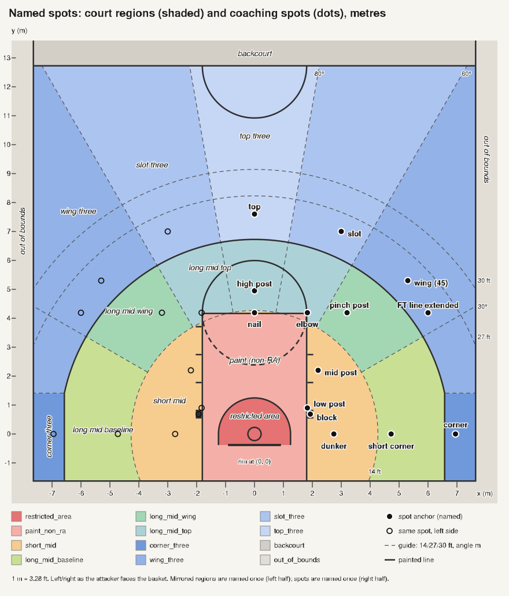

# Named-spot dictionary

Date: 2026-10-20. Version 0.3.0. Status: proposal under the build freeze.

This page is generated from `config/named_spots.yaml` by `tools/specgen/named_spots/gen_doc.py` (prose from `tools/specgen/named_spots/doc_template.md`). Do not edit it by hand. The YAML holds 603 entries; 519 of them have an exact rule that a computer can check, and 84 are procedures or team-level rules written in words only.

The dictionary gives a name to every place on the floor, for every player and the ball, in every frame. Each name sits on exact boundaries in metres and degrees. Names are labels on the math. When coaches say a word differently from the math (for example "45"), the word is stored as a speech alias; the boundary never moves (Aldemir's "45" rule).

## 0. How to read this page

The picture is drawn from the YAML by `tools/specgen/named_spots/gen_svg.py`. Shaded areas are the 12 court regions (names on the left half). Dots are the main coaching spots (names on the right half). The left half is the mirror image of the right.

- **x**: metres to the right of the rim, as the attacker faces the basket. Negative x is the left side.
- **y**: metres from the rim toward half court. The end line is at y = -1.6002 m (5.25 ft behind the rim centre). The near edge of the division line is y = 12.700 m.
- **r**: straight-line distance from the rim centre, in metres.
- **angle m**: degrees measured from the nearest end line, seen from the rim. 0 = along the baseline, 90 = straight up the middle. The same number on the left and the right. It goes below 0 behind the rim line (deep corner, under the board).
- **right / left**: as the attacker faces the basket.
- **centre label**: one label for both sides (for example `top_three`).
- **side label**: written once for the right side and copied to the left by flipping x. The stored label carries `_right` or `_left` (for example `wing_three_left`).
- **single winner**: a layer where a player has exactly one label (court region, coaching spot). **Tag**: a layer where a player can have many labels at once (landmarks, relative positions).
- **rank**: which spot wins when two overlap; the smaller number wins.
- **confidence**: high = rule book; medium = common staff usage; low = our proposal, to be checked on film.
- **reference point**: which body point is measured. Normally the midpoint of the feet; for a shot, the last floor contact; for the ball, the ball centre.
- **Exact rule (expr)**: the formula the computer checks, in code font. You do not need to read it; the "Meaning" column says the same thing in words. Names in it: `ax` = |x|; `t` = the full angle (0 to 180 across the court); `m` = angle m; `is_three(x, y)` = true when the point is past the three-point line; `bx, by` = ball; `hx, hy` = ball handler; `ax_, ay_` = the attacker this defender guards.
- **Anchor**: the typical point of a label, as (x, y) in metres and as distance r and full angle θ from the rim (θ = 0 to the right along the end line, 90 straight up the middle, 180 to the left).

Distances in prose are written as metres (feet), for example 4.2672 m (14 ft). 1 ft = 0.3048 m exactly.

## 1. Glossary

| Short form | Meaning |
|---|---|
| RA | Restricted area: the 4-ft half circle under the basket where a help defender cannot draw a charge. In prose this page writes "restricted area". |
| FT | Free throw. "FT line" = the free-throw line, 15 ft from the backboard. |
| OOB | Out of bounds. |
| BLOB / SLOB | Baseline / sideline out-of-bounds play (a throw-in from the end line / sideline). |
| PnR | Pick and roll (ball screen). |
| DHO | Dribble hand-off. |
| CTG | Cleaning the Glass, an NBA stats site with its own shot-zone map. |
| CBBD | College Basketball Data, the source of our MSU shot locations. |
| pb | Press break (the offence beating a full-court press). |
| p1211, p122, p131, p221 | Press shapes: 1-2-1-1, 1-2-2, 1-3-1, 2-2-1 (players per line from the ball outward). |
| z23, z131, z113, z122, z212, z32 | Zone-defence shapes: 2-3, 1-3-1, 1-1-3, 1-2-2, 2-1-2, 3-2. |
| crosswalk | A translation from our labels to another company's zone map (NBA.com, CTG, pbpstats, Basketball-Reference). |
| partition | A scheme where every floor point gets exactly one label of that scheme (no gaps, no overlaps). |
| three-point area | The floor strictly past the three-point line. A foot on the line is a two. |
| ctx (context) | Extra information a label needs besides the player's own position: the ball, the handler or the assigned attacker. |
| no_context | The reason stored when a label cannot be decided because that extra information is missing. The label is left empty, never "false". |
| P (probability) | How sure we are that a player is inside a region, given tracking error (about 0.30 m). |
| hysteresis | A small buffer at a boundary so a player standing on the line does not flicker between two labels. |
| dwell | How long a new label must hold before it is accepted. |
| signed distance | How far a player is inside (+) or outside (-) a region's boundary, in metres. |

## 2. Frame and edge rules

**The frame** (where (0, 0) is and which way the axes point):

- **origin**: the floor point under the centre of the basket attacked by the team in team control (rule 4-9). With no team control, the last team in control. Before the first control of a period, the absolute frame (`rule_rim_frame_selection`). This is not the same as the game state's `possession_team`, which flips at a made basket or a violation (T05, T13) and at the whistle of T09/T11, before the frame does (`rule_no_team_control_frames`).
- **x**: along the end line, positive to the attacker's right facing the basket.
- **y**: from the rim toward half court.
- **r**: hypot(x, y), in metres.
- **t (full angle θ)**: atan2(y, x) in degrees, in (-180, 180]. A y of -0.0 is set to +0.0 first, so the left end of y = 0 is 180, never -180. At r = 0, t is defined as 90. 0 = right end line, 90 = top of the key, 180 = left end line.
- **angle m**: m = degrees(atan2(y, |x|)), and 90 at the origin. It equals the folded full angle (t on the right, 180 - t on the left) but gives exactly the same number for x and -x.
- **left and right**: a side label is written once for the right side (x >= 0) and copied to the left by flipping x; the ball, handler and assigned-attacker x are flipped too. A point exactly on the middle line x = 0 belongs to the right label, except for centre labels (restricted_area, paint_non_ra, long_mid_top, top_three, backcourt, out_of_bounds), which have no side.
- **units**: metres, degrees, seconds. 1 ft = 0.3048 m exactly. Stored to 0.01 m and 0.1 degree.
- **full court**: far end line y = 27.051 m, far rim y = 25.4508 m. Backcourt points stay in the same frame.

**Court constants** (2026-27 NCAA men's rules book; `docs/data/court_constants_check.md`). Every line position is the edge named in the table.

| Name | Value | In feet | Meaning |
|---|---|---|---|
| `RIM_Y_FROM_END` | 1.6002 m | 5.25 ft | rim centre to the end line's inside edge |
| `END_Y` | -1.6002 m | -5.25 ft | end line (inside edge); y of the baseline |
| `BOARD_Y` | -0.381 m | -1.25 ft | backboard face, 4 ft in front of the end line |
| `LANE_X` | 1.8288 m | 6.00 ft | half-width of the lane to the lane line's outside edge (lane is 12 ft wide) |
| `FT_Y` | 4.191 m | 13.75 ft | FT line, far edge (15 ft from the backboard face) |
| `ARC_R` | 6.7501 m | 22.15 ft | three-point arc radius to its outside edge |
| `CORNER_X` | 6.6008 m | 21.66 ft | corner three-point line, outside edge |
| `BREAK_Y` | 1.4118 m | 4.63 ft | the break: where the corner straight meets the arc |
| `BREAK_T` | 12.073° | - | full angle of the break, in degrees (not a distance) |
| `RA_R` | 1.27 m | 4.17 ft | restricted-area arc, outside edge (4-ft inner radius plus the 2-in line) |
| `HALF_Y` | 12.7 m | 41.67 ft | division line, near edge; frontcourt is y <= this |
| `SIDE_X` | 7.62 m | 25.00 ft | sideline, inside edge |
| `FAR_END_Y` | 27.051 m | 88.75 ft | far end line, inside edge |
| `LINE_W` | 0.0508 m | 0.17 ft | width of every painted line (2 in) |

Source: docs/rules/PRMBB_RulesBook.pdf (2026-27); docs/data/court_constants_check.md.

**Edge rules** (who owns a point that sits exactly on a line):

- Boundary lines are out of bounds (\|x\| >= 7.62, y <= -1.6002, y >= 27.051).
- The division line is backcourt except its mathematical edge nearest the attacked basket (frontcourt is y <= 12.700).
- Three-point line: the line is two-point territory (strict is_three).
- Restricted area: the arc line is inside (r <= 1.2700, outer edge), straight segments to the board face.
- Lane and FT line: the lines are part of the lane (\|x\| <= 1.8288, y <= 4.191).
- Exact ties between non-rule zones go to the zone nearer the rim.

**When two labels overlap** (precedence, from the YAML): Single-winner layers (spot and every zone_scheme with partition: true) pick the entry with the minimum rank = family_rank \* 1000 + priority; family_rank canonical 0, painted 0, interior 1, perimeter 2, defensive 3, restart 4, rule/review 5, shot_zone 6, empirical 7, repo 8. If no spot matches, the primary falls back to court_region. landmark, relative, restart, restart_alignment, fullcourt, rule and non-partition zone schemes are multi-label (rank only orders their output).

**Layers** (how the 603 entries are grouped):

| Layer | Entries | Of which with an exact rule | What it holds |
|---|---|---|---|
| `zone_scheme:court_region` | 12 | 12 | the main label: exactly one region per point (section 3) |
| `zone_scheme:three_depth` | 5 | 5 | how deep a three is: corner, standard, deep, logo, heave (section 3) |
| `spot` | 22 | 22 | coaching spots; one winner per player (section 4) |
| `landmark` | 71 | 69 | painted marks, rule areas, coaching tags, named points; many at once (section 5) |
| `relative` | 92 | 74 | positions measured from the ball, the handler or the assigned attacker (section 6) |
| `restart` | 50 | 50 | dead-ball and throw-in positions (section 8.1) |
| `restart_alignment` | 1 | 1 | a throw-in alignment spot (section 8.1) |
| `fullcourt` | 38 | 38 | transition, press and backcourt positions (section 8.2) |
| `shot_zone_alt` | 20 | 20 | shot-zone labels kept as alternatives (section 8.3) |
| `rule` | 98 | 34 | labelling rules and other providers' encodings (section 8.4) |
| other `zone_scheme:` (49 schemes) | 194 | 194 | the other schemes: crosswalks, zone defences, presses, coaching bands (section 7) |
| total | 603 | 519 | |

## 3. Court regions (every object, every frame)

`court_region` is the main label. Every floor point gets exactly one of 18 labels: 6 side cells x 2 sides + 6 centre cells. When x or y is missing the label is `unknown`. This was checked on a 0.05 m grid of 231,401 points over and beyond the court: 100% covered, 0 overlaps. The table runs from the rim outward.

**Centre labels (one label for both sides)**

| Label | Meaning | Exact rule (expr) | Anchor |
|---|---|---|---|
| `restricted_area` Restricted area Also called: RA, no-charge semicircle, no-charge zone, restricted area arc (NCAA), restricted arc confidence high | Within 1.27 m (4 ft 2 in, outside of the painted arc) of the rim centre for y >= 0; behind the rim centre, between the straight legs \|x\| <= 1.27 back to the backboard face (y >= -0.381). The painted line counts as inside. | `((ax < SIDE_X and END_Y < y < FAR_END_Y) and y <= HALF_Y) and ((y >= 0 and r <= RA_R) or (BOARD_Y <= y < 0 and ax <= RA_R))` | (0.00, 0.60) m r 0.60 m (2.0 ft), θ 90.0° |
| `paint_non_ra` Paint outside the restricted area Also called: paint (non-RA), lane outside the RA confidence high | Inside the lane (\|x\| <= 1.8288 m = 6 ft, to the outer edge of the lane lines; y up to 4.191 m, the FT line far edge) but not in the restricted area. Lane lines count as paint. | `((ax < SIDE_X and END_Y < y < FAR_END_Y) and y <= HALF_Y) and (ax <= LANE_X and y <= FT_Y) and not ((y >= 0 and r <= RA_R) or (BOARD_Y <= y < 0 and ax <= RA_R))` | (0.00, 2.50) m r 2.50 m (8.2 ft), θ 90.0° |
| `long_mid_top` Long mid-range, elbow and top Also called: long top two, long elbow two confidence high | Two-point area outside the paint, more than 4.2672 m (14 ft) from the rim, angle m above 60 deg on either side. One centre label, not split left/right. | `((ax < SIDE_X and END_Y < y < FAR_END_Y) and y <= HALF_Y) and not (ax <= LANE_X and y <= FT_Y) and not is_three(x, y) and r > 4.2672 and m > 60` | (1.00, 5.60) m r 5.69 m (18.7 ft), θ 79.9° |
| `top_three` Top three Also called: top of the key three, straightaway three, top, point confidence high | Three-point area, angle m above 80 deg (a 20-deg wedge straight up the middle). | `((ax < SIDE_X and END_Y < y < FAR_END_Y) and y <= HALF_Y) and is_three(x, y) and m > 80` | (0.00, 7.60) m r 7.60 m (24.9 ft), θ 90.0° |
| `backcourt` Backcourt Also called: back court confidence high | In bounds and past the division line (y > 12.700 m); the line's near edge belongs to the frontcourt (rule 9-12). | `(ax < SIDE_X and END_Y < y < FAR_END_Y) and y > HALF_Y` | (0.00, 20.00) m r 20.00 m (65.6 ft), θ 90.0° |
| `out_of_bounds` Out of bounds Also called: OOB confidence high | On or outside a boundary line: \|x\| >= 7.62 m, y <= -1.6002 m or y >= 27.051 m. | `not (ax < SIDE_X and END_Y < y < FAR_END_Y)` | (8.00, 0.00) m r 8.00 m (26.2 ft), θ 0.0° |

**Side labels (written for the right side; the left side is the mirror image, suffix `_right` / `_left`)**

| Label | Meaning | Exact rule (expr) | Anchor |
|---|---|---|---|
| `short_mid_right`, `short_mid_left` Short mid-range Also called: short two confidence high | Two-point area outside the paint, within 4.2672 m (14 ft) of the rim centre. Includes a thin cap just above the FT line (\|x\| < 0.80 m, y 4.191-4.267). | `x >= 0 and ((ax < SIDE_X and END_Y < y < FAR_END_Y) and y <= HALF_Y) and not ((y >= 0 and r <= RA_R) or (BOARD_Y <= y < 0 and ax <= RA_R)) and not (ax <= LANE_X and y <= FT_Y) and not is_three(x, y) and r <= 4.2672` | (2.60, 2.60) m r 3.68 m (12.1 ft), θ 45.0° |
| `long_mid_baseline_right`, `long_mid_baseline_left` Long mid-range, baseline Also called: long baseline two confidence high | Two-point area more than 4.2672 m (14 ft) from the rim, angle m 30 deg or less (includes behind the backboard line). | `x >= 0 and ((ax < SIDE_X and END_Y < y < FAR_END_Y) and y <= HALF_Y) and not (ax <= LANE_X and y <= FT_Y) and not is_three(x, y) and r > 4.2672 and m <= 30` | (5.50, 1.50) m r 5.70 m (18.7 ft), θ 15.3° |
| `long_mid_wing_right`, `long_mid_wing_left` Long mid-range, wing Also called: long wing two confidence high | Two-point area more than 4.2672 m (14 ft) from the rim, angle m above 30 and up to 60 deg. | `x >= 0 and ((ax < SIDE_X and END_Y < y < FAR_END_Y) and y <= HALF_Y) and not (ax <= LANE_X and y <= FT_Y) and not is_three(x, y) and r > 4.2672 and 30 < m <= 60` | (4.20, 4.20) m r 5.94 m (19.5 ft), θ 45.0° |
| `corner_three_right`, `corner_three_left` Corner three Also called: corner, corner 3, dead corner confidence high | Behind the corner line (\|x\| > 6.6008 m, the line's outside edge; the line itself is a two) and y <= 1.4118 m (below the break). | `x >= 0 and ((ax < SIDE_X and END_Y < y < FAR_END_Y) and y <= HALF_Y) and is_three(x, y) and y <= BREAK_Y` | (6.95, 0.00) m r 6.95 m (22.8 ft), θ 0.0° |
| `wing_three_right`, `wing_three_left` Wing three Also called: wing, wing three confidence high | Three-point area above the break, angle m 60 deg or less (45 deg is its middle). | `x >= 0 and ((ax < SIDE_X and END_Y < y < FAR_END_Y) and y <= HALF_Y) and is_three(x, y) and y > BREAK_Y and m <= 60` | (5.30, 5.30) m r 7.50 m (24.6 ft), θ 45.0° |
| `slot_three_right`, `slot_three_left` Slot three Also called: slot, gap three, guard spot confidence high | Three-point area, angle m above 60 and up to 80 deg. | `x >= 0 and ((ax < SIDE_X and END_Y < y < FAR_END_Y) and y <= HALF_Y) and is_three(x, y) and 60 < m <= 80` | (3.00, 7.00) m r 7.62 m (25.0 ft), θ 66.8° |

### Three-point depth (an extra label on three-point attempts and positions)

| Label | Meaning | Exact rule (expr) | Anchor |
|---|---|---|---|
| `three_depth_corner` Corner (any depth) confidence medium | Corner three (behind the corner line, y <= 1.4118 m), at any distance. | `is_three(x, y) and END_Y < y <= BREAK_Y and ax < SIDE_X` | (6.95, 0.00) m r 6.95 m (22.8 ft), θ 0.0° |
| `three_depth_standard` Standard, under 27 ft confidence medium | Above-the-break three, up to 8.2296 m (27 ft) from the rim. | `is_three(x, y) and BREAK_Y < y <= HALF_Y and r <= 8.2296 and ax < SIDE_X` | (5.30, 5.30) m r 7.50 m (24.6 ft), θ 45.0° |
| `three_depth_deep` Deep, 27 to 30 ft confidence medium | Above-the-break three, more than 8.2296 m (27 ft) and up to 9.144 m (30 ft) from the rim. | `is_three(x, y) and BREAK_Y < y <= HALF_Y and 8.2296 < r <= 9.144 and ax < SIDE_X` | (0.00, 8.60) m r 8.60 m (28.2 ft), θ 90.0° |
| `three_depth_logo` Logo range, 30 ft to the division line confidence medium | Frontcourt, above the break, more than 9.144 m (30 ft) from the rim, up to the division line. | `BREAK_Y < y <= HALF_Y and r > 9.144 and ax < SIDE_X` | (0.00, 10.00) m r 10.00 m (32.8 ft), θ 90.0° |
| `three_depth_heave` Beyond half court confidence medium | Backcourt (y > 12.700 m): beyond the division line. | `HALF_Y < y < FAR_END_Y and ax < SIDE_X` | (0.00, 18.00) m r 18.00 m (59.1 ft), θ 90.0° |

Why 27 ft and 30 ft: MSU 2025-26 above-the-break attempts in CBBD sit a median 0.78 m (2.6 ft) behind the arc, and 90% are within 1.40 m (4.6 ft), that is r < 8.15 m. 27 ft (8.2296 m) puts the "deep" label on the last ~10%.

## 4. Coaching spots (one winner per player)

These are the words staff use for where a player stands. A player gets at most one spot; when two overlap, the smaller rank wins. The table runs from the rim outward. About 39% of the half court has no coaching spot (checked on a 0.1 m grid of 21,736 in-bounds points; by region: slot_three 51%, wing_three 27%, top_three 17%, restricted_area 4%). There the court region label is the answer.

**Centre labels (one label for both sides)**

| Label | Meaning | Exact rule (expr) | Anchor |
|---|---|---|---|
| `under_basket` Under the basket (outside R.A.) Also called: baseline under the rim, behind the board, under, UNDER rank 1020, confidence medium | \|x\| <= 1.8288 (lane line outer edge) and -1.6002 <= y < 0.5334 (bottom edge of the painted block), minus restricted_area. Sub-tag baseline_under_board covers \|x\| <= 0.9144 behind the board plane. | `ax <= LANE_X and END_Y < y < 0.5334 and not ((y >= 0 and r <= RA_R) or (BOARD_Y <= y < 0 and ax <= RA_R))` | (0.91, -0.60) m r 1.09 m (3.6 ft), θ -33.3° |
| `lane_middle` Lane middle (paint, non-R.A., between the posts) Also called: middle of the lane, lane middle rank 1110, confidence medium | \|x\| < 1.3716 and 0.5334 <= y < 3.683, minus restricted_area. Sub-tags duck_in and floater_zone. | `ax < 1.3716 and 0.5334 <= y < 3.683 and not ((y >= 0 and r <= RA_R) or (BOARD_Y <= y < 0 and ax <= RA_R))` | (0.00, 2.70) m r 2.70 m (8.9 ft), θ 90.0° |
| `nail_area` Nail area (middle half of the free-throw line) Also called: nail (as a position), nail spot rank 1080, confidence medium | \|x\| < 0.9144 m (the middle half of the 12-ft FT line; the elbows own 0.9144 to 2.7432) and 3.683 <= y <= 4.699 m (same band as the elbow: top of lane space 3 to 0.508 m beyond the FT line far edge). | `ax < 0.9144 and 3.683 <= y <= 4.699` | (0.00, 4.19) m r 4.19 m (13.7 ft), θ 90.0° |
| `high_post_strip` Strip just above the free-throw line (one part of the high-post area) Also called: above the FT line, flash spot rank 1090, confidence medium | Primary remainder: \|x\| <= 2.7432 and 4.699 < y <= 5.2. The coaching 'high post' umbrella (elbows + nail + this strip) is the separate tag high_post_area. | `ax <= 2.7432 and 4.699 < y <= 5.2` | (0.00, 4.95) m r 4.95 m (16.2 ft), θ 90.0° |
| `mr_top` Mid-range: top-of-key two Also called: top of the key two, FT-circle jumper, top two rank 1120, confidence medium | Two-point area outside the lane, angle m above 80 deg (a 20-deg wedge straight up the middle). As a coaching spot it only wins above y = 5.2 m, because elbow, nail_area and high_post_strip take \|x\| <= 2.7432, y <= 5.2. As a shot zone it covers the whole wedge. | `(not is_three(x, y) and y > END_Y) and (ax > LANE_X or y > FT_Y) and m > 80` | (0.00, 5.80) m r 5.80 m (19.0 ft), θ 90.0° |
| `centre_circle_logo` Literal halfcourt logo (frontcourt half of the centre circle) Also called: the logo (literal) rank 2010, confidence high | A circle segment: within 1.8288 m (outside edge) of the centre (0, 12.7254), with y <= 12.700. r runs from 10.8966 to 12.700. It is a subset of logo_range. | `hypot(x, y - (HALF_Y + LINE_W / 2)) <= 1.8288 and y <= HALF_Y` | (0.00, 11.80) m r 11.80 m (38.7 ft), θ 90.0° |

**Side labels (written for the right side; the left side is the mirror image, suffix `_right` / `_left`)**

| Label | Meaning | Exact rule (expr) | Anchor |
|---|---|---|---|
| `dunker_spot_right`, `dunker_spot_left` Dunker spot Also called: dunker, porch (Iowa State), ghost spot (Wizards), dunker_spot_right, dunker_spot_left, porch, ghost spot In speech: dunker rank 1030, confidence medium | Just outside the lane line, below the block: 1.8288 < x <= 3.5 m and -1.6002 <= y < 0.5334 m (end line up to the bottom of the painted block). Split into two sub-tags at the backboard face y = -0.381: baseline_dunker below it, upper_dunker above it. | `LANE_X < x <= 3.5 and END_Y < y < 0.5334` | (2.74, 0.00) m r 2.74 m (9.0 ft), θ 0.0° |
| `low_post_right`, `low_post_left` Low post (coaching 'block') Also called: low block In speech: the block rank 1050, confidence medium | 1.3716 <= x <= 2.7432 and 0.5334 <= y <= 1.7526. Does not touch the R.A. (R.A. at y 0.5334 reaches only \|x\| 1.152). Polar corners (right): (1.472, 21.3), (2.795, 11.0), (2.226, 52.0), (3.255, 32.6). | `1.3716 <= x <= 2.7432 and 0.5334 <= y <= 1.7526` | (1.83, 0.90) m r 2.04 m (6.7 ft), θ 26.2° |
| `mid_post_right`, `mid_post_left` Mid post Also called: mid post, mid-block, MID-POST rank 1060, confidence medium | 1.3716 <= x <= 2.7432 and 1.7526 < y < 3.683 (between the first lane space top and the third lane space top). Polar corners (right): (2.226, 52.0), (3.255, 32.6), (3.930, 69.6), (4.592, 53.3). | `1.3716 <= x <= 2.7432 and 1.7526 < y < 3.683` | (2.20, 2.20) m r 3.11 m (10.2 ft), θ 45.0° |
| `short_corner_right`, `short_corner_left` Short corner Also called: short corner, baseline short corner, short-corner post, behind the zone (2-3 zone context), SHORT CORNER rank 1040, confidence medium | 3.5 < x < 6.6008 (corner-three line OUTSIDE edge; the line is a two) and -1.6002 <= y < 1.5, two-point area only. Edge convention shared with high_short_corner: y = 1.5 belongs to high_short_corner. Polar corners (right): (3.808, 23.2), (6.769, 12.8), (6.792, -13.6), (3.848, -24.6). | `3.5 < x < CORNER_X and END_Y < y < 1.5 and not is_three(x, y)` | (4.72, 0.00) m r 4.72 m (15.5 ft), θ 0.0° |
| `high_short_corner_right`, `high_short_corner_left` High short corner Also called: high short corner, short corner high rank 1045, confidence low | 3.5 < x <= 5.0 and 1.5 <= y <= 2.5 (all inside the arc; farthest corner r 5.59). Takes y = 1.5 from short_corner so the repo landmark (4.0, 1.5) = (4.27, 20.6 deg) is inside it. | `3.5 < x <= 5.0 and 1.5 <= y <= 2.5` | (4.00, 1.50) m r 4.27 m (14.0 ft), θ 20.6° |
| `elbow_right`, `elbow_left` Elbow Also called: FT-line corner, elbow area, high post elbow rank 1070, confidence high | 0.9144 <= x <= 2.7432 and 3.683 <= y <= 4.699 (band = FT line far edge +/- 0.508, bottom = top of the third lane space). Polar corners (right): (3.795, 76.1), (4.592, 53.3), (4.787, 79.0), (5.441, 59.7). | `0.9144 <= x <= 2.7432 and 3.683 <= y <= 4.699` | (1.83, 4.19) m r 4.57 m (15.0 ft), θ 66.4° |
| `pinch_post_right`, `pinch_post_left` Pinch post (strip just outside the elbow, inside the arc) Also called: pinch post, elbow post, wide elbow rank 1100, confidence low | Primary strip 2.7432 < x <= 3.6576 and 3.683 <= y <= 4.699. Anchor moved into the strip: (3.2004, 4.191), r 5.273, theta 52.63. The role tag pinch_post_role (player in elbow or this strip, catch from the same-side wing/slot, holds >= 1.0 s facing up) needs ball and time and is applied by the event layer, not this expr. | `2.7432 < x <= 4.0 and 3.683 <= y <= 4.699` | (3.20, 4.19) m r 5.27 m (17.3 ft), θ 52.6° |
| `mr_baseline_right`, `mr_baseline_left` Mid-range: baseline sector Also called: baseline jumper rank 1120, confidence medium | Two-point area, outside the lane, mirrored theta <= 30 (incl. negative theta below the rim line). Fallback primary: wins only where no higher spot matches. Evaluated alone (with last_floor_contact of the shooter) the same expr is the 2PT shot-zone label. | `x >= 0 and (not is_three(x, y) and y > END_Y) and (ax > LANE_X or y > FT_Y) and m <= 30` | (5.50, 2.60) m r 6.08 m (20.0 ft), θ 25.3° |
| `mr_wing_right`, `mr_wing_left` Mid-range: wing two Also called: wing two, wing 2, FT-line-extended jumper rank 1120, confidence medium | Two-point area, outside the lane, 30 < mirrored theta <= 60. Fallback primary and 2PT shot zone. | `x >= 0 and (not is_three(x, y) and y > END_Y) and (ax > LANE_X or y > FT_Y) and 30 < m <= 60` | (4.60, 4.60) m r 6.51 m (21.3 ft), θ 45.0° |
| `mr_elbow_right`, `mr_elbow_left` Mid-range: elbow / slot two Also called: slot two, pull-up at the elbow rank 1120, confidence medium | Two-point area, outside the lane, 60 < mirrored theta <= 80. Fallback primary and 2PT shot zone; a shot from the elbow spot gets spot elbow + shot zone mr_elbow. | `x >= 0 and (not is_three(x, y) and y > END_Y) and (ax > LANE_X or y > FT_Y) and 60 < m <= 80` | (2.30, 5.60) m r 6.05 m (19.9 ft), θ 67.7° |
| `corner_deep_right`, `corner_deep_left` Deep corner (low corner, at or behind rim level) Also called: deep corner, low corner, bottom of the corner, baseline corner, corner_deep_right In speech: deep corner rank 2040, confidence medium | corner_three and y <= 0 (m from -13.63 to 0). (Caps and corner rule aligned 2026-10-20.) | `x > 0 and is_three(x, y) and y <= BREAK_Y and x < SIDE_X and y > END_Y and y <= 0.0` | (6.90, -0.80) m r 6.95 m (22.8 ft), θ -6.6° |
| `corner_high_right`, `corner_high_left` High corner (upper corner, toward the break) Also called: high corner, top of the corner, corner_high_right rank 2040, confidence low | corner_three and y > 0 (0 < m <= 12.073). (Caps and corner rule aligned 2026-10-20.) | `x > 0 and is_three(x, y) and y <= BREAK_Y and x < SIDE_X and y > 0.0` | (6.90, 0.90) m r 6.96 m (22.8 ft), θ 7.4° |
| `wing_low_right`, `wing_low_left` Low wing (short wing, below FT line extended) Also called: low wing, short wing, baseline wing, wing_low_right rank 2040, confidence medium | Three-point area above the break (y > 1.4118 m, the height where the arc meets the corner line) and angle m up to 30 deg. The 9.144 m (30 ft) cap never applies here: the 30-ft arc meets the sideline at 33.56 deg, so the outer edge of the whole band is the sideline (farthest point r 8.80 m). | `x > 0 and is_three(x, y) and y > BREAK_Y and m <= 30.0 and r <= 9.144 and x < SIDE_X` | (6.60, 2.40) m r 7.02 m (23.0 ft), θ 20.0° |
| `wing_mid_right`, `wing_mid_left` Wing centre ('45') Also called: wing (strict), FT line extended wing, wing_mid_right In speech: 45 rank 2040, confidence medium | beyond_arc, 30 < m <= 52.5, r <= 9.144. It contains the point where the FT line extended crosses the arc (38.38) and the 45 deg ray. (Caps and corner rule aligned 2026-10-20.) | `x > 0 and is_three(x, y) and 30.0 < m <= 52.5 and r <= 9.144 and x < SIDE_X` | (5.30, 5.30) m r 7.50 m (24.6 ft), θ 45.0° |
| `wing_high_right`, `wing_high_left` High wing (wing-slot seam) Also called: high wing, wing-slot gap, wide slot, wing_high_right rank 2040, confidence low | beyond_arc, 52.5 < m <= 60, r <= 9.144. (Caps and corner rule aligned 2026-10-20.) | `x > 0 and is_three(x, y) and 52.5 < m <= 60.0 and r <= 9.144` | (4.40, 6.00) m r 7.44 m (24.4 ft), θ 53.7° |
| `slot_lane_line_right`, `slot_lane_line_left` Slot on the lane line extended (narrow / Princeton slot, 'elbow extended') Also called: lane-line slot, narrow slot, Princeton slot, SLOT-LL (motion_starts) In speech: elbow extended rank 2020, confidence medium | beyond_arc, 1.2288 <= x <= 2.4288, r <= 9.144. Theta runs from 68.91 (x 2.4288 on the arc) to 81.69 (x 1.2288 at r 9.144), so the region overlaps both slot_three (m <= 80) and top_three (m > 80). The lane line extended meets the arc at (1.8288, 6.4976), 74.28 deg. (Caps and corner rule aligned 2026-10-20.) | `x > 0 and is_three(x, y) and abs(x - LANE_X) <= 0.60 and r <= 9.144` | (1.83, 7.40) m r 7.62 m (25.0 ft), θ 76.1° |

## 5. Landmarks (painted marks, rule areas, coaching tags, named points)

A player can carry many landmark tags at once. They never replace the court region or the coaching spot.

### 5.1 Painted lines and marks

Things painted on the floor or fixed to the basket. Most are thinner than tracking error, so they are stored as a probability, not a yes/no.

**Centre labels (one label for both sides)**

| Label | Meaning | Exact rule (expr) | Anchor |
|---|---|---|---|
| `backboard` Backboard (front face) confidence high | Front face plane y = -0.381; \|x\| <= 0.9144 (6 ft wide); z 2.8956 (3.5-ft board, recommended) to 3.9624 (top at 13 ft). For a 4-ft board the bottom is 2.7432. A 5-cm depth behind the face is allowed for contact detection (board thickness is not in the rules). | `BOARD_Y - 0.05 <= y <= BOARD_Y and ax <= 0.9144 and 2.8956 <= z <= 3.9624` | (0.00, -0.38) m r 0.38 m (1.2 ft), θ -90.0° height z 3.43 m |
| `division_line` Division (half-court) line Also called: half-court line, midcourt line, half court, time line, halfcourt_crossing_line confidence high | 12.7000 <= y <= 12.7508 (centre 12.7254 = 47 ft - 1.6002). The line itself is backcourt. | `HALF_Y <= y <= HALF_Y + LINE_W and ax < SIDE_X` | (0.00, 12.73) m r 12.73 m (41.8 ft), θ 90.0° |
| `end_line` End line (baseline), attacked end Also called: baseline confidence high | -1.6510 <= y <= -1.6002, \|x\| <= 7.6708. The line is out of bounds; inbounds is y > -1.6002. | `END_Y - LINE_W <= y <= END_Y and ax <= SIDE_X + LINE_W` | (0.00, -1.63) m r 1.63 m (5.3 ft), θ -90.0° |
| `free_throw_line` Free-throw line (painted) Also called: charity stripe, foul line confidence high | \|x\| <= 1.8288, 4.1402 <= y <= 4.1910 (far edge 15 ft from the board face). Part of the lane. | `ax <= LANE_X and FT_Y - LINE_W <= y <= FT_Y` | (0.00, 4.17) m r 4.17 m (13.7 ft), θ 90.0° |
| `restraining_line` Restraining line (behind the end line) confidence medium | Line 6 ft (1.8288 m) behind the end line inside edge: y from -3.4798 to -3.4290 (2-in line, edge nearest the court at -3.429; the rule does not name the edge, nearest-edge reading adopted). Line 6 ft from the end line's inside edge, painted -3.4798 <= y <= -3.4290 (edge unstated; inside-edge measurement assumed). Non-playing personnel area: -3.4290 < y < -1.6510. | `-3.429 - LINE_W <= y <= -3.429 and ax <= SIDE_X + 3.048` | (0.00, -3.45) m r 3.45 m (11.3 ft), θ -90.0° |
| `restricted_area_arc_line` Restricted-area arc (painted, curved part) confidence high | Painted arc 1.2192 <= r <= 1.2700 for y >= 0 (2-in line, inner edge 4 ft). The straight legs below y = 0 are restricted_area_straight_leg_right/left. | `y >= 0 and 1.2192 <= r <= RA_R` | (0.00, 1.24) m r 1.24 m (4.1 ft), θ 90.0° |
| `ring` Ring (rim metal) confidence high | Ring metal: 0.2286 <= r <= 0.2445 (9-in inside radius plus a rod of at most 5/8 in), z 3.0321 to the upper edge 3.048. Near inner edge at y = -0.2286, 0.1524 in front of the board face. | `0.2286 <= r <= 0.2445 and 3.0321 <= z <= 3.048` | (0.00, 0.24) m r 0.24 m (0.8 ft), θ 90.0° height z 3.05 m |
| `three_point_arc` Three-point line, arc (painted) confidence high | 6.6993 <= r <= 6.7501 for y > 1.4118 (corner/arc split is the horizontal line y = 1.4118 where the outside edges meet, theta 12.073). | `y > BREAK_Y and ARC_R - LINE_W <= r <= ARC_R` | (0.00, 6.72) m r 6.72 m (22.1 ft), θ 90.0° |
| `backboard_target_rectangle` Backboard shooter's square (24 x 18 in) confidence medium | Plane y = -0.381; \|x\| <= 0.3048 (24 in outside width); z 3.048..3.5052 (18 in tall; outside bottom edge 6 in above the bottom of a 42-in board, level with the ring's upper edge). 2-in white line. | `BOARD_Y - 0.05 <= y <= BOARD_Y and ax <= 0.3048 and 3.048 <= z <= 3.5052` | (0.00, -0.38) m r 0.38 m (1.2 ft), θ -90.0° height z 3.28 m |
| `out_of_bounds_colour_belt` Contrasting out-of-bounds belt (alternative boundary marking) confidence medium | Where a court uses a painted out-of-bounds belt instead of 2-in lines, the boundary is the colour change at the same inside-edge positions; the belt is at least 8 in (0.2032 m) wide. The expr covers the minimum 8-in band; real belts may be wider. | `(SIDE_X <= ax <= SIDE_X + 0.2032 and END_Y - 0.2032 <= y <= FAR_END_Y + 0.2032) or ((END_Y - 0.2032 <= y <= END_Y or FAR_END_Y <= y <= FAR_END_Y + 0.2032) and ax <= SIDE_X + 0.2032)` | (7.72, 5.00) m r 9.20 m (30.2 ft), θ 32.9° |
| `free_throw_semicircle` Free-throw semicircle (shooter's half circle) Also called: ft_semicircle, top_of_key_circle, circle confidence medium | y >= 4.191 and hypot(x, y - 4.191) <= 1.8288 (6-ft outside radius). Painted arc 1.7780..1.8288. Top point (0, 6.0198). | `y > FT_Y and hypot(x, y - FT_Y) <= LANE_X` | (0.00, 4.97) m r 4.97 m (16.3 ft), θ 90.0° |
| `legacy_restricted_area_arc_3ft` Legacy 3-ft restricted-area arc (old painted line, ignore) confidence medium | Old 3-ft arc that may remain beside the 4-ft arc in a contrasting colour: 0.9144 <= r <= 0.9652, y >= 0 (inner-edge convention assumed as for the 4-ft arc). Straight legs, if any, are not described. No rule effect; kept so line detection does not take it for the R.A. boundary. | `y >= 0 and 0.9144 <= r <= 0.9652` | (0.00, 0.94) m r 0.94 m (3.1 ft), θ 90.0° |
| `second_three_point_line` Second (other) three-point line on the floor (ignore) confidence medium | Venue-specific: 1-7.2 allows more than one 3-pt line on a court (contrasting colour, no belt between). Its radius and corner distance are not in the men's rules, so no fixed expr; detect it at venue calibration and tag it ignore so line detection does not snap to it. | none: a procedure or team-level rule, described in words | none (no single point) |
| `charge_circle` Charge circle (restricted-area arc line) Also called: charge circle, charge arc, no-charge semicircle (FIBA), RA arc confidence high | The painted 2-in line: 1.2192 <= r <= 1.2700 for y >= 0 plus the straight legs 1.2192 <= \|x\| <= 1.2700, -0.381 <= y < 0. Non-exclusive tag; the line belongs to restricted_area. 'Outside the charge circle' for a defender = no part of either foot with r <= 1.2700 (centroid-only fallback r > 1.42, proposal). | `(y >= 0 and 1.2192 <= r <= RA_R) or (BOARD_Y <= y < 0 and 1.2192 <= ax <= RA_R)` | (0.00, 1.24) m r 1.24 m (4.1 ft), θ 90.0° |
| `division_line_extended` Division line extended past the sidelines confidence high | 12.7000 <= y <= 12.7508 beyond the sidelines. Benches are equidistant from it on each side of the scorers' table; the scorers' X and the 2nd-half throw-in spot sit on it. | `HALF_Y <= y <= HALF_Y + LINE_W and ax >= SIDE_X` | (8.50, 12.73) m r 15.30 m (50.2 ft), θ 56.3° |

**Side labels (written for the right side; the left side is the mirror image, suffix `_right` / `_left`)**

| Label | Meaning | Exact rule (expr) | Anchor |
|---|---|---|---|
| `backcourt_28ft_mark_right`, `backcourt_28ft_mark_left` 28-foot mark at the far (backcourt) end, right Also called: backcourt_28ft_mark_right confidence medium | y = 18.5166 (28 ft from the far end line's inside edge, 27.0510); same mark geometry as the frontcourt mark. | `18.5166 - LINE_W <= y <= 18.5166 + LINE_W and 6.7056 <= x <= SIDE_X + 3.6576` | (7.62, 18.52) m r 20.02 m (65.7 ft), θ 67.6° |
| `lane_block_right`, `lane_block_left` Lane block (painted 12 x 8 in), right Also called: lane_block_right, neutral-zone block, the box (painted), painted_block, lane block, ft_lane_block, ft_lane_block_right In speech: Coaches' 'block' means the low-post spot (other family), not this paint. confidence medium | 1.8288 < x <= 2.0320 (8 in out from the lane line's outer edge), 0.5334 <= y <= 0.8382 (7-8 ft from the end line). Paint only; the rule zone is block_zone_right. | `LANE_X < x <= 2.0320 and 0.5334 <= y <= 0.8382` | (1.93, 0.69) m r 2.05 m (6.7 ft), θ 19.6° |
| `lane_line_landmark_right`, `lane_line_landmark_left` Lane line (right, painted) Also called: lane_line_right confidence high | 1.7780 <= x <= 1.8288, -1.6002 < y < 4.1402 (meets the FT line, which owns the corner). | `LANE_X - LINE_W <= x <= LANE_X and END_Y < y < FT_Y - LINE_W` | (1.80, 1.27) m r 2.21 m (7.2 ft), θ 35.2° |
| `lane_mark_1_right`, `lane_mark_1_left` Lane-space mark 1 (painted 2 x 8 in), right Also called: lane_mark_1_right confidence medium | 1.8288 < x <= 2.0320, 1.7526 <= y <= 1.8034. Paint only; rule zone is lane_mark_1_zone_right. | `LANE_X < x <= 2.0320 and 1.7526 <= y <= 1.8034` | (1.93, 1.78) m r 2.62 m (8.6 ft), θ 42.6° |
| `lane_mark_2_right`, `lane_mark_2_left` Lane-space mark 2 (painted), right Also called: lane_mark_2_right confidence medium | 1.8288 < x <= 2.0320, 2.7178 <= y <= 2.7686. Paint only. | `LANE_X < x <= 2.0320 and 2.7178 <= y <= 2.7686` | (1.93, 2.74) m r 3.35 m (11.0 ft), θ 54.9° |
| `lane_mark_3_right`, `lane_mark_3_left` Lane-space mark 3 (painted, top mark), right Also called: lane_mark_3_right confidence medium | 1.8288 < x <= 2.0320, 3.6830 <= y <= 3.7338. Paint only. | `LANE_X < x <= 2.0320 and 3.6830 <= y <= 3.7338` | (1.93, 3.71) m r 4.18 m (13.7 ft), θ 62.5° |
| `mark_28ft_right`, `mark_28ft_left` 28-foot mark/line (frontcourt), right Also called: hash mark, 28-foot hash, mark_28ft_right confidence medium | y = 6.9342 (28 ft from the end line); the 2-in paint is 6.8834..6.9342 or 6.9342..6.9850 (edge unstated), so the expr covers both. Bench side: from 3 ft inside the court (x >= 6.7056) on through the bench area; opposite side: recommended mark outside the sideline. | `6.9342 - LINE_W <= y <= 6.9342 + LINE_W and 6.7056 <= x <= SIDE_X + 3.6576` | (7.62, 6.93) m r 10.30 m (33.8 ft), θ 42.3° |
| `restricted_area_straight_leg_right`, `restricted_area_straight_leg_left` Restricted-area straight leg (right) Also called: restricted_area_straight_leg_right confidence high | 1.2192 <= x <= 1.2700, -0.381 <= y < 0 (diameter point to the backboard face). | `1.2192 <= x <= RA_R and BOARD_Y <= y < 0` | (1.24, -0.19) m r 1.26 m (4.1 ft), θ -8.7° |
| `sideline_right`, `sideline_left` Sideline (right) Also called: sideline_right confidence high | 7.6200 <= x <= 7.6708 for the full length; inbounds is x < 7.6200. | `SIDE_X <= x <= SIDE_X + LINE_W and END_Y - LINE_W <= y <= FAR_END_Y + LINE_W` | (7.65, 0.00) m r 7.65 m (25.1 ft), θ 0.0° |
| `three_point_corner_straight_right`, `three_point_corner_straight_left` Three-point line, corner straight (right, painted) Also called: three_point_corner_straight_right confidence high | 6.5500 <= x <= 6.6008, -1.6002 < y <= 1.4118 (joins the arc at y = 1.4118, 3.0120 m from the end line by geometry; the diagram says 3.0067). | `CORNER_X - LINE_W <= x <= CORNER_X and END_Y < y <= BREAK_Y` | (6.58, 0.00) m r 6.58 m (21.6 ft), θ 0.0° |
| `endline_throw_in_mark_right`, `endline_throw_in_mark_left` End-line throw-in mark (recommended 12 x 2 in), right Also called: endline_throw_in_mark_right confidence low | 2-in wide, 12-in long mark perpendicular to the end line at x = 2.7432 (centred, assumed), drawn on the court side: -1.6002 < y <= -1.2954. Recommended, not mandatory. | `2.7432 <= x <= 2.7432 + LINE_W and END_Y < y <= END_Y + 0.3048` | (2.74, -1.45) m r 3.10 m (10.2 ft), θ -27.8° |
| `coaching_box_38ft_line_landmark_right`, `coaching_box_38ft_line_landmark_left` Coaching-box 38-ft line (bench side; not a throw-in spot) Also called: coaching_box_38ft_line_right confidence medium | x > SIDE_X and \|y − 9.9822\| <= 0.4572 (38 ft from the attacked end line) or \|y − 15.4686\| <= 0.4572 (38 ft from the far end line) | `x > SIDE_X and (abs(y - 9.9822) <= 0.4572 or abs(y - 15.4686) <= 0.4572)` | (7.92, 9.98) m r 12.74 m (41.8 ft), θ 51.6° |

**Bench-side labels (drawn on the scorers'-table side; need `table_side_x_sign`)**

| Label | Meaning | Exact rule (expr) | Anchor |
|---|---|---|---|
| `scorers_x_mark` Scorers' 'X' / NCAA logo at the division line confidence low | Outside the court at the division line in front of the table (table side written at +x): an X of 12-in x 2-in segments, an NCAA logo ~8 in, or a ~1.5 x 2.5 ft rectangle. Offset from the sideline unstated; x <= 8.6 and +-0.381 in y are proposals. Loader places it by table_side_x_sign. | `SIDE_X + LINE_W < x <= 8.6 and abs(y - 12.7254) <= 0.381` | (8.20, 12.73) m r 15.14 m (49.7 ft), θ 57.2° |
| `commercial_logo_box` Commercial logo box (10 x 10 ft), one per half In speech: Coaches' 'logo' (deep top, r > 8.5) means the centre-court logo area, not this box. confidence medium | On the sideline that holds this half's box (written at +x): 4.5 ft from the sideline's inside edge and 8.5 ft from the division line's nearer edge (edges proposed). The diagrams put the two halves' boxes on opposite sidelines. | `3.2004 <= x <= 6.2484 and 7.0612 <= y <= 10.1092` | (4.72, 8.59) m r 9.80 m (32.1 ft), θ 61.2° |

**No side (not mirrored; relative entries are measured from the ball or another player)**

| Label | Meaning | Exact rule (expr) | Anchor |
|---|---|---|---|
| `coaching_box_38ft_line` 38-foot coaching-box line confidence medium | y = 9.9822 (38 ft, edge unstated, band covers both), from the sideline toward the bench, at least 2 ft: 7.6708 <= x <= 8.2804 (minimum length). Bench side written at +x. | `SIDE_X + LINE_W <= x <= 8.2804 and 9.9822 - LINE_W <= y <= 9.9822 + LINE_W` | (7.98, 9.98) m r 12.78 m (41.9 ft), θ 51.4° |

### 5.2 Rule areas

Areas the rules book defines (lane, three-point area, bench and table areas, neutral zones).

**Centre labels (one label for both sides)**

| Label | Meaning | Exact rule (expr) | Anchor |
|---|---|---|---|
| `three_point_area` Three-point field-goal area Also called: beyond the arc confidence high | Inbounds and strictly beyond the outside edge of the 3-pt line: \|x\| > 6.6008 for y <= 1.4118, r > 6.7501 above. A foot on the line is a 2. | `is_three(x, y) and ax < SIDE_X and END_Y < y < FAR_END_Y` | (0.00, 7.60) m r 7.60 m (24.9 ft), θ 90.0° |
| `rim` Rim (vertical projection) Also called: rim, rim_centre confidence high | Disk r <= 0.2286 (ring inner radius) under the ring; for ball_3d also test z near 3.048 outside this expr. | `r <= 0.2286` | (0.00, 0.00) m r 0.00 m (0.0 ft), θ 90.0° height z 3.05 m |
| `post_area_rule` Post area (Rule 4-29) confidence medium | \|x\| <= 2.7432 and -1.6002 <= y <= 4.191: the lane plus the 36-in lane-space depth on each side. The post_player flag also needs back-to-basket orientation (outside the expr). | `ax <= 2.7432 and END_Y <= y <= FT_Y` | (0.00, 1.30) m r 1.30 m (4.3 ft), θ 90.0° |
| `oob_endline_to_restraining_line` Attacked end-line area out to the restraining line confidence medium | −3.4798 <= y < END_Y and \|x\| <= SIDE_X (6 ft beyond the end line's outer edge) | `ax <= SIDE_X and -3.4798 <= y < END_Y` | (0.00, -2.50) m r 2.50 m (8.2 ft), θ -90.0° |
| `oob_far_endline_to_restraining_line` Far end-line area out to the restraining line confidence medium | FAR_END_Y < y <= 28.9306 and \|x\| <= SIDE_X | `ax <= SIDE_X and FAR_END_Y < y <= 28.9306` | (0.00, 27.60) m r 27.60 m (90.6 ft), θ 90.0° |
| `sideline_clear_space` Unobstructed space outside the sidelines confidence medium | At least 3 ft (preferably 10 ft) of unobstructed space outside each sideline (Rule 1-3.1). Expr covers the mandatory 3-ft band from the sideline's outer edge. | `SIDE_X + LINE_W <= ax <= SIDE_X + LINE_W + 0.9144 and END_Y - LINE_W <= y <= FAR_END_Y + LINE_W` | (8.10, 5.00) m r 9.52 m (31.2 ft), θ 31.7° |
| `paint` Paint / free-throw lane Also called: lane, key, painted area, lane_paint confidence high | \|x\| <= 1.8288 and -1.6002 < y <= 4.191 (lane-line outer edges, FT line far edge, in bounds). The lane lines are part of the lane. | `(ax <= LANE_X and END_Y < y <= FT_Y)` | (0.00, 2.00) m r 2.00 m (6.6 ft), θ 90.0° |

**Side labels (written for the right side; the left side is the mirror image, suffix `_right` / `_left`)**

| Label | Meaning | Exact rule (expr) | Anchor |
|---|---|---|---|
| `lane_mark_2_zone_right`, `lane_mark_2_zone_left` Lane-space mark 2 neutral zone (2 x 36 in), right Also called: lane_mark_2_zone_right confidence medium | 1.8288 < x <= 2.7432 and 2.7178 <= y < 2.7686. | `LANE_X < x <= 2.7432 and 2.7178 <= y < 2.7686` | (2.29, 2.74) m r 3.57 m (11.7 ft), θ 50.2° |
| `block_zone_right`, `block_zone_left` Block neutral zone (12 x 36 in strip at the block), right Also called: block_zone_right confidence medium | 1.8288 < x <= 2.7432 and 0.5334 <= y < 0.8382 (7-8 ft from the end line, half-open in y). | `LANE_X < x <= 2.7432 and 0.5334 <= y < 0.8382` | (2.29, 0.69) m r 2.39 m (7.8 ft), θ 16.7° |
| `lane_mark_1_zone_right`, `lane_mark_1_zone_left` Lane-space mark 1 neutral zone (2 x 36 in), right Also called: lane_mark_1_zone_right confidence medium | 1.8288 < x <= 2.7432 and 1.7526 <= y < 1.8034. | `LANE_X < x <= 2.7432 and 1.7526 <= y < 1.8034` | (2.29, 1.78) m r 2.90 m (9.5 ft), θ 37.9° |
| `lane_mark_3_zone_right`, `lane_mark_3_zone_left` Lane-space mark 3 neutral zone (2 x 36 in), right Also called: lane_mark_3_zone_right confidence medium | 1.8288 < x <= 2.7432 and 3.6830 <= y < 3.7338. The lane line above it (y 3.7338..4.1402) is unmarked. | `LANE_X < x <= 2.7432 and 3.6830 <= y < 3.7338` | (2.29, 3.71) m r 4.36 m (14.3 ft), θ 58.3° |

**Bench-side labels (drawn on the scorers'-table side; need `table_side_x_sign`)**

| Label | Meaning | Exact rule (expr) | Anchor |
|---|---|---|---|
| `coaching_box` Coaching box (bench side) confidence medium | Bench sideline written at +x: from the sideline back to the rear of the bench (x <= 11.2776, the diagram's ~12 ft from the boundary), between the end line extended (y >= -1.6002) and the 38-ft line (y <= 9.9822). Applies to the team whose bench is at this end; loader places it by bench side. | `SIDE_X + LINE_W <= x <= 11.2776 and END_Y <= y <= 9.9822` | (8.50, 4.19) m r 9.48 m (31.1 ft), θ 26.2° |
| `second_half_throw_in_division_line` Division-line throw-in spot opposite the scorers' table (2nd-half start) confidence high | Out of bounds at the division line on the sideline OPPOSITE the scorers' table (R6-3.6). Written like every table_side entry (table side at +x after table_side_x_sign), so the spot is at x <= -7.62: a 3-ft designated spot (R7-6.8b) centred on the line centre, 12.2682 <= y <= 13.1826. The loader applies table_side_x_sign per half; it is not mirrored. | `x <= -SIDE_X and abs(y - 12.7254) <= 0.4572` | (-7.92, 12.73) m r 14.99 m (49.2 ft), θ 121.9° |
| `team_bench_area` Team bench area confidence high | Bench sideline written at +x, from the sideline's outer edge back to the rear of the bench (~12 ft from the boundary), from the 28-ft line (y <= 6.9342) toward and past the end line. Seating 3-12 ft from the boundary (x 8.5344..11.2776). | `SIDE_X + LINE_W <= x <= 11.2776 and y <= 6.9342` | (9.91, 2.67) m r 10.26 m (33.7 ft), θ 15.1° |
| `timeout_huddle_rectangle` Timeout / replay / injury huddle rectangle confidence high | Bench side written at +x: from the lane line extended nearest the bench (x >= 1.8288) to the sideline including the bench (x <= 11.2776), and from the end line (y >= -1.6002) to the 28-ft line extended (y <= 6.9342). | `LANE_X <= x <= 11.2776 and END_Y <= y <= 6.9342` | (4.72, 2.67) m r 5.43 m (17.8 ft), θ 29.4° |

**No side (not mirrored; relative entries are measured from the ball or another player)**

| Label | Meaning | Exact rule (expr) | Anchor |
|---|---|---|---|
| `scorers_table_area` Scorers' and timers' table confidence medium | Courtside at midcourt on the table sideline, centred on y = 12.7254, \|x\| > 7.6708. Size and setback are not in the rules, so no expr; locate it at venue calibration. Benches sit equidistant from the division line extended on each side of it. | none: a procedure or team-level rule, described in words | (9.00, 12.73) m r 15.59 m (51.1 ft), θ 54.7° |

### 5.3 Named points with a capture disk

A single named point; a player within the capture radius carries the tag.

**Centre labels (one label for both sides)**

| Label | Meaning | Exact rule (expr) | Anchor |
|---|---|---|---|
| `ft_circle_top` Top of the FT semicircle (painted point) In speech: 'Top of the key' in coaching speech often means the top of the 3-pt arc (r 6.75); this is the painted circle top. confidence medium | Point (0, 6.0198) with a 0.45-m proximity radius (stays inside the 3-pt arc's inner edge, 0.68 m away). | `hypot(x, y - 6.0198) <= 0.45` | (0.00, 6.02) m r 6.02 m (19.8 ft), θ 90.0° |
| `nail` Nail (centre of the free-throw line) Also called: nail, middle of the FT line, FT line centre confidence high | Point (0, 4.191) with the repo's 0.9-m landmark proximity radius (geometry.LANDMARK_RADIUS_M). | `hypot(x, y - FT_Y) <= 0.9` | (0.00, 4.19) m r 4.19 m (13.7 ft), θ 90.0° |
| `half_court_centre` Half-court centre point Also called: midcourt, centre-court logo confidence high | Point (0, 12.7254), captured within 0.9 m. | `hypot(x, y - 12.7254) <= 0.9` | (0.00, 12.73) m r 12.73 m (41.8 ft), θ 90.0° |

**Side labels (written for the right side; the left side is the mirror image, suffix `_right` / `_left`)**

| Label | Meaning | Exact rule (expr) | Anchor |
|---|---|---|---|
| `break_point_right`, `break_point_left` The break (arc meets corner line) Also called: the break, corner/wing break confidence medium | The exact point is (6.6008, 1.4118), r 6.7501, theta 12.073. It lies on the line, so the region anchor is (6.70, 1.45). Region: beyond_arc, 9 <= m <= 15, r <= 9.144, in bounds. It overlaps corner_high and wing_low. (Caps and corner rule aligned 2026-10-20.) | `x > 0 and is_three(x, y) and 9.0 <= m <= 15.0 and r <= 9.144 and x < SIDE_X` | (6.70, 1.45) m r 6.86 m (22.5 ft), θ 12.2° |
| `court_corner_right`, `court_corner_left` Court corner (end line x sideline), right Also called: court_corner_right confidence high | Point (7.62, -1.6002), the inside-edge corner, with a 0.45-m proximity radius. Corner of the 7-3.2.b end-line throw-in rectangle (end line to the FT line extended, full width); the pre-2025 corner-to-elbow diagonal no longer applies. | `hypot(x - SIDE_X, y - END_Y) <= 0.45` | (7.62, -1.60) m r 7.79 m (25.5 ft), θ -11.9° |
| `elbow_landmark_right`, `elbow_landmark_left` Elbow (lane line x FT line corner), right Also called: elbow_right confidence high | Point (1.8288, 4.191), r 4.5726, theta 66.43, with the repo's 0.9-m landmark proximity radius. | `hypot(x - LANE_X, y - FT_Y) <= 0.9` | (1.83, 4.19) m r 4.57 m (15.0 ft), θ 66.4° |
| `block_outside_lane_right`, `block_outside_lane_left` Block, outside the lane (variant point) Also called: block (BLOB), outside the block confidence medium | Named variant point (2.10, 0.60) = (2.18, 15.9 deg) with a 0.6 m capture disk; primary label there is low_post. Nearest variant wins when disks overlap. | `hypot(x - 2.10, y - 0.60) <= 0.6` | (2.10, 0.60) m r 2.18 m (7.2 ft), θ 15.9° |
| `mid_post_lane_line_right`, `mid_post_lane_line_left` Mid post on the lane line (variant point) Also called: mid post (lane line) confidence medium | Named variant point (1.8288, 2.40) = (3.02, 52.7 deg) with a 0.6 m capture disk; primary label is mid_post (or low_post / lane_middle at the disk edge). | `hypot(x - LANE_X, y - 2.40) <= 0.6` | (1.83, 2.40) m r 3.02 m (9.9 ft), θ 52.7° |
| `wide_pin_spot_right`, `wide_pin_spot_left` Wide-pin screen spot Also called: wide pin, pin-down spot, corner pin spot confidence medium | Named point (5.516, 1.792) = (5.8, 18 deg) with a 0.6 m capture disk; primary label mr_baseline (overlaps short_corner at the disk bottom). Screener location for wide pin-downs; offense_full §8.1 heuristic: screener at theta <= 25 deg. | `hypot(x - 5.516, y - 1.792) <= 0.6` | (5.52, 1.79) m r 5.80 m (19.0 ft), θ 18.0° |

### 5.4 Coaching tags (non-exclusive)

Coaching words for areas that overlap the spots of section 4. A player can carry several.

**Centre labels (one label for both sides)**

| Label | Meaning | Exact rule (expr) | Anchor |
|---|---|---|---|
| `front_of_rim` Front of the rim (roll / rim-run landing) Also called: rim-run lane end, roll landing, in front of the rim confidence medium | r < 2.5 and in front of the backboard plane (y >= -0.381). Matches the ROLL / rim_run_repo endpoint r < 2.5; the dump-off primitive uses the inner part r < 2.0. | `r < 2.5 and y >= BOARD_Y` | (0.00, 1.00) m r 1.00 m (3.3 ft), θ 90.0° |
| `baseline_under_board` Under the board (behind the backboard plane) Also called: under the board, behind the backboard, behind_backboard_inbounds confidence high | \|x\| <= 0.9144 (backboard half-width) and -1.6002 <= y < -0.381. Sub-tag of under_basket. | `ax <= 0.9144 and END_Y <= y < BOARD_Y` | (0.00, -1.00) m r 1.00 m (3.3 ft), θ -90.0° |
| `duck_in` Duck-in area (low lane middle) Also called: duck in, duck-in confidence medium | \|x\| < 1.3716, 0.5334 <= y < 1.7526, outside the R.A. Sub-tag of lane_middle (Carolina duck-in landing). | `ax < 1.3716 and 0.5334 <= y < 1.7526 and not ((y >= 0 and r <= RA_R) or (BOARD_Y <= y < 0 and ax <= RA_R))` | (0.60, 1.40) m r 1.52 m (5.0 ft), θ 66.8° |
| `floater_zone` Floater zone (lane, 8 ft to FT-line distance) Also called: floater range, runner zone, teardrop zone confidence medium | Inside the lane (lines included) with 2.4384 (8 ft) <= r < 4.191. | `(ax <= LANE_X and END_Y <= y <= FT_Y) and 2.4384 <= r < FT_Y` | (0.00, 3.30) m r 3.30 m (10.8 ft), θ 90.0° |
| `high_post_area` High-post umbrella (elbows + nail + strip above) Also called: high post, high post (umbrella), FT line (as a position), high_post_umbrella In speech: high post confidence medium | \|x\| <= 2.7432 and 3.683 <= y <= 5.2. Always set inside the band; the primary is elbow, nail or high_post_strip. | `ax <= 2.7432 and 3.683 <= y <= 5.2` | (0.00, 4.40) m r 4.40 m (14.4 ft), θ 90.0° |
| `long_two` Long two (distance tag, >= 16 ft) Also called: long two, long 2 confidence medium | Two-point area with r >= 4.8768 (16 ft). | `(not is_three(x, y) and y >= END_Y) and r >= 4.8768` | (3.00, 5.80) m r 6.53 m (21.4 ft), θ 62.7° |
| `toe_on_line` Toe on the line (two within 1 ft of the arc) Also called: foot on the line, toe on the line confidence medium | Two-point area within 0.3048 of the three-point line OUTSIDE edge: 6.2960 <= \|x\| <= 6.6008 on the corner straight (y <= 1.4118), 6.4453 <= r <= 6.7501 on the arc. | `not is_three(x, y) and y >= END_Y and ((y <= BREAK_Y and ax >= CORNER_X - 0.3048) or (y > BREAK_Y and r >= ARC_R - 0.3048))` | (0.00, 6.60) m r 6.60 m (21.7 ft), θ 90.0° |
| `paint_buffer_0p5` Paint plus 0.5 m buffer ('in or near the paint') | \|x\| <= 2.3288 and -1.6002 < y <= 4.691. | `ax <= LANE_X + 0.5 and END_Y < y <= FT_Y + 0.5` | none (no single point) |
| `tip_touch_zone` Tip zone (ball touched near the rim above 9 ft) Also called: tip, tap, tip-out, tap-out, tip-in confidence low | Ball centre within 2.0 m (horizontal) of the rim centre, in front of the board plane, above 2.7432 m (9 ft), on a touch frame that is not a catch (contact < 3 frames). Tip-in if the next ring/basket event follows; tip-out if the next touch is a teammate at r > 4.2672. | `r <= 2.0 and y >= BOARD_Y and z > 2.7432` | (0.00, 1.00) m r 1.00 m (3.3 ft), θ 90.0° height z 3.20 m |

**Side labels (written for the right side; the left side is the mirror image, suffix `_right` / `_left`)**

| Label | Meaning | Exact rule (expr) | Anchor |
|---|---|---|---|
| `ft_line_extended_right`, `ft_line_extended_left` Free-throw line extended (three-point side) Also called: FT line extended, foul line extended, FTX confidence medium | beyond_arc, 3.591 <= y <= 4.791 and x < 7.62. Along y = 4.191, x runs from 5.2914 (on the arc, theta 38.38) to 7.62 (sideline, theta 28.81, r 8.696). There is no r cap. | `x > 0 and is_three(x, y) and abs(y - FT_Y) <= 0.60 and x < SIDE_X` | (6.00, 4.19) m r 7.32 m (24.0 ft), θ 34.9° |
| `lane_line_right`, `lane_line_left` Lane line (on-the-line band) Also called: lane line confidence high | Positional tag on_lane_line: \| x - 1.8034 \| <= 0.3048 (1 ft either side of the painted line centre) from the end line to the FT line. Painted line itself = 1.7780 <= x <= 1.8288. NON-EXCLUSIVE tag: it overlaps under_basket, dunker_spot, low_post, mid_post, lane_middle and elbow and never sets the primary. Named points lane_line_low (1.8288, 1.5) and lane_line_high (1.8288, 3.5) use the outer edge, matching the elbow anchor convention. | `abs(x - 1.8034) <= 0.3048 and END_Y <= y <= FT_Y` | (1.83, 1.50) m r 2.37 m (7.8 ft), θ 39.4° |
| `mikan_spot_right`, `mikan_spot_left` Mikan spot (side of the rim, under the basket) Also called: Mikan, Mikan finish, Mikan drill spot confidence low | 0.4572 <= x <= 1.524 and -0.381 <= y <= 0.9144: one side of the rim, in front of the backboard plane, close finishes off the glass. Non-exclusive tag; primary is mostly restricted_area, the outer part under_basket / lane_middle. | `0.4572 <= x <= 1.524 and BOARD_Y <= y <= 0.9144` | (0.91, 0.30) m r 0.96 m (3.2 ft), θ 18.2° |
| `deep_seal_right`, `deep_seal_left` Deep seal (spatial part) Also called: deep seal, seal deep, post seal confidence low | Spatial gate: 0.9144 <= x <= 2.7432, -0.381 <= y <= 0.8382 (board face to the block top), outside the R.A. The deep_seal label also needs back-to-basket posture with a defender pinned on the high side; that posture test is outside the expr. Overlaps under_basket, dunker_spot and low_post. | `0.9144 <= x <= 2.7432 and BOARD_Y <= y <= 0.8382 and not ((y >= 0 and r <= RA_R) or (BOARD_Y <= y < 0 and ax <= RA_R))` | (1.60, 0.40) m r 1.65 m (5.4 ft), θ 14.0° |
| `baseline_dunker_right`, `baseline_dunker_left` Baseline dunker (sub-zone) Also called: baseline dunker, deep dunker confidence medium | Dunker spot below the backboard-face plane: 1.8288 < x <= 3.5, -1.6002 <= y < -0.381 (heels-on-baseline setup). Anchor r 2.917, theta -19.86. | `LANE_X < x <= 3.5 and END_Y <= y < BOARD_Y` | (2.74, -0.99) m r 2.92 m (9.6 ft), θ -19.9° |
| `ft_line_extended_inside_right`, `ft_line_extended_inside_left` Free-throw line extended (inside the arc) Also called: FT line extended (inside the arc) confidence medium | \|y - 4.191\| <= 0.508, outside the lane (x > 1.8288), inside the arc (at y = 4.191 the arc outside edge is x = 5.2914). | `abs(y - FT_Y) <= 0.508 and x > 2.7432 and not is_three(x, y)` | (4.00, 4.19) m r 5.79 m (19.0 ft), θ 46.3° |
| `upper_dunker_right`, `upper_dunker_left` Upper dunker (sub-zone) Also called: upper dunker confidence medium | 1.8288 < x <= 3.5, -0.381 <= y < 0.5334. Corner (1.8288, -0.381) = (1.868, -11.8 deg). | `LANE_X < x <= 3.5 and BOARD_Y <= y < 0.5334` | (2.74, 0.00) m r 2.74 m (9.0 ft), θ 0.0° |

## 6. Ball- and player-relative positions

These labels depend on where the ball, the ball handler or the assigned attacker is, not only on the player's own spot. If that information is missing in a frame, the label is left empty with reason `no_context`. It is never "false" and never "out of bounds". Entries with no exact rule (team-level or timing rules such as low man or the I-stack) are labelled by the event layer from the words in their "Meaning".

Scenario tests after the 0.1.0 fixes: man-to-man 47/47 entries (322 cases), zones 53/53 (925 scenarios), presses and full court 38/39 (the one failure is the tester's old half-court edge expectation; the dictionary follows rule 9-12.2), restarts 61/61.

Summary: 92 entries in 10 groups.

| Group | What it covers | Labels | Needs |
|---|---|---|---|
| Ball side and weak side | which side of the floor the player is on, seen from the ball | `ball_side_interior`, `weak_side_interior`, `strong_side`, `weak_side`, `ball_in_middle` | ball (4); own position only (1) |
| On-ball defence | the defender guarding the ball and how close he is | `charge_position`, `face_guard`, `on_ball_tight`, `on_ball_normal`, `on_ball_cushion`, `closeout_landing`, `on_ball`, `sink_sag`, `canonical_defender_point` | handler, assigned attacker (6); ball, handler, assigned attacker (2); handler (1) |
| Deny and passing lanes | defenders one or two passes away from the ball | `deny_on_the_line`, `offball_top_lock`, `offball_trail`, `offball_under_gap`, `one_pass_away`, `two_passes_away`, `gap_one_pass`, `up_the_line`, `ball_you_man_pistols` | ball, handler, assigned attacker (4); event layer (no exact rule) (3); ball, handler (2) |
| Help defence | help positions: low man, nail, gaps, split line, block and elbow help | `load_to_ball`, `low_man`, `nail_defender`, `open_corner`, `xout_help_the_helper`, `help_side_line_foot_on`, `high_split`, `izzo_help_spot`, `baseline_drive_help`, `dig_position`, `dunker_spot_defender`, `low_man_home`, `low_split`, `split_line_neutral`, `block_help`, `elbow_help`, `gap_occupancy`, `help_side_two_away`, `tag_ready_spot`, `ball_line_depth`, `help_position` | ball, handler, assigned attacker (12); ball (3); handler, assigned attacker (3); event layer (no exact rule) (2); ball, assigned attacker (1) |
| Post defence and rebounding | fronting, playing behind, doubling the post, boxing out | `box_out_position`, `post_full_front`, `post_double_spot`, `post_three_quarter_high`, `post_three_quarter_low`, `post_behind`, `weak_side_rebound_area` | ball, handler, assigned attacker (4); assigned attacker (1); handler, assigned attacker (1); ball (1) |
| Ball screens, hand-offs and drives | pick-and-roll coverages, screen direction, drive direction | `short_roll_pocket`, `spain_pop_spot`, `screener_pop`, `pnr_big_blitz`, `pnr_big_at_level`, `pnr_big_hedge`, `pnr_big_high_drop`, `pnr_big_deep_drop`, `ball_screen_to_middle`, `ball_screen_to_sideline`, `drive_baseline`, `drive_middle`, `handoff_exchange_spot` | handler, assigned attacker (5); handler (5); own position only (3) |
| Off-ball movement | lift, drift, shake, fill, seams and stacks | `seam`, `shake`, `drift`, `lift`, `fill_slide`, `i_stack` | event layer (no exact rule) (3); own position only (3) |
| Transition | getting back, stopping the ball, trailing | `trail_spot`, `transition_protect_rim`, `transition_stop_ball`, `transition_safety_back` | own position only (3); handler (1) |
| Restarts, presses and press breaks | throw-in alignments, press roles, leak-outs | `blob_4_low`, `blob_diamond_131`, `blob_line`, `blob_stack`, `inbound_second_oob_teammate`, `leak_out_runner`, `pb_4_across_line`, `pb_inbounder_screener`, `press_goalie`, `press_on_inbounder`, `rim_run_lane`, `pb_reverse_safety`, `slob_safety_back` | event layer (no exact rule) (9); ball (2); ball, all five defenders (1); handler (1) |
| Rule geometry and officials | rules-book distances around players, and the referees' positions | `rule_closely_guarded_distance`, `official_centre`, `official_lead`, `official_trail`, `rule_verticality_cylinder` | own position only (3); handler (1); event layer (no exact rule) (1) |

### 6.1 Ball side and weak side

| Label | Meaning | Needs | Exact rule (expr) | Anchor |
|---|---|---|---|---|
| `ball_side_interior` Ball-side (strong-side) qualifier Also called: ball_side_block, strong_side_dunker confidence high | Qualifier prefixed to any interior spot: same sign of x as the ball (ball_side from bx with the \|bx\| < 0.9 dead band => neither side). Builds names like ball_side_block (low_post), strong_side_dunker. Points with x = 0 or a centred ball get no qualifier. Needs the ball variables bx/ball_side from the defensive-family grammar. | ball | `ball_side != 0 and x * ball_side > 0` | none (no single point) |
| `weak_side_interior` Weak-side qualifier Also called: weak_side_block, weak_side_dunker confidence high | Opposite sign of x to the ball (dead band \|bx\| < 0.9 => neither). Builds weak_side_block, weak_side_dunker, etc. | ball | `ball_side != 0 and x * ball_side < 0` | none (no single point) |
| `strong_side` Strong side (ball side) perimeter qualifier Also called: strong side, ball side confidence medium | The player is on the same half (by x) as the ball. ball_side = sign(bx), with a dead band \|bx\| < 0.9 -> 0 (no strong side). The player also has a 0.9 m dead band around x = 0. The probes assume the ball at (5, 5), so ball_side = +1. | ball | `ball_side != 0 and x * ball_side >= 0.9` | none (no single point) |
| `weak_side` Weak side (help side) perimeter qualifier Also called: weak side, help side, back side, backside, away side confidence medium | The player is on the opposite half (by x) from the ball, with the same 0.9 m dead bands as strong_side. The probes assume the ball at (5, 5). | ball | `ball_side != 0 and x * ball_side <= -0.9` | none (no single point) |
| `ball_in_middle` Ball in the middle (no ball side) confidence medium | Ball floor projection with \|x\| < 0.9 m. Then ball_side = 0 and side-dependent spots fall back to their middle branch. | own position only | `ax < 0.9` | none (no single point) |

### 6.2 On-ball defence

| Label | Meaning | Needs | Exact rule (expr) | Anchor |
|---|---|---|---|---|
| `charge_position` Charge position (help defender outside the restricted area) In speech: taking a charge confidence medium | Every foot point is outside the restricted area. Membership uses the outer edge RA_R = 1.2700, so the arc line counts as inside; the straight legs run to the backboard face. The defender is within 3.0 m of the rim, within 0.6 m of the handler->rim line, and at least 0.5 m closer to the rim than the handler. | handler | `y >= BOARD_Y and not ((y >= 0 and r <= RA_R) or (y < 0 and ax <= RA_R)) and r <= 3.0 and seg_dist((x, y), (hx, hy), (0, 0)) <= 0.6 and hypot(hx, hy) > r + 0.5` | none (no single point) |
| `face_guard` Face-guard (tight deny on the man) Also called: face guard confidence low | Off-ball defender within 0.9 m of his man, on the ball side of the man along the man->ball segment (t in [0, 0.15], perp <= 0.6). No passes-away condition, because chasers face-guard two passes away. | ball, handler, assigned attacker | `hypot(ax_-hx, ay_-hy) > 0.3 and 0.0 <= (((x-ax_)*(bx-ax_)+(y-ay_)*(by-ay_))/max(1e-9,(bx-ax_)**2+(by-ay_)**2)) <= 0.15 and seg_dist((x,y),(ax_,ay_),(bx,by)) <= 0.6 and hypot(x-ax_,y-ay_) <= 0.9` | none (no single point) |
| `on_ball_tight` On-ball pressure: tight confidence medium | on_ball geometry with distance to the handler <= 1.2 m. | handler, assigned attacker | `hypot(ax_-hx, ay_-hy) <= 0.3 and hypot(x-hx,y-hy) <= 1.2 and ((x-hx)*(-hx)+(y-hy)*(-hy)) >= 0.5*hypot(x-hx,y-hy)*hypot(hx,hy)` | none (no single point) |
| `on_ball_normal` On-ball pressure: normal confidence medium | on_ball geometry with 1.2 < distance to the handler < 2.0 m. | handler, assigned attacker | `hypot(ax_-hx, ay_-hy) <= 0.3 and 1.2 < hypot(x-hx,y-hy) < 2.0 and ((x-hx)*(-hx)+(y-hy)*(-hy)) >= 0.5*hypot(x-hx,y-hy)*hypot(hx,hy)` | none (no single point) |
| `on_ball_cushion` On-ball pressure: cushion (loose) confidence medium | on_ball geometry with 2.0 <= distance to the handler <= 3.0 m. | handler, assigned attacker | `hypot(ax_-hx, ay_-hy) <= 0.3 and 2.0 <= hypot(x-hx,y-hy) <= 3.0 and ((x-hx)*(-hx)+(y-hy)*(-hy)) >= 0.5*hypot(x-hx,y-hy)*hypot(hx,hy)` | none (no single point) |
| `closeout_landing` Closeout landing spot confidence medium | End point of a closeout on the new ball handler: within 1.5 m (the CLOSEOUT end test), on the rim side (angle at the handler <= 60 deg). Length classes by end distance: hard <= 0.8; sprint-stop 0.6-1.0; choppy 0.8-1.2; short 1.2-2.0 (short is built on RECOVER). | handler, assigned attacker | `hypot(ax_-hx, ay_-hy) <= 0.3 and hypot(x-hx,y-hy) <= 1.5 and ((x-hx)*(-hx)+(y-hy)*(-hy)) >= 0.5*hypot(x-hx,y-hy)*hypot(hx,hy)` | none (no single point) |
| `on_ball` On-ball defender (any band) Also called: pressure, madman (VCU Havoc) In speech: on the ball confidence high | Defender whose assigned attacker is the ball handler, within 3.0 m of the handler, with the angle at the handler between handler->defender and handler->rim <= 60 deg (defender between ball and rim). Bands: tight <= 1.2, normal (1.2, 2.0), cushion [2.0, 3.0]; > 3.0 = unguarded. | handler, assigned attacker | `hypot(ax_-hx, ay_-hy) <= 0.3 and hypot(x-hx,y-hy) <= 3.0 and ((x-hx)*(-hx)+(y-hy)*(-hy)) >= 0.5*hypot(x-hx,y-hy)*hypot(hx,hy)` | none (no single point) |
| `sink_sag` Sink / sag (between man and basket) Also called: sag, sagging man confidence medium | Off-ball defender with help depth r_man - r_D >= 1.5 m, and an angle at the man between man->defender and man->rim < 20 deg. The dynamic sink is temporal: depth rises >= 1.5 m within 0.7 s of a drive start. | handler, assigned attacker | `hypot(ax_-hx, ay_-hy) > 0.3 and hypot(ax_, ay_) - r >= 1.5 and degrees(atan2(abs((x-ax_)*(-ay_)-(y-ay_)*(-ax_)), (x-ax_)*(-ax_)+(y-ay_)*(-ay_))) < 20` | none (no single point) |
| `canonical_defender_point` Canonical guarding position confidence medium | The defender is within 0.9 m of D = 0.62\*O + 0.11\*B + 0.27\*H (O = assigned attacker, B = ball, H = rim at (0,0)). When O holds the ball, D = 0.73\*O + 0.27\*H. The 0.9 m tolerance is a proposal (the repo's LANDMARK_RADIUS_M). | ball, handler, assigned attacker | `dist((x, y), ((0.73 * ax_, 0.73 * ay_) if (ax_ == hx and ay_ == hy) else (0.62 * ax_ + 0.11 * bx, 0.62 * ay_ + 0.11 * by))) <= 0.9` | none (no single point) |

### 6.3 Deny and passing lanes

| Label | Meaning | Needs | Exact rule (expr) | Anchor |
|---|---|---|---|---|
| `deny_on_the_line` Deny, one pass away ('on the line') Also called: deny, overplay, in the passing lane In speech: on the line confidence medium | Off-ball defender whose man is one pass away. Perpendicular distance to segment man->ball <= 0.6 m, lane fraction t (0 at the man, 1 at the ball) in [0.05, 0.35], and within 2.0 m of the man. | ball, handler, assigned attacker | `hypot(ax_-hx, ay_-hy) > 0.3 and not ((ball_side != 0 and ((ax_*ball_side < -0.3048 and dist((ax_,ay_),(bx,by)) > 7.0) or dist((ax_,ay_),(bx,by)) > 9.144)) or (ball_side == 0 and degrees(atan2(ay_, abs(ax_))) <= 30 and hypot(ax_,ay_) >= 4.0 and dist((ax_,ay_),(bx,by)) > 7.0)) and seg_dist((x,y),(ax_,ay_),(bx,by)) <= 0.6 and 0.05 <= (((x-ax_)*(bx-ax_)+(y-ay_)*(by-ay_))/max(1e-9,(bx-ax_)**2+(by-ay_)**2)) <= 0.35 and hypot(x-ax_,y-ay_) <= 2.0` | none (no single point) |
| `offball_top_lock` Off-ball screen: top-lock position confidence low | The cutter's defender is on the screen side of the cutter, beyond him along the cutter's planned path and within 1.0 m, before the cutter reaches the screen (repo F5). Not expressible: needs the screener position and the cutter's path, which the grammar does not provide. (Loop 2, 2026-10-20: a proposed expression was rejected by the skeptic with a counterexample; this label stays with the event layer, which sees the screen type and timing.) | event layer (no exact rule) | none: a procedure or team-level rule, described in words | none (no single point) |
| `offball_trail` Off-ball screen: trail (lock-and-trail) position confidence low | The cutter's defender stays within 1.0 m of the cutter's path with a lag <= 0.6 s, crossing the screen on the ball side of the screener (repo F5). Not expressible: needs the screener position and the cutter's path. (Loop 2, 2026-10-20: a proposed expression was rejected by the skeptic with a counterexample; this label stays with the event layer, which sees the screen type and timing.) | event layer (no exact rule) | none: a procedure or team-level rule, described in words | none (no single point) |
| `offball_under_gap` Off-ball screen: under / shoot-the-gap position confidence low | The cutter's defender passes on the rim side of the screener (r_D < r_screener at the crossing) and reaches the catch spot within 0.4 s of the cutter (repo F5). Not expressible: needs the screener position and the cutter's path. (Loop 2, 2026-10-20: a proposed expression was rejected by the skeptic with a counterexample; this label stays with the event layer, which sees the screen type and timing.) | event layer (no exact rule) | none: a procedure or team-level rule, described in words | none (no single point) |
| `one_pass_away` One pass away (attacker class) confidence medium | An off-ball attacker who is not two passes away. Two away = (ball_side != 0 and (x\*ball_side < -0.3048 or dist to ball > 9.144)) or (ball_side == 0 and folded angle <= 30 deg and r >= 4.0 and dist to ball > 7.0). | ball, handler | `hypot(x-hx, y-hy) > 0.3 and not ((ball_side != 0 and ((x*ball_side < -0.3048 and dist((x,y),(bx,by)) > 7.0) or dist((x,y),(bx,by)) > 9.144)) or (ball_side == 0 and degrees(atan2(y, abs(x))) <= 30 and hypot(x,y) >= 4.0 and dist((x,y),(bx,by)) > 7.0))` | none (no single point) |
| `two_passes_away` Two passes away (attacker class) confidence medium | The complement of one_pass_away among off-ball attackers (same predicate). Skip (opposite corner) is a sub-class: x\*ball_side < -0.3048 and folded angle <= 25. | ball, handler | `hypot(x-hx, y-hy) > 0.3 and ((ball_side != 0 and ((x*ball_side < -0.3048 and dist((x,y),(bx,by)) > 7.0) or dist((x,y),(bx,by)) > 9.144)) or (ball_side == 0 and degrees(atan2(y, abs(x))) <= 30 and hypot(x,y) >= 4.0 and dist((x,y),(bx,by)) > 7.0))` | none (no single point) |
| `gap_one_pass` Gap position, one pass away ('in the gap') Also called: gap help In speech: in the gap confidence medium | One-pass-away defender 0.6-2.5 m off segment man->ball on the rim side, with t in [0.25, 0.75], and closer to the rim than his man. Pack-line variant: also pack_line_inside or pack_line_band. | ball, handler, assigned attacker | `hypot(ax_-hx, ay_-hy) > 0.3 and not ((ball_side != 0 and ((ax_*ball_side < -0.3048 and dist((ax_,ay_),(bx,by)) > 7.0) or dist((ax_,ay_),(bx,by)) > 9.144)) or (ball_side == 0 and degrees(atan2(ay_, abs(ax_))) <= 30 and hypot(ax_,ay_) >= 4.0 and dist((ax_,ay_),(bx,by)) > 7.0)) and 0.6 < seg_dist((x,y),(ax_,ay_),(bx,by)) <= 2.5 and 0.25 <= (((x-ax_)*(bx-ax_)+(y-ay_)*(by-ay_))/max(1e-9,(bx-ax_)**2+(by-ay_)**2)) <= 0.75 and ((bx-ax_)*(y-ay_)-(by-ay_)*(x-ax_))*((bx-ax_)*(-ay_)-(by-ay_)*(-ax_)) > 0 and r < hypot(ax_, ay_)` | none (no single point) |
| `up_the_line` 'Up the line' (two-away defender on the man->ball line) In speech: up the line confidence medium | help_side_two_away AND perpendicular distance to segment man->ball <= 1.5 m, with t in [0.2, 0.65]. | ball, handler, assigned attacker | `hypot(ax_-hx, ay_-hy) > 0.3 and ((ball_side != 0 and ((ax_*ball_side < -0.3048 and dist((ax_,ay_),(bx,by)) > 7.0) or dist((ax_,ay_),(bx,by)) > 9.144)) or (ball_side == 0 and degrees(atan2(ay_, abs(ax_))) <= 30 and hypot(ax_,ay_) >= 4.0 and dist((ax_,ay_),(bx,by)) > 7.0)) and r < hypot(ax_, ay_) and ax <= 2.1336 and END_Y < y <= FT_Y + 0.6096 and (ball_side == 0 or x*ball_side <= 0.3048) and seg_dist((x,y),(ax_,ay_),(bx,by)) <= 1.5 and 0.2 <= (((x-ax_)*(bx-ax_)+(y-ay_)*(by-ay_))/max(1e-9,(bx-ax_)**2+(by-ay_)**2)) <= 0.65` | none (no single point) |
| `ball_you_man_pistols` Ball-you-man / 'pistols' Also called: ball-you-man, flat triangle, see both In speech: pistols confidence medium | Off-ball defender closer to the rim than his man and inside the triangle (man, ball, rim) buffered by 0.5 m. He sees both: the angle at the defender between ->man and ->ball is in [100, 175] deg. He is no farther from his man than the man is from the ball. | ball, handler, assigned attacker | `hypot(ax_-hx, ay_-hy) > 0.3 and r < hypot(ax_, ay_) and ((min(((bx-ax_)*(y-ay_)-(by-ay_)*(x-ax_)),((0-bx)*(y-by)-(0-by)*(x-bx)),((ax_-0)*(y-0)-(ay_-0)*(x-0))) >= 0 or max(((bx-ax_)*(y-ay_)-(by-ay_)*(x-ax_)),((0-bx)*(y-by)-(0-by)*(x-bx)),((ax_-0)*(y-0)-(ay_-0)*(x-0))) <= 0) or min(seg_dist((x,y),(ax_,ay_),(bx,by)), seg_dist((x,y),(bx,by),(0,0)), seg_dist((x,y),(0,0),(ax_,ay_))) <= 0.5) and 100 <= degrees(atan2(abs((ax_-x)*(by-y)-(ay_-y)*(bx-x)), (ax_-x)*(bx-x)+(ay_-y)*(by-y))) <= 175 and hypot(x-ax_,y-ay_) <= hypot(ax_-bx, ay_-by)` | (-0.60, 2.40) m r 2.47 m (8.1 ft), θ 104.0° |

### 6.4 Help defence

| Label | Meaning | Needs | Exact rule (expr) | Anchor |
|---|---|---|---|---|
| `load_to_ball` Loaded to the ball (ball in corner) confidence medium | Ball in the corner (\|bx\| > 5.0, by <= BREAK_Y) and the defender on the ball side or within 1.0 m of x = 0. The team state load_to_ball holds when all five satisfy it. | ball | `(abs(bx) > 5.0 and by <= BREAK_Y) and x*ball_side >= -1.0` | none (no single point) |
| `low_man` Low man (LMH) Also called: LMH, bottom of the I, rim protector, player C In speech: low man confidence medium | Team-level argmin; not expressible per point. Candidates: off-ball defenders, excluding the on-ball defender and, during a PnR, the screener's defender. LMH = min r (tie-break: min y). Candidates come from the side the ball is moving away from: the sign of -vx_ball over the last 0.5 s, or -ball_side if the ball is still. The strong-side 2i defender is allowed when he is the rim-closest. 'LMH up' = LMH with y >= 2.0 during a hedge or blitz. | event layer (no exact rule) | none: a procedure or team-level rule, described in words | none (no single point) |
| `nail_defender` Nail defender ('on the nail') Also called: nail help, middle helper In speech: the nail confidence medium | Off-ball defender within 1.2192 m of the nail (0, 4.191, on the FT-line centreline), while the ball is on a side or outside the arc. The man's side (ball-side slot / weak-side slot / high post) is recorded as an attribute, not a condition. | ball, handler, assigned attacker | `hypot(ax_-hx, ay_-hy) > 0.3 and (ball_side != 0 or hypot(bx, by) > ARC_R) and hypot(x, y - FT_Y) <= 1.2192` | (0.00, 4.17) m r 4.17 m (13.7 ft), θ 90.0° |
| `open_corner` Open corner test box (ball-side corner) Also called: OC In speech: open corner confidence medium | Ball-side corner box: x\*ball_side > 5.0, END_Y <= y <= BREAK_Y, inside the sideline. Open corner (OC) = no attacker inside the box. Weak-side OC: the same box with -ball_side. | ball | `x*ball_side > 5.0 and END_Y <= y <= BREAK_Y and ax <= SIDE_X` | none (no single point) |
| `xout_help_the_helper` X-out / help-the-helper slots confidence low | Not expressible per point: needs two attackers and the ordered rotation chain. X-out: two weak-side defenders swap matchups with crossing paths within 2.5 s of a skip. Help the helper: >= 3 ROTATE events within 2 s toward the rim-side vacancy. The top of the I sinks between the two backside men, then closes out. | event layer (no exact rule) | none: a procedure or team-level rule, described in words | none (no single point) |
| `help_side_line_foot_on` Help-side line: 'one foot on the line' In speech: foot on the line confidence high | Active when the ball is on a side and either below the FT line (by < 4.191) or in the corner (\|bx\| > 5.0, by <= BREAK_Y). A two-away defender qualifies with \|x\| <= 0.6096 (a foot on x = 0) and BOARD_Y < y <= FT_Y + 0.6096. | ball, handler, assigned attacker | `hypot(ax_-hx, ay_-hy) > 0.3 and ((ball_side != 0 and ((ax_*ball_side < -0.3048 and dist((ax_,ay_),(bx,by)) > 7.0) or dist((ax_,ay_),(bx,by)) > 9.144)) or (ball_side == 0 and degrees(atan2(ay_, abs(ax_))) <= 30 and hypot(ax_,ay_) >= 4.0 and dist((ax_,ay_),(bx,by)) > 7.0)) and ball_side != 0 and (by < FT_Y or (abs(bx) > 5.0 and by <= BREAK_Y)) and ax <= 0.6096 and BOARD_Y < y <= FT_Y + 0.6096` | none (no single point) |
| `high_split` High split-line helper confidence medium | Off-ball defender with the ball on a side, \|x\| <= 0.9144 and 1.8 < y <= 6.0. The nail circle (radius 1.2192 around (0, 4.191)) is excluded, so this spot partitions with nail_defender. (Caps and corner rule aligned 2026-10-20.) | ball, handler, assigned attacker | `hypot(ax_-hx, ay_-hy) > 0.3 and ball_side != 0 and ax <= 0.9144 and 1.8 < y <= 6.0 and hypot(x, y - FT_Y) > 1.2192` | (0.00, 2.40) m r 2.40 m (7.9 ft), θ 90.0° |
| `izzo_help_spot` Izzo help position (one big step off the line) confidence medium | MSU one-pass-away help: 0.6-1.2 m off segment man->ball on the rim side, with t in [0.2, 0.45]. | ball, handler, assigned attacker | `hypot(ax_-hx, ay_-hy) > 0.3 and not ((ball_side != 0 and ((ax_*ball_side < -0.3048 and dist((ax_,ay_),(bx,by)) > 7.0) or dist((ax_,ay_),(bx,by)) > 9.144)) or (ball_side == 0 and degrees(atan2(ay_, abs(ax_))) <= 30 and hypot(ax_,ay_) >= 4.0 and dist((ax_,ay_),(bx,by)) > 7.0)) and 0.6 < seg_dist((x,y),(ax_,ay_),(bx,by)) <= 1.2 and 0.2 <= (((x-ax_)*(bx-ax_)+(y-ay_)*(by-ay_))/max(1e-9,(bx-ax_)**2+(by-ay_)**2)) <= 0.45 and ((bx-ax_)*(y-ay_)-(by-ay_)*(x-ax_))*((bx-ax_)*(-ay_)-(by-ay_)*(-ax_)) > 0` | none (no single point) |
| `baseline_drive_help` Baseline-drive help spot (no-middle) confidence medium | Ball in the corner. Off-ball defender within 2.0 m of the ball-side block, or inside the ball-side dunker box. | ball, handler, assigned attacker | `hypot(ax_-hx, ay_-hy) > 0.3 and (abs(bx) > 5.0 and by <= BREAK_Y) and (dist((x, y), (ball_side*LANE_X, 0.9)) <= 2.0 or (2.0 <= x*ball_side <= 3.5 and y <= 0.6))` | none (no single point) |
| `dig_position` Dig / yo-yo position confidence medium | Off-ball defender within 1.2 m of the handler (the yo-yo approach). A dig is temporal: approach <= 0.8 m, then return >= 1.0 m toward his own man within 1.5 s. A stunt is a movement (>= 1.0 m toward the handler and back within 1.0 s) with no fixed spot. | handler, assigned attacker | `hypot(ax_-hx, ay_-hy) > 0.3 and hypot(x-hx,y-hy) <= 1.2` | none (no single point) |
| `dunker_spot_defender` Dunker-spot defender confidence medium | Defender whose man is in a dunker spot (2.0 <= \|x\| <= 3.5, y <= 0.6) and who is within 2.0 m of him. | handler, assigned attacker | `hypot(ax_-hx, ay_-hy) > 0.3 and 2.0 <= abs(ax_) <= 3.5 and ay_ <= 0.6 and hypot(x-ax_,y-ay_) <= 2.0` | none (no single point) |
| `low_man_home` Low-man home / basket defender spot Also called: basket defender, goaltender (half court) confidence medium | Off-ball defender with r <= 2.5 and \|x\| <= 2.0, in front of the backboard plane. The LMH 'at home' and Painter's basket defender stand here. | handler, assigned attacker | `hypot(ax_-hx, ay_-hy) > 0.3 and r <= 2.5 and ax <= 2.0 and y >= BOARD_Y` | (-1.00, 0.60) m r 1.17 m (3.8 ft), θ 149.0° |
| `low_split` Low split-line helper confidence medium | Off-ball defender with the ball on a side, \|x\| <= 0.9144 and BOARD_Y < y <= 1.8 (backboard face to just above block height). | ball, handler, assigned attacker | `hypot(ax_-hx, ay_-hy) > 0.3 and ball_side != 0 and ax <= 0.9144 and BOARD_Y < y <= 1.8` | (0.00, 0.90) m r 0.90 m (3.0 ft), θ 90.0° |
| `split_line_neutral` On the split line (neither side) confidence medium | Ball side known and \|x\| <= 0.3048 m: the point straddles the imaginary split (help) line x = 0. | ball | `ball_side != 0 and abs(x) <= 0.3048` | none (no single point) |
| `block_help` Block help (ball-side block helper) confidence medium | Off-ball defender within 1.5 m of the ball-side block point (1.8288, 0.9) whose own man is not on that block. | ball, handler, assigned attacker | `hypot(ax_-hx, ay_-hy) > 0.3 and ball_side != 0 and dist((x, y), (ball_side*LANE_X, 0.9)) <= 1.5 and dist((ax_, ay_), (ball_side*LANE_X, 0.9)) > 1.5` | (1.83, 0.90) m r 2.04 m (6.7 ft), θ 26.2° |
| `elbow_help` Elbow help (ball-side elbow helper) confidence medium | Off-ball defender within 1.5 m of the ball-side elbow (lane outer edge x FT far edge) and outside the nail circle. (Caps and corner rule aligned 2026-10-20.) | ball, handler, assigned attacker | `hypot(ax_-hx, ay_-hy) > 0.3 and ball_side != 0 and dist((x, y), (ball_side*LANE_X, FT_Y)) <= 1.5 and hypot(x, y - FT_Y) > 1.2192` | (1.83, 4.19) m r 4.57 m (15.0 ft), θ 66.4° |
| `gap_occupancy` Gap occupancy (inside triangle ball-rim-man) confidence medium | Off-ball defender inside the triangle (ball, rim, own man), with the triangle buffered outward by 0.3 m. | ball, handler, assigned attacker | `hypot(ax_-hx, ay_-hy) > 0.3 and ((min(((0-bx)*(y-by)-(0-by)*(x-bx)),((ax_-0)*(y-0)-(ay_-0)*(x-0)),((bx-ax_)*(y-ay_)-(by-ay_)*(x-ax_))) >= 0 or max(((0-bx)*(y-by)-(0-by)*(x-bx)),((ax_-0)*(y-0)-(ay_-0)*(x-0)),((bx-ax_)*(y-ay_)-(by-ay_)*(x-ax_))) <= 0) or min(seg_dist((x,y),(bx,by),(0,0)), seg_dist((x,y),(0,0),(ax_,ay_)), seg_dist((x,y),(ax_,ay_),(bx,by))) <= 0.3)` | none (no single point) |
| `help_side_two_away` Two passes away help ('help side') Also called: two away, weak-side help, two-side, two side In speech: help side confidence medium | Defender of a two-passes-away man, closer to the rim than the man. He is in the lane (\|x\| <= 1.8288 + 0.3048), between END_Y and FT_Y + 0.6096, and on the weak side or the split line (x\*ball_side <= 0.3048). | ball, handler, assigned attacker | `hypot(ax_-hx, ay_-hy) > 0.3 and ((ball_side != 0 and ((ax_*ball_side < -0.3048 and dist((ax_,ay_),(bx,by)) > 7.0) or dist((ax_,ay_),(bx,by)) > 9.144)) or (ball_side == 0 and degrees(atan2(ay_, abs(ax_))) <= 30 and hypot(ax_,ay_) >= 4.0 and dist((ax_,ay_),(bx,by)) > 7.0)) and r < hypot(ax_, ay_) and ax <= 2.1336 and END_Y < y <= FT_Y + 0.6096 and (ball_side == 0 or x*ball_side <= 0.3048)` | (-0.60, 2.40) m r 2.47 m (8.1 ft), θ 104.0° |
| `tag_ready_spot` Tag-ready spot (pre-tag position) Also called: tag, tagger, tag spot In speech: tag confidence medium | Off-ball defender in the lane band \|x\| <= 2.1336, 0.5 <= y <= 3.0, no more than 0.6096 m onto the ball side. The tag event is temporal: a non-X-big defender comes within 1.0 m of the roller between t0+0.5 and t0+1.8 s, with r_roller <= 4.5, and leaves within 1.5 s. | ball, handler, assigned attacker | `hypot(ax_-hx, ay_-hy) > 0.3 and ax <= 2.1336 and 0.5 <= y <= 3.0 and (ball_side == 0 or x*ball_side <= 0.6096)` | (-0.90, 1.80) m r 2.01 m (6.6 ft), θ 116.6° |
| `ball_line_depth` At or below the ball line Also called: ball line confidence medium | Off-ball defender with y <= max(y_ball + 0.5, 3.5). The ball line is the horizontal line y = y_ball. | ball, handler, assigned attacker | `hypot(ax_-hx, ay_-hy) > 0.3 and y <= max(by + 0.5, 3.5)` | none (no single point) |
| `help_position` Help position confidence low | At least 2.5 m from the defender's man and within 3.0 m of the ball-rim segment. Probes assume the ball at (5, 5) and the attacker at (-6, 2). | ball, assigned attacker | `dist((x, y), (ax_, ay_)) >= 2.5 and seg_dist((x, y), (bx, by), (0, 0)) <= 3.0` | none (no single point) |

### 6.5 Post defence and rebounding

| Label | Meaning | Needs | Exact rule (expr) | Anchor |
|---|---|---|---|---|
| `box_out_position` Box-out position In speech: box out confidence medium | Between shot release and rim contact: within 1.0 m of the man, within 0.5 m of segment man->rim, and closer to the rim than the man. The >= 0.4 s hold is temporal. | assigned attacker | `hypot(x-ax_,y-ay_) <= 1.0 and seg_dist((x, y), (ax_, ay_), (0, 0)) <= 0.5 and r < hypot(ax_, ay_)` | none (no single point) |
| `post_full_front` Post defence: full front In speech: fronting confidence medium | Post man (off-ball, r <= 4.5) with his defender within 1.2 m. phi = angle at the post between post->defender and post->ball. Full front: phi <= 45. | ball, handler, assigned attacker | `hypot(ax_-hx, ay_-hy) > 0.3 and hypot(ax_, ay_) <= 4.5 and hypot(x-ax_,y-ay_) <= 1.2 and degrees(atan2(abs((x-ax_)*(by-ay_)-(y-ay_)*(bx-ax_)), (x-ax_)*(bx-ax_)+(y-ay_)*(by-ay_))) <= 45` | none (no single point) |
| `post_double_spot` Post-double arrival spot Also called: monster arrival confidence medium | Off-ball defender within 1.5 m of a post handler (r_handler <= 4.5). Monster (Houston) is temporal: arrival <= 0.5 s after the catch on >= 70% of post catches. Top and baseline doubles are told apart by the doubler's start position (temporal). | handler, assigned attacker | `hypot(ax_-hx, ay_-hy) > 0.3 and hypot(hx, hy) <= 4.5 and hypot(x-hx,y-hy) <= 1.5` | none (no single point) |
| `post_three_quarter_high` Post defence: 3/4 front, high side In speech: three-quarter high side confidence medium | Post geometry as post_full_front with 45 < phi <= 135 and y_D > y_post. | ball, handler, assigned attacker | `hypot(ax_-hx, ay_-hy) > 0.3 and hypot(ax_, ay_) <= 4.5 and hypot(x-ax_,y-ay_) <= 1.2 and 45 < degrees(atan2(abs((x-ax_)*(by-ay_)-(y-ay_)*(bx-ax_)), (x-ax_)*(bx-ax_)+(y-ay_)*(by-ay_))) <= 135 and y > ay_` | none (no single point) |
| `post_three_quarter_low` Post defence: 3/4 front, low (baseline) side In speech: three-quarter low side confidence medium | Post geometry as post_full_front with 45 < phi <= 135 and y_D <= y_post. | ball, handler, assigned attacker | `hypot(ax_-hx, ay_-hy) > 0.3 and hypot(ax_, ay_) <= 4.5 and hypot(x-ax_,y-ay_) <= 1.2 and 45 < degrees(atan2(abs((x-ax_)*(by-ay_)-(y-ay_)*(bx-ax_)), (x-ax_)*(bx-ax_)+(y-ay_)*(by-ay_))) <= 135 and y <= ay_` | none (no single point) |
| `post_behind` Post defence: behind In speech: playing behind confidence medium | Post geometry as post_full_front with phi > 135. | ball, handler, assigned attacker | `hypot(ax_-hx, ay_-hy) > 0.3 and hypot(ax_, ay_) <= 4.5 and hypot(x-ax_,y-ay_) <= 1.2 and degrees(atan2(abs((x-ax_)*(by-ay_)-(y-ay_)*(bx-ax_)), (x-ax_)*(bx-ax_)+(y-ay_)*(by-ay_))) > 135` | none (no single point) |
| `weak_side_rebound_area` Weak-side rebound area (backside box) confidence low | Within 3.0 m of the rim, in front of the board plane, on the side opposite the shot location (bx from the shot). The 3.0 m radius and 0.3 m dead band are proposals. | ball | `ball_side != 0 and x * ball_side <= -0.3 and r <= 3.0 and y >= BOARD_Y` | none (no single point) |

### 6.6 Ball screens, hand-offs and drives

**Centre labels (one label for both sides)**

| Label | Meaning | Needs | Exact rule (expr) | Anchor |
|---|---|---|---|---|
| `short_roll_pocket` Short-roll pocket (4-on-3 window) Also called: pocket, 4-on-3 confidence medium | Spatial window (expr): two-point area, 3.0 <= r <= 6.0, \|theta - 90\| <= 35. Event gate (outside the expr): the point is the ball-screener within 2.0 s after a ball screen. Overlaps high_post_strip, nail, elbow, mid_post, lane_middle, mr_top and mr_elbow. Event tag, never a primary spot. | own position only | `not is_three(x, y) and 3.0 <= r <= 6.0 and abs(t - 90) <= 35` | (0.00, 5.00) m r 5.00 m (16.4 ft), θ 90.0° |
| `spain_pop_spot` Spain pop spot (back-screener's landing) Also called: Spain pop, stack pop, Bamberg pop confidence medium | Movement (not in expr): after a back screen on the ball-screener's defender (Spain/stack PnR), the back-screener reaches this region within <= 2.0 s of screen contact. Region: beyond_arc, theta 70 to 110, r <= 8.50. | own position only | `is_three(x, y) and m >= 70.0 and r <= 8.50` | (0.00, 7.60) m r 7.60 m (24.9 ft), θ 90.0° |
| `screener_pop` Screener pop (pick-and-pop landing above the arc) Also called: pop, pick and pop, screener lift, 4 lift up, screener_lift confidence medium | Movement (not in expr; motion_starts POP): after the screen, the screener moves >= 1.5 m away from the handler with delta r >= 0, never comes within r 5.5 m, and ends inside this region within 1.5 s. Region: beyond_arc (strict r > 6.7501 / \|x\| > 6.6008), r <= 8.50, in bounds. | own position only | `is_three(x, y) and r <= 8.50 and ax < SIDE_X and y > END_Y and y <= HALF_Y` | (0.00, 7.60) m r 7.60 m (24.9 ft), θ 90.0° |

**No side (not mirrored; relative entries are measured from the ball or another player)**

| Label | Meaning | Needs | Exact rule (expr) | Anchor |
|---|---|---|---|---|
| `pnr_big_blitz` PnR X-big: blitz position confidence low | Screener's defender (as pnr_big_deep_drop) within 1.5 m of the handler, with depth <= 0.5. | handler, assigned attacker | `0.3 < hypot(ax_-hx, ay_-hy) <= 1.5 and hypot(x-hx,y-hy) <= 1.5 and (((x-ax_)*(-ax_)+(y-ay_)*(-ay_))/max(1e-9,hypot(ax_,ay_))) <= 0.5` | none (no single point) |
| `pnr_big_at_level` PnR X-big: at the level / flat confidence low | Screener's defender (as pnr_big_deep_drop) with -0.6 < depth < 1.0. | handler, assigned attacker | `0.3 < hypot(ax_-hx, ay_-hy) <= 1.5 and -0.6 < (((x-ax_)*(-ax_)+(y-ay_)*(-ay_))/max(1e-9,hypot(ax_,ay_))) < 1.0` | none (no single point) |
| `pnr_big_hedge` PnR X-big: hedge / show above the screen confidence low | Screener's defender (as pnr_big_deep_drop) with depth <= -0.6, i.e. above the screen. | handler, assigned attacker | `0.3 < hypot(ax_-hx, ay_-hy) <= 1.5 and (((x-ax_)*(-ax_)+(y-ay_)*(-ay_))/max(1e-9,hypot(ax_,ay_))) <= -0.6` | none (no single point) |
| `pnr_big_high_drop` PnR X-big: high drop confidence low | Screener's defender (as pnr_big_deep_drop) with 1.0 <= depth < 3.5 m. | handler, assigned attacker | `0.3 < hypot(ax_-hx, ay_-hy) <= 1.5 and 1.0 <= (((x-ax_)*(-ax_)+(y-ay_)*(-ay_))/max(1e-9,hypot(ax_,ay_))) and ((((x-ax_)*(-ax_)+(y-ay_)*(-ay_))/max(1e-9,hypot(ax_,ay_))) < 3.5 or r > 5.5)` | none (no single point) |
| `pnr_big_deep_drop` PnR X-big: deep drop confidence low | Screener's defender: his assigned attacker is the screener, within 1.5 m of the handler. depth = signed distance from the screener along the screener->rim direction, positive toward the rim. Deep drop: depth >= 3.5 m and r <= 5.5 m. | handler, assigned attacker | `0.3 < hypot(ax_-hx, ay_-hy) <= 1.5 and (((x-ax_)*(-ax_)+(y-ay_)*(-ay_))/max(1e-9,hypot(ax_,ay_))) >= 3.5 and r <= 5.5` | none (no single point) |
| `ball_screen_to_middle` Ball screen set to the middle confidence low | Screener (x, y) within 2.0 m of the handler (hx, hy) at screen contact and at least 0.3 m on the handler's middle side (toward x = 0), so the handler is sent to the middle. Undefined when the handler is within 0.9 m of the centre axis. | handler | `abs(hx) >= 0.9 and hypot(x-hx, y-hy) <= 2.0 and (x - hx) * (1 if hx > 0 else -1) <= -0.3` | none (no single point) |
| `ball_screen_to_sideline` Ball screen set to the sideline / baseline confidence low | Screener within 2.0 m of the handler at screen contact and at least 0.3 m on the handler's sideline side (away from x = 0), sending the handler toward the sideline/baseline. | handler | `abs(hx) >= 0.9 and hypot(x-hx, y-hy) <= 2.0 and (x - hx) * (1 if hx > 0 else -1) >= 0.3` | none (no single point) |
| `drive_baseline` Drive direction: baseline confidence low | Drive end/current point (x, y) relative to the drive start (hx, hy): same side, at least 1.0 m closer to the rim, and the rim angle at least 10 deg lower (toward the baseline). | handler | `abs(hx) >= 0.9 and x * hx > 0 and degrees(atan2(y, ax)) < degrees(atan2(hy, abs(hx))) - 10 and r < hypot(hx, hy) - 1.0` | none (no single point) |
| `drive_middle` Drive direction: middle confidence low | Drive end/current point at least 1.0 m closer to the rim than the start and at least 10 deg higher on the rim angle (toward the lane middle / FT line). | handler | `abs(hx) >= 0.9 and degrees(atan2(y, ax)) > degrees(atan2(hy, abs(hx))) + 10 and r < hypot(hx, hy) - 1.0` | none (no single point) |
| `handoff_exchange_spot` Handoff (DHO) exchange spot confidence low | Receiver (x, y) within 1.0 m of the giver (hx, hy) at the exchange frame, with the giver at least 5.5 m from the rim (perimeter handoff). The exchange is an event; location label = the giver's perimeter/pnr_location zone. | handler | `hypot(x-hx, y-hy) <= 1.0 and hypot(hx, hy) >= 5.5` | none (no single point) |

### 6.7 Off-ball movement

**Side labels (written for the right side; the left side is the mirror image, suffix `_right` / `_left`)**

| Label | Meaning | Needs | Exact rule (expr) | Anchor |
|---|---|---|---|---|
| `shake_right`, `shake_left` Shake (corner lift during a side or slot ball screen): landing region Also called: shake, shake up, corner shake, shake_right confidence medium | Movement (not in expr): a lift by the ball-side corner player (sign(x) = sign(bx)). It starts within 1.0 s of a ball screen whose handler is in pnr_location_side, pnr_location_slot or pnr_location_high, and the handler then moves toward the middle (\|x_handler\| decreases by >= 1.0 m). Landing region (expr): the adjacent wing, beyond_arc, 12.073 < m <= 60, r <= 8.50. | own position only | `x > 0 and is_three(x, y) and BREAK_T < m <= 60.0 and r <= 8.50 and x < SIDE_X` | (6.70, 3.30) m r 7.47 m (24.5 ft), θ 26.2° |
| `drift_right`, `drift_left` Drift (relocation toward the end line): landing region Also called: drift, baseline drift, drift to the corner, drift spot confidence medium | Movement (not in expr): an off-ball perimeter player's m decreases by >= 10 deg within <= 2.0 s of a DRIVE start, and the player ends in this landing region (corner_three or wing_low). Landing anchor (6.90, 0.90). | own position only | `x > 0 and is_three(x, y) and m <= 30.0 and r <= 8.50 and x < SIDE_X and y > END_Y` | (6.90, 0.90) m r 6.96 m (22.8 ft), θ 7.4° |
| `lift_right`, `lift_left` Lift (corner to wing relocation): landing region Also called: lift, corner lift, lift up, lift to the wing, lift_spot_right confidence medium | Movement (not in expr): a player without the ball starts in corner_three on the same side, m increases by >= 10 deg within <= 2.5 s, and the end point lies in the landing region. Landing region (expr): beyond_arc, 12.073 < m <= 45, r <= 8.50. The movement end test and the landing region now use the same range. | own position only | `x > 0 and is_three(x, y) and BREAK_T < m <= 45.0 and r <= 8.50 and x < SIDE_X` | (6.70, 3.30) m r 7.47 m (24.5 ft), θ 26.2° |

**No side (not mirrored; relative entries are measured from the ball or another player)**

| Label | Meaning | Needs | Exact rule (expr) | Anchor |
|---|---|---|---|---|
| `seam` Seam (gap between two defenders) Also called: seam, gap, gap attack, take the seam confidence medium | Not expressible in the grammar (needs two arbitrary defenders' positions, not just ball/handler/assigned attacker). Rule: for adjacent defenders d1, d2 with \|d1 - d2\| >= 2.4384 and no third defender within 1.0 m of segment d1-d2, the seam = points on the segment at distance >= 0.25 \|d1 - d2\| from each defender; a drive attacks the seam if the ball path crosses it. Variants top_wing_seam (zone), middle_seam (\|x\| <= 0.9144 in the lane). | event layer (no exact rule) | none: a procedure or team-level rule, described in words | none (no single point) |
| `fill_slide` Fill / replace / slide (into a vacated spot) Also called: fill, replace, slide, fill behind confidence low | Not a point test. Within 2.0 s after teammate A leaves spot S (A is > 2.0 m from S's anchor), teammate B arrives within 1.2 m of S's anchor after moving >= 2.0 m. S is any perimeter spot. It is a 'slide' when B moves along the arc (\|delta r\| <= 0.8 m). This needs two players' tracks and a spot anchor, so it cannot be written in the point grammar. | event layer (no exact rule) | none: a procedure or team-level rule, described in words | none (no single point) |
| `i_stack` 'I' stack, 1i/2i/3i Also called: 1i, 2i, 3i, tandem confidence medium | Team-level. The backside set W = off-ball defenders on the side the ball is moving away from (the same away-side rule as low_man). An 'I' pair = two members of W with \|dx\| <= 2.0 and \|dy\| >= 1.5. Label ni = \|W\|. Top of the I = the member with larger y. No claim is made that the bottom of the I is the LMH. Midline variant (M-3): both at \|x\| <= 1.0 while by < 4.191. | event layer (no exact rule) | none: a procedure or team-level rule, described in words | none (no single point) |

### 6.8 Transition

**Centre labels (one label for both sides)**

| Label | Meaning | Needs | Exact rule (expr) | Anchor |
|---|---|---|---|---|
| `trail_spot` Trail spot (transition trailer pull-up) Also called: trail, pitch-back spot confidence low | Movement (not in expr): the last offensive player to cross half court slows below 1.5 m/s inside this region within 8 s of the change of possession. Region: beyond_arc, theta 70 to 110, r <= 8.50. A trailer who stops inside the arc is labelled by the interior family, not here. | own position only | `is_three(x, y) and m >= 70.0 and r <= 8.50` | (0.00, 7.60) m r 7.60 m (24.9 ft), θ 90.0° |
| `transition_protect_rim` Transition: protect the rim Also called: protector, full back confidence medium | During the transition window: r <= 1.8 (one step out from the rim) and in front of the backboard plane. The arrival clock t_rim uses r <= 1.5. | own position only | `r <= 1.8 and y >= BOARD_Y` | none (no single point) |

**No side (not mirrored; relative entries are measured from the ball or another player)**

| Label | Meaning | Needs | Exact rule (expr) | Anchor |
|---|---|---|---|---|
| `transition_stop_ball` Transition: stop the ball Also called: stopper, half back confidence medium | During the transition window: defender within 2.0 m of the ball handler. t_stop also needs handler speed < 3.0 m/s. | handler | `hypot(x-hx,y-hy) <= 2.0` | none (no single point) |
| `transition_safety_back` Transition: safety back ('PG back') confidence medium | At own shot release + 1.0 s, in the frame of the player's own defended rim: a player more than 7.0 m from the rim being shot at, (0, 25.4508). The velocity part (moving toward own rim at >= 2 m/s) is temporal. MSU expects one (the PG). | own position only | `hypot(x, y - (FAR_END_Y - RIM_Y_FROM_END)) > 7.0 and y < FAR_END_Y` | none (no single point) |

### 6.9 Restarts, presses and press breaks

**Side labels (written for the right side; the left side is the mirror image, suffix `_right` / `_left`)**

| Label | Meaning | Needs | Exact rule (expr) | Anchor |
|---|---|---|---|---|
| `blob_line_right`, `blob_line_left` BLOB/SLOB line (four in a vertical line) Also called: blob_line_right confidence medium | four in-bounds attackers with max\|dx\| < 1.0, mean \|x\| in [1.0, 3.2], y spread >= 3.0, lowest y <= 1.5 at the handover. Multi-player, not a point expression. | event layer (no exact rule) | none: a procedure or team-level rule, described in words | (2.00, 2.50) m r 3.20 m (10.5 ft), θ 51.3° |
| `blob_stack_right`, `blob_stack_left` BLOB stack (lane-line stack) Also called: blob_stack_right confidence medium | two in-bounds attackers each with 1.20 <= \|x\| <= 3.20 and 0.0 <= y <= 3.0, same sign of x, \|dx\| < 1.0 and 0.5 <= \|dy\| <= 2.0 at the handover; double stack = one such pair on each side. Pairwise, so not a point expression. | event layer (no exact rule) | none: a procedure or team-level rule, described in words | (2.13, 1.30) m r 2.50 m (8.2 ft), θ 31.4° |
| `slob_safety_back_right`, `slob_safety_back_left` SLOB safety / pass-back receiver Also called: slob_safety_back_right confidence low | in-bounds attacker with x >= 2.0 and y_inbounder + 1.0 < y <= FAR_END_Y at the handover (the backcourt is allowed: 7-6.10/7-6.11 let the throw-in go into the backcourt) | ball | `x >= 2.0 and by + 1.0 < y <= FAR_END_Y` | (4.50, 10.00) m r 10.97 m (36.0 ft), θ 65.8° |

**No side (not mirrored; relative entries are measured from the ball or another player)**

| Label | Meaning | Needs | Exact rule (expr) | Anchor |
|---|---|---|---|---|
| `blob_4_low` BLOB 4-low / 1-4 low confidence high | all four in-bounds attackers have y <= 1.5 and max(x) − min(x) >= 9.0 at the handover (two at \|x\| >= CORNER_X, two at 1.2 <= \|x\| <= 3.2). Multi-player. | event layer (no exact rule) | none: a procedure or team-level rule, described in words | (7.00, 0.30) m r 7.01 m (23.0 ft), θ 2.5° |
| `blob_diamond_131` BLOB diamond / 1-3-1 confidence low | in-bounds attackers: one at \|x\| <= 1.0 and y <= 1.5; two at 1.5 <= \|x\| <= 3.5 with opposite signs and 1.5 <= y <= 4.5; one at \|x\| <= 1.5 and 4.0 <= y <= 7.5. Multi-player. | event layer (no exact rule) | none: a procedure or team-level rule, described in words | (0.00, 1.00) m r 1.00 m (3.3 ft), θ 90.0° |
| `inbound_second_oob_teammate` Second out-of-bounds player along the end line confidence high | a second throw-in-team player with y > FAR_END_Y and \|x\| <= SIDE_X + LINE_W at the same time as the inbounder, after a made goal (or goaltending/basket interference) in the 7-4.6.a.1-4 cases (timeout, pre-bonus common foul or technical near the end line, flagrant foul near the end line, intentional kick). Not expressible per point: it needs two players of one team and the stoppage history. | event layer (no exact rule) | none: a procedure or team-level rule, described in words | (-2.00, 27.40) m r 27.47 m (90.1 ft), θ 94.2° |
| `leak_out_runner` Leak-out / cherry-pick runner confidence medium | attacker with v_y <= −3.0 m/s, onset <= t0 + 0.5 s, first attacker across y = HALF_Y; early leak if onset < t0. Velocity/track-based. (Loop 2, 2026-10-20: a proposed expression was rejected by the skeptic with a counterexample; this label stays with the event layer, which sees the screen type and timing.) | event layer (no exact rule) | none: a procedure or team-level rule, described in words | (0.00, 12.70) m r 12.70 m (41.7 ft), θ 90.0° |
| `pb_4_across_line` 4-across line at the backcourt FT line extended confidence medium | four attackers with \|y − 21.2598\| <= 1.0 and x spread >= 9.0 at the inbound. Multi-player. | event layer (no exact rule) | none: a procedure or team-level rule, described in words | (0.00, 21.26) m r 21.26 m (69.7 ft), θ 90.0° |
| `pb_inbounder_screener` Screener for the inbounder on the end line confidence low | attacker within 1.5 m of the inbounder's re-entry path (seg_dist from the release point to the inbounder's position 1 s later) and with y >= FAR_END_Y − 3.0, within 2 s after release. Needs the inbounder's identity and track, so not a point expression. | event layer (no exact rule) | none: a procedure or team-level rule, described in words | (-1.00, 25.50) m r 25.52 m (83.7 ft), θ 92.2° |
| `press_goalie` Press defense goalie / deepest defender confidence low | the defender with minimum y (y <= lowest_defender_y) while the ball is in the backcourt (by > HALF_Y); tag 'goalie' if his y <= 8.0. Null unless all five defenders are known. | ball, all five defenders | `by > HALF_Y and y <= lowest_defender_y` | (0.00, 4.00) m r 4.00 m (13.1 ft), θ 90.0° |
| `press_on_inbounder` Press defender on the inbounder confidence low | defender within 2.0 m of the inbounder (hx, hy = ball handler) and in bounds (y <= FAR_END_Y) at the inbound | handler | `dist((x, y), (hx, hy)) <= 2.0 and y < FAR_END_Y and ax < SIDE_X` | (0.90, 26.00) m r 26.02 m (85.4 ft), θ 88.0° |
| `rim_run_lane` Rim-run lane and arrival confidence medium | path test: mean \|x\| <= 3.0, length >= 20 m, start r_own <= 4.0, end r <= 2.5 (rim_run_path); repo variant: speed >= 5.5 m/s for >= 2 s ending at r < 2.5 before the ball reaches y < 7. Track-based, not a point expression. | event layer (no exact rule) | none: a procedure or team-level rule, described in words | (0.00, 1.50) m r 1.50 m (4.9 ft), θ 90.0° |
| `pb_reverse_safety` Press-break reverse / safety behind the ball confidence medium | attacker with y > y_ball + 0.5, \|x − x_ball\| >= 3.0 and y < FAR_END_Y while the ball is in the backcourt (y_ball > HALF_Y) | ball | `by > HALF_Y and y > by + 0.5 and abs(x - bx) >= 3.0 and y < FAR_END_Y` | (-3.00, 25.00) m r 25.18 m (82.6 ft), θ 96.8° |

### 6.10 Rule geometry and officials

**Centre labels (one label for both sides)**

| Label | Meaning | Needs | Exact rule (expr) | Anchor |
|---|---|---|---|---|
| `official_centre` Official crew position: centre confidence low | Official on/near a sideline (\|x\| >= 5.5) between the end line and y 6.0 (around FT line extended). Proposal; side (opposite the trail) set by the loader. | own position only | `ax >= 5.5 and END_Y < y <= 6.0` | (7.90, 4.20) m r 8.95 m (29.4 ft), θ 28.0° |
| `official_lead` Official crew position: lead confidence low | Official standing off the attacked end line (y < -1.6002) between the corner-three straight segments. Crew mechanics are not in the rules book; proposal for rule_referee_labelling. | own position only | `y < END_Y and ax <= CORNER_X` | (1.50, -2.20) m r 2.66 m (8.7 ft), θ -55.7° |
| `official_trail` Official crew position: trail confidence low | Official on/near a sideline from y 6.0 to 2 m into the backcourt. Proposal. | own position only | `ax >= 5.5 and 6.0 < y <= HALF_Y + 2.0` | (7.90, 9.00) m r 11.98 m (39.3 ft), θ 48.7° |

**No side (not mirrored; relative entries are measured from the ball or another player)**

| Label | Meaning | Needs | Exact rule (expr) | Anchor |
|---|---|---|---|---|
| `rule_closely_guarded_distance` Closely guarded distance (6 ft forward foot to forward foot) confidence high | expr is evaluated on the defender's forward foot point (x, y), with (hx, hy) = the ball holder's forward foot point: the distance must be <= 1.8288 m, with the ball holder in the frontcourt (hy <= 12.7000; R9-14.1 requires only the player in control to be in the frontcourt). It applies only while the player in control is holding (not dribbling) the ball in the frontcourt and the opponent is in a guarding stance. Count: 5 s of holding while closely guarded continuously by the same opponent (R9-14.2-3), measured as elapsed PTS time. No closely guarded situation exists when another player is between them (R9-14.4): test whether seg_dist from any other player's pelvis to the segment between the two forward feet is < 0.30 m. | handler | `hypot(x - hx, y - hy) <= 1.8288 and hy <= HALF_Y` | none (no single point) |
| `rule_verticality_cylinder` Verticality cylinder (block/charge geometry) confidence low | There is no fixed geometry. The rule defines each player's cylinder from the floor upward, bounded by the hands and arms in front (arms bent at the elbow), the buttocks behind and the legs at the sides, and it varies with the player's size (R4-39.1c). Measurement proposal: an ellipse on the floor centred on the pelvis floor point (reference point C). Its semi-axes are half the measured hip-to-hand depth front to back and half the stance width sideways, both from pose. A contact is 'inside the defender's cylinder' when the attacker's pelvis or torso keypoints project inside that ellipse. expr is null because the cylinder is specific to each player and needs the defender's own pose. | event layer (no exact rule) | none: a procedure or team-level rule, described in words | none (no single point) |

## 7. Zone schemes and crosswalks

A scheme is a family of labels that belong together, such as the five spots of a 2-3 zone or NBA.com's shot zones. "Partition yes" means every floor point gets exactly one label of that scheme. "Partition no" means some points get none (for example a zone slot only exists near its anchor).

The crosswalks to NBA.com (basic, range, area), Cleaning the Glass, pbpstats and Basketball-Reference distance bands each cover the floor with 0 overlaps. CBBD shot range (rim, jumper, three_pointer), Hoop-Math and Torvik buckets are shot types, stored as `shot_family`, not translated by location.

| Scheme | Partition | What it is | Labels |
|---|---|---|---|
| `nba_basic` | yes | NBA.com's basic shot zones (restricted area, paint, mid-range, corner 3, above the break 3). | 6 |
| `nba_basic_literal_break` | no | NBA corner 3 using the NBA's own break height, for comparing with NBA numbers. | 1 |
| `nba_range` | yes | NBA.com distance bands: under 8 ft, 8-16 ft, 16-24 ft, 24+ ft, backcourt. | 5 |
| `nba_area` | yes | NBA.com floor areas: left side, left-centre, centre, right-centre, right side, backcourt. | 4 |
| `ctg` | yes | Cleaning the Glass zones: rim, short mid, long mid, corner three, non-corner three. | 5 |
| `ctg_shot` | no | Cleaning the Glass extras: heave zone and rim zone. | 2 |
| `pbpstats` | yes | pbpstats.com zones: at rim, short mid, long mid, corner three, arc three. | 5 |
| `br_distance` | yes | Basketball-Reference distance bands: 0-3 ft, 3-10 ft, 10-16 ft, 16 ft to the arc, three. | 5 |
| `rebound_distance` | yes | Opta rebound distance: at the rim (under 5 ft), short (5-10 ft), long (10 ft and more). | 3 |
| `three_offset` | yes | How far a player is inside or behind the three-point line, in six bands (uses d3). | 6 |
| `arc_offset` | yes | Distance to the three-point line at the catch or shot, in 2-ft and 5-ft bands. | 4 |
| `rim_radius` | no | Plain distance rings from the rim centre used by individual metrics (5 ft, 6 ft, 15 ft, ...). | 11 |
| `shot_entry_angle` | yes | How steeply the ball comes down into the rim: flat, optimal, steep. | 3 |
| `shot_entry_depth` | yes | How deep the ball enters the ring along the shot line: front of rim, swish band (7-11 in), back of rim, long. | 4 |
| `transition_band` | no | Where the team's centre of mass is relative to half court during a transition (a band 4 m either side). | 1 |
| `alignment_snap` | no | The ball position band used to take the half-court alignment snapshot. | 1 |
| `post_depth` | yes | How deep a post-up catch is: deep (6 ft or less), standard, high. | 3 |
| `contest_distance` | no | Distance from the shooter to the nearest defender: very tight, tight, open, wide open. | 4 |
| `canon_flags` | no | Two flags kept from an older scheme: paint outside the restricted area, behind the board. | 2 |
| `ball_zone` | yes | Where the ball is: high post, low post, short corner, corner, wing, top. | 6 |
| `ball_reversal` | no | Which side band the ball is in, for counting ball reversals. | 1 |
| `pnr_location` | yes | Where a ball screen is set: high, slot, side, corner, logo. | 5 |
| `pickup_y` | yes | Where the defence first picks up the ball: full court, three-quarter, half court, top of the key. | 4 |
| `court_thirds` | yes | Middle third or outer third of the court width. | 2 |
| `transition_lanes_3` | yes | Three running lanes in transition: middle and two wings. | 2 |
| `transition_lanes_5` | yes | Five running lanes in transition: middle, two lane-line lanes, two sideline lanes. | 3 |
| `screener_catch` | no | Where a screener catches after the screen: short roll, pop to the arc, pop to mid-range. | 3 |
| `spacing` | no | The perimeter band used to judge spacing. | 1 |
| `anchor_capture` | no | Named offensive points with a small capture disk (Horns bigs, deep slot, lane line high/low ...). | 9 |
| `defense_landmarks` | no | Defensive reference points used by the defence taxonomy. | 3 |
| `defensive_depth` | no | The pack line as a single defensive depth label. | 1 |
| `pack_line` | no | Inside the pack line, and the band on it. | 2 |
| `out_of_bounds` | yes | Which out-of-bounds strip a player or the ball is in (behind which line, which corner). | 6 |
| `2-3` | no | 2-3 zone: where each of the five defenders should be for each ball position. | 16 |
| `1-3-1` | no | 1-3-1 zone positions for ball at the top, wing and corner. | 11 |
| `1-1-3` | no | 1-1-3 (Baylor) zone positions. | 4 |
| `1-2-2` | no | 1-2-2 zone positions. | 3 |
| `2-1-2` | no | 2-1-2 zone positions. | 3 |
| `3-2` | no | 3-2 zone positions. | 3 |
| `box_and_1` | no | Box-and-1: the four zone defenders' box. | 2 |
| `diamond_and_1` | no | Diamond-and-1: the four zone defenders' diamond. | 3 |
| `triangle_and_2` | no | Triangle-and-2: the three zone defenders' triangle. | 2 |
| `press_1-2-1-1` | no | 1-2-1-1 full-court press roles. | 4 |
| `press_1-2-2` | no | 1-2-2 press roles. | 4 |
| `press_1-3-1` | no | 1-3-1 full-court press roles. | 4 |
| `press_1-3-1_halfcourt` | no | 1-3-1 half-court trap roles. | 4 |
| `press_2-2-1` | no | 2-2-1 full and three-quarter press roles. | 4 |
| `press_2-2-1_halfcourt` | no | 2-2-1 half-court trap roles. | 3 |
| `press_41_deny` | no | 41 Deny: the inbound safety. | 1 |

### 7.1 Crosswalks to other companies' shot maps

**`nba_basic`** (partition yes). NBA.com's basic shot zones (restricted area, paint, mid-range, corner 3, above the break 3).

*Centre labels (one label for both sides)*

| Label | Meaning | Exact rule (expr) | Anchor |
|---|---|---|---|
| `nba_backcourt` NBA SHOT_ZONE_BASIC 'Backcourt' confidence high | y >= 12.700, the NCAA frontcourt edge (the NBA line is 12.7254 m from the rim). Only meaningful in a rim-relative frame before any half-court fold; CBBD folds the far half. | `y > HALF_Y` | none (no single point) |
| `nba_restricted_area` NBA SHOT_ZONE_BASIC 'Restricted Area' confidence high | Crosswalked to the NCAA restricted area (both leagues use 4 ft): the rules-book RA region with outer edge 1.2700. For the NBA-literal r <= 1.2192, use ctg_rim. | `((y >= 0 and r <= RA_R) or (BOARD_Y <= y < 0 and ax <= RA_R))` | none (no single point) |
| `nba_in_the_paint_non_ra` NBA SHOT_ZONE_BASIC 'In The Paint (Non-RA)' confidence high | NCAA crosswalk: \|x\| <= 1.8288 and y <= 4.191, minus the RA. The 4.191 m rim-to-FT-line distance is derived (19 ft from the end line minus 5.25 ft), not quoted. NBA-literal variant uses the 16-ft lane, \|x\| <= 2.4384. hoopR approximates this zone as 4-8 ft with \|x_legacy\| <= 80, which misses paint shots 8-13.75 ft out. | `ax <= LANE_X and y <= FT_Y and not ((y >= 0 and r <= RA_R) or (BOARD_Y <= y < 0 and ax <= RA_R))` | none (no single point) |
| `nba_above_the_break_3` NBA SHOT_ZONE_BASIC 'Above the Break 3' confidence high | is_three with 1.4118 < y < 12.700. | `is_three(x, y) and BREAK_Y < y <= HALF_Y` | none (no single point) |

*Side labels (written for the right side; the left side is the mirror image, suffix `_right` / `_left`)*

| Label | Meaning | Exact rule (expr) | Anchor |
|---|---|---|---|
| `nba_mid_range_right`, `nba_mid_range_left` NBA SHOT_ZONE_BASIC 'Mid-Range' (right) Also called: nba_mid_range_left, nba_mid_range_right confidence high | Piecewise 2PA: in the corner band (y <= 1.4118) a shot is a 2PA iff \|x\| <= 6.6008; above it, iff r <= 6.7501. Minus the lane rectangle, which contains the RA. Right half; the left cell is nba_mid_range_left. | `x >= 0 and not is_three(x, y) and not (ax <= LANE_X and y <= FT_Y)` | none (no single point) |
| `nba_corner_3_right`, `nba_corner_3_left` Corner 3, our right = NBA.com 'Left Corner 3' Also called: nba_corner_3_left, nba_left_corner_3, nba_right_corner_3, nba_corner_3_right confidence medium | NCAA crosswalk: is_three with y <= 1.4118 (the NCAA break) and x > 6.6008. NBA.com names sides from the viewer (BallR), so our right (the attacker's right) is 'Left Corner 3' and our left is 'Right Corner 3'. The sign is unverified on a known shot. | `is_three(x, y) and x > 0 and y <= BREAK_Y` | none (no single point) |

**`nba_basic_literal_break`** (partition no). NBA corner 3 using the NBA's own break height, for comparing with NBA numbers.

| Label | Meaning | Exact rule (expr) | Anchor |
|---|---|---|---|
| `nba_corner_3_literal_break_right`, `nba_corner_3_literal_break_left` Corner 3 using the NBA break height on an NCAA court (right) Also called: nba_corner_3_literal_break_left, nba_corner_3_literal_break_right confidence medium | VARIANT, not canonical: is_three with y <= 2.667 m (8.75 ft). On the NCAA arc this reaches theta 23.27 deg, so short-wing threes move into the corner. Use it only to reproduce an NBA-trained model. It assumes hoopR's y_legacy is measured from the rim; pbpstats computes distance from the LOC origin, which supports that. | `is_three(x, y) and x > 0 and y <= 2.667` | none (no single point) |

**`nba_range`** (partition yes). NBA.com distance bands: under 8 ft, 8-16 ft, 16-24 ft, 24+ ft, backcourt.

| Label | Meaning | Exact rule (expr) | Anchor |
|---|---|---|---|
| `nba_range_lt8ft` NBA SHOT_ZONE_RANGE 'Less Than 8 ft.' confidence medium | r < 2.4384, a continuous radius from the rim centre. NBA SHOT_DISTANCE is in integer feet, so source labels carry about +/-0.15 m of edge noise. The bucket labels appeared only in a search snippet. | `r < 2.4384` | none (no single point) |
| `nba_range_8_16ft` NBA SHOT_ZONE_RANGE '8-16 ft.' confidence medium | 2.4384 <= r < 4.8768 (integer-foot source noise of about +/-0.15 m). | `2.4384 <= r < 4.8768` | none (no single point) |
| `nba_range_16_24ft` NBA SHOT_ZONE_RANGE '16-24 ft.' confidence medium | 4.8768 <= r < 7.3152 in the frontcourt. On an NCAA court this ring contains the whole 3pt arc, so it mixes long twos and threes. | `4.8768 <= r < 7.3152 and y <= HALF_Y` | none (no single point) |
| `nba_range_24plus_ft` NBA SHOT_ZONE_RANGE '24+ ft.' confidence medium | r >= 7.3152 and y < 12.700. Do not read this bucket as 'all threes' on an NCAA court. | `r >= 7.3152 and y <= HALF_Y` | none (no single point) |
| `nba_range_back_court` NBA SHOT_ZONE_RANGE 'Back Court Shot' confidence medium | y >= 12.700. | `y > HALF_Y` | none (no single point) |

**`nba_area`** (partition yes). NBA.com floor areas: left side, left-centre, centre, right-centre, right side, backcourt.

*Centre labels (one label for both sides)*

| Label | Meaning | Exact rule (expr) | Anchor |
|---|---|---|---|
| `nba_area_back_court` SHOT_ZONE_AREA 'Back Court(BC)' confidence medium | y >= 12.700. | `y > HALF_Y` | none (no single point) |
| `nba_area_center` SHOT_ZONE_AREA 'Center(C)' Also called: nba_center_C confidence low | PROPOSAL: the RA is always C. Also above-break threes with m >= 64.024 (64.02-115.98 deg) and 2PA with m >= 72 (72-108 deg). | `y <= HALF_Y and (((y >= 0 and r <= RA_R) or (BOARD_Y <= y < 0 and ax <= RA_R)) or (is_three(x, y) and y > BREAK_Y and m >= 64.024) or (not is_three(x, y) and m >= 72))` | none (no single point) |

*Side labels (written for the right side; the left side is the mirror image, suffix `_right` / `_left`)*

| Label | Meaning | Exact rule (expr) | Anchor |
|---|---|---|---|
| `nba_area_side_right`, `nba_area_side_left` SHOT_ZONE_AREA side, our right = NBA.com 'Left Side(L)' Also called: nba_area_side_left, nba_left_side_L, nba_right_side_R, nba_area_side_right confidence low | PROPOSAL; fit on shotchartdetail rows before use. Right half, frontcourt, outside the RA. Covers corner threes, and 2PA with folded m < 36 deg, or m < 72 deg when r < 4.8768. Under 16 ft only L/C/R exist, so the LC band folds into L. | `x >= 0 and y <= HALF_Y and not ((y >= 0 and r <= RA_R) or (BOARD_Y <= y < 0 and ax <= RA_R)) and ((is_three(x, y) and y <= BREAK_Y) or (not is_three(x, y) and (m < 36 or (m < 72 and r < 4.8768))))` | none (no single point) |
| `nba_area_side_center_right`, `nba_area_side_center_left` SHOT_ZONE_AREA side-centre, our right = NBA.com 'Left Side Center(LC)' Also called: nba_area_side_center_left, nba_left_side_center_LC, nba_right_side_center_RC, nba_area_side_center_right confidence low | PROPOSAL: above-break threes with m < 64.024 (equal thirds of the above-break arc), plus 2PA with r >= 4.8768 and 36 <= m < 72. | `x >= 0 and y <= HALF_Y and ((is_three(x, y) and y > BREAK_Y and m < 64.024) or (not is_three(x, y) and r >= 4.8768 and 36 <= m < 72))` | none (no single point) |

**`ctg`** (partition yes). Cleaning the Glass zones: rim, short mid, long mid, corner three, non-corner three.

*Centre labels (one label for both sides)*

| Label | Meaning | Exact rule (expr) | Anchor |
|---|---|---|---|
| `ctg_rim` CTG Rim Also called: at the rim, rim attempt confidence high | Literal CTG 'within 4 ft': r <= 1.2192 from the rim centre (inclusive edge assumed). The NCAA canonical rim is canon_rim (the 1.2700 RA region). | `not is_three(x, y) and r <= 1.2192` | none (no single point) |
| `ctg_short_mid` CTG Short Midrange confidence high | 2PA with 1.2192 < r <= 4.191 (4 ft < d <= 13.75 ft). This matches the NCAA FT-line distance exactly. | `not is_three(x, y) and 1.2192 < r <= FT_Y` | none (no single point) |
| `ctg_long_mid` CTG Long Midrange confidence high | 2PA with r > 4.191. | `not is_three(x, y) and r > FT_Y` | none (no single point) |
| `ctg_non_corner_3` CTG Non-Corner Three confidence medium | Threes above the break. CTG removes heaves using distance plus the clock; apply canon_heave as a clock-gated filter outside this expr. | `is_three(x, y) and y > BREAK_Y` | none (no single point) |

*Side labels (written for the right side; the left side is the mirror image, suffix `_right` / `_left`)*

| Label | Meaning | Exact rule (expr) | Anchor |
|---|---|---|---|
| `ctg_corner_3_right`, `ctg_corner_3_left` CTG Corner Three (right) Also called: ctg_corner_3_left, ctg_corner_3_right confidence medium | Threes below the break: is_three with y <= 1.4118. CTG gives no numeric cut, so the NCAA break is used. | `is_three(x, y) and x > 0 and y <= BREAK_Y` | none (no single point) |

**`ctg_shot`** (partition no). Cleaning the Glass extras: heave zone and rim zone.

| Label | Meaning | Exact rule (expr) | Anchor |
|---|---|---|---|
| `heave_zone` Heave zone confidence medium | r >= 12.0 and in bounds. A shot is a heave only if it is also taken with <= 3 s on the clock; that time condition is not expressible here. | `r > 12.0 and (END_Y < y < FAR_END_Y and ax < SIDE_X)` | (0.00, 14.00) m r 14.00 m (45.9 ft), θ 90.0° |
| `rim_zone` Rim shot zone Also called: at rim confidence medium | r <= 1.2192 (4 ft, measured from the release point). Repo variants: 1.524 (NBA) and 0.9144 (B-Ref). | `r <= 1.2192 and y > END_Y` | (0.00, 0.60) m r 0.60 m (2.0 ft), θ 90.0° |

**`pbpstats`** (partition yes). pbpstats.com zones: at rim, short mid, long mid, corner three, arc three.

*Centre labels (one label for both sides)*

| Label | Meaning | Exact rule (expr) | Anchor |
|---|---|---|---|
| `pbpstats_at_rim` pbpstats AtRim confidence high | 2PA with distance < 4 ft (strict). pbpstats covers the NBA, WNBA and G League; distance = sqrt(locX^2 + locY^2)/10 ft, rounded to 0.1 ft. Literal NBA cuts are kept; on NCAA data prefer the canon scheme. | `not is_three(x, y) and r < 1.2192` | none (no single point) |
| `pbpstats_short_mid_range` pbpstats ShortMidRange confidence high | 2PA with 4 ft <= d < 14 ft (4.2672 m). | `not is_three(x, y) and 1.2192 <= r < 4.2672` | none (no single point) |
| `pbpstats_long_mid_range` pbpstats LongMidRange confidence high | 2PA with d >= 14 ft. | `not is_three(x, y) and r >= 4.2672` | none (no single point) |
| `pbpstats_arc3` pbpstats Arc3 confidence high | 3PA with locY > 87. | `is_three(x, y) and y > 2.65176` | none (no single point) |

*Side labels (written for the right side; the left side is the mirror image, suffix `_right` / `_left`)*

| Label | Meaning | Exact rule (expr) | Anchor |
|---|---|---|---|
| `pbpstats_corner3_right`, `pbpstats_corner3_left` pbpstats Corner3 (right) Also called: pbpstats_corner3_left, pbpstats_corner3_right confidence high | 3PA with locY <= 87, i.e. 8.7 ft = 2.65176 m above the rim centre (the literal NBA cut). On an NCAA court this reaches above the 1.4118 break, like nba_corner_3_literal_break. | `is_three(x, y) and x > 0 and y <= 2.65176` | none (no single point) |

**`br_distance`** (partition yes). Basketball-Reference distance bands: 0-3 ft, 3-10 ft, 10-16 ft, 16 ft to the arc, three.

| Label | Meaning | Exact rule (expr) | Anchor |
|---|---|---|---|
| `br_0_3ft` Basketball-Reference band 0-3 ft confidence medium | 2PA with r < 0.9144. Half-open edges as in repo M-SQ-006; BR's own edge inclusivity is unverified. | `not is_three(x, y) and r < 0.9144` | none (no single point) |
| `br_3_10ft` Basketball-Reference band 3-10 ft confidence medium | 2PA with 0.9144 <= r < 3.048. | `not is_three(x, y) and 0.9144 <= r < 3.048` | none (no single point) |
| `br_10_16ft` Basketball-Reference band 10-16 ft confidence medium | 2PA with 3.048 <= r < 4.8768. | `not is_three(x, y) and 3.048 <= r < 4.8768` | none (no single point) |
| `br_16ft_to_3p` Basketball-Reference band 16 ft to the 3P line confidence medium | 2PA with r >= 4.8768. | `not is_three(x, y) and r >= 4.8768` | none (no single point) |
| `br_3p` Basketball-Reference band 3P confidence medium | is_three: corner band \|x\| > 6.6008, above it r > 6.7501. | `is_three(x, y)` | none (no single point) |

**`rebound_distance`** (partition yes). Opta rebound distance: at the rim (under 5 ft), short (5-10 ft), long (10 ft and more).

| Label | Meaning | Exact rule (expr) | Anchor |
|---|---|---|---|
| `reb_at_rim` Rebound at the rim (Opta, < 5 ft) | rebounder at the frame of first control: r < 1.524, in bounds. | `r < 1.524 and y > END_Y and y < FAR_END_Y and ax < SIDE_X` | none (no single point) |
| `reb_short` Short rebound (Opta, 5-10 ft) | rebounder at the frame of first control: 1.524 <= r < 3.048, in bounds. | `1.524 <= r < 3.048 and y > END_Y and y < FAR_END_Y and ax < SIDE_X` | none (no single point) |
| `reb_long` Long rebound (Opta, >= 10 ft) | rebounder at the frame of first control: r >= 3.048, in bounds, full court. | `r >= 3.048 and y > END_Y and y < FAR_END_Y and ax < SIDE_X` | none (no single point) |

### 7.2 Shot and distance bands

**`three_offset`** (partition yes). How far a player is inside or behind the three-point line, in six bands (uses d3).

| Label | Meaning | Exact rule (expr) | Anchor |
|---|---|---|---|
| `three_offset_far_inside` Far inside the arc (> 5 ft) confidence medium | d3 < -1.524 (more than 5 ft inside the outside edge); d3 = (\|x\| - CORNER_X if y <= BREAK_Y else r - ARC_R), the signed distance outside the outside edge of the three-point line in the regime that is_three uses; d3 > 0 iff is_three(x, y). Frontcourt in bounds only. | `(ax < SIDE_X and END_Y < y < FAR_END_Y) and y <= HALF_Y and (ax - CORNER_X if y <= BREAK_Y else r - ARC_R) < -1.524` | (0.00, 2.50) m r 2.50 m (8.2 ft), θ 90.0° |
| `three_offset_long_two` Long two (1-5 ft inside) confidence medium | -1.524 <= d3 < -0.3048; d3 as in three_offset_far_inside. | `(ax < SIDE_X and END_Y < y < FAR_END_Y) and y <= HALF_Y and -1.524 <= (ax - CORNER_X if y <= BREAK_Y else r - ARC_R) < -0.3048` | (0.00, 5.90) m r 5.90 m (19.4 ft), θ 90.0° |
| `three_offset_toe_two` Toe on the line (two) confidence medium | -0.3048 <= d3 <= 0 (includes the painted line, which is two-point territory); d3 as in three_offset_far_inside. | `(ax < SIDE_X and END_Y < y < FAR_END_Y) and y <= HALF_Y and -0.3048 <= (ax - CORNER_X if y <= BREAK_Y else r - ARC_R) <= 0` | (0.00, 6.60) m r 6.60 m (21.7 ft), θ 90.0° |
| `three_offset_toe_three` Toe behind the line (three, <= 1 ft) confidence medium | 0 < d3 <= 0.3048; d3 as in three_offset_far_inside. | `(ax < SIDE_X and END_Y < y < FAR_END_Y) and y <= HALF_Y and 0 < (ax - CORNER_X if y <= BREAK_Y else r - ARC_R) <= 0.3048` | (0.00, 6.90) m r 6.90 m (22.6 ft), θ 90.0° |
| `three_offset_spot_up` Spot-up three (1-5 ft behind) confidence medium | 0.3048 < d3 <= 1.524; d3 as in three_offset_far_inside. | `(ax < SIDE_X and END_Y < y < FAR_END_Y) and y <= HALF_Y and 0.3048 < (ax - CORNER_X if y <= BREAK_Y else r - ARC_R) <= 1.524` | (5.30, 5.30) m r 7.50 m (24.6 ft), θ 45.0° |
| `three_offset_deep` Deep three (> 5 ft behind) confidence medium | d3 > 1.524 (frontcourt only; heaves stay in three_depth_heave); d3 as in three_offset_far_inside. | `(ax < SIDE_X and END_Y < y < FAR_END_Y) and y <= HALF_Y and (ax - CORNER_X if y <= BREAK_Y else r - ARC_R) > 1.524` | (0.00, 9.00) m r 9.00 m (29.5 ft), θ 90.0° |

**`arc_offset`** (partition yes). Distance to the three-point line at the catch or shot, in 2-ft and 5-ft bands.

| Label | Meaning | Exact rule (expr) | Anchor |
|---|---|---|---|
| `arc_offset_step_in` Arc offset: step-in two (0-3 ft inside) Also called: step-in two confidence low | Signed distance d to the three-point line's outside edge (d = \|x\| - 6.6008 at or below the break, r - 6.7501 above): -0.9144 < d <= 0 (two-point, includes the painted line). | `ax < SIDE_X and END_Y < y <= HALF_Y and -0.9144 < (ax - CORNER_X if y <= BREAK_Y else r - ARC_R) <= 0` | (0.00, 6.75) m r 6.75 m (22.1 ft), θ 90.0° |
| `arc_offset_on_line` Arc offset: just behind the line (0-2 ft) Also called: just behind the line, toes behind the line confidence low | 0 < d <= 0.6096 (three-point; d > 0 is exactly is_three). | `ax < SIDE_X and END_Y < y <= HALF_Y and 0 < (ax - CORNER_X if y <= BREAK_Y else r - ARC_R) <= 0.6096` | (0.00, 6.76) m r 6.76 m (22.2 ft), θ 90.0° |
| `arc_offset_one_step` Arc offset: one step off (2-5 ft) Also called: a step behind, step-back range confidence low | 0.6096 < d <= 1.524. | `ax < SIDE_X and END_Y < y <= HALF_Y and 0.6096 < (ax - CORNER_X if y <= BREAK_Y else r - ARC_R) <= 1.524` | (0.00, 7.37) m r 7.37 m (24.2 ft), θ 90.0° |
| `arc_offset_deep` Arc offset: well behind the line (> 5 ft) Also called: well behind the line confidence low | d > 1.524, frontcourt. | `ax < SIDE_X and END_Y < y <= HALF_Y and (ax - CORNER_X if y <= BREAK_Y else r - ARC_R) > 1.524` | (0.00, 8.28) m r 8.28 m (27.2 ft), θ 90.0° |

**`rim_radius`** (partition no). Plain distance rings from the rim centre used by individual metrics (5 ft, 6 ft, 15 ft, ...).

| Label | Meaning | Exact rule (expr) | Anchor |
|---|---|---|---|
| `rim_5ft` Within 5 ft of the rim centre | r <= 1.524 (5 ft), in bounds (NBA close touch, rim defender). | `r <= 1.524 and y > END_Y and y < FAR_END_Y and ax < SIDE_X` | none (no single point) |
| `beyond_20ft` Beyond 20 ft of the rim centre (perimeter) | r > 6.096 (20 ft), in bounds; the in-bounds complement is interior (gravity split, NBA drive start). | `r > 6.096 and y > END_Y and y < FAR_END_Y and ax < SIDE_X` | none (no single point) |
| `rim_6ft` Inside 6 ft of the rim centre | r < 1.8288 (6 ft), in bounds (DFG% <6 ft shot band). | `r < 1.8288 and y > END_Y and y < FAR_END_Y and ax < SIDE_X` | none (no single point) |
| `beyond_15ft` Beyond 15 ft of the rim centre | r > 4.572 (15 ft), in bounds (penetration start, DFG% >15 ft). | `r > 4.572 and y > END_Y and y < FAR_END_Y and ax < SIDE_X` | none (no single point) |
| `rim_r_4p5` Within 4.5 m of the rim centre (crash radius) | r <= 4.5, in bounds (crash_r_m). | `r <= 4.5 and y > END_Y and y < FAR_END_Y and ax < SIDE_X` | none (no single point) |
| `rim_r_5p0` Inside 5.0 m of the rim centre (gang radius) | r < 5.0, in bounds (gang rebounding). | `r < 5.0 and y > END_Y and y < FAR_END_Y and ax < SIDE_X` | none (no single point) |
| `beyond_7m` Beyond 7.0 m of the rim centre | r > 7.0, in bounds, full court (repo safety). | `r > 7.0 and y > END_Y and y < FAR_END_Y and ax < SIDE_X` | none (no single point) |
| `beyond_8m` Beyond 8.0 m of the rim centre | r > 8.0, in bounds, full court (creative safety). | `r > 8.0 and y > END_Y and y < FAR_END_Y and ax < SIDE_X` | none (no single point) |
| `beyond_33ft` Beyond 33 ft of the rim centre (retreat) | r > 10.0584 (33 ft), in bounds, full court (PO count). | `r > 10.0584 and y > END_Y and y < FAR_END_Y and ax < SIDE_X` | none (no single point) |
| `short_band_1_3m` Short non-rim band, 1 to 3 m | two-point area, 1.0 < r <= 3.0. | `not is_three(x, y) and 1.0 < r <= 3.0 and y > END_Y` | none (no single point) |
| `beyond_3m` At least 3.0 m from the rim centre | r >= 3.0, in bounds (Hudl catch-and-shoot jump shot). | `r >= 3.0 and y > END_Y and y < FAR_END_Y and ax < SIDE_X` | none (no single point) |

**`shot_entry_angle`** (partition yes). How steeply the ball comes down into the rim: flat, optimal, steep.

| Label | Meaning | Exact rule (expr) | Anchor |
|---|---|---|---|
| `shot_entry_flat` Shot entry angle: flat (< 40 deg) Also called: flat shot, line drive confidence low | Evaluated on the ball at the apex frame (max z) of a field-goal try. Drag-free parabola: entry angle at ring height = atan(2 (z_apex - 3.048) / r_apex). Bands flat < 40, optimal 40-50, steep > 50 deg. Apex below the ring = flat. A velocity-based angle from the fitted trajectory supersedes this when it exists; the two must agree within 2 deg. | `degrees(atan2(2 * (z - 3.048), max(r, 0.01))) < 40` | (3.00, 3.00) m r 4.24 m (13.9 ft), θ 45.0° height z 3.90 m |
| `shot_entry_optimal` Shot entry angle: optimal (40-50 deg) Also called: good arc, 45-degree entry confidence low | See shot_entry_flat; 40 <= angle <= 50 deg. | `40 <= degrees(atan2(2 * (z - 3.048), max(r, 0.01))) <= 50` | (0.00, 4.00) m r 4.00 m (13.1 ft), θ 90.0° height z 4.80 m |
| `shot_entry_steep` Shot entry angle: steep (> 50 deg) Also called: rainbow, high arc confidence low | See shot_entry_flat; angle > 50 deg. | `degrees(atan2(2 * (z - 3.048), max(r, 0.01))) > 50` | (0.00, 1.50) m r 1.50 m (4.9 ft), θ 90.0° height z 4.20 m |

**`shot_entry_depth`** (partition yes). How deep the ball enters the ring along the shot line: front of rim, swish band (7-11 in), back of rim, long.

| Label | Meaning | Exact rule (expr) | Anchor |
|---|---|---|---|
| `entry_depth_short` Shot entry depth: front of rim (< 7 in deep) Also called: short, front rim confidence low | depth < 7 in from the front of the rim (s < -0.0508). Ball centre (x, y) at the first descending frame with the ball centre within one ball radius (0.1213 m) of ring height 3.048, on a field-goal try. s = signed offset of the ball centre past the rim centre along the shot line = -(x\*hx + y\*hy)/\|(hx, hy)\|, where (hx, hy) is the shooter's floor point at release (held from the release frame; the ball has no handler in flight). Noah depth from the front of the rim = 0.2286 + s (9 in + s); Noah's target is 11 in = s +0.0508. Left-right lr = (-x\*hy + y\*hx)/\|(hx, hy)\| (+ = shooter's right) is stored continuously, no bands (no published optimum). Lay-ups and dunks with \|(hx, hy)\| < 1.0 m are not labelled. Needs z: absent when z is None. | `abs(z - 3.048) <= 0.1213 and -(x * hx + y * hy) / max(hypot(hx, hy), 0.01) < -0.0508` | (0.00, 0.10) m r 0.10 m (0.3 ft), θ 90.0° height z 3.05 m |
| `entry_depth_swish` Shot entry depth: swish band (7-11 in deep) Also called: swish depth, good depth, 11 inches confidence low | 7 in <= depth <= 11 in (\|s\| <= 0.0508); Noah: a swish generally only occurs at about 7-11 in, 11 in = target. Same frame selection, s and lr as entry_depth_short. Needs z: absent when z is None. | `abs(z - 3.048) <= 0.1213 and -0.0508 <= -(x * hx + y * hy) / max(hypot(hx, hy), 0.01) <= 0.0508` | (0.00, 0.00) m r 0.00 m (0.0 ft), θ 90.0° height z 3.05 m |
| `entry_depth_back` Shot entry depth: back of rim (11-15 in deep) Also called: back rim, BRAD confidence low | 11 in < depth <= 15 in (0.0508 < s <= 0.1524); Noah calls high-make back-rim shots in 12-15 in BRAD. Same frame selection, s and lr as entry_depth_short. Needs z: absent when z is None. | `abs(z - 3.048) <= 0.1213 and 0.0508 < -(x * hx + y * hy) / max(hypot(hx, hy), 0.01) <= 0.1524` | (0.00, -0.10) m r 0.10 m (0.3 ft), θ -90.0° height z 3.00 m |
| `entry_depth_long` Shot entry depth: long (> 15 in deep) Also called: long, over the back confidence low | depth > 15 in (s > 0.1524): ball centre past the back half of the ring. Same frame selection, s and lr as entry_depth_short. Needs z: absent when z is None. | `abs(z - 3.048) <= 0.1213 and -(x * hx + y * hy) / max(hypot(hx, hy), 0.01) > 0.1524` | (0.00, -0.20) m r 0.20 m (0.7 ft), θ -90.0° height z 3.00 m |

**`transition_band`** (partition no). Where the team's centre of mass is relative to half court during a transition (a band 4 m either side).

| Label | Meaning | Exact rule (expr) | Anchor |
|---|---|---|---|
| `midcourt_band_4m` Metulini transition band (+-4 m of the division line) | \|y - 12.7254\| <= 4.0, inside the sidelines (evaluated on the team centroid). | `abs(y - (HALF_Y + LINE_W / 2)) <= 4.0 and ax < SIDE_X` | none (no single point) |

**`alignment_snap`** (partition no). The ball position band used to take the half-court alignment snapshot.

| Label | Meaning | Exact rule (expr) | Anchor |
|---|---|---|---|
| `alignment_snap_zone` Alignment snap zone (ball inside y = 9.0 m) | -1.6002 < y <= 9.0, inside the sidelines. | `END_Y < y <= 9.0 and ax < SIDE_X` | none (no single point) |

**`post_depth`** (partition yes). How deep a post-up catch is: deep (6 ft or less), standard, high.

| Label | Meaning | Exact rule (expr) | Anchor |
|---|---|---|---|
| `post_depth_deep` Post-up depth: deep (<= 6 ft) Also called: deep post-up confidence low | r <= 1.8288 at the post-up catch frame. | `ax < SIDE_X and END_Y < y <= HALF_Y and not is_three(x, y) and r <= 1.8288` | (1.50, 0.50) m r 1.58 m (5.2 ft), θ 18.4° |
| `post_depth_standard` Post-up depth: standard (6-10 ft) Also called: standard post-up confidence low | 1.8288 < r <= 3.048. | `ax < SIDE_X and END_Y < y <= HALF_Y and not is_three(x, y) and 1.8288 < r <= 3.048` | (2.20, 1.00) m r 2.42 m (7.9 ft), θ 24.4° |
| `post_depth_high` Post-up depth: high (10-15 ft) Also called: high post-up confidence low | 3.048 < r <= 4.572; beyond 4.572 a post catch is a face-up and gets no band. | `ax < SIDE_X and END_Y < y <= HALF_Y and not is_three(x, y) and 3.048 < r <= 4.572` | (2.50, 2.00) m r 3.20 m (10.5 ft), θ 38.7° |

**`contest_distance`** (partition no). Distance from the shooter to the nearest defender: very tight, tight, open, wide open.

| Label | Meaning | Exact rule (expr) | Anchor |
|---|---|---|---|
| `contest_open` Shot contest: open (4-6 ft) confidence medium | Closest defender's distance to the shooter at release: 4 ft <= d < 6 ft (NBA.com/stats bins). Shooter = handler (hx, hy). | `hypot(x-hx, y-hy) >= 1.2192 and hypot(x-hx, y-hy) < 1.8288` | none (no single point) |
| `contest_tight` Shot contest: tight (2-4 ft) confidence medium | Closest defender's distance to the shooter at release: 2 ft <= d < 4 ft (NBA.com/stats bins). Shooter = handler (hx, hy). | `hypot(x-hx, y-hy) >= 0.6096 and hypot(x-hx, y-hy) < 1.2192` | none (no single point) |
| `contest_very_tight` Shot contest: very tight (0-2 ft) confidence medium | Closest defender's distance to the shooter at release: d < 2 ft (NBA.com/stats closest-defender bins). Shooter = handler (hx, hy). Evaluated only for the defender nearest the shooter. | `hypot(x-hx, y-hy) < 0.6096` | none (no single point) |
| `contest_wide_open` Shot contest: wide open (6+ ft) confidence medium | Closest defender's distance to the shooter at release: d >= 6 ft (NBA.com/stats bins). Shooter = handler (hx, hy). | `hypot(x-hx, y-hy) >= 1.8288` | none (no single point) |

**`canon_flags`** (partition no). Two flags kept from an older scheme: paint outside the restricted area, behind the board.

| Label | Meaning | Exact rule (expr) | Anchor |
|---|---|---|---|
| `canon_paint_non_ra` Canonical flag: paint, non-RA Also called: paint_flag, paint_nonrim confidence high | The lane including its lines (rule 9-9.1): \|x\| <= 1.8288 (outer edge) and end line <= y <= 4.191 (FT line far edge), minus canon_rim. Stored as a flag next to the canon cell; it overlaps canon_short_mid by design. | `ax <= LANE_X and END_Y <= y <= FT_Y and not ((y >= 0 and r <= RA_R) or (BOARD_Y <= y < 0 and ax <= RA_R))` | none (no single point) |
| `canon_behind_board` Canonical flag: behind the backboard Also called: behind_board confidence medium | Release behind the backboard face plane: -1.6002 <= y < -0.381, for any shot value (corner threes can be here). Flag only; the canon cell still comes from the distance and three rules. | `END_Y <= y < BOARD_Y` | none (no single point) |

### 7.3 Coaching bands

**`ball_zone`** (partition yes). Where the ball is: high post, low post, short corner, corner, wing, top.

*Centre labels (one label for both sides)*

| Label | Meaning | Exact rule (expr) | Anchor |
|---|---|---|---|
| `ball_zone_high_post` Ball zone: high post confidence medium | Half-court ball zone used to pick a zone template. Order: high post, low post, short corner, corner, top, wing. The six partition the frontcourt (verified on a 7 cm grid). | `ax <= 2.6 and 3.0 <= y <= 5.2` | none (no single point) |
| `ball_zone_low_post` Ball zone: low post confidence medium | \|x\| <= 2.6 and END_Y <= y < 3.0. | `ax <= 2.6 and END_Y < y < 3.0` | none (no single point) |
| `ball_zone_top` Ball zone: top confidence medium | \|x\| < 0.9 (ball_side == 0) and 5.2 < y < HALF_Y. | `ax < 0.9 and 5.2 < y <= HALF_Y` | none (no single point) |

*Side labels (written for the right side; the left side is the mirror image, suffix `_right` / `_left`)*

| Label | Meaning | Exact rule (expr) | Anchor |
|---|---|---|---|
| `ball_zone_short_corner_right`, `ball_zone_short_corner_left` Ball zone: short corner confidence medium | 2.6 < \|x\| <= 5.0 and END_Y <= y <= BREAK_Y. | `2.6 < x <= 5.0 and END_Y < y <= BREAK_Y` | none (no single point) |
| `ball_zone_corner_right`, `ball_zone_corner_left` Ball zone: corner confidence medium | 5.0 < \|x\| <= 7.62 and END_Y <= y <= BREAK_Y. | `5.0 < x < SIDE_X and END_Y < y <= BREAK_Y` | none (no single point) |
| `ball_zone_wing_right`, `ball_zone_wing_left` Ball zone: wing confidence medium | Ball side known (\|x\| >= 0.9), not in the post box (\|x\| <= 2.6 and y <= 5.2), and BREAK_Y < y < HALF_Y. | `0.9 <= x < SIDE_X and not (x <= 2.6 and y <= 5.2) and BREAK_Y < y <= HALF_Y` | none (no single point) |

**`ball_reversal`** (partition no). Which side band the ball is in, for counting ball reversals.

| Label | Meaning | Exact rule (expr) | Anchor |
|---|---|---|---|
| `reversal_band_right`, `reversal_band_left` Ball-reversal side band | x >= 3.0 (mirrored), frontcourt in bounds; a reversal = consecutive catches in opposite side bands. | `x >= 3.0 and y > END_Y and y <= HALF_Y and x < SIDE_X` | none (no single point) |

**`pnr_location`** (partition yes). Where a ball screen is set: high, slot, side, corner, logo.

*Centre labels (one label for both sides)*

| Label | Meaning | Exact rule (expr) | Anchor |
|---|---|---|---|
| `pnr_location_high` Ball screen location: high / top Also called: high ball screen, middle ball screen, top PnR confidence medium | 6.5 <= r <= 9.144 and theta 75 to 105 (m > 75). Measured at the handler's position at screen contact. Exception to the beyond_arc base rule: it starts at r 6.5 (repo), so a screen just inside the arc still gets a location. | `6.5 <= r <= 9.144 and m > 75.0` | (0.00, 7.60) m r 7.60 m (24.9 ft), θ 90.0° |
| `pnr_location_logo` Ball screen location: logo / deep Also called: logo ball screen, deep ball screen confidence medium | r > 9.144, frontcourt, in bounds (the same region as logo_range). Measured at the handler's position at screen contact. | `r > 9.144 and ax < SIDE_X and y > END_Y and y <= HALF_Y` | (0.00, 10.00) m r 10.00 m (32.8 ft), θ 90.0° |

*Side labels (written for the right side; the left side is the mirror image, suffix `_right` / `_left`)*

| Label | Meaning | Exact rule (expr) | Anchor |
|---|---|---|---|
| `pnr_location_corner_right`, `pnr_location_corner_left` Ball screen location: corner Also called: corner ball screen confidence medium | r >= 6.5 and m <= 15 (theta <= 15 or >= 165), in bounds. Measured at the handler's position at screen contact. | `x > 0 and r >= 6.5 and m <= 15.0 and x < SIDE_X and y > END_Y` | (6.80, 0.40) m r 6.81 m (22.3 ft), θ 3.4° |
| `pnr_location_side_right`, `pnr_location_side_left` Ball screen location: side / wing Also called: side ball screen, wing ball screen confidence medium | 6.5 <= r <= 9.144, 15 < m <= 50, in bounds. The lower angle moves from the repo's 25 down to 15 so the scheme leaves no gap above the corner. Measured at the handler's position at screen contact. Starts at r 6.5 (exception to beyond_arc). | `x > 0 and 6.5 <= r <= 9.144 and 15.0 < m <= 50.0 and x < SIDE_X` | (5.30, 5.30) m r 7.50 m (24.6 ft), θ 45.0° |
| `pnr_location_slot_right`, `pnr_location_slot_left` Ball screen location: slot / angle Also called: slot ball screen, angle ball screen, spread ball screen confidence medium | 6.5 <= r <= 9.144 and 50 < m <= 75. Measured at the handler's position at screen contact. Starts at r 6.5 (exception to beyond_arc). | `x > 0 and 6.5 <= r <= 9.144 and 50.0 < m <= 75.0` | (3.00, 7.00) m r 7.62 m (25.0 ft), θ 66.8° |

**`pickup_y`** (partition yes). Where the defence first picks up the ball: full court, three-quarter, half court, top of the key.

| Label | Meaning | Exact rule (expr) | Anchor |
|---|---|---|---|
| `pickup_full_court` Pick-up zone: full court confidence low | Handler y > 21.2598, in bounds (M-DEF-080). The alternative N-DF-02 classes by r with edges 18.71 / 14.00 / 9.50. | `y > 21.2598 and (END_Y < y < FAR_END_Y and ax < SIDE_X)` | (0.00, 24.00) m r 24.00 m (78.7 ft), θ 90.0° |
| `pickup_half_court` Pick-up zone: half court confidence low | 7.75 < y < 12.700 | `7.75 < y <= HALF_Y and ax < SIDE_X` | (0.00, 10.00) m r 10.00 m (32.8 ft), θ 90.0° |
| `pickup_three_quarter` Pick-up zone: three-quarter confidence low | 12.700 <= y <= 21.2598 | `HALF_Y < y <= 21.2598 and ax < SIDE_X` | (0.00, 17.00) m r 17.00 m (55.8 ft), θ 90.0° |
| `pickup_top_of_key` Pick-up zone: top of key confidence low | y <= 7.75 | `END_Y < y <= 7.75 and ax < SIDE_X` | (0.00, 6.00) m r 6.00 m (19.7 ft), θ 90.0° |

**`court_thirds`** (partition yes). Middle third or outer third of the court width.

*Centre labels (one label for both sides)*

| Label | Meaning | Exact rule (expr) | Anchor |
|---|---|---|---|
| `middle_third` Middle third of the court confidence medium | \|x\| < 2.54 (15.24 / 6). | `ax < 2.54` | none (no single point) |

*Side labels (written for the right side; the left side is the mirror image, suffix `_right` / `_left`)*

| Label | Meaning | Exact rule (expr) | Anchor |
|---|---|---|---|
| `outer_third_right`, `outer_third_left` Outer third of the court confidence medium | 2.54 <= \|x\| <= 7.62. No-middle compliance: the ball stays in the outer third and the on-ball defender is offset 0.3-0.8 m toward the middle. | `2.54 <= x <= SIDE_X` | none (no single point) |

**`transition_lanes_3`** (partition yes). Three running lanes in transition: middle and two wings.

*Centre labels (one label for both sides)*

| Label | Meaning | Exact rule (expr) | Anchor |
|---|---|---|---|
| `lane3_middle` 3-lane break: middle lane confidence medium | \|x\| <= 2.54 while 6.0 <= y <= 22.0 | `ax <= 2.54 and 6.0 <= y <= 22.0` | (0.00, 14.00) m r 14.00 m (45.9 ft), θ 90.0° |

*Side labels (written for the right side; the left side is the mirror image, suffix `_right` / `_left`)*

| Label | Meaning | Exact rule (expr) | Anchor |
|---|---|---|---|
| `lane3_wing_right`, `lane3_wing_left` 3-lane break: wing lane Also called: lane3_wing_right confidence medium | 2.54 < x <= SIDE_X while 6.0 <= y <= 22.0 | `2.54 < x <= SIDE_X and 6.0 <= y <= 22.0` | (5.08, 14.00) m r 14.89 m (48.9 ft), θ 70.1° |

**`transition_lanes_5`** (partition yes). Five running lanes in transition: middle, two lane-line lanes, two sideline lanes.

*Centre labels (one label for both sides)*

| Label | Meaning | Exact rule (expr) | Anchor |
|---|---|---|---|
| `lane5_middle` 5-lane break: middle lane confidence high | \|x\| < LANE_X while 6.0 <= y <= 22.0 (alt equal bins: \|x\| <= 1.524) | `ax < LANE_X and 6.0 <= y <= 22.0` | (0.00, 14.00) m r 14.00 m (45.9 ft), θ 90.0° |

*Side labels (written for the right side; the left side is the mirror image, suffix `_right` / `_left`)*

| Label | Meaning | Exact rule (expr) | Anchor |
|---|---|---|---|
| `lane5_laneline_right`, `lane5_laneline_left` 5-lane break: lane-line (inner) lane Also called: lane5_laneline_right confidence high | LANE_X <= x < 5.3 while 6.0 <= y <= 22.0 (alt: 1.524-4.572) | `LANE_X <= x < 5.3 and 6.0 <= y <= 22.0` | (3.56, 14.00) m r 14.45 m (47.4 ft), θ 75.7° |
| `lane5_sideline_right`, `lane5_sideline_left` 5-lane break: sideline (outer) lane Also called: lane5_sideline_right confidence high | 5.3 <= x <= SIDE_X while 6.0 <= y <= 22.0 (alt: 4.572-7.62) | `5.3 <= x <= SIDE_X and 6.0 <= y <= 22.0` | (6.46, 14.00) m r 15.42 m (50.6 ft), θ 65.2° |

**`screener_catch`** (partition no). Where a screener catches after the screen: short roll, pop to the arc, pop to mid-range.

| Label | Meaning | Exact rule (expr) | Anchor |
|---|---|---|---|
| `short_roll_zone` Short-roll catch zone Also called: SHORT_ROLL confidence medium | 3.0 <= r <= 6.0 and \|theta - 90\| <= 35. The catch must also come within 2.0 s. | `3.0 <= r <= 6.0 and m >= 55` | (0.00, 4.50) m r 4.50 m (14.8 ft), θ 90.0° |
| `pop_arc_zone` POP_ARC band Also called: POP_ARC confidence medium | r >= 6.6 in the frontcourt. The strip 6.6-6.7501 above the break is still two-point floor. | `r >= 6.6 and (END_Y < y <= HALF_Y and ax < SIDE_X)` | (0.00, 7.20) m r 7.20 m (23.6 ft), θ 90.0° |
| `pop_mid_zone` POP_MID stop band Also called: POP_MID confidence medium | 4.0 <= r < 6.6 (also needs an outward move of >= 1.5 m within 2.0 s) | `4.0 <= r < 6.6 and y > END_Y and ax < SIDE_X` | (3.80, 3.80) m r 5.37 m (17.6 ft), θ 45.0° |

**`spacing`** (partition no). The perimeter band used to judge spacing.

| Label | Meaning | Exact rule (expr) | Anchor |
|---|---|---|---|
| `arc_band` Arc band (perimeter) confidence low | 6.6 <= r <= 8.5 in the frontcourt. It includes the two-point strip above the break. | `6.6 <= r <= 8.5 and (END_Y < y <= HALF_Y and ax < SIDE_X)` | (0.00, 7.60) m r 7.60 m (24.9 ft), θ 90.0° |

**`anchor_capture`** (partition no). Named offensive points with a small capture disk (Horns bigs, deep slot, lane line high/low ...).

| Label | Meaning | Exact rule (expr) | Anchor |
|---|---|---|---|
| `arc_high_right`, `arc_high_left` Arc-high (Horns bigs) Also called: ARC-HIGH confidence low | Point (1.80, 6.90), r 7.131, theta 75.38. Captured within 0.9 m. | `x >= 0 and hypot(x - 1.8, y - 6.9) <= 0.9 and END_Y < y < FAR_END_Y and ax < SIDE_X and not (hypot(x - 1.8288, y - 7.4) <= 0.9 and hypot(x - 1.8288, y - 7.4) < hypot(x - 1.8, y - 6.9))` | (1.80, 6.90) m r 7.13 m (23.4 ft), θ 75.4° |
| `below_the_block_right`, `below_the_block_left` Below the block confidence low | Point (1.8475, 0.0968), which is (1.85, 3). Captured within 0.9 m. | `x >= 0 and hypot(x - 1.8475, y - 0.0968) <= 0.9 and END_Y < y < FAR_END_Y and ax < SIDE_X and not (hypot(x - 2.1, y - 0.6) <= 0.9 and hypot(x - 2.1, y - 0.6) < hypot(x - 1.8475, y - 0.0968)) and not (hypot(x - 1.8288, y - 1.5) <= 0.9 and hypot(x - 1.8288, y - 1.5) < hypot(x - 1.8475, y - 0.0968)) and not (hypot(x - 0.9, y - 0.3) <= 0.9 and hypot(x - 0.9, y - 0.3) < hypot(x - 1.8475, y - 0.0968))` | (1.85, 0.10) m r 1.85 m (6.1 ft), θ 3.0° |
| `deep_slot_right`, `deep_slot_left` Deep slot confidence low | Point (1.5628, 8.8633), which is (9.0, 80). Captured within 0.9 m. | `x >= 0 and hypot(x - 1.5628, y - 8.8633) <= 0.9 and END_Y < y < FAR_END_Y and ax < SIDE_X and not (hypot(x - 1.8288, y - 7.4) <= 0.9 and hypot(x - 1.8288, y - 7.4) < hypot(x - 1.5628, y - 8.8633))` | (1.56, 8.86) m r 9.00 m (29.5 ft), θ 80.0° |
| `ft_line_ext_arc_right`, `ft_line_ext_arc_left` FT line extended, just behind the arc Also called: FTX on the arc confidence medium | Point (5.35, 4.191), r 6.796, theta 38.07, moved off the arc line (the line is at x 5.2914). Captured within 0.9 m. | `x >= 0 and hypot(x - 5.35, y - 4.191) <= 0.9 and END_Y < y < FAR_END_Y and ax < SIDE_X and not (hypot(x - 6.5, y - 4.191) <= 0.9 and hypot(x - 6.5, y - 4.191) < hypot(x - 5.35, y - 4.191))` | (5.35, 4.19) m r 6.80 m (22.3 ft), θ 38.1° |
| `ft_line_ext_inside_right`, `ft_line_ext_inside_left` FT line extended, inside the arc Also called: FT line extended inside (capture) confidence medium | Point (2.40, 4.191), r 4.830, theta 60.20. Captured within 0.9 m, with a nearest-anchor split. | `x >= 0 and hypot(x - 2.4, y - 4.191) <= 0.9 and END_Y < y < FAR_END_Y and ax < SIDE_X and not (hypot(x - 1.8288, y - 4.191) <= 0.9 and hypot(x - 1.8288, y - 4.191) < hypot(x - 2.4, y - 4.191)) and not (hypot(x - 1.8288, y - 3.5) <= 0.9 and hypot(x - 1.8288, y - 3.5) < hypot(x - 2.4, y - 4.191))` | (2.40, 4.19) m r 4.83 m (15.8 ft), θ 60.2° |
| `ft_line_ext_wing_right`, `ft_line_ext_wing_left` FT line extended, wide (FTX) Also called: FT line extended, wide (capture) confidence medium | Point (6.50, 4.191), r 7.734, theta 32.81. Captured within 0.9 m. | `x >= 0 and hypot(x - 6.5, y - 4.191) <= 0.9 and END_Y < y < FAR_END_Y and ax < SIDE_X and not (hypot(x - 5.35, y - 4.191) <= 0.9 and hypot(x - 5.35, y - 4.191) < hypot(x - 6.5, y - 4.191))` | (6.50, 4.19) m r 7.73 m (25.4 ft), θ 32.8° |
| `lane_line_high_right`, `lane_line_high_left` Lane line, high confidence medium | Point (1.8288, 3.5), r 3.949, theta 62.41. Captured within 0.9 m. | `x >= 0 and hypot(x - 1.8288, y - 3.5) <= 0.9 and END_Y < y < FAR_END_Y and ax < SIDE_X and not (hypot(x - 1.8288, y - 4.191) <= 0.9 and hypot(x - 1.8288, y - 4.191) < hypot(x - 1.8288, y - 3.5)) and not (hypot(x - 2.4, y - 4.191) <= 0.9 and hypot(x - 2.4, y - 4.191) < hypot(x - 1.8288, y - 3.5)) and not (hypot(x - 1.8288, y - 2.4) <= 0.9 and hypot(x - 1.8288, y - 2.4) < hypot(x - 1.8288, y - 3.5))` | (1.83, 3.50) m r 3.95 m (13.0 ft), θ 62.4° |
| `lane_line_low_right`, `lane_line_low_left` Lane line, low confidence medium | Point (1.8288, 1.5), r 2.365, theta 39.36. Captured within 0.9 m. | `x >= 0 and hypot(x - 1.8288, y - 1.5) <= 0.9 and END_Y < y < FAR_END_Y and ax < SIDE_X and not (hypot(x - 2.1, y - 0.6) <= 0.9 and hypot(x - 2.1, y - 0.6) < hypot(x - 1.8288, y - 1.5)) and not (hypot(x - 1.8475, y - 0.0968) <= 0.9 and hypot(x - 1.8475, y - 0.0968) < hypot(x - 1.8288, y - 1.5)) and not (hypot(x - 1.8288, y - 2.4) <= 0.9 and hypot(x - 1.8288, y - 2.4) < hypot(x - 1.8288, y - 1.5)) and not (hypot(x - 0.9, y - 0.3) <= 0.9 and hypot(x - 0.9, y - 0.3) < hypot(x - 1.8288, y - 1.5))` | (1.83, 1.50) m r 2.37 m (7.8 ft), θ 39.4° |
| `wide_pin_screen_spot_right`, `wide_pin_screen_spot_left` Wide pin-down screen spot confidence low | Point (5.5161, 1.7923), which is (5.8, 18). Captured within 0.9 m. The class rule is screener theta <= 25. | `x >= 0 and hypot(x - 5.5161, y - 1.7923) <= 0.9 and END_Y < y < FAR_END_Y and ax < SIDE_X and not (hypot(x - 6.779, y - 0.5335) <= 0.9 and hypot(x - 6.779, y - 0.5335) < hypot(x - 5.5161, y - 1.7923)) and not (hypot(x - 4.0, y - 1.5) <= 0.9 and hypot(x - 4.0, y - 1.5) < hypot(x - 5.5161, y - 1.7923))` | (5.52, 1.79) m r 5.80 m (19.0 ft), θ 18.0° |

**`defense_landmarks`** (partition no). Defensive reference points used by the defence taxonomy.

| Label | Meaning | Exact rule (expr) | Anchor |
|---|---|---|---|
| `def_high_screen_point_right`, `def_high_screen_point_left` Defense landmark: high screen point confidence low | Point (0.7672, 7.2998), which is (7.34, 84). Captured within 0.9 m, split by nearest anchor. | `x >= 0 and hypot(x - 0.7672, y - 7.2998) <= 0.9 and END_Y < y < FAR_END_Y and ax < SIDE_X and not (hypot(x - -0.7672, y - 7.2998) <= 0.9 and hypot(x - -0.7672, y - 7.2998) < hypot(x - 0.7672, y - 7.2998)) and not (hypot(x - 0.0, y - 7.6) <= 0.9 and hypot(x - 0.0, y - 7.6) < hypot(x - 0.7672, y - 7.2998))` | (0.77, 7.30) m r 7.34 m (24.1 ft), θ 84.0° |
| `def_right_wing_right`, `def_right_wing_left` Defense landmark: wing (7.3, 35) confidence low | Point (5.9798, 4.1871). Captured within 0.9 m, split by nearest anchor against the defense_full:981 list. | `x >= 0 and hypot(x - 5.9798, y - 4.1871) <= 0.9 and END_Y < y < FAR_END_Y and ax < SIDE_X and not (hypot(x - 4.9992, y - 4.9992) <= 0.9 and hypot(x - 4.9992, y - 4.9992) < hypot(x - 5.9798, y - 4.1871))` | (5.98, 4.19) m r 7.30 m (24.0 ft), θ 35.0° |
| `def_wing_screen_point_right`, `def_wing_screen_point_left` Defense landmark: wing screen point confidence low | Point (4.6022, 5.9978), which is (7.56, 52.5). Captured within 0.9 m, split by nearest anchor. | `x >= 0 and hypot(x - 4.6022, y - 5.9978) <= 0.9 and END_Y < y < FAR_END_Y and ax < SIDE_X and not (hypot(x - 4.9992, y - 4.9992) <= 0.9 and hypot(x - 4.9992, y - 4.9992) < hypot(x - 4.6022, y - 5.9978))` | (4.60, 6.00) m r 7.56 m (24.8 ft), θ 52.5° |

**`defensive_depth`** (partition no). The pack line as a single defensive depth label.

| Label | Meaning | Exact rule (expr) | Anchor |
|---|---|---|---|
| `pack_line` Pack line confidence medium | r <= 5.2. Repo variants: 4.9-5.2, and r <= 5.3 in the F1.1 signature. | `r <= 5.2 and y > END_Y and ax < SIDE_X` | (0.00, 5.00) m r 5.00 m (16.4 ft), θ 90.0° |

**`pack_line`** (partition no). Inside the pack line, and the band on it.

| Label | Meaning | Exact rule (expr) | Anchor |
|---|---|---|---|
| `pack_line_inside` Inside the pack line In speech: pack line confidence high | r <= 4.8768 (16 ft) from the rim centre. | `r <= 4.8768` | (0.00, 4.88) m r 4.88 m (16.0 ft), θ 90.0° |
| `pack_line_band` On the pack line (tolerance band) confidence high | 4.8768 < r <= 5.1816 (16-17 ft). | `4.8768 < r <= 5.1816` | none (no single point) |

**`out_of_bounds`** (partition yes). Which out-of-bounds strip a player or the ball is in (behind which line, which corner).

*Centre labels (one label for both sides)*

| Label | Meaning | Exact rule (expr) | Anchor |
|---|---|---|---|
| `oob_behind_attacked_endline` Out of bounds behind the attacked end line confidence high | y < END_Y and \|x\| <= SIDE_X | `ax < SIDE_X and y <= END_Y` | (0.00, -1.90) m r 1.90 m (6.2 ft), θ -90.0° |
| `oob_behind_far_endline` Out of bounds behind the far (own) end line confidence high | y > FAR_END_Y and \|x\| <= SIDE_X | `ax < SIDE_X and y >= FAR_END_Y` | (0.00, 27.35) m r 27.35 m (89.7 ft), θ 90.0° |

*Side labels (written for the right side; the left side is the mirror image, suffix `_right` / `_left`)*

| Label | Meaning | Exact rule (expr) | Anchor |
|---|---|---|---|
| `oob_backcourt_sideline_right`, `oob_backcourt_sideline_left` Backcourt sideline out-of-bounds strip Also called: oob_backcourt_sideline_right confidence high | x >= SIDE_X and HALF_Y < y < FAR_END_Y | `x >= SIDE_X and HALF_Y < y < FAR_END_Y` | (7.92, 19.00) m r 20.58 m (67.5 ft), θ 67.4° |
| `oob_corner_right`, `oob_corner_left` Out-of-bounds corner beyond the attacked end line and sideline Also called: oob_corner_right confidence medium | x > SIDE_X and y < END_Y | `x >= SIDE_X and y <= END_Y` | (7.92, -1.90) m r 8.14 m (26.7 ft), θ -13.5° |
| `oob_far_corner_right`, `oob_far_corner_left` Out-of-bounds corner beyond the far end line and sideline Also called: oob_far_corner_right confidence medium | x > SIDE_X and y > FAR_END_Y | `x >= SIDE_X and y >= FAR_END_Y` | (7.92, 27.35) m r 28.47 m (93.4 ft), θ 73.9° |
| `oob_frontcourt_sideline_right`, `oob_frontcourt_sideline_left` Frontcourt sideline out-of-bounds strip Also called: oob_frontcourt_sideline_right confidence high | x >= SIDE_X and END_Y < y <= HALF_Y (the sideline itself is out of bounds; the division line's frontcourt edge goes with the frontcourt) | `x >= SIDE_X and END_Y < y <= HALF_Y` | (7.92, 6.00) m r 9.94 m (32.6 ft), θ 37.1° |

### 7.4 Zone defences

**`2-3`** (partition no). 2-3 zone: where each of the five defenders should be for each ball position.

*Centre labels (one label for both sides)*

| Label | Meaning | Exact rule (expr) | Anchor |
|---|---|---|---|
| `z23_hp_low_middle` 2-3 zone, ball at high post: forward on the rim (takes the block) confidence low | Defender within 1.2 m of (0, 0.9), ball zone high post. | `(abs(bx) <= 2.6 and 3.0 <= by <= 5.2) and dist((x, y), (0, 0.9)) <= 1.2` | (0.00, 0.90) m r 0.90 m (3.0 ft), θ 90.0° |
| `z23_top_centre` 2-3 zone: centre (ball at top) Also called: z23_top_center confidence low | Defender within 1.2 m of (0, 1.2), ball zone top. | `(abs(bx) < 0.9 and 5.2 < by <= HALF_Y) and dist((x, y), (0, 1.2)) <= 1.2` | (0.00, 1.20) m r 1.20 m (3.9 ft), θ 90.0° |

*Side labels (written for the right side; the left side is the mirror image, suffix `_right` / `_left`)*

| Label | Meaning | Exact rule (expr) | Anchor |
|---|---|---|---|
| `z23_hp_guard_deny_right`, `z23_hp_guard_deny_left` 2-3 zone, ball at high post: guard denying the pass back out confidence low | Defender within 1.5 m of (2.6, 6.2) (right anchor, mirrored), ball zone high post. | `(abs(bx) <= 2.6 and 3.0 <= by <= 5.2) and dist((x, y), (2.6, 6.2)) <= 1.5` | (2.60, 6.20) m r 6.72 m (22.1 ft), θ 67.2° |
| `z23_top_forward_right`, `z23_top_forward_left` 2-3 zone: forward (ball at top) confidence low | Defender within 1.5 m of (3.4, 1.0) (right anchor, mirrored), ball zone top. | `(abs(bx) < 0.9 and 5.2 < by <= HALF_Y) and dist((x, y), (3.4, 1.0)) <= 1.5` | (3.40, 1.00) m r 3.54 m (11.6 ft), θ 16.4° |
| `z23_top_guard_right`, `z23_top_guard_left` 2-3 zone: top guard (ball at top) confidence low | Defender within 1.5 m of (2.4, 5.6) (right anchor, mirrored), ball zone top. | `(abs(bx) < 0.9 and 5.2 < by <= HALF_Y) and dist((x, y), (2.4, 5.6)) <= 1.5` | (2.40, 5.60) m r 6.09 m (20.0 ft), θ 66.8° |

*No side (not mirrored; relative entries are measured from the ball or another player)*

| Label | Meaning | Exact rule (expr) | Anchor |
|---|---|---|---|
| `z23_corner_ball_guard` 2-3 zone, ball in corner: ball guard (sunk inside the arc) confidence low | Defender within 1.5 m of (ball_side\*4.5, 4.0), ball zone corner. | `(abs(bx) > 5.0 and by <= BREAK_Y) and dist((x, y), (ball_side*4.5, 4.0)) <= 1.5` | (4.50, 4.00) m r 6.02 m (19.8 ft), θ 41.6° |
| `z23_corner_centre` 2-3 zone, ball in corner: centre (ball-side post) Also called: z23_corner_center confidence low | Defender within 1.5 m of (ball_side\*2.0, 0.5), ball zone corner. | `(abs(bx) > 5.0 and by <= BREAK_Y) and dist((x, y), (ball_side*2.0, 0.5)) <= 1.5` | (2.00, 0.50) m r 2.06 m (6.8 ft), θ 14.0° |
| `z23_corner_weak_forward` 2-3 zone, ball in corner: weak forward confidence low | Defender within 1.5 m of (ball_side\*-1.0, 1.0), ball zone corner. | `(abs(bx) > 5.0 and by <= BREAK_Y) and dist((x, y), (ball_side*-1.0, 1.0)) <= 1.5` | (-1.00, 1.00) m r 1.41 m (4.6 ft), θ 135.0° |
| `z23_corner_weak_guard` 2-3 zone, ball in corner: weak guard (high post) confidence low | Defender within 1.5 m of (ball_side\*0.6, 3.6), ball zone corner. | `(abs(bx) > 5.0 and by <= BREAK_Y) and dist((x, y), (ball_side*0.6, 3.6)) <= 1.5` | (0.60, 3.60) m r 3.65 m (12.0 ft), θ 80.5° |
| `z23_sc_centre_field` 2-3 zone, ball in short corner: weak guard 'centre field' confidence low | Defender within 1.2 m of (ball_side\*-0.6, 2.0), ball zone short corner. | `(2.6 < abs(bx) <= 5.0 and by <= BREAK_Y) and dist((x, y), (ball_side*-0.6, 2.0)) <= 1.2` | (-0.60, 2.00) m r 2.09 m (6.9 ft), θ 106.7° |
| `z23_sc_high_post_deny` 2-3 zone, ball in short corner: weak forward denying the high post confidence low | Defender within 1.2 m of (ball_side\*0.8, 4.4), ball zone short corner. | `(2.6 < abs(bx) <= 5.0 and by <= BREAK_Y) and dist((x, y), (ball_side*0.8, 4.4)) <= 1.2` | (0.80, 4.40) m r 4.47 m (14.7 ft), θ 79.7° |
| `z23_sc_wing_deny` 2-3 zone, ball in short corner: guard denying the wing confidence low | Defender within 1.5 m of (ball_side\*5.0, 3.6), ball zone short corner. | `(2.6 < abs(bx) <= 5.0 and by <= BREAK_Y) and dist((x, y), (ball_side*5.0, 3.6)) <= 1.5` | (5.00, 3.60) m r 6.16 m (20.2 ft), θ 35.8° |
| `z23_wing_ball_forward` 2-3 zone, ball at wing: ball forward (short corner) confidence low | Defender within 1.2 m of (ball_side\*4.0, 0.4), ball zone wing. | `(abs(bx) >= 0.9 and not (abs(bx) <= 2.6 and by <= 5.2) and BREAK_Y < by <= HALF_Y) and dist((x, y), (ball_side*4.0, 0.4)) <= 1.2` | (4.00, 0.40) m r 4.02 m (13.2 ft), θ 5.7° |
| `z23_wing_centre` 2-3 zone, ball at wing: centre (ball-side block) Also called: z23_wing_center confidence low | Defender within 1.2 m of (ball_side\*1.6, 0.8), ball zone wing. | `(abs(bx) >= 0.9 and not (abs(bx) <= 2.6 and by <= 5.2) and BREAK_Y < by <= HALF_Y) and dist((x, y), (ball_side*1.6, 0.8)) <= 1.2` | (1.60, 0.80) m r 1.79 m (5.9 ft), θ 26.6° |
| `z23_wing_weak_forward` 2-3 zone, ball at wing: weak forward (weak-side paint) confidence low | Defender within 1.5 m of (ball_side\*-1.2, 1.2), ball zone wing. | `(abs(bx) >= 0.9 and not (abs(bx) <= 2.6 and by <= 5.2) and BREAK_Y < by <= HALF_Y) and dist((x, y), (ball_side*-1.2, 1.2)) <= 1.5` | (-1.20, 1.20) m r 1.70 m (5.6 ft), θ 135.0° |
| `z23_wing_weak_guard` 2-3 zone, ball at wing: weak guard (high post) confidence low | Defender within 1.5 m of (ball_side\*0.3, 4.4), ball zone wing. | `(abs(bx) >= 0.9 and not (abs(bx) <= 2.6 and by <= 5.2) and BREAK_Y < by <= HALF_Y) and dist((x, y), (ball_side*0.3, 4.4)) <= 1.5` | (0.30, 4.40) m r 4.41 m (14.5 ft), θ 86.1° |

**`1-3-1`** (partition no). 1-3-1 zone positions for ball at the top, wing and corner.

*Centre labels (one label for both sides)*

| Label | Meaning | Exact rule (expr) | Anchor |
|---|---|---|---|
| `z131_top_baseline` 1-3-1 zone: baseline / warrior (ball at top) In speech: warrior confidence medium | Ball zone top; \|x\| <= 1.8288 and BOARD_Y <= y <= 1.5 (at or below the block). | `(abs(bx) < 0.9 and 5.2 < by <= HALF_Y) and ax <= LANE_X and BOARD_Y <= y <= 1.5` | (0.00, 0.30) m r 0.30 m (1.0 ft), θ 90.0° |
| `z131_top_middle` 1-3-1 zone: middle (ball at top) confidence medium | Defender within 1.2 m of (0, 3.6), ball zone top. | `(abs(bx) < 0.9 and 5.2 < by <= HALF_Y) and dist((x, y), (0, 3.6)) <= 1.2` | (0.00, 3.60) m r 3.60 m (11.8 ft), θ 90.0° |
| `z131_top_point` 1-3-1 zone: point / chaser (ball at top) In speech: chaser confidence medium | Defender within 1.5 m of (0, 7.5), ball zone top. | `(abs(bx) < 0.9 and 5.2 < by <= HALF_Y) and dist((x, y), (0, 7.5)) <= 1.5` | (0.00, 7.50) m r 7.50 m (24.6 ft), θ 90.0° |

*Side labels (written for the right side; the left side is the mirror image, suffix `_right` / `_left`)*

| Label | Meaning | Exact rule (expr) | Anchor |
|---|---|---|---|
| `z131_top_wing_right`, `z131_top_wing_left` 1-3-1 zone: wing (ball at top), just inside the arc confidence medium | Defender within 1.5 m of (5.0, 4.2) (right anchor, mirrored), ball zone top. | `(abs(bx) < 0.9 and 5.2 < by <= HALF_Y) and dist((x, y), (5.0, 4.2)) <= 1.5` | (5.00, 4.20) m r 6.53 m (21.4 ft), θ 40.0° |

*No side (not mirrored; relative entries are measured from the ball or another player)*

| Label | Meaning | Exact rule (expr) | Anchor |
|---|---|---|---|
| `z131_corner_ball_wing` 1-3-1 zone, ball in corner: ball wing drops (or traps) confidence medium | Defender within 1.5 m of (ball_side\*4.5, 2.5), ball zone corner. | `(abs(bx) > 5.0 and by <= BREAK_Y) and dist((x, y), (ball_side*4.5, 2.5)) <= 1.5` | (4.50, 2.50) m r 5.15 m (16.9 ft), θ 29.1° |
| `z131_corner_middle` 1-3-1 zone, ball in corner: middle fronting the post confidence medium | Defender within 1.2 m of (ball_side\*1.9, 1.0), ball zone corner. | `(abs(bx) > 5.0 and by <= BREAK_Y) and dist((x, y), (ball_side*1.9, 1.0)) <= 1.2` | (1.90, 1.00) m r 2.15 m (7.0 ft), θ 27.8° |
| `z131_corner_point` 1-3-1 zone, ball in corner: point at the ball-side elbow confidence medium | Defender within 1.2 m of (ball_side\*1.8288, 4.191), ball zone corner. | `(abs(bx) > 5.0 and by <= BREAK_Y) and dist((x, y), (ball_side*1.8288, 4.191)) <= 1.2` | (1.83, 4.19) m r 4.57 m (15.0 ft), θ 66.4° |
| `z131_wing_baseline` 1-3-1 zone, ball at wing: baseline halfway to the corner confidence medium | Defender within 1.5 m of (ball_side\*4.0, 0.0), ball zone wing. | `(abs(bx) >= 0.9 and not (abs(bx) <= 2.6 and by <= 5.2) and BREAK_Y < by <= HALF_Y) and dist((x, y), (ball_side*4.0, 0.0)) <= 1.5` | (4.00, 0.00) m r 4.00 m (13.1 ft), θ 0.0° |
| `z131_wing_middle` 1-3-1 zone, ball at wing: middle (ball-side mid post) confidence low | Defender within 1.2 m of (ball_side\*1.9, 2.0), ball zone wing. | `(abs(bx) >= 0.9 and not (abs(bx) <= 2.6 and by <= 5.2) and BREAK_Y < by <= HALF_Y) and dist((x, y), (ball_side*1.9, 2.0)) <= 1.2` | (1.90, 2.00) m r 2.76 m (9.1 ft), θ 46.5° |
| `z131_wing_point` 1-3-1 zone, ball at wing: point drops toward the high post confidence medium | Defender within 1.5 m of (ball_side\*0.6, 4.4), ball zone wing. | `(abs(bx) >= 0.9 and not (abs(bx) <= 2.6 and by <= 5.2) and BREAK_Y < by <= HALF_Y) and dist((x, y), (ball_side*0.6, 4.4)) <= 1.5` | (0.60, 4.40) m r 4.44 m (14.6 ft), θ 82.2° |
| `z131_wing_weak_wing` 1-3-1 zone, ball at wing: weak wing at the weak block confidence medium | Defender within 1.5 m of (ball_side\*-1.8, 1.0), ball zone wing. | `(abs(bx) >= 0.9 and not (abs(bx) <= 2.6 and by <= 5.2) and BREAK_Y < by <= HALF_Y) and dist((x, y), (ball_side*-1.8, 1.0)) <= 1.5` | (-1.80, 1.00) m r 2.06 m (6.8 ft), θ 150.9° |

**`1-1-3`** (partition no). 1-1-3 (Baylor) zone positions.

*Centre labels (one label for both sides)*

| Label | Meaning | Exact rule (expr) | Anchor |
|---|---|---|---|
| `z113_centre` 1-1-3 (Baylor) zone: centre on the blocks Also called: z113_center confidence low | Defender within 1.2 m of (0, 0.8), ball zone top. | `(abs(bx) < 0.9 and 5.2 < by <= HALF_Y) and dist((x, y), (0, 0.8)) <= 1.2` | (0.00, 0.80) m r 0.80 m (2.6 ft), θ 90.0° |
| `z113_high_post_guard` 1-1-3 (Baylor) zone: high-post guard confidence low | Defender within 1.5 m of (0, 4.4), ball zone top. | `(abs(bx) < 0.9 and 5.2 < by <= HALF_Y) and dist((x, y), (0, 4.4)) <= 1.5` | (0.00, 4.40) m r 4.40 m (14.4 ft), θ 90.0° |
| `z113_point` 1-1-3 (Baylor) zone: point on the ball confidence low | Defender within 1.5 m of (0, 8.0), ball zone top. | `(abs(bx) < 0.9 and 5.2 < by <= HALF_Y) and dist((x, y), (0, 8.0)) <= 1.5` | (0.00, 8.00) m r 8.00 m (26.2 ft), θ 90.0° |

*Side labels (written for the right side; the left side is the mirror image, suffix `_right` / `_left`)*

| Label | Meaning | Exact rule (expr) | Anchor |
|---|---|---|---|
| `z113_low_wing_right`, `z113_low_wing_left` 1-1-3 (Baylor) zone: low wings denying the corners confidence low | Defender within 1.5 m of (3.0, 0.8) (right anchor, mirrored), ball zone top. | `(abs(bx) < 0.9 and 5.2 < by <= HALF_Y) and dist((x, y), (3.0, 0.8)) <= 1.5` | (3.00, 0.80) m r 3.10 m (10.2 ft), θ 14.9° |

**`1-2-2`** (partition no). 1-2-2 zone positions.

*Centre labels (one label for both sides)*

| Label | Meaning | Exact rule (expr) | Anchor |
|---|---|---|---|
| `z122_top` 1-2-2 zone: top confidence low | Defender within 1.5 m of (0, 7.3), ball zone top. | `(abs(bx) < 0.9 and 5.2 < by <= HALF_Y) and dist((x, y), (0, 7.3)) <= 1.5` | (0.00, 7.30) m r 7.30 m (24.0 ft), θ 90.0° |

*Side labels (written for the right side; the left side is the mirror image, suffix `_right` / `_left`)*

| Label | Meaning | Exact rule (expr) | Anchor |
|---|---|---|---|
| `z122_high_right`, `z122_high_left` 1-2-2 zone: high pair confidence low | Defender within 1.5 m of (3.8, 5.0) (right anchor, mirrored), ball zone top. | `(abs(bx) < 0.9 and 5.2 < by <= HALF_Y) and dist((x, y), (3.8, 5.0)) <= 1.5` | (3.80, 5.00) m r 6.28 m (20.6 ft), θ 52.8° |
| `z122_low_right`, `z122_low_left` 1-2-2 zone: low pair confidence low | Defender within 1.5 m of (2.8, 1.2) (right anchor, mirrored), ball zone top. | `(abs(bx) < 0.9 and 5.2 < by <= HALF_Y) and dist((x, y), (2.8, 1.2)) <= 1.5` | (2.80, 1.20) m r 3.05 m (10.0 ft), θ 23.2° |

**`2-1-2`** (partition no). 2-1-2 zone positions.

*Centre labels (one label for both sides)*

| Label | Meaning | Exact rule (expr) | Anchor |
|---|---|---|---|
| `z212_middle` 2-1-2 zone: middle (high post) confidence low | Defender within 1.2 m of (0, 3.8), ball zone top. | `(abs(bx) < 0.9 and 5.2 < by <= HALF_Y) and dist((x, y), (0, 3.8)) <= 1.2` | (0.00, 3.80) m r 3.80 m (12.5 ft), θ 90.0° |

*Side labels (written for the right side; the left side is the mirror image, suffix `_right` / `_left`)*

| Label | Meaning | Exact rule (expr) | Anchor |
|---|---|---|---|
| `z212_guard_right`, `z212_guard_left` 2-1-2 zone: guards confidence low | Defender within 1.5 m of (2.2, 5.6) (right anchor, mirrored), ball zone top. | `(abs(bx) < 0.9 and 5.2 < by <= HALF_Y) and dist((x, y), (2.2, 5.6)) <= 1.5` | (2.20, 5.60) m r 6.02 m (19.7 ft), θ 68.6° |
| `z212_low_right`, `z212_low_left` 2-1-2 zone: low pair confidence low | Defender within 1.5 m of (2.6, 0.8) (right anchor, mirrored), ball zone top. | `(abs(bx) < 0.9 and 5.2 < by <= HALF_Y) and dist((x, y), (2.6, 0.8)) <= 1.5` | (2.60, 0.80) m r 2.72 m (8.9 ft), θ 17.1° |

**`3-2`** (partition no). 3-2 zone positions.

*Centre labels (one label for both sides)*

| Label | Meaning | Exact rule (expr) | Anchor |
|---|---|---|---|
| `z32_top` 3-2 zone: top confidence low | Defender within 1.5 m of (0, 7.2), ball zone top. | `(abs(bx) < 0.9 and 5.2 < by <= HALF_Y) and dist((x, y), (0, 7.2)) <= 1.5` | (0.00, 7.20) m r 7.20 m (23.6 ft), θ 90.0° |

*Side labels (written for the right side; the left side is the mirror image, suffix `_right` / `_left`)*

| Label | Meaning | Exact rule (expr) | Anchor |
|---|---|---|---|
| `z32_low_right`, `z32_low_left` 3-2 zone: low pair (blocks) confidence low | Defender within 1.5 m of (1.9, 0.8) (right anchor, mirrored), ball zone top. | `(abs(bx) < 0.9 and 5.2 < by <= HALF_Y) and dist((x, y), (1.9, 0.8)) <= 1.5` | (1.90, 0.80) m r 2.06 m (6.8 ft), θ 22.8° |
| `z32_wing_right`, `z32_wing_left` 3-2 zone: wings confidence low | Defender within 1.5 m of (4.6, 4.8) (right anchor, mirrored), ball zone top. | `(abs(bx) < 0.9 and 5.2 < by <= HALF_Y) and dist((x, y), (4.6, 4.8)) <= 1.5` | (4.60, 4.80) m r 6.65 m (21.8 ft), θ 46.2° |

**`box_and_1`** (partition no). Box-and-1: the four zone defenders' box.

| Label | Meaning | Exact rule (expr) | Anchor |
|---|---|---|---|
| `box_high_right`, `box_high_left` Box-and-1: high box slot (FT line extended) confidence low | Defender within 1.2 m of (3.0, 4.6) (right anchor, mirrored), ball zone top. | `(abs(bx) < 0.9 and 5.2 < by <= HALF_Y) and dist((x, y), (3.0, 4.6)) <= 1.5` | (3.00, 4.60) m r 5.49 m (18.0 ft), θ 56.9° |
| `box_low_right`, `box_low_left` Box-and-1: low box slot (foot in the lane) confidence low | Defender within 1.2 m of (1.9, 0.75) (right anchor, mirrored), ball zone top. | `(abs(bx) < 0.9 and 5.2 < by <= HALF_Y) and dist((x, y), (1.9, 0.75)) <= 1.2` | (1.90, 0.75) m r 2.04 m (6.7 ft), θ 21.5° |

**`diamond_and_1`** (partition no). Diamond-and-1: the four zone defenders' diamond.

*Centre labels (one label for both sides)*

| Label | Meaning | Exact rule (expr) | Anchor |
|---|---|---|---|
| `diamond_bottom` Diamond-and-1: bottom confidence low | Defender within 1.5 m of (0, 1.0), ball zone top. | `(abs(bx) < 0.9 and 5.2 < by <= HALF_Y) and dist((x, y), (0, 1.0)) <= 1.5` | (0.00, 1.00) m r 1.00 m (3.3 ft), θ 90.0° |
| `diamond_top` Diamond-and-1: top confidence low | Defender within 1.5 m of (0, 6.5), ball zone top. | `(abs(bx) < 0.9 and 5.2 < by <= HALF_Y) and dist((x, y), (0, 6.5)) <= 1.5` | (0.00, 6.50) m r 6.50 m (21.3 ft), θ 90.0° |

*Side labels (written for the right side; the left side is the mirror image, suffix `_right` / `_left`)*

| Label | Meaning | Exact rule (expr) | Anchor |
|---|---|---|---|
| `diamond_wing_right`, `diamond_wing_left` Diamond-and-1: wings confidence low | Defender within 1.5 m of (3.5, 3.5) (right anchor, mirrored), ball zone top. | `(abs(bx) < 0.9 and 5.2 < by <= HALF_Y) and dist((x, y), (3.5, 3.5)) <= 1.5` | (3.50, 3.50) m r 4.95 m (16.2 ft), θ 45.0° |

**`triangle_and_2`** (partition no). Triangle-and-2: the three zone defenders' triangle.

*Centre labels (one label for both sides)*

| Label | Meaning | Exact rule (expr) | Anchor |
|---|---|---|---|
| `triangle_top` Triangle-and-2: top confidence low | Defender within 1.2 m of (0, 4.75), ball zone top. | `(abs(bx) < 0.9 and 5.2 < by <= HALF_Y) and dist((x, y), (0, 4.75)) <= 1.2` | (0.00, 4.75) m r 4.75 m (15.6 ft), θ 90.0° |

*Side labels (written for the right side; the left side is the mirror image, suffix `_right` / `_left`)*

| Label | Meaning | Exact rule (expr) | Anchor |
|---|---|---|---|
| `triangle_bottom_right`, `triangle_bottom_left` Triangle-and-2: bottom pair confidence low | Defender within 1.2 m of (2.0, 0.75) (right anchor, mirrored), ball zone top. | `(abs(bx) < 0.9 and 5.2 < by <= HALF_Y) and dist((x, y), (2.0, 0.75)) <= 1.2` | (2.00, 0.75) m r 2.14 m (7.0 ft), θ 20.6° |

### 7.5 Presses

**`press_1-2-1-1`** (partition no). 1-2-1-1 full-court press roles.

*Side labels (written for the right side; the left side is the mirror image, suffix `_right` / `_left`)*

| Label | Meaning | Exact rule (expr) | Anchor |
|---|---|---|---|
| `p1211_wing_right`, `p1211_wing_left` 1-2-1-1 press: wing behind the nearest receiver confidence low | Defender within 2.0 m of (4.5, 22.5) (right anchor, mirrored), ball in the backcourt (by >= HALF_Y). | `by > HALF_Y and dist((x, y), (4.5, 22.5)) <= 2.0` | (4.50, 22.50) m r 22.95 m (75.3 ft), θ 78.7° |

*No side (not mirrored; relative entries are measured from the ball or another player)*

| Label | Meaning | Exact rule (expr) | Anchor |
|---|---|---|---|
| `p1211_disruptor` 1-2-1-1 press: disruptor on the inbounder confidence medium | Same geometry as inbounder_defender: handler out of bounds and the defender within 1.5 m. | `(hy <= END_Y or hy >= FAR_END_Y or abs(hx) >= SIDE_X) and hypot(x-hx,y-hy) <= 1.5` | (0.00, 26.00) m r 26.00 m (85.3 ft), θ 90.0° |
| `p1211_interceptor` 1-2-1-1 press: interceptor confidence medium | In line with the inbounder (\|x - x_inbounder\| <= 1.5), at y 14.2-17.2. The band is centred on 15.7, halfway between the far arc top (18.70) and the division line (12.70). | `by > HALF_Y and abs(x - hx) <= 1.5 and 14.2 <= y <= 17.2` | (0.00, 15.70) m r 15.70 m (51.5 ft), θ 90.0° |
| `p1211_safety` 1-2-1-1 press: safety confidence medium | Team-level: y_D within 1.5 m of the minimum y of the five attackers, clipped to [5.0, 12.7]. Not expressible, because it needs all the attackers. | `abs(y - min(max(lowest_attacker_y, 5.0), HALF_Y)) <= 1.5` | none (no single point) |

**`press_1-2-2`** (partition no). 1-2-2 press roles.

*Centre labels (one label for both sides)*

| Label | Meaning | Exact rule (expr) | Anchor |
|---|---|---|---|
| `p122_x1` 1-2-2 press: X1 at the top of the far key confidence low | Defender within 1.5 m of (0, 19.3), ball in the backcourt (by >= HALF_Y). | `by > HALF_Y and dist((x, y), (0, 19.3)) <= 1.5` | (0.00, 19.30) m r 19.30 m (63.3 ft), θ 90.0° |
| `p122_x5` 1-2-2 press: X5 deep middle safety confidence low | Defender within 2.5 m of (0, 9.0), ball in the backcourt (by >= HALF_Y). | `by > HALF_Y and dist((x, y), (0, 9.0)) <= 2.5` | (0.00, 9.00) m r 9.00 m (29.5 ft), θ 90.0° |

*Side labels (written for the right side; the left side is the mirror image, suffix `_right` / `_left`)*

| Label | Meaning | Exact rule (expr) | Anchor |
|---|---|---|---|
| `p122_wing_right`, `p122_wing_left` 1-2-2 press: wings confidence low | Defender within 2.0 m of (4.5, 17.0) (right anchor, mirrored), ball in the backcourt (by >= HALF_Y). | `by > HALF_Y and dist((x, y), (4.5, 17.0)) <= 2.0` | (4.50, 17.00) m r 17.59 m (57.7 ft), θ 75.2° |

*No side (not mirrored; relative entries are measured from the ball or another player)*

| Label | Meaning | Exact rule (expr) | Anchor |
|---|---|---|---|
| `p122_x4` 1-2-2 press '80': X4 at the ball-side half line confidence low | Defender within 1.5 m of (ball_side\*4.5, 12.9), ball in the backcourt (by >= HALF_Y). | `by > HALF_Y and dist((x, y), (ball_side*4.5, 12.9)) <= 1.5` | (4.50, 12.90) m r 13.66 m (44.8 ft), θ 70.8° |

**`press_1-3-1`** (partition no). 1-3-1 full-court press roles.

*Centre labels (one label for both sides)*

| Label | Meaning | Exact rule (expr) | Anchor |
|---|---|---|---|
| `p131_full_centre` 1-3-1 full press: centre confidence low | Defender within 2.0 m of (0, 16.5), ball in the backcourt (by >= HALF_Y). | `by > HALF_Y and dist((x, y), (0, 16.5)) <= 2.0` | (0.00, 16.50) m r 16.50 m (54.1 ft), θ 90.0° |
| `p131_full_chaser` 1-3-1 full press: chaser confidence low | Defender within 2.0 m of (0, 21.6), ball in the backcourt (by >= HALF_Y). | `by > HALF_Y and dist((x, y), (0, 21.6)) <= 2.0` | (0.00, 21.60) m r 21.60 m (70.9 ft), θ 90.0° |
| `p131_full_warrior` 1-3-1 full press: warrior confidence low | Defender within 2.0 m of (0, 11.0), ball in the backcourt (by >= HALF_Y). | `by > HALF_Y and dist((x, y), (0, 11.0)) <= 2.0` | (0.00, 11.00) m r 11.00 m (36.1 ft), θ 90.0° |

*Side labels (written for the right side; the left side is the mirror image, suffix `_right` / `_left`)*

| Label | Meaning | Exact rule (expr) | Anchor |
|---|---|---|---|
| `p131_full_wing_right`, `p131_full_wing_left` 1-3-1 full press: wings confidence low | Defender within 2.0 m of (5.0, 16.5) (right anchor, mirrored), ball in the backcourt (by >= HALF_Y). | `by > HALF_Y and dist((x, y), (5.0, 16.5)) <= 2.0` | (5.00, 16.50) m r 17.24 m (56.6 ft), θ 73.1° |

**`press_1-3-1_halfcourt`** (partition no). 1-3-1 half-court trap roles.

*Centre labels (one label for both sides)*

| Label | Meaning | Exact rule (expr) | Anchor |
|---|---|---|---|
| `p131_half_centre` 1-3-1 half-court trap: centre confidence low | Defender within 1.5 m of (0, 5.0), ball at by >= 7.0. | `by >= 7.0 and dist((x, y), (0, 5.0)) <= 1.5` | (0.00, 5.00) m r 5.00 m (16.4 ft), θ 90.0° |
| `p131_half_chaser` 1-3-1 half-court trap: chaser confidence low | Defender within 1.5 m of (0, 10.5), ball at by >= 7.0. | `by >= 7.0 and dist((x, y), (0, 10.5)) <= 1.5` | (0.00, 10.50) m r 10.50 m (34.4 ft), θ 90.0° |
| `p131_half_warrior` 1-3-1 half-court trap: warrior confidence low | Defender within 1.5 m of (0, 1.0), ball at by >= 7.0. | `by >= 7.0 and dist((x, y), (0, 1.0)) <= 1.5` | (0.00, 1.00) m r 1.00 m (3.3 ft), θ 90.0° |

*Side labels (written for the right side; the left side is the mirror image, suffix `_right` / `_left`)*

| Label | Meaning | Exact rule (expr) | Anchor |
|---|---|---|---|
| `p131_half_wing_right`, `p131_half_wing_left` 1-3-1 half-court trap: wings confidence low | Defender within 1.5 m of (5.5, 7.5) (right anchor, mirrored), ball at by >= 7.0. | `by >= 7.0 and dist((x, y), (5.5, 7.5)) <= 1.5` | (5.50, 7.50) m r 9.30 m (30.5 ft), θ 53.7° |

**`press_2-2-1`** (partition no). 2-2-1 full and three-quarter press roles.

*Centre labels (one label for both sides)*

| Label | Meaning | Exact rule (expr) | Anchor |
|---|---|---|---|
| `p221_full_prevent` 2-2-1 full press: X5 'prevent' confidence low | Defender within 2.5 m of (0, 7.5), ball in the backcourt (by >= HALF_Y). | `by > HALF_Y and dist((x, y), (0, 7.5)) <= 2.5` | (0.00, 7.50) m r 7.50 m (24.6 ft), θ 90.0° |

*Side labels (written for the right side; the left side is the mirror image, suffix `_right` / `_left`)*

| Label | Meaning | Exact rule (expr) | Anchor |
|---|---|---|---|
| `p221_34_guard_right`, `p221_34_guard_left` 2-2-1 3/4 press: front guard confidence low | Defender within 1.5 m of (2.5, 18.0) (right anchor, mirrored), ball in the backcourt (by >= HALF_Y). | `by > HALF_Y and dist((x, y), (2.5, 18.0)) <= 1.5` | (2.50, 18.00) m r 18.17 m (59.6 ft), θ 82.1° |
| `p221_full_guard_right`, `p221_full_guard_left` 2-2-1 full press: front guard at the far FT-line end confidence low | Defender within 1.5 m of (1.8288, 21.2598) (right anchor, mirrored), ball in the backcourt (by >= HALF_Y). | `by > HALF_Y and dist((x, y), (1.8288, 21.2598)) <= 1.5` | (1.83, 21.26) m r 21.34 m (70.0 ft), θ 85.1° |
| `p221_full_mid_right`, `p221_full_mid_left` 2-2-1 full press: mid-court defender confidence low | Defender within 2.0 m of (4.0, 13.7) (right anchor, mirrored), ball in the backcourt (by >= HALF_Y). | `by > HALF_Y and dist((x, y), (4.0, 13.7)) <= 2.0` | (4.00, 13.70) m r 14.27 m (46.8 ft), θ 73.7° |

**`press_2-2-1_halfcourt`** (partition no). 2-2-1 half-court trap roles.

*Centre labels (one label for both sides)*

| Label | Meaning | Exact rule (expr) | Anchor |
|---|---|---|---|
| `p221_half_back` 2-2-1 half-court trap: back (FT line) confidence low | Defender within 1.2 m of (0, 4.2), ball at by >= 7.0. | `by >= 7.0 and dist((x, y), (0, 4.2)) <= 1.2` | (0.00, 4.20) m r 4.20 m (13.8 ft), θ 90.0° |

*Side labels (written for the right side; the left side is the mirror image, suffix `_right` / `_left`)*

| Label | Meaning | Exact rule (expr) | Anchor |
|---|---|---|---|
| `p221_half_front_right`, `p221_half_front_left` 2-2-1 half-court trap: front pair confidence low | Defender within 1.5 m of (3.0, 12.0) (right anchor, mirrored), ball at by >= 7.0. | `by >= 7.0 and dist((x, y), (3.0, 12.0)) <= 1.5` | (3.00, 12.00) m r 12.37 m (40.6 ft), θ 76.0° |
| `p221_half_middle_right`, `p221_half_middle_left` 2-2-1 half-court trap: middle pair confidence low | Defender within 1.5 m of (4.5, 6.5) (right anchor, mirrored), ball at by >= 7.0. | `by >= 7.0 and dist((x, y), (4.5, 6.5)) <= 1.5` | (4.50, 6.50) m r 7.91 m (25.9 ft), θ 55.3° |

**`press_41_deny`** (partition no). 41 Deny: the inbound safety.

| Label | Meaning | Exact rule (expr) | Anchor |
|---|---|---|---|
| `p41_deny_safety` 41 Deny: inbound safety confidence low | Inbound from behind the far end line; one defender with \|x\| <= 2.0 and 12.0 <= y <= 14.0. Team check: nobody within 3.0 m of the inbounder, and the other four deny. | `hy > FAR_END_Y and ax <= 2.0 and 12.0 <= y <= 14.0` | (0.00, 13.00) m r 13.00 m (42.7 ft), θ 90.0° |

## 8. Restarts, full court, other shot zones and labelling rules

### 8.1 Restarts (dead balls, throw-ins, free throws, jump balls)

Evaluated at the restart snapshot (the frame the ball is put in play).

**Centre labels (one label for both sides)**

| Label | Meaning | Exact rule (expr) | Anchor |
|---|---|---|---|
| `throw_in_zone_endline_rectangle` Throw-in imaginary rectangle (end line to FT line extended) confidence high | Stoppage inside -1.6002 < y <= 4.1910 (any inbounds x) -> nearest end-line spot (blob_endline_spot, side by sign of x). Applies only when (a) the offence has team control in its frontcourt, one of the 7-3.1 stoppages occurs (e.g. team-control foul, common foul before the bonus, double/simultaneous fouls, inadvertent whistle, held ball) and the offence keeps the ball, or (d) the offence fouls or violates in its backcourt (other than causing the ball out of bounds) and the defence gains team control in its frontcourt. Exception: defence caused the ball out of bounds (9-2) -> spot_of_exit. Backcourt control (7-3.2.c): point of interruption or nearest designated spot. | `END_Y < y <= FT_Y and ax < SIDE_X` | (3.81, 1.30) m r 4.02 m (13.2 ft), θ 18.8° |
| `throw_in_zone_sideline_28ft` Throw-in zone beyond the rectangle (to the 28-ft sideline spot) confidence high | Stoppage in the frontcourt beyond the FT line extended (4.1910 < y <= 12.700) -> nearest sideline 28-ft spot (slob_28ft_spot, side by sign of x). Same preconditions as throw_in_zone_endline_rectangle. | `FT_Y < y <= HALF_Y and ax < SIDE_X` | (3.81, 8.45) m r 9.27 m (30.4 ft), θ 65.7° |
| `jump_ball_non_jumper_spaces` Non-jumper spaces around the centre circle confidence high | 1.8288 < rho <= 2.7432 (unmarked, 3 ft beyond the outside edge). Players beyond 2.7432 are free of position restrictions. | `LANE_X < hypot(x, y - 12.7254) <= 2.7432` | (2.29, 12.73) m r 12.93 m (42.4 ft), θ 79.8° |
| `ft_shooter` Free-throw shooter confidence high | y > FT_Y and hypot(x, y − 4.1656) <= 1.8288 (inside the FT semicircle, behind the line's far edge) | `y > FT_Y and hypot(x, y - FT_Y) <= LANE_X` | (0.00, 4.50) m r 4.50 m (14.8 ft), θ 90.0° |
| `inbound_after_make_endline` Inbounder after an opponent's made basket (run-the-baseline zone) confidence high | y >= FAR_END_Y (27.0510, inner edge; the end line itself is out of bounds) and \|x\| <= SIDE_X + LINE_W (any point out of bounds on the own end line) | `ax <= SIDE_X + LINE_W and y >= FAR_END_Y` | (1.20, 27.40) m r 27.43 m (90.0 ft), θ 87.5° |
| `jump_ball_jumper_attacking` Jumper of the team attacking the y = 0 rim Also called: jump_ball_jumper_half_attacking_team confidence high | hypot(x, y − 12.7254) <= 1.8288 and y >= 12.7000: the half of the centre circle farther from his team's basket, with the whole division line counted in that half as in rule_jump_ball_jumper_half (R6-2.4); both feet, until the ball is legally tapped | `hypot(x, y - 12.7254) <= 1.8288 and y >= HALF_Y` | (0.00, 13.20) m r 13.20 m (43.3 ft), θ 90.0° |
| `jump_ball_jumper_defending` Opposing jumper (team attacking the far rim) confidence high | hypot(x, y − 12.7254) <= 1.8288 and y <= 12.7508: the opponent jumper's half in the attacking team's frame, with the whole division line counted in his half (rule_jump_ball_jumper_half convention mirrored, R6-2.4); both feet, until the ball is legally tapped | `hypot(x, y - 12.7254) <= 1.8288 and y <= HALF_Y + LINE_W` | (0.00, 12.25) m r 12.25 m (40.2 ft), θ 90.0° |
| `ft_perimeter_top` FT non-lane player, top (trailer behind the arc) confidence medium | three-point territory, 70 <= mirrored theta <= 90 (i.e. 70-110 deg) and y < 9.0 | `is_three(x, y) and m >= 70 and y < 9.0` | (0.00, 7.60) m r 7.60 m (24.9 ft), θ 90.0° |
| `blob_safety_top` BLOB safety / release valve at the top confidence medium | \|x\| <= 2.5 and ARC_R < y < HALF_Y; the role goes to the deepest in-bounds attacker at the handover (role selection is not part of the point expression) | `ax <= 2.5 and ARC_R < y <= HALF_Y` | (0.00, 8.00) m r 8.00 m (26.2 ft), θ 90.0° |
| `ft_rebound_lane_zone` FT rebound landing / box-out zone (after release) confidence low | \|x\| < LANE_X and 0.5 <= y <= 4.1402 (inside the lane from 0.5 m up to the FT line's near edge), labelled from the FT release until possession | `ax < LANE_X and 0.5 <= y <= FT_Y - LINE_W` | (0.00, 2.00) m r 2.00 m (6.6 ft), θ 90.0° |
| `jump_ball_deep_safety` Jump-ball deep safety / streaker confidence low | unrestricted player with y <= 8.0 (attacking streaker) or y >= 17.45 (own-end safety) at the toss | `hypot(x, y - 12.7254) > 2.7432 and (y <= 8.0 or y >= 17.45)` | (0.00, 19.00) m r 19.00 m (62.3 ft), θ 90.0° |
| `jump_ball_unrestricted` Jump-ball unrestricted non-jumper (more than 3 ft outside the circle) confidence high | hypot(x, y − 12.7254) > 2.7432 at the toss | `hypot(x, y - 12.7254) > 2.7432` | (0.00, 16.00) m r 16.00 m (52.5 ft), θ 90.0° |
| `rule_jump_ball_jumper_half` Jump ball: jumper's legal half of the centre circle confidence medium | Evaluated in the jumper's own_frame (his team attacks the y = 0 basket). Both grounded foot points must satisfy expr until the ball is legally tapped: inside the centre circle (outer edge radius 1.8288 about (0, 12.7254)) and in the half farther from his team's basket (y >= 12.7000, with the division line counted in that half). Non-jumpers: after the ball leaves the referee's hand they may move around the circle, but no foot may break the cylinder over it (hypot(x, y - 12.7254) < 1.8288) until the jump-ball restrictions end. Players more than 0.9144 m outside the circle are exempt (R6-2.2, R6-2.9). Teammates may not take adjacent spaces around the circle when an opponent asks for one (R6-2.8). The non-jumper spaces extend 0.9144 m outside the circle's outer edge (R1-4.2). | `hypot(x, y - 12.7254) <= 1.8288 and y >= HALF_Y` | (0.00, 13.64) m r 13.64 m (44.7 ft), θ 90.0° |
| `four_low_band` 4-Low alignment band Also called: 1-4 Low confidence medium | Per player: y <= 1.5 and in bounds. The alignment also needs all four attackers in the band with an x spread >= 9 m; that team condition is outside the expr. | `END_Y < y <= 1.5 and ax < SIDE_X` | (0.00, 0.50) m r 0.50 m (1.6 ft), θ 90.0° |

**Side labels (written for the right side; the left side is the mirror image, suffix `_right` / `_left`)**

| Label | Meaning | Exact rule (expr) | Anchor |
|---|---|---|---|
| `blob_endline_spot_right`, `blob_endline_spot_left` End-line designated throw-in spot (3 ft outside the lane), right Also called: blob_endline_spot_right confidence medium | Out of bounds behind the end line (y <= -1.6002, no depth limit); 3-ft spot proposed centred on x = 2.7432: 2.2860 <= x <= 3.2004. Thrower keeps one foot on or over the spot. | `2.2860 <= x <= 3.2004 and y <= END_Y` | (2.74, -1.90) m r 3.34 m (10.9 ft), θ -34.7° |
| `slob_28ft_spot_right`, `slob_28ft_spot_left` Sideline designated throw-in spot at the 28-ft mark, right Also called: SLOB spot, slob_28ft_spot_right confidence medium | Out of bounds beyond the sideline (x >= 7.62, no depth limit); 3-ft spot proposed centred on y = 6.9342: 6.4770 <= y <= 7.3914. | `x >= SIDE_X and 6.4770 <= y <= 7.3914` | (7.92, 6.93) m r 10.53 m (34.5 ft), θ 41.2° |
| `lane_space_1_right`, `lane_space_1_left` Lane space 1 (above the block; opponent of the shooter) Also called: first lane space, first space, space 1, lane_space_1_spot, lane_space_1_right confidence medium | 1.8288 < x <= 2.7432, 0.8382 < y < 1.7526 (block top to first lane-space mark). | `LANE_X < x <= 2.7432 and 0.8382 < y < 1.7526` | (2.29, 1.30) m r 2.63 m (8.6 ft), θ 29.5° |
| `lane_space_2_right`, `lane_space_2_left` Lane space 2 (shooter's teammate) Also called: second lane space, space 2, second space, lane_space_2_spot, lane_space_2_right confidence medium | 1.8288 < x <= 2.7432, 1.8034 < y < 2.7178 (between the first and second 2-in lane-space marks). | `LANE_X < x <= 2.7432 and 1.8034 < y < 2.7178` | (2.29, 2.26) m r 3.21 m (10.5 ft), θ 44.7° |
| `lane_space_3_right`, `lane_space_3_left` Lane space 3 (opponent of the shooter) Also called: third lane space, space 3, third space, lane_space_3_spot, lane_space_3_right confidence medium | 1.8288 < x <= 2.7432, 2.7686 < y < 3.683 (second mark to third mark). | `LANE_X < x <= 2.7432 and 2.7686 < y < 3.683` | (2.29, 3.23) m r 3.95 m (13.0 ft), θ 54.7° |
| `lane_space_low_open_right`, `lane_space_low_open_left` Lowest lane space (kept open on free throws) Also called: open space, bottom lane space, lane_space_low_open_spot, low block space, lane_space_low_open_right confidence medium | 1.8288 < x <= 2.7432, -0.381 <= y < 0.5334 (below the block). Must stay open during free throws. | `LANE_X < x <= 2.7432 and BOARD_Y <= y < 0.5334` | (2.29, 0.08) m r 2.29 m (7.5 ft), θ 1.9° |
| `blob_backcourt_designated_spot_right`, `blob_backcourt_designated_spot_left` Backcourt end-line designated spot (throw-in not after a made goal) Also called: blob_backcourt_designated_spot_right confidence medium | 2.2860 <= x <= 3.2004 and y > FAR_END_Y (behind the team's own end line); mirror of the frontcourt BLOB spot | `2.286 <= x <= 3.2004 and y >= FAR_END_Y` | (2.74, 27.35) m r 27.49 m (90.2 ft), θ 84.3° |
| `blob_designated_spot_restart_right`, `blob_designated_spot_restart_left` BLOB inbounder designated spot (3 ft outside the lane on the end line) Also called: blob_designated_spot_right confidence high | 2.2860 <= x <= 3.2004 (3-ft spot centred on the mark at x = LANE_X + 0.9144 = 2.7432) and y < END_Y (the end line itself is out of bounds; no depth limit, rule 7-6.8.b) | `2.286 <= x <= 3.2004 and y <= END_Y` | (2.74, -1.90) m r 3.34 m (10.9 ft), θ -34.7° |
| `ft_lane_open_low_right`, `ft_lane_open_low_left` Lowest lane space (must remain open) Also called: ft_lane_open_low_right confidence medium | LANE_X <= x <= 2.7432 and BOARD_Y <= y < 0.5334 (36-in space below the block) | `LANE_X <= x <= LANE_X + 0.9144 and BOARD_Y <= y < 0.5334` | (2.29, 0.08) m r 2.29 m (7.5 ft), θ 1.9° |
| `ft_lane_space_1_right`, `ft_lane_space_1_left` Lane space 1: opponent of the shooter, mandatory Also called: ft_lane_space_R1, R1, L1 (left mirror), ft_lane_space_1_right confidence medium | LANE_X <= x <= 2.7432 and 0.8382 < y < 1.7780 (block top to the centre of lane-space mark 1) | `LANE_X <= x <= LANE_X + 0.9144 and 0.8382 < y <= 1.7526` | (2.29, 1.30) m r 2.63 m (8.6 ft), θ 29.5° |
| `ft_lane_space_2_right`, `ft_lane_space_2_left` Lane space 2: teammate of the shooter Also called: ft_lane_space_R2, R2, L2 (left mirror), ft_lane_space_2_right confidence medium | LANE_X <= x <= 2.7432 and 1.7780 <= y < 2.7432 (mark 1 centre to mark 2 centre) | `LANE_X <= x <= LANE_X + 0.9144 and 1.8034 <= y <= 2.7178` | (2.29, 2.26) m r 3.21 m (10.5 ft), θ 44.7° |
| `ft_lane_space_3_right`, `ft_lane_space_3_left` Lane space 3: opponent of the shooter Also called: ft_lane_space_R3, R3, L3 (left mirror), ft_lane_space_3_right confidence medium | LANE_X <= x <= 2.7432 and 2.7432 <= y <= 3.6830 | `LANE_X <= x <= LANE_X + 0.9144 and 2.7686 <= y <= 3.683` | (2.29, 3.23) m r 3.95 m (13.0 ft), θ 54.7° |
| `slob_28ft_frontcourt_right`, `slob_28ft_frontcourt_left` Frontcourt SLOB at the 28-ft mark Also called: slob_28ft_frontcourt_right confidence high | x >= SIDE_X and 6.4770 <= y <= 7.3914 (3-ft spot centred on the mark at y = END_Y + 8.5344 = 6.9342; the sideline is out of bounds) | `x >= SIDE_X and 6.477 <= y <= 7.3914` | (7.92, 6.93) m r 10.53 m (34.5 ft), θ 41.2° |
| `slob_division_line_designated_spot_right`, `slob_division_line_designated_spot_left` Division-line designated spot (second-half start, AP or throw-in violation) Also called: slob_division_line_designated_spot_right confidence medium | x > SIDE_X and \|y − 12.7254\| <= 0.4572 (3-ft spot centred on the division-line centre) | `x >= SIDE_X and abs(y - 12.7254) <= 0.4572` | (7.92, 12.73) m r 14.99 m (49.2 ft), θ 58.1° |
| `jump_ring_back_right`, `jump_ring_back_left` Non-jumper ring space, own-basket side Also called: jump_ring_back_right confidence medium | 1.8288 < hypot(x, y − 12.7254) <= 2.7432 and y >= 12.7254 and x >= 0 | `1.8288 < hypot(x, y - 12.7254) <= 2.7432 and y >= 12.7254 and x >= 0` | (1.41, 14.28) m r 14.35 m (47.1 ft), θ 84.3° |
| `jump_ring_front_right`, `jump_ring_front_left` Non-jumper ring space, attacked-basket side Also called: jump_ring_front_right confidence medium | 1.8288 < hypot(x, y − 12.7254) <= 2.7432 and y < 12.7254 and x >= 0 | `1.8288 < hypot(x, y - 12.7254) <= 2.7432 and y < 12.7254 and x >= 0` | (1.41, 11.17) m r 11.26 m (36.9 ft), θ 82.8° |
| `slob_28ft_backcourt_right`, `slob_28ft_backcourt_left` Backcourt sideline reference at the backcourt 28-ft mark Also called: slob_28ft_backcourt_right confidence medium | x > SIDE_X and 18.0594 <= y <= 18.9738 (FAR_END_Y − 8.5344 ± 0.4572) | `x >= SIDE_X and 18.0594 <= y <= 18.9738` | (7.92, 18.52) m r 20.14 m (66.1 ft), θ 66.8° |
| `slob_division_line_backcourt_right`, `slob_division_line_backcourt_left` SLOB at the division line, backcourt side (ATO backcourt inbound) Also called: slob_division_line_backcourt_right confidence medium | x >= SIDE_X and HALF_Y < y <= 13.6144 | `x >= SIDE_X and HALF_Y < y <= HALF_Y + 0.9144` | (7.92, 13.18) m r 15.38 m (50.5 ft), θ 59.0° |
| `slob_division_line_frontcourt_right`, `slob_division_line_frontcourt_left` SLOB at the division line, frontcourt side Also called: slob_division_line_frontcourt_right confidence medium | x >= SIDE_X and 11.7856 <= y <= HALF_Y | `x >= SIDE_X and HALF_Y - 0.9144 <= y <= HALF_Y` | (7.92, 12.24) m r 14.58 m (47.8 ft), θ 57.1° |
| `slob_ft_extended_backcourt_right`, `slob_ft_extended_backcourt_left` Backcourt sideline reference at the backcourt FT line extended Also called: slob_ft_extended_backcourt_right confidence medium | x > SIDE_X and 20.8026 <= y <= 21.7170 (backcourt FT far edge 21.2598 ± 0.4572) | `x >= SIDE_X and 20.8026 <= y <= 21.717` | (7.92, 21.26) m r 22.69 m (74.4 ft), θ 69.6° |
| `blob_ballside_corner_right`, `blob_ballside_corner_left` BLOB ball-side corner receiver Also called: blob_ballside_corner_right confidence medium | CORNER_X < x <= SIDE_X and END_Y <= y <= BREAK_Y (corner straight section, 1.4118 = sqrt(ARC_R^2 − CORNER_X^2)) and on the inbounder's side (x·bx > 0; the ball is with the inbounder) | `CORNER_X < x <= SIDE_X and END_Y <= y <= BREAK_Y and x * bx > 0` | (7.00, 0.30) m r 7.01 m (23.0 ft), θ 2.5° |
| `ft_leak_out_right`, `ft_leak_out_left` FT leak-out / safety-deep spot Also called: ft_leak_out_right confidence low | x >= 0 and 9.0 <= y <= FAR_END_Y at the FT release; store the team (opponent of the shooter = leak-out, teammate = safety) | `0 <= x < SIDE_X and 9.0 <= y < FAR_END_Y` | (3.00, 11.00) m r 11.40 m (37.4 ft), θ 74.7° |
| `ft_perimeter_wing_right`, `ft_perimeter_wing_left` FT non-lane player, wing (behind the arc and the FT line extended) Also called: ft_perimeter_wing_right confidence medium | three-point territory, FT_Y <= y < 9.0, x <= SIDE_X and theta < 70 (no lower theta bound: the real minimum is atan2(FT_Y, SIDE_X) = 28.81 deg) | `is_three(x, y) and FT_Y <= y < 9.0 and x < SIDE_X and t < 70` | (6.30, 5.00) m r 8.04 m (26.4 ft), θ 38.4° |
| `slob_receiver_ballside_corner_right`, `slob_receiver_ballside_corner_left` SLOB ball-side corner Also called: slob_receiver_ballside_corner_right confidence medium | CORNER_X < x <= SIDE_X and END_Y <= y <= BREAK_Y, same side as the SLOB inbounder (x·bx > 0) | `CORNER_X < x <= SIDE_X and END_Y <= y <= BREAK_Y and x * bx > 0` | (7.00, 0.30) m r 7.01 m (23.0 ft), θ 2.5° |
| `blob_box_high_right`, `blob_box_high_left` BLOB box high spot (elbow) Also called: blob_box_high_right confidence medium | 1.00 <= x <= 3.20 and 3.20 <= y <= 5.20 at the BLOB handover | `1.0 <= x <= 3.2 and 3.2 <= y <= 5.2` | (1.83, 4.19) m r 4.57 m (15.0 ft), θ 66.4° |
| `blob_box_low_right`, `blob_box_low_left` BLOB box low spot (block area) Also called: blob_box_low_right confidence medium | 1.20 <= x <= 3.20 and 0.0 <= y <= 2.00 at the BLOB handover | `1.2 <= x <= 3.2 and 0.0 <= y <= 2.0` | (2.13, 1.30) m r 2.50 m (8.2 ft), θ 31.4° |
| `slob_backcourt_point_of_interruption_right`, `slob_backcourt_point_of_interruption_left` Backcourt sideline throw-in at the point of interruption (generic) Also called: slob_backcourt_point_of_interruption_right confidence high | x >= SIDE_X and HALF_Y < y <= FAR_END_Y; store the actual y | `x >= SIDE_X and HALF_Y < y <= FAR_END_Y` | (7.92, 19.00) m r 20.58 m (67.5 ft), θ 67.4° |
| `slob_spot_of_exit_frontcourt_right`, `slob_spot_of_exit_frontcourt_left` Frontcourt sideline throw-in at the spot of exit Also called: slob_spot_of_exit_frontcourt_right confidence high | x >= SIDE_X and END_Y <= y <= HALF_Y; store the actual exit y | `x >= SIDE_X and END_Y <= y <= HALF_Y` | (7.92, 6.00) m r 9.94 m (32.6 ft), θ 37.1° |
| `rule_free_throw_lane_space_membership_right`, `rule_free_throw_lane_space_membership_left` Free-throw lane-space membership (players on the lane during free throws) confidence medium | expr (right side, mirrored) = the three legal marked lane spaces. They run 36 in outward from the lane line's outer edge, 1.8288 <= x <= 2.7432, with y in space 1 [0.8382, 1.7526], space 2 [1.8034, 2.7178] or space 3 [2.7686, 3.6830]. The block [0.5334, 0.8382] and the marks are excluded, and the two spaces nearest the end line stay open (R8-4.4a). Until the free-thrower releases the ball, both grounded foot points of a player in a lane space must satisfy expr for the same space: no foot beyond the outer edge of the lane line or beyond any edge of the space (R8-5.1i), and one foot near the outer edge of the lane line. Order: the first space above the block is for an opponent of the shooter, the second for a teammate, the third for an opponent. | `LANE_X <= x <= LANE_X + 0.9144 and (0.8382 <= y <= 1.7526 or 1.8034 <= y <= 2.7178 or 2.7686 <= y <= 3.6830)` | none (no single point) |
| `rule_throw_in_designated_spot_right`, `rule_throw_in_designated_spot_left` Throw-in: thrower on or over the designated spot confidence medium | The designated spot is 3 ft (0.9144 m) wide along the boundary, with no depth limit (R7-6.8b). The thrower-in must keep one foot on or over the spot until release (R7-6.8c): at least one foot point satisfies the spot test, judged at its current position even when airborne (R4-23.2 throw-in exception; 'over' counts). expr gives the two standard frontcourt spots (R7-3.2a,b): - end line, 3 ft outside the lane line: centre \|x\| = 2.7432, out of bounds (y <= -1.6002); - sideline 28-ft mark: centre y = 6.9342, out of bounds (\|x\| >= 7.62). For any other designated spot with centre (sx, sy) on a boundary, the test is \|offset along the boundary\| <= 0.4572 with the point out of bounds. Spot choice (R7-3.2b, 2025-26 change): the imaginary line is the free-throw line extended to both sidelines, so the end-line zone is the full-width rectangle -1.6002 < y <= 4.191 (see blob_award_zone / throw_in_zone_endline_rectangle). A stoppage in that rectangle gives the nearest end-line spot; a stoppage above it (4.191 < y < 12.700) gives the nearest 28-ft sideline mark. There is no elbow-to-corner diagonal. | `(y <= END_Y and abs(x - 2.7432) <= 0.4572) or (x >= SIDE_X and abs(y - 6.9342) <= 0.4572)` | (2.74, -2.00) m r 3.39 m (11.1 ft), θ -36.1° |
| `blob_designated_spot_right`, `blob_designated_spot_left` BLOB designated spot Also called: end_line_3ft_outside_lane, BLOB spot confidence low | y <= -1.6002 and 2.2860 <= x <= 3.2004: a 3-ft spot centred on the mark at x = 2.7432. Which edge of the mark sits at 2.7432 is unstated. | `y <= END_Y and 2.2860 <= x <= 3.2004` | (2.74, -1.90) m r 3.34 m (10.9 ft), θ -34.7° |
| `spot_8p53m_right`, `spot_8p53m_left` SLOB 8.53 m designated spot (frontcourt) Also called: sideline_28ft_mark, spot_28ft, team_bench_28ft_line confidence low | x >= 7.62 and 6.4770 <= y <= 7.3914: a 3-ft spot centred on y 6.9342. The mark edge is unstated. This is also where the team bench area begins. | `x >= SIDE_X and 6.4770 <= y <= 7.3914` | (7.92, 6.93) m r 10.53 m (34.5 ft), θ 41.2° |
| `spot_8p53m_backcourt_right`, `spot_8p53m_backcourt_left` SLOB 8.53 m designated spot (backcourt) confidence low | x >= 7.62 and 18.0594 <= y <= 18.9738 (centred on y 18.5166) | `x >= SIDE_X and 18.0594 <= y <= 18.9738` | (7.92, 18.52) m r 20.14 m (66.1 ft), θ 66.8° |
| `slob_stack_region_right`, `slob_stack_region_left` SLOB stack region (A6.21) confidence low | 7.3 <= r <= 9.6 and 49 <= theta <= 60 | `x >= 0 and 7.3 <= r <= 9.6 and 49 <= t <= 60` | (4.80, 6.91) m r 8.41 m (27.6 ft), θ 55.2° |
| `slob_ft_extended_frontcourt_right`, `slob_ft_extended_frontcourt_left` Frontcourt sideline throw-in at the FT line extended (spot of exit only) Also called: slob_ft_extended_frontcourt_right confidence medium | Coaching SLOB alignment area only, NOT a designated throw-in spot: since 2025-26 rule 7-3.2.b frontcourt throw-ins go to the end-line spot or the 28-ft mark. x > SIDE_X and 3.7338 <= y <= 4.6482 (FT_Y ± 0.4572) | `x >= SIDE_X and 3.7338 <= y <= 4.6482` | (7.92, 4.19) m r 8.96 m (29.4 ft), θ 27.9° |

**No side (not mirrored; relative entries are measured from the ball or another player)**

| Label | Meaning | Exact rule (expr) | Anchor |
|---|---|---|---|
| `spot_of_exit` Spot of exit (out-of-bounds throw-in) confidence high | Dynamic: where the ball crossed the boundary (first frame with the ball's floor projection out of bounds per out_of_bounds, projected onto the nearest boundary). Used when the defence causes the ball out of bounds (7-3.2.a exception) and for ordinary out-of-bounds violations. Needs the ball track, not a static region, so expr is null. | `not (ax < SIDE_X and END_Y < y < FAR_END_Y) and abs(px) < SIDE_X and END_Y < py < FAR_END_Y` | none (no single point) |
| `inbounder_defender` Defender on the inbounder Also called: disruptor, jammer confidence medium | Ball handler out of bounds (behind either end line or beyond a sideline) and the defender within 1.5 m of him. | `(hy <= END_Y or hy >= FAR_END_Y or abs(hx) >= SIDE_X) and hypot(x-hx,y-hy) <= 1.5` | none (no single point) |

### 8.2 Full court (transition, presses, backcourt)

**Centre labels (one label for both sides)**

| Label | Meaning | Exact rule (expr) | Anchor |
|---|---|---|---|
| `far_restricted_area` Far-end restricted area confidence high | Mirror of restricted_area about y = 12.7254: radius 1.2700 around the far rim (0, 25.4508) on the court side, straight legs to the far board face y = 25.8318. | `(y <= 25.4508 and hypot(x, y - 25.4508) <= RA_R) or (25.4508 < y <= 25.8318 and ax <= RA_R)` | (0.00, 24.82) m r 24.82 m (81.4 ft), θ 90.0° |
| `far_three_point_line` Far-end three-point line (painted) confidence high | Mirror of the attacked-end arc and corner straights about y = 12.7254: arc 6.6993..6.7501 around (0, 25.4508) for y < 24.0390; corner straights 6.5500 <= \|x\| <= 6.6008 for 24.0390 <= y < 27.0510. | `(24.0390 <= y < FAR_END_Y and CORNER_X - LINE_W <= ax <= CORNER_X) or (y < 24.0390 and ARC_R - LINE_W <= hypot(x, y - 25.4508) <= ARC_R)` | (0.00, 18.70) m r 18.70 m (61.4 ft), θ 90.0° |
| `frontcourt` Frontcourt (attacking half) confidence high | -1.6002 < y <= 12.7000 and \|x\| < 7.62, plus the inbounds part of the backboard and the attacked basket. | `END_Y < y <= HALF_Y and ax < SIDE_X` | (0.00, 5.55) m r 5.55 m (18.2 ft), θ 90.0° |
| `centre_circle` Centre circle Also called: jump circle, centre court confidence high | rho = hypot(x, y - 12.7254) <= 1.8288 (outer edge); painted line 1.7780..1.8288. | `hypot(x, y - 12.7254) <= LANE_X` | (0.00, 12.73) m r 12.73 m (41.8 ft), θ 90.0° |
| `far_lane_paint` Far-end (defended basket) lane confidence high | Lane at the other basket in this frame: \|x\| <= 1.8288, 21.2598 <= y < 27.0510 (far FT line far edge = far rim y 25.4508 - 4.191). | `ax <= LANE_X and 21.2598 <= y < FAR_END_Y` | (0.00, 24.16) m r 24.16 m (79.2 ft), θ 90.0° |
| `backcourt_heave` Backcourt / beyond half court Also called: beyond half court confidence high | Beyond the frontcourt edge of the division line (y > 12.700; the division line except that edge is backcourt, R9-12.2), inside the sidelines and inside the far end line's inside edge (y < 27.051). | `y > HALF_Y and y < FAR_END_Y and ax < SIDE_X` | (0.00, 14.00) m r 14.00 m (45.9 ft), θ 90.0° |
| `press_backcourt_zone` Offense's backcourt (press zone) confidence high | 12.700 < y < 27.051 and \|x\| < 7.62; the division line belongs to the backcourt except its frontcourt edge (R9-12.2). Press active: >= 3 defenders here while the ball is here, and the handler's nearest defender is <= 2.0 m. Fall-back: >= 4 defenders at y < 9.0. | `HALF_Y < y < FAR_END_Y and ax < SIDE_X` | none (no single point) |
| `press_depth_full` Press depth: full court confidence medium | Ball floor projection at the first engagement or first TRAP has y >= 21.2598 (the far FT-line edge facing half court). Edges: half court < 12.700 <= 3/4 < 21.2598 <= full. | `y >= 21.2598` | none (no single point) |
| `press_depth_three_quarter` Press depth: three-quarter court confidence medium | HALF_Y < y < 21.2598 at the first engagement or TRAP. | `HALF_Y < y < 21.2598` | none (no single point) |
| `press_depth_half_court` Press depth: half court confidence medium | y <= HALF_Y at the first engagement or TRAP. | `y <= HALF_Y` | none (no single point) |
| `long_outlet_zone` Long outlet / scoring-zone catch confidence medium | first pass after a DREB caught at y <= 10.2616 (8 ft past the division line's frontcourt edge) | `END_Y < y <= HALF_Y - 2.4384 and ax < SIDE_X` | (0.00, 10.26) m r 10.26 m (33.7 ft), θ 90.0° |
| `outlet_middle` Outlet spot, middle confidence medium | \|x\| < LANE_X and 15.4508 <= y <= 19.4508 (y_own 6-10) | `ax < LANE_X and 15.4508 <= y <= 19.4508` | (0.00, 17.45) m r 17.45 m (57.3 ft), θ 90.0° |
| `pb_home_run_target` Late-game home-run target (deep catch after a made basket) confidence low | \|x\| <= 3.0 and 2.0 <= y <= 6.5 (attacked FT line and elbows); state-gated: the inbound after a made basket whose first pass travels >= 15 m | `ax <= 3.0 and 2.0 <= y <= 6.5` | (0.00, 4.19) m r 4.19 m (13.7 ft), θ 90.0° |
| `pb_inbounder_return` Press-break inbounder after the pass (step-in / reverse return) confidence low | the inbounder only, within 2 s after release: \|x\| <= SIDE_X and 24.051 <= y <= FAR_END_Y (stepped in bounds behind the ball as the reverse option). Role gating by player identity is outside the point expression. | `ax < SIDE_X and FAR_END_Y - 3.0 <= y < FAR_END_Y` | (1.50, 25.50) m r 25.54 m (83.8 ft), θ 86.6° |
| `pb_middle` Press-break middle (flash middle) confidence medium | \|x\| < LANE_X and 13.0 <= y <= 21.2598 | `ax < LANE_X and 13.0 <= y <= 21.2598` | (0.00, 18.50) m r 18.50 m (60.7 ft), θ 90.0° |
| `trailer_spot` Trailer arrival spot (top/slot) confidence medium | 6.5 <= r <= 8.5 and 70 <= theta <= 110; role = 4th/5th attacker across half court (role gating outside the expression); alternative arrival: within 0.9 m of the opposite elbow | `6.5 <= r <= 8.5 and m >= 70` | (0.00, 7.50) m r 7.50 m (24.6 ft), θ 90.0° |
| `pb_deep_long` Press-break deep / long receiver (fly) confidence medium | inside the attacked three-point line (two-point territory, y >= END_Y) at the inbound | `not is_three(x, y) and y > END_Y` | (0.00, 3.00) m r 3.00 m (9.8 ft), θ 90.0° |
| `rule_backcourt_labels` Backcourt label for players beyond the division line confidence medium | in bounds and y > 12.7000 (the division line is backcourt except its frontcourt edge, R9-12.2) | `HALF_Y < y < FAR_END_Y and ax < SIDE_X` | (0.00, 19.88) m r 19.88 m (65.2 ft), θ 90.0° |
| `rule_backcourt_third_deep` Backcourt bin: deep third (nearest the far end line) confidence medium | 22.2673 <= y < 27.0510 and \|x\| < 7.62 in the possession frame (backcourt thirds of 4.7837 m). | `22.2673 <= y < FAR_END_Y and ax < SIDE_X` | (0.00, 24.66) m r 24.66 m (80.9 ft), θ 90.0° |
| `rule_backcourt_third_mid` Backcourt bin: middle third of the backcourt confidence medium | 17.4837 <= y < 22.2673 and \|x\| < 7.62 in the possession frame (backcourt thirds of 4.7837 m). | `17.4837 <= y < 22.2673 and ax < SIDE_X` | (0.00, 19.88) m r 19.88 m (65.2 ft), θ 90.0° |
| `rule_backcourt_third_near` Backcourt bin: near half (first third past the division line) confidence medium | 12.7000 < y < 17.4837 and \|x\| < 7.62 in the possession frame (backcourt thirds of 4.7837 m). | `HALF_Y < y < 17.4837 and ax < SIDE_X` | (0.00, 15.09) m r 15.09 m (49.5 ft), θ 90.0° |
| `drag_screen_spot` Drag screen (transition ball screen) location confidence low | Handler's position at screen contact during the transition phase (rule_transition_window): more than 7.5 m from the rim, in bounds, up to 2 m into the backcourt. Role/timing gating (screener is a trailing big, phase = transition) is outside the expression; in half-court phase the same contact is pnr_location_\*. | `r > 7.5 and ax < SIDE_X and END_Y < y <= HALF_Y + 2.0` | (0.00, 10.00) m r 10.00 m (32.8 ft), θ 90.0° |
| `far_rim` Far (opponent) rim restricted area Also called: far rim, rim being shot at (press frame) confidence high | The restricted-area shape around the far rim at (0, 25.4508), with yy = 25.4508 - y. | `((FAR_END_Y - RIM_Y_FROM_END - y) >= 0 and hypot(x, FAR_END_Y - RIM_Y_FROM_END - y) <= RA_R) or (BOARD_Y <= (FAR_END_Y - RIM_Y_FROM_END - y) < 0 and ax <= RA_R)` | (0.00, 24.85) m r 24.85 m (81.5 ft), θ 90.0° |
| `opp_ft_line` Opponent free-throw line confidence high | 21.2598 <= y <= 21.3106 and \|x\| <= 1.8288 | `21.2598 <= y <= 21.2598 + LINE_W and ax <= LANE_X` | (0.00, 21.29) m r 21.29 m (69.8 ft), θ 90.0° |
| `opp_top_of_arc` Opponent top of the arc confidence medium | Point (0, 18.7007), captured within 0.9 m. | `hypot(x, y - 18.7007) <= 0.9` | (0.00, 18.70) m r 18.70 m (61.4 ft), θ 90.0° |

**Side labels (written for the right side; the left side is the mirror image, suffix `_right` / `_left`)**

| Label | Meaning | Exact rule (expr) | Anchor |
|---|---|---|---|
| `transition_wing_lane_right`, `transition_wing_lane_left` Transition wing (outside running lane) Also called: wing lane, outside lane, running lane, lane runner, wide lane confidence low | The outside third of the court width on one side, over the full length: 2.54 <= x < 7.62 and -1.6002 < y < 27.051. It only means something during a transition state, which is gated outside the expr. A wing who reaches the corner is labelled corner_three. | `x > 0 and x >= SIDE_X / 3 and x < SIDE_X and y > END_Y and y < FAR_END_Y` | (6.00, 12.00) m r 13.42 m (44.0 ft), θ 63.4° |
| `backcourt_corner_trap_right`, `backcourt_corner_trap_left` Backcourt corner trap area Also called: coffin corner (unsourced) confidence medium | 5.5 < \|x\| <= SIDE_X and 24.0 < y <= FAR_END_Y (ball floor projection at the TRAP). | `5.5 < x <= SIDE_X and 24.0 < y <= FAR_END_Y` | (6.20, 25.50) m r 26.24 m (86.1 ft), θ 76.3° |
| `backcourt_sideline_trap_right`, `backcourt_sideline_trap_left` Backcourt sideline trap area (before half court) confidence medium | 5.0 < \|x\| <= SIDE_X and HALF_Y <= y < 16.0 (ball floor projection at the TRAP). | `5.0 < x <= SIDE_X and HALF_Y < y < 16.0` | (6.00, 14.30) m r 15.51 m (50.9 ft), θ 67.2° |
| `baseline_corner_trap_right`, `baseline_corner_trap_left` Baseline corner trap area confidence medium | 5.0 < \|x\| <= SIDE_X and END_Y <= y <= BREAK_Y (ball floor projection at the TRAP); the same as the family corner predicate. | `5.0 < x <= SIDE_X and END_Y <= y <= BREAK_Y` | (6.60, 0.00) m r 6.60 m (21.7 ft), θ 0.0° |
| `frontcourt_halfcourt_corner_trap_right`, `frontcourt_halfcourt_corner_trap_left` Frontcourt half-court corner trap area confidence medium | 5.0 < \|x\| <= SIDE_X and 7.0 <= y < HALF_Y (ball floor projection at the TRAP). | `5.0 < x <= SIDE_X and 7.0 <= y <= HALF_Y` | (6.20, 10.30) m r 12.02 m (39.4 ft), θ 59.0° |
| `pb_backcourt_elbow_right`, `pb_backcourt_elbow_left` Backcourt elbow (4-up guard spot) Also called: pb_backcourt_elbow_right confidence medium | within 1.2 m of (LANE_X, 21.2598) | `hypot(x - LANE_X, y - 21.2598) <= 1.2` | (1.83, 21.26) m r 21.34 m (70.0 ft), θ 85.1° |
| `outlet_ballside_right`, `outlet_ballside_left` Outlet spot, wing (right in the attacked frame) Also called: outlet_ballside_right confidence medium | attacked frame, x > 0: 6.75 <= hypot(x, 25.4508 − y) <= 8.5 and 30 <= atan2(25.4508 − y, x) <= 45 deg (own-rim frame: r_own 6.75-8.5, theta_own 135-150 because x_own = −x); approx 4.77 <= x <= 7.36, 19.44 <= y <= 22.08 | `6.75 <= hypot(x, 25.4508 - y) <= 8.5 and 30 <= degrees(atan2(25.4508 - y, x)) <= 45` | (6.03, 20.82) m r 21.68 m (71.1 ft), θ 73.8° |
| `pb_inbound_receiver_right`, `pb_inbound_receiver_left` Press-break inbound receiver (ball-side catch area) Also called: pb_inbound_receiver_right confidence medium | 3.0 <= x <= SIDE_X and 19.5 <= y <= FAR_END_Y; first catch after a backcourt inbound | `3.0 <= x < SIDE_X and 19.5 <= y < FAR_END_Y` | (5.00, 23.00) m r 23.54 m (77.2 ft), θ 77.7° |
| `pb_sideline_halfcourt_right`, `pb_sideline_halfcourt_left` Press-break sideline receiver at half court Also called: pb_sideline_halfcourt_right confidence medium | 5.0 <= x <= SIDE_X and 11.0 <= y <= 16.0 | `5.0 <= x <= SIDE_X and 11.0 <= y <= 16.0` | (6.60, 13.70) m r 15.21 m (49.9 ft), θ 64.3° |
| `transition_corner_arrival_right`, `transition_corner_arrival_left` Wing runner corner arrival Also called: transition_corner_arrival_right confidence medium | 6.60 <= r <= 7.3, theta <= 12 (in bounds) within 5 s of t0 | `x >= 0 and x <= SIDE_X and y >= END_Y and 6.6 <= r <= 7.3 and t <= 12` | (7.00, 0.30) m r 7.01 m (23.0 ft), θ 2.5° |
| `trap_backcourt_corner_right`, `trap_backcourt_corner_left` Backcourt trap corner Also called: trap_backcourt_corner_right confidence medium | 4.5 <= x <= SIDE_X and 23.5 <= y <= FAR_END_Y | `4.5 <= x <= SIDE_X and 23.5 <= y <= FAR_END_Y` | (6.20, 25.50) m r 26.24 m (86.1 ft), θ 76.3° |
| `trap_coffin_corner_right`, `trap_coffin_corner_left` Half-court trap corner (coffin corner), frontcourt side Also called: trap_coffin_corner_right confidence medium | 5.0 <= x <= SIDE_X and 8.5 <= y < HALF_Y | `5.0 <= x <= SIDE_X and 8.5 <= y <= HALF_Y` | (6.60, 10.50) m r 12.40 m (40.7 ft), θ 57.8° |
| `trap_halfcourt_backcourt_corner_right`, `trap_halfcourt_backcourt_corner_left` Half-court trap corner, backcourt side of the division line Also called: trap_halfcourt_backcourt_corner_right confidence medium | 5.0 <= x <= SIDE_X and HALF_Y <= y <= 15.0 | `5.0 <= x <= SIDE_X and HALF_Y < y <= 15.0` | (6.60, 13.80) m r 15.30 m (50.2 ft), θ 64.4° |

### 8.3 Other shot-zone labels (kept as alternatives)

Shot-zone labels from other research families. They do not replace `court_region`; they are stored next to it.

**Centre labels (one label for both sides)**

| Label | Meaning | Exact rule (expr) | Anchor |
|---|---|---|---|
| `lob_catch_above_rim` Lob / alley-oop catch above the rim confidence low | Ball caught or tipped with its centre above ring height (z > 3.048) within 2.0 m of the rim centre and in front of the board plane. The 2.0 m radius is a proposal. | `z > 3.048 and r <= 2.0 and y >= BOARD_Y` | (0.00, 0.80) m r 0.80 m (2.6 ft), θ 90.0° height z 3.30 m |
| `long_rebound_zone` Long rebound zone confidence low | Coaching spot: rebound secured between 14 ft and 25 ft from the rim (outside short_mid, up to just beyond the arc). Band edges are proposals. NOT the metric long rebound: M-REB-038 uses reb_long (r >= 3.048, Opta) with a 6.0 m variant. | `4.2672 < r <= 7.62 and ax < SIDE_X and y > END_Y` | (0.00, 5.50) m r 5.50 m (18.0 ft), θ 90.0° |
| `nail_jumper` Nail jumper area confidence medium | \|x\| < 0.9 and 3.4 <= y <= 5.2. | `ax < 0.9 and 3.4 <= y <= 5.2` | (0.00, 4.19) m r 4.19 m (13.7 ft), θ 90.0° |
| `free_throw_line_jumper` High post / free-throw-line jumper area Also called: ft_line_jumper confidence medium | \|x\| <= 3.0 and 3.4 <= y <= 5.2 (the union of nail_jumper and both elbow_jumper boxes). | `ax <= 3.0 and 3.4 <= y <= 5.2` | (0.00, 4.19) m r 4.19 m (13.7 ft), θ 90.0° |
| `at_rim_zone` At the rim (CBBD rim-label equivalent) confidence medium | r < 2.0 m from the rim centre. For the strict geometric label, use restricted_area. | `r < 2.0` | (0.00, 0.99) m r 0.99 m (3.2 ft), θ 90.0° |
| `above_the_break_three` Above-the-break three Also called: atb_three confidence high | Frontcourt three-point territory with m > 12.073 deg. Among threes, this is the complement of corner_three (wing + slot + top). | `is_three(x, y) and m > BREAK_T and ax < SIDE_X and y <= HALF_Y` | (0.00, 7.41) m r 7.41 m (24.3 ft), θ 90.0° |
| `deep_logo` Deep / logo range Also called: deep, deep three, well beyond the arc confidence low | r > 8.2296 (27 ft), in the frontcourt. Takes priority over the arc spots. (Caps and corner rule aligned 2026-10-20.) | `r > 8.2296 and (END_Y < y <= HALF_Y and ax < SIDE_X)` | (0.00, 9.50) m r 9.50 m (31.2 ft), θ 90.0° |
| `scoring_zone` Scoring zone (CTG-style) Also called: scoring_zone_line confidence low | y < 10.2616 (12.700 - 2.4384). The old value 10.29 was based on 12.73. | `END_Y < y <= HALF_Y - 2.4384 and ax < SIDE_X` | (0.00, 8.00) m r 8.00 m (26.2 ft), θ 90.0° |
| `heave_frontcourt_deep` Frontcourt heave range (r >= 10 m) Also called: desperation three, end-of-clock heave confidence low | Frontcourt, r >= 10.0 m: the geometric range of end-of-clock frontcourt heaves (shot_zone_alt, no clock clause). The canonical heave flag is canon_heave (r > 12.0 m and period clock <= 3 s, M-SQ-007); heave's former 'r >= 10.0 with clock <= 2.0 s' clause is dropped. | `r >= 10.0 and ax < SIDE_X and END_Y < y <= HALF_Y` | (0.00, 11.00) m r 11.00 m (36.1 ft), θ 90.0° |
| `heave_half_court` Heave from the backcourt, inside three-quarter court Also called: half-court heave, half-court shot confidence low | 12.700 < y < 19.8882 (division line to 70.5 ft from the attacked end line). | `HALF_Y < y < 19.8882 and ax < SIDE_X` | (0.00, 15.00) m r 15.00 m (49.2 ft), θ 90.0° |
| `heave_three_quarter` Heave from three-quarter court or deeper Also called: three-quarter-court heave, full-court heave, length-of-court shot confidence low | 19.8882 <= y < 27.051. | `19.8882 <= y < FAR_END_Y and ax < SIDE_X` | (0.00, 23.00) m r 23.00 m (75.5 ft), θ 90.0° |

**Side labels (written for the right side; the left side is the mirror image, suffix `_right` / `_left`)**

| Label | Meaning | Exact rule (expr) | Anchor |
|---|---|---|---|
| `short_corner_spot_right`, `short_corner_spot_left` Short corner / baseline two (right) Also called: baseline two (shot zone) confidence low | PROPOSAL: the 2-pt area along the baseline between the lane and the corner three. x > 1.8288, end line <= y <= 1.4118 (break height), not is_three (so x <= 6.6008). It overlaps dunker_spot (2.0 <= \|x\| <= 3.5, y <= 0.6) by design. | `LANE_X < x and END_Y <= y <= BREAK_Y and not is_three(x, y)` | none (no single point) |
| `corner_three_baseline_pocket_right`, `corner_three_baseline_pocket_left` Deep-baseline corner (below the rim line) Also called: corner_three_baseline_pocket_right, corner_three_baseline_pocket_left confidence medium | Corner three with y < 0 (behind the rim-centre line), in bounds. | `is_three(x, y) and END_Y < y < 0 and ax < SIDE_X` | (7.00, -0.30) m r 7.01 m (23.0 ft), θ -2.5° |
| `block_right`, `block_left` Low block Also called: low post block confidence medium | Within 0.9 m of (1.8288, 0.9), the lane edge at the block (the geometry.py landmark). | `hypot(x - LANE_X, y - 0.9) <= 0.9` | (1.83, 0.90) m r 2.04 m (6.7 ft), θ 26.2° |
| `elbow_jumper_right`, `elbow_jumper_left` Elbow jumper area Also called: elbow_jumper_right, elbow_jumper_left confidence medium | 0.9 <= \|x\| <= 3.0 and 3.4 <= y <= 5.2. It spans the lane edge, so it overlaps paint and mid_range by design. | `0.9 <= ax <= 3.0 and 3.4 <= y <= 5.2` | (1.83, 4.19) m r 4.57 m (15.0 ft), θ 66.4° |
| `extended_corner_right`, `extended_corner_left` Extended corner / low wing Also called: extended_corner_right, extended_corner_left, lifted corner confidence low | Three-point territory with 12.073 < m <= 22 deg (an overlay on the low end of wing_three). | `is_three(x, y) and BREAK_T < m <= 22 and ax < SIDE_X` | (6.85, 2.10) m r 7.16 m (23.5 ft), θ 17.0° |
| `ft_line_extended_two_right`, `ft_line_extended_two_left` Mid-post / free-throw-line-extended two Also called: ft_line_extended_two_right, ft_line_extended_two_left, short wing two confidence low | 2.0 <= \|x\| <= 4.0 and 2.5 <= y <= 4.191. | `2.0 <= ax <= 4.0 and 2.5 <= y <= FT_Y` | (3.00, 3.35) m r 4.50 m (14.8 ft), θ 48.2° |
| `short_corner_jumper_right`, `short_corner_jumper_left` Short corner (shot location) Also called: short_corner_jumper_right, short_corner_jumper_left confidence low | 2.5 <= \|x\| <= 5.5 and -1.6002 < y <= 1.5. | `3.5 < ax <= 5.5 and END_Y < y <= 1.5` | (4.50, 0.75) m r 4.56 m (15.0 ft), θ 9.5° |
| `baseline_two_right`, `baseline_two_left` Baseline two (between lane and corner line) Also called: baseline_two_right, baseline_two_left, short-corner two confidence medium | \|x\| > 1.8288 (outside the lane), -1.6002 < y <= 1.4118 (below the break height), in two-point territory (\|x\| <= 6.6008). | `ax > LANE_X and END_Y < y <= BREAK_Y and not is_three(x, y)` | (4.20, 0.50) m r 4.23 m (13.9 ft), θ 6.8° |
| `mid_range_right`, `mid_range_left` Mid-range Also called: midrange confidence medium | In bounds and not three-point area, paint or restricted area. This is the catch-all two-point label. | `x >= 0 and not is_three(x, y) and not (ax <= LANE_X and END_Y < y <= FT_Y) and not ((y >= 0 and r <= RA_R) or (BOARD_Y <= y < 0 and ax <= RA_R)) and (END_Y < y < FAR_END_Y and ax < SIDE_X)` | (4.00, 4.00) m r 5.66 m (18.6 ft), θ 45.0° |

### 8.4 Labelling rules

These rules say how labels are computed: which body point is measured, which frame, how to handle noise, missing players and airborne players. Key numbers: dwell 133 ms (5 frames) on painted lines and 233 ms (8 frames) on convention lines before a new label is accepted; a player is "set at a spot" after 0.50 s (16 frames at 29.97 fps); boundary buffer (hysteresis) at least 0.10 m on painted lines and 0.25 m on convention lines.

#### Rules with an exact area

Rule-book areas and ball-height zones that the computer can check directly.

*Centre labels (one label for both sides)*

| Label | Meaning | Exact rule (expr) | Anchor |
|---|---|---|---|
| `basket_cylinder` Basket cylinder (ring as lower base) confidence high | Imaginary cylinder with the ring as its lower base: r <= 0.2286 (ring inside edge), z > 3.048 (ring upper edge), unbounded above. | `r <= 0.2286 and z > 3.048` | (0.00, 0.00) m r 0.00 m (0.0 ft), θ 90.0° height z 3.30 m |
| `free_throw_line_extended` Free-throw line extended (sideline to sideline) confidence medium | Band 4.1402 <= y <= 4.1910 across the court (\|x\| < 7.62). 'Behind' it means y > 4.1910 (far edge, proposed). | `FT_Y - LINE_W <= y <= FT_Y and ax < SIDE_X` | (7.00, 4.17) m r 8.15 m (26.7 ft), θ 30.8° |
| `three_second_lane` Three-second lane confidence high | \|x\| <= 1.8288 and -1.6510 <= y <= 4.1910: bounded by and including the end line (outer edge -1.6510), lane lines and FT line. Team's frontcourt only; any body part counts; suspended per 9-9.2 exceptions. | `ax <= LANE_X and END_Y - LINE_W <= y <= FT_Y` | (0.00, 1.27) m r 1.27 m (4.2 ft), θ 90.0° |
| `ft_non_lane_waiting_area` Free-throw waiting area (non-lane players) confidence high | Behind the FT line extended (y > 4.191) AND behind the 3-pt line (r > 6.7501 there), inbounds. Applies to players not in a marked lane space, except the shooter. | `y > FT_Y and is_three(x, y) and ax < SIDE_X and y < FAR_END_Y` | (0.00, 7.50) m r 7.50 m (24.6 ft), θ 90.0° |
| `line_28ft_extended` 28-foot line extended (across the court) confidence medium | Imaginary line y = 6.9342 across the full width and beyond the sidelines (band covers either mark edge); boundary of the timeout rectangle and start of the bench area. | `6.9342 - LINE_W <= y <= 6.9342 + LINE_W` | (0.00, 6.93) m r 6.93 m (22.7 ft), θ 90.0° |
| `post_area` Post area (rule definition) Also called: post area confidence medium | Three-second lane plus approximately 3 ft outside it: \|x\| <= 2.7432 and -1.6510 <= y <= 4.1910 (no extension above the FT line; proposal). | `ax <= 2.7432 and END_Y - LINE_W <= y <= FT_Y` | (2.29, 1.30) m r 2.63 m (8.6 ft), θ 29.5° |
| `perimeter_band` Standard perimeter band (outer bound of every named spot) confidence medium | beyond_arc and r <= 8.50. A point beyond the arc with 8.50 < r <= 9.144 is deep_three; r > 9.144 is logo_range. Below m = 26.30 deg the sideline is closer than 8.50, so no deep label is possible there. | `is_three(x, y) and r <= 8.50 and ax < SIDE_X and y > END_Y and y <= HALF_Y` | none (no single point) |
| `beyond_arc` Three-point area (base predicate, frontcourt, in bounds) Also called: behind the arc, outside the arc confidence high | Strictly outside the outside edge of the three-point line. For y <= 1.4118 that means \|x\| > 6.6008; above it, r > 6.7501. The 0.0508 m line is two-point area. In bounds means \|x\| < 7.62 (sideline inside edge), y > -1.6002 (end line inside edge) and y <= 12.700 (division line frontcourt edge, R9-12.2). Every perimeter spot in this family is beyond_arc AND its own band. Stated exceptions: on_the_line, pnr_location_\* (these start at r 6.5), transition_wing_lane, backcourt_heave, strong_side and weak_side. | `is_three(x, y) and ax < SIDE_X and y > END_Y and y <= HALF_Y` | none (no single point) |
| `rule_ball_out_of_bounds` Ball out-of-bounds membership confidence high | The ball is out of bounds (R7-1.2/3) when: (1) its floor contact point is on or beyond a boundary line's inside edge (expr first clause, tested only on contact frames, with ball centre z <= 0.13 m for a ball radius of 0.1213 m); (2) it touches a player who is out of bounds (rule_out_of_bounds on the toucher's foot points), any other person, an object on or outside a boundary, the supports or back of the backboard, or overhead equipment (event detection, not geometry); (3) any part of the ball passes over the backboard from any direction (expr second clause: the ball's bottom is above the board top at 3.9624 m while the ball overlaps the board footprint \|x\| <= 0.9144 + 0.1213 and \|y + 0.381\| <= 0.1213, neglecting board thickness. Also evaluate it on the segment between the ball centres of frames n-1 and n: it is true when that segment crosses the plane y = BOARD_Y (or the planes \|x\| = 0.9144 + 0.1213 with \|y - BOARD_Y\| <= 0.1213) at an interpolated point with z - 0.1213 > 3.9624 and \|x\| <= 0.9144 + 0.1213. The single-frame slab \|y - BOARD_Y\| <= 0.1213 alone misses a ball moving faster than 7.27 m/s along y at 29.97 fps.) A ball in the air over out-of-bounds floor is NOT out until it touches something. | `(z <= 0.13 and (ax >= SIDE_X or y <= END_Y or y >= FAR_END_Y)) or (z - 0.1213 > 3.9624 and ax <= 0.9144 + 0.1213 and abs(y - BOARD_Y) <= 0.1213)` | none (no single point) |
| `rule_out_of_bounds` Player out-of-bounds membership confidence high | expr is the out-of-bounds region: on or beyond a boundary line's inside edge, i.e. \|x\| >= 7.6200 or y <= -1.6002 or y >= 27.0510 (the lines themselves are out of bounds). In bounds is the strict complement: \|x\| < 7.6200 and -1.6002 < y < 27.0510. A player is out of bounds when any grounded foot point is in the region (R7-1.1: touching the floor, or any object other than a person, on or outside a boundary line). Airborne: status at last contact (rule_airborne_freeze). P_oob = 1 - product over grounded foot points of Phi(d_p / sigma), where d_p = the distance inside the inside edge and the calibration offset is shared, as in rule_three_point_shot_membership. Sideline painted band: 7.6200 <= \|x\| <= 7.6708. | `ax >= SIDE_X or y <= END_Y or y >= FAR_END_Y` | none (no single point) |
| `rule_ball_court_status` Ball frontcourt status and the 10-second count confidence high | expr is tested on the ball's floor contact point (bounce) and on the foot points of every player touching the ball. For the backcourt violation (R9-12), the ball is in the frontcourt when every tested point satisfies expr, and in the backcourt when any tested point is in the backcourt (R9-12.3a). A ball touching neither a player nor the floor keeps its last-contact status (R9-12.3b). On a dribble from backcourt to frontcourt, the ball is in the frontcourt only once both of the dribbler's feet and the ball touch the floor entirely in the frontcourt (R9-12.3c). 10-second count (R9-10) uses its own status test: the ball gains frontcourt status (and the count ends) as soon as it touches the frontcourt, or touches a player or official in contact with the frontcourt (any one tested point satisfying expr), or both feet of the dribbler and the ball contact the frontcourt. The count starts on the first legal touch in the backcourt, or on player control after a rebound or jump ball. Primary measure (officials use the shot clock to administer the count, R2-7.9): a violation candidate is shot_clock(count_start) - shot_clock(t) >= 10.0 s without the ball having gained 10-second frontcourt status, using rule_shot_clock_sync. The count resets on every game-clock stoppage except when (a) the defence causes the ball to go out of bounds, (b) the offence retains possession after a held ball, or (c) a technical foul is assessed against the offence. It always resets when the offence is charged a timeout. Fallback when no shot clock is visible: elapsed PTS since the count start >= 10.0 s. | `END_Y < y <= HALF_Y and ax < SIDE_X` | none (no single point) |
| `rule_frontcourt_backcourt_player` Player frontcourt status (backcourt is the in-bounds complement) confidence high | a foot point is in the frontcourt when it is in bounds and y <= 12.7000 (R9-12.1/12.2: the backcourt includes the division line excluding the mathematical edge nearest the team's basket); y > 12.7000 is backcourt. | `END_Y < y <= HALF_Y and ax < SIDE_X` | (0.00, 6.35) m r 6.35 m (20.8 ft), θ 90.0° |
| `rule_restricted_area_membership` Restricted-area membership (secondary defender and display) confidence high | RA = {y >= 0 and r <= 1.2700} union {-0.381 <= y < 0 and \|x\| <= 1.2700}. The boundary is the outer edge of the arc (inner edge at 1.2192 m, line 0.0508 wide), with straight legs to the backboard face; the line belongs to the RA. Rule check (secondary defender at the moment of contact): in the RA if any grounded heel or toe point is in the RA. When the defender is airborne, he is in the RA if the current floor projection of any foot point is in it ('in or above', R4-31; no last-contact freeze). P_in = 1 - product over foot points of (1 - Phi(d_p / sigma)), where d_p is the signed distance to the whole RA boundary: the arc for y >= 0, \|x\| = 1.27 for -0.381 <= y < 0, and the board face y = -0.381 behind. Display label: stance centre, h = 0.10 m, 5-frame dwell. | `(y >= 0 and r <= RA_R) or (BOARD_Y <= y < 0 and ax <= RA_R)` | (0.00, 0.64) m r 0.64 m (2.1 ft), θ 90.0° |
| `rule_lane_membership_three_seconds` Three-second lane membership and count confidence high | LANE3 = {\|x\| <= 1.8288 and -1.6510 <= y <= 4.1910}. It is bounded by and includes the end line (outer edge y = -1.6510), the lane lines (outer edges \|x\| = 1.8288) and the free-throw line (far edge y = 4.1910). A player is in the lane if any grounded foot point is in LANE3. The rule says any part of the body; from broadcast, use the foot points and flag counts above 2.5 s elapsed for review. The count runs only while the player's team has team control, the ball has frontcourt status and the play is not a throw-in (R9-9.2a). Violation candidate: t_last - t_first > 3.000 s on PTS for one continuous stay (91 frame indices at 29.97 fps). Suspend the count while a player who has been in the lane under 3 s dribbles or moves in immediately to try for goal (R9-9.3). Display label in_paint: stance centre, h = 0.10 m, 5-frame dwell. | `ax <= LANE_X and END_Y - LINE_W <= y <= FT_Y` | (0.00, 1.30) m r 1.30 m (4.2 ft), θ 90.0° |
| `ball_goaltend_zone` Ball above ring level, outside the cylinder (goaltending region) confidence medium | Ball centre above the ring's upper edge (z > 3.048) and no part of the ball touching the cylinder (horizontal distance >= ring inner radius 0.2286 + ball radius 0.1213). Rule 9-15.3a(2): above the level of the ring and not touching the cylinder; downward flight and possibility of entering are event conditions (vz < 0), not part of the region. | `z > 3.048 and r >= 0.2286 + 0.1213 and y >= BOARD_Y + 0.1213` | (0.00, 0.60) m r 0.60 m (2.0 ft), θ 90.0° height z 3.40 m |
| `ball_within_basket` Ball within the basket confidence high | Some part of the ball below the ring level and inside the cylinder (Rule 9-15.2c): ball centre horizontally inside the ring (r < 0.2286), ball bottom below 3.048, and not below the bottom of an 18-in net (Rule 1-14, 15 to 18 in). | `r < 0.2286 and z - 0.1213 < 3.048 and z > 3.048 - 0.4572` | (0.00, 0.00) m r 0.00 m (0.0 ft), θ 90.0° height z 2.95 m |
| `rule_ball_z_basket_cylinder` Ball height conventions: basket-interference cylinder confidence medium | Ball z (centre height) is used only when the ball is detected in 3D. expr = some part of the ball is in the cylinder that has the ring as its lower base (R9-15.2b): the ball centre's horizontal distance from the rim centre is < 0.2286 + 0.1213 (ring inner radius + ball radius), and the ball top is above the ring (z + 0.1213 > 3.048). This is a box approximation of the sphere-cylinder test. Within the basket (R9-15.2c): any part of the ball is below ring level and inside the ring. Other heights: rim upper edge 3.048 m; backboard top edge 3.9624 m (clause 3 of rule_ball_out_of_bounds). Goaltending (ball on its downward flight above the ring) needs ball vertical velocity < 0; it is labelled by event detection, not by this region. | `r < 0.2286 + 0.1213 and z + 0.1213 > 3.048` | (0.00, 0.00) m r 0.00 m (0.0 ft), θ 90.0° height z 3.20 m |
| `rule_three_point_shot_membership` Three-point try classification at release confidence high | expr is tested on each grounded foot point at the last floor-contact frame at or before release (t_rel = the first frame in which the ball is separated from the shooter's hands). The point must be outside the outside edge of the line: \|x\| > 6.6008 where y <= 1.4118, and r > 6.7501 above that. A point on the line is a two. THREE if and only if at least one foot is grounded at last contact and every grounded foot point satisfies expr. Probability: model the shared calibration error as one 2D offset applied to all foot points, so P3 = Phi(min_p d_p / sigma_shared), where d_p = the signed distance outside the outside edge ((ax - CORNER_X if y <= BREAK_Y else r - ARC_R)). Alternatively, use Monte Carlo with one shared offset sample plus per-point keypoint noise. Final THREE if P3 >= 0.90, TWO if P3 <= 0.10; otherwise boundary_uncertain, resolved by the play-by-play shot type. If no foot was grounded in the last 1.0 s before release, mark the shot unknown. | `is_three(x, y)` | none (no single point) |
| `screen_boundary_6ft_band` Boundary screen band (within 6 ft of a boundary) confidence high | Inbounds and less than 6 ft (1.8288 m) from the inside edge of a sideline or either end line. Rule 4-35.7: screeners shall not line up next to each other, parallel to a boundary, within 6 ft of it so that contact occurs; at 6 ft or more it is permitted. | `ax < SIDE_X and END_Y < y < FAR_END_Y and (SIDE_X - ax < 1.8288 or y - END_Y < 1.8288 or FAR_END_Y - y < 1.8288)` | (6.70, 4.00) m r 7.80 m (25.6 ft), θ 30.8° |
| `rule_side_and_mirror` Side assignment: middle band and mirror rule Also called: middle, side_band confidence medium | expr is the middle band. side = middle if \|x\| < 0.30; right if x >= 0.30; left if x <= -0.30. Display hysteresis: enter middle when \|x\| < 0.20, leave it when \|x\| > 0.40 (0.10 m each way). Mirror: x -> -x. Every mirrored spot is defined on the right and looked up with the folded angle m (rule_theta_behind_backboard). Strong side and weak side for players use ball_side: the sign of the ball's x with a 0.9 m dead band. The loader holds ball_side with hysteresis: switch to +1/-1 when \|bx\| >= 0.9 + h and to 0 when \|bx\| < 0.9 - h, otherwise keep the held value, h = max(0.25 m, 0.75 x sigma_ball), confirmed over 8 frames (233 ms) and back-dated offline. The held value is passed as the ctx name ball_side, which overrides the instantaneous value the evaluator computes from bx. | `ax < 0.30` | none (no single point) |
| `rule_theta_behind_backboard` Angle fold and points behind the rim line (y < 0) confidence high | expr marks the in-bounds strip behind the rim-centre line, where the fold matters: -1.6002 < y < 0. Store the signed t = degrees(atan2(y, x)) in (-180, 180]. For spot lookup use the single fold m = t if -90 <= t <= 90; 180 - t if t > 90; -180 - t if t < -90 (equivalently m = degrees(atan2(y, \|x\|))). Unit tests: t = 30 -> 30, 150 -> 30, -30 -> -30, -150 -> -30, 90 -> 90, -90 -> -90, 180 -> 0. Points with y <= -1.6002 are on or beyond the end line's inner edge and are out of bounds (rule_out_of_bounds). | `END_Y < y < 0` | none (no single point) |
| `rule_three_point_straight_segment_junction` Three-point line: straight-segment junction (corner regime) confidence high | expr is the corner regime of the three-point test: in bounds and y <= 1.4118. That is where the r = 6.7501 arc meets \|x\| = 6.6008, at t = 12.073 deg, 3.0120 m from the end line's inner edge. Below the junction the line is the straight section (\|x\| = 6.6008); above it, the arc. The diagram's straight length of 9 ft 10 3/8 in (3.0067 m) is 5 mm shorter than the geometric value. The geometric junction is adopted because the rule text fixes both distances to the outside edge, and 5 mm is below any measurement error. | `END_Y < y <= BREAK_Y` | (6.60, 1.41) m r 6.75 m (22.1 ft), θ 12.1° |
| `rule_three_point_per_frame_label` Per-frame 'beyond the arc' state for non-shooters (hysteresis on the three-point line) confidence medium | expr is the instantaneous region: the stance centre is outside the outside edge. Held state: d = (ax - CORNER_X if y <= BREAK_Y else r - ARC_R), the signed distance outside the outside edge. Enter when d >= +0.10 for 5 consecutive frames; leave when d <= -0.10 for 5 consecutive frames; otherwise keep the previous state. P_beyond = Phi(d / sigma). | `is_three(x, y)` | none (no single point) |
| `heave` Heave confidence low | Geometric part only: a shot from the backcourt (y > 12.700). The clock-gated far-shot heave is canon_heave (r > 12.0 m and period clock <= 3 s, M-SQ-007); the pbpstats variant (r > 12.192 m and clock < 2.0 s, M-SIT-048) is a named variant. The former 'r >= 10.0 with clock <= 2.0 s' clause is dropped. | `y > HALF_Y and ax < SIDE_X and y < FAR_END_Y` | (0.00, 13.00) m r 13.00 m (42.7 ft), θ 90.0° |
| `above_the_break` Above-the-break three Also called: non-corner three confidence high | Three-point area with y > 1.4118. Heaves are removed by a separate time filter. | `is_three(x, y) and y > BREAK_Y and (END_Y < y < FAR_END_Y and ax < SIDE_X)` | (0.00, 7.60) m r 7.60 m (24.9 ft), θ 90.0° |
| `ball_ring_contact` Ball touching the ring (torus contact) Also called: hit the rim, rim touch, ring touch confidence medium | Ball centre within ball radius (0.1213) + rod radius (0.0080) = 0.1293 m of the ring rod's centre circle (radius 0.2286 + 0.0079 = 0.2365, height 3.048 - 0.0079 = 3.0401). Exact torus test, not a box. Used for: shot-clock reset on ring contact and the 20-s offensive-rebound reset (NCAA men), rim-touch flag on misses, and basket-interference timing. | `hypot(r - 0.2365, z - 3.0401) <= 0.1292` | (0.00, 0.24) m r 0.24 m (0.8 ft), θ 90.0° height z 3.16 m |
| `paint_touch` Paint touch (ball in the lane below the ring) Also called: paint touch, touch the paint, paint touches, ball in the paint confidence medium | Ball floor projection inside the lane (lines included: \|x\| <= 1.8288, y <= 4.191) with the ball centre below the ring (z < 3.048), on a frame where an offensive player has the ball (dribble, catch, hold). Passes through the air over the lane do not count. One paint touch per entry: a new one needs the ball out of the lane for >= 0.5 s. | `ax <= LANE_X and END_Y < y <= FT_Y and z < 3.048` | (0.00, 2.00) m r 2.00 m (6.6 ft), θ 90.0° height z 1.00 m |
| `ball_backboard_contact` Ball touching the backboard face Also called: off the glass, bank, glass confidence medium | Append: 'The z band assumes the recommended 6 x 3.5 ft board (R1-10.2a: bottom 13 - 3.5 ft = 2.8956 m). A venue with the permitted 6 x 4 ft board (R1-10.2b) uses 2.7432 <= z <= 3.9624; the loader takes the board height from the venue record.' | `BOARD_Y <= y <= BOARD_Y + 0.1213 and ax <= 0.9144 and 2.8956 <= z <= 3.9624` | (0.00, -0.30) m r 0.30 m (1.0 ft), θ -90.0° height z 3.30 m |

*Side labels (written for the right side; the left side is the mirror image, suffix `_right` / `_left`)*

| Label | Meaning | Exact rule (expr) | Anchor |
|---|---|---|---|
| `lane_line_extended_right`, `lane_line_extended_left` Lane line extended (right), beyond the FT line and the end line Also called: lane_line_extended_right confidence medium | x = 1.8288 (outer edge, 2-in band inward) continued from the FT line up to the 28-ft line extended, and behind the end line. Side boundary of the timeout rectangle. | `LANE_X - LINE_W <= x <= LANE_X and (FT_Y < y <= 6.9342 + LINE_W or y <= END_Y)` | (1.83, 5.56) m r 5.86 m (19.2 ft), θ 71.8° |
| `on_the_line_right`, `on_the_line_left` Foot on the three-point line (long two) Also called: on the three-point line confidence high | Right side, above the break ray: 6.6993 <= r <= 6.7501. At or below the break ray (m <= 12.073): 6.5500 <= x <= 6.6008 and y > -1.6002, so the strip stops at the end line. The painted line is two-point area. (Caps and corner rule aligned 2026-10-20.) | `x >= 0 and y > END_Y and ((m > BREAK_T and ARC_R - LINE_W <= r <= ARC_R) or (y <= BREAK_Y and CORNER_X - LINE_W <= x <= CORNER_X))` | (0.00, 6.72) m r 6.72 m (22.1 ft), θ 90.0° |
| `blob_award_zone_right`, `blob_award_zone_left` Frontcourt stoppage zone that awards the BLOB spot Also called: blob_award_zone_right confidence medium | stoppage (foul or violation, offense in team control in its frontcourt) at 0 <= x <= SIDE_X and END_Y <= y <= FT_Y -> blob_designated_spot_right; does not apply when the defense caused the ball out of bounds (spot of exit). A stoppage exactly at x = 0 goes to the right side (frame.mirror: right owns x = 0). | `0 <= x <= SIDE_X and END_Y <= y <= FT_Y` | (3.50, 1.50) m r 3.81 m (12.5 ft), θ 23.2° |
| `slob_28ft_award_zone_right`, `slob_28ft_award_zone_left` Frontcourt stoppage zone that awards the 28-ft SLOB mark Also called: slob_28ft_award_zone_right confidence medium | stoppage with the offense in control in its frontcourt at 0 <= x <= SIDE_X and FT_Y < y <= HALF_Y -> slob_28ft_frontcourt_right (spot-of-exit exception as in blob_award_zone; R7-3.2.a/b with the free-throw line extended as the imaginary line) | `0 <= x <= SIDE_X and FT_Y < y <= HALF_Y` | (4.00, 8.00) m r 8.94 m (29.3 ft), θ 63.4° |

*No side (not mirrored; relative entries are measured from the ball or another player)*

| Label | Meaning | Exact rule (expr) | Anchor |
|---|---|---|---|
| `dead_ball_deny` Dead-ball deny state (pack line) confidence medium | After DRIBBLE_END (dribble picked up), all one-pass-away defenders may leave the gaps and deny. Spatially, each satisfies deny_on_the_line until the ball is passed. Not expressible: the dribble state is not a grammar variable. | `dribbling == 2 and hypot(ax_-hx, ay_-hy) > 0.3 and not ((ball_side != 0 and ((ax_*ball_side < -0.3048 and dist((ax_,ay_),(bx,by)) > 7.0) or dist((ax_,ay_),(bx,by)) > 9.144)) or (ball_side == 0 and degrees(atan2(ay_, abs(ax_))) <= 30 and hypot(ax_,ay_) >= 4.0 and dist((ax_,ay_),(bx,by)) > 7.0)) and seg_dist((x,y),(ax_,ay_),(bx,by)) <= 0.6 and 0.05 <= (((x-ax_)*(bx-ax_)+(y-ay_)*(by-ay_))/max(1e-9,(bx-ax_)**2+(by-ay_)**2)) <= 0.35 and hypot(x-ax_,y-ay_) <= 2.0` | none (no single point) |
| `canon_heave` Canonical flag: heave confidence medium | Cannot be written in the location grammar because it needs the clock. Per M-SQ-007: is_heave = r > 12.0 m (SQ.H_DIST_M) and period clock <= 3 s (SQ.H_TIME_S). Applied as a flag on top of canon_above_break_3 / canon_backcourt; not a location cell. | `r > 12.0 and game_clock_s <= 3.0` | none (no single point) |

#### How labels are computed

Procedures, written in words (no single formula).

- **`rule_absolute_to_rim_frame_transform`** (Transform from absolute court coordinates to the attacked-rim frame). Absolute frame: origin at centre court, X along the court length toward the north basket (= player_positions.x_fc_m), Y = +90 deg counter-clockwise from X (to the left of someone facing +X). Attacking the +X basket: x = -Y, y = 12.7254 - X. Attacking the -X basket: x = +Y, y = 12.7254 + X. Then r = hypot(x, y) and t = degrees(atan2(y, x)) in (-180, 180]. Scorer's-table side: table_side_x_sign = -s_table when attacking +X and +s_table when attacking -X, where s_table = sign(Y of the table) per venue. Resulting landmarks: near end line inner edge y = -1.6002; division line frontcourt edge y = 12.7000, centre 12.7254, backcourt edge 12.7508; far end line inner edge y = 27.0510; sideline inner edges \|x\| = 7.6200. Repo edit: player_positions.y_fc_m and official_positions.y_fc_m must be redefined as '+90 deg CCW from +x_fc_m', with the table side stored as venues.table_side_y_sign; the current '+ toward the scorer's table side' flips handedness in arenas whose table is on the right facing north. expr null: coordinate transform, not a region.
- **`rule_airborne_detection_thresholds`** (Airborne detection thresholds (proposal part of the airborne rule)). airborne(t) = neither foot grounded for >= 2 consecutive frames (elapsed >= 33 ms). If airborne lasts longer than 1.0 s of elapsed PTS time (about 30 frames), treat it as a detection error: unfreeze and relabel from the current reference point with sigma +0.30 m. The landing frame is the first frame with any grounded foot. expr null: temporal rule, not a floor region.
- **`rule_airborne_freeze`** (Airborne status: location at last floor contact). While a player is airborne (neither foot grounded per rule_ref_point_floor_contact), these labels keep their values from the last frame with floor contact: - in/out of bounds (R4-23.2, R7-1.1); - frontcourt/backcourt (R4-23.2; the R9-12.9-10 landing exceptions apply); - three-point location for a try (R4-23.1c, R5-1.5); - the stance centre. NOT frozen: - restricted-area membership of a secondary defender (R4-31 counts a foot 'in or above' the area, so the current floor projection of the foot points is tested); - pelvis-based relative geometry; - the ball. Lane (three seconds): only grounded foot points count. NCAA men's: one foot grounded outside the lane with the other in the air is out of the lane (2026-27 NCAA/NFHS Major Rules Differences, Three-Second Violation row). A fully airborne player keeps his last-contact lane status (open question only for that case). Throw-in exception (R4-23.2, 'except during a throw-in'): a thrower-in in the air is judged at his current position and keeps no last-contact status. On landing, the new contact frame sets new values and bypasses hysteresis and dwell for that frame. An airborne shooter keeps that status until he returns to the floor (R4-1). expr null: temporal rule, not a floor region.
- **`rule_direction_of_play_by_period`** (Direction of play per period (halftime switch, overtime unchanged)). First half: each team attacks the basket farthest from its own bench (R1-1.2: a team's own basket is the one it shoots at, and each team shoots in the first half at the basket farthest from its bench). Second half: teams change baskets (R1-1.3). Extra periods: same direction as the second half (R5-9.2). In practice, take the direction from video (the first made field goal of each half) and use the rule only as a consistency check. expr null: procedural rule, not a floor region.
- **`rule_dwell_confirm`** (Minimum dwell to confirm a label change). A new label replaces the old one only after the exit condition of the hysteresis rule holds over an elapsed PTS time between the first and last frame of >= 133 ms (5 frames at 29.97 fps) for painted-line labels or >= 233 ms (8 frames) for tactical spots while the stance centre moves. While it is slow (centred 1.0 s speed < 1.0 m/s, the threshold of rule_spot_occupancy_dwell), the dwell is >= 467 ms (15 frames) for both. Offline, the change is back-dated to the first of those frames; live, it is reported with that delay. Exempt: landing frames (rule_airborne_freeze), camera cuts (relabel at once), possession-frame switches (rule_rim_frame_selection: relabel every object at once in the new frame and reset its hysteresis state), and event frames. expr null: temporal rule, not a floor region.
- **`rule_frame_timing`** (Frame timing and duration thresholds at 29.97 fps). t(frame n) = the PTS of frame n (nominally n x 1001/30000 s = 33.367 ms). Every duration rule is stated as the elapsed time between the first and last frame of a run, t_last - t_first, compared with the rule's threshold. For example, three seconds is > 3.000 s, which needs 91 frame indices, and 10 s is >= 10.0 s, which needs 301. Frame counts in other rules are derived from these times, never the other way round. Use presentation timestamps, because drop-frame timecode is not a frame count. Sync the game and shot clocks from the scoreboard (rule_shot_clock_sync), and never compute them from frame counts across stoppages. expr null: temporal rule, not a floor region.
- **`rule_hysteresis_convention`** (Hysteresis on convention boundaries (angles and radii with no painted line)). h = max(0.25 m, 0.75 x sigma) while the stance centre moves (centred 1.0 s speed >= 1.0 m/s) and h = max(0.25 m, 1.0 x sigma) while slow (< 1.0 m/s). Single-winner layers (spot, restart, fullcourt, partition schemes) are EXIT-based: the held label L changes only when the observed point is at least h outside L (signed distance d_in(L) <= -h) for the dwell of rule_dwell_confirm. The new label is then the instantaneous label at that frame, and offline the change is back-dated to the first qualifying frame. Never require the point to be h deep inside the new region, because a region thinner than 2h could then never be entered. For a relative entry, sigma = hypot(sigma_self, sigma_other), since the boundary quantity mixes two tracked objects. Radial boundary at R: \|r - R\| must exceed h. Angular boundary at Theta: dtheta_deg = (h / r) x 57.296 (2.12 deg at r = 6.75, 3.13 deg at r = 4.57). Below r = 2.0 m, disable angle-based zones in favour of x/y boxes (block, dunker). expr null: temporal rule, not a floor region.
- **`rule_hysteresis_painted`** (Hysteresis on painted-line boundaries (display and tactical labels)). h = max(0.10 m, 0.5 x sigma) while moving and h = max(0.10 m, 1.0 x sigma) while slow (centred 1.0 s stance speed < 1.0 m/s). Single-winner layers: leave the held label only when d_in(held) <= -h for the dwell; the new label is the instantaneous one, back-dated offline (exit-based, as in rule_hysteresis_convention). Multi-label tags: enter when d_in >= +h, leave when d_in <= -h, otherwise hold. A tag listed in loader.temporal.probability_only emits P_in and the signed distance d every frame and never a boolean. This applies to the arc, corner, RA, lane, free-throw line, division line and sidelines, for per-frame display labels only. Rule decisions at events (shot release, foul contact, out of bounds) use the instantaneous floor contact and P_in, with no hysteresis. expr null: temporal rule, not a floor region.
- **`rule_label_precedence`** (Precedence when regions overlap (one primary spot per player per frame)). Single-winner layers (spot, restart, fullcourt, every zone_scheme with partition=true) pick the entry with the minimum (family_rank, priority), where family_rank is painted 0, interior 1, perimeter 2, defensive 3, restart 4, rule 5, shot_zone 6, empirical 7, repo 8. Exact remaining ties are a validation error. The landmark, relative, rule and non-partition zone_scheme layers are multi-label and stored as intervals. If no spot entry matches, the primary falls back to court_region. Materialise rank = family_rank\*1000 + priority on every entry, and give the 17 court_region and three_depth entries family_key='canonical'.
- **`rule_line_edge_ownership`** (Which edge of each painted line is the boundary (master table)). - Three-point arc: outside edge r = 6.7501; the line is in the two-point area. - Corner straight: outside edge \|x\| = 6.6008; the line is in the two-point area; junction y = 1.4118 (rule_three_point_straight_segment_junction). - Restricted area: outer edge r = 1.2700, with \|x\| = 1.2700 legs to the board face y = -0.381; the line is in the RA. - Lane (three seconds): outer edges \|x\| = 1.8288, free-throw line far edge y = 4.1910, and the end line to its outer edge y = -1.6510. All these lines are in the lane; the lane-space marks and blocks are not. - Division line: frontcourt edge y = 12.7000; the line is in the backcourt. - Sidelines \|x\| = 7.6200 and end lines y = -1.6002 / 27.0510: inside edges; the lines are out of bounds. - Centre circle: outer edge radius 1.8288. - Lane spaces: 0.9144 m outward from the lane line's outer edge. - Convention spots (wing, slot and so on): mathematical boundaries with no line. Exact ties go to the zone nearer the rim (lower r), then nearer the baseline (lower m). expr null: reference table, not a single region.
- **`rule_no_team_control_frames`** (Frames with no team control). During a jump ball, a try in flight, a rebound tap or the scramble after it, and dead balls: the possession frame = the last team in control (rule_rim_frame_selection), offence and defence roles stay frozen, and the three-second and ten-second counts pause (both need team control). After a made basket, the frame switches when the ball becomes live for the other team's throw-in or its inbounder gets the ball, whichever comes first. expr null: procedural rule, not a floor region.
- **`rule_occlusion_handling`** (Occlusion and missing detections). Feet occluded, body visible: use the box bottom with sigma_ref = 0.30 m. Player fully occluded: constant-velocity Kalman prediction for up to 0.5 s (15 frames) with sigma_pred = 0.5 m/s x t; labels hold their last value, with P recomputed. After 0.5 s: label = unknown, keeping last_known_spot and t_last_seen. On re-acquisition, relabel at once (no dwell). Never emit rule decisions from predicted positions. expr null: procedural rule, not a floor region. Loader contract: if x or y is NaN or None, or the object is predicted past 0.5 s, emit court_region=unknown and evaluate nothing. An entry whose expr references a ctx name (bx, by, hx, hy, ax_, ay_, ball_side) returns null, not False, when any of those ctx values is missing. Null is stored as label absent with reason=no_context, never as an exception or as OOB.
- **`rule_offscreen_and_cuts`** (Off-screen players, replays and camera cuts). Off-screen with a known exit edge: position = last seen point; sigma grows at 0.5 m/s up to 3.0 m; label = offscreen_&lt;last_spot>. Replays and close-ups (homography invalid): every label is unknown, and no time accrues to dwell or to the three-second or ten-second counts (the 10-second count uses the shot clock when it is visible). Camera cut: reset the hysteresis and dwell state, and require 5 frames of valid homography before labelling. expr null: procedural rule, not a floor region.
- **`rule_position_sigma_model`** (Per-frame position uncertainty (sigma) model). Sigma_floor(p, t) = J_H(u) diag(e_px^2, e_px^2) J_H(u)^T + Sigma_cal + (sigma_ref^2 + sigma_pred^2) I, a 2x2 covariance in m^2. J_H(u) = d(x, y)/d(u, v) is the Jacobian of the image-to-floor homography at the foot pixel u, and e_px is the keypoint pixel error (default 3 px). Sigma_cal comes from the homography covariance at p when available, else (tier value)^2 times I, with tier values (standard deviations): A 0.15 m (6+ court keypoints within 5 m, residual < 3 px); B 0.30 m (default); C 0.50 m (far sideline or baseline, or < 6 keypoints); D 1.0 m (< 4 keypoints, or a homography carried across a cut). sigma_ref = 0 for foot points, 0.05 m for ankles, 0.30 m for the box bottom. sigma_pred = 0.5 m/s x t_since_obs. Store sigma_major, sigma_minor (0.01 m) and the major-axis angle in the rim frame (0.1 deg); the scalar sigma used by the hysteresis rules is sqrt(trace(Sigma)/2). Sigma_cal is shared by every point in a frame (one offset); the other terms are per point. Gate: the half-court median of sqrt(trace(Sigma_cal)/2) must be <= 0.30 m; games that fail are flagged. Report every error in metres. expr null: procedural rule, not a floor region.
- **`rule_probabilistic_membership`** (Confidence model: probability of being in a region). Position uncertainty is a full 2x2 covariance Sigma(p) = J Sigma_px J^T + Sigma_cal + (sigma_ref^2 + sigma_pred^2) I (see rule_position_sigma_model). sigma_n = sqrt(n^T Sigma n) is the standard deviation along the boundary normal n. (a) The only boundary within 4 sigma_n of p is one straight line (half-plane): P_in = Phi(sd / sigma_n). (b) The only boundary within 4 s of p is one circle of radius R (the goaltending cylinder r = 0.2286; the r = 4.2672 and r = 6.7501 arcs only away from the lane, the rays and the break), with near-isotropic Sigma (eigenvalue ratio <= 1.5): P_in = F_ncx2((R/s)^2; k = 2, lambda = (r0/s)^2), where s = sqrt(trace(Sigma)/2) and r0 = distance from the circle centre (use 1 - F for the outside of the circle). At r0 = 0 this is 1 - exp(-R^2 / (2 s^2)). Do not use Phi(d/sigma) for circles with R < 5 s. The restricted area is never case (b): it is a half-disc r <= RA_R (y >= 0) plus the rectangle \|x\| <= RA_R, BOARD_Y <= y < 0, so it always uses (c). (c) Anything else (corners, several boundaries, several foot points, anisotropic circles, the restricted area): 1024 scrambled-Sobol samples with a fixed per-game seed. Each sample is one shared calibration offset from N(0, Sigma_cal) applied to all points, plus independent per-point noise from N(0, Sigma - Sigma_cal); the expr is evaluated on each sample. The court_region distribution is always taken from these samples, even when P_in comes from (a) or (b): store the full distribution P(L) over all labels (summing to 1), the top 3 labels with P >= 0.01, and entropy H = -sum P log2 P (bits, 0.01). Emit the label when P_in >= 0.80; otherwise emit the best label plus second_label and boundary_flag. Rule decisions (three-point, out of bounds, restricted area, goaltending cylinder) are final at P >= 0.90 or P <= 0.10, and boundary_uncertain in between. Store P for every label in every frame, within this budget (29.97 fps, 11 objects, 33.37 ms per frame): a label with \|sd\| >= 3 sigma_n (sd from rule_signed_distance_field) gets P = 1 or 0 without sampling (error <= Phi(-3) = 0.0013); a context-dependent label (no live sd) is screened by the disc test at radius 3 sigma_n (17 evaluations) and gets P = 1 or 0 when all 17 agree. Only the remaining labels are evaluated on the samples (measured mean 48, max 89 labels per object at sigma 0.30, of 689). court_region and the rule decisions use all 1024 samples; the other near-boundary labels use the first 256 of the same sequence. Worst case 11 x (1024 x 22 + 256 x 89 + 185 x 17) = 5.3 x 10^5 evaluations per frame (22 = the 18 side-qualified court_region labels plus the 4 rule decisions), about 5 ms at 10 ns per compiled evaluation; sampling every label with 1024 samples would be 7.8 x 10^6 (78 ms, 2.3 frames). Evaluate F_ncx2 with a library CDF or in log space: the plain Poisson-mixture series underflows (exp(-lambda/2) = 0 in double precision once lambda/2 > 745, e.g. r0 = R = 6.7501 at s = 0.15 m, tier A). expr null: procedural rule, not a floor region.
- **`rule_ref_point_body_centre`** (Reference point C: pelvis or body centre (for relative geometry)). Use the pelvis (mid-hip keypoint), projected vertically to the floor, for tactical spacing, defender-to-attacker distance in help and positioning labels, goal-side checks, passing and driving lanes, and speed and acceleration. On broadcast video, estimate it as the stance centre + 0.5 x (mid-hip image point - mid-ankle image point), back-projected with a hip-height prior of 0.53 x player height. Fall back to the stance centre. Exception: when the rules define a distance foot to foot (closely guarded and guarding distance, 1.8288 m forward foot to forward foot, R4-17.2 and R9-14.1), the check uses reference point A (rule_closely_guarded_distance), not the pelvis. expr null: procedural rule, not a floor region.
- **`rule_ref_point_fallback_bbox`** (Fallback order of reference points). Order: foot keypoints (confidence >= 0.5) > ankle keypoints > bottom centre of the box (bottom corners for rule memberships) > Kalman prediction (rule_occlusion_handling) > unknown. Each step down adds sigma in quadrature: ankles +0.05 m, box +0.30 m, prediction 0.5 m/s x t. Store ref_point_used for every frame. expr null: procedural rule, not a floor region.
- **`rule_ref_point_floor_contact`** (Reference point A: foot floor contacts (for rule memberships)). For the three-point, restricted-area, lane (three seconds), out-of-bounds, frontcourt/backcourt, lane-space, throw-in-spot and closely-guarded checks, use each foot's floor contact: the heel and toe keypoints of each foot projected through the court homography at z = 0, used only while that foot is grounded. A foot is in a region if any of its grounded heel or toe points is in it. Grounded (proposal, to be validated): the foot keypoint's vertical image velocity is near zero for 2 or more frames, AND a foot-floor contact classifier agrees (or the heel/toe keypoint lies below the ankle and within N px of the projected floor). N is fixed on hand-labelled frames, and the classifier must reach >= 95% agreement before rule decisions use it. If the foot keypoints are missing, fall back to the bottom-left and bottom-right corners of the player box, with sigma +0.30 m. expr null: procedural rule, not a floor region.
- **`rule_ref_point_stance_centre`** (Reference point B: stance centre (for tactical spot labels)). For named tactical spots (corner, wing, slot, top, elbow, block, dunker, short corner, post zones and so on), use the stance centre: - both feet grounded: the midpoint of the two ankle floor projections; - one foot grounded: the grounded ankle; - airborne: the frozen last value (rule_airborne_freeze). Fallback: the bottom centre of the player box. Smoothing: offline, a 13-frame centred Gaussian (0.43 s); live, a constant-velocity Kalman filter (rule_trajectory_smoothing). expr null: procedural rule, not a floor region.
- **`rule_referee_labelling`** (Referees: reference point, frame and labels). Referees are tracked and expressed in the possession frame like players (rule_rim_frame_selection), with the stance centre as their reference point and the same sigma model. They get side and full-court labels only, and are excluded from player spot labels, spacing counts and defender assignment. A ball touching an official is treated as touching the floor at the official's location (R4-23.3), so on those frames the referee's foot points feed rule_ball_court_status and rule_ball_out_of_bounds. An optional crew position label (lead, centre, trail) by y and side relative to the ball is a proposal and is not used by rule checks. expr null: procedural rule, not a floor region.
- **`rule_rim_frame_selection`** (Which rim frame each player is labelled in (attacked basket by possession)). For every frame t, frame_basket(t) = the basket attacked by the team in team control at t (R4-9). All 10 players, the ball and the referees are expressed in that offence's frame, so defenders are in the frame of the basket they defend. With no team control (jump ball, try in flight, rebound tap, loose ball, dead ball; R4-9.4), keep the frame of the last team in control, and switch on the first frame of the new player control. Also store every player's position in own_frame (the frame of his own team's attacked basket) and in absolute court coordinates. Frame state never carries across a period boundary. Period 1 and every extra period begin with a jump ball (R6-2.1): until the first player control, judge each player in his own_frame (jumpers: rule_jump_ball_jumper_half; direction from rule_direction_of_play_by_period); emit court_region and every point layer for the ball and referees as unknown (reason no_frame), and relative entries as absent (reason no_context). The second half begins with the alternating-possession throw-in at the division line (R6-3.6): frame_basket = the basket the arrow team attacks in the second half, from the frame in which the ball is placed at its disposal. On every frame_basket switch, transform all held positions (x -> -x, y -> 25.4508 - y) before applying hysteresis or dwell. expr null: procedural rule, not a floor region.
- **`rule_shot_clock_sync`** (Game-clock and shot-clock sync and validation). Read the game clock and shot clock from the scoreboard or graphics each frame (OCR) and store them as clock(t) with a confidence. Fit a piecewise-linear model (slope -1 s per s while running, 0 while stopped) to remove OCR misreads. Validation: running segments must match elapsed PTS within 0.1 s per 10 s, and every reset must coincide with a logged event (possession change, foul, kicked ball, rim hit). Clock values are context for the rules (the 10-second count via rule_ball_court_status; shot-clock violations) and are never derived from frame counts across stoppages. When no clock is visible, mark clock = unknown and fall back to PTS counts. expr null: procedural rule, not a floor region.
- **`rule_shot_location_frame`** (Which frame and point define a shot's location). Shot (x, y, r, t) = the stance centre at the last floor-contact frame at or before release (t_rel). The shot value (two or three) follows rule_three_point_shot_membership on the foot points, not on the stance centre. Also store the release frame, the last-contact (jump) frame and airtime = t_rel - t_lastcontact (elapsed PTS). expr null: procedural rule, not a floor region.
- **`rule_spot_occupancy_dwell`** ('Set at spot' (occupancy) versus 'passing through'). occupies(spot) = in the spot for an elapsed time of >= 0.50 s (16 frames), with stance-centre speed < 1.0 m/s averaged over that window. passes_through(spot) = in the spot for >= 133 ms (5 frames) without meeting the occupancy test. Occupancy ends after 233 ms (8 frames) out of the spot. [also: rule_occlusion_handling '0.5 s (16 frames)'; rule_airborne_detection_thresholds '1.0 s (31 frames)']
- **`rule_storage_precision`** (Storage and reporting precision). Store x, y and r to 0.01 m and t to 0.1 deg (docs/requirements.md); sigma_major, sigma_minor to 0.01 m and the major-axis angle to 0.1 deg; P to 0.01. Report positions to 0.1 m. Every labelled frame stores: possession_frame_basket, ref_point_used, Sigma, label, P, second_label, the top-3 court_region distribution and entropy_bits (0.01), sd (0.01 m, rule_signed_distance_field), nearest_boundary_label, label_eta_s (0.01 s or null), the continuous coordinates of rule_continuous_coordinates, hysteresis_state, time_in_label, airborne flag, occluded/predicted flag and phase. When rule_space_control and rule_offense_formation_slots are evaluated, also store dom_area_m2, spot_control_&lt;id> for the spots within 3 m, formation, slot and slot offset. expr null: procedural rule, not a floor region.
- **`rule_trajectory_smoothing`** (Trajectory smoothing before labelling). Offline: a centred Gaussian FIR over 13 frames (sigma_t = 2 frames, span +-3 sigma_t, 0.43 s) on the x and y of each reference point, applied separately to the stance centre and the pelvis. Never smooth across a landing, an airborne freeze, a camera cut or a gap longer than 3 frames. Live: a constant-velocity Kalman filter with process noise 3 m/s^2 and measurement noise sigma_floor. expr null: procedural rule, not a floor region.
- **`rule_transition_window`** (Transition window: when half-court spot labels switch on). phase = transition from the first frame of new team control (or the inbound touch) until ALL of these hold: - the ball has frontcourt status (rule_ball_court_status); - at least 4 offensive players are in the frontcourt; - the ball handler's speed is < 3.0 m/s for 10 consecutive frames. The phase ends after 8.0 s elapsed at the latest; then phase = half_court. During transition, half-court spot labels are still computed but tagged phase = transition, and set and start detection ignore them. expr null: temporal rule, not a floor region.
- **`rule_validation_gates`** (Validation gates before labels are trusted). Per game: (1) median court-keypoint reprojection error in the half court <= 0.30 m, against hand-clicked lines on >= 50 frames; (2) shot-location agreement with play-by-play coordinates: 90% within 1.0 m; (3) two/three agreement with play-by-play on >= 98% of field-goal attempts; (4) label flicker (court_region and spot primary changes per player-minute in a stationary set, with the temporal rules applied) <= 2. Simulated reference with exit-based adaptive hysteresis: AR(1) rho 0.9 noise passes at sigma 0.15 (0.26) and sigma 0.30 (1.13 / 1.52) and fails at sigma 0.50 (6.8), so tracking sigma above about 0.40 m implies tier C/D; (5) grounded-foot classifier agreement >= 95% on hand-labelled frames before foot-based rule decisions are used. Games that fail are labelled with tier C/D sigma and flagged. expr null: procedural rule, not a floor region.
- **`rule_signed_distance_field`** (Signed distance, nearest boundary and label ETA for every label). For any region R with an expr and the object's reference point p: sd_R(p) = +min{\|p - q\| : q not in R} if p is in R, else -min{\|p - q\| : q in R}, in metres, clipped to [-5.00, 5.00] and stored to 0.01 m. The court_region label L(p) always gets sd_L, plus nearest_boundary_label = the label of court_region at the first point beyond the nearest boundary. Every other partition scheme's winner gets sd too. Multi-label layers get sd for each emitted label and for each label with -1.0 <= sd < 0 (labels the object is within 1 m of). Computation for court_region: closed form over its boundary primitives (lines x = +-SIDE_X, +-LANE_X, +-CORNER_X, and x = +-RA_R for BOARD_Y <= y < 0; y = END_Y, BOARD_Y (for \|x\| <= RA_R), FT_Y, BREAK_Y, HALF_Y; circles r = RA_R (y >= 0), 4.2672, ARC_R; rays m = 30, 60, 80). Reference implementation for any expr: from p, march rays at 1 deg in 0.01 m steps up to the current best distance + 0.01 m, bisect each crossing 30 times, then refine within +-1 deg of the best ray in 0.01 deg steps. Its tolerance against the closed form is 0.005 m. Label ETA: g = unit vector from the nearest boundary point to p (outward when p is outside). Closing speed c = -(v . g) for p inside (c > 0 means moving toward the boundary). label_eta_s = sd / c when c > 0.2 m/s and sd > 0, else null (not leaving). Stored at 0.01 s. Hysteresis rules use this sd as d_in. Compute budget (29.97 fps, 10 players + ball, 33.37 ms per frame). Live: (1) court_region sd by the closed form, every object every frame (measured 0.09 ms per object in Python). (2) Every label whose expr uses no context name and no z (504 of the 689 side-qualified labels) takes sd from a frozen raster: the exact Euclidean distance transform of the expr's mask built at 0.01 m, stored as int16 centimetres at 0.05 m over -8.62 <= x <= 8.62, -2.60 <= y <= 28.05, read by bilinear lookup (O(1) per label, about 214 MB for all 504; measured with int16 centimetre storage \|error\| p99 0.01 m, max 0.03 m against the exact paint-rectangle sd). The raster is rebuilt and SHA-pinned with every dictionary version. This serves the winner sd of every partition scheme and the -1.0 <= sd < 0 near-label list. (3) Labels whose expr uses a context name (ball, handler, assigned attacker, ...) get no live sd and no live near-label list; the hysteresis rules test them with a disc test instead of d_in: d_in <= -h when neither the point nor any of 16 points at radius h (22.5 deg apart) is inside, d_in >= +h when all 17 are inside. Their sd is computed offline. The ray-march reference implementation is for tests and offline use only: it costs 0.9 to 1.8 x 10^5 expr evaluations per label per object (measured), so 689 labels x 11 objects is 7 x 10^8 to 1.4 x 10^9 evaluations per frame, 7 to 14 s at 10 ns per compiled evaluation.
- **`rule_continuous_coordinates`** (Continuous coordinate vector per object per frame). Replace 'within 0.031 m of the Euclidean distance to the line for \|d3\| <= 1.524' with 'within 0.044 m of the Euclidean distance to the line for \|d3\| <= 1.524 (worst case just below the break, inside the arc)'. Replace 'd_sideline, d_endline, d_division = distances to the inside edges (in bounds > 0)' with 'd_sideline, d_endline = distances to the inside edges (in bounds > 0); d_division = HALF_Y - y (frontcourt >= 0, backcourt < 0)'
- **`rule_space_control`** (Dominant region, team control and named-spot control). Time to reach floor point q for player i with position p_i and velocity v_i (rim frame, smoothed per rule_trajectory_smoothing): T_i(q) = tau + \|q - (p_i + v_i tau)\| / v_max, with tau = 0.25 s and v_max = 7.0 m/s (proposal; recalibrate to the P99 of tracked player speed). Mesh: square 0.10 m cells covering the frontcourt in bounds (\|x\| < 7.62, -1.6002 < y <= 12.700), with cell centres at x = -7.57 + 0.10 i and y = -1.5502 + 0.10 j. Dominant region of i = the cells where T_i is the minimum over all 10 players. Ties go to the defence. dom_area_m2 = 0.01 x the cell count, at 0.01 m2. Offensive control: PC_off(q) = 1 / (1 + exp(-(min_def T(q) - min_off T(q)) / s)) with s = 0.25 s. Team control = mean of PC_off over the mesh, at 0.01. Named-spot control: for every spot, court_region and zone-slot entry with an anchor (mirrored entries at both mirrors), spot_control_&lt;id> = PC_off(anchor), at 0.01. Label open_&lt;id> (multi-label, relative layer) when PC_off(anchor) >= 0.70 for >= 0.20 s (7 frames). Euclidean Voronoi (tau = 0, all speeds equal) is stored as a variant for comparison. Evaluate only with team control (rule_no_team_control_frames) and with all 10 players observed or predicted <= 0.5 s; otherwise null.
- **`rule_offense_formation_slots`** (Formation-relative offensive slots). Templates (rim frame; post_\* slots use x times the ball side sign s = 1 if bx >= 0 else -1): 5_out = {top (0, 7.6), wing_r (5.3, 5.3), wing_l (-5.3, 5.3), corner_r (6.95, 0), corner_l (-6.95, 0)}; 4_out_1_in = {slot_r (3.0, 7.0), slot_l (-3.0, 7.0), corner_r, corner_l, post_ball (1.8288 s, 0.9)}; 4_out_high = {slot_r, slot_l, corner_r, corner_l, high_post_strip (0, 4.95)}; 3_out_2_in = {top, wing_r, wing_l, post_ball (1.8288 s, 0.9), post_help (-1.8288 s, 0.9)}. Every coordinate is an existing anchor (top_three, wing_three, corner_three, slot_three, low_post, high_post_strip). Each frame, with team control in the half court (all 5 attackers y <= HALF_Y): for every template, Hungarian-match the 5 attackers to the slots, minimising the summed squared distance; score = mean matched Euclidean distance. Active template = the lowest score, if <= 1.5 m. Switch only when another template beats the active one by >= 0.5 m for >= 1.0 s (31 frames); otherwise keep it. Else formation = unstructured. Per attacker, store formation, slot, and the slot-relative offset (dx, dy) = position - slot point (0.01 m). occupies_slot when \|offset\| <= 1.5 m. Defensive slots stay in zone_slot_assignment.
- **`rule_learned_soft_zones`** (Learned soft shot zones (frozen artifact)). Replace '-1.6002 <= y < 9.0 (25 x 35 tiles)' with '-1.6002 <= y < 9.0678 (25 x 35 tiles)'
- **`rule_ball_height_required`** (Height-dependent labels need a measured height). entries whose expr uses z (backboard, ring, backboard_target_rectangle, lob_catch_above_rim, basket_cylinder, rule_ball_out_of_bounds, ball_goaltend_zone, ball_within_basket, rule_ball_z_basket_cylinder) are evaluated only with a measured ball/body height. The loader passes z=None when height is not estimated; the entry is then absent (reason no_height), never evaluated at z = 0. spotlib: default z=None in inside()/labels()/env (env may substitute 0.0 only when 'z' is not in the entry's names).
- **`rule_early_offense_phase`** (Early-offense phase (between transition and half court)). phase = early_offense from the first frame after rule_transition_window ends until the first of: (a) 12.0 s elapsed since new team control (shot clock <= 18 of 30), (b) rule_offense_formation_slots reports an active template (5_out, 4_out_1_in, 4_out_high or 3_out_2_in, not unstructured) held >= 0.5 s, (c) a ball screen or handoff at pnr_location_\* with the ball handler at r > 6.0 that starts > 2.0 s after transition ended (a drag screen inside transition stays drag_screen_spot). Then phase = half_court. Offensive rebounds and dead-ball restarts start in half_court directly (no early_offense). Shot and possession labels carry phase.

#### Other providers' encodings

How CBBD, ESPN, NBA.com, Synergy, Hoop-Math and Torvik store shot locations, and how we translate them.

- **`cbbd_location_encoding`** (CBBD shotInfo.location encoding). Full court, corner origin, tenths of a foot: x_raw 0..940 along the length, y_raw 0..500 across; rims at x_raw 52.5 and 887.5. Near rim (x_raw < 470): y_m = (x_raw/10 - 5.25)\*0.3048 and x_m = s\*(y_raw/10 - 25)\*0.3048. Far rim: y_m = (94 - x_raw/10 - 5.25)\*0.3048 and x_m = -s\*(y_raw/10 - 25)\*0.3048. s = +1 is assumed and unverified.
- **`cbbd_range_free_throw`** (CBBD shotInfo.range = free_throw). Text rule: type contains 'free'. The FT shooting position is a restart spot (FT semicircle, 1.8288 m outside radius, rule 1-6.5; centre not checked) and belongs to the restart family; the spatial proposal is removed from this family.
- **`cbbd_range_jumper`** (CBBD shotInfo.range = jumper). Text rule: an FGA that is not a free throw, not a three and not a layup/dunk/tip. Spatially it can be any 2-pt location.
- **`cbbd_range_rim`** (CBBD shotInfo.range = rim). Text rule with no location: playType contains layup, dunk or tip. This is a shot type, not a zone; a floater labelled JumpShot goes to jumper even at r < 1.27.
- **`cbbd_range_three_pointer`** (CBBD shotInfo.range = three_pointer). Text rule: type or text contains 'three'. The spatial equivalent, for cross-checks only, is is_three(x, y).
- **`espn_location_encoding`** (ESPN shot coordinate encoding). Raw x = feet across the court (0..50, rim centre at 25); raw y = feet from the rim centre toward half court (half court at 41.75). x_m = s\*(x_raw - 25)\*0.3048 and y_m = y_raw\*0.3048, with side sign s unverified. hoopR forces free throws to (25, 13.75). Use the raw values, not hoopR's transformed coordinates.
- **`hoopmath_2pt_jumpers`** (Hoop-Math: 2pt Jumpers). Text rule: a 2PA that is not a layup, dunk or tip-in.
- **`hoopmath_3pt`** (Hoop-Math: 3pt Shots). 3PA from PBP; the spatial cross-check is is_three.
- **`hoopmath_at_rim`** (Hoop-Math: Shots at Rim). Text rule: FGA classified in PBP as a layup, dunk or tip-in. Same rule as cbbd_range_rim. The site has been offline since late 2024.
- **`nba_distance_5ft_bands`** (NBA 5-ft distance bands). An index rule, not a single region: band = floor(r / 1.524), frontcourt only. NBA 8-ft bands use floor(r / 2.4384). Edges unverified.
- **`nba_loc_encoding`** (NBA.com LOC_X / LOC_Y encoding). Rim origin, tenths of a foot: y_m = LOC_Y\*0.03048. x_m = -LOC_X\*0.03048 is a PROPOSAL (the sign flip makes our right the attacker's right) until checked on one known shot.
- **`synergy_shot_location_encoding`** (Synergy (Sportradar) shotX / shotY). x_m = shotX\*0.03048 and y_m = shotY\*0.03048, in tenths of a foot. The example (20,100) is 2 ft right and 10 ft out. Neither the hoop origin nor the sign of 'right' is stated explicitly, so both are unverified. Location = last foot position before leaving the floor.
- **`torvik_close_twos`** (Torvik: Close Twos / Rim). Text rule, assumed to work like cbbd_range_rim. Whether dunks are included is unverified.
- **`torvik_dunks`** (Torvik: Dunks). Text rule, assumed to be PBP dunks. Unverified: barttorvik.com was blocked by a JS check.
- **`torvik_farther_twos`** (Torvik: Farther Twos / Mid). Text rule, assumed to work like cbbd_range_jumper; unverified.

#### Team-level and other procedures

Rules that need several players, a sequence of frames or a speech convention.

- **`backboard_escape_lane`** (Escape lanes beside the basket stanchion (recommended)). 3-ft-wide lanes on both sides of the stanchion, from the end line back to y <= min(-3.4290, y_stanchion_back): at least to the restraining line or the back edge of the stanchion, whichever is FARTHER from the end line. The x position depends on the stanchion (venue data), so expr is null.
- **`speech_45`** ('45' speech alias map). A speech resolution rule, not a region. '45' with a catch beyond the arc -> wing_mid (30 < m <= 52.5). '45' with the high post / inside the arc -> elbow (4.57 m, 66.4 deg, interior family). '45 cut' -> a heading of 30-60 deg toward the rim. '45' as a set name -> a namespaced set (zone.Zone2.45). The 45 deg math ray never moves.
- **`matchup_zone_slots`** (Match-up zone positions). Template = 1-3-1 slots when the offence has a one-guard front (one attacker with r >= 6.0 and \|x\| < 2.5), else 2-3 slots. Each defender takes the attacker in his slot's Voronoi cell and plays on_ball / deny_on_the_line / gap_one_pass inside that cell, without following across cell boundaries.
- **`trap_roles`** (Trap roles: trappers, interceptors, goaltender). TRAP: two defenders within 1.5 m of the handler and within 2.5 m of each other for >= 0.6 s (18 frames); these two are the trappers. Interceptors = the two other defenders with the smallest perp to segment(ball, A_k) for the two attackers nearest the ball (perp <= 1 m per the Havoc signature). Goaltender = the remaining defender, the one farthest from the ball. Team-level; no per-point expr.
- **`zone_slot_assignment`** (Zone slot assignment (generic)). Pick the template by scheme and ball zone (ball_zone_\*), mirrored by ball_side. Hungarian-match the 5 defenders to the slots, minimising the summed squared distance; the ball slot is the on_ball defender. A defender occupies a slot when the matched distance is <= that slot entry's radius (per-slot radii override the 1.5 m default; loose = radius + 0.5). Shape score = mean matched distance; choose the shape with the lowest score below 1.5 m held for 1.0 s (30 frames). Templates exist for top/wing/corner (2-3, 1-3-1), high post and short corner (2-3), and top only for the other half-court zones; elsewhere fall back to the F8.0 man-vs-zone discriminator.
- **`ft_lane_occupancy_rule`** (FT lane occupancy and vacancy flags). Per FT: for each of the 6 spaces (1-3 right/left) store the occupant team (shooter's team / opponent / vacant); legal pattern: at most 4 opponents + 2 teammates, space 1 must be opponent-filled (8-4.5), lowest spaces empty, everyone else behind the FT line extended and the three-point line (8-4.4). Multi-player, not a point expression.
- **`jump_ball_adjacency_violation`** (Jump-ball adjacency violation state). two teammates occupy adjacent positions in the 1.8288-2.7432 ring (angular neighbours around (0, 12.7254) with no opponent between them) after an opponent indicated a desire for one of those positions before the referee entered the circle (6-2.8). Needs all ring players, their angular order and the request, so not a point expression.
- **`slob_bench_side_flag`** (Sideline throw-in on the bench (scorers') side vs the opposite side). state attribute: sign(x of the sideline inbounder) == bench_side_sign of the venue. The bench/table side is not part of the attacked-rim frame (it flips with the half), so it cannot be written as a point expression; tag any slob_\* restart with bench_side true/false.
- **`throw_in_location_rule`** (Throw-in location after AP, technical, flagrant, intentional and POI stoppages). Location comes from the stoppage type, not a floor zone: (1) alternating possession: designated spot nearest to where the held ball / AP situation occurred (6-3.4), except the second-half start at the division line opposite the scorers' table (6-3.6); (2) single technical foul: after the free throws, throw-in from a designated spot using 7-3.2 (7-4.7) unless 7-4.6 applies; (3) point of interruption (inadvertent whistle, double or simultaneous fouls, technical fouls; 4-28) resolved with the 7-3.2 procedures; (4) frontcourt: blob_award_zone / slob_28ft_award_zone; (5) backcourt: point of interruption or nearest designated spot (7-3.2.c). Stored as a restart attribute (stoppage_type, award_spot_id).
- **`sector_ring_cell`** (Sector x ring grid cell (15 deg x 0.5 m)). An index rule. theta_c = 0 if (y < 0 and x >= 0), 180 if (y < 0 and x < 0), else t. sector = min(floor(theta_c / 15), 11); ring = min(floor(r / 0.5), 61). Variant: y < 0 -> sector 12 (behind the rim plane; canon_behind_board uses the board-face cut instead). Repo: geometry.sector(theta) must take (x, y) and apply theta_c; its max(theta, 0) clamp sends left-behind-rim points to sector 0.
- **`offensive_spacing_reference`** (Spacing reference (mean inter-player distance)). Team-level: 5-out spaced if the mean pairwise distance of the 5 attackers is >= 7.2 m; compact if it is <= 5.7 m. It cannot be expressed per point because it needs all five attackers, so expr is null.
- **`sector_ring_bins`** (Angle sectors and distance rings). Same index as sector_ring_cell (one definition): theta_c = 0 behind the rim plane on the right, 180 on the left, else t; sector in [0, 11] from the right end line; ring capped at 61 (schema ring_0p5m).
- **`stack_alignment`** (Stack alignment). Team rule: neighbours <= 1.5 m apart along a fitted line; diagonal if the line is 25-65 deg to the baseline. It needs all attackers, so there is no single-point expr.
- **`epv7_region`** (epv7_region). Project crosswalk (approximation of Cervone et al. Fig. 3) from court_region to 7 disjoint EPV regions: 1 restricted_area; 2 paint_non_ra; 3 mid_range = short_mid_right/left + long_mid_baseline_right/left + long_mid_wing_right/left + long_mid_top; 4 corner_three_left; 5 corner_three_right; 6 above_break_three = wing_three_right/left + slot_three_right/left + top_three; 7 backcourt. out_of_bounds and unknown -> no region.

### 8.5 Missing data, in plain words

1. If the feet are hidden but the body is visible, use the bottom of the player box.
2. If the player is fully hidden, predict straight-line motion for up to 0.5 s (15 frames) and keep the last labels.
3. After 0.5 s the label becomes `unknown`; the last known spot and time are kept.
4. When the player reappears, relabel at once.
5. Never make a rule call (three, restricted area, backcourt) from a predicted position.
6. If a label needs the ball, the handler or the assigned attacker and that is missing, the label is left empty with reason `no_context`. That is not "false" and not "out of bounds".

Loader contract (for the programmer):

- A position x or y that is None, NaN, plus or minus infinity, or larger than 100 m in size counts as missing: emit `court_region = unknown` once and evaluate nothing else. A context value (ball, handler, attacker) with the same faults counts as missing (reason `no_context`).
- `unknown` is emitted once per object, by the court_region step; other entries return no label for a missing position, so one hidden player never produces hundreds of `unknown` labels.
- Bench-side labels need `table_side_x_sign(t)` = +1 if the scorers' table is on the attacker's right in the frame of frame t, else -1. Recompute it every frame: it flips with every change of the attacked basket, not only at half time. If it is missing, those labels are left empty.
- Membership probability P for every emitted label: a closed form when the boundary is one straight line (Phi(sd / sigma_n)) or one circle (noncentral chi-square, k = 2); otherwise 1024 scrambled-Sobol samples with a fixed per-game seed, only when the signed distance is within 3 sigma_n (else P = 1 or 0). Rule decisions are final at P >= 0.90 or P <= 0.10 (`rule_probabilistic_membership`).

## 9. Tests

- Static: every exact rule passes the whitelist of allowed operations; every anchor and test point lands where it should, on both sides (`tools/specgen/named_spots/check.py`; 0 failures in 0.2.0).
- Partitions (0.05 m grid, 231,401 points): 20 partition schemes checked, 0 overlaps in every one. court_region, nba_basic, nba_range, nba_area, ctg, pbpstats and br_distance cover 100% of the points. The others cover only their own part of the floor (for example three_depth covers the three-point area and the backcourt; shot_entry_angle covers no floor points because it labels the ball's flight).
- Real data: 3675 located MSU 2025-26 field-goal attempts in CBBD (34 games). Every shot gets exactly one label in each scheme. Two-vs-three agreement with CBBD: 3672/3675 (the disagreements are within 4 cm of the line). CBBD 'rim' shots: 761 restricted area, 347 paint. Transform: CBBD x 0..940, y 0..500 tenths of a foot, rim 5.25 ft from each end line, nearer basket attacked. CBBD's left/right orientation was checked on four UConn made baskets against video (2026-10-20): CBBD's y axis points to the attacker's left, and the transform negates it. Source: `results/named_spots_test/cbbd_summary.json`.
- Speed: all 519 exact rules for 10 players and the ball cost about 1.9 ms per frame with one right-side and one mirrored environment per object-frame (measured 2026-10-20 on the Mac; budget 33.37 ms at 29.97 fps).
- Picture: `gen_svg.py` samples 300 random points inside every shaded cell of the court picture, on both sides, and stops if any point gets a different court_region label from the evaluator.
- This page: `gen_doc.py` stops if any entry is missing, any text is shortened, any table row has the wrong number of columns, or a template placeholder is left unfilled.

## 10. What it replaces

- `src/msu_alpha/geometry.py` spot(), post_zone(), landmark() and `config/vocabulary_map.yaml`: superseded when production starts (code unchanged under the freeze; dated note in the YAML).
- Conflicting spot coordinates in `docs/taxonomy/offense_full.md`, `motion_starts.md`, `set_taxonomy.md` and `docs/requirements.md`: each entry lists what it supersedes. Rim 1.575 m (old offense_full 0.1) and 1.60 m become 1.6002 m.
- Schemes not adopted:
  - `zone_scheme:perimeter_class` (corner_three, wing_three, slot_three, top_three, deep_three, logo_range): replaced by court_region + three_depth
  - `zone_scheme:nba_shot_zone` (above_the_break): duplicate of nba_basic above_the_break
  - `zone_scheme:canon` (canon_backcourt, canon_rim, canon_corner_3_right, canon_above_break_3, canon_short_mid, canon_long_mid_right): replaced by court_region
  - `zone_scheme:court_spot` (restricted_area, paint, corner_three_right, wing_three_right, slot_three_right, top_three, mid_range_right): replaced by court_region (same cells, now full court and exhaustive)
  - `zone_scheme:shot_zone` (restricted_area, paint, corner_three, wing_three, slot_three, top_three, mid_range): replaced by court_region
  - `zone_scheme:three_depth` (spot_up_band, deep_three, logo_three, long_two_band): replaced by three_depth (27 ft / 30 ft bands from CBBD p90)
  - `zone_scheme:transition_lanes` (transition_lane_sideline, transition_lane_lane_line, transition_lane_middle): overlaps transition_lanes_3/_5 (restart family kept)
  - `zone_scheme:pnr_location` (pnr_logo, pnr_high_top, pnr_slot, pnr_side_wing, pnr_corner, pnr_post): duplicate of the perimeter pnr_location_\* scheme

## 11. Decisions for Aldemir

107 open questions from the research families were sorted: 29 are already answered in the dictionary, 49 fold into the first 12 decisions below, and 29 can only be settled on film (section 12). Decision 13 was added in loop 2. Format: question, then the recommended answer.

1. Question: Which edge of each painted mark do distances use (28-ft and 38-ft marks, 3-ft end-line mark, throw-in spot, restraining line, logo box)? Recommended: from the boundary's inside edge, spots centred on their marks, FT line far edge 4.191 everywhere (applied 2026-10-20). Every difference is 5 cm or less, under the ~0.30 m tracking error; one tape measure of the Breslin floor closes it.
2. Question: Are the lane-space and block y limits right? Recommended: lock the current values (block 0.5334-0.8382, spaces 0.8382-1.7526 / 1.8034-2.7178 / 2.7686-3.6830) after one full-resolution read of the rules-book diagram; the under-basket, dunker, post, elbow, nail and lane-space spots depend on them.
3. Question: How should the rules-book gaps be read (fully airborne player over the lane, a jumper's foot on the circle or division line, backcourt designated spots, charge area behind the board, height of the post area, 2026-27 post-clinic PDF)? Recommended: last floor contact for an airborne player; split at 12.700 with both lines counting as the jumper's half; mirror the frontcourt spots; exclude behind the board; cap the post area at the FT line; then read the post-clinic PDF once.
4. Question: Does the 10-second count end at shot clock 20 or 19? Recommended: keep "count start minus 10 s" until a source for 19 is found; no file in docs/rules says 19.
5. Question: Pack-line radius: 16 ft with a 16-17 ft band, 5.2 m, or 5.3 m? Recommended: 16 ft inside with the 16-17 ft band (the only value with an opened source); retire 5.2 and 5.3 and align defense_full F1.1.
6. Question: Do the interior zones match MSU staff speech (high short corner as its own spot, pinch post as a strip outside the elbow, high post as a box, low-post inner edge 1.3716)? Recommended: keep as defined (the box form keeps zones from overlapping) and confirm the words with staff.
7. Question: Perimeter terms: approve extended_corner (12-22 deg), keep "corner pocket" and "slot of the corner" as aliases, FT-extended wing anchor 6.0 or 6.5? Recommended: extended_corner as an optional tag only, keep the aliases, anchor 6.0.
8. Question: What does "two-side" in docs/requirements.md mean? Recommended: alias of help_side_two_away, unless staff use it for ball reversal.
9. Question: Should the expression language gain screener coordinates, a dribble flag and team aggregates, and should the PnR depth sign in defense_full be fixed? Recommended: yes to both; several of the 11 entries without an expression become computable.
   Status in 0.3.0: adopted. The evaluator now accepts the context names `dribbling`, `game_clock_s`, `lowest_attacker_y`, `lowest_defender_y`, `n_off_in_paint`, `px`, `py`, `shot_clock_s`, `sx`, `sy`, `t_since_catch_s`, `table_side_x_sign`, `team_centroid_x`, `team_centroid_y`. Exact rules use these today: `dribbling` (1 entry), `game_clock_s` (1 entry), `lowest_attacker_y` (1 entry), `lowest_defender_y` (1 entry), `px` (1 entry), `py` (1 entry). Of the 7 entries loop 2 named, these now have an exact rule: `press_goalie`, `spot_of_exit`, `dead_ball_deny`; these stay in words: `leak_out_runner`, `offball_top_lock`, `offball_trail`, `offball_under_gap`. 84 entries in total have no exact rule (most are labelling procedures, provider encodings and team-level rules added in 0.2.0). The PnR depth sign in defense_full is a separate repo edit.
10. Question: May the repo follow the dictionary as one batch (is_three strict, restricted area 1.22 -> 1.27, corner_deep rename, post_zone switch, A0 lane-stack spots, storage y range -3.6 to 29.0)? Recommended: yes, as one change set when the freeze lifts; every edit is listed under supersedes on its entry.
11. Question: Pay for or log into KenPom, ShotQuality, CBB Analytics, ShotTracker or Torvik to read their zone definitions? Recommended: no for v1; CBBD and the rules book cover the canonical zones.
12. Question: Frame conventions: defenders labelled only in the offence's frame, relative entries unmirrored, transition safety in his own rim's frame, "passes away" from a learned model later? Recommended: offence frame only, no mirroring for side n/a, own-rim frame for the safety, learned model later.
13. Question: What does MSU staff mean by 'elbow extended': the slot above the elbow out at the arc (slot_lane_line), the wing at FT-line height (ft_line_extended / wing_mid), or the strip just outside the elbow inside the arc (pinch_post)? Recommended: give it to slot_lane_line only (its current speech_alias) and confirm with staff.
   Status in 0.3.0: open. The speech alias "elbow extended" sits on `slot_lane_line`.

## 12. Settled only on film or tracking

- Capture radii of landmarks (0.45-1.2 m), wing band edges, FT-extended half-width, dunker box and short-corner depth: density of off-ball positions on MSU film.
- Mid-range 30/60/80 deg cuts and wing 60/80 cuts: gaps in off-ball tracking positions (shot charts are not enough).
- Lift, drift, shake, fill and trail timing, low-man rotation window, transition thresholds: labelled possessions.
- Zone and press anchors: fit to positions players hold on film (assignment residuals).
- Sign conventions (CBBD, ESPN, NBA, Synergy left/right): match about 10 known corner threes to video. CBBD is done (4 UConn makes, 2026-10-20); ESPN, NBA and Synergy remain.
- Grounded-foot classifier, foot keypoint confidence, broadcast floor-position error: hand-labelled MSU frames.
- Backboard thickness and box position on a 48-in board, rim offset: one venue frame or manufacturer spec.

## 13. Follow-up edits outside this page

The loop-2 clarity review asked for these changes in other files. They are listed here so nothing is lost. None of them is made yet; each waits for the freeze to lift or for its owner.

**In `config/named_spots.yaml` (wording only; this page already uses the corrected wording):**

1. `frame.origin`: replace "team in possession attacks it" with the team-control wording of section 2.
2. `frame.t` and `frame.m`: use the definitions of section 2 (y = -0.0 set to +0.0; t = 90 at r = 0; m = degrees(atan2(y, |x|))).
3. `frame.mirror`: use the left-and-right sentence of section 2 (centre labels have no side).
4. `layers.zone_scheme:court_region`: "every floor point gets exactly one of 18 labels (6 mirrored cells x 2 sides + 6 centre cells), or 'unknown'". The YAML still says 16.
5. `layer_counts`: the header counts are older than the entries. Section 2 of this page shows counts computed from the entries themselves. Add the layers `zone_scheme:ball_height`, `zone_scheme:shot_entry_angle`, `zone_scheme:arc_offset`, `zone_scheme:post_depth` with one line each, and add "conditional expressions (a if cond else b)" to `expression_language` (the evaluator already accepts them).
6. `loader.evaluator.loader_rules`: replace "Monte Carlo P (64 samples) only for entries with |signed distance| < 3 sigma and only for rule-decision layers" with the membership-P sentence of section 8.5.
7. `loader.missing_data` and `rule_occlusion_handling`: say that None, NaN, plus or minus infinity and |v| > 100 m all count as missing, for positions and for context.
8. Entries `press_goalie`, `spot_of_exit`, `leak_out_runner`, `dead_ball_deny`, `offball_top_lock`, `offball_trail`, `offball_under_gap`: delete the sentences "Not expressible ...", "Needs all defenders, so not a point expression", "Velocity/track-based", "Needs the ball track ... so expr is null" and "the dribble state is not a grammar variable" from those that now have an expression; keep the role and timing gates as "role/timing gate (not in expr): ...".
9. `low_man`: replace "Team-level argmin; not expressible per point" with: "Not expressible even with grammar 0.2.0: LMH is argmin r over the away-side candidate set (excluding the on-ball defender and the PnR screener's defender), and lowest_defender_y is min y over all five defenders, which differs, for example, for a deep corner defender or the on-ball defender in the post. It needs a dedicated aggregate low_man_r computed over the candidate set, and then expr = r <= low_man_r."
10. Use one word per idea in every `bounds_text`: "angle m" (not theta, θ, t, "folded angle" or "mirrored theta" when m is meant), "restricted area" (not RA or R.A. in prose), "three-point area" (not beyond_arc, and not "three" as a noun), and metres (feet) for distances. This page prints `bounds_text` exactly as written, so it still shows the older words in the tables.
11. Aliases for "elbow extended": see decision 13.

**In `tools/specgen/named_spots/spotlib.py` and `tests/test_named_spots.py` (reference evaluator):**

12. `env()`: compute m = degrees(atan2(y, |x|)) (90 at the origin) instead of folding t, so a left-side point on an exact boundary ray gets exactly one label. Add `y = y + 0.0` before atan2. Test: for angles 30, 36, 60, 64.024, 72, 80 and r 2, 5, 7, 9, exactly one court_region and one nba_area label at (-r cos a, r sin a).
13. `Spot.inside`: treat NaN, plus or minus infinity and |v| > 100 m as missing, for x, y, z and every context value (add MAX_ABS_M = 100.0 and a helper `_ok`). Today a NaN ball x makes ball_side = -1 and ball-relative labels fire on garbage.
14. `Spot.inside` for bench-side entries: if `table_side_x_sign` is not +1 or -1, return None (today it silently assumes +1). Add it to the context names.
15. `Spot.labels`: return no labels (not `unknown`) for a missing position; add a module function `court_region(spots, x, y)` that returns `["unknown"]` once. Update `test_edge_rules` to match.
16. Doc test: every entry shown in a table on this page must appear with its full `plain` or `bounds_text`. `gen_doc.py` already checks this every time it runs.

**In other repo files (when the freeze lifts):**

17. Schema `*_spot` columns (ball_states, defensive_events, dribbles, drives, events, fouls, movement_primitives, passes, player_positions, rebounds, screens, shots, touches, track_exits, turnovers) and `docs/data/dictionary_games.md` line 121 plus every `*_spot` row: range = the 18 court_region labels plus `unknown`; definition "court_region label from config/named_spots.yaml (single winner, never null: unknown when x or y is missing)". Add `player_positions.named_spot` (the single-winner coaching spot).
18. `config/state_machine.yaml`: add the dimension `frame_team` (home, away, none): the team whose attacked basket defines the frame. Add matching rows to `docs/data/live_game_state.md` section 4, and replace "the team in possession" with "frame_team" in the player_positions location columns and `dictionary_games.md` lines 1641-1650.
19. `config/invariants.yaml` IV-34 and every schema location range: |x| <= 9.62, -3.61 <= y <= 29.06, 0 <= ball z <= 15 (court plus 2.0 m beyond each line, which covers the restraining lines and sideline throw-ins); r [0, 30.62]; ring_0p5m [0, 61]. Bench, coaching-box and table spots: x in [-13.0, 13.0], only in bench and official tables.
20. `player_positions.side`: enum [left, middle, right], middle if |x| < 0.30 m (display buffer 0.20/0.40). `restarts.court_half`: [frontcourt, backcourt, none]; frontcourt iff y <= 12.700 in the frame_team frame.
21. Schema theta ranges: "(-180, 180]; 90 at r = 0".
22. `config/game_ontology.yaml` B.01.04 to B.01.15 and E.04.03: restate in the exact constants (division line centre 12.7254, frontcourt y <= 12.700; arc 6.7501 and corners 6.6008 outside edges; restricted area r <= 1.2700; 28-ft marks y = 6.9342; end-line spots x = ±2.7432; backboard y = -0.381; ring centre 1.6002 from the end line), point B.01.12 to config/named_spots.yaml, mark B.01.13 covered with short_corner = 3.5 < |x| < 6.6008 and y < 1.5, B.01.14 sectors per `sector_ring_cell`, B.01.15 post zones per low_post / mid_post / high_post / high_post_area, E.04.03 release spot = court_region.
23. `config/invariants.yaml` constants: three_point_arc_m 6.7501; three_point_corner_m 6.6008; closely_guarded_distance_m 1.8288; designated_spot_width_m 0.9144; throw_in_spot_end_line_outside_lane_m 0.9144; throw_in_spot_sideline_mark_m 8.5344 (y = 6.9342); restricted_area_radius_edge_m 1.270 as the live value.
24. `docs/requirements.md` lines 101 and 229-250 and `dictionary_games.md` line 120: rim 1.6002 m; lane x = ±1.8288 (outer edge); FT line 4.191 (far edge); arc 6.7501 / corner 6.6008 (outside edges, the line is two-point); restricted area 1.2700 (outer edge); frontcourt y <= 12.700. Replace the named-spot table with a pointer to config/named_spots.yaml. Basket attacked = frame_team's basket.
25. `docs/taxonomy/motion_starts.md` section 0.2: HIGH POST (±0.90, 4.30) -> (0.00, 4.95); ELBOW, SLOT-LL and BLOCK x ±1.83 -> ±1.8288; ELBOW y 4.19 -> 4.191; class column -> named_spots ids.
26. `schema/tables/restarts.yaml` throw_in_spot: add sideline_28ft_mark_backcourt; crosswalk the other four values through aliases (inbound_after_make_endline: end_line_runnable; second_half_throw_in_division_line: division_line_opposite_table; spot_of_exit: sideline_spot, end_line_spot; spot_8p53m_backcourt: sideline_28ft_mark_backcourt).

**In the metric registry (`config/metrics.yaml`):**

27. M-SQ-004 (also M-SQ-014, M-SQ-015, M-SQ-040): SQ.Z_CORNER_Y_M = 3.0120 (= 1.4118 + 1.6002), or use the court_region corner_three label. Today 3.0067 leaves a 5.3 mm band labelled differently.
28. M-PROF-031: corner = release spot in corner_three (y <= 1.4118 and |x| > 6.6008), not "theta <= 12 deg, r >= 6.60 m".
29. M-PROF-035: rim zone r <= 1.2192 (SQ.Z_RIM_M, entry ctg_rim), not 1.25.
30. M-TRN-023 (also M-TRN-024, -026, -056): scoring-zone edge y <= 10.2616 (HALF_Y - 2.4384), not 10.29.
31. M-TRN-022 (also M-TRN-032, -053): half-court crossing when the ball is frontcourt (y <= 12.700), not 12.73.
32. M-DEF-080: pick-up classes = pickup_full_court / three_quarter / half_court / top_of_key, half-court edge 12.700 (not 12.725).
33. M-SQ-007: half-court attempts = release point in court_region backcourt (y > 12.700).
34. M-SQ-015: deep three = three_depth_deep (8.2296 < r <= 9.144) plus three_depth_logo (r > 9.144); retire 7.5 m.
35. M-PLAY-048: ball-screen bands = pnr_location_* with high r 6.5 to 9.144 m, logo beyond 9.144 (not 9.5).
36. M-SPACE-013: middle band = strong_side / weak_side (0.9 m dead band) or rule_side_and_mirror (0.30 m), not 0.5 m.
37. M-REB-055: inside position = box_out_position (within 1.0 m of the man, within 0.5 m of the man-to-rim segment, closer to the rim), or change box_out_position to rule R-EV-20 (closer by at least 0.30 m along the segment).
38. M-FOUL-134: officials' primary coverage areas (lead, trail, centre) exist only as unverified free text in config/vocab/officials_mechanics.yaml lines 34-44. Add them as entries after the CCA manual check that file asks for.

## Appendix A. How it was built (version 0.1.0)

- Research: 9 families of sources (painted and rule landmarks, perimeter, interior, defensive and ball-relative, shot-zone crosswalks, restarts and full court, measurement rules, empirical calibration, repo reconciliation). Each family was followed by a "skeptic": a second agent that recomputed every anchor and opened every cited source (18 agents).
- Synthesis (rewriting each family as entries): every entry got a machine rule, anchors and inside/outside test points, then an independent agent tested it (18 agents).
- Merge: one main `court_region` partition and a `three_depth` label (a decision of the Mac work session). When two families defined the same place, the order of trust was painted > interior > perimeter > defensive > restart > rule > shot-zone > empirical > repo. Losing definitions are kept on each entry as `variants_not_adopted`.
- Verification: 4 scenario testers (man-to-man help, zone slides, presses and full court, restarts) and 4 reviewers (rules book, coaching meaning, data engineering, completeness); 104 fixes applied and every test rerun.

## Appendix B. Loop history

**0.1.0 (2026-10-20, first build).** Research in 9 families, each rechecked by a skeptic; synthesis into entries with exact rules and test points; merge into one main court_region partition; verification by 4 scenario testers and 4 reviewers; 104 fixes applied and every test rerun (Appendix A). Result: 555 entries, 474 with an exact rule.

**0.2.0 (2026-10-20, loop 2).** Eight review lenses, each run by a separate agent:

1. Beyond the state of the art: what the best published tracking work does that we did not.
2. Noise robustness: does a label flicker under about 0.30 m of tracking error?
3. Edge-case adversary: points exactly on lines, broken inputs (NaN, infinity), left-side rays.
4. Cross-spec consistency: does the dictionary agree with the schema, the metrics, the state machine and the ontology?
5. Metric coverage: can every metric in the registry find the spot or zone it needs?
6. Null expressions: which entries written only in words can get an exact rule?
7. Completeness: missing spots and zones.
8. Clarity: can the owner read every label?

Skeptics then challenged every proposed fix: 106 high- and medium-severity fixes were accepted and 25 rejected. The 41 accepted fixes that concern documentation are applied on this page or listed in section 13.

New in 0.2.0:

- Signed distance field (`rule_signed_distance_field`): for every label, how far inside (+) or outside (-) its boundary the player is, the neighbouring region across the nearest boundary, and the time until he crosses it at his current speed.
- Exact circle probability (`rule_probabilistic_membership`): the chance of being inside a circular boundary comes from a closed formula (noncentral chi-square); straight boundaries use the normal curve; everything else uses 1024 fixed random samples.
- Continuous coordinates (`rule_continuous_coordinates`): besides x, y, r and the angles, every object stores d3 (the signed distance behind the three-point line), distances to the sideline, end line and division line, the signed distance to the paint, and the angle to the ball.
- Space control (`rule_space_control`): which player reaches each 10 cm square first, the offence's share of the floor, and an "open" tag for a spot the offence controls for at least 0.20 s.
- Formation slots (`rule_offense_formation_slots`): 5-out, 4-out-1-in, 4-out high and 3-out-2-in templates matched to the five attackers in every frame.
- Learned soft zones (`rule_learned_soft_zones`): 10 shot zones learned once from CBBD team shot maps, then frozen with a version number.
- The `three_offset` scheme: six bands from far inside the arc to a deep three, measured with d3. Other new schemes: rim_radius, rebound_distance, ball_reversal, shot_entry_angle, arc_offset, post_depth.
- Grammar 0.2.0: the exact rules may now use these extra context names: `dribbling`, `game_clock_s`, `lowest_attacker_y`, `lowest_defender_y`, `px`, `py`. Each is empty when unknown, and the label is then left empty with reason no_context.
- Division-line convention: the frontcourt is y <= 12.700 m (the line's near edge); the painted line itself is backcourt (rule 9-12.2).
- CBBD left/right sign checked on video: four UConn made baskets (2026-10-20) show that CBBD's y axis points to the attacker's left, so the transform negates it.

Result: 603 entries, 519 with an exact rule.
