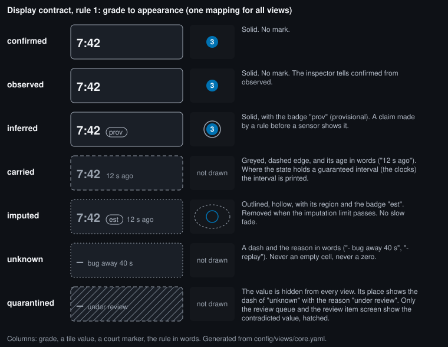
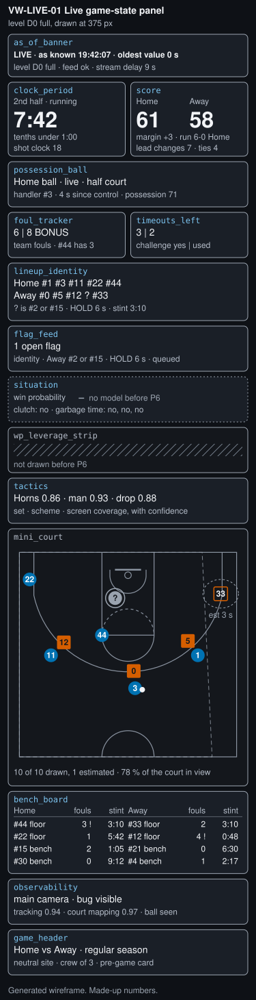
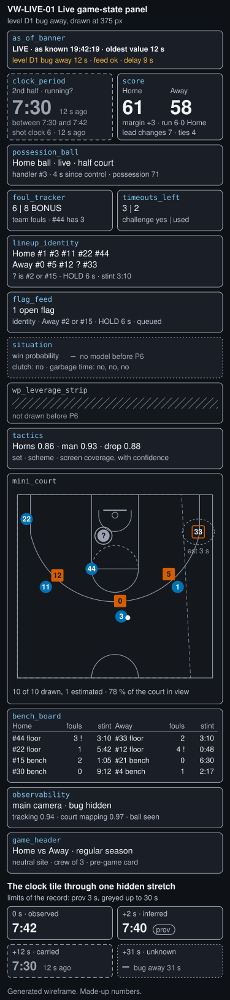
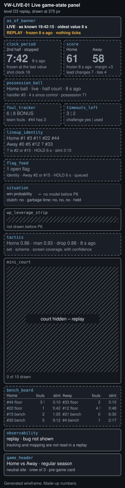
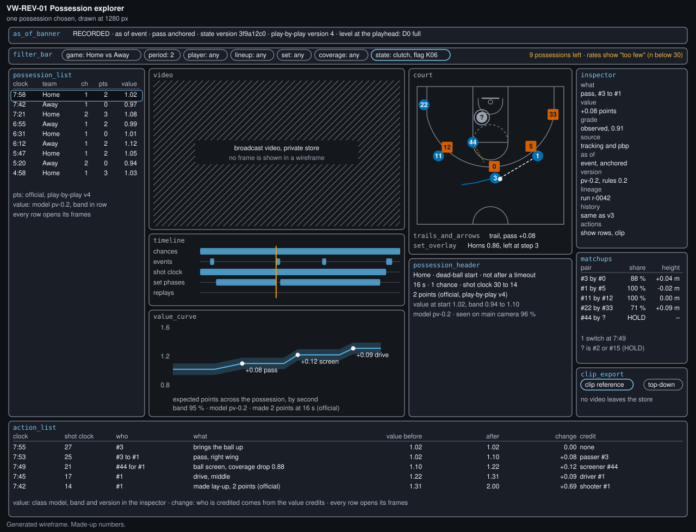
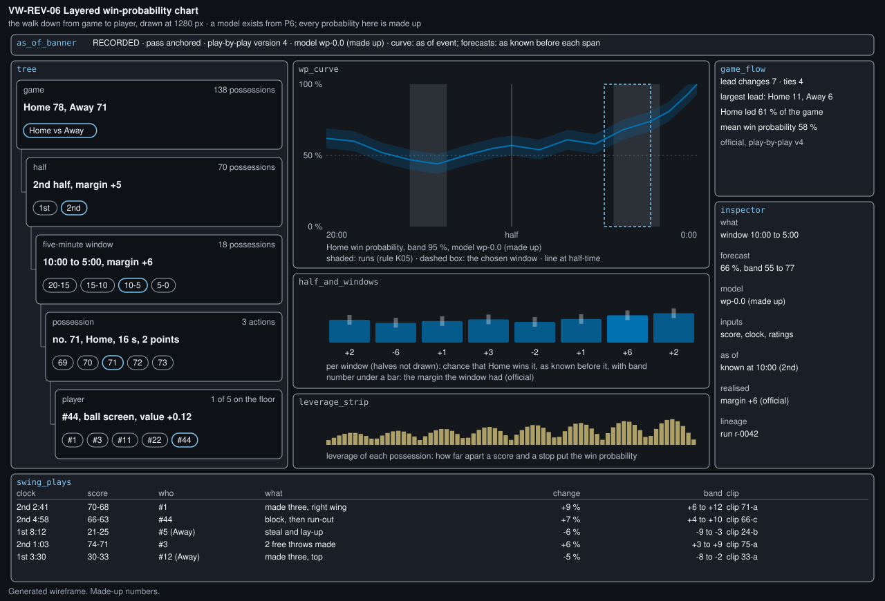
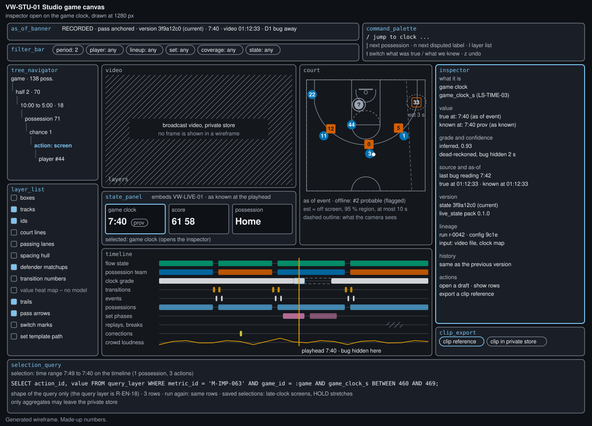
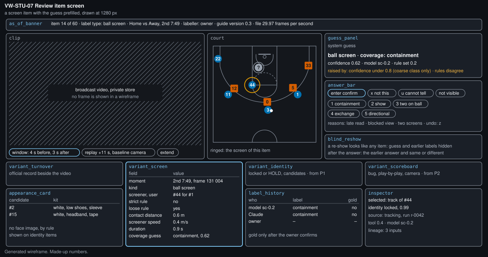
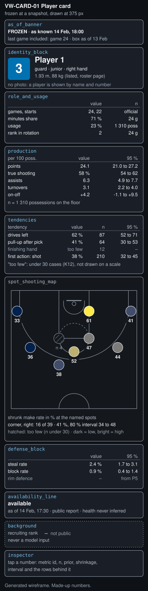

# Views catalogue

Date: 2026-11-20. Version 0.1.0. Status: proposal under the build freeze (baseline 5 of 8). No product screen is built. Every limit is an engineering proposal; each one says whether it is measured, published, decided or assumed.

This page is generated from `config/views/core.yaml` and the three views files by `tools/specgen/views/gen_doc.py` (prose from `tools/specgen/views/doc_template.md`). The drawings in `docs/data/views/` are generated by `tools/specgen/views/gen_wireframes.py`. Do not edit either by hand. A second generated page, the [reference](views_catalogue_reference.md), holds the rules of every element in full.

## 0. What this page is

This is baseline 5 of 8: every output the system shows a person. It lists each screen, page and card, and fixes for each one who it is for, the one question it answers, its grain, every input by id, how it looks when data is missing or unsure, how fresh it is and how it is tested. Nothing here is built. It is the specification a later build is checked against.

The rule of the pack: **Nothing on screen looks better than it is. A value keeps the grade the live state gave it. A number carries its count and its interval, or says why it has none. Every number is a door to the video frames that made it. A view that cannot show something says so and says why.**

| What | Count |
|---|---|
| Views | 40 (live panel 1, review 9, studio 10, report 16, card 4) |
| Elements | 369 |
| Live-state fields read | 94 of 94 |
| Table columns read | 991 in 102 tables; 239 exist only as proposals |
| Metrics read | 407 of 1591 in the registry, from all 19 categories |
| Named-spots ids and layers, events | 23 and 104 |
| Wireframes | 8 drawings of 6 views, and the grade legend |
| Acceptance tests | 23, of which 6 run now |
| Open questions | 40, each with a recommended answer |

**For a short check-in** read section 1 up to the grade table (the contract in one screen), section 2 (the map), the wireframes in sections 3 to 7, and section 11 (the questions that need your answer). Everything else is reference.

How to read an entry: a **view** has its own question and its own audience. A tile, chart or control inside it is an **element** and carries a key such as `clock_period`; the wireframes print the same keys. Inputs are always ids: a live-state field (`game_clock_s`, LS-TIME-03), a table column (`shots.made`), a metric (`M-SHOOT-021`), a named spot or layer (`elbow`, `layer:spot`), an event (`T05`, `screens:ball_screen`). A view holds no formula.

All numbers in the wireframes are made up. Teams are Home and Away. No broadcast frame is shown anywhere.

## 1. The display contract in one screen

Eight rules every view obeys. A view record states only what differs.

- 1 Grade to appearance: one mapping for all views. A view never upgrades a grade and never shows a value without it.
- 2 Identity: a locked label, or HOLD with the candidates. The probable tier is offline only, flagged, never inside a stat.
- 3 Numbers: every number has a class. An estimate shows n and interval and links to its frames. Below the minimum n it is "too few".
- 4 As-of: a live view reads as_of_known and prints its age. A review view reads as_of_event and names the pass.
- 5 Degraded states: for every level D1-D5 and a stale feed the view says what it shows. No view goes blank without a reason.
- 6 One visual standard: metric labels, one palette, contrast, 375 px, the court in the named-spots frame.
- 7 Privacy: every view has a class. Video frames never leave the private store.
- 8 Ids only: every metric, live value, spot and event is named by its id. No formula lives in a view.

### Rule 1. Grade to appearance

A value keeps the grade the live game state gave it. One mapping for all views:

| Grade | How it looks | Tile edge | Court marker | Badge | Shown in |
|---|---|---|---|---|---|
| confirmed | Solid. No mark. | solid | filled | none | every view |
| observed | Solid. No mark. The inspector tells confirmed from observed. | solid | filled | none | every view |
| inferred | Solid, with the badge "prov" (provisional). A claim made by a rule before a sensor shows it. | solid | filled with a ring | "prov" | every view |
| carried | Greyed, dashed edge, and its age in words ("12 s ago"). Where the state holds a guaranteed interval (the clocks) the interval is printed. | dashed | none (a carried position is not drawn; positions go from observed to imputed) | "&lt;n> s ago" | every view |
| imputed | Outlined, hollow, with its region and the badge "est". Removed when the imputation limit passes. No slow fade. | dotted | hollow outline with its 95 % region | "est" | every view |
| unknown | A dash and the reason in words ("- bug away 40 s", "- replay"). Never an empty cell, never a zero. | dotted | none | "- &lt;reason>" | every view |
| quarantined | The value is hidden from every view. Its place shows the dash of "unknown" with the reason "under review". Only the review queue and the review item screen show the contradicted value, hatched. | hatched | none | "- under review" | the review screens only |

- A view shows the grade the state gives. It never shows a better one.
- Grade is carried by mark style and a text badge, never by colour alone (published WCAG 2.1 SC 1.4.1).
- The grade word, the source, the confidence and the age are always one selection away, in the inspector.
- A derived value takes the worst grade and the oldest age of its inputs (live-state rule WORST_INPUT). The view shows that grade.

| Parameter | Value | Unit | Why | Evidence |
|---|---|---|---|---|
| `offscreen_marker_max_s` | 10 | s | an off-screen marker is drawn this long, hollow with its region, then removed | config: config/live_state/core.yaml profile observation, offscreen_imputed_max_s (decision K15, requirement R-DT-07) |
| `counter_stale_mark_s` | 20 | s | a carried counter with nothing watching it gets the word "stale" beside its age after this long | config: config/live_state/core.yaml profile counter, counter_stale_after_s (measured there) |
| `region_level` | 0.95 | probability | level of the region drawn round an imputed position | decision: K15 (off-screen estimates at 10 Hz with a calibrated 95 % region) |

Source: config/live_state/core.yaml grades (ladder confirmed, observed, inferred, carried, imputed, unknown; aside quarantined). The lint checks that this table has exactly those grades.

### Rule 2. Identity

- **Locked or HOLD.** A player is shown by a locked label, or as HOLD with the candidate list. Never a provisional or unconfirmed label. This is the only rule a live_panel view and any as_of_known element may use (OD-10).
- **Probable, flagged, offline.** Offline views may also show the probable tier on the video and court layers, with the word "probable" on the mark. It never appears in a tile, a table or a stat, and never on a live view (OD-8).
- **HOLD on screen.** HOLD is drawn as a neutral marker with "?" and the candidates in order of posterior. Team is shown when the team is known.
- **No face.** No element shows a face crop or a headshot. An identity item shows the jersey, the kit and the appearance card.
- Source: config/identity_pack.yaml outputs (live_panel, per_frame, probable_log). Owner decisions OD-8 and OD-10 of 25 Oct 2026.

### Rule 3. Numbers

- Every number on screen belongs to one class below. The class says what must stand beside it.
- Every number links to the frames that produced it (R-VZ-02). The link carries the filters, the series and the time range.
- An interval is never drawn as bare bar ends. Draw a fading band where there is room; otherwise print value, n and interval.
- The level of every interval is printed beside it. Two levels exist in the requirements, 95 % and 80 %.
- Below its minimum n an estimate is not drawn on the scale. The cell shows "too few" and n, in the no-data style.
- A number that is descriptive only carries the word "descriptive". It makes no claim about cause.
- A view never smooths, caps or rounds away what a model said. It shows the stored value.
- "Inspect" on any chart or table shows its rows and its query with the metric ids (R-EN-18).

| Class | What it is | Must show beside it | Also needs | Example |
|---|---|---|---|---|
| `official` | A count or value of the official record or of the rules (score, fouls, timeouts, box-score counts). | source, as_of | link | 68-61, official box, as of the final play-by-play version |
| `live_state` | A value of the live game state shown at an instant (clock, score, possession, flags). | grade, age | link | 7:42 prov |
| `estimate` | A statistic computed from a sample (a rate, a mean, a shrunk tendency). | n, interval, level | link, min_n | 1.08 points per possession, n = 64, 95 % 0.93 to 1.23 |
| `model` | An output of a model (win probability, expected points, a forecast). | band, model_version | link | 71 %, band 64 to 78, model wp-0.3 |
| `label` | The confidence of a label made by a model or a rule (a set, a coverage, a matchup, an identity). | confidence, version | link | drop coverage, confidence 0.86, rule set 0.2 |
| `measurement` | One quantity measured from tracking (a distance, a speed, a time). | unit, error | link | 4.2 m, error 0.3 m |
| `descriptive` | A number shown for description only, with no test behind it. | n, descriptive_mark | link | 4 timeouts called during opponent runs (descriptive, n = 4) |

What a number links to:

- `frames`: The video frames or the clip of the row (clip_index, proposed table).
- `rows`: The rows behind an aggregate, opened as a list; each row links to its frames.
- `state`: The state transition or segment that set the value; it links to its effective frame.
- `none_fixed`: A value fixed before tip (venue, crew). It links to its registry row, not to video.

| Parameter | Value | Unit | Why | Evidence |
|---|---|---|---|---|
| `min_n_default` | 30 | count | an estimate with fewer cases is shown as "too few" with its n | decision: K12 (n at least 30 until the reliability study gives n70 per metric) |
| `interval_level_default` | 0.95 | probability | level of an interval when the metric does not state another | requirement: R-RR-02 and decision K15 use 95 % |
| `interval_level_shooting` | 0.8 | probability | level of the interval on shrunk make rates | requirement: R-PC-23 (80 % interval at each named spot) |
| `coverage_fine_min_conf` | 0.8 | probability | a fine ball-screen coverage is shown only at this confidence; below it the coarse class is shown | decision: K04 |
| `position_sigma_max_m` | 0.5 | m | a position with a larger error is not printed as a number and not binned in a heat map | requirement: R-CG-08 |
| `position_print_step_m` | 0.1 | m | positions are printed to this step | requirement: R-CG-08 |

### Rule 4. As-of

- **as_of_known.** What the system knew at t. A live view reads only this. It prints the known-at time and the age of the oldest value on screen.
- **as_of_event.** What was true at t. A review view reads this and prints the pass (blind, anchored, pbp_only) and the state version.
- **mixed.** A view that shows both marks every element with its as-of. The Studio offers a switch "what was true / what we knew".
- **banner.** Every view carries the as-of banner (component as_of_banner). It is never hidden.
- **frozen.** A card or packet is frozen at a snapshot. It prints the snapshot time and shows nothing dated after it.

Passes: live, blind, anchored, pbp_only. Source: config/live_state/core.yaml conventions.as_of_views.

### Rule 5. Degraded states

- The level is always printed in the as-of banner, in words.
- A worse level changes the view at once. A better level waits for the return rule of each field.
- During a replay, review, timeout or break a derived value holds its last value and is marked held, with the reason. It does not tick.
- A view that cannot show its content at a level shows a card that names the level and what is missing.

Source: config/live_state/core.yaml degradation_levels (D0_full to D5_no_video and the feed_stale flag). The lint checks the level names against that file.

What a view shows at each level unless its record says otherwise:

| Level | Live panel | Review and film room | Analyst Studio and review screens | Reports and packets | Cards |
|---|---|---|---|---|---|
| D1 bug away | Clocks are shown by grade: provisional, then greyed with age and interval, then a dash. Score and counts stay solid while CV watches the ball and rim; else greyed with age. | Normal. The timeline shades the stretch; clock values in it carry their grade. | As review. The inspector shows the dead-reckoned clock with its interval. | Numbers are computed as specified. Nothing changes on the page. | Not applicable to a frozen card. The card prints its snapshot time. |
| D2 off the main camera | Positions and the mini court are hidden, with the reason. Counts are shown as read. Status values are greyed with age, then a dash. | Video plays. The court shows imputed markers with regions up to the limit, then removes them. Overlays that need positions are off for the stretch, with the reason. | As review. Layers that need the main camera are greyed in the layer list. | A number that needs positions states the share of time it could use. | A tendency built from tracking states the share of time observed. |
| D3 replay | The whole panel is frozen at the last live instant and carries the word REPLAY. Nothing ticks. | Video shows the replay. Court, state and curves stay at the last live instant, marked REPLAY. The replay is offered as linked evidence. | As review. The replay segment is a selectable object. | Replays never enter a number. | Not applicable. Replays never enter a number. |
| D4 break | The whole panel is frozen and carries the word BREAK and the age of the freeze. On return the values are re-read before they are solid again. | The playhead may cross the break. Court and state show "break"; nothing is drawn. | As review. The break is a selectable segment on the timeline. | Breaks never enter a number. | Not applicable. Breaks never enter a number. |
| D5 no video | Feed-only panel: score, fouls, timeouts and lineups from the feed while it is healthy. Clocks, positions, tactics and possession detail show a dash with "no video". | A card "no video for this stretch". State from the feed is shown where it exists. | As review. | The page marks every video-based section "no video" and keeps the play-by-play sections. | The card carries the flag "no footage: play-by-play and public data only" where it applies. |
| feed stale | A line "feed quiet &lt;n> s". Scorebook-only values (who, what, foul type, substitutions) are greyed with their age. | A recorded game uses the final play-by-play. The view prints the play-by-play version it was built from. | As review. | The page prints the play-by-play version and its pull time. | The card prints the as-of time of every source block. |

### Rule 6. One visual standard

**Labels.** Metric labels only. Metres, seconds, degrees. Every label on screen comes from the vocabulary map (R-MD-31).

**Court.** The court is always drawn in the named-spots frame (config/named_spots.yaml frame): the attacked rim at the origin, x along the end line, y toward half court, metres. Regions, spots and zones are drawn from that file, never redrawn by hand.

**Which way up.** Orientation `overhead`: What a camera above the floor sees: +x to the right of the screen, +y down the screen, the attacked rim at the top. The attacker's right is on the right. Used by every court of this pack. A top-down replay that sits beside the video (R-VZ-01) must not swap left and right. The numbers do not change: only the picture is flipped. (open question OQ-VW-40. The wireframe generator reads orientation; changing the word redraws every court.)

**Colour rules**

- Colour is never the only carrier. A series is also told apart by shape, dash or a direct label.
- Text is never coloured by team or category. Text uses the text tokens.
- Home is blue with a circle. Away is vermilion with a square. Never red against green.
- Grade is not a colour. Grade is mark style and badge (rule 1). So grade, team and category never share a channel.
- An element that colours by team uses shape, dash or a direct label for any second variable; it does not also use the categorical set.
- Court and charts sit on the dark chart surface in both themes. Text pages follow the theme.
- The no-data style lies outside every scale - a hatched neutral cell.

**Tokens**

| Token | Light | Dark |
|---|---|---|
| `bg.page` | #FFFFFF | #0E1116 |
| `bg.panel` | #F3F4F6 | #1A1F27 |
| `bg.chart` | #14171C | #14171C |
| `text.primary` | #14171C | #F2F4F7 |
| `text.secondary` | #4A5361 | #B4BCC8 |
| `text.stale` | #5F6875 | #9AA3AF |
| `text.link` | #005A8C | #7CC4F0 |
| `text.attention` | #8A4B00 | #F0B340 |
| `text.on_chart` | #F2F4F7 | #F2F4F7 |
| `text.on_chart_secondary` | #B4BCC8 | #B4BCC8 |
| `text.on_chart_stale` | #9AA3AF | #9AA3AF |
| `text.on_team_home` | #FFFFFF | #FFFFFF |
| `text.on_team_away` | #14171C | #14171C |
| `team.home` | #0072B2 | #0072B2 |
| `team.away` | #D55E00 | #D55E00 |
| `mark.court_line` | #8A93A0 | #8A93A0 |
| `mark.region` | #9AA3AF | #9AA3AF |
| `mark.no_data` | #6B7480 | #6B7480 |
| `mark.attention` | #E69F00 | #E69F00 |

**Contrast of every text pair** (WCAG 2.1; the lint recomputes each ratio)

| Text | On | Light | Dark |
|---|---|---|---|
| `text.primary` | `bg.page` | 17.96 | 17.16 |
| `text.primary` | `bg.panel` | 16.32 | 15.02 |
| `text.secondary` | `bg.page` | 7.77 | 9.88 |
| `text.secondary` | `bg.panel` | 7.06 | 8.64 |
| `text.stale` | `bg.page` | 5.64 | 7.41 |
| `text.stale` | `bg.panel` | 5.12 | 6.49 |
| `text.link` | `bg.page` | 7.39 | 9.92 |
| `text.link` | `bg.panel` | 6.72 | 8.68 |
| `text.attention` | `bg.page` | 6.80 | 10.11 |
| `text.attention` | `bg.panel` | 6.18 | 8.85 |
| `text.on_chart` | `bg.chart` | 16.30 | 16.30 |
| `text.on_chart_secondary` | `bg.chart` | 9.38 | 9.38 |
| `text.on_chart_stale` | `bg.chart` | 7.04 | 7.04 |
| `text.on_team_home` | `team.home` | 5.19 | 5.19 |
| `text.on_team_away` | `team.away` | 4.64 | 4.64 |

**Marks on the chart surface**

| Mark | On | Ratio |
|---|---|---|
| `team.home` | `bg.chart` | 3.46 |
| `team.away` | `bg.chart` | 4.64 |
| `mark.court_line` | `bg.chart` | 5.78 |
| `mark.region` | `bg.chart` | 7.04 |
| `mark.no_data` | `bg.chart` | 3.79 |
| `mark.attention` | `bg.chart` | 7.98 |

**Categorical set** (published: Okabe and Ito, Color Universal Design (2002, revised 2008). The eight hex values are the widely reproduced set; assumed: the source page shows them only in a figure. Slot 8 is a light neutral in place of black, because the chart surface is dark.)

| Slot | Name | Hex | Ratio on the chart surface |
|---|---|---|---|
| 1 | orange | #E69F00 | 7.98 |
| 2 | sky blue | #56B4E9 | 7.78 |
| 3 | bluish green | #009E73 | 5.25 |
| 4 | yellow | #F0E442 | 13.58 |
| 5 | blue | #0072B2 | 3.46 |
| 6 | vermilion | #D55E00 | 4.64 |
| 7 | reddish purple | #CC79A7 | 5.87 |
| 8 | neutral | #E6E8EB | 14.63 |

Second channel beside colour: circle, square, triangle, diamond, cross, solid, dashed, dotted. On a white page orange, sky blue, yellow and the neutral fail 3:1 (measured: 2.25, 2.31, 1.32, 1.23). That is why charts keep the dark surface in the light theme.

**Sequential scale: cividis.** more of one thing (density, time, value). Low is dark and sits near the chart surface; high is bright. Stops: #00204D #414D6B #7C7B78 #BCAF6F #FFEA46. published: Nunez, Anderton and Renslow, PLOS ONE 2018 (built so that readers with and without red-green deficiency see it alike). assumed: the five stops are written from the R viridisLite listing and are re-checked by the wireframe step.

**Diverging scale: purple-orange.** above or below a reference (expected, average, zero). The mid stop is the reference and is the lightest. Stops: #B35806 #F1A340 #FEE0B6 #F7F7F7 #D8DAEB #998EC3 #542788. published: ColorBrewer PuOr, 7 classes, marked colour-blind safe. assumed: the seven stops are written from the ColorBrewer listing and are re-checked by the wireframe step. Purple and orange are used so that the scale is never read as home against away.

**Team marks.** home: circle, `team.home`, label `text.on_team_home`; away: square, `team.away`, label `text.on_team_away`.

**Text sizes**

| Parameter | Value | Unit | Why | Evidence |
|---|---|---|---|---|
| `caption_px` | 12 | px | smallest text on any view: badges, ages, n and intervals | assumed: common floor for secondary text on phones; checked on the first wireframes at 375 px |
| `body_px` | 14 | px | labels and table text | assumed: one step above the caption; checked on the first wireframes |
| `value_px` | 20 | px | a value inside a tile | assumed: readable at arm length on a phone; checked on the first wireframes |
| `hero_px` | 32 | px | score and game clock on the live panel | assumed: the two values read from furthest away; checked on the first wireframes |
| `large_text_px` | 24 | px | from this size text may use the 3:1 limit | published: WCAG 2.1 SC 1.4.3 (18 pt, about 24 px) |

**Limits**

| Parameter | Value | Unit | Why | Evidence |
|---|---|---|---|---|
| `text_contrast_min` | 4.5 | ratio | every text and background pair of text_pairs | requirement: R-VZ-07 (published: WCAG 2.1 SC 1.4.3, level AA) |
| `graphic_contrast_min` | 3 | ratio | marks a reader needs to see against the chart surface | published: WCAG 2.1 SC 1.4.11, level AA |
| `reading_min_width_px` | 375 | px | a reading view works at this width with no sideways page scroll | requirement: R-VZ-07 (the standard asks 320 px; published: WCAG 2.1 SC 1.4.10) |
| `workspace_min_width_px` | 1280 | px | review and Studio views show video, court, panel and timeline side by side | assumed: a laptop screen; replaced by the width the first Studio wireframe needs (open question OQ-VW-4) |
| `touch_target_px` | 44 | px | side of a touch target on a reading view | published: WCAG 2.1 SC 2.5.5 |
| `touch_target_floor_px` | 24 | px | no target is smaller than this on any view | published: WCAG 2.2 SC 2.5.8 |

**Width rules**

- `reading`: Works at reading_min_width_px. The court drawing, a table and a timeline may scroll inside their own box (the standard exempts maps, diagrams, video, data tables and toolbars).
- `workspace`: Desktop only, at least workspace_min_width_px. The 375 px rule does not bind it (open question OQ-VW-4).

Units never shown: ft, feet, foot, inch, inches, yd, yard, yards, mph, lb, lbs.

### Rule 7. Privacy

- Video frames and video files never leave the private store. An export is a clip reference, a drawing, an aggregate or a query.
- No face crop and no headshot is shown or exported.
- An individual player output is private to MSU staff and the owner. It is never shareable_aggregate and never public_demo.
- No view infers race or health. A physical-load view says "no health inference" in its footer.
- A number leaves the private store only as an aggregate through the published-number gate (R-DQ-15).

| Class | Who may see it | Video | Player-level output | May export |
|---|---|---|---|---|
| `owner_only` | owner, analyst | yes | yes | `clip_reference`, `top_down_render`, `video_clip_private`, `sql`, `aggregate_table`, `page` |
| `msu_staff` | owner, analyst, msu_staff | yes | yes | `clip_reference`, `top_down_render`, `video_clip_private`, `aggregate_table`, `page` |
| `shareable_aggregate` | owner, analyst, msu_staff | no | no | `top_down_render`, `aggregate_table`, `page` |
| `public_demo` | owner, analyst, msu_staff, public_demo | no | no | `top_down_render`, `page` |

Export kinds:

- `clip_reference`: Game id, in and out video seconds, overlay spec (R-RG-02). No pixels.
- `top_down_render`: A drawing of the court with markers and arrows. No broadcast pixel.
- `video_clip_private`: A video file written inside the private store only. Never attached, never uploaded.
- `sql`: The query text of a selection, with metric ids (R-AS-06).
- `aggregate_table`: Aggregates only, through the published-number gate (R-EN-23, R-DQ-15). No row-level data.
- `page`: The rendered page without video frames.

### Rule 8. Ids only

- A view lists metric ids. It never holds a formula, a threshold of a metric or a second definition.
- Every live value is named by its live-state key. Every spot by its named-spots id. Every event by its grammar or transition id.
- A filter or shading that depends on a definition names it: run rule (K05), clutch flag (K06), garbage-time flag (K28), court partition, screen rule strict or loose.
- A number on a view equals the value of the same metric id from the query layer (R-EN-18).

## 2. The map of surfaces

| Surface | Code | What it is | As-of allowed | Width | Default refresh | Views |
|---|---|---|---|---|---|---|
| [Live panel](#3-live-panel) | LIVE | The in-game panel. One screen, read at a glance on a phone or a laptop. | as known | reading | `on_event` | 1 |
| [Review and film room](#4-review-and-film-room) | REV | Post-game and film-room views. Interactive; video beside the drawing. | as of event, mixed | workspace | `post_game` | 9 |
| [Analyst Studio and review screens](#5-analyst-studio-and-review-screens) | STU | The Analyst Studio and the review and labelling screens. Private, desktop, runs on the private store. | as of event, as known, mixed | workspace | `on_edit` | 10 |
| [Reports and packets](#6-reports-and-packets) | RPT | A generated page or packet read top to bottom (half-time packet, notes sheet, scouting packet, run record). | as of event, as known, mixed | reading | `post_game` | 16 |
| [Cards](#7-cards) | CARD | A frozen one-subject summary (player, coach, game, model), dated. | as of event, as known, mixed | reading | `pre_game` | 4 |

Audiences:

| Audience | Who | Status |
|---|---|---|
| `owner` | Aldemir. He alone promotes drafts, confirms gold labels and signs the rights gate. | active |
| `analyst` | The data-scientist seat in the Studio. Today that is Aldemir, and Claude sessions working for him (their labels are stored apart, R-HR-16). | active |
| `msu_staff` | MSU coaches and staff. | listed, excluded until staff respond (decision of 11 Nov 2026, R-PR-19) |
| `public_demo` | A reader of the public repo or of a pitch that passed the rights gate (R-RG-02) and the published-number gate (R-DQ-15). | active for drawings and made-up or public numbers only |

All views. A wireframe link opens the drawing; the id links to the entry.

| Id | View | The one question | Audience | Grain | Phase | Wireframe |
|---|---|---|---|---|---|---|
| [VW-LIVE-01](#vw-live-01-live-game-state-panel) | Live game-state panel | What is the state of this game right now, and how sure are we of each part of it? | owner, analyst, msu_staff | frame | P0p | [live_panel_d0](views/live_panel_d0.svg), [live_panel_d1](views/live_panel_d1.svg), [live_panel_d3](views/live_panel_d3.svg) |
| [VW-REV-01](#vw-rev-01-possession-explorer) | Possession explorer | What happened in this possession, and how much did each action change its value? | owner, analyst, msu_staff | possession | P2 | [possession_explorer](views/possession_explorer.svg) |
| [VW-REV-02](#vw-rev-02-matchup-board) | Matchup board | Who guarded whom in this game, for how long, and what did each pairing give up? | owner, analyst, msu_staff | game | P4 | none |
| [VW-REV-03](#vw-rev-03-lineup-board) | Lineup board | Which five-player units played, for how long, and how did each do, given how few possessions each had? | owner, analyst, msu_staff | lineup stint | P0p | none |
| [VW-REV-04](#vw-rev-04-heat-maps) | Heat maps | Where on the court does this player, lineup or set spend its time, touch the ball, shoot and gain value? | owner, analyst, msu_staff | player-game | P0p | none |
| [VW-REV-05](#vw-rev-05-passing-network) | Passing network | Who passes to whom on this team, how often, and how much value do those passes carry? | owner, analyst, msu_staff | game | P0p | none |
| [VW-REV-06](#vw-rev-06-layered-win-probability-chart) | Layered win-probability chart | How did the chance to win move through this game, at the level of the game, the half and the five-minute window, and which plays moved it most? | owner, analyst, msu_staff | game | P6 | [layered_tree](views/layered_tree.svg) |
| [VW-REV-07](#vw-rev-07-shot-chart-by-sector-and-ring) | Shot chart by sector and ring | From which sectors and rings does this player or team shoot, how well, and what were those shots worth? | owner, analyst, msu_staff | player-game | P0p | none |
| [VW-REV-08](#vw-rev-08-physical-load) | Physical load | How far and how fast did each player move in this game, and how much of his floor time did we actually see? | owner, analyst, msu_staff | player-game | P1 | none |
| [VW-REV-09](#vw-rev-09-telestrator-freeze-frame) | Telestrator freeze-frame | What did the floor look like at this one moment, and where was everyone about to go? | owner, analyst, msu_staff | frame | P1 | none |
| [VW-STU-01](#vw-stu-01-studio-game-canvas) | Studio game canvas | What does the system hold about this moment of the game, where did each value come from, and can I trust it? | owner, analyst | frame | P1 | [studio_game_canvas](views/studio_game_canvas.svg) |
| [VW-STU-02](#vw-stu-02-draft-diff-and-promote) | Draft, diff and promote | What exactly would this edit change, which stats and predictions move with it, and should it become the current version? | owner, analyst | item | P2 | none |
| [VW-STU-03](#vw-stu-03-model-bench) | Model bench | Which version of this stage is better on the gold set, on which slices, and what does each one get wrong? | owner, analyst | model version | P1 | none |
| [VW-STU-04](#vw-stu-04-parameter-sensitivity-sweep) | Parameter sensitivity sweep | If I move this parameter across its range, which stats and which win probabilities move, and by how much? | owner, analyst | item | P0p | none |
| [VW-STU-05](#vw-stu-05-network-explain-view) | Network (explain) view | For this frame or possession, what went into each network, what came out, and what did the network look at? | owner, analyst | frame | P1 | none |
| [VW-STU-06](#vw-stu-06-review-queue) | Review queue | Which moments should I label next, why these, and how much of my weekly budget do they take? | owner, analyst | item | P0 | none |
| [VW-STU-07](#vw-stu-07-review-item-screen) | Review item screen | What happened in this clip, is the guess of the system right, and if not, what is the right label? | owner, analyst | item | P0 | [review_item](views/review_item.svg) |
| [VW-STU-08](#vw-stu-08-coach-quiz) | Coach quiz | At this paused moment, does the system read the game the way I do? | owner, analyst | second | P4 | none |
| [VW-STU-09](#vw-stu-09-metric-browser) | Metric browser | What is this stat, how is it computed, can it be computed today, and which views show it? | owner, analyst | item | P0p | none |
| [VW-STU-10](#vw-stu-10-lineage-explorer) | Lineage explorer | Which input files, stage runs, code and config versions produced this row, and what depends on it? | owner, analyst | item | P0 | none |
| [VW-RPT-01](#vw-rpt-01-half-time-packet) | Half-time packet | What happened in the first half that this team should know before the second half starts? | owner, analyst, msu_staff | team-half | P0p | none |
| [VW-RPT-02](#vw-rpt-02-post-game-notes-sheet) | Post-game notes sheet | What are the ten things about this game most worth telling a coach, each with its proof? | owner, analyst, msu_staff | game | P0p | none |
| [VW-RPT-03](#vw-rpt-03-post-game-report) | Post-game report | What happened in this game, from the final score down to the possessions and players that decided it? | owner, analyst, msu_staff | game | P0p | none |
| [VW-RPT-04](#vw-rpt-04-opponent-scouting-packet) | Opponent scouting packet | What does this opponent normally do, who does it, and where can it be hurt, as known before tip? | owner, analyst, msu_staff | opponent | P0p | none |
| [VW-RPT-05](#vw-rpt-05-edge-report-per-market) | Edge report per market | Where did our frozen probability differ from the fair market probability, and did the closing line then move our way? | owner, analyst | market-game | P7 | none |
| [VW-RPT-06](#vw-rpt-06-calibration-and-scoring-report) | Calibration and scoring report | When this model said 70 percent, did it happen 70 percent of the time, and does it beat the ratings baseline and the closing line? | owner, analyst, msu_staff | model version | P6 | none |
| [VW-RPT-07](#vw-rpt-07-pitch-package) | Pitch package | What can this system show Michigan State that it does not have today, and how well has it predicted so far? | owner, analyst, msu_staff | season | P8 | none |
| [VW-RPT-08](#vw-rpt-08-hypothesis-result-table) | Hypothesis result table | Which registered hypotheses were tested, what was found, and which findings are only exploratory? | owner, analyst | item | P0p | none |
| [VW-RPT-09](#vw-rpt-09-game-processing-and-data-quality-report) | Game processing and data-quality report | Is the data of this game complete and sound enough to use, and where is it weak? | owner, analyst | game | P0 | none |
| [VW-RPT-10](#vw-rpt-10-run-record-and-failure-analysis) | Run record and failure analysis | What did this run test, what passed or failed and on what evidence, and what changed since the run before? | owner, analyst | run | P0 | none |
| [VW-RPT-11](#vw-rpt-11-monitoring-and-alerts-board) | Monitoring and alerts board | Since the last game, is anything drifting, missing, late or over budget, and what needs my attention first? | owner, analyst | run | P0 | none |
| [VW-RPT-12](#vw-rpt-12-labeller-agreement-report) | Labeller agreement report | Do my labels agree with my own earlier labels, with a second labeller and with the labels Claude made, for each label type? | owner, analyst | item | P0 | none |
| [VW-RPT-13](#vw-rpt-13-identity-quality-report) | Identity quality report | Which players does the system identify reliably, which pairs does it mix up, and may this game feed player-level numbers? | owner, analyst | player-game | P1 | none |
| [VW-RPT-14](#vw-rpt-14-jev-calibration-report) | JEV calibration report | For each kind of question, how often is the outside approver right against my answer key, and may its verdicts count? | owner, analyst | model version | P1 | none |
| [VW-RPT-15](#vw-rpt-15-play-by-play-version-diff) | Play-by-play version diff | What did the official play-by-play or box score change after the game, and which of our numbers moved because of it? | owner, analyst | game | P0p | none |
| [VW-RPT-16](#vw-rpt-16-rest-of-season-simulation) | Rest-of-season simulation | Against which of the remaining opponents is Michigan State favoured, and how sure is that? | owner, analyst | season | P6 | none |
| [VW-CARD-01](#vw-card-01-player-card) | Player card | Who is this player, what does he tend to do, and how sure are we of each tendency, as of this date? | owner, analyst, msu_staff | player-season | P0 | [player_card](views/player_card.svg) |
| [VW-CARD-02](#vw-card-02-coach-card) | Coach card | How does this coach run a game, and which of those habits are measured, as of this date? | owner, analyst, msu_staff | coach | P0 | none |
| [VW-CARD-03](#vw-card-03-pre-game-card) | Pre-game card | What is known about this game before tip, and what does each prediction layer say, with which drivers? | owner, analyst, msu_staff | game | P0 | none |
| [VW-CARD-04](#vw-card-04-model-card) | Model card | What is this model, what was it trained and tested on, how well does it score out of sample, and where does it fail? | owner, analyst | model version | P1 | none |

## 3. Live panel

The in-game panel. One screen, read at a glance on a phone or a laptop. 1 view: [VW-LIVE-01](#vw-live-01-live-game-state-panel) Live game-state panel.

### VW-LIVE-01 Live game-state panel

**Question.** What is the state of this game right now, and how sure are we of each part of it?

| Audience | Privacy | Grain | As-of | Refresh | Width | First phase | File |
|---|---|---|---|---|---|---|---|
| owner, analyst, msu_staff | `msu_staff` | frame | as known; pass live, blind, anchored | `on_event`, budget 0.5 s | 375 px | P0p | `views_live.yaml`, key `live_game_state_panel` |

  

Left to right: D0 full ([`live_panel_d0.svg`](views/live_panel_d0.svg)), D1 bug away ([`live_panel_d1.svg`](views/live_panel_d1.svg)), D3 replay ([`live_panel_d3.svg`](views/live_panel_d3.svg)). The tiles keep their place and size at every level; only their marks change.
Drawn with their keys: `as_of_banner`, `clock_period`, `score`, `possession_ball`, `foul_tracker`, `timeouts_left`, `lineup_identity`, `flag_feed`, `situation`, `wp_leverage_strip`, `tactics`, `mini_court`, `bench_board`, `observability`, `game_header`. Every element is drawn.

**When data is missing or unsure**

| Level | What the view shows |
|---|---|
| D1 bug away | Normal operation - about a fifth of all seconds. Clocks go "prov", then greyed with age and interval, then a dash. Score and counts stay solid while CV or the feed watches. No tile moves or resizes. The flag feed raises no row for it. |
| D2 off the main camera | The mini court, the ball handler and the tactics tile are hidden with the reason. Counts are shown as read. Status values grey with age, then turn to a dash. The win-probability band widens. |
| D3 replay | The whole panel freezes at the last live instant and carries the word REPLAY. Nothing ticks; win probability is held and the strip does not advance. |
| D4 break | The whole panel freezes and carries the word BREAK with its age. On return every value is re-read before it is solid; possession is a dash until the first control; lineups say "unverified". |
| D5 no video | Feed-only panel: score, fouls, timeouts, lineups, the bench board and a coarse possession from the feed. Clocks, court, tactics and identity are a dash with "no video". |
| feed stale | One line "feed quiet &lt;n> s". Who scored, foul type, player fouls and substitutions grey with their age. Values the bug and CV can see stay solid. |

**Empty state.** No game chosen: "choose a game". Before tip: the header tile is filled; every live tile shows a dash and "not started". A tile whose inputs are not built yet shows a dash and the phase that brings them.

<b>Elements (15) and their inputs by id</b>

| Element | Kind | Shows | Inputs by id | Number class | Grade rule |
|---|---|---|---|---|---|
| `as_of_banner` | control | LIVE or RECORDED, the known-at time, the age of the oldest value on screen, the worst grade on screen, the degradation level in words, feed and stream delay. | **live state** `pass` (LS-KEY-02), `state_version` (LS-KEY-03), `video_frame` (LS-KEY-04), `video_ts_ms` (LS-TIME-07), `est_utc` (LS-TIME-08), `stamp_src` (LS-KEY-06), `stamp_conf` (LS-KEY-07), `stamp_grade` (LS-KEY-08), `stamp_age_s` (LS-KEY-09), `stamp_known_at_utc` (LS-KEY-10), `degradation_level` (LS-OBS-09), `feed_heartbeat` (LS-OBS-07), `stream_delay_s` (LS-OBS-08) **tables** `state_transitions`: known_at_utc, state_version **events** `T25` plus the inputs of component `as_of_banner` | `live_state` | contract |
| `game_header` | tile | Home and Away, game type and context, venue and site, rest and travel, officials crew, link to the rosters and to the pre-game card. Fixed before tip. | **live state** `game_id` (LS-KEY-01), `rules_edition` (LS-KEY-05), `game_context` (LS-FIX-01), `venue_site` (LS-FIX-02), `rest_travel` (LS-FIX-03), `officials_crew` (LS-FIX-04), `rosters_cards` (LS-FIX-05), `pregame_card` (LS-FIX-06), `scorebug_template` (LS-FIX-08) **events** `T00`, `T24` | `official` | contract |
| `clock_period` | tile | Period and phase, game clock (the largest text), running or stopped, shot clock and its status, shot clock off, media segment, five-minute window. | **live state** `period` (LS-TIME-01), `period_phase` (LS-TIME-02), `game_clock_s` (LS-TIME-03), `game_clock_running` (LS-TIME-04), `shot_clock_s` (LS-TIME-05), `shot_clock_status` (LS-TIME-06), `shot_clock_off` (LS-SIT-06), `media_segment` (LS-TIME-09), `five_min_window` (LS-TIME-10) **tables** `clock_map`: from_gc_ds, to_gc_ds, running, err_ds **events** `T01`, `T19`, `T20`, `T21` plus the inputs of component `state_tile` | `live_state` | contract |
| `score` | tile | Score of Home and Away (the largest text with the clock), margin, current run, lead changes, ties, largest lead, close-game measure. | **live state** `score_home` (LS-SCORE-01), `score_away` (LS-SCORE-02), `margin` (LS-SCORE-03), `current_run` (LS-SCORE-04), `lead_changes` (LS-SCORE-05), `ties` (LS-SCORE-06), `largest_lead` (LS-SCORE-07), `close_game_measure` (LS-SCORE-08) **tables** `score_events`: delta_points, seen_ocr, seen_cv, seen_pbp, board_lag_s **metrics** `M-SIT-015`, `M-SIT-017`, `M-SIT-023`, `M-SIT-024` **events** `T05`, `T12`, `T18` plus the inputs of component `state_tile` | `live_state` | contract |
| `foul_tracker` | tile | Team fouls per team, bonus state, fouls to give, personal fouls of the ten on the floor and of the bench, foul-trouble flags. identity `locked_or_hold` · R-VZ-06g, R-SR-20, R-SB-05 | **live state** `team_fouls_home` (LS-COUNT-01), `team_fouls_away` (LS-COUNT-02), `bonus_home` (LS-COUNT-03), `bonus_away` (LS-COUNT-04), `player_fouls` (LS-COUNT-05), `foul_trouble` (LS-COUNT-06), `fouls_to_give` (LS-COUNT-07) **tables** `foul_state`: team_fouls_end, personal_fouls_player_cum, fouls_to_give_start **metrics** `M-FOUL-001`, `M-FOUL-010`, `M-FOUL-011`, `M-FOUL-012`, `M-FOUL-114` **events** `T09`, `T10`, `T11` plus the inputs of component `state_tile` | `live_state` | contract |
| `bench_board` | table | Every player of both rosters in two blocks per team, on the floor and on the bench: number, name, personal fouls, the foul-trouble flag with the rule that set it, disqualified, seconds on the floor in this stint or seconds on the bench since he left. identity `locked_or_hold` · R-SR-20 | **live state** `lineup_home` (LS-PERS-01), `lineup_away` (LS-PERS-02), `player_fouls` (LS-COUNT-05), `foul_trouble` (LS-COUNT-06), `stint_length_s` (LS-PERS-04) **tables** `rosters`: player_id, team_id; `players`: broadcast_name; `jersey_history`: jersey_number; `foul_state`: personal_fouls_player_cum, foul_trouble, disqualified; `lineup_stints`: player_ids, start_game_clock_s; `substitutions`: player_in_id, player_out_id, game_clock_s **metrics** `M-FOUL-001`, `M-FOUL-047`, `M-FOUL-114`, `M-PHYS-009`, `M-COACH-052` **events** `T09`, `T22`, `dim:player_fouls`, `dim:lineup_home`, `dim:lineup_away` | `live_state` | contract |
| `timeouts_left` | tile | Timeouts left per team by length, challenge available per team, the timeout format of the game. R-VZ-06h | **live state** `timeouts_left_home` (LS-COUNT-08), `timeouts_left_away` (LS-COUNT-09), `challenge_available_home` (LS-COUNT-10), `challenge_available_away` (LS-COUNT-11), `timeout_format` (LS-FIX-07) **tables** `timeouts`: timeout_type, charged, became_media **metrics** `M-COACH-002` **events** `T16`, `T17`, `T26` plus the inputs of component `state_tile` | `live_state` | contract |
| `possession_ball` | tile | Team in possession and team control, possession and chance number, ball status, flow state, restart pending, stoppage kind, free-throw state, try in flight, arrow, basket attacked, ball handler, seconds since control changed, backcourt count, transition numbers, ball-control state. identity `locked_or_hold` | **live state** `possession_team` (LS-POSS-01), `possession_seq` (LS-POSS-02), `chance_seq` (LS-POSS-03), `team_control` (LS-POSS-04), `ball_status` (LS-POSS-05), `try_in_flight` (LS-POSS-06), `flow_state` (LS-POSS-07), `restart_pending` (LS-POSS-08), `stoppage` (LS-POSS-09), `arrow` (LS-POSS-10), `basket_attacked_home` (LS-POSS-11), `ball_handler` (LS-POSS-13), `secs_since_control_change` (LS-POSS-14), `free_throw_state` (LS-POSS-15), `backcourt_count_s` (LS-POSS-16), `transition_numbers` (LS-POSS-17), `ball_control_state` (LS-POSS-18) **tables** `state_segments`: dimension, value, dq; `state_transitions`: ttype **events** `T02`, `T03`, `T04`, `T06`, `T07`, `T08`, `T13`, `T14`, `T15`, `T23`, `dim:flow_state`, `dim:ball_status`, `dim:possession_team` plus the inputs of component `state_tile` | `live_state` | contract |
| `lineup_identity` | tile | The five on the floor per team by name and number, each locked or HOLD with candidates, and the length of the current stint. identity `locked_or_hold` · R-ID-19 | **live state** `lineup_home` (LS-PERS-01), `lineup_away` (LS-PERS-02), `player_identity` (LS-PERS-03), `stint_length_s` (LS-PERS-04) **tables** `lineup_stints`: player_ids, duration_s; `tracks`: identity_conf, jersey_number_voted **events** `T22` plus the inputs of component `state_tile` | `live_state` | contract, except inferred, carried |
| `mini_court` | court | Ten players, the ball and the officials from above in the named-spots frame, with the area the camera sees. A line under it says how many of the ten are drawn and what share of the court is in view. identity `locked_or_hold` · layers: camera_area, court_regions, officials | **live state** `player_positions` (LS-PERS-05), `ball_position` (LS-POSS-12), `officials_positions` (LS-PERS-06), `court_visible_frac` (LS-OBS-11), `basket_attacked_home` (LS-POSS-11) **spots** `layer:zone_scheme:court_region`, `layer:landmark`, `rim`, `three_point_arc`, `division_line` plus the inputs of component `top_down_court` | `live_state` | contract |
| `situation` | tile | Win probability with its band, leverage, expected points of the possession, clutch flag, the three garbage-time flags side by side, end-of-period windows. from P6 · R-PR-11, R-PR-09, R-MD-30 | **live state** `win_probability` (LS-SIT-01), `leverage` (LS-SIT-02), `expected_points` (LS-SIT-07), `clutch` (LS-SIT-03), `garbage_time` (LS-SIT-04), `end_of_period_windows` (LS-SIT-05) **tables** `predictions`: point_value, interval95, model_version **metrics** `M-SIT-055`, `M-SIT-060`, `M-TEFF-024`, `M-SIT-006`, `M-SIT-052`, `M-COACH-054` plus the inputs of component `state_tile` | `model`, `live_state` | contract, except carried, unknown |
| `wp_leverage_strip` | chart | Win probability of the game so far as a line with its band, one point per published value, on the game-clock axis. Under it, leverage per possession as bars. Runs are shaded and the largest swings so far are marked. Not drawn before phase P6. from P6 · R-PR-09, R-PR-11, R-PR-12, R-MD-33 | **live state** `win_probability` (LS-SIT-01), `leverage` (LS-SIT-02), `current_run` (LS-SCORE-04), `clutch` (LS-SIT-03), `garbage_time` (LS-SIT-04) **tables** `predictions`: wp_home_live†, wp_band_lo†, wp_band_hi†, known_at_utc†, model_version; `possessions`: leverage†, pre_win_prob; `score_events`: delta_points, game_clock_s **metrics** `M-SIT-055`, `M-SIT-058`, `M-SIT-059`, `M-SIT-060`, `M-SIT-025` **events** `T03`, `T05`, `T09`, `T12`, `T13`, `T16`, `T17` | `model`, `live_state` | contract, except carried, unknown |
| `tactics` | tile | Current offensive set, defensive scheme, ball-screen coverage and who guards whom, each with its confidence. identity `locked_or_hold` · from P4 · R-DF-16 | **live state** `offense_set` (LS-TAC-01), `defense_scheme` (LS-TAC-02), `ball_screen_coverage` (LS-TAC-03), `matchups` (LS-TAC-04) **tables** `set_instances`: set_code, match_confidence; `scheme_states`: l1_base_scheme_code, l1_conf; `screens`: coverage_coarse, coverage_fine_code; `defensive_matchups`: matchup_prob **events** `screens:ball_screen_coverage`, `defense:matchup`, `composition:set_match` plus the inputs of component `state_tile` | `live_state`, `label` | contract |
| `flag_feed` | table | The open flags of this instant, newest first: what the system is unsure about, which tile it touches, since when, and whether it is queued for review. One row per cause, not per frame. A count of open flags by trigger sits above the rows. identity `locked_or_hold` · R-HR-01, R-HR-03, R-SB-01 | **live state** `stamp_grade` (LS-KEY-08), `stamp_conf` (LS-KEY-07), `stamp_age_s` (LS-KEY-09), `player_identity` (LS-PERS-03), `ball_visible` (LS-OBS-10), `ball_control_state` (LS-POSS-18), `tracking_quality` (LS-OBS-05), `offense_set` (LS-TAC-01), `ball_screen_coverage` (LS-TAC-03), `matchups` (LS-TAC-04) **tables** `state_frame`: flag_ids, invariant_breaks, players_on_floor; `scoreboard_flags`: flag_type, field, status, created_utc; `review_queue`: trigger, status, target_table; `tracks`: identity_conf, jersey_vote_conf; `set_instances`: match_confidence, unmatched_cluster_id; `lineup_stints`: player_count_error **events** `T18`, `T25`, `ball_actions:loose_ball`, `composition:scramble`, `composition:set_match`, `defense:matchup_change_log`, `defense:multi_switch` | `live_state`, `label` | contract |
| `observability` | tile | What the broadcast shows and how well we see: camera shot type, bug visible, replay flag, coverage score, tracking quality, court-mapping confidence, ball visible, audio present. R-SR-10, R-VI-05 | **live state** `camera_shot_type` (LS-OBS-01), `scorebug_visible` (LS-OBS-02), `replay_flag` (LS-OBS-03), `coverage_score` (LS-OBS-04), `tracking_quality` (LS-OBS-05), `court_mapping_conf` (LS-OBS-06), `ball_visible` (LS-OBS-10), `audio_present` (LS-OBS-12) **tables** `frames`: camera_shot_type, coverage_score, mapping_conf **events** `dim:camera_shot_type`, `dim:scorebug_visible` plus the inputs of component `state_tile` | `live_state` | contract |

† a column that exists only as a proposal in a `schema/*_changes.yaml` file.

**Parameters**

| Parameter | Value | Unit | Why | Evidence |
|---|---|---|---|---|
| `bug_away_share` | 0.21 | share | share of in-period seconds without a readable game clock; level D1 is a normal state of the panel, not an alarm | measured: results/live_state_test/measured_sensors.json clock.availability_in_period (33 broadcasts, pooled 79 % readable) |
| `hidden_stretch_median_s` | 6 | s | a typical hidden stretch ends while the clock is still provisional or just greyed | measured: results/live_state_test/measured_sensors.json clock.hidden_runs (3,189 stretches) |
| `hidden_stretch_p90_s` | 19 | s | nine in ten hidden stretches end before the clock would turn to a dash | measured: results/live_state_test/measured_sensors.json clock.hidden_runs |
| `hidden_stretches_per_game` | 73 | count | the dropout appearance is seen about once a minute of video, so it must be quiet and must not move the layout | measured: results/live_state_test/measured_sensors.json clock.hidden_runs (median game) |
| `clock_prov_max_s` | 3 | s | a dead-reckoned clock carries the badge "prov" this long after the last reading | config: config/live_state/core.yaml profile clock, clock_inferred_max_s (measured there) |
| `clock_greyed_max_s` | 30 | s | after this long without a reading the clock is a dash; only its guaranteed interval is printed | config: config/live_state/core.yaml profile clock, clock_carried_max_s (measured there) |
| `make_confirm_window_s` | 4 | s | a make seen by CV stays "prov" at most this long; if the bug or the feed has not shown it by then, a row appears in the flag feed and the score stays "prov" | config: config/live_state/core.yaml profile counter, make_confirm_window_s |
| `status_greyed_max_s` | 5 | s | a status value (ball status, restart pending, stoppage) is greyed this long off the main camera, unless the rules give its state a longer bound; then it is a dash | config: config/live_state/core.yaml profile status, status_carried_max_s |
| `lineup_unverified_after_s` | 3 | s | a dead ball out of view for this long turns the lineups to "unverified" | config: config/live_state/core.yaml profile roster, lineup_unverified_after_s |
| `hold_flag_after_s` | 10 | s | an identity on HOLD for this long raises a row in the flag feed | config: config/live_state/fields_play.yaml field player_identity, identity_hold_review_s |
| `wp_clock_interval_max_s` | 10 | s | a win probability is shown only while the guaranteed clock interval is at most this wide; wider, the strip shows a gap and the tile a dash | config: config/live_state/fields_meta.yaml field win_probability, wp_clock_interval_max_s (assumed there) |
| `wp_max_swing_no_event` | 0.25 | probability | a larger change between two published values with no score, turnover or foul event is held back by the state; the panel shows "held - input flagged" and never smooths it | requirement: R-PR-11 (config/live_state/fields_meta.yaml field win_probability) |
| `swing_marks_max` | 5 | count | the strip marks at most this many swings, the largest so far | requirement: R-PR-12 (the 5 largest swing plays per game) |
| `flag_feed_rows_max` | 5 | count | rows of the flag feed shown without scrolling at 375 px; the rest sit behind "&lt;n> more" | assumed: five rows of body text with a 44 px touch target fill about a third of a phone screen; replaced by the count the first wireframe fits |
| `flag_cleared_linger_s` | 10 | s | a flag that closed stays in the feed this long, greyed and marked cleared, so a reader sees that it closed and why | assumed: two heartbeats of the panel (refresh class on_event, heartbeat_s 5 s); replaced after the first live capture |

|  |  |
|---|---|
| Requirements | R-PR-15, R-PR-14, R-VZ-06g, R-VZ-06h, R-VZ-07, R-VZ-02, R-VZ-03, R-PR-19, R-PR-09, R-PR-11, R-PR-12, R-HR-01, R-ID-19, R-SR-20, R-SR-21, R-SR-22, R-SR-23 |
| Decisions | K03, K04, K05, K06, K10, K15, K23, K28, OD-8, OD-10 |
| Depends on | baselines live_state, state_machine, identity_pack, named_spots, metrics, movement_grammar; tables `state_transitions`, `state_segments`, `state_frame`, `clock_map`, `score_events`, `foul_state`, `timeouts`, `lineup_stints`, `substitutions`, `rosters`, `players`, `jersey_history`, `tracks`, `player_positions`, `ball_states`, `frames`, `predictions`, `possessions`, `set_instances`, `scheme_states`, `screens`, `defensive_matchups`, `scoreboard_flags`, `review_queue` |
| Acceptance | ACC-VW-1, ACC-VW-R1, ACC-VW-R3, ACC-VW-G1, ACC-VW-G2, ACC-VW-I1, ACC-VW-N2, ACC-VW-N3, ACC-VW-S1, ACC-VW-L1, ACC-VW-P1 |
| In full | [number and grade rule of every element, interactions, definitions](views_catalogue_reference.md#vw-live-01-live-game-state-panel) |

**Notes.** One panel per game (R-PR-15); the foul tracker, the bench board and timeouts left are elements of it and keep their own render tests (R-VZ-06g, R-VZ-06h). The panel is drawn once a second and on every event; it reads the per-frame state. First renderable at P0p as a feed-only panel (header, score, fouls, bench board, timeouts, coarse possession); the court, identity and the camera-based flags arrive at P1, the scoreboard flags at P2, tactics at P3 and P4, live model values and the strip at P6 (R-PR-09). Order at 375 px: banner, clock and score, possession, fouls, timeouts, lineups, flag feed, situation, strip, tactics, court, bench board, observability, header.

## 4. Review and film room

Post-game and film-room views. Interactive; video beside the drawing. 9 views: [VW-REV-01](#vw-rev-01-possession-explorer) Possession explorer, [VW-REV-02](#vw-rev-02-matchup-board) Matchup board, [VW-REV-03](#vw-rev-03-lineup-board) Lineup board, [VW-REV-04](#vw-rev-04-heat-maps) Heat maps, [VW-REV-05](#vw-rev-05-passing-network) Passing network, [VW-REV-06](#vw-rev-06-layered-win-probability-chart) Layered win-probability chart, [VW-REV-07](#vw-rev-07-shot-chart-by-sector-and-ring) Shot chart by sector and ring, [VW-REV-08](#vw-rev-08-physical-load) Physical load, [VW-REV-09](#vw-rev-09-telestrator-freeze-frame) Telestrator freeze-frame.

### VW-REV-01 Possession explorer

**Question.** What happened in this possession, and how much did each action change its value?

| Audience | Privacy | Grain | As-of | Refresh | Width | First phase | File |
|---|---|---|---|---|---|---|---|
| owner, analyst, msu_staff | `msu_staff` | possession | as of event; pass anchored, blind | `per_frame`, budget 0.0334 s | 1280 px | P2 | `views_review.yaml`, key `possession_explorer` |

Wireframe: [`possession_explorer.svg`](views/possession_explorer.svg).
Drawn with their keys: `as_of_banner`, `filter_bar`, `possession_list`, `video`, `timeline`, `value_curve`, `court`, `trails_and_arrows`, `set_overlay`, `possession_header`, `inspector`, `matchups`, `clip_export`, `action_list`. Every element is drawn.

**When data is missing or unsure**

| Level | What the view shows |
|---|---|
| D1 bug away | Normal. The timeline shades the stretch; clock values in it carry their grade. *(surface default)* |
| D2 off the main camera | Video plays. The court shows hollow markers with regions up to the limit, then removes them and prints how many of ten are shown. Trails are dotted, then stop. The value curve keeps the play-by-play layer and says the tracking layer is off. |
| D3 replay | Video shows the replay. Court, overlays and curve stay at the last live instant, marked REPLAY. The replay is offered as linked evidence of the same play. |
| D4 break | The playhead may cross the break. Court and state show "break"; nothing is drawn. *(surface default)* |
| D5 no video | A card "no video for this possession". The header, the action list from play-by-play and the play-by-play value layer stay. |
| feed stale | A recorded game uses the final play-by-play. The view prints the play-by-play version it was built from. *(surface default)* |

**Empty state.** No possession matches the filter: "no possession matches" with the filter in words and a button to clear it. Game not processed: "this game has no tracking yet - play-by-play only", and the list, header and action list still show.

<b>Elements (14) and their inputs by id</b>

| Element | Kind | Shows | Inputs by id | Number class | Grade rule |
|---|---|---|---|---|---|
| `as_of_banner` | control | RECORDED, as of event, the pass, the state version, the play-by-play version, and the level of the stretch under the playhead. | plus the inputs of component `as_of_banner` | no number | n/a (control) |
| `possession_list` | table | The possessions left by the filter, in game order: period and clock at the start, team, start type, chances, points, value at the start, share of the possession seen on the main camera. | **tables** `possessions`: possession_id, team_id, start_period, start_game_clock_s, start_type_code, n_chances, points, value_start, coverage_mean, usable_flag **metrics** `M-TEFF-024` | `official`, `model` | contract |
| `possession_header` | tile | The chosen possession: team, start type, after a timeout or not, length, chances, shot clock at the start of each chance and time used, points, value at the start, break state and its value when it is a transition. R-PS-11, R-TR-26 | **tables** `possessions`: team_id, start_type_code, after_timeout, duration_s, n_chances, points, value_start, transition_class; `chances`: chance_number, shot_clock_start_s, time_used_s, end_type; `transition_numbers`: numbers_label, value_xpts **metrics** `M-TEFF-024`, `M-TEFF-013` **events** `transition:numbers_advantage` | `official`, `model`, `measurement` | contract |
| `video` | video | The broadcast video of the possession, from the private store, with the clip window of the possession. R-VZ-01 | **tables** `clip_index`: in_s†, out_s†, key_frame†, replay_ids† plus the inputs of component `video_player` | no number | contract |
| `court` | court | Ten players and the ball from above, in step with the video, in the named-spots frame. Regions and spots can be switched on. identity `probable_flagged_offline` · R-VZ-01 | **tables** `player_positions`: player_id, team_id, spot **spots** `layer:zone_scheme:court_region`, `layer:spot`, `elbow`, `low_post`, `corner_three` plus the inputs of component `top_down_court` | no number | contract |
| `trails_and_arrows` | overlay | On court and video: a trail for every player, an arrow for every pass with its value change, a mark at every screen, a mark at every switch, the drive line. identity `probable_flagged_offline` · layers: trails, pass arrows, screen marks, switch marks, drive lines · R-VZ-04 | **tables** `movement_primitives`: player_id, primitive_type, start_x_m, start_y_m, end_x_m, end_y_m, path_shape; `passes`: passer_id, receiver_id, start_x_m, start_y_m, end_x_m, end_y_m, pass_type, outcome, value_delta; `screens`: screen_kind, x_m, y_m, screen_moment_frame, strict_rule_fired, loose_rule_fired; `defensive_matchups`: defender_id, attacker_id, switched_this_second **metrics** `M-PASS-039`, `M-DEF-071` **events** `ball_actions:pass`, `ball_actions:drive`, `cuts:cut`, `screens:screen`, `screens:ball_screen`, `defense:switch`, `defense:matchup` | `model` | contract, except imputed, unknown |
| `value_curve` | chart | Possession value in expected points across the possession, with its band, and a mark at every action with the change it made and who is credited. identity `locked_or_hold` · R-VZ-04, R-VL-01, R-VL-02 | **tables** `possession_value`: p_shot_part, p_pass_part, p_turnover_part, calibration_bin; `value_credits`: player_id, share **metrics** `M-IMP-063`, `M-IMP-065`, `M-PASS-039`, `M-PASS-041`, `M-IMP-066`, `M-IMP-067`, `M-SPACE-045`, `M-TOV-023` plus the inputs of component `value_curve` | `model` | contract, except carried, unknown |
| `action_list` | table | Every action of the possession in order: clock, shot clock, who, what, value before and after, the change. identity `locked_or_hold` | **tables** `events`: event_id, event_type_code, game_clock_s, shot_clock_s, player_id_1, value_before, value_after, frame_index **metrics** `M-IMP-065` | `model` | contract |
| `set_overlay` | overlay | For a matched set: the path of the template drawn faintly beside the real paths, the set name and the confidence of the match, the step where the possession left the template. Nothing for an unmatched set. R-VZ-05, R-ST-07 | **tables** `set_instances`: set_code, family_code, compositional_name, match_confidence, template_version, mirrored, departure_step; `set_instance_phases`: phase_name, start_ts_ms, end_ts_ms **events** `composition:set_match`, `composition:departure`, `composition:template_format` | `label` | contract |
| `matchups` | table | Who guarded whom through the possession, each switch, and the mismatch of each pair in height and speed. identity `locked_or_hold` · R-MX-01 | **tables** `defensive_matchups`: defender_id, attacker_id, matchup_prob, switched_this_second, mismatch_height_cm, mismatch_speed_mps **metrics** `M-DEF-072` **events** `defense:matchup`, `defense:switch` | `label`, `measurement` | contract |
| `timeline` | timeline | The possession on one time scale: chances, events, shot clock, set phases, and shaded replays. | **tables** `set_instance_phases`: phase_name; `frames`: is_replay **events** `dim:flow_state`, `dim:shot_clock_status`, `dim:try_in_flight` plus the inputs of component `timeline` | no number | contract |
| `filter_bar` | control | Filters by player, lineup, set, coverage, opponent, game, period and state. Each definition in use is named. R-VZ-06e | plus the inputs of component `filter_bar` | no number | n/a (control) |
| `clip_export` | control | Export of the possession or of one action: a clip reference with the overlay spec, or a top-down render. R-VZ-06f, R-VZ-10 | plus the inputs of component `clip_export` | no number | n/a (control) |
| `inspector` | control | The selected object: value, grade and confidence, source and as-of, version, lineage, history. | plus the inputs of component `inspector` | no number | n/a (control) |

† a column that exists only as a proposal in a `schema/*_changes.yaml` file.

|  |  |
|---|---|
| Requirements | R-VZ-01, R-VZ-02, R-VZ-03, R-VZ-04, R-VZ-05, R-VZ-06e, R-VZ-06f, R-VZ-10, R-ST-07, R-MX-01, R-PS-11, R-TR-26, R-VL-01, R-VL-02, R-PR-19 |
| Decisions | K05, K06, K12, K15, K28, OD-8 |
| Depends on | baselines named_spots, movement_grammar, state_machine, identity_pack, metrics, live_state; tables `possessions`, `chances`, `transition_numbers`, `clip_index`, `video_files`, `frames`, `clock_map`, `player_positions`, `ball_states`, `movement_primitives`, `passes`, `screens`, `defensive_matchups`, `possession_value`, `value_credits`, `events`, `set_instances`, `set_instance_phases`, `state_segments`, `state_transitions`, `run_records` |
| Acceptance | ACC-VW-1, ACC-VW-R1, ACC-VW-R2, ACC-VW-R4, ACC-VW-N1, ACC-VW-N2, ACC-VW-N3, ACC-VW-G1, ACC-VW-G2, ACC-VW-P1 |
| In full | [number and grade rule of every element, interactions, definitions](views_catalogue_reference.md#vw-rev-01-possession-explorer) |

**Notes.** First renderable at P2 with video, court, play-by-play events and the play-by-play value layer; trails, passes and screens at P3 and P4; the tracking value layer and credits at P5. Desktop view: video and court side by side, the value curve under both, the lists at the side.

### VW-REV-02 Matchup board

**Question.** Who guarded whom in this game, for how long, and what did each pairing give up?

| Audience | Privacy | Grain | As-of | Refresh | Width | First phase | File |
|---|---|---|---|---|---|---|---|
| owner, analyst, msu_staff | `msu_staff` | game | as of event; pass anchored, blind | `post_game`, budget 3600 s | 1280 px | P4 | `views_review.yaml`, key `matchup_board` |

No wireframe yet.

**When data is missing or unsure**

| Level | What the view shows |
|---|---|
| D1 bug away | Normal. The timeline shades the stretch; clock values in it carry their grade. *(surface default)* |
| D2 off the main camera | Seconds off the main camera are not matched. The grid counts them as "not seen" and the banner prints the share of defensive seconds matched. An estimate keeps only matched possessions and shows its n. |
| D3 replay | Video shows the replay. Court, state and curves stay at the last live instant, marked REPLAY. The replay is offered as linked evidence. *(surface default)* |
| D4 break | The playhead may cross the break. Court and state show "break"; nothing is drawn. *(surface default)* |
| D5 no video | A card "no video: no matchups for this game". Only the official counts of the outcome table stay (fouls, steals and blocks by player). |
| feed stale | A recorded game uses the final play-by-play. The view prints the play-by-play version it was built from. *(surface default)* |

**Empty state.** Game without tracking or before matchup detection (P4): "no matchups for this game yet". Filter with no matched second left: "no matched second in this filter" with the filter in words and a button to clear it.

<b>Elements (10) and their inputs by id</b>

| Element | Kind | Shows | Inputs by id | Number class | Grade rule |
|---|---|---|---|---|---|
| `as_of_banner` | control | RECORDED, as of event, the pass, the state version, the play-by-play version, and the share of defensive seconds that could be matched. | plus the inputs of component `as_of_banner` | no number | n/a (control) |
| `filter_bar` | control | Defending team, period, lineup, opponent player, state. The scope can be one game or the season. Each definition in use is named. R-VZ-06e | plus the inputs of component `filter_bar` | no number | n/a (control) |
| `pair_grid` | table | A grid for one defending team: defenders in rows, attackers in columns. Each cell: seconds matched, share of the floor time of the attacker, possessions matched and the mean assignment probability. Two extra rows count the seconds unassigned and the seconds not seen. identity `locked_or_hold` · R-VZ-06a, R-MX-01 | **tables** `defensive_matchups`: defender_id, attacker_id, matchup_prob, second_index, possession_id, is_on_ball, assignment_entropy; `lineup_stints`: player_ids, duration_s **metrics** `M-DEF-052`, `M-DEF-060`, `M-DEF-058`, `M-DEF-056`, `M-DEF-059` **events** `defense:matchup` | `measurement`, `label` | contract, except imputed, unknown |
| `pair_outcomes` | table | For each pair above the minimum count: points allowed and created per 100 matched possessions, shrunk toward the position-group prior; shots defended with makes and expected points; fouls; turnovers forced; the value credited to the defender. A pair below the minimum shows "too few" and n. identity `locked_or_hold` · from P5 · R-VL-07, R-VA-05, R-VL-12, R-VL-16 | **tables** `value_credits`: player_id, value_delta_xpts, credit_role; `shots`: shooter_id, closest_defender_id, made, shot_quality_xpts, contest_distance_m; `fouls`: fouler_id, fouled_id; `turnovers`: player_id, stealer_id **metrics** `M-DEF-061`, `M-DEF-062`, `M-DEF-063`, `M-DEF-065`, `M-DEF-044`, `M-DEF-046`, `M-DEF-128`, `M-PASS-085` | `estimate`, `official`, `model` | contract |
| `assignment_timeline` | timeline | For the chosen attacker: one row per defender across game time, a mark at every switch, the substitutions, and shaded replays and breaks. identity `locked_or_hold` | **tables** `defensive_matchups`: defender_id, attacker_id, switched_this_second, second_index; `substitutions`: player_in_id, player_out_id, game_clock_s **events** `defense:switch`, `defense:matchup_change_log`, `T22` plus the inputs of component `timeline` | no number | contract, except imputed |
| `switch_log` | table | Every switch of the game in order: clock, the two defenders, the screen or action that caused it, the coverage, the mismatch it made in height and speed, how long it lasted, whether the offense attacked it and what came of it. identity `locked_or_hold` · R-MX-01, R-MX-02, R-MX-03, R-MX-04, R-DF-16 | **tables** `defensive_matchups`: switched_this_second, mismatch_height_cm, mismatch_speed_mps, defender_id, attacker_id; `screens`: screen_id, screen_kind, coverage_coarse, coverage_fine_code; `possessions`: points **metrics** `M-DEF-071`, `M-DEF-072`, `M-DEF-070`, `M-SIT-086`, `M-PLAY-065` **events** `defense:switch`, `defense:multi_switch`, `defense:ball_screen_coverage_rule`, `screens:ball_screen` | `label`, `measurement`, `official` | contract |
| `video` | video | The clip of the selected second, switch or shot, from the private store. R-VZ-01 | **tables** `clip_index`: in_s†, out_s†, key_frame† plus the inputs of component `video_player` | no number | contract |
| `court` | court | Ten players at the playhead with a line from each defender to the attacker he is assigned to. The line is dashed below the assignment gate and missing when a player is not seen. identity `probable_flagged_offline` · R-VZ-01 | **tables** `defensive_matchups`: defender_id, attacker_id, dist_to_man_m, goal_side, in_gap **spots** `layer:zone_scheme:court_region` **events** `defense:matchup` plus the inputs of component `top_down_court` | no number | contract |
| `clip_export` | control | Export of the selected switch or matched stretch as a clip reference, or the court at one moment as a top-down render. R-VZ-06f | plus the inputs of component `clip_export` | no number | n/a (control) |
| `inspector` | control | The selected cell, switch or pair: value, grade and confidence, prior and shrinkage, source and as-of, version, lineage. | plus the inputs of component `inspector` | no number | n/a (control) |

† a column that exists only as a proposal in a `schema/*_changes.yaml` file.

|  |  |
|---|---|
| Requirements | R-VZ-06a, R-VZ-01, R-VZ-02, R-VZ-03, R-VZ-06e, R-VZ-06f, R-MX-01, R-MX-02, R-MX-03, R-MX-04, R-VL-07, R-VA-05, R-VL-12, R-VL-16, R-DF-16, R-PR-19 |
| Decisions | K04, K06, K12, K15, K28, OD-8 |
| Depends on | baselines named_spots, movement_grammar, state_machine, identity_pack, metrics, live_state; tables `defensive_matchups`, `lineup_stints`, `value_credits`, `shots`, `fouls`, `turnovers`, `substitutions`, `screens`, `possessions`, `chances`, `events`, `clip_index`, `video_files`, `frames`, `clock_map`, `player_positions`, `ball_states`, `state_segments`, `state_transitions`, `run_records` |
| Acceptance | ACC-VW-1, ACC-VW-R1, ACC-VW-R2, ACC-VW-R4, ACC-VW-N1, ACC-VW-N2, ACC-VW-N3, ACC-VW-S1, ACC-VW-G1, ACC-VW-G2, ACC-VW-P1 |
| In full | [number and grade rule of every element, interactions, definitions](views_catalogue_reference.md#vw-rev-02-matchup-board) |

**Notes.** Grid, timeline and switch log at P4; the outcome table at P5 with the value credits. The requirement test says "renders from the state tables"; this board reads the matchup and event tables, and the record lists them.

### VW-REV-03 Lineup board

**Question.** Which five-player units played, for how long, and how did each do, given how few possessions each had?

| Audience | Privacy | Grain | As-of | Refresh | Width | First phase | File |
|---|---|---|---|---|---|---|---|
| owner, analyst, msu_staff | `msu_staff` | lineup stint | as of event; pass anchored, pbp_only | `post_game`, budget 3600 s | 1280 px | P0p | `views_review.yaml`, key `lineup_board` |

No wireframe yet.

**When data is missing or unsure**

| Level | What the view shows |
|---|---|
| D1 bug away | No change. A stint edge that rests on an estimated clock prints the clock interval. |
| D2 off the main camera | No change. Units come from the substitution rows. Where tracking exists and disagrees with them, the stint carries a flag. |
| D3 replay | No change. Replays enter no stint. |
| D4 break | No change. Breaks enter no stint. |
| D5 no video | No change. The board needs no video and says "play-by-play only" in the banner. |
| feed stale | A recorded game uses the final play-by-play. The view prints the play-by-play version it was built from. *(surface default)* |

**Empty state.** No final play-by-play: "no lineups before the final play-by-play". Filter with no stint left: "no stint matches" with the filter in words and a button to clear it.

<b>Elements (8) and their inputs by id</b>

| Element | Kind | Shows | Inputs by id | Number class | Grade rule |
|---|---|---|---|---|---|
| `as_of_banner` | control | RECORDED, as of event, the pass, the play-by-play version, and the scope (this game, or the season through a date). | plus the inputs of component `as_of_banner` | no number | n/a (control) |
| `filter_bar` | control | Team, scope, opponent, period, state, and a player who must be in or out of the unit. Each definition in use is named. R-VZ-06e | plus the inputs of component `filter_bar` | no number | n/a (control) |
| `lineup_plus_minus` | table | One row per five-player unit: the five names, seconds together, offensive and defensive possessions, points for and against, plus-minus, and net points per 100 possessions with n and interval. Below the minimum n the rating cell shows "too few" and n. identity `locked_or_hold` · R-VZ-06j, R-PR-14, R-VA-05 | **tables** `lineup_stints`: lineup_key, player_ids, team_id, duration_s, off_possessions, def_possessions, points_for, points_against, opponent_lineup_key, player_count_error, season_seconds_together_before **metrics** `M-IMP-008`, `M-IMP-009`, `M-IMP-010`, `M-TEFF-039`, `M-TEFF-048`, `M-IMP-006` | `official`, `estimate` | contract, except unknown |
| `stint_timeline` | timeline | The stints of both teams across game time, one row per unit in order of first use, with the margin line above and a mark at every substitution. identity `locked_or_hold` | **tables** `lineup_stints`: stint_num, lineup_key, start_period, start_game_clock_s, end_game_clock_s; `substitutions`: game_clock_s, player_in_id, player_out_id; `score_events`: game_clock_s, delta_points, team **events** `T22`, `dim:lineup_home`, `dim:lineup_away` plus the inputs of component `timeline` | no number | contract |
| `composition` | table | For the chosen unit: mean, tallest and shortest listed height, height difference to the opposing unit, counts by listed position, bigs, shooters and ball handlers as of the date, mean class year and the archetype label. R-MD-29 | **tables** `lineup_stints`: mean_height_cm†, max_height_cm†, min_height_cm†, height_diff_cm†, n_listed_g†, n_listed_f†, n_listed_c†, n_bigs†, n_shooters_asof†, n_ball_handlers_asof†, mean_class_year†, archetype† **metrics** `M-IMP-014`, `M-PROF-045`, `M-PHYS-091`, `M-PASS-086`, `M-FOUL-067` | `official`, `descriptive` | contract |
| `combinations` | table | Groups of two and three players, and each player on and off the floor: seconds together, possessions, net points per 100 with n and interval, and the adjusted rating where a model version exists. identity `locked_or_hold` | **tables** `lineup_stints`: player_ids, off_possessions, def_possessions, points_for, points_against **metrics** `M-IMP-001`, `M-IMP-002`, `M-IMP-003`, `M-IMP-007`, `M-IMP-017`, `M-IMP-016`, `M-IMP-019` | `estimate`, `model` | contract |
| `starters_bench` | tile | Starting five against bench units: minutes share, points, distinct units used and the size of the rotation. R-OS-06 | **tables** `team_box`: bench_points†, bench_minutes_share†; `player_box`: starter, minutes **metrics** `M-IMP-015`, `M-COACH-040`, `M-COACH-043`, `M-PROF-047`, `M-PROF-048` | `official`, `descriptive` | contract |
| `inspector` | control | The selected unit, stint or number: value, n and interval, source and as-of, version, lineage. | plus the inputs of component `inspector` | no number | n/a (control) |

† a column that exists only as a proposal in a `schema/*_changes.yaml` file.

|  |  |
|---|---|
| Requirements | R-VZ-06j, R-PR-14, R-VZ-02, R-VZ-03, R-VZ-06e, R-MD-29, R-OS-06, R-VA-05, R-PR-19 |
| Decisions | K06, K12, K28 |
| Depends on | baselines state_machine, identity_pack, metrics, live_state; tables `lineup_stints`, `substitutions`, `score_events`, `team_box`, `player_box`, `state_segments`, `state_transitions`, `events`, `possessions`, `chances`, `run_records` |
| Acceptance | ACC-VW-1, ACC-VW-R1, ACC-VW-N1, ACC-VW-N2, ACC-VW-N3, ACC-VW-S1, ACC-VW-G1, ACC-VW-G2, ACC-VW-P1 |
| In full | [number and grade rule of every element, interactions, definitions](views_catalogue_reference.md#vw-rev-03-lineup-board) |

**Notes.** Renders from play-by-play alone. A number here links to rows (the possessions of the unit); each possession links to its frames once the game has video.

### VW-REV-04 Heat maps

**Question.** Where on the court does this player, lineup or set spend its time, touch the ball, shoot and gain value?

| Audience | Privacy | Grain | As-of | Refresh | Width | First phase | File |
|---|---|---|---|---|---|---|---|
| owner, analyst, msu_staff | `msu_staff` | player-game | as of event; pass anchored, pbp_only | `post_game`, budget 3600 s | 1280 px | P0p | `views_review.yaml`, key `heat_maps` |

No wireframe yet.

**When data is missing or unsure**

| Level | What the view shows |
|---|---|
| D1 bug away | No change to the maps: a position does not depend on the scorebug. A filter by game clock uses the clock of the pass named in the banner, and a stretch on an estimated clock prints its interval. |
| D2 off the main camera | Seconds off the main camera are not binned. The legend prints the share of floor seconds binned. The shot layer does not change: it reads play-by-play coordinates. |
| D3 replay | Replays never enter a map. |
| D4 break | Breaks never enter a map. |
| D5 no video | Only the shot layer is drawn. The other maps are greyed in the layer list with "no video". |
| feed stale | A recorded game uses the final play-by-play. The view prints the play-by-play version it was built from. *(surface default)* |

**Empty state.** Nothing in the filter: the empty court with "nothing to draw for this subject and scope" and the filter in words. Game without shot coordinates: "this game has no shot locations".

<b>Elements (9) and their inputs by id</b>

| Element | Kind | Shows | Inputs by id | Number class | Grade rule |
|---|---|---|---|---|---|
| `as_of_banner` | control | RECORDED, as of event, the pass, the state version, the subject and the scope. | plus the inputs of component `as_of_banner` | no number | n/a (control) |
| `filter_bar` | control | Subject (player, lineup, set, team), scope, offense or defense, period, state. Each definition in use is named. R-VZ-06e | plus the inputs of component `filter_bar` | no number | n/a (control) |
| `layer_picker` | control | The maps that can be drawn for the subject: shot density, time on the floor, touches, value. A map that cannot be drawn for this game is greyed with the reason. layers: shot density, time on the floor, touches, value · R-AS-12 | plus the inputs of component `layer_toggle` | no number | n/a (control) |
| `shot_density` | court | Shot attempts of the subject on the half court as a density, from play-by-play coordinates. Makes and misses can be drawn as points with two shapes. identity `locked_or_hold` · R-VZ-06b | **tables** `shots`: release_x_m, release_y_m, made, shooter_id, team_id, location_source, value_attempted, is_heave, video_vs_espn_diff_m; `games`: shot_coords_available **metrics** `M-SQ-001`, `M-SHOOT-023`, `M-SQ-008` **spots** `layer:zone_scheme:court_region` | `official`, `measurement` | contract, except unknown |
| `occupancy` | court | Seconds on the floor per cell for the subject, offense and defense apart, on the sequential scale. identity `locked_or_hold` · from P1 · R-VZ-06b, R-CG-08, R-CG-05 | **tables** `player_positions`: x_m, y_m, observed, on_main_camera, player_id, team_id, sigma_m†, court_region†, named_spot† **metrics** `M-SPACE-016`, `M-SPACE-014`, `M-PROF-027`, `M-PHYS-003` **spots** `layer:zone_scheme:court_region`, `layer:spot` | `measurement` | contract, except inferred, carried, imputed, unknown |
| `touch_map` | court | Where the subject caught the ball and where his drives began and ended, as marks per cell. identity `locked_or_hold` · from P3 | **tables** `touches`: catch_x_m, catch_y_m, player_id, touch_time_s, end_how; `drives`: start_x_m, start_y_m, end_x_m, end_y_m, player_id **metrics** `M-PASS-053`, `M-PASS-058`, `M-PASS-059`, `M-PASS-060`, `M-PASS-068`, `M-PASS-050` **spots** `layer:spot`, `elbow`, `low_post`, `mid_post` **events** `ball_actions:touch`, `ball_actions:catch`, `ball_actions:drive`, `ball_actions:paint_touch` | `label`, `descriptive` | contract, except imputed |
| `value_map` | court | Value gained per cell: the sum of the value changes of the actions the subject started in the cell, per 100 touches there, on the diverging scale round zero. identity `locked_or_hold` · from P5 · R-AS-12, R-VL-02 | **tables** `events`: actor_x_m, actor_y_m, value_before, value_after; `value_credits`: player_id, value_delta_xpts; `possession_value`: value_xpts, model_version **metrics** `M-IMP-063`, `M-IMP-065`, `M-SPACE-038` **spots** `layer:zone_scheme:court_region` | `model`, `estimate` | contract |
| `zone_table` | table | The same numbers as text, by court region and by named spot: seconds, touches, attempts and makes, value, each with its count. So no number has to be read from a colour. | **tables** `shots`: release_spot, release_ring_0p5m, release_sector_15deg, made; `player_positions`: court_region†, named_spot†; `touches`: catch_spot **metrics** `M-SHOOT-027`, `M-SQ-004`, `M-SQ-005` **spots** `layer:zone_scheme:court_region`, `layer:spot` | `official`, `estimate`, `measurement` | contract |
| `inspector` | control | The selected cell or zone: its numbers, the rows behind them, source and as-of, version, lineage. | plus the inputs of component `inspector` | no number | n/a (control) |

† a column that exists only as a proposal in a `schema/*_changes.yaml` file.

**Parameters**

| Parameter | Value | Unit | Why | Evidence |
|---|---|---|---|---|
| `cell_m` | 0.25 | m | side of one heat-map cell | requirement: live requirements, court geometry section, bins and grid (fine grid of 0.25 m cells, 115 x 61 over the full court, for heat maps and storage) |

|  |  |
|---|---|
| Requirements | R-VZ-06b, R-VZ-02, R-VZ-03, R-VZ-06e, R-VZ-07, R-CG-05, R-CG-08, R-AS-12, R-VL-02, R-PR-19 |
| Decisions | K12, K15, K28 |
| Depends on | baselines named_spots, movement_grammar, identity_pack, metrics, live_state; tables `shots`, `games`, `player_positions`, `touches`, `drives`, `events`, `value_credits`, `possession_value`, `run_records` |
| Acceptance | ACC-VW-1, ACC-VW-R1, ACC-VW-N1, ACC-VW-N2, ACC-VW-N3, ACC-VW-S1, ACC-VW-G1, ACC-VW-G2, ACC-VW-P1 |
| In full | [number and grade rule of every element, interactions, definitions](views_catalogue_reference.md#vw-rev-04-heat-maps) |

**Notes.** A family of maps on one court, not four views. Shot density at P0p from play-by-play coordinates; time on the floor at P1; touches at P3; value at P5. The court is never redrawn by hand: regions and spots come from config/named_spots.yaml.

### VW-REV-05 Passing network

**Question.** Who passes to whom on this team, how often, and how much value do those passes carry?

| Audience | Privacy | Grain | As-of | Refresh | Width | First phase | File |
|---|---|---|---|---|---|---|---|
| owner, analyst, msu_staff | `msu_staff` | game | as of event; pass anchored, pbp_only | `post_game`, budget 3600 s | 1280 px | P0p | `views_review.yaml`, key `passing_network` |

No wireframe yet.

**When data is missing or unsure**

| Level | What the view shows |
|---|---|
| D1 bug away | No change to the counts: a pass does not depend on the scorebug. A filter by game clock uses the clock of the pass named in the banner. |
| D2 off the main camera | A pass with either end off the main camera is not in the tracking layer. The banner prints the share of live seconds seen. The assist layer does not change. |
| D3 replay | Replays enter no count. |
| D4 break | Breaks enter no count. |
| D5 no video | Only the official-assist layer is drawn, and the banner says "play-by-play only". |
| feed stale | A recorded game uses the final play-by-play. The view prints the play-by-play version it was built from. *(surface default)* |

**Empty state.** No assisted make and no tracked pass in the filter: the nodes of the players who were on the floor, no edge, and "no pass matches" with the filter in words.

<b>Elements (7) and their inputs by id</b>

| Element | Kind | Shows | Inputs by id | Number class | Grade rule |
|---|---|---|---|---|---|
| `as_of_banner` | control | RECORDED, as of event, the pass, the play-by-play version, the layer drawn and the share of live seconds seen. | plus the inputs of component `as_of_banner` | no number | n/a (control) |
| `filter_bar` | control | Team, scope (game or season), lineup, period, state, set. Each definition in use is named. R-VZ-06e | plus the inputs of component `filter_bar` | no number | n/a (control) |
| `network` | chart | The team as a graph: one node per player, one edge per passer and receiver pair. Layers: official assists; tracked passes; pass value. identity `locked_or_hold` · layers: official assists, tracked passes, pass value · R-VZ-06c | **tables** `shots`: assister_official_id, shooter_id, made, assisted_official; `passes`: passer_id, receiver_id, outcome, pass_type, value_delta, is_official_assist **metrics** `M-PASS-073`, `M-PASS-074`, `M-PASS-077`, `M-PASS-078`, `M-PASS-083`, `M-PASS-023`, `M-PASS-075`, `M-PASS-076`, `M-PASS-080`, `M-PASS-039` **events** `ball_actions:pass`, `ball_actions:potential_assist`, `ball_actions:hockey_assist` | `official`, `label`, `model`, `descriptive` | contract, except imputed |
| `pair_table` | table | One row per passer and receiver pair: passes, completed, led to a shot, official assists, potential assists, the gap between video and official assists, and value added per pass with its band. Below the minimum n a rate shows "too few" and n. identity `locked_or_hold` · R-VL-02, R-VL-03 | **tables** `passes`: passer_id, receiver_id, outcome, value_delta, is_official_assist, receiver_first_action; `shots`: assister_official_id, assister_video_id **metrics** `M-PASS-023`, `M-PASS-024`, `M-PASS-025`, `M-PASS-026`, `M-PASS-040`, `M-PASS-052`, `M-PASS-039`, `M-PASS-073` | `official`, `estimate`, `model` | contract |
| `player_table` | table | One row per player: assists and assist percentage, passes made and received, potential and secondary assists, touches, turnovers, and his centrality in the graph. identity `locked_or_hold` | **tables** `player_box`: player_id, ast, tov, minutes; `touches`: player_id, touch_id **metrics** `M-PASS-001`, `M-PASS-002`, `M-PASS-021`, `M-PASS-022`, `M-PASS-025`, `M-PASS-027`, `M-PASS-053`, `M-PASS-075`, `M-PASS-077`, `M-TOV-009` | `official`, `estimate`, `descriptive` | contract |
| `court_arrows` | court | The passes of the selected pair or player on the half court, each an arrow from release point to catch point, coloured by value change. identity `locked_or_hold` · from P3 | **tables** `passes`: start_x_m, start_y_m, end_x_m, end_y_m, value_delta, pass_type, passer_id, receiver_id **spots** `layer:zone_scheme:court_region`, `layer:spot` **events** `ball_actions:pass`, `ball_actions:skip_pass`, `ball_actions:kick_out`, `ball_actions:entry_pass` | no number | contract, except imputed |
| `inspector` | control | The selected player, edge or number: value, n and interval or band, source and as-of, version, lineage. | plus the inputs of component `inspector` | no number | n/a (control) |

† a column that exists only as a proposal in a `schema/*_changes.yaml` file.

|  |  |
|---|---|
| Requirements | R-VZ-06c, R-VZ-02, R-VZ-03, R-VZ-06e, R-VL-02, R-VL-03, R-PR-19 |
| Decisions | K12, K15, K28 |
| Depends on | baselines named_spots, movement_grammar, identity_pack, metrics, live_state; tables `shots`, `passes`, `player_box`, `touches`, `run_records` |
| Acceptance | ACC-VW-1, ACC-VW-R1, ACC-VW-N1, ACC-VW-N2, ACC-VW-N3, ACC-VW-S1, ACC-VW-G1, ACC-VW-G2, ACC-VW-P1 |
| In full | [number and grade rule of every element, interactions, definitions](views_catalogue_reference.md#vw-rev-05-passing-network) |

### VW-REV-06 Layered win-probability chart

**Question.** How did the chance to win move through this game, at the level of the game, the half and the five-minute window, and which plays moved it most?

| Audience | Privacy | Grain | As-of | Refresh | Width | First phase | File |
|---|---|---|---|---|---|---|---|
| owner, analyst, msu_staff | `msu_staff` | game | mixed (each element says which); pass anchored, pbp_only | `post_game`, budget 3600 s | 1280 px | P6 | `views_review.yaml`, key `win_probability_chart` |

Wireframe: [`layered_tree.svg`](views/layered_tree.svg).
Drawn with their keys: `as_of_banner`, `tree`, `wp_curve`, `half_and_windows`, `leverage_strip`, `game_flow`, `inspector`, `swing_plays`. Every element is drawn.

**When data is missing or unsure**

| Level | What the view shows |
|---|---|
| D1 bug away | Normal. The timeline shades the stretch; clock values in it carry their grade. *(surface default)* |
| D2 off the main camera | The curve keeps its play-by-play inputs. Where the model version reads tracking, the stretch is marked "tracking off" on the curve. |
| D3 replay | The line holds its last value through the replay, marked "held". Nothing ticks. |
| D4 break | The line holds through the break, marked "held". The axis is game time, so a break is a mark, not a width. |
| D5 no video | The play-by-play model version is drawn and named. Swing plays keep their rows and have no clip. |
| feed stale | A recorded game uses the final play-by-play. The view prints the play-by-play version it was built from. *(surface default)* |

**Empty state.** No model for this game (before P6, or the game is not scored yet): "no win-probability model for this game yet". The margin line with runs, timeouts and the game-flow tile is still drawn; it needs no model.

<b>Elements (8) and their inputs by id</b>

| Element | Kind | Shows | Inputs by id | Number class | Grade rule |
|---|---|---|---|---|---|
| `as_of_banner` | control | RECORDED, the pass, the play-by-play version, the model version of the curve, and the line "curve: as of event; forecasts: as known before each span". | plus the inputs of component `as_of_banner` | no number | n/a (control) |
| `tree` | control | The walk down: game, half, five-minute window, possession, player. Each level prints its count of possessions. R-AS-07 | plus the inputs of component `tree_navigator` | no number | n/a (control) |
| `wp_curve` | chart | Home win probability across game time with its band, for one named model version. Runs are shaded, timeouts, lead changes and period ends are marked, and the pre-game probability is the first point. as of event · layers: curve, band, run shading, timeouts, garbage-time shading · R-VZ-06d, R-PR-02, R-PR-11, R-MD-17 | **tables** `predictions`: wp_home_live†, wp_band_lo†, wp_band_hi†, model_family, level; `possessions`: pre_win_prob; `score_events`: game_clock_s, period, delta_points, team; `runs`: definition_code†, start_game_clock_s†, end_game_clock_s†, pts_for†, pts_against†, team_id†; `timeouts`: game_clock_s, team; `state_second`: margin, lead_changes **metrics** `M-SIT-055`, `M-SIT-023`, `M-SIT-024`, `M-SIT-025`, `M-SIT-017`, `M-SIT-052`, `M-SIT-072`, `M-SIT-073`, `M-TRAT-059` **events** `T05`, `T12`, `T16`, `T20`, `T24` | `model`, `official` | contract, except carried, unknown |
| `half_and_windows` | chart | Under the curve, one bar per half and per five-minute window: the probability that the home team wins that span as forecast before it began, its band, the realised margin of the span, and the random-walk baseline of the window. as known · R-PR-01, R-PR-02, R-PR-06 | **live state** `five_min_window` (LS-TIME-10) **tables** `predictions`: window_id, target, horizon, point_value, interval95, quantiles, outcome_value, made_at_utc, frozen_sha256; `state_second`: five_min_window_id **metrics** `M-SIT-004`, `M-SIT-005` | `model`, `official` | contract, except unknown |
| `leverage_strip` | chart | The leverage of each possession as a strip under the curve: how far apart a score and a stop would put the win probability. as of event · R-PR-12 | **tables** `possessions`: leverage†, leverage_expected†, pre_win_prob; `state_second`: leverage† **metrics** `M-SIT-060`, `M-SIT-063` | `model` | contract |
| `swing_plays` | table | The five plays with the largest realised change in win probability: clock, score, who, what, the change with its band, and the clip reference. as of event · identity `locked_or_hold` · R-PR-12 | **tables** `events`: event_id, event_type_code, period, game_clock_s, player_id_1, home_score_after, away_score_after, surprise_nats; `clip_index`: in_s†, out_s†, key_frame† **metrics** `M-SIT-058`, `M-SIT-059`, `M-IMP-062`, `M-SIT-076` | `model`, `official` | contract |
| `game_flow` | tile | Lead changes, ties, the largest lead of each team, the share of the game each team led, and the time-weighted mean win probability. as of event | **tables** `state_second`: lead_changes, times_tied†, largest_lead_home†, largest_lead_away† **metrics** `M-SIT-015`, `M-SIT-017`, `M-SIT-018`, `M-SIT-019`, `M-SIT-072` | `official`, `model` | contract |
| `inspector` | control | The selected point, bar or play: value, band, model version, the inputs of the model at that instant, source and as-of, lineage. | plus the inputs of component `inspector` | no number | n/a (control) |

† a column that exists only as a proposal in a `schema/*_changes.yaml` file.

**Parameters**

| Parameter | Value | Unit | Why | Evidence |
|---|---|---|---|---|
| `swing_plays_n` | 5 | count | plays listed by realised change in win probability | requirement: R-PR-12 (the 5 largest swing plays) |

|  |  |
|---|---|
| Requirements | R-VZ-06d, R-VZ-02, R-VZ-03, R-PR-01, R-PR-02, R-PR-06, R-PR-09, R-PR-11, R-PR-12, R-MD-17, R-MK-24, R-AS-07, R-PR-19 |
| Decisions | K05, K06, K12, K28 |
| Depends on | baselines state_machine, identity_pack, metrics, live_state; tables `predictions`, `possessions`, `chances`, `events`, `score_events`, `runs`, `timeouts`, `state_second`, `clip_index`, `run_records` |
| Acceptance | ACC-VW-1, ACC-VW-R1, ACC-VW-N1, ACC-VW-N2, ACC-VW-N3, ACC-VW-S1, ACC-VW-G1, ACC-VW-G2, ACC-VW-P1 |
| In full | [number and grade rule of every element, interactions, definitions](views_catalogue_reference.md#vw-rev-06-layered-win-probability-chart) |

**Notes.** The R-VZ-06d render test uses the offline model on a recorded pilot game (R-PR-09 allows no live model before P6). The live strip is a tile of the live panel, not this view. A stored live curve (as known) is not drawn here; comparing it with this curve is a Studio task.

### VW-REV-07 Shot chart by sector and ring

**Question.** From which sectors and rings does this player or team shoot, how well, and what were those shots worth?

| Audience | Privacy | Grain | As-of | Refresh | Width | First phase | File |
|---|---|---|---|---|---|---|---|
| owner, analyst, msu_staff | `msu_staff` | player-game | as of event; pass anchored, pbp_only | `post_game`, budget 3600 s | 1280 px | P0p | `views_review.yaml`, key `shot_chart` |

No wireframe yet.

**When data is missing or unsure**

| Level | What the view shows |
|---|---|
| D1 bug away | No change. A shot location does not depend on the scorebug. |
| D2 off the main camera | A shot released off the main camera keeps its play-by-play location and says so. The contest-aware layer has no value for it. |
| D3 replay | No change. A shot seen only in a replay keeps its play-by-play location; the replay is linked as evidence. |
| D4 break | No change. |
| D5 no video | The chart is drawn from play-by-play coordinates alone and says so. The contest-aware layer is greyed with "no video". |
| feed stale | A recorded game uses the final play-by-play. The view prints the play-by-play version it was built from. *(surface default)* |

**Empty state.** No shot in the filter: the empty court with "no shot matches" and the filter in words. Game without shot coordinates: "this game has no shot locations", and the zone table from play-by-play shot types only.

<b>Elements (7) and their inputs by id</b>

| Element | Kind | Shows | Inputs by id | Number class | Grade rule |
|---|---|---|---|---|---|
| `as_of_banner` | control | RECORDED, as of event, the pass, the play-by-play version, the location source of the shots, the subject and the scope. | plus the inputs of component `as_of_banner` | no number | n/a (control) |
| `filter_bar` | control | Player or team, offense or defense, scope, shot context (transition, putback, after a timeout, half court), period, state. R-VZ-06e | plus the inputs of component `filter_bar` | no number | n/a (control) |
| `chart` | court | The half court cut into sectors and rings, one mark per cell. A cell below its minimum n is hatched and prints "too few" and n. identity `locked_or_hold` · R-VZ-06i, R-CG-05, R-PC-23 | **tables** `shots`: release_sector_15deg, release_ring_0p5m, release_x_m, release_y_m, made, value_attempted, shooter_id, team_id, location_source, is_heave, shot_type_code; `player_shooting_sector_ring`: player_id, sector_15deg, ring_0p5m, fga, fgm, rate_shrunk, prior_code, shot_context, as_of_date; `games`: shot_coords_available **metrics** `M-SHOOT-022`, `M-SHOOT-021`, `M-SQ-005`, `M-SQ-046`, `M-SQ-001`, `M-SQ-007` **spots** `layer:zone_scheme:court_region`, `layer:landmark` | `official`, `estimate` | contract, except unknown |
| `quality_layer` | court | A second colouring of the same cells: expected points per shot for an average D-I shooter, and the shot-making residual (points minus expected points). R-VL-04, R-VL-14 | **tables** `shots`: shot_quality_xpts, shot_making_residual†, contest_distance_m, contest_class† **metrics** `M-SQ-060`, `M-SQ-061`, `M-SQ-063`, `M-SQ-066`, `M-SHOOT-040`, `M-SQ-052` **spots** `layer:zone_scheme:court_region`, `layer:landmark` | `model`, `estimate` | contract |
| `zone_table` | table | The same shots by court region and by distance band: attempts, share of attempts, makes, field-goal and effective field-goal percentage, points per shot, expected points, and the label other providers give the region. R-CG-17 | **tables** `shots`: release_spot, ncaa_shot_zone, cbbd_range, made, value_attempted, assisted_official **metrics** `M-SHOOT-027`, `M-SHOOT-024`, `M-SHOOT-025`, `M-SHOOT-026`, `M-SHOOT-011`, `M-SQ-004`, `M-SQ-006`, `M-SQ-010`, `M-SQ-011`, `M-SQ-012`, `M-SQ-014`, `M-SQ-023` **spots** `restricted_area`, `paint_non_ra`, `short_mid`, `long_mid_baseline`, `long_mid_wing`, `long_mid_top`, `corner_three`, `wing_three`, `slot_three`, `top_three`, `layer:zone_scheme:ctg`, `layer:zone_scheme:nba_basic`, `layer:zone_scheme:pbpstats` | `official`, `estimate` | contract |
| `shot_list` | table | The shots of the selection in order: period and clock, shooter, shot type, distance in metres, made or missed, expected points, and the clip reference. identity `locked_or_hold` | **tables** `shots`: shot_id, period, game_clock_s, shooter_id, shot_type_code, made, value_attempted, shot_quality_xpts, assisted_official; `clip_index`: in_s†, out_s† **metrics** `M-SQ-002`, `M-SQ-061` | `official`, `measurement`, `model` | contract |
| `inspector` | control | The selected cell, region or shot: counts, rate with prior and shrinkage, expected points, source and as-of, version, lineage. | plus the inputs of component `inspector` | no number | n/a (control) |

† a column that exists only as a proposal in a `schema/*_changes.yaml` file.

|  |  |
|---|---|
| Requirements | R-VZ-06i, R-VZ-02, R-VZ-03, R-VZ-06e, R-CG-05, R-CG-17, R-PC-23, R-VL-04, R-VL-14, R-DQ-15, R-PR-19 |
| Decisions | K06, K12, K28 |
| Depends on | baselines named_spots, identity_pack, metrics, live_state; tables `shots`, `player_shooting_sector_ring`, `games`, `clip_index`, `run_records` |
| Acceptance | ACC-VW-1, ACC-VW-R1, ACC-VW-N1, ACC-VW-N2, ACC-VW-N3, ACC-VW-S1, ACC-VW-G1, ACC-VW-G2, ACC-VW-P1 |
| In full | [number and grade rule of every element, interactions, definitions](views_catalogue_reference.md#vw-rev-07-shot-chart-by-sector-and-ring) |

**Notes.** Three court partitions exist for shots: sector and ring (this chart), named spots (the spot shooting map of the player card) and provider crosswalk labels (the zone table). Each is named where it is used. A team aggregate built from play-by-play alone may be published only through the published-number gate (R-DQ-15).

### VW-REV-08 Physical load

**Question.** How far and how fast did each player move in this game, and how much of his floor time did we actually see?

| Audience | Privacy | Grain | As-of | Refresh | Width | First phase | File |
|---|---|---|---|---|---|---|---|
| owner, analyst, msu_staff | `msu_staff` | player-game | as of event; pass anchored, blind | `post_game`, budget 3600 s | 1280 px | P1 | `views_review.yaml`, key `physical_load` |

No wireframe yet.

**When data is missing or unsure**

| Level | What the view shows |
|---|---|
| D1 bug away | No change to distance and speed: they do not depend on the scorebug. Live time, the denominator of one rate, rests on an estimated clock in the stretch and prints its interval. |
| D2 off the main camera | Seconds off the main camera count as not observed. They lower the observed share and add no distance. A stint under the coverage key is left out and listed. |
| D3 replay | Replays never enter a number. |
| D4 break | Breaks never enter a number. Time on the bench is not load. |
| D5 no video | A card "no video: no load numbers for this game". The coverage table keeps the official minutes. |
| feed stale | A recorded game uses the final play-by-play. The view prints the play-by-play version it was built from. *(surface default)* |

**Empty state.** Game without tracking: "no load numbers before tracking (P1)". Every stint of a player under the coverage key: his row shows a dash and "seen too little", with the observed share.

<b>Elements (8) and their inputs by id</b>

| Element | Kind | Shows | Inputs by id | Number class | Grade rule |
|---|---|---|---|---|---|
| `as_of_banner` | control | RECORDED, as of event, the pass, the state version, and the share of player floor seconds observed in this game. | plus the inputs of component `as_of_banner` | no number | n/a (control) |
| `filter_bar` | control | Team, player, period, stint, offense or defense, band scheme, and the denominator (minutes played, live time, total time on the floor). R-VZ-06e | plus the inputs of component `filter_bar` | no number | n/a (control) |
| `coverage_table` | table | One row per player: official minutes, seconds on the floor, seconds observed and the observed share, the stints left out for low coverage, the tracked point and the filter used. identity `locked_or_hold` · R-PL-05, R-PL-10, R-PL-14 | **tables** `load_stint_bins`: player_id, stint_num, observed_frac, excluded_low_coverage, stint_minutes_played, stint_on_court_time_s, stint_live_time_s, tracked_point, filter_name; `player_box`: minutes **metrics** `M-PHYS-003`, `M-PHYS-006` | `official`, `measurement` | contract |
| `distance_bands` | chart | Per player, stacked bars of distance and of time in each speed band, per minute played, with the observed share printed beside each bar. Seconds not seen are a hatched segment and enter no total. identity `locked_or_hold` · R-PL-01, R-PL-09, R-PL-11, R-PL-15, R-PL-18 | **tables** `load_stint_bins`: player_id, team_id, period, speed_bin_lo_mps, distance_m, time_s, observed_frac, fps **metrics** `M-PHYS-018`, `M-PHYS-020`, `M-PHYS-021`, `M-PHYS-022`, `M-PHYS-023`, `M-PHYS-025`, `M-PHYS-026`, `M-PHYS-028` **events** `kinematics:kin_speed_bands`, `kinematics:high_speed`, `kinematics:sprint` | `measurement` | contract, except inferred, carried, imputed, unknown |
| `efforts` | table | Per player: high-speed and sprint efforts, the robust top speed, speed relative to his own reference speed, and acceleration and deceleration efforts by band where they can be resolved. identity `locked_or_hold` · R-PL-12, R-PL-16, R-PL-18 | **tables** `accel_efforts`: player_id, band, sign, peak_mps2, duration_s, start_speed_mps, start_ts_ms, continuous_minutes_at_start; `player_positions`: speed_mps **metrics** `M-PHYS-029`, `M-PHYS-031`, `M-PHYS-027`, `M-PHYS-033`, `M-PHYS-034`, `M-PHYS-042`, `M-PHYS-043` **events** `kinematics:hsr_effort`, `kinematics:sprint_effort`, `kinematics:accel_effort`, `kinematics:decel_effort`, `kinematics:kin_vref`, `kinematics:kin_validity` | `measurement` | contract |
| `decline` | chart | Top speed and five-second distance of the chosen player by period and by continuous minutes on the floor. R-PL-03, R-PL-17, R-PL-23 | **tables** `accel_efforts`: continuous_minutes_at_start; `load_stint_bins`: period, stint_num, distance_m, time_s **metrics** `M-PHYS-084`, `M-PHYS-009`, `M-PHYS-037` | `descriptive`, `estimate` | contract |
| `footer` | tile | The line "movement only: no health or injury inference", and the frame rate, tracked point and filter the numbers were made with. R-PL-10 | **tables** `load_stint_bins`: fps, tracked_point, filter_name | no number | contract |
| `inspector` | control | The selected bar, effort or number: value with error, observed share, the band scheme and its version, source and as-of, lineage. | plus the inputs of component `inspector` | no number | n/a (control) |

† a column that exists only as a proposal in a `schema/*_changes.yaml` file.

|  |  |
|---|---|
| Requirements | R-PL-01, R-PL-03, R-PL-05, R-PL-09, R-PL-10, R-PL-11, R-PL-12, R-PL-14, R-PL-15, R-PL-16, R-PL-17, R-PL-18, R-PL-23, R-VZ-02, R-VZ-03, R-VZ-06e, R-PC-15, R-PR-19 |
| Decisions | K03, K12, K15 |
| Depends on | baselines movement_grammar, identity_pack, metrics, live_state; tables `load_stint_bins`, `accel_efforts`, `player_box`, `player_positions`, `run_records` |
| Acceptance | ACC-VW-1, ACC-VW-R1, ACC-VW-N1, ACC-VW-N2, ACC-VW-N3, ACC-VW-S1, ACC-VW-G1, ACC-VW-G2, ACC-VW-P1 |
| In full | [number and grade rule of every element, interactions, definitions](views_catalogue_reference.md#vw-rev-08-physical-load) |

**Notes.** An individual player output: private to MSU staff and the owner, no export. The view has no video of its own; a number links to its frames through the Studio canvas.

### VW-REV-09 Telestrator freeze-frame

**Question.** What did the floor look like at this one moment, and where was everyone about to go?

| Audience | Privacy | Grain | As-of | Refresh | Width | First phase | File |
|---|---|---|---|---|---|---|---|
| owner, analyst, msu_staff | `msu_staff` | frame | as of event; pass anchored, blind | `post_game`, budget 2 s (own budget) | 375 px | P1 | `views_review.yaml`, key `telestrator_freeze_frame` |

No wireframe yet.

**When data is missing or unsure**

| Level | What the view shows |
|---|---|
| D1 bug away | The drawing does not change. The clock in the caption carries its grade: provisional, or greyed with its interval. |
| D2 off the main camera | Players off the main camera are hollow with their region up to the limit, then left out. The drawing prints how many of ten are shown and keeps that line when exported. |
| D3 replay | No drawing from a replay frame. The picker moves to the last live frame before the replay and says so. |
| D4 break | No drawing inside a break. The picker offers the last live frame before it and the first after it. |
| D5 no video | A card "no video at this moment: no positions to draw". |
| feed stale | A recorded game uses the final play-by-play. The view prints the play-by-play version it was built from. *(surface default)* |

**Empty state.** No tracked game: "no tracked game yet". A frame where the court is not mapped: "court not mapped in this frame", and the nearest mapped frame is offered.

<b>Elements (6) and their inputs by id</b>

| Element | Kind | Shows | Inputs by id | Number class | Grade rule |
|---|---|---|---|---|---|
| `as_of_banner` | control | RECORDED, as of event, the pass, the state version, the period and game clock of the frame, and how many of ten players are shown. | plus the inputs of component `as_of_banner` | no number | n/a (control) |
| `moment_picker` | control | The possession and the moment: chosen by game clock, by stepping frames, or by the key frame of an event (screen moment, help moment, release). | **tables** `possessions`: possession_id; `events`: event_id, frame_index; `clip_index`: row_ref†, key_frame† | no number | n/a (control) |
| `diagram` | court | All ten players and the ball at the chosen frame, the attacked rim at the origin, with one arrow per player and one for the ball showing the movement of the next 2 s. identity `locked_or_hold` · R-VZ-11, R-CG-02 | **tables** `player_positions`: player_id, team_id, vx_mps, vy_mps, heading_deg, spot; `movement_primitives`: player_id, primitive_type, start_x_m, start_y_m, end_x_m, end_y_m, path_shape; `passes`: start_x_m, start_y_m, end_x_m, end_y_m, pass_type **spots** `layer:zone_scheme:court_region`, `layer:spot`, `layer:landmark` **events** `cuts:cut`, `ball_actions:pass`, `ball_actions:drive`, `screens:screen` plus the inputs of component `top_down_court` | no number | contract, except imputed, unknown |
| `labels` | overlay | Labels in broadcast words: the set or action, the ball-screen coverage, and the named spot of each player involved. from P3 · layers: set name, coverage, spot names · R-MD-31, R-DF-16, R-GU-04 | **tables** `set_instances`: set_code, compositional_name, match_confidence; `screens`: screen_kind, coverage_coarse, coverage_fine_code; `scheme_states`: l1_base_scheme_code, l1_conf; `player_positions`: named_spot† **spots** `layer:spot` **events** `composition:set_match`, `composition:compositional_name`, `screens:ball_screen`, `defense:ball_screen_coverage_rule`, `defense:scheme_fingerprint` | no number | contract, except inferred, unknown |
| `export_drawing` | control | Export of the drawing as a top-down render with its caption (game, period, clock, how many of ten shown), or of the moment as a clip reference. R-VZ-06f, R-RG-02 | plus the inputs of component `clip_export` | no number | n/a (control) |
| `inspector` | control | The selected player, arrow or label: position with its error, grade and confidence, identity state, version, lineage. | plus the inputs of component `inspector` | no number | n/a (control) |

† a column that exists only as a proposal in a `schema/*_changes.yaml` file.

**Parameters**

| Parameter | Value | Unit | Why | Evidence |
|---|---|---|---|---|
| `arrow_horizon_s` | 2 | s | length of the movement each arrow shows | requirement: R-VZ-11 (arrows of the next 2 s of movement) |
| `position_match_max_m` | 0.1 | m | a drawn marker sits within this distance of the stored position | requirement: R-VZ-11 (positions match the state within 0.1 m) |

|  |  |
|---|---|
| Requirements | R-VZ-11, R-VZ-06f, R-VZ-07, R-MD-31, R-RG-02, R-CG-02, R-DF-16, R-GU-04, R-PR-19 |
| Decisions | K04, K15, K23, OD-8 |
| Depends on | baselines named_spots, movement_grammar, identity_pack, live_state; tables `possessions`, `events`, `clip_index`, `video_files`, `player_positions`, `ball_states`, `frames`, `movement_primitives`, `passes`, `set_instances`, `screens`, `scheme_states`, `run_records` |
| Acceptance | ACC-VW-1, ACC-VW-R1, ACC-VW-R4, ACC-VW-S1, ACC-VW-S2, ACC-VW-G1, ACC-VW-G2, ACC-VW-P1, ACC-VW-P2, ACC-VW-L1 |
| In full | [number and grade rule of every element, interactions, definitions](views_catalogue_reference.md#vw-rev-09-telestrator-freeze-frame) |

**Notes.** Decided here: the view is listed for MSU staff and the owner, because it shows real positions and identities. A drawing leaves the private store only as an export through the rights gate. Positions and arrows at P1; set and coverage labels at P3 and P4. The drawing shows no number, so it has no number rule. It is one drawing, so it is specified to work at reading width although it sits on the review surface.

## 5. Analyst Studio and review screens

The Analyst Studio and the review and labelling screens. Private, desktop, runs on the private store. 10 views: [VW-STU-01](#vw-stu-01-studio-game-canvas) Studio game canvas, [VW-STU-02](#vw-stu-02-draft-diff-and-promote) Draft, diff and promote, [VW-STU-03](#vw-stu-03-model-bench) Model bench, [VW-STU-04](#vw-stu-04-parameter-sensitivity-sweep) Parameter sensitivity sweep, [VW-STU-05](#vw-stu-05-network-explain-view) Network (explain) view, [VW-STU-06](#vw-stu-06-review-queue) Review queue, [VW-STU-07](#vw-stu-07-review-item-screen) Review item screen, [VW-STU-08](#vw-stu-08-coach-quiz) Coach quiz, [VW-STU-09](#vw-stu-09-metric-browser) Metric browser, [VW-STU-10](#vw-stu-10-lineage-explorer) Lineage explorer.

### VW-STU-01 Studio game canvas

**Question.** What does the system hold about this moment of the game, where did each value come from, and can I trust it?

| Audience | Privacy | Grain | As-of | Refresh | Width | First phase | File |
|---|---|---|---|---|---|---|---|
| owner, analyst | `owner_only` | frame | mixed (each element says which); pass blind, anchored | `per_frame`, budget 0.0334 s | 1280 px | P1 | `views_studio.yaml`, key `studio_game_canvas` |

Wireframe: [`studio_game_canvas.svg`](views/studio_game_canvas.svg).
Drawn with their keys: `as_of_banner`, `command_palette`, `filter_bar`, `tree_navigator`, `layer_list`, `video`, `layers`, `court`, `state_panel`, `timeline`, `inspector`, `clip_export`, `selection_query`. Every element is drawn.

**When data is missing or unsure**

| Level | What the view shows |
|---|---|
| D1 bug away | The timeline shades the stretch. The clock in the state panel shows its grade; the inspector shows the dead-reckoned value, its guaranteed interval and the reading that ended the stretch. |
| D2 off the main camera | Video plays. The court shows hollow markers with regions up to the limit, then removes them. Layers that need the main camera are greyed in the layer list with the reason. |
| D3 replay | Video shows the replay; court and state panel stay at the last live instant, marked REPLAY. The replay segment is a selectable object linked to the play it shows. |
| D4 break | The break is a shaded segment on the timeline. Court and state panel show "break"; the playhead can jump to the first live frame after it. |
| D5 no video | A card "no video" in place of video and court. Timeline rows and the state panel show what the feed gave. |
| feed stale | A recorded game uses the final play-by-play; the banner prints its version. In a blind pass the scorebook-only rows of the timeline are empty and say so. |

**Empty state.** No game chosen: the list of processed games. A game with no run yet: "not processed", with the stages that are missing. A layer or row with no rows says "none in this game" instead of staying blank.

<b>Elements (13) and their inputs by id</b>

| Element | Kind | Shows | Inputs by id | Number class | Grade rule |
|---|---|---|---|---|---|
| `as_of_banner` | control | RECORDED, the pass, the state version and whether it is the current version or a draft, the game clock and video time of the playhead, the level of the stretch under it. | plus the inputs of component `as_of_banner` | no number | n/a (control) |
| `video` | video | The broadcast video from the private store, with the layers the user switched on. as of event | plus the inputs of component `video_player` | no number | contract |
| `court` | court | Ten players and the ball from above at the playhead, in the named-spots frame, with the area the camera sees and the layers the user switched on. as of event · identity `probable_flagged_offline` · R-VZ-01 | **tables** `player_positions`: player_id, team_id, track_id, spot, speed_mps **spots** `layer:zone_scheme:court_region`, `layer:zone_scheme:three_depth`, `layer:spot`, `layer:landmark` plus the inputs of component `top_down_court` | no number | contract |
| `state_panel` | tile | The live game-state panel at the playhead: what the system knew at that instant, tile for tile as on the live surface. as known · identity `locked_or_hold` · R-PR-15 | embeds [VW-LIVE-01](#vw-live-01-live-game-state-panel) | `live_state` | contract |
| `timeline` | timeline | Rows on one time scale with one playhead: every state dimension, transitions, events, possessions, chances, set phases, scheme states, replays and breaks, corrections, and the crowd loudness curve. as of event · R-AU-03 | **tables** `set_instance_phases`: phase_name, start_ts_ms, end_ts_ms; `scheme_states`: l1_base_scheme_code, l1_conf; `frames`: is_replay, camera_shot_type; `state_corrections`: correction_id; `audio_seconds`: loudness_rel_db **events** `dim:flow_state`, `dim:ball_status`, `dim:possession_team`, `dim:team_control`, `dim:game_clock_running`, `dim:shot_clock_status`, `dim:camera_shot_type`, `dim:scorebug_visible` plus the inputs of component `timeline` | `descriptive` | contract |
| `layers` | overlay | Overlays on video and court, each switched on alone: boxes, tracks, ids, court lines, passing lanes, spacing hull, defender matchups, transition numbers, value heat map, trails, pass arrows, switch marks, set template path. as of event · identity `probable_flagged_offline` · layers: boxes, tracks, ids, court lines, passing lanes, spacing hull, defender matchups, transition numbers, value heat map, trails, pass arrows, switch marks, set template path · R-AS-12, R-VZ-04 | **tables** `detections`: bbox_px, det_conf, team_label, track_id; `tracks`: track_id, player_id, identity_conf, jersey_number_voted; `frames`: homography, mapping_conf; `frame_geometry`: passing_lanes, spacing_mean_m, hull_area_m2; `defensive_matchups`: defender_id, attacker_id, matchup_prob; `transition_numbers`: numbers_label, advantage; `possession_value`: value_xpts; `movement_primitives`: primitive_type; `passes`: passer_id, receiver_id; `set_instances`: set_code **metrics** `M-SPACE-001`, `M-SPACE-002`, `M-IMP-063` **events** `ball_actions:pass`, `screens:screen`, `defense:switch`, `defense:matchup`, `cuts:cut`, `transition:numbers_advantage`, `composition:set_match` | `measurement`, `model` | contract, except imputed, unknown |
| `layer_list` | control | The list of layers with a tick each. A layer that cannot be drawn at the level under the playhead is greyed with the reason. R-AS-12 | plus the inputs of component `layer_toggle` | no number | n/a (control) |
| `inspector` | control | The selected object in a fixed order: what it is, value, grade and confidence, source and as-of (true at, known at), version of model, rule and config, lineage, history, actions. A stat adds its metric id and formula from the registry. as of event · R-AS-02, R-EN-19 | **tables** `state_transitions`: transition_id, sources, conf, dq, known_at_utc, supersedes_id; `state_segments`: src, conf, opened_by_transition_id plus the inputs of component `inspector` | no number | n/a (control) |
| `selection_query` | control | The SQL of the current selection with its metric ids, the count of rows, and the saved selections. R-AS-06, R-EN-18, R-EN-23 | plus the inputs of component `selection_query` | no number | n/a (control) |
| `filter_bar` | control | Filters by player, lineup, set, coverage, period and state. Each definition in use is named. | plus the inputs of component `filter_bar` | no number | n/a (control) |
| `tree_navigator` | control | The game as a tree to walk down: game, half, five-minute window, possession, chance, action, player. | plus the inputs of component `tree_navigator` | no number | n/a (control) |
| `command_palette` | control | Every action by name; the 20 most used have keys. R-AS-07 | plus the inputs of component `command_palette` | no number | n/a (control) |
| `clip_export` | control | Export of the moment or the selection: a clip reference with its overlay spec, a top-down render, or a clip file inside the private store. R-AS-10 | plus the inputs of component `clip_export` | no number | n/a (control) |

† a column that exists only as a proposal in a `schema/*_changes.yaml` file.

|  |  |
|---|---|
| Requirements | R-AS-01, R-AS-02, R-AS-06, R-AS-07, R-AS-10, R-AS-12, R-VZ-01, R-VZ-02, R-VZ-03, R-VZ-04, R-PR-15, R-EN-18, R-EN-19, R-EN-23, R-AU-03 |
| Decisions | K09, K15, K23, OD-8, OD-10 |
| Depends on | baselines live_state, state_machine, named_spots, movement_grammar, identity_pack, metrics; tables `video_files`, `frames`, `clock_map`, `player_positions`, `ball_states`, `state_segments`, `state_transitions`, `events`, `possessions`, `chances`, `set_instance_phases`, `scheme_states`, `state_corrections`, `audio_seconds`, `detections`, `tracks`, `frame_geometry`, `defensive_matchups`, `transition_numbers`, `possession_value`, `movement_primitives`, `passes`, `set_instances`, `run_records`, `clip_index` |
| Acceptance | ACC-VW-1, ACC-VW-R1, ACC-VW-R2, ACC-VW-R3, ACC-VW-R4, ACC-VW-N1, ACC-VW-N3, ACC-VW-G1, ACC-VW-G2, ACC-VW-I1, ACC-VW-P1, ACC-VW-Q1 |
| In full | [number and grade rule of every element, interactions, definitions](views_catalogue_reference.md#vw-stu-01-studio-game-canvas) |

**Notes.** One canvas (R-AS-01): video and court side by side, the state panel at the right, the timeline across the bottom, the inspector over the panel when something is selected. Playback keeps video, court and panel within one frame. Edits open the draft view and are recomputed there (R-AS-03, R-AS-04). First renderable at P1 with video, court, boxes, tracks and the feed-only panel; events and the full timeline at P2; value layers at P5.

### VW-STU-02 Draft, diff and promote

**Question.** What exactly would this edit change, which stats and predictions move with it, and should it become the current version?

| Audience | Privacy | Grain | As-of | Refresh | Width | First phase | File |
|---|---|---|---|---|---|---|---|
| owner, analyst | `owner_only` | item | as of event; pass blind, anchored | `on_edit`, budget 2 s | 1280 px | P2 | `views_studio.yaml`, key `draft_diff_promote` |

No wireframe yet.

**When data is missing or unsure**

| Level | What the view shows |
|---|---|
| D1 bug away | A diff row inside the stretch shows the clock with its grade and interval. A boundary moved inside the stretch prints the dead-reckoned clock range it now covers. |
| D2 off the main camera | Video plays. The court shows hollow markers with regions up to the limit. A relabel of a player who is off screen is refused, with the reason. |
| D3 replay | A draft cannot change live state from a replay frame. The replay is offered as evidence for the draft and linked to the play it shows. |
| D4 break | Diff rows inside a break are listed with the word BREAK. Video and court show the last live instant. |
| D5 no video | The diff, the impact table and the audit log work from the feed. Video and court show a card "no video for this stretch". |
| feed stale | A recorded game uses the final play-by-play; the banner prints its version. If a newer version arrived after the draft was opened, the draft is marked "built on an older version" and must be rebuilt before promotion. |

**Empty state.** No draft for this game: "no open draft", with the list of promoted and undone ones. A draft that changes no row says "no row changes" and cannot be promoted.

<b>Elements (11) and their inputs by id</b>

| Element | Kind | Shows | Inputs by id | Number class | Grade rule |
|---|---|---|---|---|---|
| `as_of_banner` | control | DRAFT, the game, the pass, the current state version and the draft version, who opened the draft and when, and the flag HELD-OUT GAME when it applies. | plus the inputs of component `as_of_banner` | no number | n/a (control) |
| `draft_list` | table | Open and closed drafts of the game: kind of edit, target, old and new value, reason, who, when, state (open, promoted, discarded, undone), and the count of rows each one changes. R-AS-03 | **tables** `state_corrections`: correction_id, target_table, target_row_key, target_range_end_key, field, raw_value, corrected_value, correction_source, reason, reviewer, reviewed_utc, supersedes_correction_id, tool_version | `descriptive` | contract |
| `diff` | table | Exactly the rows the draft changes, grouped by table: added, removed, changed, with the old and the new value side by side and the clock range of each. Rows that stay the same are counted, not listed. R-AS-03 | **tables** `change_sets`: change_set_id†, table_name†, row_id†, op†, old_row_hash†, new_row_hash†, dimension†, period†, game_clock_ds†, before_earliest_change†, from_output_key†, to_output_key†; `state_segments`: dimension, value, from_frame, to_frame, correction_id; `state_transitions`: transition_id, ttype, supersedes_id, correction_id **events** `T18` | `descriptive` | contract |
| `downstream_impact` | table | Every stat and prediction that moves: metric id, old value, new value and the difference, each with its n and interval or its band, and whether the old value was ever published. R-AS-04 | **tables** `metric_value_log`: metric_id†, value†, n†, status†, snapshot_id†, registry_version†, lineage_handle†, consumer†; `stat_corrections`: metric_id†, old_value†, new_value†, old_n†, new_n†, was_published†; `predictions`: prediction_id, target, point_value, interval95, model_version **metrics** `M-TEFF-001`, `M-SIT-055`, `M-IMP-063` | `estimate`, `model` | contract |
| `recompute_status` | tile | What is being recomputed and what is stale: the stages running, the clock range in work, the time since the edit, and the count of values still marked stale. R-AS-04 | **tables** `stage_runs`: run_id†, stage†, dag_node†, status†, started_utc†, finished_utc†, duration_s†, error† | `measurement` | contract, except carried |
| `video` | video | The moment the selected diff row belongs to, from the private store. | plus the inputs of component `video_player` | no number | contract |
| `court` | court | The same moment from above, with a switch between the current version and the draft. Under the draft a changed label or boundary is drawn with the word DRAFT. identity `probable_flagged_offline` | **spots** `layer:zone_scheme:court_region`, `layer:spot` plus the inputs of component `top_down_court` | no number | contract |
| `audit_log` | table | One line per edit, promotion, discard and undo: who, when, why, the version before and the version after, the tool version. Append-only; nothing in it can be changed. R-AS-09 | **tables** `current_pointers`: table_name†, output_key†, supersedes_output_key†, set_at_utc†, set_by_run_id†, known_from_utc†, reason†; `registry_change_log`: table_name, row_key, column_name, old_value, new_value, changed_by, changed_at_utc, reason | no number | contract |
| `held_out_flag` | tile | Whether the game is held out or holds gold items. If so the draft carries the flag HELD-OUT, and the tile says the draft cannot enter a training set. R-AS-09 | **tables** `run_requirement_results`: hold_game; `review_labels`: gold_set; `predictions`: is_holdout_2025_26 | no number | contract |
| `promote_bar` | control | Promote (owner only), Discard, Undo the last promotion. Promote is disabled while a recompute runs or a held-out flag is not acknowledged. R-AS-03, R-AS-09 | none | no number | n/a (control) |
| `inspector` | control | The selected diff row or stat: both versions, the lineage of each, and the correction that links them. R-EN-19 | plus the inputs of component `inspector` | no number | n/a (control) |

† a column that exists only as a proposal in a `schema/*_changes.yaml` file.

**Parameters**

| Parameter | Value | Unit | Why | Evidence |
|---|---|---|---|---|
| `possession_edit_visible_s` | 2 | s | an edit of possession scope shows its recomputed values within this time | requirement: R-AS-04 (proposal; reported, not a gate, decision K23) |
| `whole_game_edit_visible_s` | 60 | s | a parameter change over a whole game shows its recomputed values within this time | requirement: R-AS-04 (proposal; reported, not a gate, decision K23) |

|  |  |
|---|---|
| Requirements | R-AS-03, R-AS-04, R-AS-09, R-CX-29, R-EN-19, R-VZ-02, R-VZ-03, R-PR-19 |
| Decisions | K09, K12, K15, K23, D19, OD-8 |
| Depends on | baselines live_state, state_machine, named_spots, identity_pack, metrics; tables `state_corrections`, `change_sets`, `state_segments`, `state_transitions`, `metric_value_log`, `stat_corrections`, `predictions`, `stage_runs`, `video_files`, `frames`, `clock_map`, `player_positions`, `ball_states`, `current_pointers`, `registry_change_log`, `run_requirement_results`, `review_labels`, `run_records` |
| Acceptance | ACC-VW-1, ACC-VW-R1, ACC-VW-R2, ACC-VW-E1, ACC-VW-N1, ACC-VW-N2, ACC-VW-N3, ACC-VW-G1, ACC-VW-G2, ACC-VW-L1, ACC-VW-P1 |
| In full | [number and grade rule of every element, interactions, definitions](views_catalogue_reference.md#vw-stu-02-draft-diff-and-promote) |

**Notes.** Three requirement rows live here: edits as drafts (R-AS-03), live recompute (R-AS-04) and audit with undo (R-AS-09). First renderable at P2, when state segments and transitions exist to be corrected. Parameter and model-version drafts arrive with the stages they touch.

### VW-STU-03 Model bench

**Question.** Which version of this stage is better on the gold set, on which slices, and what does each one get wrong?

| Audience | Privacy | Grain | As-of | Refresh | Width | First phase | File |
|---|---|---|---|---|---|---|---|
| owner, analyst | `owner_only` | model version | as of event; pass blind | `on_run`, budget 600 s | 1280 px | P1 | `views_studio.yaml`, key `model_bench` |

No wireframe yet.

**When data is missing or unsure**

| Level | What the view shows |
|---|---|
| D1 bug away | Not a state of the bench. A slice "scorebug away" is one of the technical slices and has its own row. |
| D2 off the main camera | A case on a frame off the main camera plays; the slice "camera shot type" names it. Overlays that need court positions are off, with the reason. |
| D3 replay | Replay frames are not gold cases. A case whose clip crosses a replay shows the replay shaded. |
| D4 break | Breaks hold no gold case. Nothing to show. |
| D5 no video | Scores and slices are shown. The clip is replaced by a card "video not in the private store for this game". |
| feed stale | Not applicable. The bench reads the blind pass, which uses no play-by-play. |

**Empty state.** No gold set yet: "no gold set registered", and every requirement reads "not testable". Only one version of a stage: its scores alone, with "nothing to compare".

<b>Elements (11) and their inputs by id</b>

| Element | Kind | Shows | Inputs by id | Number class | Grade rule |
|---|---|---|---|---|---|
| `as_of_banner` | control | The stage, version A and version B, the gold set and its version, the runs compared, and "blind pass". | plus the inputs of component `as_of_banner` | no number | n/a (control) |
| `stage_picker` | control | The stage, and the two versions to compare, taken from the run records. R-AS-05 | **tables** `run_records`: run_id, model_versions, config_hashes, git_commit, status, game_ids | no number | n/a (control) |
| `score_table` | table | One row per requirement and metric: target, version A, version B, the difference, pass, fail or not testable, n and the interval, per source tier. R-AS-05, R-RR-02, R-VA-04 | **tables** `run_requirement_results`: run_id, requirement_id, metric, target, value, ci95_lo, ci95_hi, n, result, delta_vs_previous, source_tier, gate, descriptive_only | `estimate` | contract |
| `slice_table` | table | The same scores per slice: the nine technical slices and the six game-situation slices, each with its n, and the flag "pass, weak slice" where it applies. R-RR-04, R-RR-06 | **tables** `run_requirement_results`: slice_key, value, n, ci95_lo, ci95_hi, result, robustness_variant | `estimate` | contract |
| `failure_cases` | table | The cases each version gets wrong: gold label, prediction, slice, cause, rank among the worst, and whether the other version gets it right. R-AS-05, R-RR-05 | **tables** `error_catalogue`: error_id, run_id, requirement_id, game_id, video_id, frame_index, video_ts_ms, gold_label, prediction, slice_values, model_version, cause, worst_case_rank, clip_link, fix_verified | `label` | contract |
| `case_video` | video | The clip of the selected failure case. | plus the inputs of component `video_player` | no number | contract |
| `case_overlay` | overlay | On the clip: the output of version A, the output of version B and the gold label, each switched on alone, each with its own dash style. identity `probable_flagged_offline` · layers: version A output, version B output, gold label | **tables** `detections`: bbox_px, det_conf, model_version, track_id, jersey_read_front, jersey_read_conf; `tracks`: track_id, player_id, identity_conf, model_version | `label` | contract |
| `release_check` | tile | For the candidate version: every gold test of its phase and earlier phases re-run, the largest drop, and the verdict "may release" or "blocks release". R-VA-09 | **tables** `run_requirement_results`: requirement_id, delta_vs_previous, result, gate, n | `estimate` | contract |
| `learning_curve` | chart | Per label type: the model metric after each labelled batch, against the count of labels, with a band. A flat curve says more labels of this type no longer help. R-HR-09 | **tables** `run_requirement_results`: run_id, metric, value, ci95_lo, ci95_hi, n; `review_labels`: label_type, labelled_at_utc, gold_set | `estimate` | contract |
| `choose_version` | control | Choose version A or B for the stage. The choice opens a draft; nothing changes until the owner promotes it. R-AS-05, R-AS-03 | none | no number | n/a (control) |
| `inspector` | control | The selected score or case: the runs, the config hashes and model versions behind it, and the model card of each version. | plus the inputs of component `inspector` | no number | n/a (control) |

† a column that exists only as a proposal in a `schema/*_changes.yaml` file.

**Parameters**

| Parameter | Value | Unit | Why | Evidence |
|---|---|---|---|---|
| `regression_drop_max_points` | 1 | points | a version that drops more than this on any gold test of its phase or an earlier one is marked "blocks release" | requirement: R-VA-09 (initial value, to calibrate) |
| `slice_flag_min_n` | 50 | count | a slice with fewer cases is listed with its n but never flagged | requirement: R-RR-03a and R-RR-04 |
| `weak_slice_gap_points` | 5 | points | a slice this far below target on a passing run gets the flag "pass, weak slice" | requirement: R-RR-04 (proposal) |
| `worst_cases_shown` | 20 | count | failure cases listed per failed requirement | requirement: R-RR-03b |

|  |  |
|---|---|
| Requirements | R-AS-05, R-AS-03, R-HR-07, R-HR-09, R-HR-12, R-HR-16, R-RR-02, R-RR-04, R-RR-05, R-RR-06, R-RR-07, R-VA-04, R-VA-09, R-VZ-02, R-VZ-03 |
| Decisions | K12, OD-8 |
| Depends on | baselines live_state, identity_pack; tables `run_records`, `run_requirement_results`, `error_catalogue`, `video_files`, `frames`, `clock_map`, `detections`, `tracks`, `review_labels` |
| Acceptance | ACC-VW-1, ACC-VW-R1, ACC-VW-R4, ACC-VW-N1, ACC-VW-N2, ACC-VW-E1, ACC-VW-G2, ACC-VW-P1 |
| In full | [number and grade rule of every element, interactions, definitions](views_catalogue_reference.md#vw-stu-03-model-bench) |

**Notes.** The scores are requirement metrics (HOTA, IDF1, read rates), stored per run in run_requirement_results. They are not registry metrics, so no M-id is listed. The learning curve (R-HR-09) sits here because it answers the same question for labels: is the model still getting better.

### VW-STU-04 Parameter sensitivity sweep

**Question.** If I move this parameter across its range, which stats and which win probabilities move, and by how much?

| Audience | Privacy | Grain | As-of | Refresh | Width | First phase | File |
|---|---|---|---|---|---|---|---|
| owner, analyst | `owner_only` | item | as of event; pass pbp_only, anchored | `on_edit`, budget 60 s (own budget) | 1280 px | P0p | `views_studio.yaml`, key `parameter_sweep` |

No wireframe yet.

**When data is missing or unsure**

| Level | What the view shows |
|---|---|
| D1 bug away | No change. A metric that reads the clock uses each value with its grade; the count of possessions with a dead-reckoned clock is printed. |
| D2 off the main camera | A tracking metric states the share of time it could use at each step. A step with too few usable cases reads "too few" with n. |
| D3 replay | Replays never enter a number. |
| D4 break | Breaks never enter a number. |
| D5 no video | Only play-by-play metrics are swept for the game. Tracking metrics read "no video" for it. |
| feed stale | The sweep prints the play-by-play version it ran on. A game whose final play-by-play is not in the store is left out and counted. |

**Empty state.** No parameter chosen: the list of registered parameters with the count of metrics that declare each. A parameter no metric declares: "no dependent metric". Too few cases at every step: "too few" with n, and no curve.

<b>Elements (9) and their inputs by id</b>

| Element | Kind | Shows | Inputs by id | Number class | Grade rule |
|---|---|---|---|---|---|
| `as_of_banner` | control | SWEEP (nothing is saved), the parameter, the registry version, the games in scope and the pass. | plus the inputs of component `as_of_banner` | no number | n/a (control) |
| `parameter_picker` | control | The parameter by its registry key: definition, unit, default, valid range, who may change it, the metrics that declare it, and its change history. R-CX-29, R-MR-04 | **tables** `registry_change_log`: table_name, row_key, column_name, old_value, new_value, changed_by, changed_at_utc, reason | no number | n/a (control) |
| `scope_bar` | control | The games, the team and the period the sweep runs on. The count of possessions in scope is printed. | plus the inputs of component `filter_bar` | no number | n/a (control) |
| `sweep_chart` | chart | One small chart per dependent metric: the metric against the parameter value, with its band, the default marked, the value in use marked, and the value being tried marked. R-AS-08 | **tables** `metric_value_log`: metric_id†, parameters†, value†, n†, status†, binding_hash†, registry_version† **metrics** `M-SIT-006`, `M-SIT-052`, `M-TEFF-045`, `M-IMP-006` | `estimate` | contract |
| `win_probability_shift` | chart | How the win probability of the games in scope moves across the range: the largest and the mean change, with the band of the model. from P6 · R-AS-08 | **tables** `predictions`: prediction_id, target, level, point_value, interval95, model_version, game_id **metrics** `M-SIT-055`, `M-TRAT-059` | `model` | contract, except unknown |
| `flipped_rows` | table | What changes class between the value in use and the value tried: possessions, events or labels that flip, counted per table, with the list one click away. | **tables** `change_sets`: table_name†, row_id†, op†, period†, game_clock_ds† | `descriptive` | contract |
| `rule_variants` | table | Named definitions side by side for the same games: strict and loose screen rule, each run rule, each garbage-time flag, the possession count under each source definition, with the difference between them. R-ST-17, R-SY-17 | **tables** `screens`: strict_rule_fired, loose_rule_fired; `runs`: definition_code†, run_id†; `possessions`: is_garbage_time_source, garbage_time_ctg_adapted†, garbage_time_wp†, poss_num_ncaa; `team_box`: possessions_source; `source_definitions`: source†, concept†, definition_text†, difference_from_ours† **metrics** `M-TEFF-001`, `M-TEFF-002`, `M-PASS-030`, `M-SIT-052` **events** `screens:screen_stationarity` | `official`, `estimate` | contract |
| `open_as_draft` | control | Open the tried value as a draft. The sweep itself stays unsaved. R-AS-03 | none | no number | n/a (control) |
| `inspector` | control | The selected point: the parameter value, the metric id and formula from the registry, n, and the rows behind it. | plus the inputs of component `inspector` | no number | n/a (control) |

† a column that exists only as a proposal in a `schema/*_changes.yaml` file.

**Parameters**

| Parameter | Value | Unit | Why | Evidence |
|---|---|---|---|---|
| `sweep_steps_default` | 11 | count | points computed across the valid range, ends included | assumed: enough to see a bend in the curve; replaced by what the 60 s budget allows on the pilot games |

|  |  |
|---|---|
| Requirements | R-AS-08, R-AS-03, R-AS-04, R-CX-29, R-MR-04, R-ST-17, R-SY-17, R-VZ-02, R-VZ-03, R-EN-18 |
| Decisions | K05, K06, K12, K23, K28 |
| Depends on | baselines live_state, metrics, movement_grammar; tables `registry_change_log`, `metric_value_log`, `predictions`, `change_sets`, `screens`, `runs`, `possessions`, `team_box`, `source_definitions`, `run_records` |
| Acceptance | ACC-VW-1, ACC-VW-R1, ACC-VW-N1, ACC-VW-N2, ACC-VW-N3, ACC-VW-E1, ACC-VW-L1, ACC-VW-Q1 |
| In full | [number and grade rule of every element, interactions, definitions](views_catalogue_reference.md#vw-stu-04-parameter-sensitivity-sweep) |

**Notes.** Renderable at P0p for play-by-play metrics (clutch, garbage time, runs, possession counts). Tracking parameters join with their stages; the win-probability chart at P6. Decision taken here: a sweep is never stored as state. Only the one value the owner opens as a draft can reach the current version.

### VW-STU-05 Network (explain) view

**Question.** For this frame or possession, what went into each network, what came out, and what did the network look at?

| Audience | Privacy | Grain | As-of | Refresh | Width | First phase | File |
|---|---|---|---|---|---|---|---|
| owner, analyst | `owner_only` | frame | as of event; pass blind | `on_select`, budget 10 s (own budget) | 1280 px | P1 | `views_studio.yaml`, key `network_view` |

No wireframe yet.

**When data is missing or unsure**

| Level | What the view shows |
|---|---|
| D1 bug away | No change for the detector and the sequence model. The OCR reader shows its input with "no scorebug in frame" and no output. |
| D2 off the main camera | Input and output are shown as stored. A model that does not run off the main camera says "not run on this camera shot". |
| D3 replay | The frame is shown with the word REPLAY. Outputs on replay frames are evidence only and feed no state. |
| D4 break | A card "break: no model output is stored for this stretch". |
| D5 no video | A card "no video: nothing was given to a vision model". The sequence model shows its feed-only input and output. |
| feed stale | Not applicable to vision models. The sequence model input lists which feed values were missing. |

**Empty state.** Nothing selected: "select a frame or a possession on the canvas". A model with no stored output for the instant: "this model did not run here", with the frame policy of the run.

<b>Elements (8) and their inputs by id</b>

| Element | Kind | Shows | Inputs by id | Number class | Grade rule |
|---|---|---|---|---|---|
| `as_of_banner` | control | RECORDED, the frame or possession, the model and its exact version, the run that produced the stored output. | plus the inputs of component `as_of_banner` | no number | n/a (control) |
| `model_picker` | control | The stage and the model version, taken from the run record of the selected output. | **tables** `run_records`: run_id, model_versions, config_hashes, processing_resolution, frame_policy | no number | n/a (control) |
| `architecture` | chart | A block diagram of the network: input, the main blocks in order, output heads. Sizes and counts are on the model card, not here. R-AS-11 | **tables** `run_records`: model_versions | no number | contract |
| `input_view` | video | Exactly what the network received for the selected instant: the frame or crop at processing resolution, with the graphics mask applied. R-AS-11 | **tables** `frames`: frame_index, video_ts_ms, graphics_mask_ref, camera_shot_type, is_replay; `detections`: det_id, bbox_px, inside_graphics_mask | no number | contract |
| `output_view` | overlay | The raw output drawn on the input: boxes with class and score, the digits read with their score, or the ranked sets and next actions of the sequence model. layers: detector output, jersey reader output, sequence model output · R-AS-11 | **tables** `detections`: object_class, det_conf, person_class, person_class_conf, jersey_read_front, jersey_read_back, jersey_read_conf, model_version; `set_instances`: set_code, classifier_probs, match_confidence, model_version; `belief_states`: top3_sets, next_action_probs, model_version | `label` | contract |
| `explanation_map` | overlay | One attention or saliency map over the input, on the sequential scale, with the name of the method. For the sequence model: the weight of each earlier moment. layers: explanation map · R-AS-11 | **tables** `frames`: frame_index; `detections`: det_id | `descriptive` | contract, except unknown |
| `raw_output_table` | table | The top outputs before any threshold: class or label, score, and the threshold the pipeline applies, read from config. | **tables** `detections`: det_conf, person_class_conf, jersey_read_conf; `set_instances`: classifier_probs; `belief_states`: next_action_probs | `label` | contract |
| `inspector` | control | The selected output: value, score, model version, config hash, lineage, and the model card. | plus the inputs of component `inspector` | no number | n/a (control) |

† a column that exists only as a proposal in a `schema/*_changes.yaml` file.

|  |  |
|---|---|
| Requirements | R-AS-11, R-AS-02, R-AS-10, R-PR-19, R-VZ-02 |
| Decisions | K23 |
| Depends on | baselines live_state; tables `run_records`, `frames`, `detections`, `set_instances`, `belief_states` |
| Acceptance | ACC-VW-1, ACC-VW-R1, ACC-VW-R4, ACC-VW-N1, ACC-VW-G2, ACC-VW-P1 |
| In full | [number and grade rule of every element, interactions, definitions](views_catalogue_reference.md#vw-stu-05-network-explain-view) |

**Notes.** A "Should" row. First renderable at P1 for the detector and the jersey reader; the sequence model at P4. Decision taken here: the view shows stored outputs and one map computed on request; it never re-runs a model with changed inputs. What-if questions belong to the parameter sweep and the model bench.

### VW-STU-06 Review queue

**Question.** Which moments should I label next, why these, and how much of my weekly budget do they take?

| Audience | Privacy | Grain | As-of | Refresh | Width | First phase | File |
|---|---|---|---|---|---|---|---|
| owner, analyst | `owner_only` | item | as of event; pass blind, anchored | `on_run`, budget 600 s | 1280 px | P0 | `views_studio.yaml`, key `review_queue` |

No wireframe yet.

**When data is missing or unsure**

| Level | What the view shows |
|---|---|
| D1 bug away | Items inside a stretch with no scorebug show the game clock with its grade. Scoreboard items cannot arise there and the summary says so. |
| D2 off the main camera | Items raised off the main camera carry the camera shot in their trigger line. Identity and position items are not raised there; the count of seconds left out is printed. |
| D3 replay | No item is raised on a replay frame. A replay linked to an item is offered on the item screen as evidence. |
| D4 break | No item is raised in a break, except scoreboard corrections made during a timeout or review. |
| D5 no video | Only feed items are listed for the game (scoreboard against play-by-play cannot be checked; market mapping and play-by-play conflicts can). The banner says "no video". |
| feed stale | The queue prints the play-by-play version it was built on. Items that need the final play-by-play wait and are counted as "waiting for the final play-by-play". |

**Empty state.** No open item: "queue empty", with the label counts and the date of the next run. Nothing processed yet: "no game processed", and only the manual-item control.

<b>Elements (8) and their inputs by id</b>

| Element | Kind | Shows | Inputs by id | Number class | Grade rule |
|---|---|---|---|---|---|
| `as_of_banner` | control | The week, the run that built the queue, the count of open items, and who is labelling: the owner, or a Claude session on his behalf. | plus the inputs of component `as_of_banner` | no number | n/a (control) |
| `budget_bar` | tile | The weekly budget, the time used this week, the time the open queue asks for (items times the measured median per item), and in words whether the queue asks for more than the budget. R-HR-04 | **tables** `review_queue`: budget_week, status, item_id; `review_labels`: labelled_at_utc, item_id | `measurement` | contract |
| `queue_list` | table | The items in order: rank, label type, game and game clock, every trigger of the item in words, the score and its parts, the model guess with its confidence (hidden on audit items), the planned time, the status. R-HR-01, R-HR-03, R-MM-05, R-RR-05, R-DT-11, R-DT-24, R-MK-17, R-RF-21 | **tables** `review_queue`: item_id, priority, trigger, target_table, target_key, game_id, video_id, center_ts_ms, clip_window_s, model_guess, status; `error_catalogue`: error_id, requirement_id, worst_case_rank; `scoreboard_flags`: flag_id, flag_type, priority, status; `cv_events_unmatched`: cv_event_id, unmatched_reason, review_status; `quarantine_rows`: rule_id, table_name, first_seen_utc, resolution; `identity_switch_log`: kind†, review_status†; `identity_probable_runs`: mean_posterior†, review_status†; `identity_confusions`: n_confusions **events** `bigs:id_swap_risk`, `ball_actions:loose_ball`, `ball_actions:contested_ball`, `composition:set_match`, `defense:switch`, `defense:matchup`, `T18` | `label`, `descriptive` | contract, except quarantined |
| `trigger_summary` | table | Open items counted per trigger and per label type, with the count that are failed gold cases and the count drawn for the audit share. R-HR-01 | **tables** `review_queue`: trigger, status, target_table | `descriptive` | contract |
| `label_counts` | table | Stored labels per label type and class, split by who made them (owner, Claude, model pre-label) and by gold status. A thin class is highlighted with the word "thin" and its count. R-HR-08, R-HR-05, R-HR-16 | **tables** `review_labels`: label_type, value, labeller, prelabel_by, gold_set, action, labelled_at_utc | `descriptive` | contract |
| `gold_set_status` | table | Each gold set and interim truth set: version, frozen or open, items, the share the owner confirmed, items pre-labelled by Claude that still wait for him, the manifest hash, and the result of the check that no item was trained on. R-HR-07, R-HR-12, R-HR-16, R-VA-17 | **tables** `review_labels`: gold_set, labeller, action, item_id, label_type; `run_requirement_results`: requirement_id, result | `descriptive` | contract |
| `filter_bar` | control | Filters by label type, trigger, game, player, status and labeller. | plus the inputs of component `filter_bar` | no number | n/a (control) |
| `inspector` | control | The selected item: every flag behind it, the score parts as stored, the model and rule versions, and the earlier labels of the same target. | plus the inputs of component `inspector` | no number | n/a (control) |

† a column that exists only as a proposal in a `schema/*_changes.yaml` file.

**Parameters**

| Parameter | Value | Unit | Why | Evidence |
|---|---|---|---|---|
| `weekly_budget_h` | 2 | h | review time per week the queue plans for; the queue says so when it asks for more | requirement: R-HR-04 (default) |
| `median_item_time_target_s` | 20 | s | planning time per item until the measured median replaces it; items queued are at most the budget divided by the median | requirement: R-HR-02 and R-HR-04 (initial value, to calibrate) |
| `audit_share` | 0.1 | share | share of the queue drawn at random, so that the queue does not bias the test set | requirement: R-HR-03 and R-MM-05 |
| `thin_class_below` | 30 | count | a class with fewer labels is highlighted as thin | assumed: the K12 minimum n reused as the thin-class line until the learning curve gives a number per label type |

|  |  |
|---|---|
| Requirements | R-HR-01, R-HR-03, R-HR-04, R-HR-05, R-HR-07, R-HR-08, R-HR-12, R-HR-16, R-MM-05, R-RR-05, R-ID-14, R-DT-11, R-DT-24, R-SB-01, R-MK-17, R-RF-21, R-HR-19, R-VA-17, R-PR-18, R-VZ-02 |
| Decisions | K12, OD-8, OD-10 |
| Depends on | baselines live_state, state_machine, movement_grammar; tables `review_queue`, `review_labels`, `error_catalogue`, `scoreboard_flags`, `cv_events_unmatched`, `quarantine_rows`, `identity_switch_log`, `identity_probable_runs`, `identity_confusions`, `run_requirement_results`, `run_records` |
| Acceptance | ACC-VW-1, ACC-VW-R1, ACC-VW-N1, ACC-VW-N2, ACC-VW-G1, ACC-VW-G2, ACC-VW-P1, ACC-VW-Q1, ACC-VW-B1 |
| In full | [number and grade rule of every element, interactions, definitions](views_catalogue_reference.md#vw-stu-06-review-queue) |

**Notes.** This is the owner input "flag the moments the system is unsure of, for me to label". Decisions taken here: label counts and gold-set status are elements of the queue, because they answer "where should the next hour go". Flags on one moment are folded into one item. The queue never reorders by hand.

### VW-STU-07 Review item screen

**Question.** What happened in this clip, is the guess of the system right, and if not, what is the right label?

| Audience | Privacy | Grain | As-of | Refresh | Width | First phase | File |
|---|---|---|---|---|---|---|---|
| owner, analyst | `owner_only` | item | as of event; pass blind, anchored | `on_select`, budget 1 s | 1280 px | P0 | `views_studio.yaml`, key `review_item` |

Wireframe: [`review_item.svg`](views/review_item.svg).
Drawn with their keys: `as_of_banner`, `clip`, `court`, `guess_panel`, `answer_bar`, `blind_reshow`, `variant_turnover`, `variant_screen`, `variant_identity`, `variant_scoreboard`, `appearance_card`, `label_history`, `inspector`. Every element is drawn.

**When data is missing or unsure**

| Level | What the view shows |
|---|---|
| D1 bug away | The clip plays. The game clock in the banner is shown with its grade and interval. A scoreboard item cannot be answered "bug correct" for a frame with no bug; the answer list drops it. |
| D2 off the main camera | The clip plays. The court shows hollow markers with regions up to the limit, then removes them, and says "off the main camera". "Not visible" is offered first. |
| D3 replay | An item is never centred on a replay frame. A linked replay is shown as evidence, marked REPLAY, with its offset to the live event. |
| D4 break | Only scoreboard corrections arise in a break. Court shows "break"; the clip shows the board or the scorebug. |
| D5 no video | A card "no video for this item". Only feed items can be answered, from the rows of the sources; clip, court and identity variants are not offered. |
| feed stale | The banner prints the play-by-play version. A turnover or scoreboard item built on a version that has since changed is marked "play-by-play changed" and is rebuilt before it can be answered. |

**Empty state.** No item open: "pick an item in the queue". An item whose clip fails the frame-rate check: "clip refused: frame rate differs from its record", with both rates, and no answer keys.

<b>Elements (13) and their inputs by id</b>

| Element | Kind | Shows | Inputs by id | Number class | Grade rule |
|---|---|---|---|---|---|
| `as_of_banner` | control | The item and its label type, the game and game clock, the labeller by name, the version of the labelling guide, the place in the queue, and the frame rate of the file. R-HR-15, R-HR-16 | plus the inputs of component `as_of_banner` | no number | n/a (control) |
| `clip` | video | The clip with the window of its event type, looping. Replay segments linked to the event are offered as extra evidence, with their time offset and camera view. R-HR-02, R-VI-20 | **tables** `review_queue`: center_ts_ms, clip_window_s, video_id; `frames`: replay_segment_id, replay_of_event_id†, replay_offset_s†, camera_view† plus the inputs of component `video_player` | no number | contract |
| `court` | court | The same instant from above, beside the clip: ten players and the ball, with the track or the event of the item marked. identity `probable_flagged_offline` · R-HR-02 | **spots** `layer:zone_scheme:court_region`, `layer:spot`, `layer:landmark` plus the inputs of component `top_down_court` | no number | contract |
| `guess_panel` | tile | The guess of the system with its confidence and model version, and the triggers that raised the item. On an audit item or a blind re-show the tile reads "guess hidden" until the answer is stored. R-HR-02 | **tables** `review_queue`: model_guess, trigger, priority; `review_labels`: prelabel_by, model_version | `label` | contract, except quarantined |
| `answer_bar` | control | Confirm (enter), not this (x), cannot tell (u), not visible, answers 1 to 9 for the label type, three or four quick reasons, extend the clip, undo the last answer. R-HR-02, R-HR-05 | none | no number | n/a (control) |
| `variant_turnover` | table | The turnover as the official record has it (player, type, team turnover or not, clock) beside what the video shows. Answers: as scored, wrong player, wrong type, not a turnover on video, cannot tell. identity `locked_or_hold` · R-PR-18, R-VA-17 | **tables** `turnovers`: turnover_id, turnover_type, is_team_turnover, live_ball, player_id, team_id, period, game_clock_s, source; `pbp_versions`: pbp_version_id† **metrics** `M-TOV-001`, `M-TOV-002` **events** `ball_actions:live_ball_turnover`, `ball_actions:violation_turnover`, `ball_actions:turnover_abstention`, `T03`, `T13` | `official` | contract |
| `variant_screen` | table | The screen: its moment, its kind, screener and user, whether the strict rule and the loose rule fired, the measured contact distance, screener speed and duration, and the coverage guess. Answers: screen or not, the kind, the moment (one frame step), the coverage. identity `locked_or_hold` · R-PR-18, R-ST-17, R-ST-20 | **tables** `screens`: screen_id, screen_kind, screen_moment_frame, screen_moment_ts_ms, screener_id, user_id, strict_rule_fired, loose_rule_fired, contact_distance_m, screener_speed_mps, duration_s, coverage_coarse, coverage_fine_code, confidence, model_version **events** `screens:screen`, `screens:screen_moment`, `screens:screen_stationarity`, `screens:ball_screen`, `screens:ball_screen_coverage`, `screens:moving_screen_hint` | `label`, `measurement` | contract |
| `variant_identity` | table | The chain in question: locked label or HOLD, the candidates in order of posterior, the evidence per cue, the crossing or alarm that raised the item, the switch-log rows around it, and how often this pair was confused before. A probable run is listed by chain, frames and mean posterior; its name is read on the clip and the court, flagged "probable". identity `locked_or_hold` · from P1 · R-ID-19, R-ID-17, R-ID-20, R-DT-24 | **tables** `identity_frames`: chain_id†, label_player_id†, lock_state†, hold_reason†, candidates†, candidate_posteriors†, candidates_open†, evidence_by_cue†, posterior†, mode†; `identity_switch_log`: kind†, frame†, frame_last†, from_label†, to_label†, evidence_before†, evidence_after†, review_status†; `identity_probable_runs`: chain_id†, frame_start†, frame_end†, mean_posterior†, review_status†; `identity_confusions`: n_confusions; `confusable_pairs`: separation_rate_nats_per_s†; `tracks`: jersey_number_voted, jersey_vote_conf; `detections`: jersey_read_front, jersey_read_back, jersey_read_conf **events** `bigs:id_swap_risk`, `T22` | `label` | contract |
| `appearance_card` | table | For each candidate: jersey number, kit colours, shoes, sleeves, leg sleeves, headband, tape, undershirt, as filled at tip. No face image. identity `locked_or_hold` · R-ID-12 | **tables** `appearance_cards`: player_id, team_id, shoes, sleeves, leg_sleeves, headband, tape, undershirt; `kit_cards`: kit_colour_primary†, kit_colour_secondary†, number_colour†, uniform_variant†; `jersey_history`: jersey_number | no number | contract |
| `variant_scoreboard` | table | The discrepancy and its type: the scorebug reading, the play-by-play, and the make the camera saw, side by side with their times, the lag, and the authority order (scorebook, then arena board, then scorebug). Answers: which value stands, or cannot tell. from P2 · R-SB-01, R-IV-40, R-IV-42 | **tables** `scoreboard_flags`: flag_id, flag_type, field, observed_value, expected_value, corrected_value, lag_s, window_s, not_seen, invariant_id, status; `scoreboard_ocr`: score_home_parsed, score_away_parsed, game_clock_parsed_s, field_conf_json; `score_events`: seen_cv, seen_ocr, seen_pbp, delta_points, board_lag_s, score_home_after†, score_away_after† **events** `T05`, `T12`, `T17`, `T18` | `official`, `live_state` | contract, except quarantined |
| `blind_reshow` | control | A re-show looks like any item, with the guess and every earlier label hidden. Nothing says it is a re-show until the answer is stored; then the earlier answer and "same" or "different" are shown. R-HR-06 | **tables** `review_labels`: is_repeat_blind, agrees_with_previous | no number | n/a (control) |
| `label_history` | table | Every stored label of this target, newest first: who (owner, Claude, model pre-label), when, the action, the value, the tool and model version, gold or not. Hidden on audit items and re-shows until the answer is stored. R-HR-05, R-HR-16 | **tables** `review_labels`: label_id, item_id, labeller, labelled_at_utc, action, value, reason, tool, model_version, prelabel_by, gold_set; `state_corrections`: correction_id, reviewer | no number | contract |
| `inspector` | control | The selected track, event or reading: value, source, confidence, version and lineage. | plus the inputs of component `inspector` | no number | n/a (control) |

† a column that exists only as a proposal in a `schema/*_changes.yaml` file.

**Parameters**

| Parameter | Value | Unit | Why | Evidence |
|---|---|---|---|---|
| `window_shot_before_s` | 3 | s | clip start before a shot | requirement: R-HR-02 |
| `window_shot_after_s` | 2 | s | clip end after a shot | requirement: R-HR-02 |
| `window_ball_screen_before_s` | 4 | s | clip start before a ball screen | requirement: R-HR-02 |
| `window_ball_screen_after_s` | 3 | s | clip end after a ball screen | requirement: R-HR-02 |
| `window_foul_before_s` | 3 | s | clip start before a foul | requirement: R-HR-02 |
| `window_foul_after_s` | 3 | s | clip end after a foul | requirement: R-HR-02 |
| `window_default_before_s` | 3 | s | clip start for any other label type | requirement: R-HR-02 |
| `window_default_after_s` | 3 | s | clip end for any other label type | requirement: R-HR-02 |
| `median_item_time_target_s` | 20 | s | median time per item the screen is designed for; measured and reported per session | requirement: R-HR-02 (initial value, to calibrate) |
| `reshow_share` | 0.05 | share | share of past items shown again blind | requirement: R-HR-06 |
| `coverage_fine_min_conf` | 0.8 | probability | a fine coverage is offered as the guess only at this confidence | decision: K04 |

|  |  |
|---|---|
| Requirements | R-HR-02, R-HR-05, R-HR-06, R-HR-12, R-HR-15, R-HR-16, R-PR-18, R-PR-19, R-VI-20, R-VA-17, R-ST-17, R-ST-20, R-ID-12, R-ID-17, R-ID-19, R-ID-20, R-DT-24, R-SB-01, R-IV-40, R-IV-42, R-AS-03, R-VZ-01, R-VZ-02 |
| Decisions | K04, K15, OD-8, OD-10 |
| Depends on | baselines live_state, state_machine, named_spots, movement_grammar, identity_pack, metrics; tables `review_queue`, `review_labels`, `video_files`, `frames`, `clock_map`, `player_positions`, `ball_states`, `turnovers`, `pbp_versions`, `screens`, `identity_frames`, `identity_switch_log`, `identity_probable_runs`, `identity_confusions`, `confusable_pairs`, `tracks`, `detections`, `appearance_cards`, `kit_cards`, `jersey_history`, `scoreboard_flags`, `scoreboard_ocr`, `score_events`, `state_corrections`, `clip_index`, `run_records` |
| Acceptance | ACC-VW-1, ACC-VW-R1, ACC-VW-R2, ACC-VW-N1, ACC-VW-G1, ACC-VW-G2, ACC-VW-I1, ACC-VW-P1, ACC-VW-E1, ACC-VW-L1, ACC-VW-B1 |
| In full | [number and grade rule of every element, interactions, definitions](views_catalogue_reference.md#vw-stu-07-review-item-screen) |

**Notes.** Phase P0 for the turnover and scoreboard variants from play-by-play and video alone (the two private tools run today under freeze exceptions). The screen variant needs tracking (P1 and P2); the identity variant needs the identity run (P1). Decision taken here: a probable name is never printed in a row of this screen; it is read on the clip and court layers, flagged (rule 2 of the contract). See the report for the exception the review of probable runs may need.

### VW-STU-08 Coach quiz

**Question.** At this paused moment, does the system read the game the way I do?

| Audience | Privacy | Grain | As-of | Refresh | Width | First phase | File |
|---|---|---|---|---|---|---|---|
| owner, analyst | `owner_only` | second | as known; pass blind | `on_select`, budget 1 s | 1280 px | P4 | `views_studio.yaml`, key `coach_quiz` |

No wireframe yet.

**When data is missing or unsure**

| Level | What the view shows |
|---|---|
| D1 bug away | A moment may be drawn. The banner shows the game clock with its grade. No question asks about the clock. |
| D2 off the main camera | Not drawn. A moment off the main camera is skipped and counted. |
| D3 replay | Not drawn. Replay frames are never quiz moments. |
| D4 break | Not drawn. |
| D5 no video | No quiz for the stretch: a card "no video". Scores of earlier questions stay visible. |
| feed stale | No change. The quiz reads the blind pass and uses no play-by-play. |

**Empty state.** Before the third processed game: "the quiz starts with the third processed game" (R-GU-03). No belief state for the game: "no belief state stored", and no question is drawn.

<b>Elements (7) and their inputs by id</b>

| Element | Kind | Shows | Inputs by id | Number class | Grade rule |
|---|---|---|---|---|---|
| `as_of_banner` | control | QUIZ, as known at the pause, the game and game clock, the model version that answers, the count of questions done in this session. | plus the inputs of component `as_of_banner` | no number | n/a (control) |
| `paused_frame` | video | The video up to the pause and the paused frame. Playing on is locked until the answer is stored. | plus the inputs of component `video_player` | no number | contract |
| `court` | court | The paused instant from above. Hidden until the owner has answered, so that the drawing does not answer the matchup question for him. identity `locked_or_hold` | **spots** `layer:zone_scheme:court_region`, `layer:spot` plus the inputs of component `top_down_court` | no number | contract |
| `question_card` | control | One question of one type, with the answer choices: the players on the floor, the sets of the library, the defences, the next actions. R-GU-03 | **tables** `coach_quiz`: quiz_id, question, video_ts_ms, game_id | no number | n/a (control) |
| `system_answer` | tile | After the owner answered: the answer of the system with its confidence, its top three sets with probabilities, the defensive scheme, the matchup it holds, the next-action probabilities, and "same" or "different". identity `locked_or_hold` · R-GU-01, R-GU-03 | **live state** `offense_set` (LS-TAC-01), `defense_scheme` (LS-TAC-02), `matchups` (LS-TAC-04), `ball_handler` (LS-POSS-13) **tables** `coach_quiz`: system_answer, aldemir_answer, correct; `belief_states`: second_index, ball_team_id, phase, top3_sets, defense_scheme_code, next_action_probs, confidence, model_version; `defensive_matchups`: defender_id, attacker_id, matchup_prob **events** `composition:live_belief`, `composition:set_match`, `defense:matchup`, `defense:scheme_fingerprint` | `label` | contract, except unknown |
| `score_table` | table | Per question type, game and model version: questions asked, answered by the system, the share correct with its interval, and the pass mark once it is set. R-GU-03 | **tables** `coach_quiz`: quiz_id, question, correct, game_id; `run_requirement_results`: requirement_id, value, n, ci95_lo, ci95_hi, target | `estimate` | contract |
| `inspector` | control | The selected answer: the belief state behind it, its inputs, the model version and lineage. | plus the inputs of component `inspector` | no number | n/a (control) |

† a column that exists only as a proposal in a `schema/*_changes.yaml` file.

|  |  |
|---|---|
| Requirements | R-GU-03, R-GU-01, R-ID-19, R-VZ-01, R-VZ-02, R-VZ-03 |
| Decisions | D18, K12, OD-10 |
| Depends on | baselines live_state, named_spots, identity_pack, movement_grammar; tables `coach_quiz`, `belief_states`, `defensive_matchups`, `run_requirement_results`, `video_files`, `frames`, `clock_map`, `player_positions`, `ball_states`, `run_records` |
| Acceptance | ACC-VW-1, ACC-VW-R1, ACC-VW-R2, ACC-VW-N1, ACC-VW-N2, ACC-VW-G1, ACC-VW-G2, ACC-VW-I1, ACC-VW-P1 |
| In full | [number and grade rule of every element, interactions, definitions](views_catalogue_reference.md#vw-stu-08-coach-quiz) |

**Notes.** The only Studio view that reads as_of_known throughout: the question is what the system believed at the pause. So identity is locked or HOLD, as on the live panel (OD-10). Decision taken here: the court drawing and the answer of the system stay hidden until the owner has answered.

### VW-STU-09 Metric browser

**Question.** What is this stat, how is it computed, can it be computed today, and which views show it?

| Audience | Privacy | Grain | As-of | Refresh | Width | First phase | File |
|---|---|---|---|---|---|---|---|
| owner, analyst | `owner_only` | item | as of event; pass pbp_only, anchored | `on_run`, budget 600 s | 1280 px | P0p | `views_studio.yaml`, key `metric_browser` |

No wireframe yet.

**When data is missing or unsure**

| Level | What the view shows |
|---|---|
| D1 bug away | No change to the registry. A sample value that reads the clock states the share of possessions with a dead-reckoned clock. |
| D2 off the main camera | A sample value from tracking states the share of time it could use. |
| D3 replay | Replays never enter a number. |
| D4 break | Breaks never enter a number. |
| D5 no video | Registry rows are shown as always. A sample value of a tracking metric reads "no video for this game". |
| feed stale | The sample value prints the play-by-play version it was computed from. |

**Empty state.** No metric matches the filters: "no metric matches", with the filters named. No game processed: registry rows are shown and every sample value reads "no processed game".

<b>Elements (8) and their inputs by id</b>

| Element | Kind | Shows | Inputs by id | Number class | Grade rule |
|---|---|---|---|---|---|
| `as_of_banner` | control | The registry version and date, the count of metrics and categories as read, and the scope of the sample value (game, team, pass). | plus the inputs of component `as_of_banner` | no number | n/a (control) |
| `filter_bar` | control | Filters by category, data tier, computable now or not, level (team, player, lineup), depth, and a text search over names and aliases. | plus the inputs of component `filter_bar` | no number | n/a (control) |
| `registry_table` | table | One row per metric: id, name, category, unit, level, data tier, computable now, minimum sample, value range, and the count of views that show it. R-MR-01, R-PR-14 | **metrics** `M-TEFF-001`, `M-TRAT-001`, `M-SHOOT-001`, `M-SQ-001`, `M-PASS-001`, `M-TOV-001`, `M-REB-001`, `M-FOUL-001`, `M-DEF-001`, `M-TRN-001`, `M-PLAY-001`, `M-SPACE-001`, `M-PHYS-001`, `M-IMP-001`, `M-PROF-001`, `M-SIT-001`, `M-COACH-001`, `M-MKT-001`, `M-TREE-001` | `descriptive` | contract |
| `metric_page` | table | The registry row of the selected metric as text: definition, formula, estimator, unit, value range, parameters with defaults, variants, edge cases, as-of rule, minimum sample, sources, related requirements, and the link to its catalogue page. R-MR-01, R-MR-04 | none | no number | n/a (no data) |
| `sample_value` | tile | The value of the metric for the chosen scope, served through the query layer by its id, with its n and interval or its source. A metric that cannot be computed yet reads "not computable before" and the phase. R-EN-18 | **tables** `metric_value_log`: metric_id†, value†, n†, status†, grain†, entity_keys†, filters†, parameters†, registry_version†, as_of_event†, lineage_handle† **metrics** `M-TEFF-001`, `M-TEFF-002` | `estimate`, `official` | contract |
| `used_by` | table | The views and elements of this catalogue that list the metric id, and the requirement rows that name it. R-PR-14 | none | no number | n/a (no data) |
| `change_history` | table | Every logged change of the registry row: when, who, the field, the old and the new text, the reason. | **tables** `registry_change_log`: table_name, row_key, column_name, old_value, new_value, changed_by, changed_at_utc, reason | no number | contract |
| `inspector` | control | The sample value: its query with the metric id, its rows, its lineage. | plus the inputs of component `inspector` | no number | n/a (control) |

† a column that exists only as a proposal in a `schema/*_changes.yaml` file.

|  |  |
|---|---|
| Requirements | R-MR-01, R-MR-04, R-PR-14, R-EN-18, R-CX-29, R-VZ-02, R-VZ-03 |
| Decisions | K12 |
| Depends on | baselines live_state, metrics; tables `metric_value_log`, `registry_change_log`, `run_records` |
| Acceptance | ACC-VW-1, ACC-VW-2, ACC-VW-R1, ACC-VW-N1, ACC-VW-N2, ACC-VW-N3, ACC-VW-Q1 |
| In full | [number and grade rule of every element, interactions, definitions](views_catalogue_reference.md#vw-stu-09-metric-browser) |

**Notes.** This view is how the stat catalogue maps into the views catalogue: one row of the inventory per registry category points here. The registry pages are readable today; the sample value needs the query layer and the play-by-play tables (P0p).

### VW-STU-10 Lineage explorer

**Question.** Which input files, stage runs, code and config versions produced this row, and what depends on it?

| Audience | Privacy | Grain | As-of | Refresh | Width | First phase | File |
|---|---|---|---|---|---|---|---|
| owner, analyst | `owner_only` | item | as of event; pass blind, anchored, pbp_only | `on_run`, budget 600 s | 1280 px | P0 | `views_studio.yaml`, key `lineage_explorer` |

No wireframe yet.

**When data is missing or unsure**

| Level | What the view shows |
|---|---|
| D1 bug away | Not a state of this view. A row written while the scorebug was away shows its grade in the row header. |
| D2 off the main camera | Not a state of this view. A row with imputed positions names the imputation stage in its upstream graph. |
| D3 replay | A row from a replay frame is marked "evidence only"; its downstream list is empty by rule and says so. |
| D4 break | Not a state of this view. |
| D5 no video | The upstream graph ends in feed pulls only and says "no video input". |
| feed stale | The upstream graph names the play-by-play version used. A newer version in the store is flagged "a newer version exists" on the box. |

**Empty state.** Nothing selected: "select a value anywhere and choose Lineage". Lineage that does not resolve: the graph stops at the last resolved step with "manifest missing", and the row is listed in the lineage audit.

<b>Elements (7) and their inputs by id</b>

| Element | Kind | Shows | Inputs by id | Number class | Grade rule |
|---|---|---|---|---|---|
| `as_of_banner` | control | The table and key of the row, the pass, the state version, and whether the row is of the current version or of an older one. | plus the inputs of component `as_of_banner` | no number | n/a (control) |
| `row_header` | tile | The stage output the row belongs to: output key, table, stage, content hash, schema version, rows and bytes, the run that first wrote it, and the pointer that makes it current. R-EN-19, R-RR-01 | **tables** `stage_outputs`: output_key†, table_name†, stage†, pass†, content_hash†, file_sha256†, schema_version†, rows†, bytes†, first_run_id†, created_utc†, code_version†, config_hash†; `current_pointers`: output_key†, set_by_run_id†, set_at_utc†, supersedes_output_key†, reason† | `measurement` | contract |
| `upstream_graph` | chart | The dependency graph above the row: stage runs as boxes, stage outputs as arrows, ending in raw pulls, video files and play-by-play versions. Each box shows stage, code version, config hash, status, duration and cost. R-EN-19 | **tables** `stage_runs`: run_id†, stage†, dag_node†, inputs†, outputs†, code_version†, config_hash†, git_commit†, status†, started_utc†, finished_utc†, duration_s†, cost_usd†, counts†; `stage_outputs`: inputs†; `raw_pulls`: pull_id†, source, endpoint, sha256, fetched_at_utc; `video_files`: video_id, source_kind; `pbp_versions`: pbp_version_id†, plays_sha256†, known_at_utc† | `measurement` | contract |
| `downstream_list` | table | What reads the row: later stage outputs, metric values served (by metric id and consumer), predictions, and whether any of them was published. R-EN-19 | **tables** `stage_outputs`: output_key†, inputs†; `metric_value_log`: metric_id†, lineage_handle†, consumer†, served_utc†, status†; `predictions`: prediction_id, model_version, frozen_sha256; `stat_corrections`: metric_id†, was_published† | `descriptive` | contract |
| `version_history` | table | The versions of the row: each change set that touched it, the correction behind it, the hashes before and after, and which version each pointer made current and when. R-AS-09 | **tables** `change_sets`: change_set_id†, table_name†, row_id†, op†, old_row_hash†, new_row_hash†, from_output_key†, to_output_key†; `state_corrections`: correction_id, reason, reviewer, reviewed_utc; `current_pointers`: known_from_utc† | no number | contract |
| `lineage_audit` | tile | The lineage check of the run: of a random one percent of output rows, the share whose lineage resolves to input files and config hashes, and the rows that did not resolve. R-EN-19 | **tables** `run_requirement_results`: run_id, requirement_id, value, n, ci95_lo, ci95_hi, result, target | `estimate` | contract |
| `inspector` | control | The selected box or arrow: the full run record of the stage, its inputs and outputs by key, its hashes. R-AS-02 | plus the inputs of component `inspector` | no number | n/a (control) |

† a column that exists only as a proposal in a `schema/*_changes.yaml` file.

|  |  |
|---|---|
| Requirements | R-EN-19, R-RR-01, R-AS-02, R-AS-09, R-AS-10, R-EN-23, R-VZ-02 |
| Decisions | K09 |
| Depends on | baselines live_state; tables `stage_outputs`, `current_pointers`, `stage_runs`, `raw_pulls`, `video_files`, `pbp_versions`, `metric_value_log`, `predictions`, `stat_corrections`, `change_sets`, `state_corrections`, `run_requirement_results`, `run_records` |
| Acceptance | ACC-VW-1, ACC-VW-R1, ACC-VW-N1, ACC-VW-N3, ACC-VW-P1, ACC-VW-Q1 |
| In full | [number and grade rule of every element, interactions, definitions](views_catalogue_reference.md#vw-stu-10-lineage-explorer) |

**Notes.** The inspector shows the lineage of one value in a few lines; this view is the full graph behind that line. Renderable at P0, as soon as stage runs and stage outputs are written for the play-by-play pipeline.

## 6. Reports and packets

A generated page or packet read top to bottom (half-time packet, notes sheet, scouting packet, run record). 16 views: [VW-RPT-01](#vw-rpt-01-half-time-packet) Half-time packet, [VW-RPT-02](#vw-rpt-02-post-game-notes-sheet) Post-game notes sheet, [VW-RPT-03](#vw-rpt-03-post-game-report) Post-game report, [VW-RPT-04](#vw-rpt-04-opponent-scouting-packet) Opponent scouting packet, [VW-RPT-05](#vw-rpt-05-edge-report-per-market) Edge report per market, [VW-RPT-06](#vw-rpt-06-calibration-and-scoring-report) Calibration and scoring report, [VW-RPT-07](#vw-rpt-07-pitch-package) Pitch package, [VW-RPT-08](#vw-rpt-08-hypothesis-result-table) Hypothesis result table, [VW-RPT-09](#vw-rpt-09-game-processing-and-data-quality-report) Game processing and data-quality report, [VW-RPT-10](#vw-rpt-10-run-record-and-failure-analysis) Run record and failure analysis, [VW-RPT-11](#vw-rpt-11-monitoring-and-alerts-board) Monitoring and alerts board, [VW-RPT-12](#vw-rpt-12-labeller-agreement-report) Labeller agreement report, [VW-RPT-13](#vw-rpt-13-identity-quality-report) Identity quality report, [VW-RPT-14](#vw-rpt-14-jev-calibration-report) JEV calibration report, [VW-RPT-15](#vw-rpt-15-play-by-play-version-diff) Play-by-play version diff, [VW-RPT-16](#vw-rpt-16-rest-of-season-simulation) Rest-of-season simulation.

### VW-RPT-01 Half-time packet

**Question.** What happened in the first half that this team should know before the second half starts?

| Audience | Privacy | Grain | As-of | Refresh | Width | First phase | File |
|---|---|---|---|---|---|---|---|
| owner, analyst, msu_staff | `msu_staff` | team-half | as known; pass live, blind | `half_time`, budget 300 s | 375 px | P0p | `views_live.yaml`, key `halftime_packet` |

No wireframe yet.

**When data is missing or unsure**

| Level | What the view shows |
|---|---|
| D1 bug away | Nothing changes on the page. A game clock that was estimated at its moment is printed with its interval. |
| D2 off the main camera | Counts are complete (feed and bug). The set and coverage mix and the possession ranking use only possessions seen in full; the data basis says how many that is. |
| D3 replay | Replays enter no number. A replay of a listed possession is offered as linked evidence. |
| D4 break | Breaks enter no number. Live play missed after a late return is counted as not seen. |
| D5 no video | Feed-only page: score, four factors, runs, fouls and timeouts. The mix and the possession ranking are cards that say "no video". |
| feed stale | Bug-and-CV page: score and runs are shown. Four factors, player fouls and timeouts are greyed and say through which game clock they are known. |

**Empty state.** No game chosen: "choose a game". First half still in play: "not ready - first half in play" with the game clock. Build not finished: the elements that are ready are shown and the others say what they wait for.

<b>Elements (9) and their inputs by id</b>

| Element | Kind | Shows | Inputs by id | Number class | Grade rule |
|---|---|---|---|---|---|
| `as_of_banner` | control | FROZEN, the snapshot time, "first half only", the pass, the state version, the play-by-play pull time, and the seconds from the first-half horn to the page. | **live state** `pass` (LS-KEY-02), `state_version` (LS-KEY-03), `stamp_known_at_utc` (LS-KEY-10), `period` (LS-TIME-01), `period_phase` (LS-TIME-02), `degradation_level` (LS-OBS-09), `feed_heartbeat` (LS-OBS-07) **tables** `state_transitions`: known_at_utc, state_version; `team_box`: pulled_at_utc **events** `T20`, `T21` plus the inputs of component `as_of_banner` | `live_state` | n/a (control) |
| `data_basis` | tile | What the page is built from: the share of first-half game seconds at each degradation level, whether the feed was healthy, how many possessions were seen in full on the main camera, and how many flags are open on this half. | **live state** `degradation_level` (LS-OBS-09), `feed_heartbeat` (LS-OBS-07), `coverage_score` (LS-OBS-04) **tables** `state_second`: degradation_level†, feed_stale†; `possessions`: coverage_mean, usable_flag, n_camera_cuts; `scoreboard_flags`: status; `review_queue`: status **events** `T25` | `descriptive` | contract |
| `score_block` | tile | Score at the half, margin, points by five-minute window, lead changes, ties, largest lead for each team. | **live state** `score_home` (LS-SCORE-01), `score_away` (LS-SCORE-02), `margin` (LS-SCORE-03), `lead_changes` (LS-SCORE-05), `ties` (LS-SCORE-06), `largest_lead` (LS-SCORE-07), `five_min_window` (LS-TIME-10) **tables** `games`: home_period_points, away_period_points; `score_events`: delta_points, game_clock_s, period, team **metrics** `M-SIT-015`, `M-SIT-017` **events** `T05`, `T12`, `T20` | `official` | contract |
| `four_factors` | table | For the team and its opponent in the first half: possessions, points per possession, effective field-goal percentage, turnover rate, offensive-rebound rate and free-throw rate, each with the counts it is made of. One more column gives the season value of the team before this game. | **tables** `team_box`: fgm, fga, fg3m, ftm, fta, oreb, dreb, tov, points, pulled_at_utc **metrics** `M-TEFF-003`, `M-TEFF-018`, `M-TEFF-028`, `M-TEFF-029`, `M-TEFF-030`, `M-TEFF-031` | `official`, `descriptive`, `estimate` | contract |
| `runs` | chart | The margin across the first half as a line, with every run shaded and labelled, and every timeout as a mark on the line. | **live state** `current_run` (LS-SCORE-04), `margin` (LS-SCORE-03) **tables** `score_events`: delta_points, game_clock_s, team, period; `timeouts`: game_clock_s, team, timeout_type **metrics** `M-SIT-023`, `M-SIT-024`, `M-SIT-025`, `M-COACH-012` **events** `T05`, `T12`, `T16` | `official`, `descriptive` | contract |
| `foul_trouble_bonus` | table | Per player of the team: personal fouls, the foul-trouble flag for the start of the second half with the rule that set it, minutes played in the half, disqualified. Per team: fouls in the half and the game clock at which each bonus was reached. identity `locked_or_hold` · R-SR-20 | **live state** `player_fouls` (LS-COUNT-05), `foul_trouble` (LS-COUNT-06), `team_fouls_home` (LS-COUNT-01), `team_fouls_away` (LS-COUNT-02), `bonus_home` (LS-COUNT-03), `bonus_away` (LS-COUNT-04) **tables** `foul_state`: personal_fouls_player_cum, foul_trouble, disqualified, team_fouls_end, bonus_reached_clock_s, double_bonus_reached_clock_s; `fouls`: foul_type, game_clock_s, fouler_id; `players`: broadcast_name; `lineup_stints`: player_ids, duration_s **metrics** `M-FOUL-001`, `M-FOUL-010`, `M-FOUL-011`, `M-FOUL-013`, `M-FOUL-014`, `M-FOUL-114`, `M-FOUL-115` **events** `T09`, `dim:player_fouls` | `official` | contract |
| `timeouts_challenges` | tile | Timeouts each team has for the second half by length, what the half-time carry-over took away, the challenge of each team, and the timeouts used in the first half with their game clock. | **live state** `timeouts_left_home` (LS-COUNT-08), `timeouts_left_away` (LS-COUNT-09), `challenge_available_home` (LS-COUNT-10), `challenge_available_away` (LS-COUNT-11), `timeout_format` (LS-FIX-07) **tables** `timeouts`: timeout_type, charged, became_media, halftime_carry_loss, game_clock_s, team; `coaches_challenges`: outcome, timeout_charged **metrics** `M-COACH-001`, `M-COACH-002`, `M-COACH-003` **events** `T16`, `T17`, `T26` | `official` | contract |
| `set_coverage_mix` | table | Offence of the team: the sets it ran, how often, and the points they brought, with the share of possessions that matched no template. Defence it faced and defence it played: the ball-screen coverage mix and the base-scheme mix. from P4 · R-DF-16 | **tables** `set_instances`: set_code, family_code, match_confidence, points, unmatched_cluster_id; `screens`: coverage_coarse, coverage_fine_code, confidence; `scheme_states`: l1_base_scheme_code, l1_conf; `possessions`: usable_flag **metrics** `M-PLAY-060`, `M-DEF-102`, `M-DEF-110` **events** `composition:set_match`, `screens:ball_screen`, `screens:ball_screen_coverage`, `defense:ball_screen_coverage_rule`, `defense:scheme_fingerprint` | `descriptive`, `label` | contract |
| `top_possessions` | table | The three possessions of the half with the largest value change for the team, good or bad: game clock, what happened in one line, the value change with its band, the players credited, and a clip reference. identity `locked_or_hold` · from P5 | **tables** `possession_value`: value_xpts, ts_ds, model_version; `value_credits`: value_delta_xpts, credit_role, player_id; `possessions`: start_game_clock_s, points, usable_flag; `clip_index`: row_ref†, in_s†, out_s†, key_frame†, replay_ids† **metrics** `M-IMP-063`, `M-IMP-065` | `model` | contract |

† a column that exists only as a proposal in a `schema/*_changes.yaml` file.

**Parameters**

| Parameter | Value | Unit | Why | Evidence |
|---|---|---|---|---|
| `halftime_intermission_s` | 900 | s | the packet is useful only inside the intermission | rule: 5-6.1 (config/live_state/core.yaml max_dwell.halftime) |
| `top_possessions_n` | 3 | count | possessions listed by value change per team page | requirement: R-VZ-08 (top 3 possessions by value change) |
| `estimate_min_n` | 30 | count | no rate of the packet is shown as an estimate below this count; one half rarely reaches it, so half rates are class descriptive | decision: K12 (config/views/core.yaml display_contract.numbers.params.min_n_default) |

|  |  |
|---|---|
| Requirements | R-VZ-08, R-VZ-02, R-VZ-03, R-VZ-07, R-PR-14, R-PR-19, R-SR-20, R-DF-16 |
| Decisions | K04, K05, K10, K12, K23 |
| Depends on | baselines live_state, state_machine, identity_pack, metrics, movement_grammar; tables `state_transitions`, `state_second`, `team_box`, `games`, `score_events`, `possessions`, `scoreboard_flags`, `review_queue`, `timeouts`, `coaches_challenges`, `foul_state`, `fouls`, `players`, `lineup_stints`, `set_instances`, `screens`, `scheme_states`, `possession_value`, `value_credits`, `clip_index` |
| Acceptance | ACC-VW-1, ACC-VW-R1, ACC-VW-H1, ACC-VW-N1, ACC-VW-N2, ACC-VW-N3, ACC-VW-S1, ACC-VW-G2, ACC-VW-L1, ACC-VW-P1, ACC-VW-P2 |
| In full | [number and grade rule of every element, interactions, definitions](views_catalogue_reference.md#vw-rpt-01-half-time-packet) |

**Notes.** First renderable at P0p from the feed alone: banner, data basis, score, four factors, runs, fouls and timeouts. The set and coverage mix arrives at P3 and P4, the possession ranking at P5. Decisions made here where R-VZ-08 is vague: (1) the packet is frozen and as known - it never reads the anchored pass; (2) rates of one half are class descriptive, because one half rarely gives 30 cases (K12) and "too few" on every factor would leave the page empty; (3) the foul-trouble flag is the one for the start of the second half; (4) "value change" is the total value credit of the possession, ranked by size; (5) no win probability is on the page, since R-VZ-08 lists none and no live model exists before P6. Tests that can run later: render from the state tables of a pilot game replayed in live mode; every counting number equal to the official half-time box; number-link audit; the time from horn to page reported per game. Order at 375 px: banner, data basis, score, four factors, runs, fouls, timeouts, mix, possessions.

### VW-RPT-02 Post-game notes sheet

**Question.** What are the ten things about this game most worth telling a coach, each with its proof?

| Audience | Privacy | Grain | As-of | Refresh | Width | First phase | File |
|---|---|---|---|---|---|---|---|
| owner, analyst, msu_staff | `msu_staff` | game | as of event; pass anchored, pbp_only | `post_game`, budget 3600 s | 375 px | P0p | `views_review.yaml`, key `postgame_notes` |

No wireframe yet.

**When data is missing or unsure**

| Level | What the view shows |
|---|---|
| D1 bug away | Numbers are computed as specified. Nothing changes on the page. *(surface default)* |
| D2 off the main camera | A number that needs positions states the share of time it could use. *(surface default)* |
| D3 replay | Replays never enter a number. *(surface default)* |
| D4 break | Breaks never enter a number. *(surface default)* |
| D5 no video | Notes are written from play-by-play metrics only, and the sheet says "no video: play-by-play notes". A note has no clip reference; it links to its play-by-play rows. |
| feed stale | The page prints the play-by-play version and its pull time. *(surface default)* |

**Empty state.** Fewer than ten findings pass their checks: the sheet shows those that do and the line "n of 10: the rest failed minimum n or the gate". No final play-by-play yet: "no notes before the final play-by-play".

<b>Elements (6) and their inputs by id</b>

| Element | Kind | Shows | Inputs by id | Number class | Grade rule |
|---|---|---|---|---|---|
| `as_of_banner` | control | RECORDED, as of event, the pass, the state version, the play-by-play version and its pull time. | plus the inputs of component `as_of_banner` | no number | n/a (control) |
| `data_basis` | tile | What the sheet is built from: the share of possessions seen in full on the main camera, the share of game seconds at each level, and the count of open flags on this game. | **tables** `possessions`: usable_flag, coverage_mean, n_camera_cuts; `state_second`: degradation_level†; `scoreboard_flags`: status; `pbp_versions`: pbp_version_id†, known_at_utc† **metrics** `M-TEFF-045` | `descriptive` | contract |
| `notes_list` | table | Ten rows in rank order: the sentence, its number with n and interval (or the parts of its class), the metric id with its definition in words, the value-change score, the novelty score, the gate result and the clip reference. identity `locked_or_hold` · R-VZ-09, R-GU-04, R-DQ-15 | **tables** `metric_value_log`: metric_id†, value†, n†, status†, lineage_handle†; `profile_snapshots`: metric_code, value, ci95, n; `possession_value`: value_xpts; `clip_index`: row_ref†, in_s†, out_s†, key_frame† **metrics** `M-TEFF-018`, `M-TEFF-028`, `M-TEFF-029`, `M-TEFF-030`, `M-TEFF-031`, `M-TRN-002`, `M-TRN-004`, `M-SIT-025`, `M-SIT-039`, `M-DEF-102`, `M-DEF-103`, `M-PLAY-060`, `M-REB-024`, `M-TOV-016`, `M-TOV-021`, `M-FOUL-003`, `M-SQ-063`, `M-SQ-066`, `M-IMP-065`, `M-TREE-009`, `M-TREE-013` | `estimate`, `official`, `model`, `descriptive` | contract, except inferred, carried, imputed, unknown |
| `left_out` | table | The next ten candidates with their two scores and the reason each was left out: below its minimum n, failed the gate, or the same finding as a higher note. | **tables** `metric_value_log`: metric_id†, value†, n†, status† | `estimate`, `descriptive` | contract |
| `build_line` | tile | The seconds from full video to sheet, the run that built it, and how many of the ten notes passed the published-number gate. R-DQ-15 | **tables** `run_records`: run_id, start_utc, end_utc; `run_requirement_results`: requirement_id, result | `measurement` | contract |
| `inspector` | control | The number of the selected note: metric id, registry definition, n, interval or band, the rows behind it, version, lineage. | plus the inputs of component `inspector` | no number | n/a (control) |

† a column that exists only as a proposal in a `schema/*_changes.yaml` file.

**Parameters**

| Parameter | Value | Unit | Why | Evidence |
|---|---|---|---|---|
| `notes_n` | 10 | count | notes on one sheet | requirement: R-VZ-09 (ten notes per game) |

|  |  |
|---|---|
| Requirements | R-VZ-09, R-VZ-02, R-VZ-03, R-GU-04, R-DQ-15, R-MD-31, R-PT-01, R-PR-19 |
| Decisions | K12, K23 |
| Depends on | baselines identity_pack, metrics, live_state; tables `possessions`, `state_second`, `scoreboard_flags`, `pbp_versions`, `metric_value_log`, `profile_snapshots`, `possession_value`, `clip_index`, `run_records`, `run_requirement_results` |
| Acceptance | ACC-VW-1, ACC-VW-R1, ACC-VW-N1, ACC-VW-N2, ACC-VW-N3, ACC-VW-S1, ACC-VW-G1, ACC-VW-G2, ACC-VW-P1, ACC-VW-L1 |
| In full | [number and grade rule of every element, interactions, definitions](views_catalogue_reference.md#vw-rpt-02-post-game-notes-sheet) |

**Notes.** Play-by-play notes at P0p; tracking notes as their metrics arrive, in full at P5. Decided here: the sheet never pads. A game with seven findings that pass has seven notes.

### VW-RPT-03 Post-game report

**Question.** What happened in this game, from the final score down to the possessions and players that decided it?

| Audience | Privacy | Grain | As-of | Refresh | Width | First phase | File |
|---|---|---|---|---|---|---|---|
| owner, analyst, msu_staff | `msu_staff` | game | as of event; pass anchored, pbp_only | `post_game`, budget 3600 s | 375 px | P0p | `views_review.yaml`, key `postgame_report` |

No wireframe yet.

**When data is missing or unsure**

| Level | What the view shows |
|---|---|
| D1 bug away | Numbers are computed as specified. Nothing changes on the page. *(surface default)* |
| D2 off the main camera | A number that needs positions states the share of time it could use. *(surface default)* |
| D3 replay | Replays never enter a number. *(surface default)* |
| D4 break | Breaks never enter a number. *(surface default)* |
| D5 no video | The box, the factors, the player lines, the lineups, the shot charts from play-by-play coordinates, the play-by-play columns of the transition table and the stat corrections stay. Matchups, offense, defense and the clip list are marked "no video". |
| feed stale | The page prints the play-by-play version and its pull time. *(surface default)* |

**Empty state.** No final play-by-play yet: "report not built: waiting for the final play-by-play". Game not processed on video: the play-by-play sections only, each video section marked "no video".

<b>Elements (16) and their inputs by id</b>

| Element | Kind | Shows | Inputs by id | Number class | Grade rule |
|---|---|---|---|---|---|
| `as_of_banner` | control | RECORDED, as of event, the pass, the state version, the play-by-play version and its pull time, and which sections are "no video". | plus the inputs of component `as_of_banner` | no number | n/a (control) |
| `data_basis` | tile | The share of possessions seen in full, the share of game seconds at each level, the official-record checks that passed, and the count of open flags. R-VA-03 | **tables** `possessions`: usable_flag, coverage_mean; `state_second`: degradation_level†; `scoreboard_flags`: status; `run_requirement_results`: requirement_id, result **metrics** `M-TEFF-045`, `M-TEFF-004` | `descriptive` | contract |
| `box_and_factors` | table | Both teams: the official box, counted possessions, points per possession, the four factors with the counts they are made of, points in the paint, off turnovers, on the break and on second chances, and the season value of each rate before this game. R-PR-14, R-VA-03 | **tables** `team_box`: points, fgm, fga, fg3m, fg3a, ftm, fta, oreb, dreb, ast, stl, blk, tov, pf, points_in_paint, fast_break_points, points_off_turnovers, largest_lead **metrics** `M-TEFF-001`, `M-TEFF-018`, `M-TEFF-019`, `M-TEFF-020`, `M-TEFF-028`, `M-TEFF-029`, `M-TEFF-030`, `M-TEFF-031`, `M-TEFF-052`, `M-TEFF-053`, `M-SHOOT-011`, `M-REB-007`, `M-REB-008`, `M-REB-024`, `M-TOV-006`, `M-TOV-021`, `M-FOUL-003`, `M-FOUL-065`, `M-TRN-013`, `M-TRN-016`, `M-SQ-024` | `official`, `descriptive`, `estimate` | contract, except unknown |
| `player_lines` | table | One row per player of both teams: minutes, points, shooting made-attempted, rebounds, assists, steals, blocks, turnovers, fouls, plus-minus, usage and true-shooting percentage. identity `locked_or_hold` | **tables** `player_box`: player_id, starter, minutes, points, fgm, fga, fg3m, fg3a, ftm, fta, oreb, dreb, ast, stl, blk, tov, pf **metrics** `M-PROF-004`, `M-PROF-013`, `M-SHOOT-012`, `M-IMP-001`, `M-IMP-044` | `official`, `descriptive` | contract |
| `tree` | control | The walk down the game: game, half, five-minute window, possession, chance, action, player. Each level prints its count and one headline number: points and points per possession for a span, points and value at the start for a possession, the value change for an action. R-AS-07 | **metrics** `M-SIT-004`, `M-TEFF-018`, `M-TEFF-024`, `M-IMP-065` plus the inputs of component `tree_navigator` | `official`, `descriptive`, `model` | n/a (control) |
| `win_probability` | chart | The win-probability curve of the game with run shading, and the five swing plays, at reading width. from P6 · R-VZ-06d | embeds [VW-REV-06](#vw-rev-06-layered-win-probability-chart) | `model` | contract |
| `shot_charts` | court | The sector and ring shot chart of each team for this game, side by side. R-VZ-06i | embeds [VW-REV-07](#vw-rev-07-shot-chart-by-sector-and-ring) | no number | contract |
| `lineups` | table | The units of each team in this game: seconds, possessions, points for and against. The rating of a unit is the season value, with n. R-VZ-06j | embeds [VW-REV-03](#vw-rev-03-lineup-board) | `official`, `estimate` | contract |
| `matchups` | table | The pair grid of each defending team for this game: seconds matched per pair and the switches. from P4 · R-VZ-06a | embeds [VW-REV-02](#vw-rev-02-matchup-board) | `measurement`, `label` | contract |
| `offense_breakdown` | table | Per team: the play-type mix with points per possession, the sets run with their count and points per chance, how often a set was completed or countered, and the first set after each timeout. from P3 · R-ST-25 | **tables** `set_instances`: set_code, family_code, match_confidence, points, departure_step, situation; `play_calls`: after_timeout, mapped_set_code **metrics** `M-PLAY-014`, `M-PLAY-015`, `M-PLAY-004`, `M-PLAY-049`, `M-PLAY-060`, `M-PLAY-063`, `M-PLAY-066`, `M-SIT-039`, `M-COACH-015` **events** `composition:set_match`, `composition:departure`, `screens:ball_screen`, `transition:ato` | `label`, `descriptive` | contract, except unknown |
| `transition_breakdown` | table | Per team: how possessions started, the share and points per possession in transition under our state rule and under each play-by-play definition side by side, numbers advantages and what was done with them, breaks passed up with the value at stake, and the seconds the defense took to get set. R-TR-09, R-TR-10, R-TR-16, R-TR-17, R-TR-18, R-TR-24, R-TR-26 | **tables** `possessions`: start_type_code, transition_class, is_transition_ncaa_engine, points; `transition_phases`: transition_class, tr_state_repo, tr_ncaa_engine, tr_hoopmath_10s, tr_synergy_like, numbers_at_t0, pushed, passed_up_category, value_at_stake_xpts, seconds_to_defense_set; `transition_numbers`: numbers_label, value_xpts **metrics** `M-TRN-001`, `M-TRN-002`, `M-TRN-003`, `M-TRN-004`, `M-TRN-005`, `M-TRN-015`, `M-TRN-018`, `M-TRN-019`, `M-TRN-034`, `M-TRN-036`, `M-TRN-037`, `M-TRN-038`, `M-TRN-044`, `M-PLAY-003` **events** `transition:transition_phase`, `transition:numbers_advantage`, `transition:primary_break`, `transition:secondary_break`, `transition:push`, `transition:pull_back`, `transition:passed_up_break`, `defense:transition_defense_chain`, `defense:get_back` | `official`, `label`, `descriptive`, `model` | contract |
| `defense_breakdown` | table | Per team on defense: the scheme mix with points per possession allowed, the ball-screen coverage mix with its outcome, scheme changes with their trigger and lag, and closeouts, help and rotations with their rates. from P4 · R-DF-14, R-DF-16 | **tables** `scheme_states`: l1_base_scheme_code, l1_conf, l2_active_coverages, press_code, possession_id; `screens`: coverage_coarse, coverage_fine_code, drop_depth_m, value_delta; `scheme_changes`: scheme_before, scheme_after, trigger_type, lag_s; `reaction_events`: closeout_distance_m, closeout_speed_mps, latency_s **metrics** `M-DEF-002`, `M-DEF-006`, `M-DEF-110`, `M-DEF-111`, `M-DEF-102`, `M-DEF-103`, `M-DEF-104`, `M-DEF-112`, `M-DEF-113`, `M-DEF-034`, `M-DEF-038`, `M-DEF-091`, `M-DEF-097` **events** `defense:scheme_fingerprint`, `defense:ball_screen_coverage_rule`, `defense:drop_coverage`, `defense:show`, `defense:blitz`, `defense:ice`, `defense:switch`, `defense:closeout`, `defense:help_and_recover`, `defense:rotate`, `defense:zone_slide`, `defense:press_pickup` | `label`, `descriptive`, `measurement` | contract |
| `notes` | table | The ten notes of the game, each with its number and clip reference. R-VZ-09 | embeds [VW-RPT-02](#vw-rpt-02-post-game-notes-sheet) | `estimate`, `descriptive` | contract |
| `clip_browser` | table | Every clip of the game by row type (possession, chance, event, action): period and clock, what, in and out seconds, key frame and linked replays. It can be sorted and filtered; a row opens its clip. R-VZ-10 | **tables** `clip_index`: row_ref†, video_id†, in_s†, out_s†, key_frame†, replay_ids†; `events`: event_type_code, period, game_clock_s | `measurement` | contract, except unknown |
| `stat_corrections` | tile | The numbers of this report that changed after a stat correction: old value, new value, the play-by-play versions, and whether the old value had been published. R-SY-20 | **tables** `stat_corrections`: metric_id†, old_value†, new_value†, was_published†, cause_diff_id†; `pbp_versions`: pbp_version_id†, known_at_utc†; `pbp_diffs`: change_kind† | `official` | contract |
| `inspector` | control | The selected number: metric id, registry definition, the parts of its class, the rows behind it, version, lineage. | plus the inputs of component `inspector` | no number | n/a (control) |

† a column that exists only as a proposal in a `schema/*_changes.yaml` file.

|  |  |
|---|---|
| Requirements | R-PR-14, R-VZ-02, R-VZ-03, R-VZ-06a, R-VZ-06d, R-VZ-06i, R-VZ-06j, R-VZ-09, R-VZ-10, R-SY-20, R-VA-03, R-AS-07, R-ST-25, R-TR-09, R-TR-10, R-TR-16, R-TR-17, R-TR-18, R-TR-24, R-TR-26, R-DF-14, R-DF-16, R-DQ-15, R-PR-19 |
| Decisions | K04, K05, K12, K23, K28 |
| Depends on | baselines movement_grammar, identity_pack, metrics, live_state; tables `possessions`, `chances`, `events`, `state_second`, `scoreboard_flags`, `run_requirement_results`, `team_box`, `player_box`, `set_instances`, `play_calls`, `transition_phases`, `transition_numbers`, `scheme_states`, `screens`, `scheme_changes`, `reaction_events`, `clip_index`, `stat_corrections`, `pbp_versions`, `pbp_diffs`, `run_records` |
| Acceptance | ACC-VW-1, ACC-VW-R1, ACC-VW-N1, ACC-VW-N2, ACC-VW-N3, ACC-VW-S1, ACC-VW-G1, ACC-VW-G2, ACC-VW-P1, ACC-VW-L1 |
| In full | [number and grade rule of every element, interactions, definitions](views_catalogue_reference.md#vw-rpt-03-post-game-report) |

**Notes.** First version at P0p: banner, data basis, box and factors, player lines, the tree down to the possession, shot charts, lineups, the play-by-play transition columns, notes and stat corrections. Offense at P3, matchups and defense at P4, the win-probability section at P6. The schema has no half scope on team_box, so the half level of the tree is folded from play-by-play rows.

### VW-RPT-04 Opponent scouting packet

**Question.** What does this opponent normally do, who does it, and where can it be hurt, as known before tip?

| Audience | Privacy | Grain | As-of | Refresh | Width | First phase | File |
|---|---|---|---|---|---|---|---|
| owner, analyst, msu_staff | `msu_staff` | opponent | as known; pass pbp_only, anchored | `pre_game`, budget 86400 s (own budget) | 375 px | P0p | `views_review.yaml`, key `opponent_scouting_packet` |

No wireframe yet.

**When data is missing or unsure**

| Level | What the view shows |
|---|---|
| D1 bug away | Numbers are computed as specified. Nothing changes on the page. *(surface default)* |
| D2 off the main camera | A number that needs positions states the share of time it could use. *(surface default)* |
| D3 replay | Replays never enter a number. *(surface default)* |
| D4 break | Breaks never enter a number. *(surface default)* |
| D5 no video | Sections that need video carry "no footage: play-by-play and public data only". For most opponents that is the normal state of the packet (R-OS-05). |
| feed stale | The packet prints the as-of time of every source block. A game whose final play-by-play was not in at the snapshot is listed as "not included". |

**Empty state.** Opponent with no game this season before the snapshot: values of last season, each marked "prior season", and the line "no game this season yet". Opponent outside the sources: "no data for this opponent" with the sources that were tried.

<b>Elements (10) and their inputs by id</b>

| Element | Kind | Shows | Inputs by id | Number class | Grade rule |
|---|---|---|---|---|---|
| `as_of_banner` | control | FROZEN, the snapshot time, "as known", the last game included, and the as-of time of every source block. | plus the inputs of component `as_of_banner` | no number | n/a (control) |
| `data_basis` | tile | What the packet is built from: games used and their dates, how many have play-by-play, shot locations and our video, and whether any value falls back on last season. | **tables** `profile_snapshots`: games_used, as_of_date, source_basis, prior_season_fallback; `games`: pbp_available, shot_coords_available, primary_video_id | `descriptive` | contract |
| `opponent_normal` | table | The normal game of the opponent on offense and defense: efficiency, tempo, four factors, shot mix, foul rate, free-throw percentage, transition share, bench share, each with n games, interval and D-I rank, and the adjusted ratings of the named system. R-OS-01, R-OS-06, R-FD-06, R-FD-07 | **tables** `profile_snapshots`: entity_id, entity_type, metric_code, value, ci95, n; `ratings_snapshots`: system, metric_code, value, rank, as_of_date, is_point_in_time; `team_box`: bench_points†, bench_minutes_share† **metrics** `M-TEFF-010`, `M-TEFF-018`, `M-TEFF-019`, `M-TEFF-028`, `M-TEFF-029`, `M-TEFF-030`, `M-TEFF-031`, `M-TEFF-035`, `M-TEFF-036`, `M-TRAT-001`, `M-TRAT-002`, `M-SQ-010`, `M-SQ-011`, `M-SQ-012`, `M-FOUL-003`, `M-FOUL-065`, `M-TRN-002`, `M-TRN-004`, `M-REB-007`, `M-TOV-006`, `M-TOV-010`, `M-COACH-041`, `M-COACH-042` | `estimate`, `official` | contract, except carried |
| `style` | table | The style of the opponent: its style class and what dictates tempo, the start-type mix of its possessions, seconds to the first shot, efficiency by shot-clock band, and from games with footage the play-type mix and the sets it runs most. R-OS-02, R-ST-25 | **tables** `profile_snapshots`: metric_code, value, n; `set_instances`: set_code, family_code, team_id; `transition_phases`: transition_class **metrics** `M-TRAT-074`, `M-TRAT-075`, `M-TRAT-079`, `M-TRN-019`, `M-TRN-021`, `M-SIT-043`, `M-PLAY-014`, `M-PLAY-015`, `M-PLAY-029`, `M-PLAY-060`, `M-TREE-016` **events** `composition:style_measures`, `composition:set_match` | `estimate`, `label` | contract, except unknown |
| `defense_profile` | table | How the opponent defends: what it allows by shot zone, its forced-turnover rate, and from games with footage its scheme mix by context (after a make or a miss, by score, by period), zone and press use, and its ball-screen coverage mix. from P4 · R-DF-14, R-DF-16, R-OS-03 | **tables** `profile_snapshots`: metric_code, value, ci95, n; `scheme_states`: l1_base_scheme_code, l1_conf, press_code, zone_family_probs; `screens`: coverage_coarse, coverage_fine_code **metrics** `M-DEF-006`, `M-DEF-008`, `M-DEF-009`, `M-DEF-010`, `M-TOV-010`, `M-DEF-110`, `M-DEF-111`, `M-DEF-102`, `M-DEF-112`, `M-DEF-132` **events** `defense:scheme_fingerprint`, `defense:ball_screen_coverage_rule` | `estimate`, `label` | contract, except unknown |
| `players` | table | One short row per rotation player from his frozen player card: role, minutes share, usage, shooting by zone, and the tendencies that are above their reliability n. identity `locked_or_hold` · R-OS-02 | embeds [VW-CARD-01](#vw-card-01-player-card) | `estimate` | contract |
| `spot_game_plan` | court | For each opponent player: his best and worst spots against the D-I average, with his share of shots there. For each of our defenders: the make rate opponents had at each spot against him. identity `locked_or_hold` · R-PC-24, R-PC-23 | **tables** `player_shooting_sector_ring`: player_id, sector_15deg, ring_0p5m, fga, fgm, rate_shrunk, prior_code, as_of_date; `shots`: release_spot, shooter_id, closest_defender_id, made **metrics** `M-SHOOT-021`, `M-SHOOT-022`, `M-SQ-046`, `M-SQ-047`, `M-DEF-044` **spots** `layer:spot`, `layer:zone_scheme:court_region` | `estimate` | contract |
| `coach` | tile | The opposing head coach in four lines from his frozen coach card: tenure and record, system tags, timeouts against runs, and the first set after a timeout. R-CH-07 | embeds [VW-CARD-02](#vw-card-02-coach-card) | `descriptive` | contract |
| `head_to_head` | table | Earlier meetings of the two teams and of the two head coaches: date, site, score, pace, the four factors of each side, and from our video the sets and schemes used. R-CC-05 | **tables** `games`: season, tip_scheduled_utc, neutral_site, home_team_id, away_team_id, home_score, away_score, home_head_coach_id, away_head_coach_id; `team_box`: points, fga, tov, oreb, fta **metrics** `M-COACH-094`, `M-TRAT-078`, `M-TEFF-010`, `M-TEFF-052` | `official`, `descriptive` | contract |
| `inspector` | control | The selected number: metric id, n, prior and shrinkage, interval, the games behind it, source and as-of, lineage. | plus the inputs of component `inspector` | no number | n/a (control) |

† a column that exists only as a proposal in a `schema/*_changes.yaml` file.

|  |  |
|---|---|
| Requirements | R-PR-14, R-OS-01, R-OS-02, R-OS-03, R-OS-05, R-OS-06, R-OS-07, R-PC-23, R-PC-24, R-DF-14, R-DF-16, R-ST-25, R-CC-05, R-CH-07, R-FD-06, R-FD-07, R-CX-09, R-VZ-02, R-VZ-03, R-PR-19 |
| Decisions | K04, K12 |
| Depends on | baselines named_spots, movement_grammar, identity_pack, metrics, live_state; tables `profile_snapshots`, `ratings_snapshots`, `games`, `team_box`, `set_instances`, `transition_phases`, `scheme_states`, `screens`, `player_shooting_sector_ring`, `shots`, `run_records` |
| Acceptance | ACC-VW-1, ACC-VW-R1, ACC-VW-N1, ACC-VW-N2, ACC-VW-N3, ACC-VW-S1, ACC-VW-G1, ACC-VW-P1, ACC-VW-L1 |
| In full | [number and grade rule of every element, interactions, definitions](views_catalogue_reference.md#vw-rpt-04-opponent-scouting-packet) |

**Notes.** From play-by-play alone at P0p for every Big Ten opponent (R-OS-07). R-OS-03 asks how the opponent defended our most-used sets when other teams ran them; R-OS-05 says those games are not recorded. Decided here: that section is built only from this opponent's games against Michigan State, and says so. The conflict is recorded for the open questions. The predicted pairings are the mismatch map of the pre-game card (R-MX-06).

### VW-RPT-05 Edge report per market

**Question.** Where did our frozen probability differ from the fair market probability, and did the closing line then move our way?

| Audience | Privacy | Grain | As-of | Refresh | Width | First phase | File |
|---|---|---|---|---|---|---|---|
| owner, analyst | `owner_only` | market-game | mixed (each element says which); pass pbp_only | `post_game`, budget 3600 s | 375 px | P7 | `views_review.yaml`, key `edge_report` |

No wireframe yet.

**When data is missing or unsure**

| Level | What the view shows |
|---|---|
| D1 bug away | Not applicable. The pre-game part reads no video. |
| D2 off the main camera | Not applicable. |
| D3 replay | Not applicable. |
| D4 break | Not applicable. |
| D5 no video | No change to the pre-game part. The in-game chart needs the clock map of a processed game; without it the chart says "no clock map for this game". |
| feed stale | A game with no closing snapshot from any enabled source shows "no close" and enters no closing-line value. The count of such games is printed in the banner. |

**Empty state.** No frozen prediction with a market snapshot (before P7): "no priced prediction yet". A market under the minimum count is still listed, with "no edge claim".

<b>Elements (9) and their inputs by id</b>

| Element | Kind | Shows | Inputs by id | Number class | Grade rule |
|---|---|---|---|---|---|
| `as_of_banner` | control | The season and date range, the model variant, the fair-probability method, the snapshot the predictions are compared with, and the count of predictions that were not frozen in time. | plus the inputs of component `as_of_banner` | no number | n/a (control) |
| `filter_bar` | control | Market type (moneyline, spread, total, first half, player prop), model variant, engine level, season, walk-forward fold or the held-out season, and the snapshot (open, 24 h, 1 h, close). | plus the inputs of component `filter_bar` | no number | n/a (control) |
| `market_table` | table | One row per market type and model variant: priced events, mean edge with interval, mean closing-line value with interval, log loss of the model and of the market, and the line "no edge claim" where the count is too low. as known · R-MK-04, R-MK-05, R-MK-06, R-MK-07, R-MK-08, R-PR-08 | **tables** `predictions`: edge, clv, log_loss, compared_snapshot_key, priced_events_in_market, made_at_utc, frozen_sha256, level, model_family, target, is_holdout_2025_26; `market_snapshots`: market, market_phase, snapshot_label, snapshot_time_utc, fair_prob_power, fair_prob_shin, fair_prob_mult; `simulation_runs`: uses_market_input **metrics** `M-MKT-067`, `M-MKT-070`, `M-MKT-071`, `M-MKT-073`, `M-MKT-015`, `M-MKT-016`, `M-MKT-022`, `M-MKT-027`, `M-MKT-087`, `M-MKT-055` | `estimate`, `model` | contract, except unknown |
| `game_rows` | table | One row per market and game: our probability with its interval, the fair market probability at the compared snapshot, the edge, the closing fair probability and the closing-line value, with the book or consensus named. as known · R-MK-05, R-MK-06 | **tables** `predictions`: prediction_id, point_value, interval95, edge, clv, made_at_utc, compared_snapshot_key; `market_snapshots`: book, price_american, line, implied_prob, fair_prob_power, snapshot_label, line_is_integer, dq_flags **metrics** `M-MKT-001`, `M-MKT-021`, `M-MKT-023`, `M-MKT-024`, `M-MKT-025`, `M-MKT-026`, `M-MKT-027`, `M-MKT-033`, `M-MKT-067`, `M-MKT-070` | `model`, `official` | contract, except unknown |
| `clv_chart` | chart | Closing-line value over the season for each model variant: the distribution per market type and the running mean with its band. as known · R-MK-06 | **tables** `predictions`: clv, made_at_utc, target, model_family **metrics** `M-MKT-070`, `M-MKT-072`, `M-MKT-074` | `estimate` | contract |
| `graded_results` | table | Per game and market, after the final: the result against the line (cover, push, over or under) and the margin against the spread. as of event | **tables** `predictions`: outcome_value; `games`: home_score, away_score, status; `market_snapshots`: line, snapshot_label **metrics** `M-MKT-060`, `M-MKT-061`, `M-MKT-063` | `official` | contract |
| `paper_staking` | chart | The paper bankroll over the season under the staking rule: units gained, return, largest drawdown, and the count of paper stakes. Each variant has its own line. as of event · R-MK-09 | **tables** `predictions`: paper_stake_frac, outcome_value, edge, made_at_utc **metrics** `M-MKT-069`, `M-MKT-076`, `M-MKT-078`, `M-MKT-079`, `M-MKT-080`, `M-MKT-081` | `descriptive`, `estimate` | contract |
| `in_game_divergence` | chart | For games with exchange prices joined to the game clock: our in-game win probability and the exchange-implied one over game time, and the gap between them. as of event · R-MK-03 | **tables** `market_snapshots`: market_phase, bid, ask, last, source_time_utc; `clock_map`: utc_at_from, utc_err_s; `predictions`: wp_home_live†, wp_band_lo†, wp_band_hi† **metrics** `M-MKT-043`, `M-MKT-044`, `M-MKT-049`, `M-MKT-085` | `model`, `official` | contract, except unknown |
| `inspector` | control | The selected row or number: the prediction with its hash and time, the snapshot row, the margin-removal method, the rows behind an aggregate, lineage. | plus the inputs of component `inspector` | no number | n/a (control) |

† a column that exists only as a proposal in a `schema/*_changes.yaml` file.

**Parameters**

| Parameter | Value | Unit | Why | Evidence |
|---|---|---|---|---|
| `min_priced_events` | 200 | count | no edge claim on a market with fewer priced events | requirement: R-PR-08 (proposal; unless the test was registered before with a power calculation) |
| `kelly_fraction_max` | 0.25 | fraction | largest share of the Kelly stake the paper simulation may use | requirement: R-MK-09 (at most quarter Kelly and a stake cap) |

|  |  |
|---|---|
| Requirements | R-MK-03, R-MK-04, R-MK-05, R-MK-06, R-MK-07, R-MK-08, R-MK-09, R-MK-24, R-MK-32, R-PR-04, R-PR-07, R-PR-08, R-VZ-02, R-VZ-03, R-PR-19 |
| Decisions | K12 |
| Depends on | baselines metrics, live_state; tables `predictions`, `market_snapshots`, `simulation_runs`, `games`, `clock_map`, `run_records` |
| Acceptance | ACC-VW-1, ACC-VW-R1, ACC-VW-N1, ACC-VW-N2, ACC-VW-N3, ACC-VW-S1, ACC-VW-P1, ACC-VW-P2 |
| In full | [number and grade rule of every element, interactions, definitions](views_catalogue_reference.md#vw-rpt-05-edge-report-per-market) |

**Notes.** Owner only. The view is mixed: prices and frozen predictions are as known, and the three elements that read a result are as of event; every element says which. The matchup layer (player props, R-PR-07) is a market type of the filter, not a view of its own.

### VW-RPT-06 Calibration and scoring report

**Question.** When this model said 70 percent, did it happen 70 percent of the time, and does it beat the ratings baseline and the closing line?

| Audience | Privacy | Grain | As-of | Refresh | Width | First phase | File |
|---|---|---|---|---|---|---|---|
| owner, analyst, msu_staff | `shareable_aggregate` | model version | as of event; pass pbp_only | `post_game`, budget 3600 s | 375 px | P6 | `views_review.yaml`, key `calibration_report` |

No wireframe yet.

**When data is missing or unsure**

| Level | What the view shows |
|---|---|
| D1 bug away | Not applicable. Scores read frozen predictions and official results. |
| D2 off the main camera | Not applicable. |
| D3 replay | Not applicable. |
| D4 break | Not applicable. |
| D5 no video | No change. A model version that reads video features is scored only on games with video; the banner prints how many. |
| feed stale | A game whose final score is not in the official record is not scored. The count of unscored games is printed in the banner. |

**Empty state.** No model scored yet (before P6): "no model scored yet", and the two baselines scored against each other where their data exists. A bin or bar with too few predictions shows "too few" and n.

<b>Elements (8) and their inputs by id</b>

| Element | Kind | Shows | Inputs by id | Number class | Grade rule |
|---|---|---|---|---|---|
| `as_of_banner` | control | The model family, version and level, the layer scored, the period, the last game scored, and the count of predictions left out as not frozen. | plus the inputs of component `as_of_banner` | no number | n/a (control) |
| `scope_bar` | control | Model family and version, engine level, layer (game, half, five-minute window), target (win, margin, total), walk-forward fold or the held-out season. | plus the inputs of component `filter_bar` | no number | n/a (control) |
| `reliability_curve` | chart | Forecast probability against observed frequency in ten bins, with the count and a band in each bin, the diagonal, and the calibration error printed beside its reference line. R-PR-05a | **tables** `predictions`: point_value, outcome_value, target, level, model_family, horizon, made_at_utc, frozen_sha256, is_holdout_2025_26 **metrics** `M-MKT-089`, `M-MKT-091`, `M-MKT-092`, `M-MKT-093` | `estimate` | contract |
| `score_table` | table | One row per layer and target: log loss, Brier score and skill, ranked probability score, error of the predicted margin, each for the model, the ratings baseline and the closing line, with n and the interval of each difference. R-PR-03, R-PR-04, R-MK-32 | **tables** `predictions`: log_loss, crps, point_value, outcome_value, level, target; `hypothesis_results`: hypothesis_id, estimate, ci95, n, p_adjusted **metrics** `M-MKT-087`, `M-MKT-088`, `M-MKT-090`, `M-MKT-094`, `M-MKT-095`, `M-MKT-099`, `M-MKT-100`, `M-MKT-102`, `M-TRAT-065` | `estimate` | contract |
| `pit_histogram` | chart | For margin and total distributions: the histogram of the probability integral transform against the flat line, with the count per bar. R-PR-05b | **tables** `predictions`: pit, crps, quantiles, target **metrics** `M-MKT-095`, `M-MKT-096` | `estimate` | contract |
| `window_scores` | table | Five-minute windows: the score of the model against the pace-scaled random-walk baseline, per window of the game. R-PR-06 | **tables** `predictions`: window_id, point_value, outcome_value, log_loss **metrics** `M-SIT-005`, `M-MKT-097`, `M-MKT-098` | `estimate` | contract |
| `rolling_monitor` | chart | The calibration error over the last ten scored games as a line, with the alert line, one point per game. R-VA-14 | **tables** `run_requirement_results`: requirement_id, metric, value, ci95_lo, ci95_hi, n, result **metrics** `M-MKT-091` | `estimate` | contract |
| `inspector` | control | The selected bin, score or point: its predictions as rows, the model card of the version, the baselines used, lineage. | plus the inputs of component `inspector` | no number | n/a (control) |

† a column that exists only as a proposal in a `schema/*_changes.yaml` file.

**Parameters**

| Parameter | Value | Unit | Why | Evidence |
|---|---|---|---|---|
| `reliability_bins` | 10 | count | bins of the reliability curve and of the calibration error | requirement: R-PR-05a (10-bin ECE) |
| `ece_target` | 0.03 | probability | reference line for the calibration error of win probabilities | requirement: R-PR-05a (proposal) |
| `rolling_games` | 10 | games | window of the rolling calibration monitor | requirement: R-VA-14 (rolling 10-game ECE) |
| `rolling_ece_alert` | 0.05 | probability | alert line on the rolling monitor | requirement: R-VA-14 (alert when rolling 10-game ECE is above 0.05) |

|  |  |
|---|---|
| Requirements | R-PR-03, R-PR-04, R-PR-05a, R-PR-05b, R-PR-06, R-VA-14, R-MK-24, R-MK-32, R-DQ-15, R-VZ-02, R-VZ-03, R-PR-19 |
| Decisions | K12 |
| Depends on | baselines metrics, live_state; tables `predictions`, `hypothesis_results`, `run_requirement_results`, `run_records` |
| Acceptance | ACC-VW-1, ACC-VW-R1, ACC-VW-N1, ACC-VW-N2, ACC-VW-N3, ACC-VW-S1, ACC-VW-P1, ACC-VW-P2 |
| In full | [number and grade rule of every element, interactions, definitions](views_catalogue_reference.md#vw-rpt-06-calibration-and-scoring-report) |

**Notes.** The only view of this file whose class is shareable aggregate. Its link from a number goes to rows (predictions), not to video.

### VW-RPT-07 Pitch package

**Question.** What can this system show Michigan State that it does not have today, and how well has it predicted so far?

| Audience | Privacy | Grain | As-of | Refresh | Width | First phase | File |
|---|---|---|---|---|---|---|---|
| owner, analyst, msu_staff | `msu_staff` | season | as of event; pass anchored, pbp_only | `on_run`, budget 600 s | 375 px | P8 | `views_review.yaml`, key `pitch_package` |

No wireframe yet.

**When data is missing or unsure**

| Level | What the view shows |
|---|---|
| D1 bug away | Numbers are computed as specified. Nothing changes on the page. *(surface default)* |
| D2 off the main camera | A number that needs positions states the share of time it could use. *(surface default)* |
| D3 replay | Replays never enter a number. *(surface default)* |
| D4 break | Breaks never enter a number. *(surface default)* |
| D5 no video | The processed game is chosen among games with video. With none, the package has no game section and says "no processed game yet". |
| feed stale | The page prints the play-by-play version and its pull time. *(surface default)* |

**Empty state.** Rights gate not signed: only the gate line and "not released: the rights gate is not signed". No processed game: the walk-forward results and the calibration section only.

<b>Elements (10) and their inputs by id</b>

| Element | Kind | Shows | Inputs by id | Number class | Grade rule |
|---|---|---|---|---|---|
| `as_of_banner` | control | The date the package was built, the run it reports, the processed game it shows, and the date and name on the rights gate. | plus the inputs of component `as_of_banner` | no number | n/a (control) |
| `gate_line` | tile | The rights gate and the published-number gate: signed or not, by whom and when, what the package holds and what it never holds. R-RG-02, R-DQ-15 | **tables** `run_requirement_results`: requirement_id, result; `run_records`: run_id, end_utc | no number | contract, except unknown |
| `walk_forward_results` | table | Engine levels L1 to L3 against closing lines, out of sample: closing-line value, log loss against the market and against the ratings baseline, each with interval and n. R-PT-01, R-PR-08, R-MK-24 | **tables** `predictions`: level, clv, log_loss, priced_events_in_market, is_holdout_2025_26, model_family **metrics** `M-MKT-070`, `M-MKT-087`, `M-MKT-088`, `M-MKT-090`, `M-MKT-091` | `estimate` | contract |
| `calibration` | chart | The reliability curve of the chosen model version with its calibration error. | embeds [VW-RPT-06](#vw-rpt-06-calibration-and-scoring-report) | `estimate` | contract |
| `processed_game` | table | One fully processed Michigan State game: its post-game report at reading width. R-PT-01 | embeds [VW-RPT-03](#vw-rpt-03-post-game-report) | `official`, `descriptive` | contract |
| `halftime` | tile | The half-time packet of that game as it was known at the half, with the seconds it took to build. R-VZ-08 | embeds [VW-RPT-01](#vw-rpt-01-half-time-packet) | `official` | contract |
| `notes` | table | The ten post-game notes of that game, those that passed the gate. R-VZ-09 | embeds [VW-RPT-02](#vw-rpt-02-post-game-notes-sheet) | `estimate`, `descriptive` | contract |
| `what_video_adds` | table | For the processed game, the numbers that exist only with video (who guarded whom, ball-screen coverages, numbers advantages, value credits) beside the play-by-play numbers of the same game, with the share of possessions seen in full. R-PT-01 | **tables** `possessions`: usable_flag, coverage_mean **metrics** `M-TEFF-045`, `M-DEF-060`, `M-DEF-102`, `M-TRN-036`, `M-IMP-065`, `M-TEFF-018` | `descriptive`, `label` | contract |
| `drawings` | court | Top-down drawings of chosen moments of that game, each with its caption. Drawings only; locked identities only. identity `locked_or_hold` · R-VZ-11, R-RG-02 | embeds [VW-REV-09](#vw-rev-09-telestrator-freeze-frame) | no number | contract |
| `inspector` | control | The selected number: metric id, definition, n and interval, the gate result, the rows behind it. | plus the inputs of component `inspector` | no number | n/a (control) |

† a column that exists only as a proposal in a `schema/*_changes.yaml` file.

|  |  |
|---|---|
| Requirements | R-PT-01, R-RG-02, R-DQ-15, R-MK-24, R-PR-08, R-VZ-08, R-VZ-09, R-VZ-11, R-VZ-02, R-VZ-03, R-PR-19 |
| Decisions | K12, K23 |
| Depends on | baselines identity_pack, metrics, live_state; tables `run_requirement_results`, `run_records`, `predictions`, `possessions` |
| Acceptance | ACC-VW-1, ACC-VW-R1, ACC-VW-N1, ACC-VW-N2, ACC-VW-N3, ACC-VW-S1, ACC-VW-P1, ACC-VW-P2 |
| In full | [number and grade rule of every element, interactions, definitions](views_catalogue_reference.md#vw-rpt-07-pitch-package) |

**Notes.** Decided here: class MSU staff, because the processed game holds player-level findings, and stricter than the class allows: no video element and no video export. A public cut would be the calibration report page and drawings that passed the gate; whether one is wanted is an open question. Built once, on the run it reports, or earlier on the owner's word.

### VW-RPT-08 Hypothesis result table

**Question.** Which registered hypotheses were tested, what was found, and which findings are only exploratory?

| Audience | Privacy | Grain | As-of | Refresh | Width | First phase | File |
|---|---|---|---|---|---|---|---|
| owner, analyst | `owner_only` | item | as of event; pass pbp_only, anchored | `on_run`, budget 600 s | 375 px | P0p | `views_studio.yaml`, key `hypothesis_results` |

No wireframe yet.

**When data is missing or unsure**

| Level | What the view shows |
|---|---|
| D1 bug away | Numbers are computed as specified. A test that reads the clock states the share of possessions with a dead-reckoned clock in its row. |
| D2 off the main camera | A test on tracking data states the share of time it could use. |
| D3 replay | Replays never enter a number. |
| D4 break | Breaks never enter a number. |
| D5 no video | Tests that need video are listed as "not testable on this data version", never as null results. |
| feed stale | The banner prints the data version and the play-by-play versions inside it. |

**Empty state.** No test run yet: the registered hypotheses are listed with "not tested". A family with too few cases reads "too few" with n and makes no decision.

<b>Elements (6) and their inputs by id</b>

| Element | Kind | Shows | Inputs by id | Number class | Grade rule |
|---|---|---|---|---|---|
| `as_of_banner` | control | The data version, the games it covers, the date of the last test run, and the count of hypotheses registered, tested and still open. | plus the inputs of component `as_of_banner` | no number | n/a (control) |
| `filter_bar` | control | Filters by family, decision, registered or exploratory, and data version. | plus the inputs of component `filter_bar` | no number | n/a (control) |
| `result_table` | table | One row per test: hypothesis id and statement, expected direction, primary metric by id, estimate with its interval, adjusted p, n, achieved power, data version, decision, and the word "exploratory" where it applies. R-HY-01, R-HY-04, R-HY-05, R-VA-06 | **tables** `hypothesis_results`: hypothesis_id, test_date, estimate, ci95, p_adjusted, n, achieved_power, data_version, decision, exploratory | `estimate` | contract |
| `family_view` | table | Per family: the tests in it, raw and adjusted p side by side, the correction used, and which rows pass. R-VA-07 | **tables** `hypothesis_results`: hypothesis_id, p_adjusted, exploratory, decision, n | `estimate` | contract |
| `registration_check` | tile | For the selected hypothesis: registered on, first data version it could see, and "registered first: yes" or "no". A "no" turns the row exploratory. R-HY-01 | **tables** `hypothesis_results`: hypothesis_id, test_date, data_version, exploratory | no number | contract |
| `inspector` | control | The selected row: the registered text of the hypothesis, its analysis method, confounders and decision rule, and the query behind the estimate. | plus the inputs of component `inspector` | no number | n/a (control) |

† a column that exists only as a proposal in a `schema/*_changes.yaml` file.

**Parameters**

| Parameter | Value | Unit | Why | Evidence |
|---|---|---|---|---|
| `exploratory_q_max` | 0.1 | probability | false-discovery level across exploratory features; a row above it reads "not kept" | requirement: R-VA-07 |

|  |  |
|---|---|
| Requirements | R-HY-01, R-HY-04, R-HY-05, R-VA-06, R-VA-07, R-VZ-02, R-VZ-03 |
| Decisions | K12 |
| Depends on | baselines live_state; tables `hypothesis_results`, `run_records` |
| Acceptance | ACC-VW-1, ACC-VW-R1, ACC-VW-N1, ACC-VW-N2, ACC-VW-S1, ACC-VW-P1 |
| In full | [number and grade rule of every element, interactions, definitions](views_catalogue_reference.md#vw-rpt-08-hypothesis-result-table) |

**Notes.** The primary metric of a hypothesis is named by its registry id in config/hypotheses.yaml and printed from there; the record lists no M-id because the set changes with the registry of hypotheses.

### VW-RPT-09 Game processing and data-quality report

**Question.** Is the data of this game complete and sound enough to use, and where is it weak?

| Audience | Privacy | Grain | As-of | Refresh | Width | First phase | File |
|---|---|---|---|---|---|---|---|
| owner, analyst | `owner_only` | game | as of event; pass blind, anchored, pbp_only | `on_run`, budget 600 s | 375 px | P0 | `views_studio.yaml`, key `game_processing_report` |

No wireframe yet.

**When data is missing or unsure**

| Level | What the view shows |
|---|---|
| D1 bug away | The page prints the seconds with no scorebug and the count of hidden stretches. Clock checks state the share of the game they could cover. |
| D2 off the main camera | The page prints the seconds off the main camera. Tracking completeness is given for main-camera time and for all time, side by side. |
| D3 replay | Replays never enter a number. Their seconds are a row of the level bar. |
| D4 break | Breaks never enter a number. Their seconds are a row of the level bar. |
| D5 no video | Intake, usable share, level time and tracking completeness read "no video". The feed sections, possession counts and revisions are shown. |
| feed stale | The page prints the play-by-play version and its pull time, and the seconds of the live run during which the feed was stale. |

**Empty state.** Game not processed: "not processed", with the stages that are missing. A section whose stage did not run says "stage not run" instead of showing zeros.

<b>Elements (14) and their inputs by id</b>

| Element | Kind | Shows | Inputs by id | Number class | Grade rule |
|---|---|---|---|---|---|
| `as_of_banner` | control | The game, the run, the passes shown, the source tier of the video, the play-by-play version, and the state version. | plus the inputs of component `as_of_banner` | no number | n/a (control) |
| `verdict` | tile | The gate results of the game in words: play-by-play status, lineup status, final score equal to the official one or not, largest possession difference between passes, counts of segment breaks and untyped transitions, and whether the official record is reconciled. | **tables** `game_gate_results`: pbp_status†, lineup_status†, final_score_equal†, possession_diff_max†, segment_breaks†, untyped_transitions†, unknown_floor_labels†, view_cells_differ†; `games`: pbp_status†, lineup_status†, official_record_reconciled†, footage_quality_score | `official`, `descriptive` | contract |
| `intake` | table | Per video file: length against expected, dropped and frozen frames, letterboxing, overlays, frame rate and its spread, resolution, bitrate, edit type, and the cut map of video stretches against game-clock ranges. from P1 · R-VI-02, R-VI-10 | **tables** `video_files`: video_id, duration_s, intake_expected_s, intake_dropped_frames, intake_frozen_frames, intake_letterbox_px, intake_overlays, fps_nominal, fps_constant, frame_interval_spread_ms, height_px, width_px, bitrate_kbps, quality_tier, is_full_game, source_kind; `clock_map`: from_video_ms, to_video_ms, from_gc_ds, to_gc_ds | `measurement` | contract |
| `usable_share` | tile | The share of possessions that are usable (coverage score at or above the threshold), with its count, and the same share per half. from P1 · R-VI-06 | **tables** `possessions`: possession_id, usable_flag, coverage_mean, n_camera_cuts **metrics** `M-TEFF-045` | `estimate` | contract |
| `completeness` | table | Per table: rows, and the share of filled values per field. Fields under the flag line are listed first. R-DQ-07 | **tables** `dq_reports`: table_name, field, check, value, flag, note; `stage_outputs`: rows† | `descriptive` | contract |
| `distributions` | chart | For each key field: the quantiles of this game against the running baseline of its source tier, and from game 11 the stability index with its flag. R-DQ-08 | **tables** `dq_reports`: table_name, field, check, value, flag | `descriptive` | contract |
| `possession_counts` | table | Possessions per team under every definition in use: ours, the box-score formula, each outside source, each with its definition text and its difference from ours. R-SY-17 | **tables** `possessions`: possession_id, team_id, poss_num_ncaa; `team_box`: possessions_source; `source_definitions`: source†, concept†, definition_text†, difference_from_ours† **metrics** `M-TEFF-001`, `M-TEFF-002`, `M-TRN-066` | `official` | contract |
| `official_record_checks` | table | Our state against the official record: score and clock against play-by-play, shot locations against the outside source, possessions against the box score, lineups against substitutions. Each check with its count of differences. R-VA-03 | **tables** `run_requirement_results`: requirement_id, metric, value, n, result; `shots`: video_vs_espn_diff_m; `identity_possession_checks`: lineup_conflicts†, unexplained_holds_s†; `game_gate_results`: breaks_lineup† **metrics** `M-SQ-008` | `official`, `measurement` | contract |
| `invariant_breaks` | table | Every invariant break of the game: the invariant id, the table and row, the game clock, the cause class (source gap, spec fault, label fault, lineup), the action taken (flag, quarantine), and whether a review answer resolved it. R-IV-40, R-SB-01 | **tables** `state_second`: invariant_breaks; `state_frame`: invariant_breaks; `quarantine_rows`: rule_id, table_name, first_seen_utc, resolution, resolved_by, resolved_utc; `scoreboard_flags`: invariant_id, flag_type, status; `game_gate_results`: segment_breaks†, breaks_source_gap†, breaks_spec_fault†, breaks_label_fault†, breaks_lineup† | `descriptive` | contract |
| `level_time` | chart | The game as one bar: the seconds and the share of game time at each degradation level, and the stretches with a stale feed. | **live state** `degradation_level` (LS-OBS-09), `feed_heartbeat` (LS-OBS-07) **tables** `state_second`: degradation_level†, feed_stale†, feed_state†; `frames`: camera_shot_type, is_replay **events** `dim:camera_shot_type`, `dim:scorebug_visible`, `T25` | `measurement` | contract |
| `latency` | table | Per field of the live state: how late the value became known after the event (median and 95th percentile), provisional and confirmed. Beside it the feed delay and the stream delay against real time, and per view the measured refresh time beside its budget. Reported, not gated. as known · R-SY-21, R-PR-15 | **live state** `stream_delay_s` (LS-OBS-08), `stamp_known_at_utc` (LS-KEY-10) **tables** `state_transitions`: ttype, effective_frame, known_at_utc, est_utc, est_utc_err_s, known_video_ms†, confirmed_at_utc†; `video_files`: stream_delay_s†, stream_delay_err_s†, stream_delay_basis†; `state_second`: feed_last_row_age_s†; `pbp_version_pulls`: fetched_at_utc† | `measurement` | contract |
| `cost` | table | Per stage: duration, GPU-seconds, CPU-seconds, API calls, storage and money; and the totals of the run. R-CS-13 | **tables** `stage_runs`: stage†, duration_s†, gpu_s†, cpu_s†, api_calls†, cost_usd†; `run_records`: gpu_hours, compute_units, storage_raw_gb, storage_processed_mb | `measurement` | contract |
| `revisions` | tile | How many versions of the play-by-play and of the box score exist for the game, when the last one arrived, and how many of our numbers a revision moved. R-SY-20 | **tables** `pbp_versions`: pbp_version_id†, known_at_utc†, n_plays†; `stat_corrections`: stat_correction_id†, was_published† | `official` | contract |
| `inspector` | control | The selected number: the check behind it, its rows, the run record and lineage. | plus the inputs of component `inspector` | no number | n/a (control) |

† a column that exists only as a proposal in a `schema/*_changes.yaml` file.

**Parameters**

| Parameter | Value | Unit | Why | Evidence |
|---|---|---|---|---|
| `usable_coverage_min` | 0.6 | score | a possession is usable at this coverage score or more | requirement: R-VI-06 (initial value, to calibrate on 3 games) |
| `completeness_flag_below` | 0.95 | share | a field filled less than this is flagged | requirement: R-DQ-07 (proposal) |
| `psi_flag_above` | 0.25 | index | a population stability index above this raises a drift flag | requirement: R-DQ-08 (proposal) |
| `psi_baseline_games` | 10 | games | games of the same source tier needed before any drift verdict | requirement: R-DQ-08 (decision K17) |

|  |  |
|---|---|
| Requirements | R-VI-02, R-VI-06, R-VI-10, R-DQ-07, R-DQ-08, R-SY-17, R-SY-20, R-SY-21, R-VA-03, R-CS-13, R-IV-40, R-SB-01, R-RR-08, R-PR-15, R-VZ-02, R-VZ-03 |
| Decisions | K12, K17, K23 |
| Depends on | baselines live_state, state_machine, metrics; tables `game_gate_results`, `games`, `video_files`, `clock_map`, `possessions`, `dq_reports`, `stage_outputs`, `team_box`, `source_definitions`, `run_requirement_results`, `shots`, `identity_possession_checks`, `state_second`, `state_frame`, `quarantine_rows`, `scoreboard_flags`, `frames`, `state_transitions`, `pbp_version_pulls`, `stage_runs`, `run_records`, `pbp_versions`, `stat_corrections` |
| Acceptance | ACC-VW-1, ACC-VW-R1, ACC-VW-N1, ACC-VW-N2, ACC-VW-N3, ACC-VW-S1, ACC-VW-L1, ACC-VW-P1 |
| In full | [number and grade rule of every element, interactions, definitions](views_catalogue_reference.md#vw-rpt-09-game-processing-and-data-quality-report) |

**Notes.** Two screens the task names are sections of this page: the latency report (K23) and the invariant-break list. At P0 the page shows the feed sections; intake at P1; tracking completeness, level time and latency as their stages arrive. The latency section reads as_of_known; every other section reads as_of_event.

### VW-RPT-10 Run record and failure analysis

**Question.** What did this run test, what passed or failed and on what evidence, and what changed since the run before?

| Audience | Privacy | Grain | As-of | Refresh | Width | First phase | File |
|---|---|---|---|---|---|---|---|
| owner, analyst | `owner_only` | run | as of event; pass blind, anchored, pbp_only | `on_run`, budget 600 s | 375 px | P0 | `views_studio.yaml`, key `run_record_report` |

No wireframe yet.

**When data is missing or unsure**

| Level | What the view shows |
|---|---|
| D1 bug away | Numbers are computed as specified. "Scorebug away" is a technical slice with its own row. |
| D2 off the main camera | "Camera shot type during the event" is a game-situation slice with its own row. |
| D3 replay | Replays never enter a number. |
| D4 break | Breaks never enter a number. |
| D5 no video | A run on a game with no video tests the feed requirements only. Video requirements read "not testable". |
| feed stale | The header prints the play-by-play source and version of the run. |

**Empty state.** No run yet: "no run recorded". A run that tested nothing: the header and the stage table, and "no requirement was tested in this run".

<b>Elements (9) and their inputs by id</b>

| Element | Kind | Shows | Inputs by id | Number class | Grade rule |
|---|---|---|---|---|---|
| `as_of_banner` | control | The run, its task, its status, its start and end, the games, the pass, and the run it is compared with. | plus the inputs of component `as_of_banner` | no number | n/a (control) |
| `run_header` | tile | Code commit, config hashes, model versions, seed, frame policy, processing resolution, mode, play-by-play source, compute units, GPU hours and storage. Any target that changed since the run before, with its logged reason. R-RR-01, R-RR-07 | **tables** `run_records`: run_id, task_id, status, start_utc, end_utc, game_ids, git_commit, config_hashes, input_hashes, model_versions, seed, frame_policy, processing_resolution, mode†, pbp_source†, compute_units, gpu_hours, gpu_type, storage_raw_gb, storage_processed_mb, requirement_ids, discrepancy_counts; `registry_change_log`: old_value, new_value, reason, changed_at_utc | `measurement` | contract |
| `stage_table` | table | One row per stage: its node in the dependency graph, the output keys of its inputs and outputs, row counts, duration, cost, status, and the error text of a failed stage. R-RR-01, R-EN-19 | **tables** `stage_runs`: stage†, dag_node†, inputs†, outputs†, counts†, duration_s†, cost_usd†, status†, error†, code_version†, config_hash†; `stage_outputs`: output_key†, content_hash†, rows† | `measurement` | contract |
| `requirement_results` | table | One row per requirement tested and source tier: metric, target, value, pass, fail or not testable, n, the interval, the change against the run before, and whether the row is a gate or descriptive only. R-RR-02, R-GT-03, R-RR-06 | **tables** `run_requirement_results`: requirement_id, metric, target, value, result, n, ci95_lo, ci95_hi, source_tier, gate, descriptive_only, hold_game, delta_vs_previous | `estimate` | contract |
| `slice_report` | table | For every failed requirement, and for passing ones too: the error rate per slice with its n, the confusion matrix, and the flag "pass, weak slice" where it applies. R-RR-03a, R-RR-04 | **tables** `run_requirement_results`: requirement_id, slice_key, value, n, ci95_lo, ci95_hi, result, robustness_variant; `error_catalogue`: gold_label, prediction, slice_values | `estimate` | contract |
| `worst_cases` | table | The twenty worst cases of each failed requirement: frame, clip link, gold label, prediction, the one cause from the fixed list, and the next fix with its expected gain in metric points. R-RR-03b, R-RR-05 | **tables** `error_catalogue`: error_id, requirement_id, game_id, video_id, frame_index, video_ts_ms, clip_link, gold_label, prediction, cause, worst_case_rank, model_version, fix_verified | `label` | contract |
| `reproducibility` | tile | Whether re-running the inputs of the record reproduced the output keys: the count of deterministic stages checked and the count that matched, and the GPU stages inside their tolerance. R-RR-01 | **tables** `stage_outputs`: output_key†, content_hash†, first_run_id†; `run_requirement_results`: requirement_id, result, n | `descriptive` | contract |
| `filter_bar` | control | Filters by result, phase, requirement family, source tier and cause. | plus the inputs of component `filter_bar` | no number | n/a (control) |
| `inspector` | control | The selected result or case: its gold cases, the stage that produced the prediction, config hash and model version. | plus the inputs of component `inspector` | no number | n/a (control) |

† a column that exists only as a proposal in a `schema/*_changes.yaml` file.

**Parameters**

| Parameter | Value | Unit | Why | Evidence |
|---|---|---|---|---|
| `bootstrap_resamples` | 1000 | count | resamples by game behind every interval | requirement: R-RR-02 (initial value, to calibrate) |
| `slice_flag_min_n` | 50 | count | a slice with fewer cases is listed with its n but never flagged | requirement: R-RR-03a and R-RR-04 |
| `weak_slice_gap_points` | 5 | points | a slice this far below target on a passing run gets the flag "pass, weak slice" | requirement: R-RR-04 (proposal) |
| `worst_cases_shown` | 20 | count | worst cases listed per failed requirement | requirement: R-RR-03b |

|  |  |
|---|---|
| Requirements | R-RR-01, R-RR-02, R-RR-03a, R-RR-03b, R-RR-04, R-RR-05, R-RR-06, R-RR-07, R-RR-08, R-GT-03, R-VA-09, R-EN-19, R-VZ-02, R-VZ-03 |
| Decisions | K12 |
| Depends on | baselines live_state; tables `run_records`, `registry_change_log`, `stage_runs`, `stage_outputs`, `run_requirement_results`, `error_catalogue` |
| Acceptance | ACC-VW-1, ACC-VW-R1, ACC-VW-N1, ACC-VW-N2, ACC-VW-S1, ACC-VW-P1 |
| In full | [number and grade rule of every element, interactions, definitions](views_catalogue_reference.md#vw-rpt-10-run-record-and-failure-analysis) |

**Notes.** The scores are requirement metrics stored per run; no registry M-id applies. The model bench is the interactive two-version reading of the same tables; this page is the record of one run, read top to bottom.

### VW-RPT-11 Monitoring and alerts board

**Question.** Since the last game, is anything drifting, missing, late or over budget, and what needs my attention first?

| Audience | Privacy | Grain | As-of | Refresh | Width | First phase | File |
|---|---|---|---|---|---|---|---|
| owner, analyst | `owner_only` | run | as known; pass blind, pbp_only | `on_run`, budget 600 s | 375 px | P0 | `views_studio.yaml`, key `monitoring_board` |

No wireframe yet.

**When data is missing or unsure**

| Level | What the view shows |
|---|---|
| D1 bug away | The board prints, per game, the seconds with no scorebug as one of its health numbers. Nothing else changes. |
| D2 off the main camera | The board prints, per game, the seconds off the main camera. Tracking health is given for main-camera time. |
| D3 replay | Replays never enter a number. |
| D4 break | Breaks never enter a number. |
| D5 no video | A game with no video shows its feed health only; its video lines read "no video". |
| feed stale | A stale feed during a live run is itself listed, with its start, its length and the last row received. |

**Empty state.** No alert: "no open alert", with the time of the last check. Fewer than eleven games of a source tier: "baseline building: quantiles only" in place of every drift verdict.

<b>Elements (10) and their inputs by id</b>

| Element | Kind | Shows | Inputs by id | Number class | Grade rule |
|---|---|---|---|---|---|
| `as_of_banner` | control | AS KNOWN, the time of the board, the last run and the last game it covers, the age of its oldest input. | plus the inputs of component `as_of_banner` | no number | n/a (control) |
| `alerts` | table | Open alerts, most urgent first: what, the rule in words with its threshold, since when, the game or source, and the link to the evidence. R-DQ-18, R-VA-14, R-MK-33 | **tables** `dq_reports`: game_id, table_name, field, check, value, flag, note; `run_requirement_results`: requirement_id, result, value, target | `descriptive` | contract |
| `table_health` | table | Per table and game: row volume, null rates, freshness, and the drift verdict of each key field once a baseline exists. R-DQ-18, R-DQ-08 | **tables** `dq_reports`: table_name, game_id, field, check, value, flag; `stage_outputs`: table_name†, rows†, created_utc† | `descriptive` | contract |
| `model_health` | chart | Per deployed model: the calibration error over the last ten games as a line with its alert line, and the stability index of each key input feature. from P6 · R-VA-14, R-VA-18 | **tables** `run_requirement_results`: run_id, requirement_id, metric, value, ci95_lo, ci95_hi, n; `predictions`: model_version, made_at_utc **metrics** `M-MKT-091` | `estimate` | contract, except unknown |
| `market_health` | table | Per market source and week: completeness, the unmatched share, and the games of interest that lack a closing line from any enabled source. from P7 · R-MK-33 | **tables** `run_requirement_results`: requirement_id, metric, value, n, result, slice_key **metrics** `M-MKT-055` | `estimate` | contract |
| `latency_trend` | chart | Per view with a refresh budget: the measured time per game as points, with the budget as a line. No colour says pass or fail. R-SY-21 | **live state** `stamp_known_at_utc` (LS-KEY-10), `stream_delay_s` (LS-OBS-08) **tables** `run_requirement_results`: run_id, metric, value, n, descriptive_only; `video_files`: stream_delay_s† | `measurement` | contract |
| `budget_use` | table | Compute units, GPU hours, storage, API calls and money against their caps, per week and per game; the cost of the outside approver under its monthly cap; the credit counters of each data source. R-CS-13, R-HR-20 | **tables** `run_records`: run_id, compute_units, gpu_hours, storage_raw_gb, storage_processed_mb; `stage_runs`: stage†, api_calls†, cost_usd†; `raw_pulls`: source, call_budget_counter, fetched_at_utc | `measurement` | contract |
| `privacy_lane` | table | The standing privacy checks with their last result: export paths that write video or a face crop outside the private store (must be none), exports counted by kind, numbers served by consumer, the check that no pipeline module reads the log of the outside approver, and the check that a run with the approver off is byte-identical. R-AS-10, R-PR-19, R-EN-23, R-HR-13, R-HR-20 | **tables** `run_requirement_results`: requirement_id, result, value, n; `metric_value_log`: consumer†, served_utc†, status† | `descriptive` | contract |
| `review_load` | tile | Open review items against the weekly budget, and the label types paused by low agreement. R-HR-04 | **tables** `review_queue`: status, budget_week, item_id | `descriptive` | contract |
| `inspector` | control | The selected alert or number: the rule, the values behind it, the run records. | plus the inputs of component `inspector` | no number | n/a (control) |

† a column that exists only as a proposal in a `schema/*_changes.yaml` file.

**Parameters**

| Parameter | Value | Unit | Why | Evidence |
|---|---|---|---|---|
| `rolling_games` | 10 | games | window of the rolling calibration monitor | requirement: R-VA-14 |
| `rolling_ece_alert` | 0.05 | probability | alert line of the rolling calibration error | requirement: R-VA-14 |
| `feature_psi_alert` | 0.25 | index | alert line of the stability index of a key feature | requirement: R-VA-14 and R-DQ-08 (proposal) |
| `market_completeness_min` | 0.95 | share | weekly market completeness below this, two weeks running, raises an alert | requirement: R-MK-33 |
| `market_unmatched_max` | 0.02 | share | a source whose unmatched share is above this raises an alert | requirement: R-MK-33 |

|  |  |
|---|---|
| Requirements | R-DQ-18, R-DQ-08, R-VA-14, R-VA-18, R-MK-33, R-CS-13, R-HR-04, R-HR-13, R-HR-20, R-AS-10, R-PR-19, R-EN-23, R-SY-21, R-VZ-02, R-VZ-03 |
| Decisions | K12, K17, K23 |
| Depends on | baselines live_state, metrics; tables `dq_reports`, `run_requirement_results`, `stage_outputs`, `predictions`, `video_files`, `run_records`, `stage_runs`, `raw_pulls`, `metric_value_log`, `review_queue` |
| Acceptance | ACC-VW-1, ACC-VW-R1, ACC-VW-N1, ACC-VW-N2, ACC-VW-S1, ACC-VW-L1, ACC-VW-P1 |
| In full | [number and grade rule of every element, interactions, definitions](views_catalogue_reference.md#vw-rpt-11-monitoring-and-alerts-board) |

**Notes.** At P0 the board shows table health, budget use and the privacy lane. Model health joins at P6 and market health at P7. Decision taken here: the privacy lane of R-AS-10 is a section of this board, so that the standing checks are read in one place after every run.

### VW-RPT-12 Labeller agreement report

**Question.** Do my labels agree with my own earlier labels, with a second labeller and with the labels Claude made, for each label type?

| Audience | Privacy | Grain | As-of | Refresh | Width | First phase | File |
|---|---|---|---|---|---|---|---|
| owner, analyst | `owner_only` | item | as of event; pass blind, anchored | `on_run`, budget 600 s | 375 px | P0 | `views_studio.yaml`, key `labeller_agreement_report` |

No wireframe yet.

**When data is missing or unsure**

| Level | What the view shows |
|---|---|
| D1 bug away | Not applicable. Agreement is computed over stored labels. |
| D2 off the main camera | Not applicable. Items answered "not visible" are counted in their own column. |
| D3 replay | Not applicable. No item is centred on a replay. |
| D4 break | Not applicable. |
| D5 no video | Label types that need video have no items for the game; the row says "no video". |
| feed stale | Not applicable. The banner prints the play-by-play version the turnover items were built on. |

**Empty state.** No re-show answered yet: "no blind re-show answered", with the count of items due. One labeller only: the matrix reads "no second labeller yet" and the self-agreement table stands alone.

<b>Elements (6) and their inputs by id</b>

| Element | Kind | Shows | Inputs by id | Number class | Grade rule |
|---|---|---|---|---|---|
| `as_of_banner` | control | The labelling sessions covered, the date of the last one, the labellers by name, and the versions of the labelling guides. | plus the inputs of component `as_of_banner` | no number | n/a (control) |
| `self_agreement` | table | Per label type: items shown again blind, same answers, the share with its interval, the line, and "paused" where the share is below it. R-HR-06 | **tables** `review_labels`: label_type, labeller, is_repeat_blind, agrees_with_previous, labelled_at_utc, item_id | `estimate` | contract |
| `agreement_matrix` | chart | Per label type: a matrix of labellers against labellers with the agreement beyond chance in each cell, its n and interval. Cells with fewer shared possessions than the minimum read "too few". R-HR-10, R-HR-14 | **tables** `review_labels`: label_type, labeller, target_table, target_key, value, tool | `estimate` | contract |
| `ai_label_gate` | table | Per label type: labels Claude made, how many the owner has confirmed, corrected or not yet seen, the agreement between the two with its interval, and "usable" or "not yet". R-HR-16, R-HR-12 | **tables** `review_labels`: label_type, labeller, prelabel_by, action, gold_set, value, item_id | `estimate` | contract |
| `disagreement_list` | table | The items on which two labellers, or the owner and his own earlier answer, differ: label type, both values, who and when. | **tables** `review_labels`: item_id, label_type, target_table, target_key, value, labeller, labelled_at_utc; `review_queue`: item_id, status | no number | contract |
| `inspector` | control | The selected cell or item: the labels behind it, each with who, when, tool and model version. | plus the inputs of component `inspector` | no number | n/a (control) |

† a column that exists only as a proposal in a `schema/*_changes.yaml` file.

**Parameters**

| Parameter | Value | Unit | Why | Evidence |
|---|---|---|---|---|
| `reshow_share` | 0.05 | share | share of past items shown again blind | requirement: R-HR-06 |
| `self_agreement_min` | 0.95 | share | self-agreement below this pauses the label type | requirement: R-HR-06 (proposal) |
| `kappa_min` | 0.75 | kappa | agreement beyond chance with a second labeller on sets and coverages | requirement: R-HR-10 (proposal) |
| `shared_sample_min` | 50 | possessions | shared possessions needed before a kappa is printed | requirement: R-HR-14 |

|  |  |
|---|---|
| Requirements | R-HR-06, R-HR-10, R-HR-12, R-HR-14, R-HR-16, R-HR-05, R-VZ-02, R-VZ-03 |
| Decisions | K12 |
| Depends on | baselines live_state; tables `review_labels`, `review_queue`, `run_records` |
| Acceptance | ACC-VW-1, ACC-VW-R1, ACC-VW-N1, ACC-VW-N2, ACC-VW-S1, ACC-VW-P1, ACC-VW-B1 |
| In full | [number and grade rule of every element, interactions, definitions](views_catalogue_reference.md#vw-rpt-12-labeller-agreement-report) |

**Notes.** Renderable at P0 from the labels of the two private tools. The report never shows a guess of a model as if it were a label: model pre-labels have their own labeller name.

### VW-RPT-13 Identity quality report

**Question.** Which players does the system identify reliably, which pairs does it mix up, and may this game feed player-level numbers?

| Audience | Privacy | Grain | As-of | Refresh | Width | First phase | File |
|---|---|---|---|---|---|---|---|
| owner, analyst | `owner_only` | player-game | as of event; pass blind, anchored | `post_game`, budget 3600 s | 375 px | P1 | `views_studio.yaml`, key `identity_quality_report` |

No wireframe yet.

**When data is missing or unsure**

| Level | What the view shows |
|---|---|
| D1 bug away | No change. Identity does not read the scorebug. |
| D2 off the main camera | Off the main camera no identity is locked. Those seconds are left out of coverage and printed as "off main camera" in every row. |
| D3 replay | Replays never enter a number. A replay may be linked to a switch-log row as evidence. |
| D4 break | Breaks never enter a number. Identities are released at a break and re-locked after it; the timeline shows the gap. |
| D5 no video | A card "no video: no identity run for this game". The season roll-up leaves the game out and says so. |
| feed stale | The lineup check prints the play-by-play version it used. With no final play-by-play the lineup check reads "waiting for the final play-by-play". |

**Empty state.** No identity run for the game: "no identity run". A player with no gold frames: accuracy reads "no gold" and only coverage is shown. Too few frames: "too few" with n.

<b>Elements (11) and their inputs by id</b>

| Element | Kind | Shows | Inputs by id | Number class | Grade rule |
|---|---|---|---|---|---|
| `as_of_banner` | control | The game, the identity run and pack version, the pass, and in words whether the game meets the recording standard. | plus the inputs of component `as_of_banner` | no number | n/a (control) |
| `recording_standard` | tile | Picture height and frame rate of the file against the standard, and the verdict: player-level numbers, team-level only, or probable-only labels. R-ID-18 | **tables** `video_files`: video_id, height_px, fps_nominal, fps_constant, quality_tier | `measurement` | contract |
| `per_player` | table | One row per player on the floor: frames locked, on HOLD and in the probable tier as shares of his on-court time, identity accuracy where gold exists, jersey read rate, corrected switches, agreement with the play-by-play lineup. identity `locked_or_hold` · R-ID-14, R-DT-11 | **tables** `tracks`: player_id, n_frames, n_frames_locked†, n_frames_hold†, n_frames_probable†, identity_conf, jersey_number_voted, jersey_vote_conf, id_switches_corrected, agrees_with_pbp_lineup; `tracking_quality_second`: identity_state†, observed_share†; `run_requirement_results`: requirement_id, value, n, ci95_lo, ci95_hi | `estimate` | contract |
| `confusion_list` | table | Pairs of players with any alarm or split between them: the count, the frames both were on the floor, the kind, and how fast the evidence tells the two apart. identity `locked_or_hold` · R-ID-14 | **tables** `identity_confusions`: player_a_id, player_b_id, n_confusions, player_frames, kind†; `confusable_pairs`: player_id_a†, player_id_b†, separation_rate_nats_per_s† | `descriptive`, `measurement` | contract |
| `switch_log` | table | Every row of the switch log: frame, chain, from and to label, the kind (alarm, lineup conflict, release at a substitution, offline correction), the evidence before and after, and its review status. Above it: swap events with their exposure and the upper bound of the swap rate. identity `locked_or_hold` · R-ID-17, R-ID-20, R-DT-24 | **tables** `identity_switch_log`: row_seq†, frame†, frame_last†, chain_id†, from_label†, to_label†, kind†, evidence_before†, evidence_after†, review_status†; `run_requirement_results`: metric, value, n, ci95_hi **events** `bigs:id_swap_risk`, `T22` | `estimate` | contract |
| `lock_timeline` | timeline | One row per player across the game: locked, HOLD, probable, off the floor, with crossings and substitutions marked. identity `locked_or_hold` · R-ID-20 | **tables** `identity_frames`: frame_index†, chain_id†, lock_state†, tier†, hold_reason†; `tracks`: start_frame, end_frame, chain_kind†, end_reason† **events** `bigs:id_swap_risk`, `T22` | no number | contract |
| `probable_runs` | table | The probable log: chain, frame range, mean posterior, review status, and the count of probable runs that proved wrong where truth exists. No name is printed; the run opens on the review item screen. | **tables** `identity_probable_runs`: chain_id†, frame_start†, frame_end†, mean_posterior†, review_status† | `label` | contract |
| `lineup_check` | table | Per possession: the lineup of the play-by-play against the labels seen, lineup conflicts, the share of abstention, and seconds of HOLD that nothing explains. identity `locked_or_hold` | **tables** `identity_possession_checks`: possession_id†, lineup_pbp†, lineup_seen†, lineup_conflicts†, abstention_share†, unexplained_holds_s† | `descriptive` | contract |
| `season_roll_up` | table | Per player over the season: accuracy and coverage with n, lowest first. The players at the top get more labels first. identity `locked_or_hold` · R-ID-14 | **tables** `tracks`: player_id, n_frames_locked†, n_frames_hold†; `run_requirement_results`: value, n, ci95_lo, ci95_hi, slice_key | `estimate` | contract |
| `jersey_read_curve` | chart | The jersey read rate against the height of the player in pixels, with its band, and the least height at which reading reaches the target. R-ID-05 | **tables** `detections`: height_px, jersey_read_conf, jersey_read_front, jersey_read_back, occlusion_level | `estimate` | contract |
| `inspector` | control | The selected row: the chain, its evidence per cue, the identity pack version and lineage. | plus the inputs of component `inspector` | no number | n/a (control) |

† a column that exists only as a proposal in a `schema/*_changes.yaml` file.

**Parameters**

| Parameter | Value | Unit | Why | Evidence |
|---|---|---|---|---|
| `recording_min_height_px` | 1080 | px | least picture height for player-level numbers | requirement: R-ID-18 (decision OD-9) |
| `recording_min_fps` | 59.94 | fps | least frame rate for player-level numbers | requirement: R-ID-18 (decision OD-9) |
| `jersey_read_target` | 0.9 | share | read rate at which the least usable player height in pixels is reported | requirement: R-ID-05 |

|  |  |
|---|---|
| Requirements | R-ID-14, R-ID-05, R-ID-17, R-ID-18, R-ID-20, R-DT-11, R-DT-24, R-PR-19, R-VZ-02, R-VZ-03 |
| Decisions | K12, OD-8, OD-10 |
| Depends on | baselines live_state, state_machine, movement_grammar, identity_pack; tables `video_files`, `tracks`, `tracking_quality_second`, `run_requirement_results`, `identity_confusions`, `confusable_pairs`, `identity_switch_log`, `identity_frames`, `identity_probable_runs`, `identity_possession_checks`, `detections`, `run_records` |
| Acceptance | ACC-VW-1, ACC-VW-R1, ACC-VW-N1, ACC-VW-N2, ACC-VW-I1, ACC-VW-S1, ACC-VW-P1 |
| In full | [number and grade rule of every element, interactions, definitions](views_catalogue_reference.md#vw-rpt-13-identity-quality-report) |

**Notes.** Renders the per_game, per_season, switch_log, probable_log and per_possession outputs of the identity pack. The quality numbers (accuracy, coverage, swap-rate bound) are metrics of that pack, stored per run; the stat registry holds no M-id for them.

### VW-RPT-14 JEV calibration report

**Question.** For each kind of question, how often is the outside approver right against my answer key, and may its verdicts count?

| Audience | Privacy | Grain | As-of | Refresh | Width | First phase | File |
|---|---|---|---|---|---|---|---|
| owner, analyst | `owner_only` | model version | as of event; pass blind | `on_run`, budget 600 s | 375 px | P1 | `views_studio.yaml`, key `jev_calibration_report` |

No wireframe yet.

**When data is missing or unsure**

| Level | What the view shows |
|---|---|
| D1 bug away | Not applicable. Calibration reads the answer key. |
| D2 off the main camera | Not applicable. Items off the main camera are not sent to the approver. |
| D3 replay | Not applicable. Replay frames are not sent. |
| D4 break | Not applicable. |
| D5 no video | No consultation is possible for the game; the verdict table says "no video". |
| feed stale | Not applicable. |

**Empty state.** No calibration yet: "no consultation type is calibrated; every type is off". A type with too few key items: "too few" with n, and the type stays off.

<b>Elements (7) and their inputs by id</b>

| Element | Kind | Shows | Inputs by id | Number class | Grade rule |
|---|---|---|---|---|---|
| `as_of_banner` | control | READ-ONLY LANE, the pinned model version, the version of the answer key, the date of the calibration. | plus the inputs of component `as_of_banner` | no number | n/a (control) |
| `type_table` | table | Per consultation type and pinned version: items on the answer key, top-1 accuracy with its interval, calibration error, and "on" or "off" against the line. R-HR-19 | **tables** `run_requirement_results`: run_id, requirement_id, slice_key, metric, value, n, ci95_lo, ci95_hi, target, result | `estimate` | contract |
| `reliability_curve` | chart | Per type: the corrected probability against the observed share right, in bins with their counts and a band, and the diagonal. R-HR-19 | **tables** `run_requirement_results`: slice_key, metric, value, n, ci95_lo, ci95_hi | `estimate` | contract |
| `verdict_use` | table | Per game and type: consultations, confirms, disputes and "none of these"; the disputes that entered the review queue, and how the owner answered them. R-HR-17, R-HR-19 | **tables** `review_queue`: item_id, trigger, status, game_id; `review_labels`: item_id, action, labeller | `descriptive` | contract |
| `cost` | table | Per game and per month: calls and cost of the lane against the monthly cap set by the owner. R-HR-20 | **tables** `stage_runs`: stage†, api_calls†, cost_usd†, started_utc† | `measurement` | contract |
| `isolation_checks` | tile | Three standing checks with their last result: no pipeline module reads the consultation log; a run with the lane off is byte-identical to a run with it on; the Studio wrote nothing to the log. R-HR-13, R-HR-20, R-AS-10 | **tables** `run_requirement_results`: requirement_id, result, run_id | no number | contract |
| `inspector` | control | The selected number: the calibration run, the key version and the pinned model version behind it. | plus the inputs of component `inspector` | no number | n/a (control) |

† a column that exists only as a proposal in a `schema/*_changes.yaml` file.

**Parameters**

| Parameter | Value | Unit | Why | Evidence |
|---|---|---|---|---|
| `enable_top1_min` | 0.8 | share | a consultation type is switched on only at this top-1 accuracy on the answer key | requirement: R-HR-19 (proposal) |
| `confirm_min_prob` | 0.85 | probability | a verdict confirms at this corrected probability or more | requirement: R-HR-19 (proposal) |
| `dispute_min_prob` | 0.7 | probability | a verdict disputes at this corrected probability or more | requirement: R-HR-19 (proposal) |

|  |  |
|---|---|
| Requirements | R-HR-13, R-HR-17, R-HR-18, R-HR-19, R-HR-20, R-AS-10, R-PR-19, R-VZ-02, R-VZ-03 |
| Decisions | K12 |
| Depends on | baselines live_state; tables `run_requirement_results`, `review_queue`, `review_labels`, `stage_runs`, `run_records` |
| Acceptance | ACC-VW-1, ACC-VW-R1, ACC-VW-N1, ACC-VW-N2, ACC-VW-S1, ACC-VW-P1 |
| In full | [number and grade rule of every element, interactions, definitions](views_catalogue_reference.md#vw-rpt-14-jev-calibration-report) |

**Notes.** The consultation log itself has no schema table by design: it is private and read by no pipeline module. The report reads the calibration results as requirement results per run, the disputes from the review queue and the cost from the stage runs. See the report to the lead for the table this may need.

### VW-RPT-15 Play-by-play version diff

**Question.** What did the official play-by-play or box score change after the game, and which of our numbers moved because of it?

| Audience | Privacy | Grain | As-of | Refresh | Width | First phase | File |
|---|---|---|---|---|---|---|---|
| owner, analyst | `owner_only` | game | as known; pass pbp_only | `on_run`, budget 600 s | 375 px | P0p | `views_studio.yaml`, key `pbp_version_diff` |

No wireframe yet.

**When data is missing or unsure**

| Level | What the view shows |
|---|---|
| D1 bug away | Not applicable. The diff reads the feed, not the scorebug. |
| D2 off the main camera | Not applicable. |
| D3 replay | Not applicable. |
| D4 break | Not applicable. A change dated inside a break is listed with the word BREAK. |
| D5 no video | No change. The link from a changed play goes to its rows instead of to video. |
| feed stale | This is the view that explains a stale or late feed after the fact: the banner prints the last pull, its result, and the time of the next scheduled pull. |

**Empty state.** One version only: "no revision since the first pull", with the count of pulls that found no change. No play-by-play for the game: "no play-by-play available".

<b>Elements (7) and their inputs by id</b>

| Element | Kind | Shows | Inputs by id | Number class | Grade rule |
|---|---|---|---|---|---|
| `as_of_banner` | control | AS KNOWN, the game, the two versions compared with the time each became known, and the count of pulls with no change. | plus the inputs of component `as_of_banner` | no number | n/a (control) |
| `version_list` | table | Every version of the play-by-play of the game: when it became known, plays, hash, source, the canonical rule; and under each the pulls that found it, with added, removed, changed and moved plays. R-SY-20 | **tables** `pbp_versions`: pbp_version_id†, known_at_utc†, n_plays†, plays_sha256†, source†, canonical_rule†, n_duplicate_source_ids†; `pbp_version_pulls`: pull_id†, fetched_at_utc†, is_change†, change_class†, n_added†, n_removed†, n_changed†, n_moved†, schedule_slot† | `official` | contract |
| `play_diff` | table | Between the two versions: each play added, removed, changed or moved, the field, the old and the new value, and its period and clock. R-SY-20 | **tables** `pbp_diffs`: diff_id†, from_pbp_version_id†, to_pbp_version_id†, change_kind†, source_play_id†, field†, field_class†, old_value†, new_value†, period_old†, period_new†, seconds_remaining_old†, seconds_remaining_new† | `official` | contract |
| `box_diff` | table | Box statistics credited differently: the metric by id, the team or player, old and new value, old and new n, and whether the old value was ever published. identity `locked_or_hold` · R-SY-20 | **tables** `stat_corrections`: stat_correction_id†, metric_id†, grain†, team_id†, player_id†, old_value†, new_value†, old_n†, new_n†, was_published†, cause_diff_id† **metrics** `M-PASS-001`, `M-TOV-001`, `M-REB-001`, `M-FOUL-001` | `official` | contract |
| `affected_outputs` | table | Our tables and served numbers that used a changed value: the table, the clock range, re-scored or waiting, and the consumers that were served the old number. Untouched tables are counted in one line. R-SY-20 | **tables** `change_sets`: change_set_id†, table_name†, op†, period†, game_clock_ds†, before_earliest_change†; `metric_value_log`: metric_id†, status†, consumer†, served_utc†; `stage_outputs`: output_key†, created_utc† | `descriptive` | contract |
| `change_strip` | timeline | The game clock as one strip, with a mark at every changed play, so that the clock ranges that are re-scored can be seen at once. | **tables** `pbp_diffs`: period_new†, seconds_remaining_new†, change_kind† **events** `T18` | no number | contract |
| `inspector` | control | The selected change: both raw rows, the pulls that carried them, and the outputs that read them. | plus the inputs of component `inspector` | no number | n/a (control) |

† a column that exists only as a proposal in a `schema/*_changes.yaml` file.

**Parameters**

| Parameter | Value | Unit | Why | Evidence |
|---|---|---|---|---|
| `rerun_within_days` | 7 | days | dependent outputs are re-run within this time after a revision | requirement: R-SY-20 |

|  |  |
|---|---|
| Requirements | R-SY-20, R-EN-19, R-PR-19, R-VZ-02, R-VZ-03 |
| Decisions | K09 |
| Depends on | baselines live_state, state_machine, identity_pack, metrics; tables `pbp_versions`, `pbp_version_pulls`, `pbp_diffs`, `stat_corrections`, `change_sets`, `metric_value_log`, `stage_outputs`, `run_records` |
| Acceptance | ACC-VW-1, ACC-VW-R1, ACC-VW-N1, ACC-VW-N3, ACC-VW-S1, ACC-VW-P1 |
| In full | [number and grade rule of every element, interactions, definitions](views_catalogue_reference.md#vw-rpt-15-play-by-play-version-diff) |

**Notes.** Renderable at P0p, as soon as two pulls of one game exist. Player rows of the box diff name players from the official record; the page is owner-only.

### VW-RPT-16 Rest-of-season simulation

**Question.** Against which of the remaining opponents is Michigan State favoured, and how sure is that?

| Audience | Privacy | Grain | As-of | Refresh | Width | First phase | File |
|---|---|---|---|---|---|---|---|
| owner, analyst | `owner_only` | season | mixed (each element says which); pass pbp_only | `post_game`, budget 3600 s | 375 px | P6 | `views_review.yaml`, key `season_simulation` |

No wireframe yet.

**When data is missing or unsure**

| Level | What the view shows |
|---|---|
| D1 bug away | Not applicable. The view reads results and frozen forecasts, not video. |
| D2 off the main camera | Not applicable. The view reads no positions. |
| D3 replay | Not applicable. |
| D4 break | Not applicable. |
| D5 no video | No change. A model version that reads video features says so in the banner; games without video use the version that does not. |
| feed stale | A game whose final score is not yet in the official record stays under "remaining" and says "result pending". |

**Empty state.** No simulation yet (no model before P6): "no simulation yet", and the schedule with dates and sites only. Season over: the played table only, and "no game remains".

<b>Elements (6) and their inputs by id</b>

| Element | Kind | Shows | Inputs by id | Number class | Grade rule |
|---|---|---|---|---|---|
| `as_of_banner` | control | The simulation id, the time it was run, the last game it knows, the model variant, and the line "forecasts: as known; results: as of event". | plus the inputs of component `as_of_banner` | no number | n/a (control) |
| `remaining_games` | table | One row per remaining game: date, opponent, site, win probability with its band, predicted margin with its interval, and whether Michigan State is favoured. as known · R-PR-10, R-PR-01, R-PR-02 | **tables** `games`: tip_scheduled_utc, home_team_id, away_team_id, neutral_site, status; `predictions`: target, level, point_value, interval95, made_at_utc, sim_id; `simulation_runs`: sim_id, n_sims, as_of_utc, uses_market_input, model_versions, param_uncertainty **metrics** `M-TRAT-058`, `M-TRAT-059`, `M-TRAT-056`, `M-TRAT-031` | `model` | contract, except unknown |
| `played_games` | table | One row per played game: the result, and the win probability and margin that were frozen before tip. as of event · R-MK-07, R-CX-09 | **tables** `games`: home_score, away_score, status, tip_actual_utc; `predictions`: point_value, interval95, outcome_value, made_at_utc, frozen_sha256 **metrics** `M-TRAT-043`, `M-TRAT-052` | `official`, `model` | contract |
| `season_outlook` | chart | The distribution of final wins over the simulated seasons, with the projected overall and conference record. as known · R-PR-10 | **tables** `simulation_runs`: n_sims, seed; `predictions`: quantiles, target **metrics** `M-TRAT-062`, `M-TRAT-063`, `M-TRAT-064`, `M-TRAT-054` | `model` | contract |
| `change_since_last` | table | For each remaining game: the win probability of the previous simulation, of this one, the difference, and the inputs that moved (rating change, availability, site). as known | **tables** `predictions`: point_value, sim_id, made_at_utc; `simulation_runs`: as_of_utc, input_hashes **metrics** `M-TRAT-015`, `M-TRAT-013`, `M-TRAT-060` | `model` | contract |
| `inspector` | control | The selected game or number: the simulation, its inputs and hashes, the model versions, the seed, and whether a replay of the simulation was exact. | plus the inputs of component `inspector` | no number | n/a (control) |

† a column that exists only as a proposal in a `schema/*_changes.yaml` file.

|  |  |
|---|---|
| Requirements | R-PR-10, R-PR-01, R-PR-02, R-PR-09, R-MK-07, R-MK-08, R-CX-09, R-VZ-02, R-VZ-03, R-PR-19 |
| Decisions | K12 |
| Depends on | baselines metrics, live_state; tables `games`, `predictions`, `simulation_runs`, `run_records` |
| Acceptance | ACC-VW-1, ACC-VW-R1, ACC-VW-N1, ACC-VW-N2, ACC-VW-N3, ACC-VW-S1, ACC-VW-G1, ACC-VW-P1 |
| In full | [number and grade rule of every element, interactions, definitions](views_catalogue_reference.md#vw-rpt-16-rest-of-season-simulation) |

**Notes.** A report, not a film-room view: it has no video and reads top to bottom at 375 px. A forecast is as known and a result is as of event, so the record is mixed and every element says which rule it reads. The view names Michigan State because the requirement does (R-PR-10); stored state stays home and away.

## 7. Cards

A frozen one-subject summary (player, coach, game, model), dated. 4 views: [VW-CARD-01](#vw-card-01-player-card) Player card, [VW-CARD-02](#vw-card-02-coach-card) Coach card, [VW-CARD-03](#vw-card-03-pre-game-card) Pre-game card, [VW-CARD-04](#vw-card-04-model-card) Model card.

### VW-CARD-01 Player card

**Question.** Who is this player, what does he tend to do, and how sure are we of each tendency, as of this date?

| Audience | Privacy | Grain | As-of | Refresh | Width | First phase | File |
|---|---|---|---|---|---|---|---|
| owner, analyst, msu_staff | `msu_staff` | player-season | as known; pass pbp_only, anchored | `pre_game`, budget 900 s | 375 px | P0 | `views_review.yaml`, key `player_card` |

Wireframe: [`player_card.svg`](views/player_card.svg).
Drawn with their keys: `as_of_banner`, `identity_block`, `role_and_usage`, `production`, `tendencies`, `spot_shooting_map`, `defense_block`, `availability_line`, `background`, `inspector`. Every element is drawn.

**When data is missing or unsure**

| Level | What the view shows |
|---|---|
| D1 bug away | Not applicable to a frozen card. The card prints its snapshot time. *(surface default)* |
| D2 off the main camera | A tendency built from tracking states the share of time observed. *(surface default)* |
| D3 replay | Not applicable. Replays never enter a number. *(surface default)* |
| D4 break | Not applicable. Breaks never enter a number. *(surface default)* |
| D5 no video | The card carries the flag "no footage: play-by-play and public data only" where it applies. *(surface default)* |
| feed stale | The card prints the as-of time of every source block. *(surface default)* |

**Empty state.** A player with no D-I game before the snapshot: the identity block, the line "no game yet", and every tendency as "too few".

<b>Elements (10) and their inputs by id</b>

| Element | Kind | Shows | Inputs by id | Number class | Grade rule |
|---|---|---|---|---|---|
| `as_of_banner` | control | FROZEN, the snapshot date, "as known", the last game included, and the as-of date of every source block. | plus the inputs of component `as_of_banner` | no number | n/a (control) |
| `identity_block` | tile | Name as the broadcast says it, jersey numbers with their dates, listed position, class and eligibility year, age at tip, listed height and weight with their source, shooting hand, transfer origin and seasons in the program. R-PC-01, R-PC-14, R-PC-15, R-FD-12 | **tables** `players`: broadcast_name, full_name, shooting_hand; `rosters`: listed_position, class_year, eligibility_year, listed_height_cm, listed_height_source, listed_weight_kg, transfer_origin_team_id, is_walk_on; `jersey_history`: jersey_number, valid_from, valid_to; `player_game_context`: age_at_tip_years **metrics** `M-PROF-021`, `M-PROF-042`, `M-PROF-059`, `M-PROF-061`, `M-PROF-063`, `M-PROF-076` | `official` | contract, except unknown |
| `role_and_usage` | table | Games and starts, minutes share, usage, his rank in the rotation, the share of minutes at each position, and his role cluster where the cluster is stable. R-PC-18 | **tables** `profile_snapshots`: entity_id, metric_code, value, ci95, n, games_used, as_of_date, source_basis **metrics** `M-PROF-001`, `M-PROF-002`, `M-PROF-005`, `M-PROF-013`, `M-PROF-020`, `M-PROF-024`, `M-PROF-037`, `M-PROF-049` | `estimate` | contract, except unknown |
| `production` | table | Per 100 possessions: scoring, effective field-goal and true-shooting percentage, projected free-throw percentage, assist and turnover rates, rebound rates, fouls; and his on-court and on-off numbers with n. R-PC-18 | **tables** `profile_snapshots`: metric_code, value, ci95, n, prior_season_fallback **metrics** `M-PROF-009`, `M-SHOOT-011`, `M-SHOOT-012`, `M-SHOOT-017`, `M-FOUL-066`, `M-FOUL-003`, `M-PASS-002`, `M-TOV-009`, `M-REB-010`, `M-REB-011`, `M-IMP-002`, `M-IMP-003`, `M-TEFF-040` | `estimate` | contract, except carried |
| `tendencies` | table | Drive direction, finishing hand, shot-clock use, pass or shoot by zone, first action after the catch and its latency: each with n, as-of date, the shrunk estimate and its reliability. A tendency below its reliability n is hidden. R-PC-11, R-PC-18, R-VL-12, R-CO-01 | **tables** `profile_snapshots`: metric_code, value, ci95, n, as_of_date; `drives`: direction, hand_side; `touches`: decision_latency_s, end_how **metrics** `M-PROF-043`, `M-PROF-040`, `M-PROF-070`, `M-PASS-045`, `M-PASS-050`, `M-SHOOT-069`, `M-SQ-022`, `M-TREE-001`, `M-TREE-002` **events** `ball_actions:drive_direction`, `ball_actions:touch`, `ball_actions:drive` | `estimate` | contract, except unknown |
| `spot_shooting_map` | court | The half court with the named spots: at each spot attempts, makes and the shrunk make rate with its 80 % interval. A spot below its minimum n is hatched with "too few" and n. identity `locked_or_hold` · R-PC-23 | **tables** `player_shooting_sector_ring`: player_id, sector_15deg, ring_0p5m, fga, fgm, rate_shrunk, prior_code, shot_context, as_of_date, location_source; `shots`: release_spot, shooter_id, made **metrics** `M-SHOOT-021`, `M-SHOOT-022`, `M-SQ-046` **spots** `layer:spot`, `layer:zone_scheme:court_region` | `estimate` | contract, except unknown |
| `defense_block` | table | Block and steal rates, and from tracking the field-goal percentage allowed at the rim, rim attempts deterred per 100 possessions and how many positions he guards. from P5 · R-VL-17, R-PC-18 | **tables** `profile_snapshots`: metric_code, value, ci95, n **metrics** `M-DEF-020`, `M-TOV-012`, `M-DEF-047`, `M-DEF-048`, `M-DEF-069`, `M-PROF-058` | `estimate` | contract, except unknown |
| `availability_line` | tile | His status for the game (available, out, questionable, minutes limit, suspended) with the as-of time and the public source. R-FD-05, R-RG-06 | **tables** `availability`: status, known_at_utc, reason_public, source_link, minutes_limit_note, is_private_note **metrics** `M-PROF-003` | `official` | contract, except unknown |
| `background` | tile | Recruiting rank, and a name, image and likeness value where one is published, with its source, publication date and kind (estimate or reported). R-PC-22, R-FD-12 | **tables** `player_card_template`: nil_source†, nil_as_of_date†, nil_kind† **metrics** `M-PROF-074`, `M-MKT-112` | `official` | contract, except unknown |
| `inspector` | control | The selected number: metric id, n, prior, effective sample size, shrinkage, interval, percentile source, the rows behind it. | plus the inputs of component `inspector` | no number | n/a (control) |

† a column that exists only as a proposal in a `schema/*_changes.yaml` file.

|  |  |
|---|---|
| Requirements | R-PR-14, R-PC-01, R-PC-11, R-PC-14, R-PC-15, R-PC-18, R-PC-22, R-PC-23, R-FD-05, R-FD-12, R-VL-12, R-VL-17, R-CO-01, R-RG-06, R-VZ-02, R-VZ-03, R-PR-19 |
| Decisions | K12 |
| Depends on | baselines named_spots, movement_grammar, identity_pack, metrics, live_state; tables `players`, `rosters`, `jersey_history`, `player_game_context`, `profile_snapshots`, `drives`, `touches`, `player_shooting_sector_ring`, `shots`, `availability`, `player_card_template`, `run_records` |
| Acceptance | ACC-VW-1, ACC-VW-R1, ACC-VW-N1, ACC-VW-N2, ACC-VW-N3, ACC-VW-S1, ACC-VW-G1, ACC-VW-P1, ACC-VW-P2 |
| In full | [number and grade rule of every element, interactions, definitions](views_catalogue_reference.md#vw-card-01-player-card) |

**Notes.** Version 1 at P0: identity block, role, production from public data, availability. Spot shooting map and play-by-play tendencies at P0p. Tracking tendencies and the defense block at P5. An individual output: private to MSU staff and the owner.

### VW-CARD-02 Coach card

**Question.** How does this coach run a game, and which of those habits are measured, as of this date?

| Audience | Privacy | Grain | As-of | Refresh | Width | First phase | File |
|---|---|---|---|---|---|---|---|
| owner, analyst, msu_staff | `msu_staff` | coach | as known; pass pbp_only, anchored | `pre_game`, budget 900 s | 375 px | P0 | `views_review.yaml`, key `coach_card` |

No wireframe yet.

**When data is missing or unsure**

| Level | What the view shows |
|---|---|
| D1 bug away | Not applicable to a frozen card. The card prints its snapshot time. *(surface default)* |
| D2 off the main camera | A tendency built from tracking states the share of time observed. *(surface default)* |
| D3 replay | Not applicable. Replays never enter a number. *(surface default)* |
| D4 break | Not applicable. Breaks never enter a number. *(surface default)* |
| D5 no video | The card carries the flag "no footage: play-by-play and public data only" where it applies. *(surface default)* |
| feed stale | The card prints the as-of time of every source block. *(surface default)* |

**Empty state.** A coach in his first game at the school: the profile from public records, and every table as "too few" with n. A coach with no public record: "no public record" with the sources tried.

<b>Elements (9) and their inputs by id</b>

| Element | Kind | Shows | Inputs by id | Number class | Grade rule |
|---|---|---|---|---|---|
| `as_of_banner` | control | FROZEN, the snapshot date, "as known", the games included, and how many of them have our video. | plus the inputs of component `as_of_banner` | no number | n/a (control) |
| `profile` | tile | Name, role, seasons at the school, career record and record this season, record in the conference, and the offense and defense families he uses most. R-CC-01 | **tables** `coaches`: name, role, season, team_id, tenure_start_season, career_wins_asof, career_losses_asof, system_offense_codes, system_defense_codes **metrics** `M-COACH-081`, `M-COACH-091`, `M-COACH-092`, `M-COACH-095` | `official` | contract |
| `timeouts_and_runs` | table | Timeouts by type; how large the opponent run was when he called one; the lag from the run reaching its threshold to the timeout, in game-clock seconds and in possessions; the share of his timeouts called during a run; and what the next possessions gave. R-CC-02, R-HY-08 | **tables** `timeouts`: team, timeout_type, called_by, period, game_clock_s, became_media; `runs`: definition_code†, timeouts_during†, pts_for†, pts_against†, start_game_clock_s†, end_game_clock_s† **metrics** `M-COACH-001`, `M-COACH-010`, `M-COACH-011`, `M-COACH-012`, `M-COACH-015`, `M-COACH-016`, `M-COACH-024`, `M-SIT-040` **events** `T16`, `T26` | `descriptive`, `estimate` | contract |
| `after_timeout_sets` | table | The first set after each timeout: which set, how often, and the points per chance it gave; and how often he goes to a counter. from P3 · R-CH-06 | **tables** `timeouts`: ato_set_instance_id; `play_calls`: after_timeout, mapped_set_code; `set_instances`: set_code, family_code, match_confidence, points, counter_code **metrics** `M-PLAY-066`, `M-COACH-069`, `M-COACH-070`, `M-TREE-009` **events** `transition:ato`, `composition:set_match` | `label`, `descriptive` | contract, except unknown |
| `substitutions_and_fouls` | table | Substitutions per game and when; the size of the rotation; how often a player is pulled at the first dead ball after a mistake; and for each player in foul trouble whether he sat, for how long, and when he came back. identity `locked_or_hold` · R-CC-03, R-CC-06 | **tables** `substitutions`: period, game_clock_s, player_in_id, player_out_id, reason_inferred, during_timeout; `foul_state`: foul_trouble, personal_fouls_player_cum **metrics** `M-COACH-037`, `M-COACH-043`, `M-COACH-044`, `M-COACH-046`, `M-COACH-050`, `M-COACH-053`, `M-FOUL-115` **events** `T22`, `T09` | `descriptive` | contract |
| `adjustments` | table | The half-time adjustment (the change from the end of the first half to the start of the second), scheme changes with their trigger and lag, and how often a timeout is followed by a scheme change. from P4 · R-CH-06, R-CH-10 | **tables** `scheme_changes`: trigger_type, scheme_before, scheme_after, lag_s, opp_ppp_before; `reaction_events`: trigger_type, latency_s **metrics** `M-COACH-077`, `M-COACH-075`, `M-COACH-078`, `M-COACH-030`, `M-DEF-113` **events** `defense:scheme_fingerprint` | `descriptive`, `measurement` | contract |
| `end_game` | table | Late-game choices: two-for-one attempts, fouling when up three, use of fouls to give, and coach challenges with their success rate. | **tables** `coaches_challenges`: outcome, play_type, timeout_charged; `state_second`: two_for_one_window, foul_up_3_cell† **metrics** `M-COACH-032`, `M-COACH-055`, `M-COACH-059`, `M-COACH-060`, `M-COACH-066` | `descriptive` | contract |
| `head_to_head` | table | His record against the opposing head coach, with the date, site and score of each meeting. R-CC-05, R-CH-07 | **tables** `games`: home_head_coach_id, away_head_coach_id, tip_scheduled_utc, neutral_site, home_score, away_score **metrics** `M-COACH-094` | `official` | contract |
| `inspector` | control | The selected number: metric id, n, the definition of the run or window used, the design behind an effect, the rows behind it. | plus the inputs of component `inspector` | no number | n/a (control) |

† a column that exists only as a proposal in a `schema/*_changes.yaml` file.

|  |  |
|---|---|
| Requirements | R-CC-01, R-CC-02, R-CC-03, R-CC-05, R-CC-06, R-CH-06, R-CH-07, R-CH-10, R-HY-08, R-FD-07, R-VZ-02, R-VZ-03, R-PR-19 |
| Decisions | K05, K12 |
| Depends on | baselines movement_grammar, state_machine, identity_pack, metrics, live_state; tables `coaches`, `timeouts`, `runs`, `play_calls`, `set_instances`, `substitutions`, `foul_state`, `scheme_changes`, `reaction_events`, `coaches_challenges`, `state_second`, `games`, `run_records` |
| Acceptance | ACC-VW-1, ACC-VW-R1, ACC-VW-N1, ACC-VW-N2, ACC-VW-N3, ACC-VW-S1, ACC-VW-G1, ACC-VW-P1 |
| In full | [number and grade rule of every element, interactions, definitions](views_catalogue_reference.md#vw-card-02-coach-card) |

**Notes.** Version 1 at P0: profile and head-to-head from public records. Timeouts, substitutions, foul trouble and end game from play-by-play at P0p. Sets after timeouts at P3, scheme changes at P4. The grain coach is one coach as of the snapshot date, over the seasons the card names.

### VW-CARD-03 Pre-game card

**Question.** What is known about this game before tip, and what does each prediction layer say, with which drivers?

| Audience | Privacy | Grain | As-of | Refresh | Width | First phase | File |
|---|---|---|---|---|---|---|---|
| owner, analyst, msu_staff | `msu_staff` | game | mixed (each element says which); pass pbp_only | `pre_game`, budget 900 s | 375 px | P0 | `views_review.yaml`, key `pregame_card` |

No wireframe yet.

**When data is missing or unsure**

| Level | What the view shows |
|---|---|
| D1 bug away | Not applicable to a frozen card. The card prints its snapshot time. *(surface default)* |
| D2 off the main camera | A tendency built from tracking states the share of time observed. *(surface default)* |
| D3 replay | Not applicable. Replays never enter a number. *(surface default)* |
| D4 break | Not applicable. Breaks never enter a number. *(surface default)* |
| D5 no video | The card carries the flag "no footage: play-by-play and public data only" where it applies. *(surface default)* |
| feed stale | The card prints the as-of time of every source block. *(surface default)* |

**Empty state.** Card not frozen yet: "card not frozen: snapshot due at &lt;time>", and the blocks already known, each with its as-of time. No prediction (before P6): the prediction blocks show a dash and "no model before P6".

<b>Elements (11) and their inputs by id</b>

| Element | Kind | Shows | Inputs by id | Number class | Grade rule |
|---|---|---|---|---|---|
| `as_of_banner` | control | FROZEN, which snapshot (day before, or 900 s before tip), its time, the hash of the card, and the as-of time of every block. | **live state** `pregame_card` (LS-FIX-06) **tables** `pregame_cards`: frozen_at_utc, horizon, card_sha256 plus the inputs of component `as_of_banner` | no number | n/a (control) |
| `context` | tile | Game type, conference or not, tournament and round, seeds, site (home, away or neutral), venue, days of rest and games in the last week for each team, travel distance, time zones crossed and altitude difference. as known · R-MD-14 | **live state** `game_context` (LS-FIX-01), `venue_site` (LS-FIX-02), `rest_travel` (LS-FIX-03) **tables** `games`: game_type, conference_game, tournament_name, tournament_round, home_seed, away_seed, neutral_site, tip_scheduled_utc, venue_id; `venues`: name, city, elevation_m, capacity; `team_game_context`: days_rest, games_last_7d, travel_from_prev_km, campus_to_venue_km, time_zones_crossed, altitude_diff_m, is_rivalry **metrics** `M-SIT-082`, `M-SIT-083`, `M-SIT-092`, `M-SIT-094`, `M-SIT-099` | `official`, `measurement` | contract |
| `ratings` | table | Both teams in each rating system as of the day before: adjusted efficiency on offense and defense, tempo, rank, and the gap between the teams. as known · R-FD-06 | **tables** `ratings_snapshots`: system, entity_id, metric_code, value, rank, as_of_date, is_point_in_time, snapshot_kind; `pregame_cards`: rating_snapshot_ids **metrics** `M-TRAT-001`, `M-TRAT-002`, `M-TRAT-004`, `M-TRAT-056`, `M-TEFF-011`, `M-TEFF-015`, `M-TEFF-035`, `M-TEFF-036` | `official` | contract, except carried |
| `availability` | table | Each rotation player of both teams: status at the snapshot, the as-of time and source of the status, and whether he is an announced starter. as known · identity `locked_or_hold` · R-FD-05, R-CX-18, R-RG-06 | **live state** `rosters_cards` (LS-FIX-05) **tables** `availability`: player_id, team_id, status, known_at_utc, reason_public, source_link, minutes_limit_note, is_private_note; `player_game_context`: is_starter; `pregame_cards`: availability_refs, player_card_snapshot_ids **metrics** `M-PROF-003`, `M-TRAT-013` | `official` | contract, except unknown |
| `officials_crew_sheet` | table | The crew when announced: each official with games worked, and the tendencies of the crew and of each official as of the date: fouls per 100 possessions, free-throw attempts per field-goal attempt, the away-minus-home foul split and reviews per game, each shrunk, with n games and interval. as known · R-RF-06, R-RF-18, R-FD-08 | **live state** `officials_crew` (LS-FIX-04) **tables** `game_officials`: official_id, is_crew_chief, listed_position, known_at_utc; `officials`: name, first_season_seen; `pregame_cards`: officials_announced; `profile_snapshots`: entity_type, metric_code, value, ci95, n **metrics** `M-FOUL-121`, `M-FOUL-122`, `M-FOUL-123`, `M-FOUL-124`, `M-FOUL-125`, `M-FOUL-126`, `M-FOUL-128`, `M-FOUL-130` | `estimate`, `official` | contract, except unknown |
| `predictions` | table | Per layer (game, half, five-minute window): win probability, the margin distribution and the total distribution, each with its interval, beside the ratings baseline. The model variant and the simulation are named. as known · from P6 · R-PR-01, R-PR-02, R-PR-09, R-MK-07 | **tables** `predictions`: target, level, horizon, window_id, point_value, interval95, quantiles, made_at_utc, frozen_sha256, model_family, sim_id; `pregame_cards`: prediction_ids; `simulation_runs`: n_sims, pregame_card_sha256, uses_market_input, param_uncertainty **metrics** `M-TRAT-057`, `M-TRAT-058`, `M-TRAT-059`, `M-TEFF-038` | `model` | contract, except unknown |
| `prediction_drivers` | table | Under the predicted margin: its three largest drivers in points of margin (for example rating gap, site, rest, availability) and the remainder, which add up to the predicted margin. as known · from P6 · R-PR-13 | **tables** `predictions`: point_value, target; `pregame_cards`: context_feature_values, context_feature_asof **metrics** `M-TRAT-060`, `M-TRAT-061`, `M-TRAT-013` | `model` | contract |
| `mismatch_map` | table | The predicted pairings from the player cards and the expected lineups: who is likely to guard whom, the probability of each pairing, and the gaps of each pair in listed height, weight and measured top speed. as known · identity `locked_or_hold` · from P4 · R-MX-06, R-MX-07 | **tables** `rosters`: player_id, listed_height_cm, listed_weight_kg, listed_position; `pregame_cards`: player_card_snapshot_ids; `profile_snapshots`: metric_code, value, n; `defensive_matchups`: defender_id, attacker_id, matchup_prob **metrics** `M-DEF-063`, `M-DEF-068`, `M-DEF-072`, `M-PHYS-029`, `M-TREE-004` **events** `defense:matchup` | `model`, `measurement` | contract, except unknown |
| `mismatch_check` | table | After the game: each predicted pairing beside the share of matched seconds it really had, and the share of predicted pairings that came true. as of event · identity `locked_or_hold` · from P4 · R-MX-06 | **tables** `defensive_matchups`: defender_id, attacker_id, matchup_prob, second_index **metrics** `M-DEF-060` | `measurement`, `descriptive` | contract |
| `snapshot_changes` | table | What changed between the frozen card and the snapshot at 900 s before tip: starters announced, a status that moved, the crew announced. as known · R-CX-18 | **tables** `pregame_cards`: horizon, frozen_at_utc, card_sha256; `availability`: status, known_at_utc; `player_game_context`: is_starter | `official` | contract |
| `inspector` | control | The selected value: its source and as-of time, the hash of the card it belongs to, the simulation and model version behind a prediction, lineage. | plus the inputs of component `inspector` | no number | n/a (control) |

† a column that exists only as a proposal in a `schema/*_changes.yaml` file.

**Parameters**

| Parameter | Value | Unit | Why | Evidence |
|---|---|---|---|---|
| `drivers_n` | 3 | count | drivers listed under each prediction | requirement: R-PR-13 (top 3 drivers in points of margin) |

|  |  |
|---|---|
| Requirements | R-PR-14, R-CX-18, R-CX-09, R-MD-14, R-MR-03, R-FD-05, R-FD-06, R-FD-08, R-RF-06, R-RF-18, R-MX-06, R-MX-07, R-PR-01, R-PR-02, R-PR-09, R-PR-13, R-MK-07, R-MK-24, R-RG-06, R-VZ-02, R-VZ-03, R-PR-19 |
| Decisions | K12 |
| Depends on | baselines movement_grammar, identity_pack, metrics, live_state; tables `pregame_cards`, `games`, `venues`, `team_game_context`, `ratings_snapshots`, `availability`, `player_game_context`, `game_officials`, `officials`, `profile_snapshots`, `predictions`, `simulation_runs`, `rosters`, `defensive_matchups`, `run_records` |
| Acceptance | ACC-VW-1, ACC-VW-R1, ACC-VW-N1, ACC-VW-N2, ACC-VW-N3, ACC-VW-S1, ACC-VW-G1, ACC-VW-P1, ACC-VW-P2 |
| In full | [number and grade rule of every element, interactions, definitions](views_catalogue_reference.md#vw-card-03-pre-game-card) |

**Notes.** Version 1 at P0: context, ratings, availability and officials. Mismatch map at P4, prediction blocks at P6. The schema has no table for the predicted pairings; the map is drawn from the player-card snapshots and earlier matchups until the table pregame_matchups of schema/views_changes.yaml exists. The card is mixed: all of it is as known at the snapshot except the mismatch check, which is filled after the game (as of event).

### VW-CARD-04 Model card

**Question.** What is this model, what was it trained and tested on, how well does it score out of sample, and where does it fail?

| Audience | Privacy | Grain | As-of | Refresh | Width | First phase | File |
|---|---|---|---|---|---|---|---|
| owner, analyst | `owner_only` | model version | as known; pass blind, pbp_only | `on_run`, budget 600 s | 375 px | P1 | `views_studio.yaml`, key `model_card` |

No wireframe yet.

**When data is missing or unsure**

| Level | What the view shows |
|---|---|
| D1 bug away | Not applicable to a frozen card. Where the model was scored with the scorebug away, that is a slice of the scores block. |
| D2 off the main camera | A model that reads tracking states the share of time observed in its data block. |
| D3 replay | Not applicable. Replays never enter a number. |
| D4 break | Not applicable. Breaks never enter a number. |
| D5 no video | The card carries the flag "trained on play-by-play and public data only" where it applies. |
| feed stale | The card prints the as-of time of every source in its data block. |

**Empty state.** A model version with no card: "no card: this version may not be used", and its predictions are listed as unresolved. A block with nothing to show says why ("no held-out score yet: not testable").

<b>Elements (8) and their inputs by id</b>

| Element | Kind | Shows | Inputs by id | Number class | Grade rule |
|---|---|---|---|---|---|
| `as_of_banner` | control | FROZEN, the model, its version, the date it was registered, the revision of the card, and its source tags. | plus the inputs of component `as_of_banner` | no number | n/a (control) |
| `identity_block` | table | Name, stage, family, version, code commit, config hash, what the model is for and what it must not be used for, and the version it replaced. R-PR-16 | **tables** `run_records`: run_id, model_versions, git_commit, config_hashes, seed | no number | contract |
| `data_block` | table | Training data: sources with their use class and permission status, period, games and rows, the priors and shrinkage written down, and the sets that were held out. R-PR-16, R-RG-04, R-PE-08, R-HR-07 | **tables** `source_register`: source, use_class, permission_status, seasons; `run_records`: game_ids, input_hashes; `review_labels`: gold_set | `descriptive` | contract |
| `features_block` | table | The inputs of the model, each by its metric id with name and unit from the registry, and its parameters by registry key. R-PR-16, R-CX-29 | **metrics** `M-SIT-001`, `M-SIT-002`, `M-TRAT-001`, `M-TEFF-001` | `descriptive` | contract |
| `scores_block` | table | Held-out and walk-forward scores with n and interval, beside the baseline, per slice and per source tier. For a probability model: log loss, Brier score and calibration error. R-PR-16, R-VA-04 | **tables** `run_requirement_results`: requirement_id, metric, value, n, ci95_lo, ci95_hi, target, slice_key, source_tier, hold_game; `predictions`: log_loss, crps, is_holdout_2025_26, model_version **metrics** `M-MKT-087`, `M-MKT-088`, `M-MKT-091` | `estimate` | contract |
| `failures_block` | table | Known failures: the causes that lead the error catalogue for this version with their counts, the weak slices, and the conditions the model was never tested in. R-PR-16, R-RR-05 | **tables** `error_catalogue`: model_version, requirement_id, cause, slice_values, fix_verified, error_id | `descriptive` | contract |
| `release_block` | tile | The result of the regression check at release, the retraining rule that applies, and the version to roll back to. R-VA-09, R-VA-18 | **tables** `run_requirement_results`: requirement_id, result, delta_vs_previous, gate | no number | contract |
| `prediction_count` | tile | How many stored predictions name this version, and the check that every one of them resolves to this card. R-PR-16 | **tables** `predictions`: prediction_id, model_version, model_family | `descriptive` | contract |

† a column that exists only as a proposal in a `schema/*_changes.yaml` file.

|  |  |
|---|---|
| Requirements | R-PR-16, R-RG-04, R-PE-08, R-VA-04, R-VA-09, R-VA-18, R-HR-07, R-RR-05, R-CX-29, R-VZ-02, R-VZ-03, R-PR-19 |
| Decisions | K12 |
| Depends on | baselines live_state, metrics; tables `run_records`, `source_register`, `review_labels`, `run_requirement_results`, `predictions`, `error_catalogue` |
| Acceptance | ACC-VW-1, ACC-VW-R1, ACC-VW-N1, ACC-VW-N2, ACC-VW-N3, ACC-VW-S1, ACC-VW-P1 |
| In full | [number and grade rule of every element, interactions, definitions](views_catalogue_reference.md#vw-card-04-model-card) |

**Notes.** Kept owner-only for now: a card names training sources and failure cases. A public edition without licensed detail is an open question for the owner. The card has no schema table of its own yet; it is assembled from the run records, the requirement results, the error catalogue and the source register (see the report to the lead).

## 8. Building blocks

### Components

An element names its component; the rules of the component then apply, and its inputs are added to those of the element.

**`as_of_banner`** (control). Says what the reader is looking at - live or recorded, which as-of, how old, which level. Used by 40 views. Requirements: R-PR-15, R-PR-14.

- Live: "LIVE, as known &lt;hh:mm:ss>, oldest value &lt;n> s". Recorded: "RECORDED, as of event, pass anchored, version &lt;id>".
- A packet or a card: "FROZEN, as known &lt;snapshot time>", with the last game included and the as-of time of every source block. It shows nothing dated after the snapshot.
- A mixed view prints both lines and each element carries its own mark ("as of event" or "as known").
- The degradation level is printed in words. A stale feed adds its own line.
- Always visible. It does not scroll away.

Inputs: **live state** `pass` (LS-KEY-02), `state_version` (LS-KEY-03), `stamp_known_at_utc` (LS-KEY-10), `stamp_age_s` (LS-KEY-09), `degradation_level` (LS-OBS-09), `feed_heartbeat` (LS-OBS-07), `stream_delay_s` (LS-OBS-08)

**`state_tile`** (tile). One live-state value or a small group, with its stamps. Used by 1 views. Requirements: R-PR-15, R-AS-02.

- Shows label, value, unit and the grade appearance of rule 1.
- A tile of several values takes the edge style of its worst grade; each value keeps its own badge.
- Selecting the tile opens the inspector on the value.

Inputs: **live state** `stamp_src` (LS-KEY-06), `stamp_conf` (LS-KEY-07), `stamp_grade` (LS-KEY-08), `stamp_age_s` (LS-KEY-09), `stamp_known_at_utc` (LS-KEY-10)

**`video_player`** (video). The broadcast video, played from the private store. Used by 7 views. Requirements: R-VZ-01, R-AS-01, R-AS-10.

- Plays, pauses, steps one frame, steps one second. Speeds 0.25 to 2.
- Shares one playhead with every other element of the view. The clock map turns video time into game clock and back.
- Shows the frame rate of the file and refuses a clip whose rate does not match its record.
- Never streams or writes a frame outside the private store.

Inputs: **tables** `video_files`: video_id, fps_nominal; `frames`: frame_index, video_ts_ms, camera_shot_type, is_replay; `clock_map`: from_video_ms, to_video_ms, from_gc_ds, to_gc_ds

| Parameter | Value | Unit | Why | Evidence |
|---|---|---|---|---|
| `sync_offset_max_frames` | 1 | frames | video and top-down court refer to the same instant within this offset | requirement: R-VZ-01 (offset at most 1 frame on a whistle check) |

**`top_down_court`** (court). Ten players and the ball from above, in metres, in the named-spots frame. Used by 8 views. Requirements: R-VZ-01, R-VZ-11, R-AS-01.

- The attacked rim is at the origin. Home is a circle, away a square, with the jersey number as a direct label.
- An observed player is a filled marker. An off-screen player is a hollow marker with its 95 % region, for at most offscreen_marker_max_s, then it is removed.
- The area the camera sees is drawn as a polygon. Everything outside it is in the not-seen style.
- A player on HOLD is a neutral marker with "?"; the candidates are in the inspector.
- Regions, spots and zones can be switched on as layers. They are read from config/named_spots.yaml.

Inputs: **live state** `player_positions` (LS-PERS-05), `ball_position` (LS-POSS-12), `basket_attacked_home` (LS-POSS-11), `court_visible_frac` (LS-OBS-11); **tables** `player_positions`: x_m, y_m, observed, region95_semi_axes_m, region95_angle_deg, imputation_strength, on_main_camera, identity_conf; `ball_states`: ball_x_m, ball_y_m, ball_visible; `frames`: homography; **spots** `layer:zone_scheme:court_region`, `layer:spot`, `layer:landmark`

**`timeline`** (timeline). Rows of boxes on one time scale with one playhead. Used by 4 views. Requirements: R-AS-01, R-AS-06.

- One row per state dimension, plus rows for transitions, events, possessions and chances. A view adds rows (set phases, scheme states).
- A box is drawn in the appearance of its grade. Replays and breaks are shaded across all rows.
- Scrubbing moves video, court and panel. Brushing a range makes a selection.

Inputs: **tables** `state_segments`: dimension, value, from_frame, to_frame, dq; `state_transitions`: ttype, effective_frame, known_at_utc; `events`: event_type_code, frame_index; `possessions`: start_frame_index, end_frame_index; `chances`: start_frame_index, end_frame_index; **events** `T00`, `T01`, `T02`, `T03`, `T04`, `T05`, `T06`, `T07`, `T08`, `T09`, `T10`, `T11`, `T12`, `T13`, `T14`, `T15`, `T16`, `T17`, `T18`, `T19`, `T20`, `T21`, `T22`, `T23`, `T24`, `T25`, `T26`

**`value_curve`** (chart). Possession value across a possession, with the change each action made. Used by 1 views. Requirements: R-VZ-04.

- A line with its band and the model version. Each action is a mark on the line with its change printed.
- Shares the playhead. Selecting a mark jumps the video to the action.
- Holds its last value through a replay or a break, marked held.

Inputs: **tables** `possession_value`: ts_ds, value_xpts, model_version; `value_credits`: value_delta_xpts, credit_role; **metrics** `M-IMP-063`, `M-IMP-065`

**`inspector`** (control). Details of the one selected object. Used by 37 views. Requirements: R-AS-02, R-EN-19, R-VZ-02, R-VZ-03.

- Fixed order for every object: what it is, value, grade and confidence, source and as-of, version (model, rule, config), lineage, history, actions.
- A stat also shows its metric id, its formula from the registry and a link to its catalogue page.
- Lineage resolves to input files and config hashes (R-EN-19).
- History compares with the previous state version.

Inputs: **tables** `run_records`: run_id, model_versions, config_hashes, input_hashes, git_commit

**`filter_bar`** (control). Narrows what a view shows. Used by 15 views. Requirements: R-VZ-06e, R-AS-06, R-EN-18.

- Filters: player, lineup, set, coverage, opponent, game, period, state ("clutch, home ball, after timeout").
- A filter that rests on a definition names it (run rule, clutch flag, garbage-time flag).
- Every filter state is a query over the query layer. The bar shows the count of rows left.
- A filter that leaves fewer cases than the minimum n says so; the numbers switch to "too few".

**`selection_query`** (control). Turns a selection into a query. Used by 1 views. Requirements: R-AS-06, R-EN-18, R-EN-23.

- A selection shows the SQL it stands for, with metric ids. Running it again returns the same rows.
- A saved selection is a named shortcut.
- Only aggregates may leave the private store (R-EN-23).

**`layer_toggle`** (control). Switches overlays on and off, on video and court. Used by 2 views. Requirements: R-AS-12, R-VZ-04.

- Each layer toggles alone and stays aligned.
- A layer that cannot be drawn at the current level is greyed, with the reason.

| Parameter | Value | Unit | Why | Evidence |
|---|---|---|---|---|
| `overlay_align_max_m` | 0.1 | m | an overlay sits on its track within this distance | requirement: R-VZ-04 |
| `overlay_align_max_frames` | 1 | frames | a toggled layer stays in step with the video within this offset | requirement: R-AS-12 |

**`clip_export`** (control). Hands a moment on, without moving video. Used by 4 views. Requirements: R-VZ-06f, R-VZ-10, R-PR-19, R-AS-10.

- Produces a clip reference (game id, in and out seconds, overlay spec) and, on request, a top-down render.
- A video file is written only inside the private store. It is never attached or uploaded.
- No export contains a face crop.

Inputs: **tables** `clip_index`: row_ref†, in_s†, out_s†, key_frame†, replay_ids†; `video_files`: video_id

**`tree_navigator`** (control). Walks down from the game to the player - game, half, five-minute window, possession, chance, action, player. Used by 3 views. Requirements: R-AS-07.

- Each level shows its count and its headline number, by the number rule.
- Choosing a branch filters the view and moves the playhead to its start.

Inputs: **live state** `five_min_window` (LS-TIME-10); **tables** `possessions`: possession_id; `chances`: chance_id; `events`: event_id

**`command_palette`** (control). Every action as a command. Used by 1 views. Requirements: R-AS-07.

- Every action of the interaction grammar has a command. The 20 most used have keys.

### Interaction grammar

- Overview first, zoom and filter, then details on demand; history and extract are first class.
- Two selection gestures only: point (click) and range (drag a time range, lasso a court area). Shift adds. Double-click clears.
- A click on a number carries its context forward - filters, series and time range travel with the link.
- Nothing is edited in place. A model guess and a human label are two stored objects.

R-AS-03 and R-AS-09: an edit makes a draft version with a diff. Only the owner promotes. Every edit records who, when, why, before and after. Edits on held-out games are flagged. R-AS-04: after an edit only what depends on it is recomputed. The screen marks what is stale while it recomputes.

| Action | Gesture | Result | Requirement |
|---|---|---|---|
| `select` | click or tap | the object opens in the inspector (R-AS-02) | R-AS-02 |
| `add_select` | shift-click | adds the object to the selection | R-AS-06 |
| `clear` | double-click on empty space | clears the selection | R-AS-06 |
| `brush` | drag on a timeline or a chart axis | a time-range selection; it is a query by metric id (R-AS-06) | R-AS-06 |
| `lasso` | drag on the court | a selection of players or of a court zone; it is a query by metric id (R-AS-06) | R-AS-06 |
| `filter` | choose in the filter bar | narrows the view; the filter state is a query | R-VZ-06e |
| `scrub` | drag the playhead | video, court, panel and curves move together through the clock map (R-AS-01) | R-AS-01 |
| `step` | arrow keys | one frame, one second or one possession forward or back | R-AS-07 |
| `drill_down` | click a number or a row | opens the view one level down, with the context carried | R-VZ-02 |
| `toggle_layer` | tick in the layer list | one overlay on or off | R-AS-12 |
| `inspect_query` | Inspect on a chart or table | shows the rows and the query with metric ids | R-EN-18 |
| `export` | Export on a selection | one of the export kinds the privacy class allows (rule 7) | R-PR-19 |
| `edit` | change a label | a draft state version with a diff; the current version is untouched (R-AS-03) | R-AS-03 |
| `promote` | Promote on a draft | the draft becomes the current version; owner only (R-AS-03) | R-AS-03 |
| `undo` | Undo | the previous version is restored byte for byte (R-AS-09) | R-AS-09 |
| `confirm` | one key or one tap | copies the guess into a label with who, when, model version and tool version (R-HR-05) | R-HR-02 |
| `correct` | pick another answer | writes the reviewer's label beside the guess (R-HR-05) | R-HR-02 |
| `abstain` | one key | "not visible" or "cannot tell" stored as an answer | R-HR-02 |
| `command` | open the palette | runs any action by name | R-AS-07 |

Keys (proposal: the 20 keys of R-AS-07. assumed: a starting set; replaced by the 20 most used actions once use is logged.):

| Key | Does |
|---|---|
| `space` | play or pause |
| `left / right` | one frame back or forward |
| `shift+left / shift+right` | one second back or forward |
| `[ / ]` | previous or next possession |
| `{ / }` | previous or next chance |
| `g` | jump to a game clock |
| `n` | next disputed label |
| `l` | layer list |
| `i` | inspector |
| `/` | command palette |
| `f` | filter bar |
| `s` | save the selection |
| `r` | run a saved selection |
| `e` | export a clip reference |
| `t` | switch what was true / what we knew |
| `enter` | confirm |
| `x` | not this |
| `u` | cannot tell |
| `1-9` | pick answer 1 to 9 |
| `z` | undo |

### Refresh classes

Decision K23: latency is measured and reported per view and per game. No budget below is a gate. A budget exists so that a measured number has something to be compared with. budget_s = planning time from the trigger of the class to the view showing the result.

| Class | Trigger | Budget | Why | Evidence | Views |
|---|---|---|---|---|---|
| `per_frame` | a new video frame at the playhead | 0.0334 s | one frame; video, court and overlays stay within one frame of each other | requirement: R-VZ-01 and R-AS-12 (one frame; 33.37 ms at 29.97 fps, config/live_state/core.yaml sensor cv_tracking) | 2 |
| `per_second` | one second of game or video time | 1 s | clocks tick and ages count up once a second | measured: the scorebug shows whole seconds above 1:00 (results/w3_intake/scorebug_summary.md) | 0 |
| `on_event` | a typed transition or a change of grade in the live state; a heartbeat when nothing changes | 0.5 s | from the state holding a change to the panel showing it | config: config/live_state/core.yaml latency_budget (frame_to_state_p95_s 0.3 s + state_to_view_s 0.2 s; both assumed there, measured per run) | 1 |
| `on_event` / `heartbeat_s` |  | 5 s | the panel proves it is alive when nothing changes | published: Sportradar NBA push feeds send a heartbeat every 5 s; our own value is measured at the first live capture |  |
| `on_event` / `live_model_refresh_s` |  | 10 s | a live model output follows its inputs within this time (95th percentile) | requirement: R-PR-11 |  |
| `on_edit` | an edit in the Studio | 2 s | an edit of possession scope is visible within this time | requirement: R-AS-04 (proposal) | 2 |
| `on_edit` / `whole_game_recompute_s` |  | 60 s | a parameter change over a whole game is visible within this time | requirement: R-AS-04 (proposal) |  |
| `on_select` | a selection, an answer or a step in a Studio screen (an item opened, a label stored, an instant chosen) | 1 s | the screen answers a selection or a stored label within this time, so the time per review item is spent looking, not waiting | assumed: one second; the only measured target is the median of 20 s per review item (requirement R-HR-02). Replaced by the time measured in the private review tools | 3 |
| `on_run` | a pipeline run seals its run record | 600 s | a platform report follows its run | assumed: one report build after the run; replaced by the measured build time on the pilot games | 13 |
| `post_game` | the video or the final play-by-play of the game is in the private store | 3600 s | post-game views are ready the same evening | assumed: one hour; replaced by the measured time from full video to notes on the 3 pilot games (R-VZ-09) | 14 |
| `half_time` | the horn that ends the first half (transition T21 into the intermission), on the live or the blind pass | 300 s | the packet can be read before the teams return | assumed: a third of the 900 s intermission (param halftime_intermission_s of the half-time packet); replaced by the time measured from the first-half horn to the page on the 3 pilot games (requirement R-VZ-08; reported, not a gate, decision K23) | 1 |
| `pre_game` | the frozen snapshot of the game | 900 s | the last snapshot is taken this long before tip and the card shows nothing dated after it | requirement: R-CX-18 (a snapshot at T minus 900 s) | 4 |
| `pre_game` / `packet_ready_before_tip_s` |  | 86400 s | the scouting packet is ready one day before tip | requirement: R-OS-07 (packet ready 24 h before tip) |  |

## 9. Coverage

Every requirement row the catalogue answers for, and the views that cite it. A row with no view says why.

| Requirement | What it asks for (inventory item) | Views that cite it | Kind |
|---|---|---|---|
| R-VZ-01 | Video and top-down replay side by side; Video and top-down replay in the Studio | [VW-REV-01](#vw-rev-01-possession-explorer), [VW-REV-02](#vw-rev-02-matchup-board), [VW-STU-01](#vw-stu-01-studio-game-canvas), [VW-STU-07](#vw-stu-07-review-item-screen), [VW-STU-08](#vw-stu-08-coach-quiz) | required |
| R-VZ-02 | Every number links to its frames | [VW-CARD-01](#vw-card-01-player-card), [VW-CARD-02](#vw-card-02-coach-card), [VW-CARD-03](#vw-card-03-pre-game-card), [VW-CARD-04](#vw-card-04-model-card), [VW-LIVE-01](#vw-live-01-live-game-state-panel), [VW-REV-01](#vw-rev-01-possession-explorer), [VW-REV-02](#vw-rev-02-matchup-board), [VW-REV-03](#vw-rev-03-lineup-board), [VW-REV-04](#vw-rev-04-heat-maps), [VW-REV-05](#vw-rev-05-passing-network), [VW-REV-06](#vw-rev-06-layered-win-probability-chart), [VW-REV-07](#vw-rev-07-shot-chart-by-sector-and-ring), [VW-REV-08](#vw-rev-08-physical-load), [VW-RPT-01](#vw-rpt-01-half-time-packet), [VW-RPT-02](#vw-rpt-02-post-game-notes-sheet), [VW-RPT-03](#vw-rpt-03-post-game-report), [VW-RPT-04](#vw-rpt-04-opponent-scouting-packet), [VW-RPT-05](#vw-rpt-05-edge-report-per-market), [VW-RPT-06](#vw-rpt-06-calibration-and-scoring-report), [VW-RPT-07](#vw-rpt-07-pitch-package), [VW-RPT-08](#vw-rpt-08-hypothesis-result-table), [VW-RPT-09](#vw-rpt-09-game-processing-and-data-quality-report), [VW-RPT-10](#vw-rpt-10-run-record-and-failure-analysis), [VW-RPT-11](#vw-rpt-11-monitoring-and-alerts-board), [VW-RPT-12](#vw-rpt-12-labeller-agreement-report), [VW-RPT-13](#vw-rpt-13-identity-quality-report), [VW-RPT-14](#vw-rpt-14-jev-calibration-report), [VW-RPT-15](#vw-rpt-15-play-by-play-version-diff), [VW-RPT-16](#vw-rpt-16-rest-of-season-simulation), [VW-STU-01](#vw-stu-01-studio-game-canvas), [VW-STU-02](#vw-stu-02-draft-diff-and-promote), [VW-STU-03](#vw-stu-03-model-bench), [VW-STU-04](#vw-stu-04-parameter-sensitivity-sweep), [VW-STU-05](#vw-stu-05-network-explain-view), [VW-STU-06](#vw-stu-06-review-queue), [VW-STU-07](#vw-stu-07-review-item-screen), [VW-STU-08](#vw-stu-08-coach-quiz), [VW-STU-09](#vw-stu-09-metric-browser), [VW-STU-10](#vw-stu-10-lineage-explorer) | required |
| R-VZ-03 | Every number with n and interval | [VW-CARD-01](#vw-card-01-player-card), [VW-CARD-02](#vw-card-02-coach-card), [VW-CARD-03](#vw-card-03-pre-game-card), [VW-CARD-04](#vw-card-04-model-card), [VW-LIVE-01](#vw-live-01-live-game-state-panel), [VW-REV-01](#vw-rev-01-possession-explorer), [VW-REV-02](#vw-rev-02-matchup-board), [VW-REV-03](#vw-rev-03-lineup-board), [VW-REV-04](#vw-rev-04-heat-maps), [VW-REV-05](#vw-rev-05-passing-network), [VW-REV-06](#vw-rev-06-layered-win-probability-chart), [VW-REV-07](#vw-rev-07-shot-chart-by-sector-and-ring), [VW-REV-08](#vw-rev-08-physical-load), [VW-RPT-01](#vw-rpt-01-half-time-packet), [VW-RPT-02](#vw-rpt-02-post-game-notes-sheet), [VW-RPT-03](#vw-rpt-03-post-game-report), [VW-RPT-04](#vw-rpt-04-opponent-scouting-packet), [VW-RPT-05](#vw-rpt-05-edge-report-per-market), [VW-RPT-06](#vw-rpt-06-calibration-and-scoring-report), [VW-RPT-07](#vw-rpt-07-pitch-package), [VW-RPT-08](#vw-rpt-08-hypothesis-result-table), [VW-RPT-09](#vw-rpt-09-game-processing-and-data-quality-report), [VW-RPT-10](#vw-rpt-10-run-record-and-failure-analysis), [VW-RPT-11](#vw-rpt-11-monitoring-and-alerts-board), [VW-RPT-12](#vw-rpt-12-labeller-agreement-report), [VW-RPT-13](#vw-rpt-13-identity-quality-report), [VW-RPT-14](#vw-rpt-14-jev-calibration-report), [VW-RPT-15](#vw-rpt-15-play-by-play-version-diff), [VW-RPT-16](#vw-rpt-16-rest-of-season-simulation), [VW-STU-01](#vw-stu-01-studio-game-canvas), [VW-STU-02](#vw-stu-02-draft-diff-and-promote), [VW-STU-03](#vw-stu-03-model-bench), [VW-STU-04](#vw-stu-04-parameter-sensitivity-sweep), [VW-STU-08](#vw-stu-08-coach-quiz), [VW-STU-09](#vw-stu-09-metric-browser) | required |
| R-VZ-04 | Trails, pass arrows, switch marks, value curve | [VW-REV-01](#vw-rev-01-possession-explorer), [VW-STU-01](#vw-stu-01-studio-game-canvas) | required |
| R-VZ-05 | Set overlay | [VW-REV-01](#vw-rev-01-possession-explorer) | required |
| R-VZ-06a | Matchup board | [VW-REV-02](#vw-rev-02-matchup-board), [VW-RPT-03](#vw-rpt-03-post-game-report) | required |
| R-VZ-06b | Heat maps | [VW-REV-04](#vw-rev-04-heat-maps) | required |
| R-VZ-06c | Passing network | [VW-REV-05](#vw-rev-05-passing-network) | required |
| R-VZ-06d | Layered win probability with run shading | [VW-REV-06](#vw-rev-06-layered-win-probability-chart), [VW-RPT-03](#vw-rpt-03-post-game-report) | required |
| R-VZ-06e | Filters | [VW-REV-01](#vw-rev-01-possession-explorer), [VW-REV-02](#vw-rev-02-matchup-board), [VW-REV-03](#vw-rev-03-lineup-board), [VW-REV-04](#vw-rev-04-heat-maps), [VW-REV-05](#vw-rev-05-passing-network), [VW-REV-07](#vw-rev-07-shot-chart-by-sector-and-ring), [VW-REV-08](#vw-rev-08-physical-load) | required |
| R-VZ-06f | Clip export | [VW-REV-01](#vw-rev-01-possession-explorer), [VW-REV-02](#vw-rev-02-matchup-board), [VW-REV-09](#vw-rev-09-telestrator-freeze-frame) | required |
| R-VZ-06g | Foul tracker | [VW-LIVE-01](#vw-live-01-live-game-state-panel) | required |
| R-VZ-06h | Timeouts left | [VW-LIVE-01](#vw-live-01-live-game-state-panel) | required |
| R-VZ-06i | Shot chart by sector and ring | [VW-REV-07](#vw-rev-07-shot-chart-by-sector-and-ring), [VW-RPT-03](#vw-rpt-03-post-game-report) | required |
| R-VZ-06j | Lineup plus-minus with n | [VW-REV-03](#vw-rev-03-lineup-board), [VW-RPT-03](#vw-rpt-03-post-game-report) | required |
| R-VZ-07 | One visual standard | [VW-LIVE-01](#vw-live-01-live-game-state-panel), [VW-REV-04](#vw-rev-04-heat-maps), [VW-REV-09](#vw-rev-09-telestrator-freeze-frame), [VW-RPT-01](#vw-rpt-01-half-time-packet) | required |
| R-VZ-08 | Half-time packet | [VW-RPT-01](#vw-rpt-01-half-time-packet), [VW-RPT-07](#vw-rpt-07-pitch-package) | required |
| R-VZ-09 | Post-game notes sheet | [VW-RPT-02](#vw-rpt-02-post-game-notes-sheet), [VW-RPT-03](#vw-rpt-03-post-game-report), [VW-RPT-07](#vw-rpt-07-pitch-package) | required |
| R-VZ-10 | Clip index; Clip index browser of a game | [VW-REV-01](#vw-rev-01-possession-explorer), [VW-RPT-03](#vw-rpt-03-post-game-report) | required |
| R-VZ-11 | Telestrator freeze-frame | [VW-REV-09](#vw-rev-09-telestrator-freeze-frame), [VW-RPT-07](#vw-rpt-07-pitch-package) | required |
| R-AS-01 | One game canvas | [VW-STU-01](#vw-stu-01-studio-game-canvas) | required |
| R-AS-02 | Inspector | [VW-STU-01](#vw-stu-01-studio-game-canvas), [VW-STU-05](#vw-stu-05-network-explain-view), [VW-STU-10](#vw-stu-10-lineage-explorer) | required |
| R-AS-03 | Edits as draft versions | [VW-STU-02](#vw-stu-02-draft-diff-and-promote), [VW-STU-03](#vw-stu-03-model-bench), [VW-STU-04](#vw-stu-04-parameter-sensitivity-sweep), [VW-STU-07](#vw-stu-07-review-item-screen) | required |
| R-AS-04 | Live recompute; Recompute status after an edit | [VW-STU-02](#vw-stu-02-draft-diff-and-promote), [VW-STU-04](#vw-stu-04-parameter-sensitivity-sweep) | required |
| R-AS-05 | Model bench | [VW-STU-03](#vw-stu-03-model-bench) | required |
| R-AS-06 | Selections become queries | [VW-STU-01](#vw-stu-01-studio-game-canvas) | required |
| R-AS-07 | Shortcuts and command palette; Owner input: the layered tree on the win-probability chart; Owner input: the layered tree on the post-game report | [VW-REV-06](#vw-rev-06-layered-win-probability-chart), [VW-RPT-03](#vw-rpt-03-post-game-report), [VW-STU-01](#vw-stu-01-studio-game-canvas) | required |
| R-AS-08 | Parameter sensitivity | [VW-STU-04](#vw-stu-04-parameter-sensitivity-sweep) | required |
| R-AS-09 | Audit and undo; Audit log of edits | [VW-STU-02](#vw-stu-02-draft-diff-and-promote), [VW-STU-10](#vw-stu-10-lineage-explorer) | required |
| R-AS-10 | Private by design; Privacy lane (what left the private store) | [VW-RPT-11](#vw-rpt-11-monitoring-and-alerts-board), [VW-RPT-14](#vw-rpt-14-jev-calibration-report), [VW-STU-01](#vw-stu-01-studio-game-canvas), [VW-STU-05](#vw-stu-05-network-explain-view), [VW-STU-10](#vw-stu-10-lineage-explorer) | required |
| R-AS-11 | Network view | [VW-STU-05](#vw-stu-05-network-explain-view) | required |
| R-AS-12 | Layers | [VW-REV-04](#vw-rev-04-heat-maps), [VW-STU-01](#vw-stu-01-studio-game-canvas) | required |
| R-PR-14 | R-PR-14 output: post-game report; R-PR-14 output: opponent scouting packet; R-PR-14 output: player card; R-PR-14 output: lineup board; R-PR-14 output: in-game state panel; R-PR-14 output: pre-game card | [VW-CARD-01](#vw-card-01-player-card), [VW-CARD-03](#vw-card-03-pre-game-card), [VW-LIVE-01](#vw-live-01-live-game-state-panel), [VW-REV-03](#vw-rev-03-lineup-board), [VW-RPT-01](#vw-rpt-01-half-time-packet), [VW-RPT-03](#vw-rpt-03-post-game-report), [VW-RPT-04](#vw-rpt-04-opponent-scouting-packet), [VW-STU-09](#vw-stu-09-metric-browser) | required |
| R-PR-15 | Live game state as one panel; Game-state panel at the playhead of a recorded game; Live top-down court | [VW-LIVE-01](#vw-live-01-live-game-state-panel), [VW-RPT-09](#vw-rpt-09-game-processing-and-data-quality-report), [VW-STU-01](#vw-stu-01-studio-game-canvas) | required |
| R-PR-16 | Model card | [VW-CARD-04](#vw-card-04-model-card) | required |
| R-PR-17 | Views catalogue page | no view: The catalogue itself. Met by this pack, its lint and the generated page (ACC-VW-1, ACC-VW-4), not by a view. | reported |
| R-PR-18 | Private review tools as catalogued views; Turnover review (private tool in use); Screens tagging (private tool in use) | [VW-STU-06](#vw-stu-06-review-queue), [VW-STU-07](#vw-stu-07-review-item-screen) | reported |
| R-PR-19 |  | [VW-CARD-01](#vw-card-01-player-card), [VW-CARD-02](#vw-card-02-coach-card), [VW-CARD-03](#vw-card-03-pre-game-card), [VW-CARD-04](#vw-card-04-model-card), [VW-LIVE-01](#vw-live-01-live-game-state-panel), [VW-REV-01](#vw-rev-01-possession-explorer), [VW-REV-02](#vw-rev-02-matchup-board), [VW-REV-03](#vw-rev-03-lineup-board), [VW-REV-04](#vw-rev-04-heat-maps), [VW-REV-05](#vw-rev-05-passing-network), [VW-REV-06](#vw-rev-06-layered-win-probability-chart), [VW-REV-07](#vw-rev-07-shot-chart-by-sector-and-ring), [VW-REV-08](#vw-rev-08-physical-load), [VW-REV-09](#vw-rev-09-telestrator-freeze-frame), [VW-RPT-01](#vw-rpt-01-half-time-packet), [VW-RPT-02](#vw-rpt-02-post-game-notes-sheet), [VW-RPT-03](#vw-rpt-03-post-game-report), [VW-RPT-04](#vw-rpt-04-opponent-scouting-packet), [VW-RPT-05](#vw-rpt-05-edge-report-per-market), [VW-RPT-06](#vw-rpt-06-calibration-and-scoring-report), [VW-RPT-07](#vw-rpt-07-pitch-package), [VW-RPT-11](#vw-rpt-11-monitoring-and-alerts-board), [VW-RPT-13](#vw-rpt-13-identity-quality-report), [VW-RPT-14](#vw-rpt-14-jev-calibration-report), [VW-RPT-15](#vw-rpt-15-play-by-play-version-diff), [VW-RPT-16](#vw-rpt-16-rest-of-season-simulation), [VW-STU-02](#vw-stu-02-draft-diff-and-promote), [VW-STU-05](#vw-stu-05-network-explain-view), [VW-STU-07](#vw-stu-07-review-item-screen) | reported |
| R-HR-01 | Live flag feed (what the system is unsure about right now) | [VW-LIVE-01](#vw-live-01-live-game-state-panel), [VW-STU-06](#vw-stu-06-review-queue) | reported |
| R-HR-02 | Review item screen | [VW-STU-07](#vw-stu-07-review-item-screen) | reported |
| R-HR-03 | Review queue | [VW-LIVE-01](#vw-live-01-live-game-state-panel), [VW-STU-06](#vw-stu-06-review-queue) | reported |
| R-HR-04 | Review queue | [VW-RPT-11](#vw-rpt-11-monitoring-and-alerts-board), [VW-STU-06](#vw-stu-06-review-queue) | reported |
| R-HR-05 |  | [VW-RPT-12](#vw-rpt-12-labeller-agreement-report), [VW-STU-06](#vw-stu-06-review-queue), [VW-STU-07](#vw-stu-07-review-item-screen) | reported |
| R-HR-06 | Consistency re-show (blind); Labeller agreement | [VW-RPT-12](#vw-rpt-12-labeller-agreement-report), [VW-STU-07](#vw-stu-07-review-item-screen) | reported |
| R-HR-07 | Gold-set status | [VW-CARD-04](#vw-card-04-model-card), [VW-STU-03](#vw-stu-03-model-bench), [VW-STU-06](#vw-stu-06-review-queue) | reported |
| R-HR-08 | Label counts per class | [VW-STU-06](#vw-stu-06-review-queue) | reported |
| R-HR-09 | Learning curve | [VW-STU-03](#vw-stu-03-model-bench) | reported |
| R-HR-10 | Labeller agreement | [VW-RPT-12](#vw-rpt-12-labeller-agreement-report) | reported |
| R-HR-11 |  | no view: Merged into R-HR-14 by the keeper pass of 11 Nov 2026 (the labelling tool and its licence). | reported |
| R-HR-12 | Gold-set status | [VW-RPT-12](#vw-rpt-12-labeller-agreement-report), [VW-STU-03](#vw-stu-03-model-bench), [VW-STU-06](#vw-stu-06-review-queue), [VW-STU-07](#vw-stu-07-review-item-screen) | reported |
| R-HR-13 |  | [VW-RPT-11](#vw-rpt-11-monitoring-and-alerts-board), [VW-RPT-14](#vw-rpt-14-jev-calibration-report) | reported |
| R-HR-14 |  | [VW-RPT-12](#vw-rpt-12-labeller-agreement-report) | reported |
| R-HR-15 | Labelling guides | [VW-STU-07](#vw-stu-07-review-item-screen) | reported |
| R-HR-16 | Labeller agreement | [VW-RPT-12](#vw-rpt-12-labeller-agreement-report), [VW-STU-03](#vw-stu-03-model-bench), [VW-STU-06](#vw-stu-06-review-queue), [VW-STU-07](#vw-stu-07-review-item-screen) | reported |
| R-HR-17 |  | [VW-RPT-14](#vw-rpt-14-jev-calibration-report) | reported |
| R-HR-18 | JEV verification packet | [VW-RPT-14](#vw-rpt-14-jev-calibration-report) | reported |
| R-HR-19 | JEV calibration | [VW-RPT-14](#vw-rpt-14-jev-calibration-report), [VW-STU-06](#vw-stu-06-review-queue) | reported |
| R-HR-20 |  | [VW-RPT-11](#vw-rpt-11-monitoring-and-alerts-board), [VW-RPT-14](#vw-rpt-14-jev-calibration-report) | reported |

Where every named output lives, row by row, and the metrics the views read by registry id: [reference page](views_catalogue_reference.md).

### Not views, and future views

| Not a view | Why |
|---|---|
| `game_day_run_book` | R-EN-26. A written procedure for a live game, not an output of the system. |
| `weekly_digest` | R-RR-09. A text on the coordination board, written by hand each week. |
| `spec_pages` | The generated spec pages (named spots, live game state, identity pack, the stat catalogue pages). They are documents about the system. The metric browser is the view over the registry; the inspector links to the pages. |
| `views_catalogue_page` | The generated page of this pack. It describes the views; it is not one of them. |
| `requirements_tree` | The category tree of the requirements keeper. A document about requirements, not about a game. |
| `clip_index` | R-VZ-10. A data product (proposed table clip_index). Every number link and the clip export read it; it has no screen of its own. |
| `jev_verification_packet` | R-HR-18. Shown to a model, not to a person. |
| `labelling_guides` | R-HR-15. Written guides. The review item screen shows the guide version. |
| `private_review_tools_code` | The two private tools in use (turnover review, screens tagging) are catalogued as variants of review_item (R-PR-18). Their code and data stay private and are not described here. |

**Future view: Movement fingerprint profile** (`movement_fingerprint_profile`, no id yet). Goal 9, parked. It needs pose features that are not built, and nothing starts while the freeze holds (docs/data/movement_fingerprint.md). A heat-map matrix of players by movement features with clips. Individual output, private. No id is given until it is specified. Privacy `msu_staff`. Requirements: R-FP-01, R-FP-02, R-FP-03, R-FP-04, R-FP-05, R-FP-06.

- identity: locked labels of config/identity_pack.yaml only
- events: action windows of config/movement_grammar (screens, cuts, ball actions, bigs, defense, transition, kinematics)
- tables_existing: movement_primitives, shots, passes, touches, drives, screens, reaction_events, player_positions, rosters
- tables_missing: pose features per player and action window (not built, no schema file)
- metrics: none yet: the feature catalogue is not in config/metrics.yaml

Guardrails: No face data, no race or ethnicity proxy, no health or injury inference. Individual output, private (R-FP-05, R-FP-06).

## 10. What each project phase makes renderable

A view is listed at the first phase whose hand-over gives every input of a useful minimum version. Elements that arrive later are listed at their own phase.

| Phase | Views first renderable | Elements of earlier views that arrive here |
|---|---|---|
| P0 Foundation | [VW-STU-06](#vw-stu-06-review-queue) Review queue, [VW-STU-07](#vw-stu-07-review-item-screen) Review item screen, [VW-STU-10](#vw-stu-10-lineage-explorer) Lineage explorer, [VW-RPT-09](#vw-rpt-09-game-processing-and-data-quality-report) Game processing and data-quality report, [VW-RPT-10](#vw-rpt-10-run-record-and-failure-analysis) Run record and failure analysis, [VW-RPT-11](#vw-rpt-11-monitoring-and-alerts-board) Monitoring and alerts board, [VW-RPT-12](#vw-rpt-12-labeller-agreement-report) Labeller agreement report, [VW-CARD-01](#vw-card-01-player-card) Player card, [VW-CARD-02](#vw-card-02-coach-card) Coach card, [VW-CARD-03](#vw-card-03-pre-game-card) Pre-game card | none |
| P0p Play-by-play track (parallel) | [VW-LIVE-01](#vw-live-01-live-game-state-panel) Live game-state panel, [VW-REV-03](#vw-rev-03-lineup-board) Lineup board, [VW-REV-04](#vw-rev-04-heat-maps) Heat maps, [VW-REV-05](#vw-rev-05-passing-network) Passing network, [VW-REV-07](#vw-rev-07-shot-chart-by-sector-and-ring) Shot chart by sector and ring, [VW-STU-04](#vw-stu-04-parameter-sensitivity-sweep) Parameter sensitivity sweep, [VW-STU-09](#vw-stu-09-metric-browser) Metric browser, [VW-RPT-01](#vw-rpt-01-half-time-packet) Half-time packet, [VW-RPT-02](#vw-rpt-02-post-game-notes-sheet) Post-game notes sheet, [VW-RPT-03](#vw-rpt-03-post-game-report) Post-game report, [VW-RPT-04](#vw-rpt-04-opponent-scouting-packet) Opponent scouting packet, [VW-RPT-08](#vw-rpt-08-hypothesis-result-table) Hypothesis result table, [VW-RPT-15](#vw-rpt-15-play-by-play-version-diff) Play-by-play version diff | none |
| P1 Vision | [VW-REV-08](#vw-rev-08-physical-load) Physical load, [VW-REV-09](#vw-rev-09-telestrator-freeze-frame) Telestrator freeze-frame, [VW-STU-01](#vw-stu-01-studio-game-canvas) Studio game canvas, [VW-STU-03](#vw-stu-03-model-bench) Model bench, [VW-STU-05](#vw-stu-05-network-explain-view) Network (explain) view, [VW-RPT-13](#vw-rpt-13-identity-quality-report) Identity quality report, [VW-RPT-14](#vw-rpt-14-jev-calibration-report) JEV calibration report, [VW-CARD-04](#vw-card-04-model-card) Model card | VW-REV-04 `occupancy`, VW-STU-07 `variant_identity`, VW-RPT-09 `intake`, VW-RPT-09 `usable_share` |
| P2 Events and possessions | [VW-REV-01](#vw-rev-01-possession-explorer) Possession explorer, [VW-STU-02](#vw-stu-02-draft-diff-and-promote) Draft, diff and promote | VW-STU-07 `variant_scoreboard` |
| P3 Actions and sets | none | VW-REV-04 `touch_map`, VW-REV-05 `court_arrows`, VW-REV-09 `labels`, VW-RPT-03 `offense_breakdown`, VW-CARD-02 `after_timeout_sets` |
| P4 Defense | [VW-REV-02](#vw-rev-02-matchup-board) Matchup board, [VW-STU-08](#vw-stu-08-coach-quiz) Coach quiz | VW-LIVE-01 `tactics`, VW-RPT-01 `set_coverage_mix`, VW-RPT-03 `matchups`, VW-RPT-03 `defense_breakdown`, VW-RPT-04 `defense_profile`, VW-CARD-02 `adjustments`, VW-CARD-03 `mismatch_map`, VW-CARD-03 `mismatch_check` |
| P5 Value | none | VW-REV-02 `pair_outcomes`, VW-REV-04 `value_map`, VW-RPT-01 `top_possessions`, VW-CARD-01 `defense_block` |
| P6 Prediction | [VW-REV-06](#vw-rev-06-layered-win-probability-chart) Layered win-probability chart, [VW-RPT-06](#vw-rpt-06-calibration-and-scoring-report) Calibration and scoring report, [VW-RPT-16](#vw-rpt-16-rest-of-season-simulation) Rest-of-season simulation | VW-LIVE-01 `situation`, VW-LIVE-01 `wp_leverage_strip`, VW-STU-04 `win_probability_shift`, VW-RPT-03 `win_probability`, VW-RPT-11 `model_health`, VW-CARD-03 `predictions`, VW-CARD-03 `prediction_drivers` |
| P7 Markets | [VW-RPT-05](#vw-rpt-05-edge-report-per-market) Edge report per market | VW-RPT-11 `market_health` |
| P8 Product | [VW-RPT-07](#vw-rpt-07-pitch-package) Pitch package | none |

## 11. Open questions for Aldemir

Each question has a recommended answer. "Yes to all" accepts every recommendation. The first table holds the ones that change the most records.

**Answer these first**

| Id | Question | Recommended answer |
|---|---|---|
| OQ-VW-4 | Does the 375 px rule bind the Studio and the film-room views? | No. It binds reading views (panel, packets, notes, cards). The Studio and review views are desktop, 1280 px or wider. |
| OQ-VW-8 | Dark or light surface for court and charts? | Dark in both themes. Four of the eight colour-blind-safe colours fail contrast on white; none fails on the dark surface (measured). |
| OQ-VW-12 | R-VZ-03 says no number without n and interval. A score has neither. Accept number classes? | Yes. Accept the seven number classes of rule 3. Read the R-VZ-03 test as: no estimate without n and interval, no official value without source and as-of. |
| OQ-VW-13 | Should the live win-probability tile be drawn before the model exists? | No. The tile shows a dash with "no model before P6" (R-PR-09). No wireframe shows a made-up live probability as if it existed. |
| OQ-VW-14 | K12 asks n of at least 30 before a rate is drawn. One half rarely gives 30 cases, yet R-VZ-08 asks the four factors at the half. Which rule wins on the half-time packet? | Show the half rates as descriptive: the counts, the rate, the word "descriptive", no interval. Do not blank them as "too few". |
| OQ-VW-29 | R-AS-03 lets the Studio relabel an identity. R-ID-17 says a locked label never swaps. Which stands? | Both: a relabel is an offline correction row in the switch log plus a draft version. Nothing changes in place. |
| OQ-VW-30 | R-HR-20 says a run with JEV off is byte-identical. JEV disputes join the review queue. Is that a conflict? | Say in the requirement that the review queue is not a pipeline output under R-HR-20. If not, keep JEV disputes in their own table. |
| OQ-VW-40 | Which way up is a court drawn? The named-spots picture has the rim at the bottom with +x on the right. That is the mirror image of what a camera above the floor sees. | Overhead: rim at the top, the attacker's right on the right. Every court of the wireframes is drawn so. Coordinates and ids do not change; the named-spots picture is redrawn or labelled as a mirrored plot (FU-VW-13). |

**Reports**

| Id | Question | Recommended answer | Raised by | Status |
|---|---|---|---|---|
| OQ-VW-1 | What is the "lineup board" of R-PR-14? | Lineup plus-minus with n, stints and composition. The matchup board (who guarded whom) stays a separate view. | core | open |
| OQ-VW-2 | What is the "post-game report" of R-PR-14? | A container page: box and four factors, win-probability chart, shot chart, lineup board, matchup board, the ten notes, swing plays and a stat-corrections line. | core | open |
| OQ-VW-20 | R-OS-03 asks how the opponent defended our sets when other teams ran them. R-OS-05 says those games are not recorded. What does the scouting packet show? | Build that section only from the opponent's games against Michigan State, and say so on the page. | review | open |
| OQ-VW-21 | The notes sheet asks for ten findings. What if fewer pass their checks? | Show fewer, with "n of 10". Never pad. | review | open |
| OQ-VW-22 | Is a public cut of the pitch package wanted as its own view? | No. The calibration page and the gated drawings serve a public reader. | review | open |
| OQ-VW-23 | May a freeze-frame drawing with player numbers go public? | Only through the rights gate, with locked identities only. Staff-only by default. | review | open |
| OQ-VW-24 | Do market prices appear on staff views such as the win-probability chart and the pre-game card? | No. Prices are on the edge report only, which the owner alone sees (R-MK-24). | review | open |
| OQ-VW-25 | Heat maps bin positions in 0.25 m cells; the position error limit is 0.5 m. Keep the finer cell? | Keep 0.25 m and print the share of seconds that could be binned. | review | open |
| OQ-VW-26 | The owner's private availability notes sit on cards that staff may see. Who sees the note? | The owner alone. The line is marked private and is left off every export. | review | open |
| OQ-VW-27 | The coach card leaves off timeout purpose (R-CC-07) and sideline reactions (R-CC-04) until staff respond. Agreed? | Yes. Both need staff input; the card says "not collected". | review | open |

**Live**

| Id | Question | Recommended answer | Raised by | Status |
|---|---|---|---|---|
| OQ-VW-3 | Are the foul tracker and timeouts left their own views? | No. They are tiles of the one live panel (R-PR-15). Each keeps its own render test. | core | open |
| OQ-VW-15 | Which foul-trouble flag goes on the half-time packet? | The cut-off of the first second of the second half, with the plain 2 and 4 foul counts beside it. K10 has no cut-off for the last 300 s of the first half; that stays open in the live-state pack. | live | open |
| OQ-VW-16 | What is the "value change" that ranks the top 3 possessions of R-VZ-08? | The total value credit of the possession (M-IMP-065), ranked by size, with its sign printed. | live | open |
| OQ-VW-17 | What planning time does the half-time packet get? | 300 s after the horn, a third of the 900 s intermission. Reported, not a gate (K23). | live | open |
| OQ-VW-18 | May MSU staff see the live flag feed? | Yes. It tells them what not to trust. Labelling stays with the owner, after the game. | live | open |
| OQ-VW-19 | The four factors of the packet carry a season-to-date column, frozen before tip. Keep it? | Keep it. It is the only estimate on the page, and the half is never coloured against it. | live | open |

**Contract**

| Id | Question | Recommended answer | Raised by | Status |
|---|---|---|---|---|
| OQ-VW-5 | What does "clip export" produce? | A clip reference and a top-down render. A video file is written only inside the private store. | core | open |
| OQ-VW-6 | One interval level on screen or two? | Keep both (80 % for shrunk shooting rates, 95 % elsewhere) and print the level beside every interval. | core | open |
| OQ-VW-10 | Are staff views listed now although staff are excluded? | Yes. Audience msu_staff, status excluded until staff respond. Tests run with the owner as viewer. | core | open |
| OQ-VW-36 | The wireframes are drawn in the dark theme only. Enough for now? | Yes. The tokens of both themes are in the contract and checked; a light set is drawn when a product screen is designed. | doc | open |
| OQ-VW-37 | The layered-tree wireframe shows a post-game win-probability curve with made-up numbers, although no model exists before P6. Acceptable? | Yes. It is marked made-up and "from P6". The live tile still shows a dash until the model exists (OQ-VW-13). | doc | open |
| OQ-VW-39 | Should an element be able to narrow the audience of its view (an owner-only line inside a staff card)? | Not yet. Two elements need it and say so in their notes. Add the key when a third case appears. | doc | open |

**Studio**

| Id | Question | Recommended answer | Raised by | Status |
|---|---|---|---|---|
| OQ-VW-7 | May the Studio show probable identity labels? | Yes, on the video and court layers only, flagged "probable", offline. The embedded game-state panel keeps the live rule: locked or HOLD. | core | open |
| OQ-VW-9 | Is the model guess prefilled on every review item? | Prefilled on normal items. Hidden on the 10 % audit share and on the 5 % blind re-shows. | core | open |
| OQ-VW-28 | Should the review screens print a probable name in a table row? | No. Read it on the clip and court layers, flagged. Revisit if reviewing probable runs proves slow. | studio | open |
| OQ-VW-31 | Should the model card have a public edition? | Later, through the rights gate, without source detail or clip links. Owner-only now. | studio | open |
| OQ-VW-32 | May Claude sessions open and amend drafts in the Studio? | Yes. Only the owner promotes a draft. | studio | open |
| OQ-VW-33 | Coach quiz: hide the court and the system's answer until the coach has answered? | Yes. | studio | open |
| OQ-VW-34 | Can an alert on the monitoring board be closed by hand? | No. An alert closes when its rule clears. | studio | open |
| OQ-VW-35 | Is 30 labels the line under which a label class counts as thin? | Yes (K12 reused), until the learning curve gives a number per label type. | studio | open |

**Requirement text**

| Id | Question | Recommended answer | Raised by | Status |
|---|---|---|---|---|
| OQ-VW-11 | R-PR-17 says the catalogue is one file. This baseline is a pack. Which stands? | Keep the pack. Generate one catalogue page from it and check it in CI. Ask the requirements keeper to adjust the wording. | core | open |
| OQ-VW-38 | Pipeline quality scores (HOTA, IDF1, identity accuracy, kappa) have no id in the metric registry, so rule 8 cannot bind them. Add them? | Yes: a registry category for pipeline quality, added by the registry owner. Until then the views name them by requirement id. | doc | open |

## 12. Acceptance tests

| Id | Level | Runs now | What | Scope | Passes when | On fail | Requirement | Views |
|---|---|---|---|---|---|---|---|---|
| ACC-VW-1 | lint | yes | lint | this pack | tools/specgen/views/vwlib.py --check reports 0 problems | spec defect - fix before 0.1.x is accepted | R-PR-17 | 40 |
| ACC-VW-2 | lint | yes | coverage of the inventory | the R-VZ and R-AS rows, R-PR-14 to 16, the review screens, the cards and packets, the 10 live-state groups, the registry categories, the platform screens | every one maps to a view, an element, a component, out_of_scope or future_views; every required row is cited by a record | add the view or the reason | R-PR-17 | 1 |
| ACC-VW-3 | lint | yes | palette contrast | every pair of text_pairs and graphic_pairs in both themes and every categorical colour on the chart surface | text at least 4.5:1, marks at least 3:1, the stored ratio equals the computed one | change the token | R-VZ-07 |  |
| ACC-VW-4 | lint | yes | the catalogue pages are current | docs/data/views_catalogue.md and docs/data/views_catalogue_reference.md | tools/specgen/views/gen_doc.py --check passes: both pages equal what the pack generates; every view id, element key, component, contract rule and acceptance id is on them; no placeholder is left; the first page stays under 450 000 bytes | run the generator and read the diff | R-PR-17 |  |
| ACC-VW-R1 | render | no | render test | every view; first the ten of R-VZ-06 | the view renders from the stored tables of a pilot game with no missing input | view or input defect | R-VZ-06a | 40 |
| ACC-VW-R2 | render | no | sync | views with video and court | at 100 random instants video frame, court and state panel refer to the same game-clock instant; offset at most 1 frame on a whistle check | clock-map or player defect | R-AS-01 | 6 |
| ACC-VW-R3 | render | no | panel equals the as-of view | the live panel at any instant of a recorded game | 0 differences from the as_of_known view of the stored truth on the pilot games | panel defect | R-PR-15 | 2 |
| ACC-VW-R4 | render | no | overlay alignment | every overlay | within 0.1 m of its track and within 1 frame of the video | overlay defect | R-VZ-04 | 6 |
| ACC-VW-N1 | audit | no | number-link audit | 20 random numbers per view | every one clicks through to the right moment | link defect | R-VZ-02 | 38 |
| ACC-VW-N2 | audit | no | number completeness | every number on every view | no number without the parts its class asks for; no estimate below its minimum n drawn on a scale | view defect | R-VZ-03 | 34 |
| ACC-VW-N3 | audit | no | numbers resolve to ids | every number on every view | 0 numbers defined only in a view; a number equals the value of its metric id from the query layer | move the definition to the registry | R-PR-14 | 28 |
| ACC-VW-S1 | style | no | style check | every rendered view | metric labels only, palette tokens only, text contrast at least 4.5:1, reading views usable at 375 px | style defect | R-VZ-07 | 29 |
| ACC-VW-S2 | style | yes | wireframe check | every wireframe of docs/data/views | every wireframe a record names exists, parses, and equals what gen_wireframes.py generates; it labels only element keys of its view, uses only colour tokens of this file, holds no text wider than its box at the stated width and no text below the caption size, names no banned unit and shows no real game data | wireframe defect | R-VZ-07 | 1 |
| ACC-VW-G1 | render | no | grade honesty | a seeded value at each grade on each view | drawn with the appearance of its grade; never a better one; a quarantined value shown nowhere but the review screens | view defect | R-PR-15 | 22 |
| ACC-VW-G2 | render | no | degraded states | a seeded stretch at each level D1-D5 and a stale feed on each view | the view shows what its record says; it is never blank without a reason | view defect | R-PR-15 | 20 |
| ACC-VW-I1 | audit | no | identity display | the live panel and every stat | 0 provisional or probable labels on a live view; 0 stats that read a probable label | view defect | R-ID-19 | 5 |
| ACC-VW-P1 | audit | no | privacy audit | every export path and every view | 0 video frames and 0 face crops outside the private store; exports write only what the privacy class allows | block the export | R-PR-19 | 38 |
| ACC-VW-P2 | lint | yes | access class | every record | every view has a privacy class and an audience the class allows; no video and no player grain in a shareable or public view | spec defect | R-PR-19 | 7 |
| ACC-VW-L1 | audit | no | latency | every view with a refresh budget | measured and reported per game beside its budget; not a gate (K23) | report only | R-VZ-08 | 11 |
| ACC-VW-H1 | audit | no | half-time box equality | the half-time packet on the 3 pilot games | 100 % of counting numbers equal the official half-time box; the time from the first-half horn to the page is reported beside its budget | packet or fold defect | R-VZ-08 | 1 |
| ACC-VW-B1 | audit | no | label honesty | every stored label and every review item | every label carries who, when, the guide version, the tool version and the model version; 0 gold items without the confirmation of the owner (decision of 11 Nov 2026); the guess is hidden on 100 % of audit items and blind re-shows until the answer is stored | review tool defect | R-HR-05 | 3 |
| ACC-VW-E1 | render | no | edits are drafts | every edit action | the current state version stays byte-identical until promotion; undo restores the previous version byte for byte | Studio defect | R-AS-03 | 4 |
| ACC-VW-Q1 | render | no | selection to query | every selection | exports its SQL; running it again returns the same rows | Studio defect | R-AS-06 | 5 |

## 13. Follow-up edits outside this page

None of these is made by this baseline.

| Id | Owner | Where | What | Why |
|---|---|---|---|---|
| FU-VW-1 | requirements session | `schema/views_changes.yaml` | Approve or reject the proposed tables and columns the views need. | Until then those inputs resolve only as proposals. |
| FU-VW-2 | schema owner | `schema/tables/rosters.yaml` | Remove the column headshot_url, or mark it never read. | Decision of 11 Nov 2026: no headshots anywhere. The lint already bans the column as an input. |
| FU-VW-3 | requirements keeper | R-PR-17 | Say "one pack with one generated page" instead of "one file". | The catalogue is four YAML files; one page is generated and checked (OQ-VW-11). |
| FU-VW-4 | requirements keeper | R-VZ-03 | Read the test as: no estimate without n and interval, no official value without source and as-of. | A score or a foul count has neither n nor interval (OQ-VW-12). |
| FU-VW-5 | requirements keeper | R-PR-12 | Name where the live win probability and the swing plays are stored. | The row names wp_live and swing_plays; neither exists. The views read the predictions columns of schema/live_state_changes.yaml and the proposed table swing_plays. |
| FU-VW-6 | requirements keeper | R-OS-03 and R-OS-05 | Resolve: one asks for games the other says are not recorded. | See OQ-VW-20. |
| FU-VW-7 | requirements keeper | R-AS-03 and R-ID-17; R-HR-20 | Resolve the two conflicts of the Studio rows. | See OQ-VW-29 and OQ-VW-30. |
| FU-VW-8 | registry owner | `config/metrics.yaml` | Add ids for the pipeline quality scores (HOTA, IDF1, identity accuracy, kappa). | Rule 8 cannot bind a number that has no id (OQ-VW-38). |
| FU-VW-9 | named-spots owner | `docs/data/named_spots_court.svg` | Relabel the three guide arcs in metres. | The drawing prints three imperial labels; R-VZ-07 asks metric labels only on every screen. |
| FU-VW-10 | live-state owner | decision K10 | Give the foul-trouble cut-off for the last 300 s of the first half. | The half-time packet shows the flag (OQ-VW-15). |
| FU-VW-11 | views, next round | `tools/specgen/views/vwlib.py` | Check the text of shows against the inputs of the element. | Some elements describe a field that has no column yet; schema/views_changes.yaml lists them, the lint does not catch a new one. |
| FU-VW-12 | views, next round | `config/views/core.yaml components.as_of_banner` | Let a view that reads no live state use the banner without naming the live-state baseline. | The model card must declare the baseline only because of the banner. |
| FU-VW-13 | named-spots owner | `docs/data/named_spots_court.svg and tools/specgen/named_spots/gen_svg.py` | Redraw the picture as an overhead view (rim at the top), or say on it that it is a mirrored plot. | The frame is left-handed with z up, so x right and y up shows left and right swapped against video (OQ-VW-40). |

### Proposed schema changes

`schema/views_changes.yaml` (proposed (not applied; proposal for the requirements session)). A view adds no stored truth. What the views need and the schema lacks is of four kinds: (1) the link from a row to its video, the clip index of R-VZ-10, which every "number links to its frames" rule reads; (2) the frozen products a person reads (half-time packet, notes sheet, model card, pre-game pairings, swing plays), so that a page can be rebuilt and compared; (3) the working state of the Studio and the review screens (drafts, the parts of the priority score, guide version, time per item, the owner's confirmation); (4) the records behind the platform screens (parameter registry, export log, alerts, JEV calibration). read_by names the view and element that show the value (view.element). Most of these elements describe the value in their shows text today and do not list the column as an input yet; the column joins their inputs when the proposal is approved.

**New tables**

| Table | Grain | Columns | Requirement | Why | Read by |
|---|---|---|---|---|---|
| `clip_index` | one row per event, action or possession row that can be shown as a clip | 7 | R-VZ-10, R-VZ-02, R-VI-20 | R-VZ-10 names the table and its columns; no file of schema/tables holds it. Without it no number can be followed to its frames. | `possession_explorer.clip_export`, `postgame_report.clip_browser` |
| `state_drafts` | one row per draft state version of a game | 15 | R-AS-03, R-AS-09, R-AS-04 | R-AS-03 and R-AS-09: an edit makes a draft version with a diff; only the owner promotes; undo restores the previous version byte for byte. No table holds a draft, its state or who promoted it. | `draft_diff_promote.draft_list`, `draft_diff_promote.promote_bar`, `draft_diff_promote.held_out_flag`, `draft_diff_promote.audit_log`, `studio_game_canvas.as_of_banner` |
| `halftime_packets` | one row per game and packet build | 9 | R-VZ-08 | R-VZ-08 says the packet lands in results/&lt;game id>/halftime_packet and that the time from the first-half video to the packet is measured. No table records the snapshot it was frozen at, so a rebuilt packet cannot be told from the first one. | `halftime_packet.as_of_banner`, `halftime_packet.data_basis` |
| `postgame_notes` | one row per candidate finding of a game | 12 | R-VZ-09 | R-VZ-09 asks for the ten notes of a game, each with its number and clip. No table holds a note, its rank or why a candidate was left out; the sheet reads metric_value_log and clip_index and rebuilds the ranking each time. | `postgame_notes.notes_list`, `postgame_notes.left_out`, `postgame_report.notes` |
| `pregame_matchups` | one row per predicted pairing of a game and snapshot | 10 | R-MX-06 | R-MX-06 asks for the mismatch map before the game and its check after it. No table holds the predicted pairings; the card draws the map from profile snapshots and earlier matchups and cannot store what it predicted. | `pregame_card.mismatch_map`, `pregame_card.mismatch_check` |
| `swing_plays` | one row per event of a game and model version | 10 | R-PR-12 | R-PR-12 names the tables wp_live and swing_plays; neither exists. The live values have columns in schema/live_state_changes.yaml (predictions). The change each event made has no home, so the list of swing plays is rebuilt each time. | `win_probability_chart.swing_plays`, `live_game_state_panel.wp_leverage_strip`, `postgame_report.win_probability` |
| `model_cards` | one row per model version | 12 | R-PR-16 | R-PR-16: every model version has a card and a prediction resolves to it. Nothing in schema/tables holds a card; the view assembles it from run records and requirement results. | `model_card.identity_block`, `model_card.data_block`, `model_card.features_block`, `model_card.scores_block`, `model_card.failures_block`, `model_card.release_block` |
| `parameter_registry` | one row per parameter and version | 9 | R-CX-29, R-AS-08 | R-CX-29 and R-AS-08: a parameter is swept and its effect shown. The parameters live in the config packs as {value, unit, why, evidence}; no table lists them, so the sweep cannot name what it changed. | `parameter_sweep.parameter_picker`, `parameter_sweep.sweep_chart` |
| `export_log` | one row per export | 9 | R-PR-19, R-AS-10, R-EN-23 | R-PR-19: the export audit finds no video frame outside the private store. An audit needs a record of every export; none exists. | `monitoring_board.privacy_lane` |
| `alerts` | one row per alert | 8 | R-DQ-08 | R-DQ-08: monitoring raises alerts. No table holds an alert, when it opened or when its rule cleared. | `monitoring_board.alerts` |
| `jev_calibration_results` | one row per label type, confidence bin and run | 8 | R-HR-19, R-HR-17 | R-HR-19: the external consultant is calibrated per label type against gold. The report reads run_requirement_results, which has no place for a confidence bin. | `jev_calibration_report.type_table`, `jev_calibration_report.reliability_curve` |

**Column additions**

| Column | Type | Requirement | Why | Read by |
|---|---|---|---|---|
| `state_corrections.draft_id` | string | R-AS-03 | R-AS-03: an edit is a draft version with a diff. The table has no link from a correction to its draft. | `draft_diff_promote.draft_list`, `draft_diff_promote.diff` |
| `state_corrections.edit_kind` | enum (label, boundary, parameter, model_version) | R-AS-03, R-AS-09 | The draft list shows and filters by the kind of edit; no column holds it. | `draft_diff_promote.draft_list`, `draft_diff_promote.audit_log` |
| `review_queue.priority_parts` | map&lt;string, float> | R-HR-03 | R-HR-03 orders the one queue by these parts. The table stores only their product, so the order cannot be explained on screen. | `review_queue.queue_list` |
| `review_queue.triggers` | list&lt;string> | R-HR-01 | Several flags of one cause fold into one item (one row per cause). The column trigger holds one value. | `review_queue.trigger_summary`, `review_item.guess_panel` |
| `review_queue.is_audit_item` | bool | R-HR-03, R-HR-06 | The review screen must know which items hide the guess; today only blind re-shows are marked (review_labels.is_repeat_blind). | `review_item.guess_panel`, `review_item.blind_reshow` |
| `review_queue.raised_known_at_utc` | timestamp | R-HR-01, R-PR-15 | The live flag feed is as known: a flag found offline must never appear for a past instant. The table has no known-at time; the feed works round it with state_frame.flag_ids. | `live_game_state_panel.flag_feed` |
| `review_queue.cleared_known_at_utc` | timestamp | R-HR-01, R-PR-15 | A cleared flag stays in the feed for a short time, greyed; the feed needs the instant it closed. | `live_game_state_panel.flag_feed` |
| `review_queue.status_history` | list&lt;struct&lt;status, at_utc, by>> | R-HR-03, R-HR-05 | The queue shows how an item moved (queued, shown, answered, disputed, closed); status holds only the last value. | `review_queue.queue_list`, `review_item.label_history` |
| `review_labels.guide_version` | string | R-HR-15 | R-HR-15: a label is read against the guide it was made under. No column holds the version. | `review_item.as_of_banner`, `labeller_agreement_report.agreement_matrix` |
| `review_labels.seconds_on_item` | float | R-HR-02 | R-HR-02 sets a median time per item of 20 s, to calibrate. Nothing stores the time, so the median cannot be measured. | `review_queue.budget_bar` |
| `review_labels.owner_confirmed_at_utc` | timestamp | R-HR-16, R-HR-12 | Decision of 11 Nov 2026: a label made by Claude counts as gold only after the owner confirms it. gold_set alone does not show that the confirmation happened. | `review_item.label_history`, `review_queue.gold_set_status`, `labeller_agreement_report.ai_label_gate` |
| `error_catalogue.next_fix` | string | R-RR-03, R-RR-05 | The failure analysis lists the next fix beside each worst case; the table stops at the cause. | `run_record_report.worst_cases` |
| `error_catalogue.expected_gain` | string | R-RR-03, R-RR-05 | As next_fix. | `run_record_report.worst_cases` |
| `hypothesis_results.p_raw` | float | R-HY-01, R-VA-07 | The table shows the raw and the adjusted value side by side; only p_adjusted is stored. | `hypothesis_results.result_table` |
| `hypothesis_results.family_id` | string | R-VA-07 | The family view groups results by family; no column names it. | `hypothesis_results.family_view` |
| `coach_quiz.question_type` | enum (who_guards, which_set, which_defence, what_next) | R-GU-03 | The score table is per question type; the table stores the question as text only. | `coach_quiz.question_card`, `coach_quiz.score_table` |
| `coach_quiz.model_version` | string | R-GU-03, R-PR-16 | A score cannot be compared across versions without it. | `coach_quiz.system_answer`, `coach_quiz.score_table` |
| `team_box.period_scope` | enum (game, half_1, half_2, overtime) | R-VZ-08 | R-VZ-08 asks that every counting number of the packet equals the official half-time box. The table has one row per game; the packet works round it with the pull time. | `halftime_packet.score_block`, `halftime_packet.four_factors` |
| `player_box.period_scope` | enum (game, half_1, half_2, overtime) | R-VZ-08 | As team_box.period_scope. | `halftime_packet.foul_trouble_bonus` |

**Removals**

| Column | Decision | Why |
|---|---|---|
| `rosters.headshot_url` | owner decision of 11 Nov 2026: no headshots anywhere | No view may show or need a face image. The lint of this pack already refuses the column as an input (display_contract.identity.banned_column_pattern); the column itself still invites a pull of face images. |

- The views also read columns that exist only as proposals of the sister baselines (live state, identity, platform, named spots). The catalogue page counts them per change file. They are not repeated here.
- Pipeline quality scores (HOTA, IDF1, identity accuracy, kappa) are read from run_requirement_results by requirement id and metric name. They have no registry id; that is a registry follow-up, not a schema change.

**Proposed columns the views already read, by the file that proposes them** (a column proposed by two files counts in both)

| Change file | Columns read | Tables |
|---|---|---|
| `schema/identity_changes.yaml` | 46 | `confusable_pairs`, `identity_confusions`, `identity_frames`, `identity_possession_checks`, `identity_probable_runs`, `identity_switch_log`, `kit_cards`, `tracks` |
| `schema/live_state_changes.yaml` | 26 | `possessions`, `predictions`, `run_records`, `state_second`, `state_transitions`, `tracking_quality_second`, `video_files` |
| `schema/named_spots_changes.yaml` | 3 | `player_positions` |
| `schema/platform_changes.yaml` | 123 | `change_sets`, `current_pointers`, `game_gate_results`, `games`, `metric_value_log`, `pbp_diffs`, `pbp_version_pulls`, `pbp_versions`, `raw_pulls`, `score_events`, `stage_outputs`, `stage_runs`, `stat_corrections` |
| `schema/tables_proposed_changes.yaml` | 38 | `frames`, `games`, `lineup_stints`, `player_card_template`, `possessions`, `runs`, `shots`, `source_definitions`, `state_second`, `team_box` |
| `schema/views_changes.yaml` | 6 | `clip_index` |

## 14. Journal

**2026-11-20, step core**

- Core contract written: eight rules, 13 components, 19 actions, 7 refresh classes, the index of 40 views (1 live, 10 review, 10 studio, 15 report, 4 card), 1 future view, 9 out-of-scope items and an inventory of 116 rows.
- Number classes added to rule 3 (official, live_state, estimate, model, label, measurement, descriptive). The requirement text "every number with n and interval" cannot hold for a score or a foul count.
- Refresh classes on_edit and on_run added to the five of the design (Studio edits, platform reports).
- Three worked records: live_game_state_panel (12 elements, all 94 live-state fields), possession_explorer (14 elements), studio_game_canvas (13 elements).
- schema/views_changes.yaml seeded with the proposed table clip_index (R-VZ-10): every number link and the clip export read it.

**2026-11-20, step views**

- All 40 records written by three authors: views_live 2 views and 24 elements (the panel grew from 12 to 15 elements: bench board, win-probability and leverage strip, flag feed), views_review 19 views and 172 elements, views_studio 19 views and 173 elements.
- Screens without an index entry became elements: audit log and live recompute (draft_diff_promote), privacy lane (monitoring_board), identity review and the two private tools (variants of review_item), label counts and gold-set status (review_queue), learning curve (model_bench), latency and invariant breaks (game_processing_report), clip browser, tree and three breakdown tables (postgame_report).

**2026-11-20, step doc**

- Integration. Asked by the authors and applied: grains team-half and coach; refresh classes half_time and on_select; mixed as-of allowed on reports and cards (edge_report and pregame_card are now mixed, 11 elements state their as-of); the FROZEN line of the as-of banner; 18 inventory rows for elements; acceptance tests ACC-VW-H1 (half-time box) and ACC-VW-B1 (label honesty).
- season_simulation moved from the review surface to the report surface (VW-REV-10 became VW-RPT-16; no id was published before). It has no video and reads at 375 px. The index is now 1 live, 9 review, 10 studio, 16 report, 4 card.
- The future view lives in one place: future_views of this file now holds what the movement fingerprint profile will read; the copy in views_review.yaml is removed.
- Lint additions: unknown key in a number_rule block; by_grade for every grade on a live-panel tile; a court names its named-spots layers; wireframe_states; reported requirement rows (R-HR, R-PR-17 to 19) are cited or have a reason.
- Wireframes: tools/specgen/views/gen_wireframes.py draws 8 wireframes and the grade legend from the records and this file (live panel at D0, D1 and D3, possession explorer, Studio canvas with the inspector open, the layered tree, the review item, the player card). ACC-VW-S2 runs now.
- Pages: tools/specgen/views/gen_doc.py writes docs/data/views_catalogue.md and docs/data/views_catalogue_reference.md with --check (ACC-VW-4). Two pages because one would pass 500 KiB, where a rendered Markdown page is cut off; the first page is kept under 450 000 bytes by a check.
- schema/views_changes.yaml completed from the three reports: new tables, column additions and one removal, each with why and requirement id; none applied.
- Not applied, with the reason: an audience per element (only two elements hold an owner-only line; they say so in their notes); a by_grade rule for views other than the live panel.
- Court orientation fixed in the contract (visual_standard.court_drawing): overhead, rim at the top. The named-spots picture is a mirrored plot; see OQ-VW-40 and FU-VW-13.
- Scale stops (cividis, purple-orange) compared again with the published listings from memory; no tool in the test environment can confirm them, so they stay tagged assumed.
